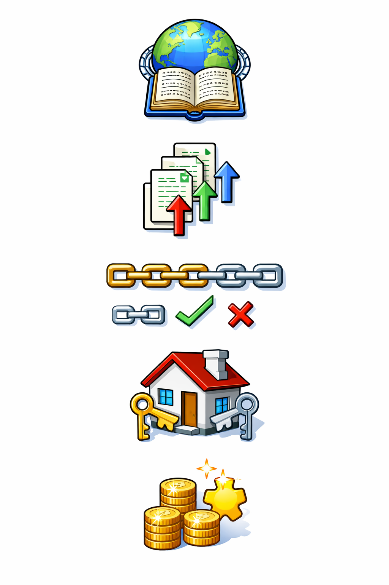
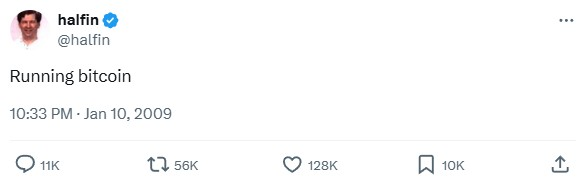

## And Now, Bitcoin

:::: {.columns}

::: {.column width="56%"}

<div style="font-size: 0.88em; line-height: 1.16;">

- So far, we have studied the **history that led to Bitcoin**, the **cryptographic primitives** it depends on, the **principles of distributed computing**, **consensus protocols**, and **how blockchains work** in permissioned systems.

- This section develops **Bitcoin** as a technical system: blocks, transactions, mining, networking, and security.

</div>

:::

::: {.column width="44%"}

{fig-align="center" width="92%"}

:::
::::
<div style="font-size: 0.88em; line-height: 1.16;">
**In this lesson, we assemble everything we have learned so far into a coherent picture of how Bitcoin works.**
</div>
::: {.notes}

**Overall Slide Concept**
This opening slide establishes Bitcoin as the synthesis point for the whole course so far, where prior work on history, cryptography, distributed systems, and consensus becomes one concrete system. It matters here because students need to shift from learning components in isolation to seeing how those parts cooperate inside Bitcoin. Emphasize that Bitcoin is a socio-technical design built from cryptography, networking, incentives, and coordination rather than just a digital asset.

**Key Points**
- This lesson assembles earlier course topics into one system-level picture of Bitcoin.
- Bitcoin should be framed as a socio-technical system, not merely a coin or app.
- The next Bitcoin lessons will zoom in on transactions, mining, networking, and security.

**Walkthrough**
None

**Sources**
- @nakamoto_bitcoinpeertopeerelectronic_2008
- @antonopoulos_masteringbitcoinprogramming_2017

:::


## The Emergence of Bitcoin

- In **2008**, trust in traditional financial intermediaries was collapsing, which sharpened interest in alternatives to bank-centered digital money.

- Earlier digital cash systems still depended on **trusted intermediaries** or assumptions that did not hold on the open internet.

- A successful internet-native cash system also needed **global access** and **censorship resistance**.

- **Double‑spending** digital money was the central technical problem without a shared ledger or trusted arbiter.


::: {.notes}

**Overall Slide Concept**
This slide establishes the problem environment that made Bitcoin compelling: collapsing trust in intermediaries, persistent double-spend risk, and the need for an internet-native cash system. It matters here because students need to see Bitcoin as a response to a specific technical and institutional gap rather than as an abstract invention. Emphasize that the core challenge is achieving shared agreement about ownership and ordering without a trusted central ledger.

**Key Points**
- Double-spending means the same digital unit can be copied and spent more than once unless the system agrees on one valid history.
- Bitcoin emerged when distrust of financial intermediaries made decentralized alternatives more attractive.
- A decentralized cash system must handle open participation, adversarial behavior, and global transaction ordering.

**Walkthrough**
None

**Sources**
- @nakamoto_bitcoinpeertopeerelectronic_2008
- @antonopoulos_masteringbitcoinprogramming_2017

:::

## Satoshi Nakamoto's Whitepaper

- On **October 31, 2008**, a paper titled **Bitcoin: A Peer-to-Peer Electronic Cash System**, authored by **Satoshi Nakamoto**, appeared on the **Cryptography Mailing List**.

- The paper entered a community already debating privacy, digital cash, and whether cryptography could replace trust in centralized institutions.

- It gained traction because it did more than criticize the old model: it offered a concrete technical design for decentralized digital cash.

::: {.callout-note appearance="simple"}
The real identity behind the pseudonym **Satoshi Nakamoto** remains unknown today.
:::

::: {.notes}

**Overall Slide Concept**
This slide establishes the whitepaper as the formal entry point of Bitcoin into an existing cryptography and digital cash conversation. It matters here because students should understand Bitcoin was introduced first as a technical proposal to a specialist community, not as a finished commercial product. Emphasize that the design had to earn attention through its architecture rather than through the authority of a known founder.

**Key Points**
- The Bitcoin whitepaper appeared on October 31, 2008, on the Cryptography Mailing List.
- Satoshi Nakamoto is a pseudonym, so the design itself had to carry the argument.
- The mailing-list context ties Bitcoin directly to earlier debates about privacy, trust, and digital cash.

**Walkthrough**
None

**Sources**
- @nakamoto_bitcoinpeertopeerelectronic_2008

:::

## Bitcoin: The Mission Statement {.smaller}

> **Abstract.** A [*purely peer-to-peer*]{style="color: red;"} version of electronic cash would allow online payments to be sent directly from one party to another [*without going through a financial institution*]{style="color: blue;"}... We propose a solution to the double-spending problem using a [*peer-to-peer network*]{style="color: red;"}.

> **Introduction.** What is needed is an electronic payment system based on [*cryptographic proof instead of trust*]{style="color: green;"}, allowing any two willing parties to transact directly with each other [*without the need for a trusted third party*]{style="color: blue;"}. Transactions that are [*computationally impractical to reverse*]{style="color: purple;"} would protect sellers from fraud....

**Every phrase here is a design requirement:** [*purely peer-to-peer*]{style="color: red;"}, [*no trusted third party*]{style="color: blue;"}, [*cryptographic proof instead of trust*]{style="color: green;"}, and [*computationally impractical to reverse*]{style="color: purple;"}.

<div style="margin-top: 0.6em; font-size: 1.02em;"><strong>Nakamoto Satoshi aimed to realize the cypherpunk vision: private, direct, censorship-resistant digital cash without trusted intermediaries.</strong></div>

::: {.notes}

**Overall Slide Concept**
This slide establishes the opening lines of the whitepaper as Bitcoin's design requirements in miniature. It matters here because the rest of the lesson can be read as showing how each highlighted phrase becomes a technical mechanism inside the system. Emphasize that peer-to-peer cash, cryptographic proof, no trusted third party, and practical irreversibility are requirements that drive later design choices.

**Key Points**
- The whitepaper frames Bitcoin as peer-to-peer cash without a financial intermediary.
- "Cryptographic proof instead of trust" means authority is shifted from institutions to protocol rules and verification.
- "Computationally impractical to reverse" points students toward proof-of-work, confirmations, and probabilistic finality.

**Walkthrough**
None

**Sources**
- @nakamoto_bitcoinpeertopeerelectronic_2008

:::

## Lessons from Precursors

::: {style="font-size: 0.60em; line-height: 1.08;"}
| Feature | DigiCash (Chaum)<br>**1980s–1990s** | Hashcash (Back)<br>**1997** | b-money / bit gold<br>**1998** | E-Gold<br>**Early 2000s** | <span style="color:#2e7d32;">Bitcoin (Nakamoto)<br>**2008–2009**</span> |
| :-- | :-- | :-- | :-- | :-- | :-- |
| **Trust Model** | Centralized issuer | No issuer; standalone PoW scheme | Decentralized (theory) | Centralized company |  |
| **Double-Spend Prevention** | Central ledger | No ledger | Proposed distributed accounting, but consensus unresolved | Central ledger |  |
| **Scarcity / Costliness** | Bank-issued digital cash | Computational work stamps | Work-based money concepts | Gold-backed balances |  |
| **Point of Failure** | Company and issuing bank | Not designed as a full payment network | Consensus and implementation never operationalized | Legal and operational shutdown |  |

<div style="font-size:1.28em; line-height:1.15;"><strong><em>Bitcoin did not appear from nowhere; it assembled earlier ideas into a system designed to overcome the failures those earlier projects exposed.</em></strong></div>
:::

::: {.notes}

**Overall Slide Concept**
This first precursor slide establishes the historical design space before Bitcoin by showing what earlier systems solved and what they still left unresolved. It matters here because students need a baseline before the repeated builds reveal Bitcoin's answers row by row. Emphasize that the empty Bitcoin column is the central question of the sequence.

**Key Points**
- DigiCash, Hashcash, b-money, bit gold, and E-Gold each contributed an important idea or lesson.
- No single precursor combined decentralization, double-spend resistance, scarcity, and operational resilience in one deployed system.
- The blank Bitcoin column invites students to watch how Bitcoin fills those gaps.

**Walkthrough**
1. Read the table from left to right to situate each precursor in time and design intent.
2. Point out the unresolved cells in the Bitcoin column to frame the remaining build slides.
3. Use the closing line to signal that Bitcoin's significance lies in synthesis, not in inventing every component from scratch.

**Sources**
- @back_hashcashdenialservice_2002
- @dai_bmoney_1998
- @szabo_bitgold_2008

:::

## Lessons from Precursors

::: {style="font-size: 0.60em; line-height: 1.08;"}
| Feature | DigiCash (Chaum)<br>**1980s–1990s** | Hashcash (Back)<br>**1997** | b-money / bit gold<br>**1998** | E-Gold<br>**Early 2000s** | <span style="color:#2e7d32;">Bitcoin (Nakamoto)<br>**2008–2009**</span> |
| :-- | :-- | :-- | :-- | :-- | :-- |
| **Trust Model** | Centralized issuer | No issuer; standalone PoW scheme | Decentralized (theory) | Centralized company | <span style="color:#2e7d32;"><strong>Decentralized in practice</strong></span> |
| **Double-Spend Prevention** | Central ledger | No ledger | Proposed distributed accounting, but consensus unresolved | Central ledger |  |
| **Scarcity / Costliness** | Bank-issued digital cash | Computational work stamps | Work-based money concepts | Gold-backed balances |  |
| **Point of Failure** | Company and issuing bank | Not designed as a full payment network | Consensus and implementation never operationalized | Legal and operational shutdown |  |

<div style="font-size:1.28em; line-height:1.15;"><strong><em>Bitcoin had to work without a central issuer or company as the system's root of trust.</em></strong></div>
:::

::: {.notes}

**Overall Slide Concept**
This build establishes the first specific lesson Bitcoin absorbed from its precursors: central issuers and operating companies become choke points. It matters here because the class starts to see Bitcoin's design as a response to concrete predecessor failures rather than as a generic decentralization slogan. Emphasize that removing the obvious operator is the first revealed answer in the sequence, not the whole solution.

**Key Points**
- Bitcoin's trust model differs from DigiCash and E-Gold because it does not depend on a company or issuer as the root of trust.
- A central administrator creates a legal, operational, and censorship choke point.
- This build reveals only the trust-model row, so students should still see other design questions as unresolved.

**Walkthrough**
None

**Sources**
- @nakamoto_bitcoinpeertopeerelectronic_2008
- @back_hashcashdenialservice_2002
- @u.s.departmentofjustice_egoldforfeited_2014

:::

## Lessons from Precursors

::: {style="font-size: 0.60em; line-height: 1.08;"}
| Feature | DigiCash (Chaum)<br>**1980s–1990s** | Hashcash (Back)<br>**1997** | b-money / bit gold<br>**1998** | E-Gold<br>**Early 2000s** | <span style="color:#2e7d32;">Bitcoin (Nakamoto)<br>**2008–2009**</span> |
| :-- | :-- | :-- | :-- | :-- | :-- |
| **Trust Model** | Centralized issuer | No issuer; standalone PoW scheme | Decentralized (theory) | Centralized company | <span style="color:#2e7d32;"><strong>Decentralized in practice</strong></span> |
| **Double-Spend Prevention** | Central ledger | No ledger | Proposed distributed accounting, but consensus unresolved | Central ledger | <span style="color:#2e7d32;"><strong>PoW consensus plus network verification</strong></span> |
| **Scarcity / Costliness** | Bank-issued digital cash | Computational work stamps | Work-based money concepts | Gold-backed balances |  |
| **Point of Failure** | Company and issuing bank | Not designed as a full payment network | Consensus and implementation never operationalized | Legal and operational shutdown |  |

<div style="font-size:1.28em; line-height:1.15;"><strong><em>Bitcoin needed open participants to agree on one valid transaction history.</em></strong></div>
:::

::: {.notes}

**Overall Slide Concept**
This build establishes the second design lesson from the precursor table: Bitcoin had to solve double-spending through network agreement, not just through cryptographic ownership proofs. It matters here because students are now moving from "who can spend" to "how the system agrees which spend counts." Emphasize that consensus over transaction history is the missing piece earlier systems did not operationalize on an open network.

**Key Points**
- Digital cash needs a shared decision about which competing spend is valid.
- Bitcoin's answer is network verification plus proof-of-work consensus rather than a central ledger.
- This build adds transaction ordering to the story without yet explaining the full proof-of-work mechanism.

**Walkthrough**
None

**Sources**
- @nakamoto_bitcoinpeertopeerelectronic_2008
- @dai_bmoney_1998
- @antonopoulos_masteringbitcoinprogramming_2017

:::

## Lessons from Precursors

::: {style="font-size: 0.60em; line-height: 1.08;"}
| Feature | DigiCash (Chaum)<br>**1980s–1990s** | Hashcash (Back)<br>**1997** | b-money / bit gold<br>**1998** | E-Gold<br>**Early 2000s** | <span style="color:#2e7d32;">Bitcoin (Nakamoto)<br>**2008–2009**</span> |
| :-- | :-- | :-- | :-- | :-- | :-- |
| **Trust Model** | Centralized issuer | No issuer; standalone PoW scheme | Decentralized (theory) | Centralized company | <span style="color:#2e7d32;"><strong>Decentralized in practice</strong></span> |
| **Double-Spend Prevention** | Central ledger | No ledger | Proposed distributed accounting, but consensus unresolved | Central ledger | <span style="color:#2e7d32;"><strong>PoW consensus plus network verification</strong></span> |
| **Scarcity / Costliness** | Bank-issued digital cash | Computational work stamps | Work-based money concepts | Gold-backed balances | <span style="color:#2e7d32;"><strong>PoW secures issuance and history</strong></span> |
| **Point of Failure** | Company and issuing bank | Not designed as a full payment network | Consensus and implementation never operationalized | Legal and operational shutdown |  |

<div style="font-size:1.28em; line-height:1.15;"><strong><em>Proof-of-work made issuance costly and abusive behavior expensive.</em></strong></div>
:::

::: {.notes}

**Overall Slide Concept**
This build establishes the third design lesson from the precursor sequence: scarcity and security in Bitcoin are tied to costly work. It matters here because students need to connect Hashcash-style proof-of-work ideas to both issuance and attack resistance. Emphasize that Bitcoin turns proof-of-work from an anti-spam idea into part of a monetary and security system.

**Key Points**
- Proof-of-work makes block production and history rewriting expensive.
- Bitcoin uses costly work both to regulate issuance and to defend the ledger.
- This reveals how scarcity and security reinforce each other inside the design.

**Walkthrough**
None

**Sources**
- @nakamoto_bitcoinpeertopeerelectronic_2008
- @back_hashcashdenialservice_2002
- @bitcoin.orgdevelopers_miningdeveloperguide_2024

:::

## Lessons from Precursors

::: {style="font-size: 0.60em; line-height: 1.08;"}
| Feature | DigiCash (Chaum)<br>**1980s–1990s** | Hashcash (Back)<br>**1997** | b-money / bit gold<br>**1998** | E-Gold<br>**Early 2000s** | <span style="color:#2e7d32;">Bitcoin (Nakamoto)<br>**2008–2009**</span> |
| :-- | :-- | :-- | :-- | :-- | :-- |
| **Trust Model** | Centralized issuer | No issuer; standalone PoW scheme | Decentralized (theory) | Centralized company | <span style="color:#2e7d32;"><strong>Decentralized in practice</strong></span> |
| **Double-Spend Prevention** | Central ledger | No ledger | Proposed distributed accounting, but consensus unresolved | Central ledger | <span style="color:#2e7d32;"><strong>PoW consensus plus network verification</strong></span> |
| **Scarcity / Costliness** | Bank-issued digital cash | Computational work stamps | Work-based money concepts | Gold-backed balances | <span style="color:#2e7d32;"><strong>PoW secures issuance and history</strong></span> |
| **Point of Failure** | Company and issuing bank | Not designed as a full payment network | Consensus and implementation never operationalized | Legal and operational shutdown | <span style="color:#2e7d32;"><strong>Majority attack economics (difficult)</strong></span> |
<div style="font-size:1.28em; line-height:1.15;"><strong><em>Bitcoin was designed to avoid a single operator that regulators or attackers could easily shut down.</em></strong></div>
:::

::: {.notes}

**Overall Slide Concept**
This build establishes the fourth design lesson from the precursor sequence: Bitcoin's architecture is meant to avoid a single operator that attackers or regulators can easily target. It matters here because students can now connect decentralization, consensus, and costly work to operational resilience. Emphasize that Bitcoin does not remove risk, but it does remove the simplest shutdown point that doomed earlier systems.

**Key Points**
- Centralized services often fail because a company, bank, or operator can be pressured or shut down.
- Bitcoin's design tries to replace that choke point with distributed participation and majority-work economics.
- This row completes the operational-resilience piece of the comparison before the final synthesis.

**Walkthrough**
None

**Sources**
- @l35_wired_emoney_1994
- @back_hashcashdenialservice_2002
- @dai_bmoney_1998
- @szabo_bitgold_2008
- @u.s.departmentofjustice_egoldforfeited_2014
- @nakamoto_bitcoinpeertopeerelectronic_2008

:::

## Lessons from Precursors

::: {style="font-size: 0.60em; line-height: 1.08;"}
| Feature | DigiCash (Chaum)<br>**1980s–1990s** | Hashcash (Back)<br>**1997** | b-money / bit gold<br>**1998** | E-Gold<br>**Early 2000s** | <span style="color:#2e7d32;">Bitcoin (Nakamoto)<br>**2008–2009**</span> |
| :-- | :-- | :-- | :-- | :-- | :-- |
| **Trust Model** | Centralized issuer | No issuer; standalone PoW scheme | Decentralized (theory) | Centralized company | <span style="color:#2e7d32;"><strong>Decentralized in practice</strong></span> |
| **Double-Spend Prevention** | Central ledger | No ledger | Proposed distributed accounting, but consensus unresolved | Central ledger | <span style="color:#2e7d32;"><strong>PoW consensus plus network verification</strong></span> |
| **Scarcity / Costliness** | Bank-issued digital cash | Computational work stamps | Work-based money concepts | Gold-backed balances | <span style="color:#2e7d32;"><strong>PoW secures issuance and history</strong></span> |
| **Point of Failure** | Company and issuing bank | Not designed as a full payment network | Consensus and implementation never operationalized | Legal and operational shutdown | <span style="color:#2e7d32;"><strong>Majority attack economics (difficult)</strong></span> |
<div style="font-size:1.28em; line-height:1.15; color:#2e7d32;"><strong><em>Bitcoin's breakthrough was combining all four into one operational system.</em></strong></div>
:::

::: {.notes}

**Overall Slide Concept**
This final precursor slide establishes Bitcoin's historical breakthrough as synthesis: it combined decentralization, double-spend resistance, costly issuance, and reduced chokepoints in one operational system. It matters here because the class now has a concise explanation for why Bitcoin mattered relative to earlier attempts. Emphasize that Bitcoin's importance lies less in inventing every component than in making those components work together.

**Key Points**
- Bitcoin assembled multiple earlier ideas into one functioning public system.
- Its historical significance comes from combining trust minimization, consensus, scarcity, and resilience.
- This synthesis prepares students for the next simplification slide and the deeper technical breakdown that follows.

**Walkthrough**
1. Revisit each completed row in the Bitcoin column as one lesson inherited from earlier systems.
2. Use the green synthesis line to summarize why those rows matter together.
3. Transition from historical comparison to the simpler mental model of how the system works end to end.

**Sources**
- @back_hashcashdenialservice_2002
- @dai_bmoney_1998
- @szabo_bitgold_2008
- @nakamoto_bitcoinpeertopeerelectronic_2008

:::

## Bitcoin, Simplified {.smaller}

:::: columns

::: column

- **Think of Bitcoin as a global append‑only ledger shared by peers.**
  
- **Anyone can propose the next page (block) by showing work; others verify and accept.**
  
- **The chain with the most cumulative work is the canonical history.**
  
- **Ownership of funds is control of private keys**
  
- **Incentives (block reward + fees) promote security and honest participation.**
:::

::: column

{fig-align="center" width="70%"}
:::
::::

<div style="margin-top: 0.5em; font-size: 1.02em;"><strong>Nakamoto's design rests on three core primitives for digital money: digital signatures, a public ledger, and proof-of-work.</strong></div>

::: {.notes}

**Overall Slide Concept**
This slide establishes the durable mental model students should carry through the rest of the Bitcoin unit: a shared ledger, open verification, proof-of-work block production, and incentive-driven participation. It matters here because the lesson has just finished the historical setup and now needs a simple systems picture before drilling into specific primitives. Emphasize that ownership, ordering, and incentives are all part of the same operational loop.

**Key Points**
- Bitcoin can be simplified as a shared append-only ledger maintained by peers rather than by a central administrator.
- Ownership means control of private keys, while confirmations come from blocks accepted onto the highest-work chain.
- Mempool, full-node verification, and miner incentives connect transaction flow to system security.

**Walkthrough**
1. Start with the shared-ledger image to explain blocks as new pages appended over time.
2. Show that miners compete to add the next page by proving work and that nodes independently verify the result.
3. Close by tying private-key control and incentives back to ownership and honest participation.

**Sources**
- @nakamoto_bitcoinpeertopeerelectronic_2008
- @antonopoulos_masteringbitcoinprogramming_2017

:::

## Primitive 1: Ownership via Digital Signatures {.smaller}

Nakamoto defines an electronic coin as a **"chain of digital signatures."**

* To transfer a coin, the current owner (say, Alice) uses her private key to digitally sign a hash of the previous transaction plus the public key of the next owner (Bob).
* This creates a new link in the chain of ownership.
* Anyone can verify this chain of signatures to confirm that Alice indeed had the right to spend that coin.

**The Limitation:** This mechanism proves *who* can spend a coin, but not whether that coin was already spent somewhere else.

<div style="margin-top:-8rem;">
```{dot}
digraph SignatureChain {
  rankdir=LR;
  bgcolor="transparent";
  graph [pad="0.1", nodesep="0.35", ranksep="0.45"];
  node [shape=box, style="rounded,filled", fillcolor="#f8fafc", color="#cbd5e1", fontname="Helvetica", fontsize=16, margin="0.14,0.08"];
  edge [color="#64748b", arrowsize=0.7, penwidth=1.1];

  C0 [label="Coin"];
  T1 [label="Tx1\nMint -> Alice\nSig: Mint"];
  T2 [label="Tx2\nAlice -> Bob\nSig: Alice"];
  T3 [label="Tx3\nBob -> Carol\nSig: Bob"];

  C0 -> T1 -> T2 -> T3;
}
```
</div>

::: {.notes}

**Overall Slide Concept**
This slide establishes the first of Bitcoin's three core primitives: ownership is represented as a verifiable chain of signatures rather than as an account entry controlled by a bank. It matters here because students need to separate the problem of proving control from the different problem of preventing double-spends. Emphasize that signatures answer who is authorized to spend, but not whether the same output has already been spent elsewhere.

**Key Points**
- A bitcoin transfer is validated through signatures that connect one transaction output to the next owner.
- Public-key cryptography lets anyone verify the chain of authorized transfers without knowing private keys.
- Digital signatures prove rightful control, but they do not by themselves solve double-spending.

**Walkthrough**
1. Start at the minted coin and follow the signature chain from one owner to the next.
2. Explain that each transfer references the previous transaction and signs value over to a new public key.
3. End by pointing out that the same signer could still try to create conflicting transfers unless the network agrees on one history.

**Sources**
- @nakamoto_bitcoinpeertopeerelectronic_2008
- @bitcoin.orgdevelopers_transactionsdeveloperguide_2024

:::

## Primitive 2: The Public Ledger via P2P Networking {.smaller}

To solve double-spending, the network needs a single, global history of all transactions. Nakamoto's solution is radical transparency:

:::: {.columns}

::: {.column}

* **Public Announcement:** All transactions are broadcast to all nodes on a peer-to-peer (P2P) network.
* **Blocks:** Nodes collect these transactions into a “block.”
* **The New Challenge:** The task shifts from verifying individual transactions to agreeing on the **order** of transactions. Without a central timekeeper, ordering is a hard problem.

:::

::: {.column}

```{dot}
digraph Networks {
    bgcolor="transparent";
    layout=neato;
    overlap=false;
    splines=true;
    rotate=0;

    node [shape=circle, style=filled, fillcolor="#e3e3c0", color="#4f89a9", penwidth=1.2, label="", width=0.4];
    edge [dir=none, color="#7a7a7a", penwidth=1.1];

    // Organic P2P mesh
    // Cluster A (Left)
    N1 -> N3; N1 -> N4; N1 -> N5;
    N2 -> N3; N2 -> N6; N2 -> N7;
    N3 -> N4; N3 -> N8;
    N4 -> N5; N4 -> N8;
    N5 -> N6; N5 -> N7;
    N6 -> N8; N7 -> N8;

    // Link A to B
    N4 -> N9; N5 -> N10; N8 -> N12;

    // Cluster B
    N9 -> N10; N9 -> N13;
    N10 -> N11; N10 -> N14; N10 -> N15;
    N11 -> N12; N11 -> N15; N11 -> N16;
    N12 -> N13; N12 -> N16;
    N13 -> N14; N13 -> N15;
    N14 -> N15; N14 -> N16;
    N15 -> N16;

    // Link B to C
    N13 -> N17; N14 -> N18; N16 -> N20;

    // Cluster C (Center)
    N17 -> N18; N17 -> N19;
    N18 -> N19; N18 -> N22;
    N19 -> N20; N19 -> N23; N19 -> N24;
    N20 -> N21; N20 -> N24;
    N21 -> N22; N21 -> N23;
    N22 -> N23; N22 -> N24;

    // Link C to D
    N21 -> N25; N22 -> N26; N24 -> N28;

    // Cluster D
    N25 -> N26; N25 -> N27;
    N26 -> N27; N26 -> N30;
    N27 -> N28; N27 -> N31; N27 -> N32;
    N28 -> N29; N28 -> N32;
    N29 -> N30; N29 -> N31;
    N30 -> N31; N30 -> N32;

    // Link D to E
    N29 -> N33; N30 -> N34; N32 -> N36;

    // Cluster E (Right)
    N33 -> N34; N33 -> N35; N33 -> N37;
    N34 -> N35; N34 -> N38;
    N35 -> N36; N35 -> N39; N35 -> N40;
    N36 -> N37; N36 -> N40;
    N37 -> N38;
    N38 -> N39; N38 -> N40;
    N39 -> N40;

    // Highlight senders and show possible propagation trees
    N19 [fillcolor="#2f80ed", color="#1f5fb8", width=0.46];
    N10 [fillcolor="#f2994a", color="#c56a16", width=0.46];
    N29 [fillcolor="#27ae60", color="#1e8449", width=0.46];

    edge [dir=forward, color="#2f80ed", penwidth=2.1, arrowsize=0.8];
    N19 -> N17;
    N19 -> N18;
    N19 -> N20;
    N19 -> N23;
    N19 -> N24;
    N17 -> N13;
    N18 -> N14;
    N20 -> N16;
    N20 -> N21;
    N24 -> N28;
    N13 -> N9;
    N14 -> N10;
    N21 -> N25;
    N28 -> N29;
    N29 -> N33;

    edge [dir=forward, color="#f2994a", penwidth=2.1, arrowsize=0.8];
    N10 -> N9;
    N10 -> N11;
    N10 -> N14;
    N10 -> N15;
    N11 -> N12;
    N14 -> N18;
    N15 -> N16;
    N16 -> N20;

    edge [dir=forward, color="#27ae60", penwidth=2.1, arrowsize=0.8];
    N29 -> N28;
    N29 -> N30;
    N29 -> N31;
    N29 -> N33;
    N28 -> N27;
    N30 -> N34;
    N31 -> N32;
    N33 -> N35;

    // Continuation hints on the perimeter
    node [shape=point, width=0, style=invis];
    edge [dir=none, style=dashed, color="#999999", penwidth=1.0];
    N1 -> ext1; N2 -> ext2; N3 -> ext3; N6 -> ext6; N7 -> ext7;
    N9 -> ext9; N12 -> ext12; N17 -> ext17; N20 -> ext20;
    N26 -> ext26; N31 -> ext31;
    N34 -> ext34; N37 -> ext37; N38 -> ext38; N39 -> ext39; N40 -> ext40;
}
```
:::
::::

::: {.notes}

**Overall Slide Concept**
This slide establishes the second primitive: Bitcoin solves private-ledger dependence by broadcasting transactions across a public peer-to-peer network. It matters here because once ownership is verifiable, the next challenge is getting distributed participants to agree on one shared history of those verified transactions. Emphasize that public propagation changes the problem from isolated verification to collective ordering.

**Key Points**
- Transactions are broadcast to peers instead of being submitted to a central authority.
- Nodes gather known transactions into candidate blocks, creating a shared public record.
- The hard problem is not signature checking alone but agreeing on transaction order without a universal clock.

**Walkthrough**
1. Show a transaction starting at one node and propagating outward through the mesh.
2. Explain that nodes collect visible transactions into blocks rather than into private account ledgers.
3. Close on the unresolved question of how the network chooses one ordering when conflicts appear.

**Sources**
- @nakamoto_bitcoinpeertopeerelectronic_2008
- @bitcoin.orgdevelopers_miningdeveloperguide_2024

:::

## Primitive 3: Consensus via Proof-of-Work {.smaller} 

Bitcoin orders blocks by making miners prove computational work before a new block is accepted.

:::: {.columns}

::: {.column}

1. **Build a Candidate Block:** A miner gathers pending transactions from the **mempool** and forms a candidate block.
2. **Search for a Valid Hash:** The miner changes the **nonce** until the block header hash falls below the difficulty target.
3. **Broadcast and Verify:** The first miner with a valid proof broadcasts the block; other nodes verify it and add it to the chain.

:::

::: {.column}

{fig-align="center"}

::: {.callout-note appearance="minimal"}
**Mempool:** every node keeps a local copy of the network's known pending transactions waiting to be included in a block.
:::

:::
::::

::: {.notes}

**Overall Slide Concept**
This slide establishes the third primitive: proof-of-work gives the network a practical way to order blocks without a central timekeeper. It matters here because the lesson is moving from the need for shared ordering to the actual mechanism Bitcoin uses to achieve it. Emphasize that solving the puzzle is costly, but verifying the solution is easy for everyone else.

**Key Points**
- Miners assemble candidate blocks from mempool transactions and search for a valid nonce.
- Proof-of-work makes proposing the next block expensive enough to resist easy manipulation.
- Other nodes can cheaply verify a winning block and extend the shared chain.

**Walkthrough**
1. Describe miners building a candidate block from pending transactions.
2. Explain the nonce search and target threshold as repeated hashing rather than clever shortcutting.
3. Show that once a valid block is found, peers verify and append it, creating shared order.

**Sources**
- @nakamoto_bitcoinpeertopeerelectronic_2008
- @bitcoin.orgdevelopers_miningdeveloperguide_2024

:::

## A Practical Solution to Byzantine Generals {.smaller}

Recall the Byzantine Generals Problem (BGP) as a classic thought experiment in distributed computing.

:::: {.columns}

::: {.column width="52%"}

* **The Problem:** How can distributed participants reach agreement if some members are malicious?
* **Bitcoin's Solution:** The longest Proof-of-Work chain becomes the agreed plan. It is trusted not because of who the participants are, but because creating that chain required tremendous computational effort.

:::

::: {.column width="48%"}

```{dot}
//| fig-width: 5
//| fig-height: 4
digraph G {
    layout=circo;
    overlap=false;
    splines=true;
    outputorder=edgesfirst;

    node [shape=circle, style=filled, fontname="Helvetica-Bold", width=0.4, fixedsize=true, fontsize=9, penwidth=1];
    edge [fontname="Helvetica", fontsize=7, penwidth=0.5, arrowsize=0.4];
    bgcolor="transparent";

    node [fillcolor="#c1e1c1", color="#77af77"];
    L1; L2; L3; L4;

    node [fillcolor="#f9d0c4", color="#e06666"];
    T1; T2; T3;

    edge [color="#77af77", fontcolor="#3b7a3b", style=solid];
    L1 -> {L2 L3 L4 T1 T2 T3} [label="A"];
    L2 -> {L1 L3 L4 T1 T2 T3} [label="A"];
    L3 -> {L1 L2 L4 T1 T2 T3} [label="A"];
    L4 -> {L1 L2 L3 T1 T2 T3} [label="A"];

    edge [color="#e06666", style=dashed];
    T1 -> {L1 L3 T2} [label="R", fontcolor="#a33333"];
    T1 -> {L2 L4 T3} [label="A", fontcolor="#a33333"];

    T2 -> {L2 L4 T1} [label="R", fontcolor="#a33333"];
    T2 -> {L1 L3 T3} [label="A", fontcolor="#a33333"];

    T3 -> {L1 L2 T2} [label="R", fontcolor="#a33333"];
    T3 -> {L3 L4 T1} [label="A", fontcolor="#a33333"];
}
```

:::
::::

::: {.notes}

**Overall Slide Concept**
This slide establishes how Bitcoin translates the abstract Byzantine Generals Problem into a practical coordination rule based on cumulative work. It matters here because students have already seen Byzantine agreement conceptually and now need to connect that theory to Bitcoin's longest-chain behavior. Emphasize that agreement is conditioned on assumptions about honest majority work, not on trusted participant identities.

**Key Points**
- Bitcoin treats the chain with the most accumulated proof-of-work as the agreed history.
- Trust is placed in observable work and verification rules rather than in named participants.
- This is a practical solution under Bitcoin's assumptions, not a guarantee against every attack.

**Walkthrough**
1. Revisit the Byzantine problem as disagreement under malicious or unreliable participation.
2. Map the diagram to Bitcoin's rule: follow the chain backed by the most work.
3. Reinforce that attackers must outproduce the honest network, not merely send conflicting messages.

**Sources**
- @nakamoto_bitcoinpeertopeerelectronic_2008
- @narayanan_bitcoincryptocurrencytechnologies_2016

:::

## How Double-Spending is Solved {.smaller}

If Bitcoin can solve the Byzantine Generals Problem in practice, it can solve double-spending by converging on one accepted transaction history:

* **The Chain:** Each block includes the hash of the previous block, forming a cryptographically linked chain. Changing an earlier block would break its link to all subsequent blocks.
* **The Longest Chain Rule:** By convention, all nodes treat the longest chain—the one with the most cumulative proof-of-work—as the valid history that everyone accepts.
* **The Cost of Attack:** To reverse a transaction, an attacker would have to redo the proof-of-work for that block *and* all blocks after it, then catch up and surpass the work of the honest network.

In practice, the probability of a successful attacker catching up diminishes exponentially with each new block added on top of the transaction.

::: {.notes}

**Overall Slide Concept**
This slide establishes the full double-spend defense by combining hashed block linkage, the highest-work chain rule, and the growing cost of catching up from behind. It matters here because students can now see how the earlier primitives cooperate to make conflicting transaction histories progressively harder to sustain. Emphasize that Bitcoin offers probabilistic security that grows with confirmations rather than instant absolute finality.

**Key Points**
- Each block commits to the previous one, so rewriting history requires rebuilding later work as well.
- Nodes converge on the chain with the most cumulative proof-of-work as the valid ledger.
- Additional confirmations raise the attacker's cost and reduce the chance of a successful reversal.

**Walkthrough**
1. Start with a confirmed transaction inside an earlier block.
2. Show how altering that block would force an attacker to recompute later blocks and catch up.
3. Use confirmations to explain why merchants wait for more blocks before treating a payment as settled.

**Sources**
- @nakamoto_bitcoinpeertopeerelectronic_2008
- @narayanan_bitcoincryptocurrencytechnologies_2016

:::

## Incentives: Making Honesty Profitable {.smaller}

Why would anyone expend electricity and computing power to do all this work?

1. **Block Reward:** The first transaction in each new block is the **coinbase transaction**, which creates new bitcoins and awards them to the miner who found the block. This is how new bitcoins enter circulation. **As time goes on, the reward is halved.**
2. **Transaction Fees:** Additionally, users can include small transaction fees in their payments. These fees are collected by the miner who adds that transaction to a block.

Together, these incentives make it more profitable for a rational actor to follow the protocol than to attack it. An attack would be extraordinarily expensive, and even if successful, would likely destroy the very value the attacker is trying to steal.

::: {.notes}

**Overall Slide Concept**
This slide establishes why rational participants might spend real resources to maintain Bitcoin's consensus process. It matters here because the technical mechanism only persists if miners have a reason to keep following the protocol instead of attacking it or exiting. Emphasize that Bitcoin ties rewards, fees, and asset value together so that honest participation is usually more profitable than disruption.

**Key Points**
- Miners earn block subsidies through the coinbase transaction and collect transaction fees.
- Rewards align miner behavior with protocol-following block production.
- A successful attack would be costly and could damage the value of the very asset the attacker is trying to exploit.

**Walkthrough**
None

**Sources**
- @nakamoto_bitcoinpeertopeerelectronic_2008
- @bitcoin.orgdevelopers_miningdeveloperguide_2024

:::


## Monetary Policy

::: {style="font-size: 0.84em; width: 88%; margin: 0 auto;"}

- Incentives provide security by rewarding miners for honest participation in block production.
  
- Bitcoin also enforces scarcity through a hard cap of about **21 million bitcoin**, limiting total issuance rather than allowing open-ended creation.
  
- New bitcoin enters through the **coinbase transaction**, which awards the block subsidy to the miner who adds a valid block.
  
- A **halving** cuts the block subsidy in half every **210,000 blocks**, or roughly every four years.
  
- Over time, miner compensation shifts away from newly issued bitcoin and toward **transaction fees**, tying long-run security more closely to demand for block space.

:::


::: {.notes}

**Overall Slide Concept**
This slide establishes Bitcoin's monetary policy as both a supply rule and a long-run security-funding mechanism. It matters here because students should see that issuance, halvings, and fees are not just economic trivia but part of how Bitcoin pays for block production over time. Emphasize the tension between preserving scarcity and sustaining miner incentives as subsidy declines.

**Key Points**
- Bitcoin introduces new coins through the coinbase transaction but caps total supply near 21 million BTC.
- The block subsidy halves every 210,000 blocks, roughly every four years.
- Over time, miner revenue shifts from mostly subsidy toward a larger role for transaction fees.

**Walkthrough**
None

**Sources**
- @nakamoto_bitcoinpeertopeerelectronic_2008
- @bitcoin.orgdevelopers_miningdeveloperguide_2024

:::

## Security Model & Threats


- Assumes majority of **honest work**; 51% attacker can rewrite recent history.
  
- **Selfish mining**, **eclipse attacks**, **network partitions** are notable risks.
  
- **Full nodes** mitigate many risks by enforcing validity and rejecting bad blocks.
  
- **Confirmations** reduce reorg risk; fee incentives align honest behavior.
  
- Security is **economic and probabilistic**, not absolute.


::: {.notes}

**Overall Slide Concept**
This slide establishes Bitcoin's security model as economic and probabilistic rather than absolute. It matters here because students need to understand both the honest-majority assumption and the concrete risks that remain even when validity rules are enforced by full nodes. Emphasize that confirmations, node verification, and incentive alignment reduce risk, but they do not eliminate adversarial pressure.

**Key Points**
- Bitcoin assumes most mining work follows the protocol; a majority attacker can threaten recent history.
- Full nodes still enforce validity rules, even against powerful miners.
- Reorgs, selfish mining, eclipse attacks, and partitions show that Bitcoin security is conditional and economic.

**Walkthrough**
None

**Sources**
- @nakamoto_bitcoinpeertopeerelectronic_2008
- @heilman_eclipseattacksbitcoins_2015
- @apostolaki_hijackingbitcoinrouting_2017

:::

## The Network Comes Alive: The First Blocks {.smaller}

* **January 3, 2009:** The **Genesis Block** (Block 0) is mined by Satoshi Nakamoto.
* **January 9, 2009:** Satoshi releases the first version of the Bitcoin software to the public.
* **January 12, 2009:** The **first Bitcoin transaction** occurs – Satoshi sends 10 BTC to Hal Finney, a respected cryptographer and early cypherpunk.

This first transaction was a critical proof-of-concept, demonstrating that the system described in the whitepaper actually worked in practice.

<center>

</center>
::: {.notes}

**Overall Slide Concept**
This slide establishes the transition from design to reality by showing how quickly Bitcoin moved from whitepaper to functioning network. It matters here because students should see the genesis block, software release, and Hal Finney transaction as proof that the architecture was operational, not merely theoretical. Emphasize that early participation by known cypherpunks helped validate the system as a working experiment.

**Key Points**
- The genesis block, first software release, and first transaction all occurred within days in January 2009.
- Hal Finney's participation matters because he was an early, credible technical peer.
- This is a proof-of-concept milestone, not yet a story about mass adoption or market value.

**Walkthrough**
None

**Sources**
- @nakamoto_bitcoinpeertopeerelectronic_2008
- @stoll_carbonfootprintbitcoin_2019
- @sykes_virtualcurrenciesmoney_2019

:::


## The 10,000 BTC Pizza {.smaller}

:::: {.columns}

::: {.column}

- On **May 22, 2010**, Laszlo Hanyecz offered **10,000 BTC** on Bitcointalk for two large pizzas.

- Another user arranged the order from a Papa John's in Florida and had the pizzas delivered to Hanyecz.

- Hanyecz then transferred **10,000 BTC**, marking the first documented Bitcoin purchase of a physical good.

- At the time, the transaction was worth about **$41** total.

- The event is now remembered as **Bitcoin Pizza Day**, a proof-of-concept that gave Bitcoin an early real-world price.

:::

::: {.column}

{fig-align="center"}


:::
::::

::: {.notes}

**Overall Slide Concept**
This slide establishes the moment Bitcoin moved from an internal network experiment to an observable medium of exchange. It matters here because the pizza purchase gave the system an early real-world price signal and demonstrated that people would trade physical goods for bitcoin. Emphasize proof-of-concept and emerging economic meaning, not the hindsight spectacle of the modern dollar equivalent.

**Key Points**
- The pizza purchase is the first famous example of bitcoin buying a physical good.
- It gave Bitcoin an early real-world exchange value rather than a purely notional one.
- The significance is grassroots economic experimentation, not retrospective wealth mythology.

**Walkthrough**
None

**Sources**
- @coinbase_whatbitcoinpizza_2025
- https://bitcointalk.org/index.php?topic=137.0

:::


## Skepticism {.smaller}

From its inception, Bitcoin was met with intense criticism on multiple fronts.

* **Economic Skepticism:** Critics have argued that Bitcoin’s extreme price volatility made it impractical as a currency. It is often labeled a speculative bubble or even a Ponzi scheme with no intrinsic value.
* **Technical Skepticism:** Many observe that Bitcoin is inefficient: it handles only a handful of transactions per second and consumes vast amounts of electricity for mining.
* **Social & Legal Skepticism:** Bitcoin’s pseudonymous nature and lack of regulatory oversight makes it attractive for illicit activities (e.g., the Silk Road online marketplace), raising concerns about crime and money laundering. Bitcoin has enabled ransomware. 

::: {.notes}

**Overall Slide Concept**
This slide establishes that Bitcoin's rise was contested from the beginning across economic, technical, and legal dimensions. It matters here because students should not read Bitcoin's later visibility as evidence that its value and viability were ever uncontested. Emphasize that many criticisms track genuine trade-offs built into the design rather than mere misunderstanding.

**Key Points**
- Critics questioned Bitcoin's volatility, intrinsic value, and suitability as money.
- Technical concerns included throughput limits and proof-of-work energy use.
- Legal and social skepticism focused on pseudonymity, illicit use, and regulatory anxiety.

**Walkthrough**
None

**Sources**
- @nakamoto_bitcoinpeertopeerelectronic_2008

:::


## Benefits of Bitcoin’s Design


- **Decentralization:** no single point of control/failure; open participation.
  
- **Censorship resistance:** hard to block valid transactions; permissionless access.
  
- **Verifiability:** anyone can run a node and independently check rules/history.
  
- **Predictable monetary policy:** transparent issuance; 21M cap.
  
- **Robustness:** resilient to outages/attacks; conservative governance and upgrades.


::: {.notes}

**Overall Slide Concept**
This slide establishes the design strengths that continue to make Bitcoin attractive to many users and analysts despite its costs. It matters here because the class has just reviewed skepticism and now needs a balanced summary of what Bitcoin's architecture is actually optimized to provide. Emphasize that decentralization, censorship resistance, verifiability, and monetary predictability are advantages under Bitcoin's assumptions, not absolute guarantees.

**Key Points**
- Open participation and lack of a single controller support decentralization and censorship resistance.
- Full nodes enable independent verification instead of blind trust in service providers.
- A transparent issuance schedule and conservative governance contribute to predictability and robustness.

**Walkthrough**
None

**Sources**
- @nakamoto_bitcoinpeertopeerelectronic_2008
- @antonopoulos_masteringbitcoinprogramming_2017

:::

## Limitations and Trade‑Offs


- **Scalability:** mining difficulty and limited block size restrict throughput, while multiple **confirmations** add latency before a block is treated as secure.
  
- **Energy use:** PoW consumes substantial electricity; debated but integral to security model.
  
- **UX & key management:** self‑custody is powerful but difficult for many users.
  
- **Privacy:** transparent ledger yields **pseudonymity**, not strong anonymity.
  
- **Protocol governance friction:** new features can have slow adoption.


::: {.notes}

**Overall Slide Concept**
This slide establishes that Bitcoin's strengths are inseparable from its trade-offs. It matters here because students should leave the lesson understanding that decentralization and verifiability are purchased with costs in throughput, energy use, user burden, privacy, and upgrade speed. Emphasize that these are coherent design compromises, not accidental flaws detached from the system's goals.

**Key Points**
- Scalability and confirmation latency reflect conservative block production and security priorities.
- Proof-of-work energy use and self-custody demands are real costs of the system's design.
- Public transparency and cautious governance limit privacy and speed of protocol change.

**Walkthrough**
None

**Sources**
- @nakamoto_bitcoinpeertopeerelectronic_2008
- @antonopoulos_masteringbitcoinprogramming_2017
- @stoll_carbonfootprintbitcoin_2019

:::


## Bitcoin as a System

- Bitcoin combines **three primitives** into one working system: **digital signatures** for ownership, a **public ledger** shared across nodes, and **proof-of-work** for consensus.

- Together, these primitives let the network verify transactions, agree on their order, and resist **double-spending** without a central intermediary.

- What makes Bitcoin important is not any one part alone, but the way these pieces reinforce one another through incentives, verification, and network participation.

**Next lesson, we focus on Bitcoin's two core actions: transactions and mining**.


::: {.notes}

**Overall Slide Concept**
This closing slide establishes Bitcoin as an integrated system whose core pieces only make sense when viewed together. It matters here because the lesson is ending and students need a final systems-level synthesis before the next lesson zooms into transactions and mining. Emphasize that signatures, the public ledger, proof-of-work, and incentives mutually reinforce one another to make decentralized digital cash viable.

**Key Points**
- Digital signatures establish who can spend, the public ledger shares state, and proof-of-work orders history.
- Incentives and node verification bind those primitives into one functioning system.
- The next lesson narrows from the whole architecture to Bitcoin's two central operational actions: transactions and mining.

**Walkthrough**
None

**Sources**
- @nakamoto_bitcoinpeertopeerelectronic_2008
- @antonopoulos_masteringbitcoinprogramming_2017

:::


## References
