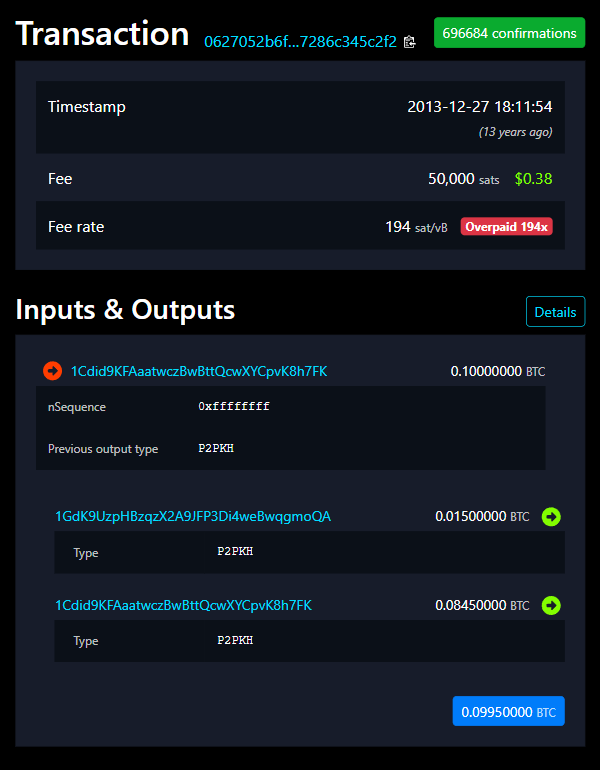

## A trace is read one transaction at a time {.smaller}

:::: {.columns}
::: {.column width="52%"}
::: {style="font-size: .76em;"}

**Day 1 left off** with Alice's 0.015 BTC coffee payment in block 277,316. You read its inputs, outputs, change and fee [@antonopoulos_masteringbitcoinprogramming_2017]. A trace follows money hop by hop, and every hop is one transaction like it.

**This lesson reads one transaction completely**, in four parts:

1. **Scripts and types:** who could spend, and what wallet made it.
2. **Time, fee, replace:** when it happened, and what it cost.
3. **Blocks and proofs:** where coins start, and how a block holds a payment.
4. **Read it whole:** every field, and two clues about owners.

**By the end:** given any Bitcoin transaction, record the six fields and say how sure you are which output is change.

**The point to earn:** the explorer shows the fields; when it was sent and which output is change are your reading, with a confidence [@meiklejohn_fistfulbitcoinscharacterizing_2013].

:::
:::
::: {.column width="48%"}
::: {style="font-size: .8em;"}

| For every hop, record | Part |
| --- | --- |
| 1. Inputs: script types, and which are spent together | Scripts; Read it whole |
| 2. Outputs: amounts and script types | Scripts |
| 3. Change: which output, and how sure | Read it whole |
| 4. Fee rate and replace-by-fee signal | Time, fee, replace |
| 5. Block height and block time | Time, fee, replace |
| 6. Origin: an earlier payment, or a coinbase | Blocks and proofs |

: {tbl-colwidths="[64,36]"}

Today's wallet lab, and day 6's ransom trace, record the same six at every hop.

:::
:::
::::

::: {.notes}

**Overall Slide Concept**
This slide opens day 2 by linking back to Alice's payment from day 1 and naming the six fields every transaction read records. It matters here because today's wallet lab reads the wallet's own transactions in the explorer, and day 6's ransom trace records the same six fields at every hop; an analyst who skips one misses where the money went or when. Emphasize the point to earn: the explorer prints the fields, but the time a payment was sent and which output is change are the analyst's reading, each with a confidence.

**Key Points**
- Start from the case students know. Alice paid Bob's Cafe 0.015 BTC for a coffee; on day 1 the first lesson read its inputs, outputs, change and fee, the keys lesson its signature, and the consensus lesson its confirmations.
- So students already know what a transaction is. This lesson reads one completely, because a trace is a chain of transactions and each hop is read the same way.
- Read the four parts as the route. Part 1 says what locks each output and what the lock's type says about the wallet; part 2 says when a transaction happened and what it paid; part 3 says where new coins start and how a block commits to its transactions; part 4 reads Alice's payment whole and adds the two clues about owners that day 6 builds on.
- The six fields, in the table, are what students record for every hop. Each part fills one or more rows.
- The objective is a skill used this afternoon: record the six fields for any transaction, and say how sure you are of the change.
- The point to earn: an explorer shows the inputs, outputs and fee, but it does not say when a payment was sent or which output is change. Those are the analyst's reading, and each carries a confidence word.
- Day 6 turns the clues into tracing method; today only reads.

**Walkthrough**
1. Read the link back: Alice's payment, and what day 1 read from it.
2. Read the four parts.
3. Walk the six fields in the table, and point to the part that teaches each.
4. Read the objective and the point to earn.
5. Time plan, 50 minutes: opening 2; part 1 (scripts and types) with its check 10; part 2 (time, fee, replace) with its worked fee rate and check 12; part 3 (blocks and proofs) 7; part 4 (Alice's payment and the two clues) 11; practice, answers, review and next 8.

**Sources**
- @antonopoulos_masteringbitcoinprogramming_2017
- @meiklejohn_fistfulbitcoinscharacterizing_2013

:::

## Every output is locked by a small script {.smaller}

:::: {.columns}
::: {.column width="55%"}
::: {style="font-size: .9em;"}
**Bottom line:** an output holds an amount and a locking script. Whoever spends it must supply data that makes the script succeed, and every node checks [@bitcoin.orgdevelopers_transactionsdeveloperguide_2024].

- **Locking script** (`scriptPubKey`): sits on the output and states the condition.
- **Unlocking data** (`scriptSig`): supplied by the input that spends it.
- **SegWit** (segregated witness): newer types move the signature and key out of the input into a separate part of the transaction, the **witness** [@lombrozo_bip141segregatedwitness_2015].
- Nodes run lock and unlock together; if the result is true, the spend is valid [@bitcoin.orgdevelopers_contractsbitcoindeveloper_2024].
- Script has no loops, so every script finishes [@antonopoulos_masteringbitcoin3e_2023, ch. 7].
- You never run a script. You read its **type**, because the type shows what kind of wallet made it.
:::
:::
::: {.column width="45%"}
Pay-to-public-key-hash (P2PKH), the type in Alice's payment [@antonopoulos_masteringbitcoin3e_2023, ch. 7; @antonopoulos_masteringbitcoinprogramming_2017]:

```text
Lock (on the output):
OP_DUP OP_HASH160 <pubKeyHash>
OP_EQUALVERIFY OP_CHECKSIG

Unlock (in the input):
<signature> <pubKey>
```

1. The public key must hash to `<pubKeyHash>`.
2. The signature must verify with that key.
:::
::::

::: {.notes}

**Overall Slide Concept**
This slide teaches the two halves of every Bitcoin spend: the locking script on the output and the unlocking data in the input, and where SegWit moves that data. It matters here because script type is one of the six fields an analyst records for each hop, and it means something only once students know what a script does. Emphasize reading, not programming: students identify the type; they never write or run a script.

**Key Points**
- Every output carries a locking script, the scriptPubKey, which states the condition for spending it.
- The input that spends it supplies the unlocking data: in older types the scriptSig, and in SegWit types the witness. SegWit, short for segregated witness, moves the signature and key out of the input into that separate witness section; the fee slides later in this part show why that matters to the analyst.
- Every node runs the two together, and only a true result makes the spend valid. So no one can spend an output without the data its lock asks for.
- Script is deliberately simple: it has no loops, so every script finishes.
- In P2PKH, the type in Alice's payment, the spender reveals a public key that hashes to the locked hash, and a signature valid for that key.
- Students read the type, which an explorer prints, because it tells them what kind of wallet made the output; the next slide is that table.

**Walkthrough**
1. Point to the lock: duplicate the key, hash it, compare with the stored hash, check the signature.
2. Point to the unlock: the signature and the public key.
3. Ask: what does the spender reveal that the output did not? (The public key, as the keys lesson on day 1 showed: the address holds only its hash.)

**Sources**
- @bitcoin.orgdevelopers_transactionsdeveloperguide_2024
- @bitcoin.orgdevelopers_contractsbitcoindeveloper_2024
- @lombrozo_bip141segregatedwitness_2015
- @antonopoulos_masteringbitcoin3e_2023 [ch. 7]
- @antonopoulos_masteringbitcoinprogramming_2017

:::

## Script type and prefix say what wallet paid {.smaller}

[]{#script-type-says-what-kind-of-wallet-paid}**Bottom line:** read an address's first characters and you know its script type, which the wallet picked. The inputs and the change show the payer's wallet; the payment shows the payee's [@frowis_safeguardingevidentialvalue_2020].

::: {style="font-size: .85em;"}

| Starts with | Type | Locks to | What it tells you |
| --- | --- | --- | --- |
| `1` | P2PKH | A key hash | Older single-key wallet [@antonopoulos_masteringbitcoin3e_2023, ch. 4] |
| `3` | P2SH | A script hash; script shown on spend | Often multisig (several keys must sign); can wrap SegWit [@andresen_bip16paytoscript_2012; @lombrozo_bip141segregatedwitness_2015] |
| `bc1q`, 42 chars | P2WPKH | A 20-byte key hash | Modern single-key wallet [@lombrozo_bip141segregatedwitness_2015; @wuille_bip173base32address_2017] |
| `bc1q`, 62 chars | P2WSH | A 32-byte script hash | Modern multisig or contract [@lombrozo_bip141segregatedwitness_2015; @wuille_bip173base32address_2017] |
| `bc1p` | P2TR | The public key itself, shown before any spend | **Taproot** wallet; signs with Schnorr signatures, a newer scheme than the others' ECDSA; a key-path spend shows one key [@wuille_bip341taprootsegwit_2020; @antonopoulos_masteringbitcoin3e_2023, ch. 8] |
| None | `OP_RETURN` | Data; never spendable | A marker, not a payment [@bitcoin.orgdevelopers_transactionsdeveloperguide_2024] |

: {tbl-colwidths="[15,12,30,43]"}

`1` and `3` addresses are Base58Check; `bc1q` is Bech32 and `bc1p` Bech32m, each with a checksum that catches typing errors [@antonopoulos_masteringbitcoin3e_2023, ch. 4; @wuille_bip173base32address_2017; @wuille_bip350bech32mformat_2020].

:::

::: {.notes}

**Overall Slide Concept**
This slide teaches how to read an address's prefix, and what each script type tells an analyst about the wallet behind it. It matters here because script type is recorded at every hop, and a payment whose outputs differ in type gives day 6 one of its change clues. Emphasize that P2SH (`3...`) is not SegWit by itself: it is a script hash, often multisig, and can carry wrapped SegWit; native SegWit is `bc1q` and Taproot is `bc1p`.

**Key Points**
- The wallet that makes an address picks its type, so the type describes the wallet. The payee's wallet made the payment address, so the payment's type describes the payee; the inputs and the change describe the payer.
- Read the prefix first. A `1` address is P2PKH and locks to a public-key hash.
- A `3` address is P2SH. It locks to the hash of a script that appears only when the output is spent. Its most common use is multisig, where several keys must sign (the next slide), and BIP 141 defines SegWit nested inside it.
- A `bc1q` address is native SegWit version 0. P2WPKH and P2WSH are told apart by length: a 20-byte program makes a 42-character address, a 32-byte one a 62-character address.
- A `bc1p` address is Taproot, SegWit version 1. Unlike the hashed types, it carries the public key itself, so the key is on chain before any spend; Taproot spends sign with Schnorr signatures (BIP 340), a different signature scheme from the older types' ECDSA.
- `OP_RETURN` outputs carry data and can never be spent. Their size is node policy, not a consensus rule: Bitcoin Core relayed and mined at most 83 bytes by default from 0.12.0 (Feb 2016), and 30.0 (Oct 2025) raised the default to 100,000 bytes, "which effectively uncaps the limit", and allows several `OP_RETURN` outputs in one transaction [24 Oct 2026]{.asof}.
- The encoding follows the prefix: Base58Check for `1` and `3`, Bech32 for `bc1q`, Bech32m for `bc1p`. Each carries a checksum, so a mistyped address is rejected rather than paid. How a key becomes an address is the wallet types lesson's subject.

**Walkthrough**
1. Read the first column: the characters an address starts with.
2. Read the second: the type an explorer or bitcoin-cli prints.
3. Read the last: what to write in the trace for each.
4. Ask: Alice's payment pays two `1...` addresses. What kind of wallet? (An older single-key wallet, P2PKH, on both sides.)

**Sources**
- @antonopoulos_masteringbitcoin3e_2023 [chs. 4, 7, 8]
- @andresen_bip16paytoscript_2012
- @lombrozo_bip141segregatedwitness_2015
- @wuille_bip173base32address_2017
- @wuille_bip341taprootsegwit_2020
- @wuille_bip350bech32mformat_2020
- @bitcoin.orgdevelopers_transactionsdeveloperguide_2024
- @bitcoincore_bitcoincore0120_2016
- @bitcoincore_bitcoincore30_2025
- @frowis_safeguardingevidentialvalue_2020

:::

## P2SH and Taproot reveal the rule only on spend {.smaller}

:::: {.columns}
::: {.column width="58%"}
**Bottom line:** a `3...` output shows its spending rule only when spent; a `bc1p...` output often not even then. Report what the chain shows.

- **Multisig** (multi-signature): an output that needs m of n keys to sign, such as 2 of 3 [@bitcoin.orgdevelopers_transactionsdeveloperguide_2024]. The multisig lesson later today reads one.
- P2SH stores only a script hash. The spender reveals the script, such as a 2-of-3 multisig [@andresen_bip16paytoscript_2012].
- Taproot can spend by its one key alone, a **key-path spend**, which "prevents observers from learning the spending conditions of a coin"; keys held by several people look like a single key [@wuille_bip341taprootsegwit_2020].
- Write "a 2-of-3 multisig", not "the company's cold wallet", unless other evidence names it.
:::
::: {.column width="42%"}
```{dot}
//| fig-width: 4.5
//| fig-height: 4.5
//| fig-alt: "Two paths: an unspent 3... output's rule is unknown until it is spent, when the script shows 2 of 3 keys signed; an unspent bc1p... output's rule is unknown, and a key-path spend still looks like one key."
digraph Reveal {
  rankdir=TB;
  bgcolor="transparent";
  node [shape=box, style="rounded,filled", fillcolor="#f8fafc", color="#cbd5e1", fontname="Helvetica", fontsize=13];
  edge [color="#64748b", arrowsize=0.7, fontname="Helvetica", fontsize=11];

  U [label="Unspent 3...\nrule unknown", fillcolor="#fef3c7", color="#f59e0b"];
  S [label="Spent: script shown\n2 of 3 keys signed", fillcolor="#dcfce7", color="#22c55e"];
  P [label="Unspent bc1p...\nrule unknown", fillcolor="#fef3c7", color="#f59e0b"];
  T [label="Key-path spend:\nlooks like one key", fillcolor="#fee2e2", color="#f87171"];

  U -> S [label=" spent"];
  P -> T [label=" spent"];
}
```
:::
::::

::: {.notes}

**Overall Slide Concept**
This slide shows that some script types hide their spending rule until the output is spent, and Taproot often hides it even then. It matters here because analysts are tempted to describe an unspent `3...` output as multisig, or to guess how many people control a Taproot output, and an agent will repeat what the assessment says. Emphasize describing only what the chain shows.

**Key Points**
- First the word: multisig, short for multi-signature, is an output that needs m of n keys to sign, such as any 2 of 3. The multisig lesson later today reads a real one; here students need only the idea.
- A P2SH output stores only the hash of its script. So until the output is spent, no one outside the wallet knows the rule; when it is spent, the input reveals the script, for example 2 of 3 keys.
- Taproot goes further. A key-path spend signs with the one key and shows no script at all, and several people's keys can be combined to look like one key. So even a spent Taproot output may say nothing about how many people control it.
- That is why the trace records what the chain shows: "a 2-of-3 multisig", once revealed. Attribution, such as "cold wallet" or "exchange", needs separate evidence.

**Walkthrough**
1. An unspent `3...` output: the rule is unknown.
2. Once spent, the input reveals the script, for example 2 of 3 keys.
3. A Taproot key-path spend looks like a single key, whatever stands behind it.

**Sources**
- @andresen_bip16paytoscript_2012
- @bitcoin.orgdevelopers_transactionsdeveloperguide_2024
- @wuille_bip341taprootsegwit_2020

:::

## Check: an unspent 3… address. Is it multisig? {.smaller}

::: {style="font-size: .85em;"}

A case note reads: "The suspect's funds sit in `3J98t1Wp…`, a multisig wallet." The output has never been spent.

**Write one line:** what can you say about that output's spending rule?

::: {.fragment}
**Answer:** not that it is multisig. A `3...` address is P2SH: it locks to a script's hash, and the script appears only when the output is spent [@andresen_bip16paytoscript_2012]. Write "a P2SH output; its spending rule is not yet revealed". Once spent, read the script; for a `bc1p...` output, even a spend may show only one key [@wuille_bip341taprootsegwit_2020].

**Part 1 in one line:** the prefix gives the script type, and the type describes the wallet, but only what the chain has revealed goes in the assessment.
:::

:::

::: {.notes}

**Overall Slide Concept**
This slide closes part 1 with a check on the most common overstatement about script types: calling an unspent `3...` address multisig. It matters here because case notes arrive with that word already in them, and the analyst's line is what an agent repeats. Emphasize that the answer is what the chain shows, not what is common.

**Key Points**
- Expected answer: you cannot say it is multisig. A `3...` address is P2SH, which stores only the hash of its script; the script, and so the rule, appears only when the output is spent.
- Multisig is the most common use of P2SH, which is why the guess is tempting, but P2SH can also wrap a single-key SegWit wallet.
- The line to write: "a P2SH output; its spending rule is not yet revealed". Once it is spent, the input shows the script.
- For a Taproot output, even a spend may show only one key.
- The part's synthesis, on the slide: prefix gives type, type describes the wallet, and only what is revealed is reported.

**Walkthrough**
1. Read the case note.
2. Give every student thirty seconds to write one line.
3. Take two or three answers, then reveal.
4. Read the part 1 synthesis.

**Sources**
- @andresen_bip16paytoscript_2012
- @wuille_bip341taprootsegwit_2020

:::

## A transaction has no timestamp of its own {.smaller}

:::: {.columns}
::: {.column width="55%"}
::: {style="font-size: .92em;"}
**The wrong idea:** the time an explorer prints beside a transaction is when it was sent.

**The case that breaks it:** in the five-minute lab's made-up chain, block 800,002 is stamped 10:03 and block 800,001 is stamped 10:05, yet 800,002 names 800,001 as the block before it. The rules "do not mandate strict ordering of block timestamps" [@kerin_bip113mediantimepast_2015].

**The right model:** the printed time is the block's, which its miner wrote. Order comes from block height, not block time.

- A transaction's **locktime** sets the earliest point it may be mined: below 500 million it is a block height, otherwise a Unix time [@bitcoin.orgdevelopers_transactionsdeveloperguide_2024].
- Alice's payment: locktime 0; block 277,316's time is 27 Dec 2013, 23:11:54 UTC [@antonopoulos_masteringbitcoinprogramming_2017].

[Try it: What time was it sent? (five-minute lab)](/assets/labs/what-time-was-it-sent/index.html)
:::
:::
::: {.column width="45%"}
| Don't write | Write |
| --- | --- |
| "Sent at 23:11 UTC" | "Mined in block 277,316; block time 23:11:54 UTC" |
| "The time on the transaction" | "The miner's stated block time" |
| "Paid before block 277,316" | "Confirmed in block 277,316" |
:::
::::

::: {.notes}

**Overall Slide Concept**
This slide corrects a common error in reports: treating the explorer's time as the moment a transaction was sent. It matters here because an assessment states times, and agents and prosecutors read them as exact. Emphasize the order of the slide: the wrong idea, the case that breaks it, then the right model, that the transaction carries no time and the block's time is its miner's claim.

**Key Points**
- Start with the belief most students hold: the time beside a transaction is when someone sent it.
- Then the case that breaks it. In the lab's made-up chain, block 800,002 says 10:03 and block 800,001 says 10:05, yet 800,002 names 800,001 as the block before it, so it was recorded later. That is allowed, because miners set block timestamps and the rules do not require each to be later than the last.
- So the right model: a Bitcoin transaction has no timestamp field. The time an explorer shows is the block's, which the miner wrote, and the order of events comes from block height.
- Locktime is the only time-related field in a transaction, and it is a lower bound on when the transaction may be mined: a height if below 500 million, a Unix time otherwise.
- Wallets use locktime as a fingerprint too. Since 0.11.0 (2015) Bitcoin Core's wallet sets locktime near the current height ("anti-fee-sniping"), and one time in ten a further 0 to 99 blocks back; today it uses the current height, or 0 when the wallet's copy of the chain lags [24 Oct 2026]{.asof}. A wallet stuck at one height once gave all its transactions the same locktime, which "makes it easier for passive observers to cluster transactions by wallet". That clue points to wallet software, not a person: Low on its own.
- Alice's payment: locktime 0; block 277,316's time is 1388185914, which is 27 Dec 2013 23:11:54 UTC.
- Optional, five minutes: the What time was it sent? lab (link on the slide). Students predict what the explorer's 09:09 means for a payment sent at 09:02, watch a low-fee payment wait while a slow-clocked miner stamps it, meet the word block time, and see the 800,001 and 800,002 case for themselves. The lab's heights and payments are made up.

**Walkthrough**
1. Ask the room: what does the time beside a transaction mean? Take one or two answers.
2. Read the case that breaks it, and ask which block came first. (800,001: 800,002 names it as the block before.)
3. Read the right model.
4. Walk the table: each wrong phrase and its fix.

**Sources**
- @kerin_bip113mediantimepast_2015
- @bitcoin.orgdevelopers_transactionsdeveloperguide_2024
- @todd_discouragefeesniping_2014
- @falke_avoidleakingnlocktime_2019
- @antonopoulos_masteringbitcoinprogramming_2017

:::

## Fees are priced per virtual byte, not per BTC {.smaller}

:::: {.columns}
::: {.column width="55%"}
<div style="font-size: .9em;">

**The wrong idea:** a big fee means a big payment. **It breaks on** Alice's 50,000-sat fee for 0.015 BTC: 1 BTC in the same 258 bytes would pay the same. **The right model:** miners rank waiting transactions by fee rate, in satoshis per virtual byte (sat/vB).

- Miners prioritize transactions "based on their fee per byte" [@bitcoin.orgdevelopers_transactionsdeveloperguide_2024].
- Weight = base size (no witness) × 3 + total size; virtual size = weight ÷ 4; a block holds 4,000,000 weight at most [@lombrozo_bip141segregatedwitness_2015].
- So witness bytes count a quarter as much as the rest. The next slide shows it on a SegWit payment.
- The wallet chooses the fee rate. A repeated, unusual fee rate is behavior: on its own, **Low** confidence.

</div>
:::
::: {.column width="45%"}
Alice's payment [@antonopoulos_masteringbitcoinprogramming_2017]:

| | |
| --- | --- |
| Size | 258 bytes, no witness |
| Weight | 258 × 3 + 258 = 1,032 |
| Virtual size | 1,032 ÷ 4 = 258 vB |
| Fee | 0.0005 BTC = 50,000 sat |
| Fee rate | 50,000 ÷ 258 ≈ 194 sat/vB |
:::
::::

::: {.notes}

**Overall Slide Concept**
This slide moves from day 1's fee (inputs minus outputs) to the fee rate that miners and wallets actually use. It matters here because the trace records fee rate as wallet behavior, and students must not read a large fee as a large payment. Emphasize the formula once with Alice's legacy payment, where virtual size equals size because there is no witness.

**Key Points**
- Day 1 worked the fee as inputs minus outputs. Miners, though, have limited block space, so they compare transactions by fee rate: the fee divided by the transaction's virtual size, in satoshis per virtual byte. One satoshi is 0.00000001 BTC.
- Virtual size comes from weight. BIP 141 counts each byte outside the witness four times and each witness byte once; virtual size is weight divided by four.
- Base size is the transaction without its witness; total size includes it. Alice's legacy payment has no witness, so its weight is 258 × 4 and its virtual size equals its 258 bytes.
- So Alice's 50,000 sat fee is about 194 sat/vB. The fee says nothing about the 0.015 BTC she sent: a 1 BTC payment of the same size would cost the same.
- The wallet picks the fee rate, so a repeated, unusual rate is wallet behavior: Low on the course scale on its own.

**Walkthrough**
1. Size: 258 bytes, all outside a witness.
2. Weight: 258 × 3 + 258 = 1,032; virtual size 258 vB.
3. Fee rate: 50,000 sat ÷ 258 vB ≈ 194 sat/vB.

**Sources**
- @bitcoin.orgdevelopers_transactionsdeveloperguide_2024
- @lombrozo_bip141segregatedwitness_2015
- @antonopoulos_masteringbitcoinprogramming_2017

:::

## Worked: a SegWit fee rate, discount included {.smaller}

:::: {.columns}
::: {.column width="50%"}
**The SegWit payment:** transaction `ac4e20f7…c262`, block 887,986, with two P2WPKH (`bc1q`) inputs [@mempoolspace_transactionac4e20f7_2025].

| Step | Working |
| --- | --- |
| Total size | 382 bytes |
| Weight | 880 |
| Base size | (880 − 382) ÷ 3 = 166 bytes |
| Witness | 382 − 166 = 216 bytes |
| Virtual size | 880 ÷ 4 = 220 vB |
| Fee | 15,112,262 in − 15,111,822 out = 440 sat |
| Fee rate | 440 ÷ 220 = **2 sat/vB** |

: {tbl-colwidths="[30,70]"}
:::
::: {.column width="50%"}
- **The discount:** the 216 witness bytes count as 54 vB. Counted in full, the same fee would be 440 ÷ 382 ≈ 1.15 sat per byte [@lombrozo_bip141segregatedwitness_2015].
- **The signal:** both inputs carry sequence `0xfffffffd`, below `0xfffffffe`: the wallet signaled replace-by-fee (next slide) [@harding_bip125optinfull_2015].
- **Read it as:** a cheap, unhurried payment from a modern wallet. That describes the wallet, not the sender [@frowis_safeguardingevidentialvalue_2020].
:::
::::

::: {.notes}

**Overall Slide Concept**
This slide works the fee rate on a second, real transaction, a SegWit payment, so students see the witness discount on real numbers rather than only in the formula. It matters here because most payments analysts read today spend from `bc1` addresses, and their fee rate cannot be worked from the byte size alone. Emphasize that weight, not size, sets the fee rate, and that explorers print both.

**Key Points**
- The case: transaction ac4e20f7c78ba7317d313a034dfd9927c06f090050449bb51eef23f784eac262, mined in block 887,986 on 16 Mar 2025. It spends two P2WPKH inputs, so its signatures and keys sit in the witness. Call it "the SegWit payment"; the practice at the end reads it whole.
- An explorer gives total size and weight. Base size follows from the formula: weight is base × 3 plus total, so base is (880 − 382) ÷ 3, which is 166 bytes; the other 216 bytes are witness.
- Virtual size is 880 ÷ 4, which is 220 vB: the 166 base bytes plus a quarter of the 216 witness bytes, which is 54.
- The fee is inputs minus outputs: 75,000 plus 15,037,262 in, 14,112,262 plus 999,560 out, so 440 sat. 440 ÷ 220 is 2 sat/vB, a low rate.
- Without the discount, 440 ÷ 382 is about 1.15 per byte; that is the number a student gets by dividing by size, and it is wrong for SegWit.
- Both inputs carry sequence 0xfffffffd, which is below 0xfffffffe, so the wallet signaled replace-by-fee; the next slide explains the signal. The transaction's locktime, 887,985, is one block below the block it was mined in: the anti-fee-sniping habit from the time slide.
- What to write: a low fee rate and an RBF signal from a modern single-key wallet. Both describe the wallet software, not who sent the money.

**Walkthrough**
1. Read the size and weight the explorer gives.
2. Work the base size, then the witness bytes.
3. Work the virtual size, then the fee from inputs minus outputs.
4. Divide: 2 sat/vB.
5. Ask: what rate would a student get dividing by size? (About 1.15; wrong, because the witness counts at a quarter.)

**Sources**
- @mempoolspace_transactionac4e20f7_2025
- @lombrozo_bip141segregatedwitness_2015
- @harding_bip125optinfull_2015
- @frowis_safeguardingevidentialvalue_2020

:::

## Replace-by-fee: unconfirmed can still change {.smaller}

:::: {.columns}
::: {.column width="60%"}
::: {style="font-size: .94em;"}
**Bottom line:** until it is mined, a transaction can be replaced by one paying a higher fee, which can pay someone else. Trace the version that was mined.

- Each input carries a **sequence** number. Below `0xfffffffe` on any input, it signals that the transaction may be replaced (BIP 125); the replacement pays at least the original's fee, with no rule on outputs [@harding_bip125optinfull_2015].
- Bitcoin Core now replaces whether or not the original signaled: "full replace-by-fee" [@bitcoincore_bitcoincore29_2025] [24 Oct 2026]{.asof}. The signal is a wallet trait, not a protection.
- Both spend the same inputs, so at most one is mined [@nakamoto_bitcoinpeertopeerelectronic_2008].
- Alice's input has sequence `0xffffffff`: no signal. The SegWit payment's inputs have `0xfffffffd`: signaled [@antonopoulos_masteringbitcoinprogramming_2017; @mempoolspace_transactionac4e20f7_2025].
:::
:::
::: {.column width="40%"}
```{dot}
//| fig-width: 4.5
//| fig-height: 4.5
//| fig-alt: "One unspent output is spent by version 1, paying Bob a low fee, and by version 2, paying Carol a higher fee; only version 2 is mined."
digraph RBF {
  rankdir=TB;
  bgcolor="transparent";
  node [shape=box, style="rounded,filled", fillcolor="#f8fafc", color="#cbd5e1", fontname="Helvetica", fontsize=13];
  edge [color="#64748b", arrowsize=0.7, fontname="Helvetica", fontsize=11];

  I [label="Input: one unspent output", fillcolor="#e1effa", color="#0072b2"];
  A [label="Version 1: pays Bob\nlow fee", fillcolor="#fee2e2", color="#f87171"];
  B [label="Version 2: pays Carol\nhigher fee", fillcolor="#dcfce7", color="#22c55e"];
  K [label="Mined: only version 2", fillcolor="#fef3c7", color="#f59e0b"];

  I -> A [label=" broadcast"];
  I -> B [label=" replaces"];
  B -> K;
}
```
:::
::::

::: {.notes}

**Overall Slide Concept**
This slide teaches replace-by-fee as the reason an unconfirmed transaction is not evidence of payment. It matters here because a victim or an exchange may show an analyst a txid that never confirmed, and the money may have gone elsewhere. Emphasize that the trace follows the version that was mined; the diagram is illustrative, not a real case.

**Key Points**
- First the field: every input carries a sequence number, `nSequence` in explorers. Wallets use it for signals; its maximum, 0xffffffff, signals nothing.
- BIP 125's opt-in signal is a sequence number below 0xfffffffe on any input. A replacement must pay at least the original's absolute fee, and BIP 125 places no rule on where it sends the money.
- Before full replace-by-fee, nodes kept the first version they saw unless it signaled, a policy "sometimes called first-seen"; Bitcoin Core 24.0.1 (Dec 2022) added an option to drop it, off by default.
- Bitcoin Core 28.0 (Oct 2024) turned full replace-by-fee on by default and 29.0 (Apr 2025) removed the option, so nodes accept replacements whether or not the original signaled [24 Oct 2026]{.asof}. So the signal no longer protects anyone; it is a wallet trait to record.
- Two transactions that spend the same output cannot both be mined, so only one version ever appears in a block.
- Alice's input uses 0xffffffff: no signal. The SegWit payment's inputs use 0xfffffffd: signaled. Record either as wallet behavior.
- Treat every unconfirmed transaction as able to change, as day 1 taught: unconfirmed is not paid.

**Walkthrough**
1. One unspent output is spent by version 1, which pays Bob a low fee.
2. The sender broadcasts version 2, which pays Carol and a higher fee.
3. Only version 2 is mined; version 1's txid never appears in a block.

**Sources**
- @harding_bip125optinfull_2015
- @bitcoincore_bitcoincore2401_2022
- @bitcoincore_bitcoincore28_2024
- @bitcoincore_bitcoincore29_2025
- @nakamoto_bitcoinpeertopeerelectronic_2008
- @antonopoulos_masteringbitcoinprogramming_2017
- @mempoolspace_transactionac4e20f7_2025

:::

## Check: "sent 14:02". What do you record? {.smaller}

::: {style="font-size: .85em;"}

**1.** A case note says a payment was "sent 14:02", the time the explorer prints beside it. **Write the line you would record.**

**2.** One payment paid 5,000 sat and is 250 vB; another paid 50,000 sat and is 2,500 vB. **Which bid more for block space?**

::: {.fragment}
**Answers:** 1. The block height and the block's time, as its miner's claim: "Mined in block N; block time 14:02 UTC". The transaction carries no time of its own [@kerin_bip113mediantimepast_2015]. 2. Neither: both are 20 sat/vB. The bigger fee bought more bytes, not a faster place [@bitcoin.orgdevelopers_transactionsdeveloperguide_2024].

**Part 2 in one line:** record the height, the block time, the fee rate and the RBF signal; none of them is the moment of sending or the size of the payment.
:::

:::

::: {.notes}

**Overall Slide Concept**
This slide closes part 2 with two short checks, one on time and one on fee rate. It matters here because both errors reach reports: a time read as the moment of sending, and a big fee read as urgency or a big payment. Emphasize that the record is height, block time and rate.

**Key Points**
- Question 1, expected answer: record the block height and the block's time, and say it is the miner's stated time. The explorer's 14:02 is the block's time; the transaction has none of its own, and the payment may have waited in the mempool well before that.
- Question 2: 5,000 ÷ 250 and 50,000 ÷ 2,500 are both 20 sat/vB. The second paid ten times the fee for ten times the space, so neither bid more for its place in a block.
- The part's synthesis, on the slide: height, block time, fee rate and RBF signal are what part 2 adds to the record.

**Walkthrough**
1. Read question 1 and give thirty seconds to write the line.
2. Read question 2 and give thirty seconds to work both rates.
3. Take answers, then reveal.
4. Read the part 2 synthesis.

**Sources**
- @kerin_bip113mediantimepast_2015
- @bitcoin.orgdevelopers_transactionsdeveloperguide_2024

:::

## A trace ending at a coinbase reached new coins {.smaller}

:::: {.columns}
::: {.column width="55%"}
[]{#coinbase-pays-the-miner-subsidy-plus-fees}[]{#mining-a-candidate-block}**Bottom line:** new bitcoin enters only through each block's first transaction, the **coinbase**. A trace that ends at a coinbase has reached newly mined coins, not someone's earlier payment.

- The consensus lesson on day 1 showed how a miner wins a block by proof of work. The coinbase is how the winner is paid [@bitcoin.orgdevelopers_blockchaindeveloper_2024].
- It spends no earlier output; it collects the block **subsidy** (newly created bitcoin) plus every fee in the block [@bitcoin.orgdevelopers_blockchaindeveloper_2024].
- The subsidy halves every 210,000 blocks; it is 3.125 BTC a block [@antonopoulos_masteringbitcoin3e_2023, ch. 12] [24 Oct 2026]{.asof}.
- Coinbase outputs cannot be spent for 100 blocks [@bitcoin.orgdevelopers_blockchaindeveloper_2024].
:::
::: {.column width="45%"}
```{dot}
//| fig-width: 4.4
//| fig-height: 4.4
//| fig-alt: "A block: its first transaction, the coinbase, has no earlier input and pays the miner the subsidy plus the fees collected from every other transaction in the block."
digraph Coinbase {
  rankdir=TB;
  bgcolor="transparent";
  node [shape=box, style="rounded,filled", fillcolor="#f8fafc", color="#cbd5e1", fontname="Helvetica", fontsize=13];
  edge [color="#64748b", arrowsize=0.7, fontname="Helvetica", fontsize=11];

  S [label="Subsidy:\nnew bitcoin", fillcolor="#f8fafc", color="#94a3b8"];
  F [label="Fees from every\nother transaction", style="rounded,dashed", color="#6b7280", fontcolor="#4b5563"];
  C [label="Coinbase:\nthe block's first transaction\n(no earlier input)", fillcolor="#f8fafc", color="#94a3b8"];
  M [label="Miner's address", fillcolor="#dff4ec", color="#009e73"];

  S -> C; F -> C;
  C -> M [label=" spendable after\n 100 blocks"];
  {rank=same; S; F;}
}
```
:::
::::

::: {.notes}

**Overall Slide Concept**
This slide teaches the coinbase as an analyst meets it: the place a trace backwards can end, because coins there were newly created rather than paid by anyone. It matters here because an analyst who reaches a coinbase must not report it as a payment from a person, and the sixth field of every hop asks whether the money came from an earlier payment or a coinbase. Emphasize that the consensus lesson on day 1 taught how a block is won; this slide reads only what the winner is paid.

**Key Points**
- Day 1's consensus lesson showed a miner guessing until its block's hash is low enough: proof of work. This slide picks up at the reward.
- Every block's first transaction is the coinbase. Unlike every other transaction, it spends no earlier output, so a trace backwards stops there.
- The coinbase pays the miner two things: the subsidy, bitcoin created in that block, and the fees from every other transaction in the block.
- The subsidy began at 50 BTC and halves every 210,000 blocks: 50, 25, 12.5, 6.25 and, from block 840,000, 3.125 BTC; the next halving is at block 1,050,000 [24 Oct 2026]{.asof}. Alice's block, 277,316, was in the 25 BTC era. Students need the current figure and the idea of halving, not the table.
- Coinbase outputs mature after 100 blocks: the miner cannot spend them sooner.
- Background, if asked: most miners join pools, so a coinbase usually pays a pool, which pays its members' addresses once their share reaches a threshold. A pool payout looks like one transaction paying many addresses.

**Walkthrough**
1. Point to the coinbase: the first transaction, with no earlier input.
2. Point to what flows in: the subsidy and the fees.
3. Point to what flows out: the miner's address, spendable after 100 blocks.
4. Ask: a trace backwards ends at a transaction with no earlier input. What have you reached? (A coinbase: newly mined coins, not someone's payment.)

**Sources**
- @bitcoin.orgdevelopers_blockchaindeveloper_2024
- @antonopoulos_masteringbitcoin3e_2023 [ch. 12]
- @narayanan_bitcoincryptocurrencytechnologies_2016

:::

## The Merkle root commits to every transaction {.smaller}

:::: {.columns}
::: {.column width="52%"}
**Bottom line:** one hash in the block header covers every transaction in the block. Change any transaction and that hash changes, so the block no longer matches its header.

- The consensus lesson called it the header's "summary of the block's transactions". This is how it is built.
- The txids are hashed in pairs, then the results are paired and hashed again, until a single hash remains: the **Merkle root** [@bitcoin.orgdevelopers_blockchaindeveloper_2024].
- With an odd number, "the txid without a partner is hashed with a copy of itself" [@bitcoin.orgdevelopers_blockchaindeveloper_2024].
- The root sits in the header, which the next block's header hashes in turn (day 1) [@bitcoin.orgdevelopers_blockchaindeveloper_2024].
:::
::: {.column width="48%"}
```{dot}
//| fig-width: 4.5
//| fig-height: 4.5
//| fig-alt: "A Merkle tree: four txids A to D at the bottom; A and B hash to AB, C and D hash to CD; AB and CD hash to the Merkle root in the header."
digraph Merkle {
  rankdir=BT;
  bgcolor="transparent";
  node [shape=box, style="rounded,filled", fillcolor="#f8fafc", color="#cbd5e1", fontname="Helvetica", fontsize=13];
  edge [color="#64748b", arrowsize=0.7];

  A [label="txid A"]; B [label="txid B"]; C [label="txid C"]; D [label="txid D", fillcolor="#fef3c7", color="#f59e0b"];
  AB [label="hash AB", fillcolor="#e0f2fe", color="#38bdf8"];
  CD [label="hash CD", fillcolor="#e0f2fe", color="#38bdf8"];
  R [label="Merkle root\nin the header", fillcolor="#dcfce7", color="#22c55e"];

  A -> AB; B -> AB; C -> CD; D -> CD;
  AB -> R; CD -> R;
  {rank=same; A; B; C; D;}
}
```
:::
::::

::: {.notes}

**Overall Slide Concept**
This slide introduces the Merkle tree, built from the hashes students met in the keys lesson on day 1. It matters here because the Merkle root is why one header commits to all of a block's transactions, and it is the basis of the inclusion proof on the next slide. Emphasize the tamper evidence: altering any transaction changes the root, then the header, then every later block's link.

**Key Points**
- The consensus lesson on day 1 said a block's header holds a summary of its transactions and promised day 2 would name it. Its name is the Merkle root.
- It is built from the bottom. Each transaction's txid is a leaf; pairs of leaves are hashed together, then pairs of those results, until one hash is left, the root.
- When a level has an odd number of hashes, the last one is paired with a copy of itself.
- The root sits in the header, and the next block's header hashes this header. So changing any transaction changes the root, the header, and every later block's link to it.

**Walkthrough**
1. Start at the four txids at the bottom.
2. Hash A with B and C with D.
3. Hash the two results into the root in the header.

**Sources**
- @bitcoin.orgdevelopers_blockchaindeveloper_2024

:::

## A Merkle proof shows inclusion, not the sender {.smaller}

:::: {.columns}
::: {.column width="55%"}
[]{#a-merkle-proof-shows-a-tx-is-in-a-block}**Bottom line:** a short list of hashes proves that a transaction is in a block, without the rest of the block. It proves inclusion; it says nothing about who sent the money.

- To check D in a block of four (A to D), a client needs only C's hash, the hash AB and the root [@bitcoin.orgdevelopers_blockchaindeveloper_2024].
- **SPV** (simplified payment verification): a lightweight wallet keeps only block headers and checks its own payments with such proofs [@nakamoto_bitcoinpeertopeerelectronic_2008; @bitcoin.orgdevelopers_blockchaindeveloper_2024].
- A proof grows by one hash each time a block doubles [@narayanan_bitcoincryptocurrencytechnologies_2016]. Block 277,316 holds 419 transactions, so a proof needs 9 hashes (2⁹ = 512).

[Try it: Prove it is in the block (five-minute lab)](/assets/labs/merkle-trees/index.html)

:::
::: {.column width="45%"}
```{dot}
//| fig-width: 4
//| fig-height: 3.2
//| fig-alt: "A Merkle proof: given C and AB, the checker hashes C with D to get CD, then AB with CD, and compares the result with the root in the header."
digraph Proof {
  rankdir=BT;
  bgcolor="transparent";
  node [shape=box, style="rounded,filled", fillcolor="#f8fafc", color="#cbd5e1", fontname="Helvetica", fontsize=13];
  edge [color="#64748b", arrowsize=0.7];

  C [label="C (given)", fillcolor="#e0f2fe", color="#38bdf8"];
  D [label="D (checked)", fillcolor="#fef3c7", color="#f59e0b"];
  AB [label="AB (given)", fillcolor="#e0f2fe", color="#38bdf8"];
  CD [label="CD (worked out)"];
  R [label="Root: matches\nthe header?", fillcolor="#dcfce7", color="#22c55e"];

  C -> CD; D -> CD;
  AB -> R; CD -> R;
  {rank=same; C; D;}
}
```

::: {.fragment style="font-size: .85em;"}
**Check:** a defense expert shows a valid Merkle proof for a payment. What does it prove? **Answer:** that the payment is in that block; not who sent it or who controls its outputs.
:::
:::
::::

::: {.notes}

**Overall Slide Concept**
This slide shows the Merkle proof, the payoff of the tree for anyone who must show a transaction is in a block, and closes part 3 with a one-question check. It matters here because analysts meet lightweight wallets and inclusion proofs, and must be clear what such a proof does and does not establish. Emphasize that inclusion is not attribution.

**Key Points**
- A Merkle proof is the transaction plus the sibling hashes on its path up to the root. To check D in a block of four, the checker needs C's hash and the hash AB; it works out CD, then the root, and compares it with the header.
- So a wallet need not download whole blocks. SPV, simplified payment verification, is the name the Bitcoin paper gives this: a lightweight wallet keeps only the block headers and checks its own payments with proofs. Many phone wallets work this way.
- A proof stays short: it grows by one hash each time the block doubles. Block 277,316's 419 transactions need 9 hashes, because 2⁹ is 512. The developer guide's own example has five transactions, so its proof adds one more hash than this slide's four.
- A proof shows that a transaction is in a block. It does not show who sent it or who controls its outputs.
- The check, on the slide as a fragment: a valid proof proves inclusion only. Part 3 in one line: a trace backwards can end at a coinbase, and the Merkle root ties every transaction to its block.

**Walkthrough**
1. Given C, hash C with D to get CD.
2. Given AB, hash AB with CD to get the root.
3. If it matches the header's root, D is in the block.
4. Read the check, take an answer, then reveal.

**Sources**
- @bitcoin.orgdevelopers_blockchaindeveloper_2024
- @nakamoto_bitcoinpeertopeerelectronic_2008
- @narayanan_bitcoincryptocurrencytechnologies_2016

:::

## Reading Alice's payment, field by field {.smaller}

:::: {.columns}
::: {.column width="57%"}
Bitcoin Core's decode, trimmed [@antonopoulos_masteringbitcoinprogramming_2017]:

```json
{ "version": 1, "locktime": 0,
  "vin": [{ "txid": "7957a35f...6f18", "vout": 0,
            "sequence": 4294967295 }],
  "vout": [
  { "value": 0.01500000, "n": 0, "scriptPubKey": {
   "type": "pubkeyhash", "addresses": ["1GdK9Uzp..."]}},
  { "value": 0.08450000, "n": 1, "scriptPubKey": {
   "type": "pubkeyhash", "addresses": ["1Cdid9KF..."]}}
  ] }
```

<div style="font-size: 0.75em;">

| Field | What you record |
| --- | --- |
| 1. Inputs | One, P2PKH, from `1Cdid9KF...`; nothing co-spent |
| 2. Outputs | 0.015 and 0.0845 BTC, both P2PKH |
| 3. Change | 0.0845 back to `1Cdid9KF...`: High (next slides) |
| 4. Fee rate, RBF | ≈ 194 sat/vB; `0xffffffff`: no signal |
| 5. Height, time | Block 277,316; block time 23:11:54 UTC |
| 6. Origin | An earlier payment, `7957a35f...:0`: not a coinbase |

</div>
:::
::: {.column width="43%"}
In mempool, an open-source explorer [@mempool_mempool_2026; @mempoolspace_transaction0627052b_2013] [31 Oct 2026]{.asof}:

{fig-alt="mempool's transaction page for Alice's payment: 696,684 confirmations, 194 sat/vB, one P2PKH input from 1Cdid9KF... with nSequence 0xffffffff, two P2PKH outputs" width="78%"}

<div style="font-size: 0.75em;">
Click **Details** to show nSequence and the script types. mempool prints times in your own time zone: convert to UTC.
</div>
:::
::::

::: {.notes}

**Overall Slide Concept**
This slide reads day 1's payment again, this time for the six fields a trace records, first in Bitcoin Core's decode and then in mempool, the explorer the course labs run. It matters here because it is the worked example for annotating a hop, in today's lab and in day 6's trace: every row comes from the decode, the explorer or an earlier slide. Emphasize that the change here is easy, because Alice's change went back to the very address her input came from.

**Key Points**
- In full: txid 0627052b6f28912f2703066a912ea577f2ce4da4caa5a5fbd8a57286c345c2f2; input 7957a35fe64f80d234d76d83a2a8f1a0d8149a41d81de548f0a65a8a999f6f18 output 0; output hashes ab68025513c3dbd2f7b92a94e0581f5d50f654e7 and 7f9b1a7fb68d60c536c2fd8aeaa53a8f3cc025a8.
- Field 1: the input's address and type are not in `vin`. They are on the output it spends, output 0 of transaction 7957a35f…6f18, which paid 0.1 BTC to 1Cdid9KF…. So students look them up there, or let mempool show them beside the input. There is one input, so nothing is co-spent.
- Field 2: both outputs are P2PKH, an older single-key wallet on both sides.
- Field 3: the second output pays 1Cdid9KFAaatwczBwBttQcwXYCpvK8h7FK, the address Joe paid and Alice's input spent from. Only the holder of that key could spend from it, so an output back to it returns to the payer: the change. The next two slides give the clues for harder cases.
- Field 4: about 194 sat/vB, and sequence 0xffffffff, so no replace-by-fee signal. Locktime 0: no restriction.
- Field 5: block 277,316, block time 1388185914, which is 27 Dec 2013 23:11:54 UTC.
- Field 6: the input is an earlier payment's output, so the money did not start at a coinbase here.
- The decode comes from Bitcoin Core's bitcoin-cli, as on day 1. The screenshot is mempool, open source under AGPL-3.0 [31 Oct 2026]{.asof}, on the public site mempool.space; the course lab runs the same software on the course chain.
- mempool does the lookup the decode leaves to you: it shows the input's address (1Cdid9KF…), amount (0.1 BTC) and previous output type (P2PKH) beside the input, and works out the fee rate (194 sat/vB) and confirmations: 696,684 [31 Oct 2026]{.asof}, a count that grows with every block.
- The "Details" button opens the nSequence and type rows; the screenshot hides the script rows, the miner row and the size, virtual size and weight rows lower down. The page gives confirmations, not a block-height row: the height is on the block's own page. Confirmed transactions get no RBF badge: read nSequence.
- mempool shows times in the viewer's own time zone: the screenshot's 18:11:54 is 23:11:54 UTC, when block 277,316 was mined. Record times in UTC.
- Ignore the dollar figure and the red "Overpaid" badge: they are mempool's own estimates, not fields of the transaction. The lab instance runs offline, so its dollar figures mean nothing at all.
- mempool shows no owner names and does not mark change: field 3 is the analyst's call.

**Walkthrough**
1. Find version, locktime and the input's sequence in the decode.
2. Find each output's type and address.
3. Fill the six fields, row by row.
4. Point to the same values in mempool: click Details, then find the input address and type, nSequence, fee rate and confirmations; convert the time to UTC.

**Sources**
- @antonopoulos_masteringbitcoinprogramming_2017
- @harding_bip125optinfull_2015
- @mempool_mempool_2026
- @mempoolspace_transaction0627052b_2013

:::

## Co-spent inputs point to one owner {.smaller}

:::: {.columns}
::: {.column width="55%"}
[]{#co-spending-and-change-two-clues-to-carry}**Bottom line:** inputs signed together in one transaction most often belong to one wallet. It is a clue, rated **Moderate** on its own, because it has a known failure.

- **Co-spending:** A1 and A2 sign one transaction, so one wallet most often holds both keys. The Bitcoin paper itself warns that such inputs "were owned by the same owner" [@nakamoto_bitcoinpeertopeerelectronic_2008; @meiklejohn_fistfulbitcoinscharacterizing_2013].
- **Where it fails:** a **CoinJoin** is one transaction that several people build together, each signing their own inputs, so co-spent inputs there have different owners [@gmaxwell_coinjoinbitcoinprivacy_2013].
- So write "co-spent with A2 (Moderate)", not "Alice's wallet holds A2".
:::
::: {.column width="45%"}
```{dot}
//| fig-width: 4.5
//| fig-height: 4.5
//| fig-alt: "Illustration: addresses A1 (0.60 BTC) and A2 (0.70 BTC) are spent together in one transaction with a 0.01 BTC fee, paying Bob 1.00 BTC and a new address A3 0.29 BTC."
digraph Clues {
  rankdir=TB;
  bgcolor="transparent";
  node [shape=box, style="rounded,filled", fillcolor="#f8fafc", color="#cbd5e1", fontname="Helvetica", fontsize=13];
  edge [color="#64748b", arrowsize=0.7, fontname="Helvetica", fontsize=11];

  A1 [label="A1: 0.60 BTC", fillcolor="#fef3c7", color="#f59e0b"];
  A2 [label="A2: 0.70 BTC", fillcolor="#fef3c7", color="#f59e0b"];
  T [label="One transaction\nfee 0.01 BTC", fillcolor="#e0f2fe", color="#38bdf8"];
  B [label="Bob: 1.00 BTC"];
  C [label="A3 (new): 0.29 BTC"];

  A1 -> T; A2 -> T;
  T -> B; T -> C;
  {rank=same; A1; A2;}
  {rank=same; B; C;}
}
```
:::
::::

::: {.notes}

**Overall Slide Concept**
This slide teaches the first of the two Bitcoin clues day 6 turns into method: co-spending, also called common-input ownership. It matters here because day 6's trace names a clue for every hop that groups addresses, and students should arrive there already seeing co-spending in a transaction and knowing where it fails. Emphasize that it is a clue with a known failure, rated on the course scale, not proof.

**Key Points**
- The diagram is an illustration, not a real case: Alice spends A1, 0.60 BTC, and A2, 0.70 BTC, in one transaction.
- To spend an output, the spender must sign for it, as the script slide showed. So a transaction that spends A1 and A2 needed both keys at once, and most often one wallet holds both. Nakamoto's paper names this itself: multi-input transactions reveal that their inputs were owned by the same owner.
- It fails in a CoinJoin. Several people build one transaction together and each signs only their own inputs, so co-spent inputs there belong to different people. CoinJoin is a privacy technique; day 6 and the mixers lesson show how to recognize one.
- Because of that known failure, co-spending alone is Moderate on the course scale. The line to write names the clue and its rating, not an owner.
- The diagram's outputs carry the second clue, change, on the next slide.

**Walkthrough**
1. Alice spends A1 (0.60) and A2 (0.70) together: co-spending.
2. Ask: what would make A1 and A2 belong to different people? (A CoinJoin: several people signing one transaction.)
3. Read the line to write.

**Sources**
- @nakamoto_bitcoinpeertopeerelectronic_2008
- @meiklejohn_fistfulbitcoinscharacterizing_2013
- @gmaxwell_coinjoinbitcoinprivacy_2013

:::

## Change is the output back to the payer {.smaller}

:::: {.columns}
::: {.column width="55%"}
**Bottom line:** an input is spent whole, so the payer's wallet usually sends the leftover back to itself as **change**. Which output is change is your call, with a confidence.

- **Clues that point at A3:** a new address, the same script type as the inputs, and an un-round amount (0.29, where Bob's 1.00 is round) [@meiklejohn_fistfulbitcoinscharacterizing_2013; @frowis_safeguardingevidentialvalue_2020].
- **How sure:** one clue alone is **Low**. Agreeing clues, as for A3, are **Moderate**: a CoinJoin could still break them. Alice's change returns to her one input's own address, with the un-round amount: two lines agree and one input rules out CoinJoin, so **High**.
- **Warning:** the clues assume one payer. In a CoinJoin, several payers share one transaction, so do not name "the" change [@gmaxwell_coinjoinbitcoinprivacy_2013].
:::
::: {.column width="45%"}
```{dot}
//| fig-width: 4.2
//| fig-height: 3.8
//| fig-alt: "The same illustration: A1 and A2 spent together, 1.30 BTC in; Bob receives a round 1.00 BTC and the new address A3 receives 0.29 BTC, marked as the likely change."
digraph Change {
  rankdir=TB;
  bgcolor="transparent";
  node [shape=box, style="rounded,filled", fillcolor="#f8fafc", color="#cbd5e1", fontname="Helvetica", fontsize=13];
  edge [color="#64748b", arrowsize=0.7, fontname="Helvetica", fontsize=11];

  A1 [label="A1: 0.60 BTC", fillcolor="#e1effa", color="#0072b2"];
  A2 [label="A2: 0.70 BTC", fillcolor="#e1effa", color="#0072b2"];
  T [label="One transaction\n1.30 in, fee 0.01", fillcolor="#f8fafc", color="#94a3b8"];
  B [label="Bob: 1.00 BTC\nround: the payment", fillcolor="#dff4ec", color="#009e73"];
  C [label="A3 (new): 0.29 BTC\nun-round: change?", fillcolor="#fdf0d5", color="#e69f00"];

  A1 -> T; A2 -> T;
  T -> B; T -> C;
  {rank=same; A1; A2;}
  {rank=same; B; C;}
}
```
:::
::::

::: {.notes}

**Overall Slide Concept**
This slide teaches the second clue: which output is change, the money the payer's wallet sends back to itself. It matters here because the third field of every hop is the change call, and a trace follows the payment, not the change, or the reverse, depending on that call. Emphasize that change is the analyst's call with a confidence, and that the clues assume a single payer.

**Key Points**
- Day 1 taught that an input is spent whole. So when Alice owes Bob 1.00 BTC and her inputs hold 1.30, her wallet pays Bob 1.00, the miner 0.01, and itself the remaining 0.29: the change.
- An explorer does not mark change. The analyst names it from clues: the output goes to a new address; its script type matches the inputs'; and its amount is un-round, where the payment is a round figure a person would choose.
- Then the confidence words, from the course scale. One clue alone is weak: a change call on the round amount alone is Low. Clues that agree raise it to Moderate, as A3's three do, but not to High while a known failure such as a CoinJoin could apply. Day 6 shows more clues, and when they mislead.
- One case is strong: an output back to an address the transaction spends from, as in Alice's payment. Only the holder of that key could spend from it, so the output returns to the payer. Add the un-round amount, 0.0845 against the round 0.015, and two lines agree; with one input there can be no CoinJoin, so the scale gives High.
- Warning: every clue assumes one payer. In a CoinJoin, the transaction from the last slide that several people build together, there are several payers and several change outputs, so do not name "the" change.

**Walkthrough**
1. 1.30 in, 1.29 out: fee 0.01.
2. Bob gets the round 1.00; A3, new, gets 0.29: the change clues point at A3.
3. Ask: how sure on the round amount alone? (Low.) And Alice's payment? (Back to her input's own address: the payer.)

**Sources**
- @meiklejohn_fistfulbitcoinscharacterizing_2013
- @frowis_safeguardingevidentialvalue_2020
- @gmaxwell_coinjoinbitcoinprivacy_2013

:::

## Practice: six fields for the SegWit payment {.smaller}

::: {style="font-size: .8em;"}

Transaction `ac4e20f7…c262`, from mempool [@mempoolspace_transactionac4e20f7_2025]. Record the six fields, and say how sure you are of the change.

| Item | Value |
| --- | --- |
| Input 1 | 75,000 sat from `bc1qwafv…`, P2WPKH, from output 1 of `466200…6177`; sequence `0xfffffffd` |
| Input 2 | 15,037,262 sat from `bc1qvyqn…`, P2WPKH, from output 1 of `fa588c…b373`; sequence `0xfffffffd` |
| Output 0 | 14,112,262 sat to `bc1quh0z…`, P2WPKH; the address's first appearance |
| Output 1 | 999,560 sat to `bc1pzvqc…`, P2TR |
| Size, fee | 382 bytes, weight 880; fee 440 sat |
| Block | 887,986; block time 1742094256 (16 Mar 2025, 03:04:16 UTC) |

: {tbl-colwidths="[16,84]"}


:::

::: {.notes}

**Overall Slide Concept**
The four parts are done; this slide has students record all six fields for the SegWit payment, the real transaction whose fee rate they worked in part 2. It matters here because this is the skill the opening promised and the afternoon's wallet lab uses: read a transaction whole, and say how sure you are of the change. Emphasize that the change call needs reasons and a confidence word.

**Key Points**
- Each field is a second case of a reading taught on a slide: input types from the prefix table, the fee rate from the worked slide, the RBF signal from the replace-by-fee slide, the time from the timestamp slide, the origin from the coinbase slide, and co-spending and change from part 4.
- The data on the slide comes from mempool's page for the transaction; trimmed addresses are in full in the bibliography entry.
- The answers are on the next slide; keep it hidden until students have written theirs.

**Walkthrough**
1. Give students five minutes in pairs to write the six fields.
2. Ask one pair for fields 1 and 2, another for 4 and 5.
3. Ask a third pair which output is change, why, and how sure.

**Sources**
- @mempoolspace_transactionac4e20f7_2025

:::

## Answers: six fields, and how sure of change {.smaller}

::: {style="font-size: .78em;"}

| Field | The SegWit payment | Why |
| --- | --- | --- |
| 1. Inputs | Two, both P2WPKH; co-spent, so one wallet (Moderate) | Both signed one transaction [@meiklejohn_fistfulbitcoinscharacterizing_2013] |
| 2. Outputs | 14,112,262 sat P2WPKH; 999,560 sat P2TR | The prefixes `bc1q` and `bc1p` [@wuille_bip173base32address_2017; @wuille_bip350bech32mformat_2020] |
| 3. Change | Output 0, 14,112,262 sat: **Moderate** | A new address, and the inputs' type where the other output's differs [@meiklejohn_fistfulbitcoinscharacterizing_2013] |
| 4. Fee rate, RBF | 2 sat/vB (440 ÷ 220); signaled | Weight ÷ 4; sequence below `0xfffffffe` [@harding_bip125optinfull_2015] |
| 5. Height, time | Block 887,986; block time 03:04:16 UTC, 16 Mar 2025 | The miner's stated time, not when it was sent [@kerin_bip113mediantimepast_2015] |
| 6. Origin | Two earlier payments' outputs: not a coinbase | Each input spends an earlier output |

: {tbl-colwidths="[15,42,43]"}

Two clues agree on output 0, so Moderate, not Low; not High, because a CoinJoin would void both [@gmaxwell_coinjoinbitcoinprivacy_2013]. Output 0 is still unspent [@mempoolspace_transactionac4e20f7_2025] [13 Nov 2026]{.asof}.

:::

::: {.notes}

**Overall Slide Concept**
This slide gives the answers to the practice, each with the reason it rests on, and the change call with its confidence. It matters here because the feedback is where students check their own reading, and answering first and then hearing the reasons teaches more than reading a summary. Emphasize row 3: three agreeing clues give Moderate, and the reasons go in the record.

**Key Points**
- Field 1: two P2WPKH inputs signed together. Co-spending alone is Moderate that one wallet holds both.
- Field 2: one P2WPKH output and one Taproot output.
- Field 3: output 0 is the change, Moderate. Two clues agree: it goes to an address seen for the first time, and its type, P2WPKH, matches the inputs', where the other output is Taproot. Agreeing clues raise the call above a single clue's Low, but not to High, because a CoinJoin would void them. Neither output is a round amount, so the round-amount clue gives nothing here. A sharp student may notice that 999,560 plus the 440 fee is exactly 1,000,000 sat; it fits output 1 being the payment, but this lesson does not rate that pattern.
- Field 4: 2 sat/vB, worked in part 2, and both inputs signal replace-by-fee.
- Field 5: block 887,986; the block time 1742094256 is 16 Mar 2025, 03:04:16 UTC, and it is the miner's stated time.
- Field 6: both inputs spend earlier outputs, so this hop did not start at a coinbase.
- The last line is dated because "unspent" can change: when the change moves, a trace follows it to the payer's next transaction.

**Walkthrough**
1. Reveal the slide after students have written their six fields.
2. Read each row, and ask a pair who wrote something different to read theirs.
3. Stress row 3: the two clues and the confidence word.

**Sources**
- @meiklejohn_fistfulbitcoinscharacterizing_2013
- @wuille_bip173base32address_2017
- @wuille_bip350bech32mformat_2020
- @harding_bip125optinfull_2015
- @kerin_bip113mediantimepast_2015
- @gmaxwell_coinjoinbitcoinprivacy_2013
- @mempoolspace_transactionac4e20f7_2025

:::

## Review: every hop records the same six fields {.smaller}

::: {style="font-size: .8em;"}

[]{#recap-what-to-record-for-every-hop}**The objective:** given any Bitcoin transaction, record the six fields and say how sure you are of the change. Answer each question from memory before the answer appears.

**1. Name the six fields.**

::: {.fragment}
Inputs and co-spending; outputs; change and how sure; fee rate and RBF; block height and block time; origin.
:::

**2. The explorer prints a time beside a transaction. Is that when it was sent?**

::: {.fragment}
No: it is the block's time, its miner's claim. Record height and block time [@kerin_bip113mediantimepast_2015].
:::

**3. A payment paid a large fee. Was it a large payment?**

::: {.fragment}
Not from the fee: the fee rate, in sat/vB, prices block space, not the amount sent [@bitcoin.orgdevelopers_transactionsdeveloperguide_2024].
:::

**4. An unspent `3...` output: multisig?**

::: {.fragment}
Not yet known: P2SH shows its rule only when spent [@andresen_bip16paytoscript_2012].
:::

**5. Co-spending alone, and a round-amount change call alone: how sure?**

::: {.fragment}
Moderate, and Low; a CoinJoin breaks both [@gmaxwell_coinjoinbitcoinprivacy_2013].
:::

:::

::: {.notes}

**Overall Slide Concept**
This slide reviews the lesson against its objective: five questions, answered from memory before each answer appears, including the two wrong beliefs this lesson corrected, about time and about fees. It matters here because recalling an answer fixes it better than hearing a summary, and the questions show whether students can now do what the opening promised. Emphasize questions 2 and 3: the time and fee beliefs, asked a second time.

**Key Points**
- Question 1 is the opening's table, recalled.
- Question 2 re-asks the timestamp slide's wrong idea: the explorer's time is the block's, and the transaction has none.
- Question 3 re-asks the fee belief: a fee shows block space bought, not the payment's size.
- Question 4 is part 1's check.
- Question 5 is part 4's two clues and their ratings, with the failure they share.
- No new facts appear here; every answer was taught on an earlier slide.

**Walkthrough**
1. Read the objective.
2. For each question, give students a few seconds to answer aloud or on paper, then reveal the answer.
3. A class that misses question 2 or 3 needs that slide once more.

**Sources**
- @kerin_bip113mediantimepast_2015
- @bitcoin.orgdevelopers_transactionsdeveloperguide_2024
- @andresen_bip16paytoscript_2012
- @gmaxwell_coinjoinbitcoinprivacy_2013

:::

## Next: who holds the keys {.smaller}

::: {style="font-size: .88em;"}

You can now read a transaction. The next question is who could have signed it, and that depends on the wallet.

| Where | What you do with today's reading |
| --- | --- |
| **Next lesson:** Bitcoin wallet types | Who holds the keys: custodial or self-held, hot or cold, and how one seed makes many addresses |
| Later today: Multi-sig and wallet software | Reading a real multisig spend, the rule this lesson's P2SH outputs hide |
| This afternoon: the wallet lab | Record the six fields for the wallet's own transactions in mempool |
| Day 6: tracing | Co-spending and change become method, with their failures, along a ransom's path |

: {tbl-colwidths="[36,64]"}

**Bottom line:** every hop, the same six fields; the change call always with its reasons and a confidence word.

:::

::: {.notes}

**Overall Slide Concept**
The review checked the objective; this slide gives the lesson's bottom line and names where it is used next without teaching it. It matters here because the next lesson asks who controls the keys behind the addresses students can now read, and the afternoon's lab asks them to record the six fields themselves. Emphasize the bottom line.

**Key Points**
- The next lesson, Bitcoin wallet types, asks who holds the keys: an exchange or the user, a phone or a hardware device, and how one seed makes the many addresses a wallet uses.
- Later today the multisig lesson reads a real multisig spend, the rule that P2SH and P2WSH outputs hide until they are spent.
- This afternoon's wallet lab has students record the six fields for the wallet's own transactions in mempool.
- Day 6 turns co-spending and change into tracing method, and shows when they fail, along a ransom's path.

**Walkthrough**
1. Read the bridge to the next lesson.
2. Walk the table.
3. Close on the bottom line.

**Sources**
- @meiklejohn_fistfulbitcoinscharacterizing_2013

:::

<!-- Hidden 24 Oct 2026 when this lesson was rebuilt to read a transaction for the day 2 trace (Build Tracker D2 ①): kept for reuse, not shown. "Mining a Candidate Block" hidden 13 Nov 2026: the consensus lesson on day 1 teaches proof of work. -->

:::: {.content-hidden}

## Mining a Candidate Block {.smaller}

:::: {.columns}
::: {.column width="60%"}
**Bottom line:** a miner guesses until its block header's hash falls below the network's target. That guessing is proof of work.

- **What is hashed:** the 80-byte header: the previous block's hash, the Merkle root and "a dedicated nonce field" [@bitcoin.orgdevelopers_blockchaindeveloper_2024].
- **The loop:** change the nonce, hash again; "there is no way to modify the data to make the hash number predictable" [@bitcoin.orgdevelopers_blockchaindeveloper_2024].
- **Why it costs:** each guess spends "CPU time and electricity" [@nakamoto_bitcoinpeertopeerelectronic_2008]. The target resets each 2,016 blocks to keep blocks about ten minutes apart [@bitcoin.orgdevelopers_blockchaindeveloper_2024].
- **What the analyst reads:** the coinbase, the block's first transaction, which pays the winner the subsidy plus the fees [@bitcoin.orgdevelopers_blockchaindeveloper_2024].
:::
::: {.column width="40%"}
```{dot}
//| fig-width: 4.5
//| fig-height: 4.8
digraph MiningLoop {
  rankdir=TB;
  bgcolor="transparent";
  node [shape=box, style="rounded,filled", fillcolor="#f8fafc", color="#cbd5e1", fontname="Helvetica", fontsize=13];
  edge [color="#64748b", arrowsize=0.7, fontname="Helvetica", fontsize=11];

  C [label="Candidate block\ncoinbase + waiting transactions", fillcolor="#fef3c7", color="#f59e0b"];
  H [label="Hash the header\n(previous hash, Merkle root,\ntime, nonce)", fillcolor="#e0f2fe", color="#38bdf8"];
  T [label="Hash below\nthe target?", shape=diamond, fillcolor="#f8fafc"];
  N [label="Change the nonce"];
  W [label="Broadcast the block:\nthe coinbase pays the miner", fillcolor="#dcfce7", color="#22c55e"];

  C -> H -> T;
  T -> N [label=" no: almost always"];
  N -> H;
  T -> W [label=" yes"];
}
```
:::
::::

::: {.notes}

**Overall Slide Concept**
This slide teaches proof of work at the level an analyst needs: what the miner hashes, the guess-and-check loop, why it costs real money, and what the analyst reads from a mined block. It matters here because day 1 named the coinbase and the header's link to the block before; this slide shows how a block is won, and the next one reads what the winner is paid. Emphasize that the nonce and the hash are the miner's lottery ticket: the analyst reads the coinbase, not the nonce.

**Key Points**
- The miner hashes the 80-byte header, not the whole block; the Merkle root in the header commits to the transactions (two slides on).
- The miner changes the nonce and hashes again until the hash is no higher than the target. No one can predict which nonce works, so the only way is to try.
- The cost is computing time and electricity. That cost is why rewriting an old block is hard: its work, and the work of every block after it, would have to be redone.
- Every 2,016 blocks the network adjusts the target so that 2,016 blocks take about two weeks (1,209,600 seconds), about ten minutes a block.
- The winning block's coinbase pays the miner the subsidy plus every fee in the block. That is the analyst's reading; the next slide adds pools.

**Walkthrough**
1. Start at the candidate block: the miner picks waiting transactions and adds its own coinbase.
2. Hash the header; compare with the target.
3. Almost always the answer is no: change the nonce and hash again.
4. When the hash is low enough, the miner broadcasts the block and its coinbase pays the miner.
5. Ask: what in a mined block tells an analyst who was paid for it? (The coinbase's outputs; the nonce tells you nothing about anyone.)

**Sources**
- @bitcoin.orgdevelopers_blockchaindeveloper_2024
- @nakamoto_bitcoinpeertopeerelectronic_2008

:::


## Agenda
- First, we start with wallets, keys, and addresses: what a Bitcoin user actually controls.
- Next, we follow how a transaction is created, broadcast, and represented in the UTXO model.
- Then, we examine blocks, mining, and how miners assemble and propagate valid blocks.
- Finally, we connect confirmations, chain growth, and mining practice into one end-to-end system.

::::

:::: {.content-hidden}

## From Wallet to Block

- This lesson follows two linked actions in Bitcoin: **transactions** and **mining**.
- Users create and sign transactions; miners gather valid transactions into blocks.
- Together, these actions move value, update the ledger, and secure the network.

**Let's start with what a Bitcoin user actually has: a wallet that manages keys, addresses, and the authority to spend Bitcoin.**

::: {.notes}

**Overall Slide Concept**
This opening content slide establishes the lesson arc from wallet control to mined block inclusion. It matters here because students need to see transactions and mining as two linked actions inside one lifecycle rather than as separate topics. Emphasize that user signing, node relay, miner selection, and block confirmation are one continuous process.

**Key Points**
- This lesson follows the path from user-controlled spending authority to block-level confirmation.
- Transactions and mining are linked: one creates candidate value transfers and the other orders them into the ledger.
- The lesson begins with wallets because they are the user-facing entry point into that larger process.

**Walkthrough**
None

**Sources**
- @nakamoto_bitcoinpeertopeerelectronic_2008
- @bitcoin.orgdevelopers_walletsdeveloperguide_2024
- @bitcoin.orgdevelopers_miningdeveloperguide_2024

:::

::::

:::: {.content-hidden}

## Transactions and the UTXO Model {.smaller}

- Bitcoin enters circulation in a **coinbase transaction**, the first transaction of every block.
- That reward appears as an **Unspent Transaction Output (UTXO)** credited to that block's miner.
- A **UTXO** is a spendable output, like a receipt for a specific amount of bitcoin from an earlier transaction.
- Wallet balances are the **sum of the UTXOs** a wallet can spend.
- UTXOs are **indivisible**: each one must be spent in full or not at all.
- Transactions use UTXOs as **inputs** and create new UTXOs as **outputs**.
- New outputs usually go to the **recipient** and back to the **sender** as change.
- Each UTXO is locked by a script, and spending it requires unlocking data (such as a valid digital signature and public key).
- After signing a transaction, the wallet broadcasts it to the peer-to-peer network.

::: {.callout-note appearance="simple"}
**Smallest unit:** One bitcoin can be divided into **100,000,000 satoshis**, so **1 satoshi = 0.00000001 BTC**.
:::

::: {.notes}

**Overall Slide Concept**
This slide establishes the UTXO model as the accounting foundation for Bitcoin transactions. It matters here because all later transaction examples depend on seeing value as discrete spendable outputs rather than as one mutable balance. Emphasize that transactions consume earlier outputs completely and create new outputs in their place.

**Key Points**
- A wallet balance is the sum of the UTXOs it can spend.
- Transactions use existing UTXOs as inputs and create new UTXOs as outputs.
- Because UTXOs are spent in full, change outputs are a normal part of Bitcoin payments.

**Walkthrough**
None

**Sources**
- @nakamoto_bitcoinpeertopeerelectronic_2008
- @bitcoin.orgdevelopers_transactionsdeveloperguide_2024

:::

::::

:::: {.content-hidden}

## UTXO Visualized

```{dot}
//| fig-height: 7
//| fig-width: 15

digraph UTXO_Flow {
bgcolor="transparent";
height="100%";
rankdir=TB;
node [shape=box, style="rounded,filled", fontname="Inter,Helvetica,Arial",
fontsize=22, margin=0.25, fillcolor="#f8fafc", color="#cbd5e1"];
edge [color="#64748b", arrowsize=0.7, penwidth=1.1];

subgraph cluster_prev {
label="Existing UTXOs (Unspent Outputs)";
labelloc="t";
color="#e2e8f0";
U1 [label="UTXO A\nTXID:...:0\nscriptPubKey (locks to Alice)", fillcolor="#e1effa", color="#0072b2"];
U2 [label="UTXO B\nTXID:...:1\nscriptPubKey (locks to Alice)", fillcolor="#e1effa", color="#0072b2"];
}

subgraph cluster_tx {
label="Spending Transaction";
labelloc="t";
color="#e2e8f0";
I [label="Inputs\n(ref TXID:index)", fillcolor="#e1effa", color="#0072b2"];
UNL [label="Unlocking Data\n(scriptSig / witness)\n(signature + pubkey)", fillcolor="#f7e8f0", color="#cc79a7"];
CORE [label="Transaction Logic\n• verifies scripts\n• sums inputs ≥ outputs\n• includes fee", fillcolor="#f8fafc", color="#94a3b8"];
O1 [label="Output #0\nRecipient: Bob\nscriptPubKey (locks to Bob)", fillcolor="#dff4ec", color="#009e73"];
O2 [label="Output #1\nChange: Alice\nscriptPubKey (locks to Alice)", fillcolor="#fdf0d5", color="#e69f00"];
}

subgraph cluster_next {
label="After Inclusion in a Block";
labelloc="t";
color="#e2e8f0";
SPENT [label="Consumed:\nUTXO A, UTXO B\n(removed from UTXO set)", fillcolor="#fee2e2", color="#f87171"];
NEW1 [label="New UTXO: O#0\n(controls value for Bob)", fillcolor="#dff4ec", color="#009e73"];
NEW2 [label="New UTXO: O#1\n(controls change for Alice)", fillcolor="#fdf0d5", color="#e69f00"];
}

U1 -> I;
U2 -> I;
I -> UNL [label="script checks"];
UNL -> CORE;
CORE -> O1;
CORE -> O2;

U1 -> SPENT [style=dashed, color="#f87171", label="spent"];
U2 -> SPENT [style=dashed, color="#f87171", label="spent"];
O1 -> NEW1;
O2 -> NEW2;

NOTE2 [shape=note, fillcolor="#fee2e2", color="#f87171",
label="Double-spend check:\nAn output can be consumed at most once"];

I -> NOTE2 [style=dotted, arrowsize=0.5];
}
```

::: {.notes}

**Overall Slide Concept**
This slide establishes the UTXO model visually so students can track how inputs are consumed and replaced by new outputs. It matters here because the diagram makes Bitcoin's accounting rules more concrete than a verbal description alone. Emphasize that double-spend prevention begins with the rule that an output can only be consumed once.

**Key Points**
- Existing UTXOs are referenced as inputs and checked against unlocking data.
- Valid spending destroys the old outputs and creates new outputs for recipient and change.
- Bitcoin updates ownership by replacing outputs, not by editing one account balance in place.

**Walkthrough**
None

**Sources**
- @bitcoin.orgdevelopers_transactionsdeveloperguide_2024
- @bitcoin.orgdevelopers_contractsbitcoindeveloper_2024

:::

::::

:::: {.content-hidden}

## Why the UTXO Model?

- Bitcoin does not track one mutable account balance; every spendable balance is a collection of **UTXOs**.
- This makes validation simpler because each referenced output is either **unspent** or already **spent**.
- It also supports cleaner transaction accounting and more parallel verification than an **account model** like Ethereum's.

::: {.notes}

**Overall Slide Concept**
This slide establishes why Bitcoin uses the UTXO model instead of a mutable account balance model. It matters here because students should understand that the data model supports simpler double-spend checks and cleaner validation logic. Emphasize that each referenced output is either still unspent or already consumed, which simplifies reasoning about validity.

**Key Points**
- Bitcoin tracks value as spendable outputs rather than as one changing account state.
- Validation is simplified because each output has a binary status: unspent or already spent.
- This model supports straightforward accounting and efficient verification.

**Walkthrough**
None

**Sources**
- @nakamoto_bitcoinpeertopeerelectronic_2008
- @bitcoin.orgdevelopers_transactionsdeveloperguide_2024
- @antonopoulos_masteringbitcoin3e_2023 [ch. 6]

:::

::::

:::: {.content-hidden}

## Example Transaction

<div style="font-size: 0.88em; line-height: 1.14;">

- Alice wants to pay Bob **1 BTC**.
- Alice controls UTXOs: 0.6 BTC + 0.7 BTC.
- Does the math add up?
- Why did the change go to a new address?

</div>


```{dot}
//| label: fig-utxo-compose
//| fig-cap: "Composing a Bitcoin transaction from two different prior UTXOs; change sent to a new address."
//| echo: false
//| fig-width: 14
//| fig-height: 4.5
digraph UTXOFlow {
  graph [rankdir=LR, splines=ortho, nodesep=1.1, ranksep=1.0,
         fontname="Helvetica", fontsize=16, bgcolor="transparent"];
  node  [shape=box, style="rounded,filled", fontname="Helvetica", fontsize=18,
         margin=0.22, penwidth=1.2, fillcolor="#f5f7fb", color="#64748b"];
  edge  [fontname="Helvetica", fontsize=13, penwidth=1.1, color="#64748b", arrowsize=0.7];

  U1 [label="0.60 BTC UTXO\n(to Alice addr A1)\nfrom Tx alpha", fillcolor="#e1effa", color="#0072b2"];
  U2 [label="0.70 BTC UTXO\n(to Alice addr A2)\nfrom Tx beta", fillcolor="#e1effa", color="#0072b2"];

  TX [label="Transaction", shape=box, style="rounded,filled,bold", fillcolor="#f8fafc", color="#94a3b8"];

  OB [label="Bob\n1.00 BTC", fillcolor="#dff4ec", color="#009e73"];
  OC [label="Alice (change)\n0.29 BTC\nNEW address A3", style="rounded,filled,bold", fillcolor="#fdf0d5", color="#e69f00"];

  U1 -> TX [label="input #1"];
  U2 -> TX [label="input #2"];

  TX -> OB [label="output #1"];
  TX -> OC [label="output #2"];
  
  {rank=same; U1; U2;}
  {rank=same; OB; OC;}
}
```

::: {.notes}

**Overall Slide Concept**
This slide establishes a concrete UTXO spend so students can see how multiple inputs, change, and fees work together in one real-looking payment. It matters here because abstract rules become easier to retain when mapped onto a simple numerical example. Emphasize that inputs are spent in full, outputs are reassigned, and the fee is the leftover difference.

**Key Points**
- Alice combines two smaller UTXOs to fund one payment to Bob.
- Because inputs are fully consumed, change returns to Alice as a new output.
- The difference between total inputs and total outputs becomes the miner fee.

**Walkthrough**
None

**Sources**
- @nakamoto_bitcoinpeertopeerelectronic_2008
- @bitcoin.orgdevelopers_transactionsdeveloperguide_2024

:::

::::

:::: {.content-hidden}

## Change Addresses and Fees

<div style="font-size: 0.9em; line-height: 1.15;">

- Because UTXOs must be spent in full, any leftover value returns to the sender as **change**.
- Wallets usually send that change to a **new address** they control, which helps reduce address reuse and improve privacy.
- The miner fee is **not a separate field** in the transaction body.
- The sender, usually through their wallet software, **sets the fee** by choosing how much value to leave unassigned to outputs.
- Instead, the fee is the arithmetic difference: **Inputs - Outputs**.
- In the previous example: `1.30 BTC in - 1.29 BTC out = 0.01 BTC fee`.
- A miner claims the fees from the block's transactions by rolling them into that block's **coinbase transaction**.
- Higher fees usually give a transaction better priority for inclusion in a block.

</div>

::: {.notes}

**Overall Slide Concept**
This slide establishes the connection between leftover value, privacy-preserving change handling, and fee creation. It matters here because students often assume change and fees are separate special mechanisms rather than natural consequences of the UTXO model. Emphasize that the sender's wallet decides both by selecting outputs and leaving a deliberate difference between total inputs and outputs.

**Key Points**
- Change exists because UTXOs are consumed in full and excess value must return somewhere.
- Wallets usually send change to a fresh address to reduce address reuse.
- Miner fees are created by the arithmetic gap between total inputs and total outputs.

**Walkthrough**
None

**Sources**
- @nakamoto_bitcoinpeertopeerelectronic_2008
- @bitcoin.orgdevelopers_transactionsdeveloperguide_2024
- @bitcoin.orgdevelopers_miningdeveloperguide_2024

:::

::::

:::: {.content-hidden}

## Where Does a Transaction Go?

- Transaction -> **local wallet -> node -> mempool**.
- Mempool = holding area of unconfirmed transactions.
- Miners choose which mempool transactions to include in a block.
- Incentive: prioritize higher-fee transactions.

```{dot}
//| fig-width: 13
//| fig-height: 2.8
digraph TxPath {
  graph [rankdir=LR, splines=ortho, nodesep=0.8, ranksep=0.9, bgcolor="transparent"];
  node [shape=box, style="rounded,filled", fillcolor="#f8fafc", color="#64748b",
        fontname="Helvetica", fontsize=18, margin=0.18];
  edge [color="#64748b", penwidth=1.2, arrowsize=0.7, fontname="Helvetica", fontsize=13];

  Wallet [label="Wallet"];
  Node [label="Full Node"];
  Mempool [label="Mempool"];
  Miner [label="Miner"];

  Wallet -> Node;
  Node -> Mempool;
  Mempool -> Miner;
}
```

::: {.notes}

**Overall Slide Concept**
This slide establishes the first network step after transaction creation: broadcast from wallet to node to mempool. It matters here because a signed transaction is not yet part of the blockchain; it must enter the network's relay and selection process first. Emphasize that the mempool is a temporary staging area for valid but unconfirmed transactions.

**Key Points**
- Wallets hand signed transactions to nodes, which validate and relay them.
- Valid unconfirmed transactions live in node mempools until mined.
- Miners generally favor higher-fee transactions when choosing what to include.

**Walkthrough**
None

**Sources**
- @bitcoin.orgdevelopers_transactionsdeveloperguide_2024
- @bitcoin.orgdevelopers_p2pnetworkdeveloper_2024

:::

::::

:::: {.content-hidden}

## End-to-End Transaction Flow

:::: {.columns}

::: {.column width="10%"}
:::

::: {.column width="80%"}
::: {style="font-size: 0.84em;"}

```{mermaid}
%%{init: {'sequence': {'diagramMarginY': 10, 'actorMargin': 30, 'messageMargin': 18, 'noteMargin': 8}} }%%
sequenceDiagram
participant U as Users (Wallets)
participant N as Full Nodes
participant M as Miner

U->>N: Broadcast signed transaction
N-->>N: Gossip to peers (mempool)
M->>M: Build candidate block from mempool<br/>Find PoW solution (hash < target)
M->>N: Broadcast new block
N->>N: Validate block & transactions
N->>M: Accept if valid
N->>U: Confirmations increase over time
```

:::
:::

::: {.column width="10%"}
:::

::::

::: {.notes}

**Overall Slide Concept**
This slide establishes the full lifecycle of a transaction from user signing through confirmation growth. It matters here because students need a single end-to-end picture before the lesson splits into confirmation details and mining mechanics. Emphasize the dual role of full nodes as both relays of pending transactions and validators of mined blocks.

**Key Points**
- Transactions are signed, broadcast, relayed, mined, validated, and then confirmed over time.
- Full nodes participate at multiple stages, not just at final block acceptance.
- Mining and confirmation are extensions of the same transaction lifecycle, not separate workflows.

**Walkthrough**
None

**Sources**
- @nakamoto_bitcoinpeertopeerelectronic_2008
- @bitcoin.orgdevelopers_p2pnetworkdeveloper_2024
- @bitcoin.orgdevelopers_miningdeveloperguide_2024

:::

::::

:::: {.content-hidden}

## When Is a Transaction Complete?

:::: {.columns}

::: {.column width="66%"}

<div style="font-size: 0.98em; line-height: 1.16;">

- Once mined into a block: **1 confirmation**.
- Mining a new block usually takes about **10 minutes** on average.
- More confirmations = more security.
  - **Chain reorganizations** are possible in short windows. (Why?)
- Exchanges and merchants often require **6 confirmations** (about 1 hour).
- Finality in Bitcoin is **probabilistic**, not instant.

</div>

:::

::: {.column width="34%"}

```{dot}
//| fig-width: 4
//| fig-height: 6.5
digraph Confirmations {
  graph [rankdir=TB, splines=false, nodesep=0.25, ranksep=0.35, bgcolor="transparent"];
  node [shape=box, style="rounded,filled", width=0.9, height=0.55, fixedsize=true,
        fontname="Helvetica", fontsize=14, color="#475569", penwidth=1.1];
  edge [color="#94a3b8", penwidth=1.2, arrowsize=0.55];

  b1 [label="1", fillcolor="#ef4444", color="#b91c1c"];
  b2 [label="2", fillcolor="#f97316", color="#c2410c"];
  b3 [label="3", fillcolor="#f59e0b", color="#b45309"];
  b4 [label="4", fillcolor="#eab308", color="#a16207"];
  b5 [label="5", fillcolor="#84cc16", color="#4d7c0f"];
  b6 [label=<<B>6</B>>, fillcolor="#22c55e", color="#2563eb", penwidth=2.8];
  b7 [label="7", fillcolor="#22c55e", color="#15803d"];
  b8 [label="8", fillcolor="#22c55e", color="#15803d"];
  b9 [label="9", fillcolor="#22c55e", color="#15803d"];
  b10 [label="10", fillcolor="#22c55e", color="#15803d"];

  lab_newest [shape=plaintext, style="", fixedsize=false, width=3.0, label=< <FONT POINT-SIZE="14">Newest block</FONT> >];
  lab_oldest [shape=plaintext, style="", fixedsize=false, width=3.0, label=< <FONT POINT-SIZE="14">Oldest block</FONT> >];
  gap_newest_a [shape=point, style=invis, fixedsize=true, width=0.01, height=0.01, label=""];
  gap_newest_b [shape=point, style=invis, fixedsize=true, width=0.01, height=0.01, label=""];
  gap_oldest_a [shape=point, style=invis, fixedsize=true, width=0.01, height=0.01, label=""];
  gap_oldest_b [shape=point, style=invis, fixedsize=true, width=0.01, height=0.01, label=""];

  b1 -> b2 -> b3 -> b4 -> b5 -> b6 -> b7 -> b8 -> b9 -> b10;

  {rank=same; lab_newest; gap_newest_a; gap_newest_b; b1;}
  {rank=same; lab_oldest; gap_oldest_a; gap_oldest_b; b10;}

  lab_newest -> gap_newest_a [style=invis, weight=10];
  gap_newest_a -> gap_newest_b [style=invis, weight=10];
  gap_newest_b -> b1 [style=dashed, arrowhead=none, color="#94a3b8", weight=10];
  lab_oldest -> gap_oldest_a [style=invis, weight=10];
  gap_oldest_a -> gap_oldest_b [style=invis, weight=10];
  gap_oldest_b -> b10 [style=dashed, arrowhead=none, color="#94a3b8", weight=10];
}
```

:::

::::

::: {.notes}

**Overall Slide Concept**
This slide establishes Bitcoin finality as probabilistic confidence that grows with added blocks rather than as an instant binary event. It matters here because students should understand why merchants care about confirmation counts and why short reorganizations are possible near the chain tip. Emphasize that each additional block raises the cost of reversal for an attacker.

**Key Points**
- One confirmation means the transaction is in a valid block, not that reversal is impossible.
- Additional confirmations increase the work an attacker would need to replace history.
- Businesses often wait for more confirmations when value or risk is high.

**Walkthrough**
None

**Sources**
- @nakamoto_bitcoinpeertopeerelectronic_2008
- @bitcoin.orgdevelopers_blockchaindeveloper_2024

:::

::::

:::: {.content-hidden}

## Transaction Challenges

<div style="font-size: 0.92em; line-height: 1.15;">

- **Slow confirmation**: if fees are too low or the mempool is crowded, transactions may wait a long time before inclusion.
- **Probabilistic finality**: merchants may not want to treat a payment as settled until several confirmations have passed.
- **Currency utility**: that delay makes Bitcoin less convenient for instant, in-person payments than cash or cards.
- **Trade-off**: Bitcoin gains global, decentralized security by accepting slower local settlement.
- **Price risk**: if bitcoin's price moves before finality, buyers and merchants face exchange-rate uncertainty during the wait.

</div>

::: {.notes}

**Overall Slide Concept**
This slide establishes the user-facing consequences of delayed and probabilistic settlement. It matters here because students should connect confirmation mechanics to the practical limits of using Bitcoin as an everyday payment system. Emphasize that stronger decentralized security comes with slower local settlement and greater short-term usability friction.

**Key Points**
- Low fees or crowded mempools can delay inclusion for long periods.
- Probabilistic finality makes instant in-person settlement less convenient than cash or cards.
- Bitcoin's security properties come with real trade-offs in speed, certainty, and price exposure.

**Walkthrough**
None

**Sources**
- @nakamoto_bitcoinpeertopeerelectronic_2008
- @bitcoin.orgdevelopers_transactionsdeveloperguide_2024
- @bitcoin.orgdevelopers_p2pnetworkdeveloper_2024

:::

::::

:::: {.content-hidden}

## The Data Structure of a Block

:::: {.columns}

::: {.column width="54%"}

<div style="font-size: 0.74em; line-height: 1.12;">

- Each block contains a **header** (hash pointer to prior block, Merkle root, timestamp, nonce, etc.) and a **list of transactions**.
  
- Hashes link blocks; changing history breaks the chain (tamper‑evident).
  
- Merkle trees compress many transaction hashes into one for efficient verification.

- A block header is only **80 bytes**, but a full block can grow up to Bitcoin's consensus limit of **4 million weight units** (roughly up to about **4 MB**, depending on transaction mix).
  
- Structure enables scalability of verification, not infinite throughput.

</div>

:::

::: {.column width="42%"}

```{dot}
digraph BlockStructure {
    bgcolor="transparent";
    rankdir=TB;
    node [shape=plain];

    block [label=<
    <TABLE BORDER="0" CELLBORDER="0" CELLSPACING="0" CELLPADDING="0">
        <TR>
            <TD>
                <TABLE BORDER="2" COLOR="#3f4854" CELLBORDER="0" CELLSPACING="0" CELLPADDING="10" WIDTH="260">
                    <TR>
                        <TD><FONT POINT-SIZE="18"><B>Block</B></FONT></TD>
                    </TR>
                    <TR>
                        <TD>
                            <TABLE BORDER="0" CELLBORDER="0" CELLSPACING="0" CELLPADDING="0" WIDTH="100%">
                                <TR>
                                    <TD WIDTH="20"></TD>
                                    <TD ALIGN="CENTER">
                                        <TABLE BORDER="0" CELLBORDER="1" CELLSPACING="0" CELLPADDING="8" WIDTH="200">
                                            <TR>
                                                <TD BGCOLOR="#e9eef7">
                                                    <TABLE BORDER="0" CELLBORDER="0" CELLSPACING="4" CELLPADDING="0" WIDTH="100%">
                                                        <TR>
                                                            <TD ALIGN="CENTER"><B>Header</B></TD>
                                                        </TR>
                                                        <TR>
                                                            <TD>
                                                                <TABLE BORDER="0" CELLBORDER="1" CELLSPACING="4" CELLPADDING="4" WIDTH="100%">
                                                                    <TR>
                                                                        <TD BGCOLOR="#ffffff" ALIGN="CENTER">Version<BR/><FONT POINT-SIZE="10">4 bytes</FONT></TD>
                                                                        <TD BGCOLOR="#ffffff" ALIGN="CENTER">Hash ptr<BR/><FONT POINT-SIZE="10">32 bytes</FONT></TD>
                                                                    </TR>
                                                                    <TR>
                                                                        <TD BGCOLOR="#ffffff" ALIGN="CENTER">Merkle root<BR/><FONT POINT-SIZE="10">32 bytes</FONT></TD>
                                                                        <TD BGCOLOR="#ffffff" ALIGN="CENTER">Timestamp<BR/><FONT POINT-SIZE="10">4 bytes</FONT></TD>
                                                                    </TR>
                                                                    <TR>
                                                                        <TD BGCOLOR="#ffffff" ALIGN="CENTER">Target<BR/><FONT POINT-SIZE="10">4 bytes</FONT></TD>
                                                                        <TD BGCOLOR="#ffffff" ALIGN="CENTER">Nonce<BR/><FONT POINT-SIZE="10">4 bytes</FONT></TD>
                                                                    </TR>
                                                                </TABLE>
                                                            </TD>
                                                        </TR>
                                                    </TABLE>
                                                </TD>
                                            </TR>
                                        </TABLE>
                                    </TD>
                                    <TD WIDTH="20"></TD>
                                </TR>
                            </TABLE>
                        </TD>
                    </TR>
                    <TR><TD HEIGHT="10" BORDER="0"></TD></TR>
                    <TR>
                        <TD>
                            <TABLE BORDER="0" CELLBORDER="0" CELLSPACING="0" CELLPADDING="0" WIDTH="100%">
                                <TR>
                                    <TD WIDTH="20"></TD>
                                    <TD ALIGN="CENTER">
                                        <TABLE BORDER="0" CELLBORDER="1" CELLSPACING="0" CELLPADDING="8" WIDTH="200">
                                            <TR><TD BORDER="0" ALIGN="CENTER"><B>Transactions</B></TD></TR>
                                            <TR><TD BGCOLOR="#f7f9fc" WIDTH="184" ALIGN="CENTER">Coinbase Tx</TD></TR>
                                            <TR><TD BGCOLOR="#f7f9fc" WIDTH="184" ALIGN="CENTER">Tx</TD></TR>
                                            <TR><TD BGCOLOR="#f7f9fc" WIDTH="184" ALIGN="CENTER">Tx</TD></TR>
                                            <TR><TD BGCOLOR="#f7f9fc" WIDTH="184" ALIGN="CENTER">Tx</TD></TR>
                                            <TR><TD BORDER="0" ALIGN="CENTER"><FONT POINT-SIZE="20">...</FONT></TD></TR>
                                        </TABLE>
                                    </TD>
                                    <TD WIDTH="20"></TD>
                                </TR>
                            </TABLE>
                        </TD>
                    </TR>
                </TABLE>
            </TD>
        </TR>
    </TABLE>
    >];
}
```

:::
::::

::: {.notes}

**Overall Slide Concept**
This slide establishes the internal structure of a block by separating its compact header from its full transaction list. It matters here because mining works on the header while the header itself commits to all included transactions through the Merkle root. Emphasize that the block is both a data container and a compact cryptographic commitment.

**Key Points**
- A block has a small header plus a larger transaction list beginning with the coinbase transaction.
- The Merkle root links the header to all included transactions.
- Hash pointers and compact metadata make verification scalable, though not infinitely scalable.

**Walkthrough**
None

**Sources**
- @bitcoin.orgdevelopers_blockchaindeveloper_2024
- @nakamoto_bitcoinpeertopeerelectronic_2008

:::

::::

:::: {.content-hidden}

## Transactions in a Block

- Blocks can contain thousands of transactions.
- Each transaction contributes to the Merkle tree.
- Nodes validate every transaction before accepting the block.

<div style="margin-top: -2.5em;">

```{dot}
//| label: fig-merkle-tree
//| fig-cap: "Merkle tree construction from transaction hashes to the Merkle Root."
//| echo: false
//| fig-width: 5.5
//| fig-height: 2.8
digraph Merkle {
graph [rankdir=BT, splines=ortho, fontsize=9, nodesep=0.22, ranksep=0.22];
node  [shape=box, style="rounded,filled", fillcolor="#f5f7fb", fontname="Helvetica", fontsize=9, margin=0.08];
edge  [fontname="Helvetica", fontsize=8, penwidth=0.9];
bgcolor="transparent";

TX1 [label="TX1"];
TX2 [label="TX2"];
TX3 [label="TX3"];
TX4 [label="TX4"];

HTX1 [label="Hash(TX1)"];
HTX2 [label="Hash(TX2)"];
HTX3 [label="Hash(TX3)"];
HTX4 [label="Hash(TX4)"];

H12 [label="Hash(H1 || H2)"];
H34 [label="Hash(H3 || H4)"];

MR  [label="Merkle Root", shape=oval, style=filled, fillcolor="#e8f5e9", fontsize=10];

TX1 -> HTX1;
TX2 -> HTX2;
TX3 -> HTX3;
TX4 -> HTX4;
HTX1 -> H12;
HTX2 -> H12;
HTX3 -> H34;
HTX4 -> H34;
H12 -> MR;
H34 -> MR;

{rank=same; TX1; TX2; TX3; TX4;}
{rank=same; HTX1; HTX2; HTX3; HTX4;}
}
```

</div>

::: {.notes}

**Overall Slide Concept**
This slide establishes how many transactions are summarized into one block commitment using a Merkle tree. It matters here because students need to see why the header can stand in for a much larger transaction set during validation. Emphasize that nodes still validate all transactions even though the header stores only the root.

**Key Points**
- Each transaction contributes a leaf hash to the Merkle tree.
- The Merkle root commits the block header to the full transaction set.
- Merkle trees support compact inclusion proofs without requiring the entire block body.

**Walkthrough**
None

**Sources**
- @nakamoto_bitcoinpeertopeerelectronic_2008
- @bitcoin.orgdevelopers_blockchaindeveloper_2024

:::

::::

:::: {.content-hidden}

## After Finding a Valid Block {.smaller}
:::: {.columns}
::: {.column width="40%"}
- Miner broadcasts block to peers.
- Peers validate:
  - Proof-of-Work meets difficulty.
  - Transactions are valid and unspent.
  - Block builds on current longest chain.
- Only then is the block relayed further.
:::

::: {.column width="60%"}
::: {style="font-size: 0.8em;"}
```{dot}
//| fig-width: 8.5
//| fig-height: 5.4
digraph Step1Flow {
  graph [rankdir=TB, splines=ortho, nodesep=0.45, ranksep=0.42, bgcolor="transparent"];
  node [shape=box, style="rounded,filled", fillcolor="#f8fafc", color="#64748b",
        fontname="Helvetica", fontsize=12, margin=0.14];
  edge [color="#94a3b8", penwidth=1.1, arrowsize=0.65, fontname="Helvetica", fontsize=10];

  s1 [label="Users -> Full Nodes\nBroadcast signed transaction"];
  s2 [label="Full Nodes\nGossip to peers (mempool)"];
  s3 [label="Miner\nBuild candidate block from mempool\nFind PoW solution (hash < target)"];
  s4 [label="Miner -> Full Nodes\nBroadcast new block", fillcolor="#dbeafe", color="#2563eb", penwidth=2];
  s5 [label="Full Nodes\nValidate block & transactions", fillcolor="#dbeafe", color="#2563eb", penwidth=2];
  s6 [label="Full Nodes -> Miner\nAccept if valid"];
  s7 [label="Full Nodes -> Users\nConfirmations increase over time"];

  s1 -> s2;
  s2 -> s3;
  s3 -> s4 [color="#2563eb", penwidth=2];
  s4 -> s5 [color="#2563eb", penwidth=2];
  s5 -> s6;
  s6 -> s7;
}
```
:::
:::
::::

::: {.notes}

**Overall Slide Concept**
This slide establishes that finding a valid proof-of-work does not by itself place a block into Bitcoin's accepted history. It matters here because students must see that decentralized validation by peers is still the gate before broad propagation. Emphasize that miners propose blocks, but full nodes decide whether those blocks are relayed and accepted.

**Key Points**
- A mined block must still be broadcast to peers and survive independent validation.
- Peers check proof-of-work, transaction validity, and proper chain extension before relaying.
- Invalid blocks die locally instead of becoming part of the shared ledger.

**Walkthrough**
None

**Sources**
- @nakamoto_bitcoinpeertopeerelectronic_2008
- @bitcoin.orgdevelopers_p2pnetworkdeveloper_2024
- @bitcoin.orgdevelopers_blockchaindeveloper_2024

:::

::::

:::: {.content-hidden}

## Adding to the Chain {.smaller}
:::: {.columns}
::: {.column width="40%"}
- If valid: the block is appended to a node's local chain.
- Competing valid blocks can create temporary **forks**.
- The network converges on the chain with the most cumulative work.
- Transactions gain confirmations as more blocks are added on top.
:::

::: {.column width="60%"}
::: {style="font-size: 0.8em;"}
```{dot}
//| fig-width: 8.5
//| fig-height: 5.4
digraph Step2Flow {
  graph [rankdir=TB, splines=ortho, nodesep=0.45, ranksep=0.42, bgcolor="transparent"];
  node [shape=box, style="rounded,filled", fillcolor="#f8fafc", color="#64748b",
        fontname="Helvetica", fontsize=12, margin=0.14];
  edge [color="#94a3b8", penwidth=1.1, arrowsize=0.65, fontname="Helvetica", fontsize=10];

  s1 [label="Users -> Full Nodes\nBroadcast signed transaction"];
  s2 [label="Full Nodes\nGossip to peers (mempool)"];
  s3 [label="Miner\nBuild candidate block from mempool\nFind PoW solution (hash < target)"];
  s4 [label="Miner -> Full Nodes\nBroadcast new block"];
  s5 [label="Full Nodes\nValidate block & transactions"];
  s6 [label="Full Nodes -> Miner\nAccept if valid", fillcolor="#dbeafe", color="#2563eb", penwidth=2];
  s7 [label="Full Nodes -> Users\nConfirmations increase over time", fillcolor="#dbeafe", color="#2563eb", penwidth=2];

  s1 -> s2;
  s2 -> s3;
  s3 -> s4;
  s4 -> s5;
  s5 -> s6 [color="#2563eb", penwidth=2];
  s6 -> s7 [color="#2563eb", penwidth=2];
}
```
:::
:::
::::

::: {.notes}

**Overall Slide Concept**
This slide establishes how local acceptance becomes chain-level convergence despite occasional temporary forks. It matters here because learners need to understand that multiple valid tips can coexist briefly without breaking the system's overall ordering rule. Emphasize that confirmations grow as the network continues building on the highest-work branch.

**Key Points**
- Nodes append valid blocks locally, but simultaneous discoveries can create short-lived forks.
- The network converges by following the chain with the most cumulative work.
- Each block added on top of a transaction's block increases confidence in that transaction's permanence.

**Walkthrough**
None

**Sources**
- @nakamoto_bitcoinpeertopeerelectronic_2008
- @bitcoin.orgdevelopers_blockchaindeveloper_2024

:::

::::

:::: {.content-hidden}

## Linking Blocks into a Chain {.smaller}
- Each block references the **hash of the previous block header**.
- Creates an **immutable chain** of history back to Genesis Block (2009).

```{dot}
//| label: fig-linking-blocks
//| fig-cap: "Blocks linked by the previous block header hash."
//| echo: false
//| fig-width: 8
//| fig-height: 2.5
digraph Chain {
graph [rankdir=LR, splines=ortho, nodesep=0.2, ranksep=0.1,
fontname="Helvetica", fontsize=10];
node  [shape=record, style="rounded,filled", fillcolor="#f5f7fb", fontname="Helvetica"];
edge  [fontname="Helvetica"];
bgcolor="transparent";

G  [label="{ Genesis Block | Header Hash: h₀ }"];
B1 [label="{ Block 1 | Header Hash: h₁ | Prev: h₀ }"];
B2 [label="{ Block 2 | Header Hash: h₂ | Prev: h₁ }"];
B3 [label="{ Block 3 | Header Hash: h₃ | Prev: h₂ }"];

B1 -> G  [label="ref prev header hash (h₀)"];
B2 -> B1 [label="ref prev header hash (h₁)"];
B3 -> B2 [label="ref prev header hash (h₂)"];

{rank=same; G; B1; B2; B3;}
}
```

::: {.notes}

**Overall Slide Concept**
This slide establishes the cryptographic linkage that makes the blockchain tamper-evident over time. It matters here because students have just seen block acceptance in practice and now need to reconnect that process to the underlying hash-linked structure. Emphasize that changing an earlier block forces changes to every later reference and corresponding proof-of-work.

**Key Points**
- Each block header references the previous block header hash.
- The chain structure makes history tamper-evident because edits ripple forward.
- Rewriting deep history requires rebuilding later work and catching up with the honest chain.

**Walkthrough**
None

**Sources**
- @nakamoto_bitcoinpeertopeerelectronic_2008
- @bitcoin.orgdevelopers_blockchaindeveloper_2024

:::

::::

:::: {.content-hidden}

## Transactions and Mining Together

- Transactions move value through the UTXO model.
- Mining packages those transactions into blocks and secures their ordering.
- Bitcoin works because spending, validation, incentives, and chain growth reinforce one another.

::: {.notes}

**Overall Slide Concept**
This slide establishes the lesson's central synthesis: transactions move value while mining orders and secures those transfers inside the chain. It matters here because the lesson is transitioning from individual mechanisms back to a systems-level picture before the historical hardware note and summary. Emphasize that spending, validation, incentives, and chain growth are mutually reinforcing parts of one design.

**Key Points**
- Transactions create and transfer UTXOs, while mining orders and confirms them.
- Full-node validation and incentives connect user spending to durable ledger state.
- Bitcoin works because these components reinforce one another rather than operating independently.

**Walkthrough**
None

**Sources**
- @nakamoto_bitcoinpeertopeerelectronic_2008
- @bitcoin.orgdevelopers_transactionsdeveloperguide_2024
- @bitcoin.orgdevelopers_miningdeveloperguide_2024

:::

::::

:::: {.content-hidden}

## Evolution of Mining Hardware {.smaller}

- In Bitcoin's early years, ordinary **CPUs** could mine blocks; miners soon shifted to **GPUs**, which performed SHA-256 hashing much faster through parallel computation.
- A brief **FPGA** phase followed, but by about **2013** specialized **ASIC** miners had become the practical standard because they were far faster and more energy efficient.
- Modern Bitcoin mining is therefore an industrial activity: profitability depends heavily on efficient ASICs, cheap electricity, and cooling.
- A block header nonce is only **32 bits**, so miners eventually exhaust that search space; mining software then updates the **coinbase extra nonce**, rebuilds the Merkle root, and may refresh the timestamp within allowed bounds before hashing again.


::: {.notes}

**Overall Slide Concept**
This slide establishes mining hardware evolution as a consequence of competitive proof-of-work economics. It matters here because it shows how a protocol rule translated into a real-world industrial arms race over efficiency and electricity. Emphasize that the move from CPUs to ASICs explains why modern mining is specialized and capital-intensive.

**Key Points**
- Bitcoin mining progressed from CPUs to GPUs to FPGAs and finally to ASICs.
- Specialized hardware won because SHA-256 mining rewards speed and energy efficiency.
- Extra nonce updates and related header changes are needed once the simple nonce space is exhausted.

**Walkthrough**
None

**Sources**
- @bitcoin.orgdevelopers_miningdeveloperguide_2024
- @bitcoin.orgdevelopers_blockchaindeveloper_2024
- @antonopoulos_masteringbitcoin3e_2023 [ch. 12]
- @neumueller_cambridgedigitalmining_2025

:::

::::

:::: {.content-hidden}

## Summary
- Wallets manage keys, addresses, and the authority to spend UTXOs.
- Bitcoin transactions consume old UTXOs, create new outputs, and move through nodes into the mempool.
- Miners assemble candidate blocks, search for valid proof-of-work, and broadcast winning blocks to the network.
- Full nodes validate those blocks, adopt the accepted chain, and confirmations increase as more blocks are added.

::: {.notes}

**Overall Slide Concept**
This summary slide establishes the lesson's final integrated picture from wallets and UTXOs through mining and confirmations. It matters here because students should leave with one coherent flow that explains how user authority becomes settled ledger history. Emphasize that wallets, transactions, mempools, miners, and full nodes all play distinct roles in that same pipeline.

**Key Points**
- Wallets manage keys and UTXOs, then create signed transactions.
- Nodes relay and hold valid transactions until miners include them in blocks.
- Full-node validation and additional blocks turn inclusion into growing confidence over time.

**Walkthrough**
None

**Sources**
- @bitcoin.orgdevelopers_walletsdeveloperguide_2024
- @bitcoin.orgdevelopers_transactionsdeveloperguide_2024
- @bitcoin.orgdevelopers_miningdeveloperguide_2024

:::

::::

## References
