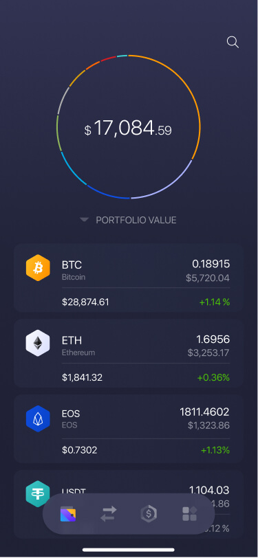
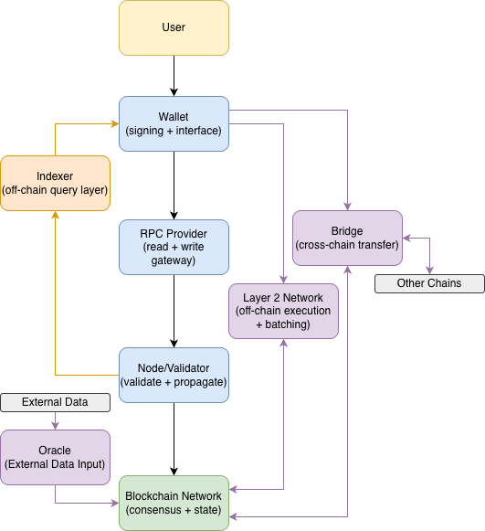

## From Theory to Reality

**We’ve studied how blockchain works—and how it’s abused. But how do real people actually use it?**

- From diagrams → to real systems
- From cryptography → to applications
- From theory → to user experience

::: {.notes}

**Overall Slide Concept**
This opening slide establishes the lesson's purpose: translating blockchain from an abstract system into something people actually use. It matters here because students have spent much of the course in technical and adversarial detail and now need a user-facing synthesis. Emphasize the shift from protocol internals to lived applications and interfaces.

**Key Points**
- The lesson moves from theory and abuse cases toward real user interactions and deployed systems.
- Most users experience blockchain through products, not through direct contact with consensus or cryptography.
- Define user experience briefly as how people actually encounter and navigate a system in practice.

**Walkthrough**
None

**Sources**
[@yaga_blockchaintechnologyoverview_2018]; [@buterin_ethereumnextgenerationsmart_2014]

:::

## What Does a User Actually Interact With?

::::: {.columns}
::: {.column width="55%"}

- Users do **not** interact with blockchains directly
- They interact with:
  - Wallet applications
  - Web interfaces (dApps)
  - Exchanges and platforms
- Blockchain is **abstracted away**

:::
::: {.column width="45%"}

{fig-alt="Exodus wallet interface example" width="60%"}

[Wallet Interface Example (Exodus)](https://www.exodus.com/eos-wallet)

:::
:::::

::: {.notes}

**Overall Slide Concept**
This slide establishes that users interact with abstraction layers rather than with raw blockchain state or nodes. It matters here because many misunderstandings about blockchain come from ignoring those interface layers. Emphasize that wallets, dApps, and exchanges are the real contact surface for most people.

**Key Points**
- Wallets, web interfaces, and platforms translate user intent into blockchain actions.
- Usability depends on these layers hiding complexity without hiding too much risk.
- Define dApp briefly as a decentralized application built on smart contracts and supporting infrastructure.

**Walkthrough**
None

**Sources**
[@antonopoulos_masteringethereum_2018]; [@buterin_ethereumnextgenerationsmart_2014]

:::

## Walking a Transaction Step-by-Step

::::: {.columns}
::: {.column width="70%"}

- User initiates an action (send or swap)
- Wallet **creates and signs** the transaction
- RPC provider **broadcasts** it to the network
  - RPC = **Remote Procedure Call**, the network interface wallets and apps use to talk to blockchain nodes
- Node **validates and propagates**
- Blockchain **records** the transaction

:::
::: {.column width="30%"}
{fig-alt="Simplified blockchain transaction flow from user through wallet, RPC provider, node, and blockchain." width="40%"}
:::
:::::

::: {.notes}

**Overall Slide Concept**
This slide establishes the practical path a user action takes before it becomes blockchain state. It matters here because the rest of the lesson builds on this transaction pipeline as the core execution pattern behind many applications. Emphasize each intermediate dependency between user click and confirmed record.

**Key Points**
- A user action becomes a signed transaction, then moves through RPC infrastructure, nodes, and finally on-chain inclusion.
- Each step adds both functionality and possible failure points or chokepoints.
- Spell out RPC as remote procedure call and define propagation briefly as spreading a valid transaction across network peers.

**Walkthrough**
None

**Sources**
[@antonopoulos_masteringethereum_2018]; [@ethereumorg_transactions_2025]

:::

## Wallets: The Control Layer

- Wallets manage **private keys**, which control assets
- They **sign transactions** on behalf of the user
- Wallets now come in many forms:
  - browser extensions, mobile apps, hardware devices
  - exchange-linked wallets with extra services

::::: {.columns}
::: {.column width="50%"}

  
  
<strong>MetaMask</strong> <small>Browser/mobile wallet focused on signing, swapping, and dApp access.</small>

:::
::: {.column width="50%"}

  
  
<strong>Ledger</strong> <small>Hardware wallet focused on isolating keys from the internet-facing device.</small>

:::
:::::

::: {.notes}

**Overall Slide Concept**
This slide establishes wallets as the user's control layer rather than just a storage container. It matters here because custody, transaction approval, and identity in blockchain systems all begin with wallet behavior. Emphasize that wallets manage keys and authorize actions, not the asset ledger itself.

**Key Points**
- Wallets manage private keys and sign transactions on behalf of users.
- Different wallet forms trade off convenience, isolation, and recovery features.
- Define private key briefly as the secret credential that authorizes control over blockchain assets.

**Walkthrough**
None

**Sources**
[@bitcoin.orgdevelopers_walletsdeveloperguide_2024]; [@u.c.f.library_digitalwalletsoverview_2022]

:::

## Custody Models

::: {.column width="50%"}

- **Custodial**
  - Platform holds keys
  - Easier to use
  - Account recovery possible

- Examples:
  - Coinbase
  - Kraken
  - Robinhood

:::

::: {.column width="50%"}

- **Self-Custody**
  - User holds keys
  - Full control
  - No recovery if lost

- Examples:
  - MetaMask
  - Ledger

:::

*Self-Custody does not imply easier or safer control.*

::: {.notes}

**Overall Slide Concept**
This slide establishes custody as one of the biggest real-world tradeoffs in blockchain use. It matters here because control over keys determines both autonomy and failure mode. Emphasize that self-custody and custodial access solve different problems and expose different risks.

**Key Points**
- Custodial models shift key management to institutions, while self-custody shifts it to the user.
- Ease of recovery often comes at the cost of direct control, and direct control often comes with irreversible responsibility.
- Define self-custody briefly as personally controlling the private keys needed to move assets.

**Walkthrough**
None

**Sources**
[@u.c.f.library_digitalwalletsoverview_2022]; [@bitcoin.orgdevelopers_walletsdeveloperguide_2024]; [@sec_sec_2025]

:::

## What Users Actually Do

::::: {.columns}
::: {.column width="50%"}
::: {.callout-note appearance="simple" style="background:#EAF2FF; border-left-color:#9BBCE0;"}
**Send Funds**

Initiate a wallet-to-wallet transfer of value.
:::

::: {.callout-note appearance="simple" style="background:#EAF7EE; border-left-color:#98C7A5;"}
**Mint or Trade NFTs**

Create or exchange unique digital items.
:::
:::

::: {.column width="50%"}
::: {.callout-note appearance="simple" style="background:#F2EAFE; border-left-color:#B7A1DB;"}
**Swap Assets**

Trade tokens through smart contracts.
:::

::: {.callout-note appearance="simple" style="background:#FFF4D6; border-left-color:#D8B45A;"}
**Bridge Across Networks**

Move assets between chains or execution layers.
:::
:::
::::: 

- Users see apps and wallets  
- But systems rely on **hidden infrastructure**
- Multiple components work together behind the scenes
- Each adds functionality, dependencies, and tradeoffs

::: {.notes}

**Overall Slide Concept**
This slide establishes the small set of user-visible actions that account for much of practical blockchain usage. It matters here because it turns the architecture into familiar behaviors such as sending, swapping, minting, and bridging. Emphasize that very different application categories still rely on the same underlying transaction machinery.

**Key Points**
- Most end-user blockchain activity can be grouped into a few repeated action types.
- Even simple user actions rely on hidden infrastructure and smart-contract logic behind the interface.
- Define bridge briefly as a mechanism for moving or representing assets across different chains or layers.

**Walkthrough**
None

**Sources**
[@ethereumorg_guides_2025]; [@uniswaplabs_uniswapdocs_2025]; [@opensea_helpcenter_2025]; [@yaga_blockchaintechnologyoverview_2018]; [@antonopoulos_masteringethereum_2018]

:::

## RPC Providers: The Access Layer

- Wallets and apps talk to nodes through **JSON-RPC endpoints**
- Common requests: balances, blocks, logs, and transaction submission
- Providers include:
  - [Infura](https://www.infura.io/product/ethereum)
  - [Alchemy](https://www.alchemy.com/docs)
- They abstract node access, but can become major infrastructure chokepoints

::: {.notes}

**Overall Slide Concept**
This slide establishes RPC providers as the practical access layer most wallets and applications depend on. It matters here because decentralization at the protocol layer can still rest on concentrated service dependencies. Emphasize that convenience and centralization can reappear at the infrastructure gateway.

**Key Points**
- JSON-RPC providers let applications query chain data and submit transactions without running their own nodes.
- Heavy reliance on a few providers creates visibility and availability chokepoints.
- Define JSON-RPC briefly as a network interface format used by apps and wallets to request blockchain data or actions.

**Walkthrough**
None

**Sources**
[@antonopoulos_masteringethereum_2018]; [@ethereumorg_jsonrpcapi_2025]; [@l31_infura_ethereum_api_2026]; [@l31_alchemy_docs_2026]

:::

## Nodes and Validators

- Nodes maintain the ledger, mempool, and current network state
- Full nodes independently verify blocks and transactions
- Validators (or miners) order transactions and produce new blocks
- Consensus rules determine which chain becomes the accepted state

::: {.notes}

**Overall Slide Concept**
This slide establishes the node and validator layer as the part of the system that turns requests into accepted shared state. It matters here because students should connect the user-facing pipeline back to the network's source of truth. Emphasize that validation is decentralized even if access often is not.

**Key Points**
- Nodes maintain state, validate data, and relay transactions and blocks across the network.
- Validators or miners produce blocks, but all honest validating nodes still check the rules independently.
- Define consensus briefly as the process by which the network converges on the accepted state history.

**Walkthrough**
None

**Sources**
[@yaga_blockchaintechnologyoverview_2018]; [@antonopoulos_masteringbitcoinprogramming_2017]

:::

## The Full Blockchain System

  

The diagram shows *system* relationships; *communication paths* differ by implementation.

::: {.notes}

**Overall Slide Concept**
This slide establishes the full blockchain ecosystem as a layered system rather than a single monolithic chain. It matters here because later real-world use cases depend on many supporting services beyond wallets and validators. Emphasize that each extra component solves a problem while introducing new dependencies.

**Key Points**
- Blockchain systems rely on supporting components such as oracles, indexers, bridges, and scaling layers.
- The full system is best understood as a coordinated stack of services rather than just a ledger.
- Define ecosystem component briefly as a supporting service that enables usability, interoperability, or performance around the chain.

**Walkthrough**
1. Start at the user and wallet layers that initiate actions.
2. Move through RPC providers and nodes into the chain itself.
3. Then map the surrounding services like oracles, indexers, bridges, and L2s that extend the system.

**Sources**
[@yaga_blockchaintechnologyoverview_2018]; [@antonopoulos_masteringethereum_2018]; [@ellis_chainlinkdecentralizedoracle_2017]; [@croman_scalingdecentralizedblockchains_2016]

:::

## Oracles: Connecting to the Real World

::::: {.columns}
::: {.column width="44%"}

- Virtual machines are deterministic and cannot query the web directly
- Oracles publish **external data** on-chain for smart contracts to read
- Common inputs: prices, reserves, outcomes, and timestamps
- Oracle design determines **who reports**, **how often**, and **how disputes are handled**

:::
::: {.column width="56%"}

:::: {.callout-note appearance="simple"}
**Typical Oracle Flow**

1. Data is gathered from external APIs, exchanges, or reporters  
2. Oracle nodes validate or aggregate the observations  
3. A signed answer is posted on-chain  
4. Smart contracts read that value during execution
::::

:::: {.callout-warning appearance="simple"}
**Failure Modes**

Bad data, delayed updates, or manipulated reporting can trigger incorrect contract behavior.
::::

Example: [Chainlink Data Feeds](https://chain.link/data-feeds)

:::
:::::

::: {.notes}

**Overall Slide Concept**
This slide establishes why deterministic blockchain systems need external data providers to react to real-world conditions. It matters here because many practical applications depend on prices, outcomes, or events that the chain cannot fetch directly. Emphasize that oracles solve a need while introducing a trust and dispute layer.

**Key Points**
- Oracles publish outside information on-chain so contracts can respond to events beyond the ledger itself.
- Oracle design matters because reporting frequency, validation, and dispute handling shape reliability.
- Define oracle briefly as a mechanism that carries external data into a blockchain environment.

**Walkthrough**
None

**Sources**
[@ellis_chainlinkdecentralizedoracle_2017]; [@l31_chainlink_data_feeds_2026]

:::

## Indexing: Making Blockchain Usable

::::: {.columns}
::: {.column width="48%"}

- Raw blockchain state is optimized for verification, not rich queries
- Indexers scan blocks, transactions, logs, and contract events
- They build queryable databases for front ends, dashboards, and analytics
- Example outputs: wallet history, token balances, DEX trades, NFT activity

:::
::: {.column width="52%"}

:::: {.callout-note appearance="simple"}
**Indexing Pipeline**

1. Watch new blocks and contract events  
2. Parse the fields the app cares about  
3. Store them in searchable tables or entities  
4. Serve fast application queries
::::

:::: {.callout-tip appearance="simple"}
**Why Apps Need It**

Without indexing, an app would repeatedly scan raw chain data just to answer simple interface questions.
::::

Example: [The Graph](https://thegraph.com/docs/en/)

:::
:::::

::: {.notes}

**Overall Slide Concept**
This slide establishes indexing as the layer that turns raw blockchain data into usable application queries. It matters here because most user-facing products depend on organized read access rather than scanning the chain from scratch. Emphasize that indexers improve usability without becoming the canonical source of truth.

**Key Points**
- Indexers reorganize raw chain data so applications can search balances, histories, and events efficiently.
- Fast querying is essential for dashboards, explorers, wallets, and analytics tools.
- Define indexer briefly as a service that reads blockchain data and structures it for retrieval and analysis.

**Walkthrough**
None

**Sources**
[@thegraph_docs_2025]; [@antonopoulos_masteringethereum_2018]

:::

## Bridges: Linking Separate Chains

- Blockchains do **not natively share assets or state**
- Bridges move assets or messages between separate networks
- Often work by **locking** an asset on one chain and **issuing** a linked version on another
- Expand usability across ecosystems, but add major trust and security risks
- Example: [Wormhole](https://wormhole.com)

::: {.callout-note appearance="simple"}
**A locking flow:**

1. Send the original token to a bridge contract on Chain A
2. The bridge contract escrows it so it cannot be spent again there
3. Bridge validators or relayers verify the lock event
4. A wrapped or linked token is minted or released on Chain B
:::

::: {.notes}

**Overall Slide Concept**
This slide establishes bridges as the connective tissue of a fragmented multichain ecosystem. It matters here because users often expect assets to move seamlessly even when chains do not share one state machine. Emphasize that bridging is useful but creates additional trust and attack surfaces.

**Key Points**
- Bridges let users move or represent value across otherwise separate networks.
- They solve interoperability friction but often become concentrated points of risk.
- Define interoperability briefly as the ability of systems to exchange assets, messages, or data meaningfully.

**Walkthrough**
None

**Sources**
[@l31_ethereumorg_blockchainbridges_2026]; [@wormhole_wormholedocs_2025]

:::

## Scaling and Interoperability

- Layer 2 networks execute many user transactions away from the base layer
  - Example: [Optimism](https://docs.optimism.io/stack/explainer), [Arbitrum](https://arbitrum.io/rollup)
- They batch transactions together and post compressed data back to Layer 1
- Some designs use fraud proofs or validity proofs so Layer 1 can verify the result
- Interoperability expands what users can do across networks, but adds cross-system dependencies

::: {.callout-note appearance="simple"}
**A typical Layer 2 flow**

Users submit transactions to the Layer 2. A sequencer orders them, updates the Layer 2 state, and periodically posts a batch summary plus data or proofs to Layer 1, where final settlement or dispute resolution occurs.
:::

::: {.notes}

**Overall Slide Concept**
This slide establishes that scaling and interoperability are central practical problems, not just research topics. It matters here because real adoption depends on both throughput and smooth movement across systems. Emphasize that many user-visible experiences are really workarounds for base-layer limits.

**Key Points**
- Layer 2 systems and interoperability tools are responses to cost, speed, and fragmentation limits.
- Performance improvements often come with new complexity and trust assumptions.
- Define Layer 2 briefly as a system that processes activity outside the base chain while still depending on it in some way.

**Walkthrough**
None

**Sources**
[@croman_scalingdecentralizedblockchains_2016]; [@l31_optimism_stack_explainer_2026]; [@l31_arbitrum_rollup_2026]

:::

## Where Does Blockchain Show Up?

- We now understand the **system architecture**
- The same components can support very different deployments
- Blockchain is often used to address **one or more** of these conditions:
  - Multiple parties must coordinate
  - Auditability is required
  - Trust is limited or no single operator should dominate
- Not every blockchain deployment emphasizes all three equally

::: {.notes}

**Overall Slide Concept**
This slide establishes the pivot from infrastructure to concrete application areas. It matters here because students should now be ready to see how the stack appears in real services and sectors. Emphasize that blockchain is used selectively where its specific properties matter.

**Key Points**
- Real-world blockchain use appears in finance, supply chains, identity systems, and other niche but meaningful domains.
- The key question is not whether blockchain can be used, but where it adds enough value to justify its costs.
- Define application area briefly as a domain where blockchain features are applied to a recurring real-world problem.

**Walkthrough**
None

**Sources**
[@yaga_blockchaintechnologyoverview_2018]; [@bis_annualeconomicreport_2022]; [@wang_soktokenizationblockchain_2021]

:::

## Finance (High-Level Overview)

- Decentralized finance (DeFi)
- Stablecoin payments and settlement
- Tokenized assets (real-world and digital)
- Global, programmable transactions

::: {.callout-note appearance="simple"}
**Market Churn and Complexity**

CoinMarketCap's [cryptocurrency count page](https://coinmarketcap.com/charts/number-of-cryptocurrencies-tracked/) showed about **46.86 million** cryptocurrencies tracked on **March 23, 2026**. At that scale, discovery, due diligence, liquidity, and risk assessment become dramatically harder, and the market experiences constant churn as new tokens appear faster than most users can evaluate them.
:::

::: {.notes}

**Overall Slide Concept**
This slide establishes finance as one of the clearest and most visible practical uses of blockchain infrastructure. It matters here because stablecoins, exchanges, and DeFi are where many users first encounter blockchain in everyday life. Emphasize that financial use combines convenience, programmability, and major regulatory stakes.

**Key Points**
- Financial applications include payments, trading, lending, and tokenized claims that operate on top of blockchain rails.
- Finance is a strong use case because value transfer is native to blockchain systems, but it also attracts risk and regulation quickly.
- Define stablecoin briefly as a token designed to track a reference asset such as a national currency.

**Walkthrough**
None

**Sources**
[@u.s.cftc_cftcorderstether_2021]; [@labonte_keyissuesstablecoin_2025]; [@wang_soktokenizationblockchain_2021]; [@l31_coinmarketcap_cryptocurrency_count_2026]

:::

## Supply Chain Case

- Multiple parties share a **common ledger**
- Each step records product data (origin, handling, location)
- Data is visible across trusted organizations
- Shared records make it easier to trace where contamination or handling problems entered the chain

::: {.callout-note appearance="simple"}
**Example: IBM Food Trust**

IBM's [Colli del Garda case study](https://www.ibm.com/case-studies/colli-del-garda-blockchain) describes a food traceability deployment in which product history, handling events, and distribution records were surfaced to both staff and consumers through an IBM Food Trust-backed system.
:::

::: {.notes}

**Overall Slide Concept**
This slide establishes supply chains as a case where provenance and auditability can matter more than open public trading. It matters here because it broadens student understanding beyond financial use cases. Emphasize that blockchain here is about shared records and traceability, not speculation.

**Key Points**
- Supply-chain applications use shared records to track product origin, movement, or certification.
- The value proposition depends on whether multiple parties need a common, tamper-evident record.
- Define provenance briefly as a verifiable history of origin and transfer.

**Walkthrough**
None

**Sources**
[@l31_ibm_colli_del_garda_2026]; [@fda_foodtraceabilityrule_2025]

:::

## Identity Case: Verifiable Credentials

- Three roles:
- **Issuer** (creates credential)
  - **Holder** (stores it)
  - **Verifier** (checks it)
- Credentials are **cryptographically signed**
- Validators are run by participating public institutions

::: {.callout-note appearance="simple"}
**Example: EBSI Academic Credentials**

The European Commission's [EBSI verifiable-credentials success stories](https://ec.europa.eu/digital-building-blocks/sites/spaces/EBSI/pages/575210496/Verifiable+Credentials+Success+Stories) describe a cross-border pilot launched in **July 2021** involving **2 university alliances and 11 universities in 11 countries**. Students can hold signed credentials in wallets and present them to verifiers without each institution manually re-checking records through a central database.
:::

::: {.notes}

**Overall Slide Concept**
This slide establishes identity as a use case where blockchain may help with attestations and portability rather than with replacing identity institutions outright. It matters here because identity systems require careful separation between verification and disclosure. Emphasize credential verification and user-controlled presentation of claims.

**Key Points**
- Verifiable credentials aim to let users prove specific claims without revealing unnecessary information.
- Blockchain can help anchor trust or revocation data, but the surrounding identity model still matters.
- Define verifiable credential briefly as a digitally signed claim that can be checked by another party.

**Walkthrough**
None

**Sources**
[@l31_ebsi_verifiable_credentials_success_2026]; [@worldwidewebconsortium_verifiablecredentialsdata_2025]; [@temoshok_digitalidentityguidelines_2025]

:::

## Prediction Markets Case: Polymarket

- Users trade **YES / NO shares** on real-world events
- Markets use **USDC, a dollar-pegged stablecoin, on Polygon** for collateral and settlement
- Wallet signatures authorize trades, while smart contracts track positions and payouts
- Final resolution still depends on market rules, oracle inputs, and dispute handling
- The result is transparent and portable, but still exposed to speculation, regulation, and contested outcomes

::: {.callout-note appearance="simple"}
**Policy trouble still matters**

Polymarket's blockchain design does not remove legal oversight. The CFTC's **January 3, 2022** enforcement order shows that even when markets run with wallets, smart contracts, and on-chain settlement, prediction products can still face regulatory action. [CFTC Order](https://www.cftc.gov/PressRoom/PressReleases/8478-22)
:::

::: {.notes}

**Overall Slide Concept**
This slide establishes prediction markets as an application where blockchain combines financial incentives with information aggregation. It matters here because it shows how on-chain settlement can support markets around future events. Emphasize both the coordination potential and the policy sensitivity of these systems.

**Key Points**
- Prediction markets use tradable positions and settlement rules to aggregate beliefs about outcomes.
- Their usefulness depends on market integrity, resolution rules, and regulatory context.
- Define prediction market briefly as a market where prices reflect collective expectations about future events.

**Walkthrough**
None

**Sources**
[@polymarket_whatispolymarket_2026]; [@polymarket_whycrypto_2026]; [@polymarket_howarepredictionmarketsresolved_2026]; [@cftc_cftcorderseventbased_2022]

:::

## Infrastructure as a Use Case

- Blockchain networks provide **services**, not just transactions, such as **Chainlink** for data and **Filecoin / IPFS** for storage
- Multiple independent providers coordinate through protocols
- These services reduce reliance on one company, but still depend on incentives, availability, and data quality

::: {.callout-note appearance="simple"}
**Example: Chainlink Feeds in Lending**

Chainlink's [Data Feeds page](https://chain.link/data-feeds) highlights lending protocols such as **Aave** as users of decentralized price feeds. In practice, the oracle network is the product: applications depend on it to price collateral, trigger liquidations, and reduce the risk of acting on stale or manipulated market data.
:::

::: {.notes}

**Overall Slide Concept**
This slide establishes decentralized infrastructure networks as products in their own right rather than merely support tools for other apps. It matters here because some of the most important blockchain uses are about coordinating service providers instead of end-user apps. Emphasize blockchain as a coordination mechanism for infrastructure markets.

**Key Points**
- Oracle and storage networks show how protocols can organize service provision without a single traditional operator.
- Infrastructure use cases depend on incentives, verification, and protocol-governed coordination.
- Define protocol coordination briefly as aligning many participants through shared rules and incentives rather than central management.

**Walkthrough**
None

**Sources**
[@ellis_chainlinkdecentralizedoracle_2017]; [@androulaki_hyperledgerfabricdistributed_2018]; [@filecoin_docs_2025]; [@ipfs_docs_2025]; [@l31_chainlink_data_feeds_2026]

:::

## Complications and Risks

- **Fraud:** phishing, malicious contracts, and rug pulls
- **Regulation:** unclear rules and different approaches across countries
- **Usability:** key management and irreversible mistakes
- **Fragmentation:** too many networks, standards, and wrapped versions of assets

::: {.callout-note appearance="simple"}
**What the reports show**

A report on [*The crypto ecosystem: key elements and risks*](https://www.bis.org/publ/othp72.htm) argues that congestion, high fees, fragmentation, and de-facto centralization can undermine the system's promised efficiency and resilience. The FBI's [Operation Level Up](https://www.fbi.gov/how-we-can-help-you/victim-services/national-crimes-and-victim-resources/operation-level-up) and the FTC's [guidance on cryptocurrency scams](https://consumer.ftc.gov/articles/what-know-about-cryptocurrency-scams) show the user-facing result: scams, theft, and costly mistakes remain common even when the technology itself is sophisticated.
:::

::: {.notes}

**Overall Slide Concept**
This slide establishes the four major real-world complications that keep reappearing across blockchain systems. It matters here because the lesson is now shifting from architecture and use cases to friction and risk. Emphasize that fraud, regulation, usability, and fragmentation interact rather than appearing independently.

**Key Points**
- Real adoption is constrained by scams, uncertain rules, usability burdens, and ecosystem fragmentation.
- These issues reinforce each other, making technically capable systems harder to trust and use.
- Define fragmentation briefly as the splitting of users, assets, or infrastructure across many partially incompatible systems.

**Walkthrough**
None

**Sources**
[@chainalysis_reports_2025]; [@ftc_cryptocurrency_2025]; [@yaga_blockchaintechnologyoverview_2018]; [@bis_annualeconomicreport_2022]; [@l31_bis_crypto_ecosystem_risks_2022]; [@l31_fbi_operation_level_up_2026]; [@l31_ftc_crypto_scams_2026]

:::

## Fraud and Scams

- Phishing attacks and fake websites
- Malicious smart contracts
- Rug pulls (developers drain liquidity after attracting buyers)
- Irreversible transactions increase impact

::: {.callout-note appearance="simple"}
**Example: HAWK Memecoin Collapse**

CoinDesk reported on **December 10, 2024** that Haliey Welch's HAWK token had [lost more than 95% of its value](https://www.coindesk.com/business/2024/12/10/hailey-welch-goes-awol-after-failed-hawk-tuah-token-launch) shortly after launch. After a rapid spike in market value, the token crashed within hours and left many buyers with steep losses.
:::

::: {.notes}

**Overall Slide Concept**
This slide establishes fraud as one of the most persistent user-facing realities in blockchain systems. It matters here because open access and irreversible settlement create a harsh environment for mistakes and deception. Emphasize that permissionless innovation also means permissionless exploitation.

**Key Points**
- Phishing, malicious contracts, and rug pulls exploit openness and user trust rather than breaking the chain itself.
- Irreversibility makes even small user errors financially severe.
- Define rug pull briefly as a project or developer exit that leaves buyers holding suddenly worthless assets or drained liquidity.

**Walkthrough**
None

**Sources**
[@chainalysis_reports_2025]; [@fbi_ic3_2025]; [@ftc_cryptocurrency_2025]; [@l31_coindesk_hawk_token_2024]

:::

## Regulation and Uncertainty

- Laws and regulations are still evolving
- Different countries take different approaches
- Unclear classification of assets (security, commodity, etc.)
- Regulatory actions can impact markets and platforms

::: {.callout-note appearance="simple"}
**Example: Russia Sanctions and Account Disruption**

CoinDesk reported on **October 14, 2022** that, after EU sanctions tightened in response to Russia's invasion of Ukraine, [LocalBitcoins, Crypto.com, and Blockchain.com began discontinuing services for Russian users](https://www.coindesk.com/policy/2022/10/14/russian-journalists-activists-kicked-off-crypto-exchanges-due-to-eu-sanctions). Some users were told to withdraw funds before their accounts were closed, showing how fast-changing rules can abruptly cut off platform access and create real financial risk for holders.
:::

::: {.notes}

**Overall Slide Concept**
This slide establishes regulation as a moving and uneven force that shapes what blockchain systems can do in practice. It matters here because legal ambiguity affects product design, user access, and market stability. Emphasize that classification and jurisdiction matter as much as technology here.

**Key Points**
- Different countries and agencies classify and regulate digital assets in different ways.
- Regulatory action can quickly change market access, product availability, or user risk.
- Define classification briefly as the legal categorization that determines which rules apply to an asset or service.

**Walkthrough**
None

**Sources**
[@sec_sec_2025]; [@crs_crsreports_2025]; [@bis_annualeconomicreport_2022]; [@l31_coindesk_russian_users_sanctions_2022]

:::

## Usability Challenges

- Managing private keys is difficult
- Interfaces can be complex and inconsistent
- Errors are often irreversible
- Requires technical understanding from users

::: {.callout-note appearance="simple"}
**Example: Removing Seed-Phrase Friction**

CoinDesk covered Coinbase's **February 29, 2024** launch of [smart wallets that avoid traditional seed phrases](https://www.coindesk.com/tech/2024/02/29/coinbase-adds-smart-wallet-feature-so-lengthy-seed-phrases-arent-needed). The product pitch itself is revealing: one of the industry's biggest onboarding efforts was explicitly framed around eliminating recovery-phrase complexity and reducing the burden placed on ordinary users.
:::

::: {.notes}

**Overall Slide Concept**
This slide establishes usability as a structural problem, not just a temporary design annoyance. It matters here because key management and irreversible mistakes make many blockchain systems hard for ordinary users to adopt safely. Emphasize that technical sophistication does not automatically translate into humane user experience.

**Key Points**
- Key handling, interface inconsistency, and irreversibility create a high burden for ordinary users.
- Improving usability often means reintroducing support layers or trust assumptions that pure self-custody avoids.
- Define seed phrase briefly as the backup sequence used to recover control of a wallet's keys.

**Walkthrough**
None

**Sources**
[@u.c.f.library_digitalwalletsoverview_2022]; [@toch_oncryptocurrencywallet_2021]; [@voskobojnikov_userperceptionbitcoin_2019]; [@l31_coindesk_coinbase_smart_wallet_2024]

:::

## Fragmentation and Speculation

- Many separate blockchains and ecosystems
- Limited interoperability between systems
- Users must navigate **multiple networks and standards**
- Market behavior often driven by **speculation**

::: {.callout-note appearance="minimal"}
**Fragmentation Example**

In 2023, fears around Multichain's Fantom bridge caused bridged stablecoins such as `anyUSDC` to lose their dollar peg. [CoinDesk reported](https://www.coindesk.com/business/2023/06/01/as-multichain-wobbles-some-fantom-based-defi-projects-flee-bridged-tokens) that some traders bought the token at roughly a **30% discount**, showing how fragmentation between "native" and bridge-issued versions of the same asset can directly hit holders.
:::

::: {.notes}

**Overall Slide Concept**
This slide establishes fragmentation and speculation as linked realities in the current ecosystem. It matters here because technical multiplicity and market incentives often make systems harder to navigate and easier to destabilize. Emphasize that many problems users face come from navigating multiple non-equivalent chains and assets.

**Key Points**
- Many chains, bridges, and wrapped assets create user confusion and integration risk.
- Speculative behavior often dominates attention even when long-term utility is the stated goal.
- Define wrapped asset briefly as a token representation of value bridged or mirrored from another system.

**Walkthrough**
None

**Sources**
[@bis_annualeconomicreport_2022]; [@l2beat_l2beat_2025]; [@aramonte_defirisksdecentralisation_2021]; [@l31_coindesk_multichain_fantom_2023]

:::

## How Information Flows in Crypto

- Multiple actors produce information:
  - Journalists
  - Protocol teams
  - Analysts and researchers
  - Governments and regulators
- Each has **different incentives**
- Information environment is **fast-moving and competitive**

::: {.notes}

**Overall Slide Concept**
This slide establishes the crypto ecosystem as an information environment with competing narrators, not just a technical environment with objective facts. It matters here because students need to interpret claims, incentives, and framing as part of understanding the space. Emphasize that source incentives shape what gets highlighted or omitted.

**Key Points**
- Journalists, protocol teams, analysts, and governments all produce important but differently motivated narratives.
- Good interpretation requires noticing both the source and the context in which claims are made.
- Define incentive briefly as the reason a source may emphasize certain interpretations or outcomes.

**Walkthrough**
None

**Sources**
[@bis_annualeconomicreport_2022]; [@imf_fintechnotes_2025]; [@chainalysis_reports_2025]

:::

## Key Sources

- **Journalism**
  - [CoinDesk](https://www.coindesk.com) - markets, companies, and protocol developments.
  - [The Block](https://www.theblock.co) - industry news, policy coverage, and infrastructure.
- **Research and analytics**
  - [Messari Research](https://messari.io/research) - market structure, protocol overviews, and sector reports.
  - [Chainalysis](https://www.chainalysis.com/reports/) - crime trends, illicit-finance analysis, and on-chain investigations.
  - [Rekt News](https://rekt.news) - exploit timelines and incident postmortems.
- **Policy and institutions**
  - [BIS](https://www.bis.org) - payments, CBDC, and financial-stability analysis.
  - [IMF](https://www.imf.org/en/Publications/fintech-notes) - digital-money policy, macroeconomic framing.
  - [Federal Reserve](https://www.federalreserve.gov) - U.S. payments-system and central-bank perspectives.

::: {.notes}

**Overall Slide Concept**
This slide establishes a practical map of source types students can use to follow the industry without relying on one voice. It matters here because information quality depends on knowing which sources are timely, which are analytical, and which are institutional. Emphasize that no one source category gives the whole picture.

**Key Points**
- Journalism, analytics, and institutional policy sources each illuminate different parts of the blockchain landscape.
- Comparing source categories helps separate breaking events from deeper trend analysis or policy framing.
- Define primary source briefly as a source close to the original event, dataset, or official decision being described.

**Walkthrough**
None

**Sources**
[@coindesk_coindesk_2025]; [@theblock_theblock_2025]; [@messari_research_2025]; [@chainalysis_reports_2025]; [@rekt_rektnews_2026]; [@bis_annualeconomicreport_2022]; [@imf_fintechnotes_2025]; [@federalreserve_federalreserve_2025]

:::

## Reading Critically

- Ask: **Who is the source?**
- What are their **incentives or biases?**
- Is the claim supported by **data or evidence?**
- Cross-check across **multiple sources**

::: {.notes}

**Overall Slide Concept**
This slide establishes critical reading as a necessary blockchain skill, not just a general academic habit. It matters here because the space is noisy, incentive-heavy, and fast-moving. Emphasize source identity, evidence quality, and cross-checking as the minimum standard for forming conclusions.

**Key Points**
- Readers should always ask who is speaking, what incentives they have, and what evidence supports the claim.
- Cross-checking across independent sources is essential before trusting a strong conclusion.
- Define bias briefly as a systematic tendency that shapes what a source notices, values, or omits.

**Walkthrough**
None

**Sources**
[@bis_annualeconomicreport_2022]; [@imf_fintechnotes_2025]; [@chainalysis_reports_2025]

:::

## What Blockchain Looks Like in Practice

- Users interact through **wallets and applications**
- Systems rely on **layered infrastructure**
- Tradeoffs reappear:
  - Convenience vs control
  - Performance vs decentralization
- Blockchain is used **selectively**, not universally

::: {.notes}

**Overall Slide Concept**
This final slide establishes the synthesized practical view students should carry out of the lesson. It matters here because the course is ending this section by reinforcing the mediated, layered, tradeoff-heavy nature of real blockchain systems. Emphasize that blockchain appears selectively and always through infrastructure and human design choices.

**Key Points**
- Real blockchain use is mediated through wallets, apps, infrastructure, and repeated tradeoffs.
- Convenience, control, performance, and decentralization remain in tension across the whole system.
- Blockchain matters most in practice where its specific properties justify its costs and complexity.

**Walkthrough**
None

**Sources**
[@yaga_blockchaintechnologyoverview_2018]; [@bis_annualeconomicreport_2022]; [@u.s.cftc_cftcorderstether_2021]

:::

## References
