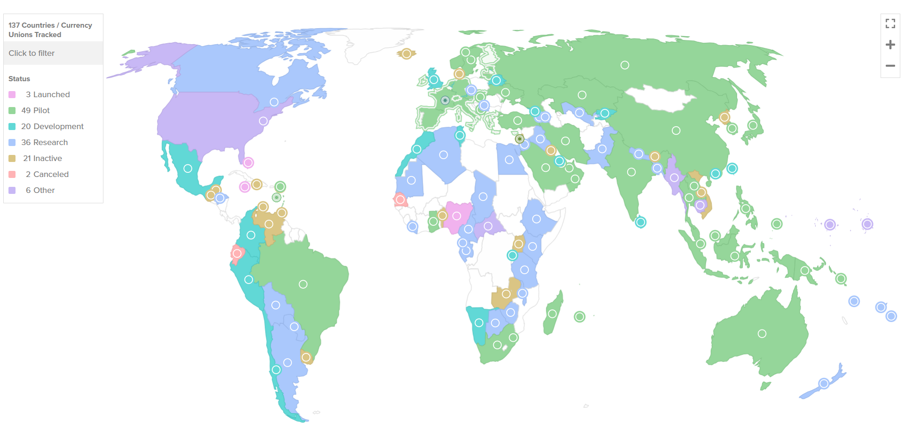

## Agenda {.smaller}

::: {style="font-size: 1.0em;"}

1. **Types of Digital Money** — CBDCs, stablecoins, and traditional cryptocurrencies defined
2. **Trust Architecture** — how control is built into (or out of) each system
3. **Central Bank Digital Currencies** — who is building them and why
4. **Global Payment Infrastructure** — the rails that move money across borders
5. **Stablecoins** — major players and real-world use cases
6. **Why Governments Care** — sovereignty, sanctions, and the permission layer
7. **Case Study: USDT on Tron** — the framework applied

:::

::: {.notes}

**Overall Slide Concept**
This agenda slide establishes the lesson as a comparison of digital money types, trust architectures, and geopolitical consequences. It matters here because students need a roadmap before the lesson moves from classification to state strategy and case study. Emphasize that the lesson is about control over both money and rails.

**Key Points**
- The lesson compares CBDCs, stablecoins, and cryptocurrencies across issuer, infrastructure, and control.
- The structure moves from taxonomy to trust architecture to global consequences and a concrete USDT case.
- Spell out CBDC as central bank digital currency.

**Walkthrough**
None

**Sources**
[@atlanticcouncil_centralbankdigital_2025]; [@boneh_policycryptocurrenciescbdcs_2020]; [@labonte_keyissuesstablecoin_2025]

:::

## Objectives {.smaller}

::: {style="font-size: 0.85em;"}

By the end of this lesson, you will be able to:

1. Distinguish **CBDCs**, **stablecoins**, and **cryptocurrencies** by issuer, infrastructure, and state visibility.

2. Apply the **currency layer vs payment infrastructure layer** framework to analyze threats to state control.

3. Assess **geopolitical implications**: sovereignty, sanctions, capital flows, and infrastructure fragmentation.

:::

::: {.notes}

**Overall Slide Concept**
This slide establishes the analytical objectives students should carry through the rest of the lesson. It matters here because the lesson depends on distinguishing currency type from payment infrastructure and connecting both to state power. Emphasize the currency-layer versus payment-layer framework as the main takeaway.

**Key Points**
- Students should be able to classify digital money systems by issuer, infrastructure, and visibility.
- The lesson's core skill is separating threats to what money is from threats to how money moves.
- Define monetary sovereignty briefly as a state's ability to issue and govern its own currency and monetary policy.

**Walkthrough**
None

**Sources**
[@atlanticcouncil_centralbankdigital_2025]; [@bis_annualeconomicreport_2022]

:::

## Types of Digital Money {.smaller}

::: {style="font-size: 0.80em;"}

| Type | Issuer | Infrastructure | State Visibility | Example |
|:-----|:-------|:---------------|:-----------------|:--------|
| [Central Bank Digital Currency (CBDC)](https://en.wikipedia.org/wiki/Central_bank_digital_currency) | Central bank | State-controlled digital ledger | High — programmable, traceable | China e-CNY |
| [Stablecoins](https://en.wikipedia.org/wiki/Stablecoin) | Private company or protocol | Public or permissioned blockchain | Varies — USDC (moderate) to DAI (low) | USDT, USDC, DAI |
| [Traditional Cryptocurrencies](https://en.wikipedia.org/wiki/Cryptocurrency) | Protocol (no single issuer) | Permissionless blockchain | Low — pseudonymous | Bitcoin, Ethereum |

: {tbl-colwidths="[16,18,22,24,20]"}

:::

- The **issuer** and the **infrastructure** are separable — that separation is what creates geopolitical tension.

- Not all governments pursue all three: **China banned private stablecoins** (February 2026); the **US legislatively blocked a federal CBDC** (July 2025).

::: {.notes}

**Overall Slide Concept**
This slide establishes the three main categories of digital money used in the lesson. It matters here because later state responses only make sense once these categories are clearly separated. Emphasize that issuer and infrastructure are separable design choices.

**Key Points**
- CBDCs, stablecoins, and cryptocurrencies differ by who issues them, what rails they use, and how visible they are to the state.
- Stablecoins occupy the contested middle because sovereign currency can ride on non-sovereign infrastructure.
- Define issuer briefly as the entity or protocol responsible for creating and redeeming the monetary instrument.

**Walkthrough**
None

**Sources**
None

:::

## Central Bank Digital Currencies (CBDCs) {.smaller}

::: {style="font-size: 1.2em;"}

- **137 countries** (98% of global GDP) are exploring a CBDC; **72** are in advanced stages; **49** pilots are active worldwide.

- All CBDC designs are **permissioned by definition** — no sovereign builds on infrastructure it cannot control.

- **Retail CBDCs**: public-facing digital currency for citizens and businesses.

- **Wholesale CBDCs**: interbank settlement systems for financial institutions.

:::

::: {.notes}

**Overall Slide Concept**
This slide establishes CBDCs as state-issued digital money defined by permissioned control, regardless of the exact technology stack used. It matters here because the lesson contrasts them against permissionless systems later. Emphasize that state control is a design requirement, not an accidental feature.

**Key Points**
- CBDCs are central-bank liabilities designed for direct state oversight of issuance and participation.
- Retail and wholesale CBDCs solve different problems and expose different policy tradeoffs.
- Define wholesale CBDC briefly as a digital central-bank instrument intended for settlement among financial institutions rather than the general public.

**Walkthrough**
None

**Sources**
None

:::

## Trust Architecture: CBDCs vs Permissionless Systems {.smaller}

::: {style="font-size: 0.55em;"}

:::: {.columns}

::: {.column width="50%"}

**CBDC: Hierarchical Trust (PKI-like)**

```{dot}
//| fig-width: 4.5
digraph cbdc {
    rankdir=TB;
    bgcolor="transparent";
    node [shape=box, style="filled,rounded", fontname="Helvetica", fontsize=11, margin="0.2,0.1"];
    edge [fontname="Helvetica", fontsize=9];

    CB [label="Central Bank\n(Root of Trust)", fillcolor="#2d3748", fontcolor="white"];
    IB [label="Commercial Banks\n(Intermediate Authorities)", fillcolor="#4a5568", fontcolor="white"];
    U  [label="End Users\n(Verified Wallets)", fillcolor="#718096", fontcolor="white"];

    CB -> IB [label="licenses, rules"];
    IB -> U  [label="KYC, wallet issuance"];
    CB -> IB [label="can revoke/freeze", style=dashed, color="#e53e3e", fontcolor="#e53e3e"];
    CB -> U  [label="can freeze wallets,\nreverse transactions", style=dashed, color="#e53e3e", fontcolor="#e53e3e"];
}
```

- Trust flows **downward** from a root authority
- Every participant is **credentialed** by a higher authority
- The root can **revoke** at any level
- No participation without **authorization**

:::

::: {.column width="50%"}

**Permissionless: Distributed Trust (No CA)**

```{dot}
//| fig-width: 4.5
graph permissionless {
    bgcolor="transparent";
    node [shape=box, style="filled,rounded", fontname="Helvetica", fontsize=11, margin="0.2,0.1"];
    edge [fontname="Helvetica", fontsize=9];

    N1 [label="Node", fillcolor="#744210", fontcolor="white"];
    N2 [label="Node", fillcolor="#744210", fontcolor="white"];
    N3 [label="Node", fillcolor="#744210", fontcolor="white"];
    N4 [label="Node", fillcolor="#744210", fontcolor="white"];

    N1 -- N2;
    N2 -- N3;
    N3 -- N4;
    N4 -- N1;
    N1 -- N3;
    N2 -- N4;

    U1 [label="Any User\n(Self-Generated Keys)", fillcolor="#975a16", fontcolor="white"];
    U1 -- N1 [label="broadcasts tx", style=bold];
}
```

- Trust is **emergent** from consensus, not delegated
- Anyone can generate keys and **participate**
- No single entity can **revoke or freeze**
- Security from **cryptography + economics**, not authority

:::

::::

:::

::: {.notes}

**Overall Slide Concept**
This slide establishes the core trust-model contrast between CBDCs and permissionless systems. It matters here because much of the geopolitical analysis depends on whether trust is hierarchical or emergent. Emphasize the analogy between state-controlled credential chains and open network participation.

**Key Points**
- CBDCs rely on hierarchical trust and revocable participation, while permissionless systems rely on cryptography and consensus without a root authority.
- This architectural difference determines who can freeze, exclude, surveil, or shut down participation.
- Define PKI briefly as public key infrastructure, a hierarchical trust model built around certificate authorities.

**Walkthrough**
1. Start with the CBDC side, where trust flows downward from a root authority through licensed intermediaries.
2. Contrast it with the permissionless side, where anyone can generate keys and join without prior authorization.
3. End by connecting the different trust models to different kinds of political power.

**Sources**
[@boneh_policycryptocurrenciescbdcs_2020]; [@yaga_blockchaintechnologyoverview_2018]; [@nakamoto_bitcoinpeertopeerelectronic_2008]

:::

## Global CBDC Landscape {.smaller}

::: {style="font-size: 0.80em;"}

{width="85%"}

- **3 launched**, **49 pilots**, **20 in development**, **36 researching** — the US is an outlier, having legislatively blocked a retail CBDC.

:::

::: {.notes}

**Overall Slide Concept**
This slide establishes the global scale of CBDC exploration while also warning against confusing experimentation with adoption. It matters here because students need to distinguish policy momentum from actual usage. Emphasize both the breadth of exploration and the uneven reality of deployment.

**Key Points**
- Many countries are exploring CBDCs, but launched systems have often seen limited uptake.
- The U.S. stands out by blocking a retail CBDC path while many others continue pilots or development.
- Define pilot briefly as a limited operational test rather than a fully mature production deployment.

**Walkthrough**
None

**Sources**
[@atlanticcouncil_centralbankdigital_2025]

:::

## CBDC Technical Platforms {.smaller}

::: {style="font-size: 0.80em;"}

| Platform | Type | Permission Model | CBDC Users |
|:---------|:-----|:-----------------|:-----------|
| [Hyperledger Fabric](https://www.hyperledger.org/projects/fabric) | Permissioned DLT | Private membership (MSP) | Some pilots, enterprise |
| [Hyperledger Besu](https://www.hyperledger.org/projects/besu) | Enterprise Ethereum | Permissioned or public | Nigeria (eNaira), Brazil (Drex) |
| [Hyperledger Iroha](https://www.hyperledger.org/projects/iroha) | Permissioned DLT | Role-based access | Cambodia (Bakong) |
| [R3 Corda](https://r3.com/corda/) | Distributed ledger | Permissioned | Sweden (e-Krona), Canada (Jasper) |
| [Quorum](https://consensys.io/quorum) | Ethereum fork | Consortium | Singapore (Ubin), South Africa |
| [Tezos](https://tezos.com/) | Public blockchain | Permissionless | France wholesale experiments |
| [mBridge Ledger](https://www.bis.org/about/bisih/topics/cbdc/mcbdc_bridge.htm) | Custom CBDC DLT | Central bank only | China, UAE, Thailand, HK, Saudi Arabia |
| [Bitt Platform](https://www.bitt.com/) | Proprietary | Central bank controlled | DCash (ECCU) |
| [eCurrency Mint](https://www.ecurrency.net/) | Centralized | Central bank controlled | Jamaica (JAM-DEX) |

: {tbl-colwidths="[20,18,22,40]"}

:::

::: {.notes}

**Overall Slide Concept**
This slide establishes that CBDCs can be implemented on different technical substrates without changing the fundamental governance model. It matters here because students should not mistake architectural variety for a shift away from permissioned control. Emphasize that the trust model matters more than whether the backend is blockchain, database, or hybrid.

**Key Points**
- CBDCs may use centralized databases, permissioned distributed ledgers, or hybrid architectures.
- Technical variation changes performance and resilience details, but not the state's control of access and rules.
- Define hybrid architecture briefly as combining different technical approaches within one controlled monetary system.

**Walkthrough**
None

**Sources**
[@atlanticcouncil_centralbankdigital_2025]; [@bis_mbridge_2024]; [@hyperledger_blockchainplatformenterprise_2023]

:::

## Global Payment Infrastructure: Overview {.smaller}

::: {style="font-size: .8em;"}

Money moving across borders travels on **rails** — messaging and settlement systems that were built long before blockchain existed.

- **Two functions**: *messaging* (instructions about who pays whom) and *settlement* (the actual movement of value). These are often separate systems.

- **The dominant rails are American**: SWIFT carries messages; Fedwire and CHIPS settle dollars. Foreign banks reach the dollar system through US correspondent banks — every layer is a potential choke point.

- **Sanctions power flows from infrastructure control**: cutting a country off SWIFT or US correspondent banking is one of the most powerful non-military tools available.

- **Alternatives are emerging**: CIPS (China), SPFS (Russia), and mBridge (CBDC settlement) each reduce dependence on US-controlled infrastructure.

- The rise of digital money — stablecoins on permissionless chains, CBDCs on sovereign ledgers — is inseparable from this competition for infrastructure control.

:::

::: {.notes}

**Overall Slide Concept**
This slide establishes the existing global payment stack as the incumbent system that digital money systems interact with or challenge. It matters here because CBDCs and stablecoins are not building in a vacuum. Emphasize correspondent banking and messaging layers as the current cross-border baseline.

**Key Points**
- Cross-border money movement today depends on layered banking and messaging infrastructure rather than one unified digital rail.
- New digital-money systems matter because they may bypass, compete with, or rebuild parts of that stack.
- Define correspondent banking briefly as banks holding accounts with one another to route international payments.

**Walkthrough**
None

**Sources**
[@swift_getstarted_2026]; [@worldbank_financialsector_2026]; [@bis_annualeconomicreport_2022]; [@bis_mbridge_2024]

:::

## Global Payment Infrastructure: Compare and Contrast {.smaller}

::: {style="font-size: 0.52em;"}

| System | Description | Operator | Function | Reach | US Leverage | Key Limitation |
|:-------|:------------|:---------|:---------|:------|:------------|:---------------|
| [**SWIFT**](https://www.swift.com/about-us/discover-swift/messaging-standards) | The global "postal service" for bank-to-bank financial messages; does not move money itself | SWIFT (Belgium, US-influenced) | Messaging — carries transfer instructions between banks | 11,000+ institutions, 200+ countries | High — most dollar transactions clear through US correspondents | Messaging only; doesn't settle. Disconnection is a major sanction tool (Russia 2022) |
| [**Fedwire**](https://en.wikipedia.org/wiki/Fedwire) / [**CHIPS**](https://en.wikipedia.org/wiki/CHIPS_(payment_system)) | The US domestic systems where dollars actually settle; the foundation of global dollar clearing | Federal Reserve / The Clearing House (US) | Settlement — where dollars actually move | US domestic + international dollar clearing | Maximum — the dollar's home rails | Only handles USD; foreign banks need US correspondents to access |
| [**CIPS**](https://en.wikipedia.org/wiki/Cross-Border_Interbank_Payment_System) | China's cross-border yuan system; combines messaging and settlement, reducing dependence on SWIFT | People's Bank of China | Messaging + settlement for yuan cross-border transactions | 1,400+ institutions, 110+ countries | Low — operates independently of US infrastructure | Limited to yuan-denominated transactions; still growing reach |
| [**SPFS**](https://en.wikipedia.org/wiki/System_for_Transfer_of_Financial_Messages) | Russia's SWIFT replacement, built after Crimea sanctions to ensure domestic banks could still communicate | Central Bank of Russia | Messaging — Russia's SWIFT alternative (est. 2014) | ~550 institutions, mostly Russia + former Soviet states | None — built to avoid US/EU leverage | Very limited international reach; not widely trusted outside allies |
| [**mBridge**](https://www.bis.org/about/bisih/topics/cbdc/mcbdc_bridge.htm) | A new model: central banks settle directly in each other's digital currencies, no correspondent banking needed | Consortium (China, UAE, Thailand, HK, Saudi Arabia) | Direct CBDC-to-CBDC settlement — bypasses correspondent banking | Pilot stage; 5 central banks + observers | None — settles without touching dollar infrastructure | Still experimental; governance and scaling unresolved |

: {tbl-colwidths="[9,16,12,16,13,15,19]"}

:::

- SWIFT + Fedwire/CHIPS = the **current US-centered system**. CIPS, SPFS, and mBridge = **emerging alternatives**. The fragmentation is already underway.

::: {.notes}

**Overall Slide Concept**
This slide establishes the comparative lens needed to judge legacy and emerging payment systems. It matters here because state interest in digital money is often about infrastructure performance as much as about ideology. Emphasize how speed, cost, control, and visibility vary across rails.

**Key Points**
- Payment infrastructures differ in latency, cost, control points, and cross-border dependence.
- Comparing systems reveals why governments and firms might prefer one rail even if another is more open.
- Define settlement briefly as the final completion of a payment or transfer obligation.

**Walkthrough**
None

**Sources**
[@swift_getstarted_2026]; [@worldbank_financialsector_2026]; [@l32_bis_project_mbridge_connecting_2022]; [@bis_mbridge_2024]

:::

## Major Stablecoins and Use Cases {.smaller}

::: {style="font-size: 1.2em;"}

- **[USDT (Tether)](https://tether.to/en/transparency/)**: largest by volume; dominant on Tron for emerging-market payments.

- **[USDC (Circle)](https://www.circle.com/usdc)**: US-regulated; can freeze addresses; sanctions-compliant.

- **[DAI (MakerDAO)](https://makerdao.com/en/)**: decentralized governance; crypto-collateralized; permissionless.

- Use cases: DeFi liquidity, international payments, crypto market settlement, **inflation hedging**.

- In practice: shops in Bolivia price goods in USDT; Venezuela's economy is substantially rewired to stablecoins; Iran's citizens use Tron-based USDT to hedge a collapsing rial.

:::

::: {.notes}

**Overall Slide Concept**
This slide establishes the main stablecoin actors and practical use cases students should recognize in the real world. It matters here because the later geopolitical discussion depends on stablecoins being used at scale for savings, settlement, and cross-border movement. Emphasize that stablecoin relevance comes from actual utility, not just theory.

**Key Points**
- Major stablecoins differ in issuer structure, reserve model, and regulatory posture.
- Common use cases include remittances, trading, hedging inflation, and moving dollars outside local banking controls.
- Define reserve briefly as the backing assets or collateral meant to support redemption confidence.

**Walkthrough**
None

**Sources**
[@tether_howitworks_2025]; [@l34_circle_usdc_2018]; [@labonte_keyissuesstablecoin_2025]; [@mitdigitalcurrencyinitiative_stablecoinredemptionsnot_2022]

:::

## CBDCs vs Cryptocurrencies {.smaller}

::: {style="font-size: 0.75em;"}

| Dimension | CBDCs | Cryptocurrencies (Bitcoin, Ethereum) |
|:----------|:------|:-------------------------------------|
| Issuer | Central bank (state liability) | No single issuer (protocol rules) |
| Infrastructure | Permissioned — state controls nodes, validation, participation | Permissionless — anyone can run a node, validate, transact |
| Identity | KYC required; state knows participants | Pseudonymous; no identity gate at protocol level |
| Supply control | Central bank sets monetary policy | Fixed or algorithmic supply; no policy discretion |
| Censorship | State can freeze, block, or reverse transactions | Censorship-resistant by design; no single point of control |
| Privacy | Design choice — ranges from cash-like to fully traceable | Pseudonymous on-chain; privacy depends on chain and user behavior |
| Cross-border | Requires bilateral or multilateral agreements (e.g., mBridge) | Borderless by default; no permission needed |
| Legal status | Legal tender in issuing jurisdiction | Varies by jurisdiction — legal, restricted, or banned |

: {tbl-colwidths="[14,43,43]"}

:::

- CBDCs extend state control into digital infrastructure. Cryptocurrencies remove the state from the loop entirely. **Stablecoins sit between them** — which is why they are the most contested.

::: {.notes}

**Overall Slide Concept**
This slide establishes CBDCs and cryptocurrencies as opposing poles on several governance and control dimensions. It matters here because students need a clean contrast before understanding why stablecoins are strategically ambiguous. Emphasize that control, censorship, and cross-border behavior are central differences.

**Key Points**
- CBDCs maximize sovereign control, while cryptocurrencies minimize reliance on sovereign control.
- Stablecoins are analytically important because they mix properties from both ends of the spectrum.
- Define censorship resistance briefly as the difficulty of preventing a valid participant from transacting.

**Walkthrough**
None

**Sources**
[@atlanticcouncil_centralbankdigital_2025]; [@boneh_policycryptocurrenciescbdcs_2020]; [@labonte_keyissuesstablecoin_2025]; [@nakamoto_bitcoinpeertopeerelectronic_2008]

:::

## Why Governments Care {.smaller}

::: {style="font-size: 1.2em;"}

- **Monetary sovereignty**: control over currency issuance and monetary policy transmission.

- **Payment system modernization**: faster, cheaper, more resilient domestic payments.

- **Financial inclusion**: reaching unbanked populations with digital infrastructure.

- **Sanctions enforcement and capital flow control**: maintaining the state's ability to restrict and surveil financial activity.

:::

::: {.notes}

**Overall Slide Concept**
This slide establishes why digital money triggers state attention even when the underlying technology varies. It matters here because governments do not respond mainly to novelty; they respond to threats and opportunities involving sovereignty, modernization, and control. Emphasize that different states weight these motivations differently.

**Key Points**
- Governments care about monetary sovereignty, payment modernization, inclusion, and the ability to monitor or restrict flows.
- The same digital-money system can look like innovation to one government and threat to another.
- Define capital flow control briefly as state efforts to restrict or steer money moving across borders or out of the domestic system.

**Walkthrough**
None

**Sources**
[@bis_annualeconomicreport_2022]; [@imf_fintechnotes_2025]; [@atlanticcouncil_centralbankdigital_2025]; [@labonte_keyissuesstablecoin_2025]

:::

## The Permission Layer: Three Challenges to State Control {.smaller}

::: {style="font-size: 1.2em;"}

- **Bitcoin/Ethereum** challenge the **currency layer** — they propose alternative units of value. A slow, theoretical threat for most major economies.

- **Stablecoins** challenge the **payment infrastructure layer** — they distribute existing currencies outside sovereign banking channels. An immediate, operational threat.

- **CBDCs** are the state's attempt to **own both layers** — the currency and the rails.

:::

::: {.notes}

**Overall Slide Concept**
This slide establishes the lesson's core framework: different digital-money systems challenge different layers of state control. It matters here because it explains why governments regulate Bitcoin, stablecoins, and CBDCs in such different ways. Emphasize that stablecoins threaten the payment layer more immediately than the currency layer.

**Key Points**
- Bitcoin and Ethereum challenge alternative units of value, while stablecoins challenge how sovereign currency moves.
- CBDCs are an attempt by states to maintain authority over both the currency and its infrastructure.
- Define payment infrastructure layer briefly as the set of rails and intermediaries that move money, distinct from the currency unit itself.

**Walkthrough**
None

**Sources**
[@boneh_policycryptocurrenciescbdcs_2020]; [@labonte_keyissuesstablecoin_2025]; [@atlanticcouncil_centralbankdigital_2025]

:::

## Case Study: USDT on Tron {.smaller}

::: {style="font-size: 1.2em;"}

- Tron carries a **large share** of USDT transfers—low fees enable small-value payments.

- Functions as **de facto dollar infrastructure** in economies with capital controls or unstable currencies — Venezuela collects ~80% of oil revenue in USDT; Bolivia shops display USDT price tags.

- Local governments lack visibility and control; the US has **limited reach** over Tron validators.

- Demonstrates the gap between **issuer control** (Tether froze $182M in a single action, Jan 2026) and **network control** (no one entity controls Tron).

:::

::: {style="font-size: 0.75em;"}

**Reference:** [Atlantic Council — How Venezuela uses crypto to sell oil (Dec 2025)](https://www.atlanticcouncil.org/blogs/new-atlanticist/how-venezuela-uses-crypto-to-sell-oil-and-what-the-us-should-do-about-it/)

:::

::: {.notes}

**Overall Slide Concept**
This slide establishes USDT on Tron as the clearest real-world example of sovereign currency moving through infrastructure outside sovereign banking control. It matters here because it turns the abstract permission-layer framework into a concrete geopolitical case. Emphasize the difference between issuer power and network power.

**Key Points**
- USDT on Tron functions as practical dollar infrastructure in places with inflation, capital controls, or sanctions pressure.
- Tether can freeze known addresses, but that does not equal full banking-style control over participation or routing.
- Define de facto dollar infrastructure briefly as a system people use in practice to access and move dollars even if it is not the official banking rail.

**Walkthrough**
None

**Sources**
[@labonte_keyissuesstablecoin_2025]; [@tether_howitworks_2025]; [@u.s.cftc_cftcorderstether_2021]; [@l33_coindesk_coindesk_tether_freezes_28m_usdt_on_russian_crypto_exch_2025]; Atlantic Council, "How Venezuela uses crypto to sell oil and what the US should do about it" (Dec. 2025); DefiLlama, "Tron Stablecoin Market Cap & Supply Chart"; Cointelegraph, "Tether USDT stablecoin seen on Bolivian store price tags" (June 2025)

:::

## mBridge: A Test Case

- Cross-border payments still rely on correspondent banks, messaging layers, and intermediary checkpoints  
- [mBridge](https://www.bis.org/press/p240605.htm) began in **2021** through the **Bank for International Settlements (BIS) Innovation Hub**, with China, Hong Kong, Thailand, and the UAE; Saudi Arabia later joined as a full participant  
- mBridge asks: *can central banks settle more directly on a shared digital platform using their own currencies?*  


::: {.notes}

**Overall Slide Concept**
This slide establishes mBridge as a state-led attempt to build alternative cross-border payment rails using sovereign digital money. It matters here because it shows that states are not only reacting to crypto; they are also building competing infrastructure. Emphasize mBridge as a test of direct multi-central-bank settlement.

**Key Points**
- mBridge explores whether central banks can settle across borders more directly on shared controlled infrastructure.
- The project matters because it points toward parallel payment architectures rather than one universal global rail.
- Define BIS briefly as the Bank for International Settlements, an international institution that supports central-bank coordination.

**Walkthrough**
None

**Sources**
[@bis_mbridge_2024]; [@bis_annualeconomicreport_2022]

:::

## mBridge So Far

::: {style="font-size: 0.9em; line-height: 1.18;"}
- In [**2021**](https://www.bis.org/publ/othp40.htm), the prototype showed that transfers and foreign exchange (FX) transactions could settle in seconds, run **24/7**, and lower costs  
- In [**2022**](https://www.bis.org/publ/othp59.htm), the pilot handled real value: **20 banks** completed **164** transactions worth more than **$22 million**  
- In [**2024**](https://www.bis.org/press/p240605.htm), BIS said mBridge had reached **minimum viable product (MVP)** stage: usable for broader testing, but not yet a mature global production system  
- Cross-border rule alignment remains a friction point: Countries still have to agree on compliance, data visibility, dispute handling, and network membership  
:::


::: {.notes}

**Overall Slide Concept**
This slide establishes the current status of mBridge as meaningful progress with unresolved governance and adoption challenges. It matters here because students should avoid treating every pilot as either empty rhetoric or inevitable success. Emphasize that technical viability and political scalability are different tests.

**Key Points**
- mBridge has progressed from prototype to pilot to MVP, which shows serious development but not yet global deployment.
- The hardest unresolved issues are governance, compliance alignment, and membership rules across sovereign systems.
- Define MVP briefly as minimum viable product, a usable early-stage system that is not yet full mature deployment.

**Walkthrough**
None

**Sources**
[@l32_bis_inthanon_lionrock_mbridge_2021]; [@l32_bis_project_mbridge_connecting_2022]; [@bis_mbridge_2024]

:::

<!-- Hidden 31 Oct 2026: stablecoin types and the issuer/network split are now taught in 05-EF, the D3 ③ tokens lesson (Build Tracker D3 ③): kept for reuse, not shown. -->

:::: {.content-hidden}

## Stablecoins: Types and Mechanisms {.smaller}

::: {style="font-size: 1.2em;"}

- **Fiat-collateralized**: reserves of dollars or equivalents back each token (USDT, USDC).

- **Crypto-collateralized**: on-chain collateral, often over-collateralized (DAI).

- **Algorithmic**: supply adjustments attempt to maintain peg without full collateral.

- The collateral model determines **redemption risk**, **transparency**, and **regulatory surface**.

:::

::: {.notes}

**Overall Slide Concept**
This slide establishes stablecoins as privately issued digital money whose value proposition depends on peg mechanisms and rail choice. It matters here because stablecoins sit between sovereign money and permissionless infrastructure. Emphasize that different stablecoin designs solve the peg problem in different ways.

**Key Points**
- Stablecoins can be fiat-backed, crypto-backed, or algorithmic, and each design creates different trust assumptions.
- The key question is not only what they are pegged to, but who can redeem, freeze, or inspect them.
- Define peg briefly as the mechanism intended to keep a token's value aligned with a reference asset.

**Walkthrough**
None

**Sources**
[@labonte_keyissuesstablecoin_2025]; [@mitdigitalcurrencyinitiative_stablecoinredemptionsnot_2022]; [@u.s.cftc_cftcorderstether_2021]; [@l34_euronews_reuters_terra_2022]

:::

::::

:::: {.content-hidden}

## Trust Architecture: The Stablecoin Hybrid {.smaller}

::: {style="font-size: 0.55em;"}

```{dot}
//| fig-width: 9
digraph stablecoin {
    rankdir=TB;
    bgcolor="transparent";
    node [shape=box, style="filled,rounded", fontname="Helvetica", fontsize=11, margin="0.2,0.1"];
    edge [fontname="Helvetica", fontsize=9];

    subgraph cluster_issuer {
        label="Issuer Layer (CA-like)";
        labeljust=l;
        fontname="Helvetica";
        fontsize=10;
        style=dashed;
        color="#e53e3e";

        ISS [label="Private Issuer\n(e.g., Tether, Circle)", fillcolor="#744210", fontcolor="white"];
        ISS -> FREEZE [label="can freeze\nspecific addresses", style=dashed, color="#e53e3e", fontcolor="#e53e3e"];
        FREEZE [label="Blacklist /\nFreeze Capability", fillcolor="#e53e3e", fontcolor="white", shape=octagon];
    }

    subgraph cluster_network {
        label="Network Layer (No CA)";
        labeljust=l;
        fontname="Helvetica";
        fontsize=10;
        style=dashed;
        color="#2d3748";

        N1 [label="Validator", fillcolor="#2d3748", fontcolor="white"];
        N2 [label="Validator", fillcolor="#2d3748", fontcolor="white"];
        N3 [label="Validator", fillcolor="#2d3748", fontcolor="white"];

        N1 -> N2 [dir=none];
        N2 -> N3 [dir=none];
        N3 -> N1 [dir=none];
    }

    ISS -> N1 [label="mints tokens onto\npermissionless network", style=bold];

    U1 [label="User A\n(No KYC at\nprotocol level)", fillcolor="#975a16", fontcolor="white"];
    U2 [label="User B\n(No KYC at\nprotocol level)", fillcolor="#975a16", fontcolor="white"];

    N2 -> U1 [label="holds tokens", dir=none];
    N3 -> U2 [label="holds tokens", dir=none];
    U1 -> U2 [label="peer-to-peer transfer\n(no issuer approval needed)", style=bold, color="#38a169", fontcolor="#38a169"];
}
```

- **Issuer layer**: centralized, CA-like — can mint, freeze addresses, comply with sanctions (USDC) or not (USDT offshore)
- **Network layer**: permissionless, no CA — anyone can receive, hold, and transfer tokens without identity verification
- **The gap**: issuer can freeze *known* addresses reactively, but cannot gate *participation* at the network level — users transact peer-to-peer without issuer approval
- This hybrid is why stablecoins are **the most contested category** — governments have partial leverage (issuer) but not full control (network)

:::

::: {.notes}

**Overall Slide Concept**
This slide establishes stablecoins as a hybrid trust model: centralized issuer logic operating on rails that may themselves be decentralized. It matters here because this hybrid nature explains much of the regulatory tension around them. Emphasize the split between issuer authority and network openness.

**Key Points**
- Stablecoins often combine centralized redemption and freeze power with public blockchain settlement.
- This split means the issuer and the infrastructure can offer different levels of control.
- Define hybrid trust briefly as a system where different parts of the stack rely on different trust assumptions.

**Walkthrough**
None

**Sources**
[@labonte_keyissuesstablecoin_2025]; [@tether_howitworks_2025]; [@l34_circle_usdc_2018]; [@u.s.cftc_cftcorderstether_2021]

:::

::::

## References
