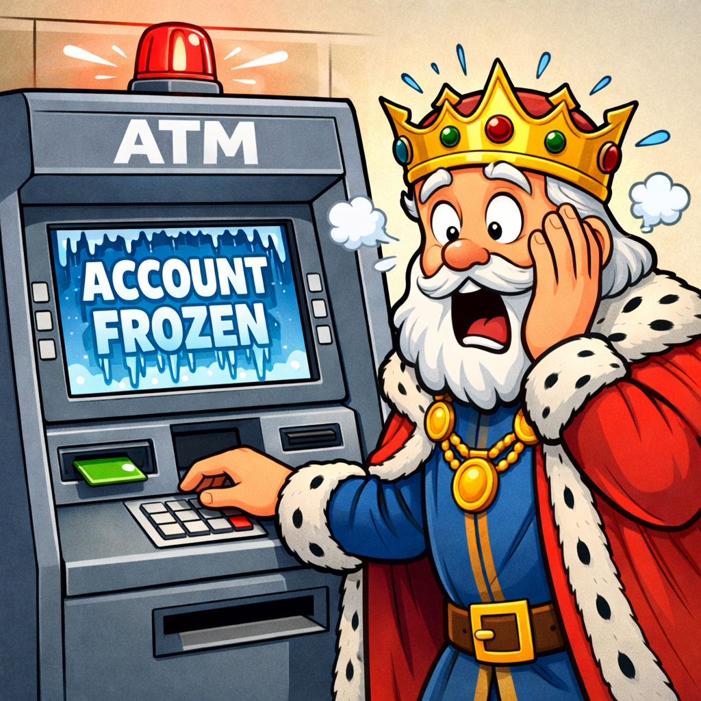
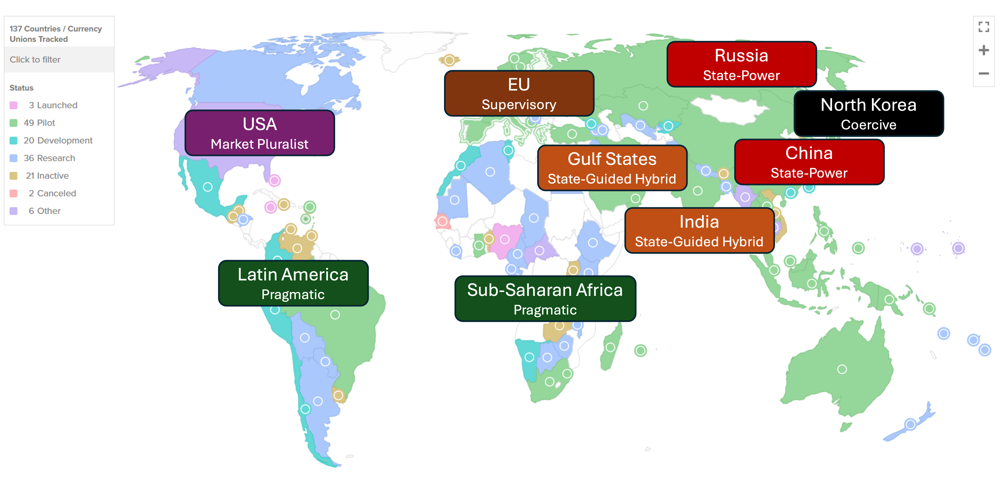
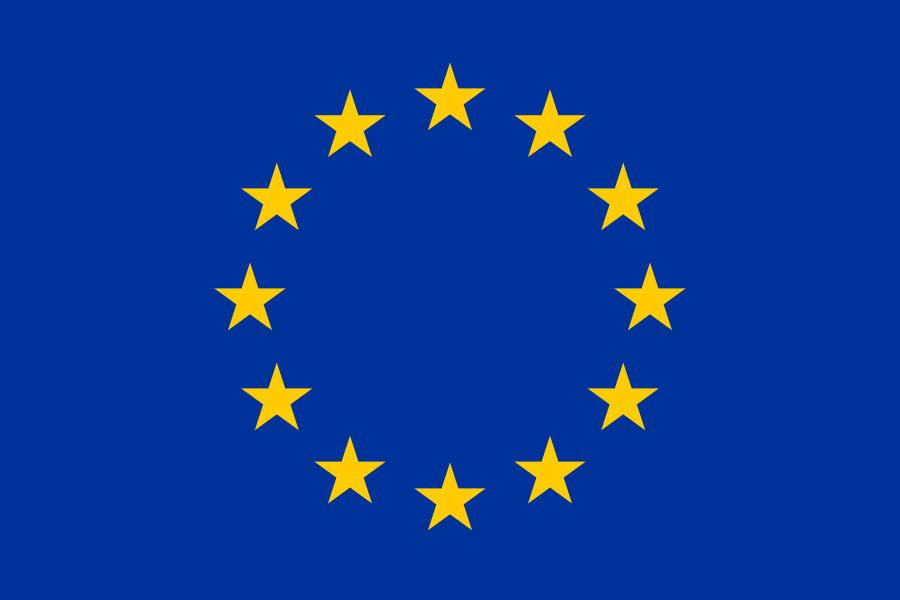
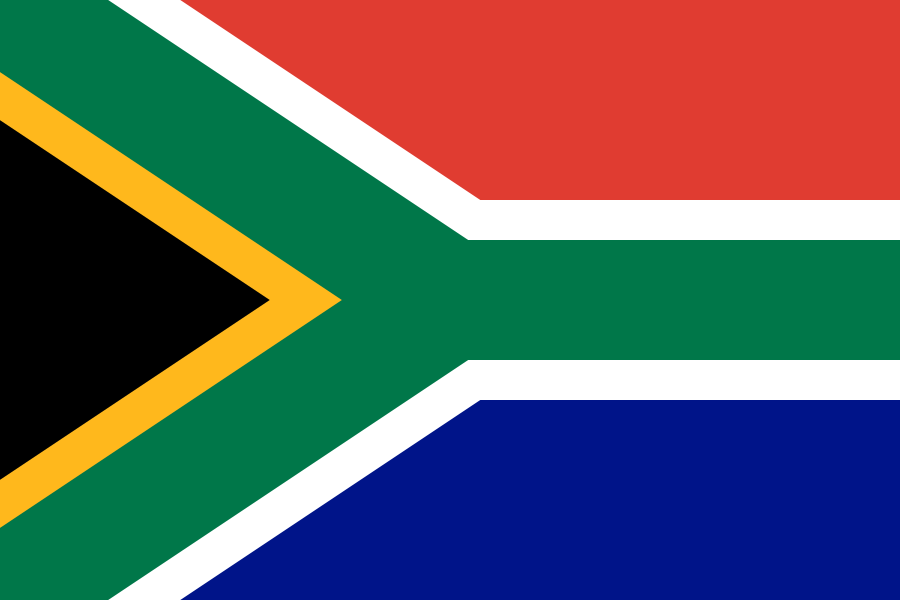

## Royal Funds Frozen!

:::: {.columns}
::: {.column width="55%"}

- One day, a country wakes up and cannot access its foreign reserves  
- Banks refuse transactions  
- Global payment systems no longer respond  

:::
::: {.column width="45%"}
{fig-align="center" width="100%"}

:::
::::
**How is a country's sovereignty impacted when it can no longer move money?**

::: {.notes}

**Overall Slide Concept**
This opening scenario slide establishes financial access as a concrete dimension of sovereignty rather than an abstract policy term. It matters here because the lesson is about how control over payment systems becomes geopolitical power. Emphasize that states can be weakened not only by losing money, but by losing the rails that move it.

**Key Points**
- Sanctions and financial exclusion operate through infrastructure, not only through direct seizure of assets.
- A state cut off from global payment systems loses room to trade, stabilize, and respond under pressure.
- Define foreign reserves briefly as state-held external assets used to support currency stability and international payments.

**Walkthrough**
None

**Sources**
[@u.s.dept.oftreasury_ustreasurysanctions_2022]; [@swift_getstarted_2026]

:::

## Financial Rails Are Power

- Economic power is an instrument of national power  
- Financial rails determine who can transact, settle, and survive pressure  
- Blockchain-based financial systems introduce alternative rails and new control points  

::: {.callout-note appearance="simple"}
**Doctrinal Framing**

Sanctions, reserves, payment networks, and settlement access are part of the economic instrument of statecraft. When the infrastructure of money changes, the way states project power and absorb pressure changes too.
:::

::: {.notes}

**Overall Slide Concept**
This slide establishes financial rails as instruments of statecraft and strategic leverage. It matters here because the lesson is framing blockchain as part of geopolitical competition, not just technological change. Emphasize that whoever controls key payment pathways shapes who can transact and under what conditions.

**Key Points**
- Financial infrastructure is part of national power because it governs settlement, access, and resilience under coercion.
- Blockchain introduces alternative rails and new chokepoints rather than simply eliminating control.
- Define financial rail briefly as a payment or settlement pathway through which value moves between participants.

**Walkthrough**
None

**Sources**
[@imf_fintechnotes_2025]; [@worldbank_financialsector_2026]

:::

## What We’re Analyzing Today

Now that we have covered **CBDCs, stablecoins, and broad sovereignty questions**, we can shift to **specific country and regional cases**.

- How are governments responding when blockchain changes:
  - payment chokepoints
  - financial visibility
  - access to dollar-like digital instruments

::: {.notes}

**Overall Slide Concept**
This slide establishes the shift from general digital-money concepts to comparative geopolitical cases. It matters here because students should understand that the rest of the lesson is about pattern recognition across states, not technology basics. Emphasize that the key variables are payment chokepoints, visibility, and access to dollar-like instruments.

**Key Points**
- The lesson now compares real-world government responses rather than revisiting the base taxonomy.
- Students should watch for recurring strategic patterns across countries and regions.
- Define payment chokepoint briefly as a point in the system where access, surveillance, or blockage can be applied.

**Walkthrough**
None

**Sources**
[@atlanticcouncil_centralbankdigital_2025]; [@bis_annualeconomicreport_2022]

:::

## How Blockchain Changes State Power

:::: {.columns}

::: {.column width="50%"}

**State Concern**

- Public blockchains reduce some traditional chokepoints  
- Stablecoins and crypto rails can move value across borders faster  
- States may lose leverage if activity shifts outside older intermediated systems  

:::

::: {.column width="50%"}

**State Opportunity**

- Public ledgers also make transactions more traceable at scale  
- Exchanges, stablecoin issuers, and service providers create new control points  
- Digital finance can become a tool of sanctions resilience, surveillance, or monetary competition  

:::
::::

::: {.notes}

**Overall Slide Concept**
This slide establishes that blockchain changes state power in two directions at once: it can reduce old chokepoints and create new opportunities for control. It matters here because the country cases only make sense if students see both sides of that shift. Emphasize redistribution of power, not a simple decline or rise of state authority.

**Key Points**
- Public blockchains can bypass some intermediaries while also creating new visibility and control points through services and issuers.
- Different governments respond according to whether they see more threat or more opportunity in that redistribution.
- Define state capacity briefly as a government's practical ability to observe, regulate, and influence outcomes.

**Walkthrough**
None

**Sources**
[@u.s.dept.oftreasury_ustreasurysanctions_2022]; [@chainalysis_reports_2025]; [@imf_fintechnotes_2025]; [@bis_annualeconomicreport_2022]

:::

## Strategic Approaches to Cryptocurrency

::: {.r-stack}
{width="1100"}

States do not follow one universal crypto model; they fall along a <strong>policy spectrum</strong>.

These choices reflect national interests: innovation, monetary sovereignty, sanctions resilience, surveillance, and access to payments.

The next slides will test this framework against nine country and regional cases.

:::

Source image adapted from the Atlantic Council <a href="https://www.atlanticcouncil.org/programs/geoeconomics-center/cryptoregulationtracker/">Cryptocurrency Regulation Tracker</a>.

::: {.notes}

**Overall Slide Concept**
This slide establishes the policy-spectrum framework used to compare states throughout the lesson. It matters here because students need a stable interpretive map before the country-by-country material begins. Emphasize that these are analytical positions, not rigid legal categories.

**Key Points**
- States fall along a spectrum from market-pluralist to state-power or coercive approaches.
- Strategic posture reflects how each government balances innovation, control, sanctions resilience, and monetary sovereignty.
- Define policy spectrum briefly as a range of recurring state approaches rather than one binary classification.

**Walkthrough**
None

**Sources**
[@atlanticcouncil_centralbankdigital_2025]; [@bis_annualeconomicreport_2022]; [@imf_fintechnotes_2025]

:::

## United States: Overview
**Model: Market-driven innovation with strategic dollar protection**

:::: {.columns}
::: {.column width="75%"}
- The USG increasingly treats blockchain and dollar-backed stablecoins as tools of competitiveness and dollar reach  
- Neither fully pro- or anti-crypto
- Oversight remains fragmented across Congress, Treasury, the Federal Reserve, and market regulators  
- Federal policy moved sharply against a retail CBDC in **2025**  

:::
::: {.column width="25%"}

{fig-align="center" width="100%"}

Flag source: Wikimedia Commons / Wikipedia

:::
::::

::: {.notes}

**Overall Slide Concept**
This slide establishes the United States as a market-driven but dollar-protective case, not a purely pro- or anti-crypto one. It matters here because the U.S. model becomes the reference point for comparison with more state-guided approaches. Emphasize fragmented oversight paired with strategic support for private digital-dollar infrastructure.

**Key Points**
- The U.S. prefers private-sector digital-asset growth and regulated stablecoins over a federal retail CBDC.
- Institutional fragmentation means multiple agencies shape policy rather than one unified digital-finance authority.
- Define retail CBDC briefly as a central-bank digital currency intended for direct public use rather than only interbank settlement.

**Walkthrough**
None

**Sources**
[@atlanticcouncil_centralbankdigital_2025]

:::

## United States: Impact Signals {.smaller}
**Executive Order 14178 (January 23, 2025)**

- Made support for digital assets and open blockchain development an explicit federal policy goal  
- Directed agencies to propose a federal digital-asset framework  
- Prohibited agencies from establishing or promoting a U.S. CBDC

**Stablecoin Policy Shift in 2025**

- The **GENIUS Act** framework creates a federal path for regulated payment stablecoins backed by reserves and subject to supervisory standards  
- Treasury framed regulated stablecoins as a way to expand global dollar use and demand for U.S. Treasuries  
- Stablecoins are more politically palatable than a retail CBDC because they preserve private issuers, bank intermediation, and distance from direct state retail control  
- But that choice still carries risk: private firms and foreign holders can become important nodes in dollar liquidity and reserve demand  

::: {.notes}

**Overall Slide Concept**
This slide establishes the concrete policy signals that make the U.S. posture visible in practice. It matters here because students should connect broad strategic labels to actual executive and legislative moves. Emphasize the combination of anti-CBDC federal policy and pro-stablecoin regulatory development.

**Key Points**
- 2025 U.S. policy signaled support for digital assets and resistance to a federal retail CBDC.
- Stablecoins are being treated as a strategic extension of dollar influence through private intermediaries.
- Define GENIUS Act briefly as the 2025 U.S. framework establishing a regulated path for payment stablecoins.

**Walkthrough**
None

**Sources**
[@l33_congress_gov_congress_gov_s_919_genius_act_of_2025_2025]; [@l33_u_s_treasury_u_s_treasury_statement_from_secretary_scott_bessent_on__2025]; [@atlanticcouncil_centralbankdigital_2025]

:::

## EU: Overview
**Model: Supervisory integration with strategic autonomy**

:::: {.columns}
::: {.column width="75%"}
- The EU treats crypto predominantly as a supervision and sovereignty question
- MiCA (Markets in Crypto-Assets) regulation gives the EU one crypto rulebook across member states before broader market expansion  
- The digital euro remains part of a long-term payments-autonomy strategy  
- The posture is coordinated, bloc-wide, and more state-guided than the US 

:::
::: {.column width="25%"}

{fig-align="center" width="100%"}

Flag source: Wikimedia Commons / Wikipedia

:::
::::

::: {.notes}

**Overall Slide Concept**
This slide establishes the EU as a supervisory model focused on bloc-wide harmonization and strategic autonomy. It matters here because the EU illustrates a more rules-first approach than the U.S. market-led model. Emphasize coordinated legal integration rather than laissez-faire expansion.

**Key Points**
- The EU wants crypto activity inside a common legal framework before broader market scaling.
- The digital euro is tied to payment resilience and sovereignty rather than to open experimentation.
- Define strategic autonomy briefly as the ability to preserve key capabilities without excessive dependence on outside powers.

**Walkthrough**
None

**Sources**
[@l33_cnbc_cnbc_crypto_firm_circle_gets_approval_to_issue_stableco_2024]; [@l33_european_central_bank_ecb_progress_on_the_digital_euro_2025]; [@l33_marketscreener_reuters_eu_ministers_reach_compromise_on_digital_euro_r_2025]

:::

## EU: Impact Signals {.smaller}

**MiCA as a bloc-wide rulebook**

- MiCA gives the EU one supervisory framework for crypto issuers, exchanges, and service providers across the single market  
- It is meant to reduce national fragmentation and bring stablecoins and crypto firms under consumer-protection and prudential rules  
- It has been welcomed as regulatory clarity by some firms, but it also raises compliance costs and may concentrate activity in the best-prepared jurisdictions  

**The digital euro project**

- The digital euro project aims to preserve public money in digital payments and reduce dependence on non-European payment platforms  
- The European Commission presented the legal package on **June 28, 2023**, keeping open the option of a retail digital euro  
- The project still faces political and practical questions about privacy, adoption, and whether Europeans see enough benefit to justify a new payment layer  

::: {.notes}

**Overall Slide Concept**
This slide establishes the practical evidence behind the EU's supervisory posture. It matters here because MiCA and the digital euro show the EU translating concerns about sovereignty into harmonized regulation and official experimentation. Emphasize bloc-wide coordination as the distinguishing feature.

**Key Points**
- MiCA gives the EU a unified crypto rulebook that reduces internal fragmentation across member states.
- Digital-euro work reflects long-term concern about payments dependence and monetary autonomy.
- Define MiCA briefly as the EU's Markets in Crypto-Assets regulatory framework.

**Walkthrough**
None

**Sources**
[@atlanticcouncil_centralbankdigital_2025]; [@l33_people_s_bank_of_china_pboc_pressing_ahead_with_the_pilot_program_of_e_cny_r_a_2025]; [@l33_people_s_bank_of_china_pboc_notice_on_further_preventing_and_resolving_the_ris_2025]

:::

## China: Overview
**Model: State-capacity first, with prohibition of private crypto speculation**

:::: {.columns}
::: {.column width="75%"}
- China restricts private crypto speculation while advancing state-directed digital money  
- e-CNY is built inside a state-observable payment architecture  
- Blockchain is accepted where it strengthens official payments, trade, or administrative capacity  
- The goal is state capacity and control

:::
::: {.column width="25%"}

{fig-align="center" width="100%"}

Flag source: Flagcdn

:::
::::

::: {.notes}

**Overall Slide Concept**
This slide establishes China as the clearest state-capacity model in the lesson. It matters here because China illustrates what it looks like when a state embraces digital money under strict political control while excluding private alternatives. Emphasize control, surveillance potential, and managed experimentation.

**Key Points**
- China treats digital finance as an extension of state control and strategic capacity rather than as an open market domain.
- The e-CNY advances on official rails while private stablecoins and open alternatives face tighter exclusion.
- Define e-CNY briefly as China's retail central-bank digital currency pilot.

**Walkthrough**
None

**Sources**
[@l33_people_s_bank_of_china_pboc_balancing_privacy_and_security_theory_and_practice_2025]; [@l33_euronews_reuters_china_vows_privacy_information_protection_in_us_2022]; [@l33_people_s_bank_of_china_pboc_theories_and_practice_of_exploring_china_s_e_cny_2025]

:::

## China: Impact Signals {.smaller}
**e-CNY is built for traceability under state rules**

- People's Bank of China (PBOC) materials describe e-CNY as using **managed anonymity**, or **"anonymity for small value and traceable for high value"**
- In practice, that means e-CNY is not designed to work like cash-level anonymity at scale  
- Larger or suspicious flows remain visible to authorities for compliance and enforcement  

**Critics worry this fits a broader control architecture**

- Chinese officials present e-CNY as privacy-protective, but only within a state-managed data system  
- That raises surveillance concerns because a state-linked payment system can make transaction activity easier to monitor, map, and analyze  
- It also raises censorship concerns because a payment system under centralized control can be used to restrict, freeze, or deny transactions in line with state policy  

::: {.notes}

**Overall Slide Concept**
This slide establishes the specific signals that show China's control-oriented strategy in practice. It matters here because students should see how bans, pilots, and payment-system ambitions fit together coherently. Emphasize that China is not anti-digital-money; it is anti-uncontrolled digital money.

**Key Points**
- China banned unapproved stablecoin activity while continuing to develop the e-CNY and related state-linked infrastructure.
- The strategy is to centralize digital-money capacity inside systems the state can observe and shape directly.
- Define pilot ambition briefly as a staged rollout designed to test and normalize a state-preferred payment model.

**Walkthrough**
None

**Sources**
[@l31_coindesk_russian_users_sanctions_2022]; [@l33_bank_of_russia_bank_of_russia_digital_ruble_2025]; [@l33_bank_of_russia_bank_of_russia_monetary_policy_guidelines_for_2025_2027_2025]

:::

## Russia: Overview
**Model: State-capacity under sanctions pressure**

:::: {.columns}
::: {.column width="75%"}
- Sanctions pressure pushes Russia to seek payment channels less dependent on Western banks, messaging networks, and dollar-linked intermediaries  
- The digital ruble and other state-led digital-finance experiments aim to widen foreign-trade settlement options
- Many of these experiments still depend on exchanges, stablecoins, and intermediaries that can be frozen, pressured, or cut off

:::
::: {.column width="25%"}

{fig-align="center" width="100%"}

Flag source: Wikimedia Commons / Wikipedia

:::
::::

::: {.notes}

**Overall Slide Concept**
This slide establishes Russia as a sanctions-adaptation case where blockchain and digital finance are valued for resilience under pressure more than for liberalization. It matters here because it shows how digital rails can be integrated into survival strategy under coercive constraints. Emphasize adaptation rather than open innovation.

**Key Points**
- Russia's digital-finance posture is shaped by sanctions pressure, access constraints, and the search for alternative settlement pathways.
- The state's interest lies less in decentralization than in preserving room to transact despite external pressure.
- Define sanctions resilience briefly as the ability to continue operating economically despite external restrictions.

**Walkthrough**
None

**Sources**
[@l33_bank_of_russia_bank_of_russia_large_scale_introduction_of_digital_rubl_2026]; [@l33_tass_tass_state_duma_approves_use_of_digital_currency_for_in_2025]; [@l33_coindesk_coindesk_sanctioned_russian_crypto_exchange_garantex_se_2025]

:::

## Russia: Impact Signals {.smaller}

**State rollout of the digital ruble**

- Russia has developed the digital ruble over several years as a state-run alternative within its domestic payment system, and plans to begin a large-scale introduction on **September 1, 2026**, moving past the pilot stage
- The opportunity is stronger domestic payment control, but the model also raises concerns about state visibility, limited user appeal, and whether it can meaningfully reduce external financial pressure  

**Foreign-trade digital-asset experiments under sanctions**

- In **February 2024**, the **State Duma**, Russia’s lower house of parliament, approved use of digital currency for international payments as part of a sanctions-era search for alternative trade rails   
- But the **March 6-7, 2025** [Garantex actions](https://www.coindesk.com/policy/2025/03/07/sanctioned-russian-crypto-exchange-garantex-seized-operators-charged-with-money-laundering) showed how quickly those alternatives can run back into chokepoints when exchanges, stablecoin issuers, and cross-border enforcement coordination are still involved  

::: {.notes}

**Overall Slide Concept**
This slide establishes the practical signals of Russia's adaptation strategy. It matters here because students should see how rhetoric about sovereignty translates into settlement alternatives and digital-payment experiments. Emphasize that the goal is not ideological crypto freedom, but strategic flexibility under sanctions.

**Key Points**
- Russia explores alternative payment and settlement mechanisms to reduce vulnerability to Western-controlled rails.
- Digital-finance tools are being evaluated for utility in sanctioned trade and reserve-management pressure.
- Define workaround rail briefly as an alternative path used when mainstream financial infrastructure becomes unavailable or risky.

**Walkthrough**
None

**Sources**
[@l33_chainalysis_chainalysis_2_2_billion_stolen_in_crypto_in_2024_but_ha_2024]; [@l33_u_s_treasury_u_s_treasury_u_s_treasury_issues_first_ever_sanctions_o_2025]; [@l33_u_s_treasury_u_s_treasury_treasury_sanctions_mixer_used_by_the_dprk__2023]

:::

## North Korea: Overview
**Model: Coercive revenue generation under sanctions**

:::: {.columns}
::: {.column width="75%"}
- North Korea has evolved from isolated cyber theft into a more sustained crypto-revenue strategy  
- State-linked operators steal from exchanges, bridges, and service providers, then use laundering networks to generate revenue for sanctioned state activity  
- The strategy depends on covert cyber capability, not open domestic crypto adoption  

:::
::: {.column width="25%"}

{fig-align="center" width="100%"}

Flag source: Wikimedia Commons / Wikipedia

:::
::::

::: {.notes}

**Overall Slide Concept**
This slide establishes North Korea as the clearest coercive-use case in the lesson. It matters here because it shows blockchain not just as adaptation, but as a direct source of extractive power. Emphasize state-linked theft, laundering, and sanctions circumvention as part of national strategy.

**Key Points**
- North Korea uses cyber theft and laundering to convert blockchain ecosystems into revenue and sanctions-evasion tools.
- The regime's relationship to crypto is operational and extractive, not developmental or market-oriented.
- Define coercive extraction briefly as gaining value through theft, extortion, or forced illicit transfer rather than through normal market participation.

**Walkthrough**
None

**Sources**
[@l33_reserve_bank_of_india_reserve_bank_of_india_concept_note_on_central_bank_digi_2025]; [@l33_reserve_bank_of_india_rbi_governor_press_conference_transcript_february_8_202_2024]; [@l33_the_block_reuters_india_resisting_comprehensive_crypto_law_wary_r_2025]

:::

## North Korea: Impact Signals {.smaller}

**State-linked theft at industrial scale**

- [Chainalysis reported](https://www.chainalysis.com/blog/crypto-hacking-stolen-funds-2025/) that North Korea-linked hackers stole about **$1.34 billion across 47 incidents in 2024**, up sharply from roughly **$660.5 million across 20 incidents in 2023**
- This scale suggests a sustained state revenue strategy rather than isolated criminal activity  
- Stolen crypto can support procurement, sanctions evasion, and other state-linked activities once it is laundered into usable funds  

**Laundering infrastructure keeps getting sanctioned**

- The [U.S. Treasury](https://home.treasury.gov/news/press-releases/jy0768) sanctioned **Blender.io** in **May 2022** and later [sanctioned Sinbad.io](https://home.treasury.gov/news/press-releases/jy1933) in **November 2023** for laundering DPRK-linked stolen virtual currency  
- In both cases, U.S. officials tied the services to the **Lazarus Group**, the DPRK-linked hacking organization associated with major exchange and bridge thefts  
- These sanctions show that DPRK laundering networks are sophisticated, but they still create traces that states can identify, designate, and disrupt  

::: {.notes}

**Overall Slide Concept**
This slide establishes the impact signals that make North Korea's coercive model concrete. It matters here because students should connect strategic labeling to observable operational behavior. Emphasize the role of theft, laundering infrastructure, and enforcement response.

**Key Points**
- North Korean-linked operations show how stolen digital assets can be turned into state-relevant funding streams.
- Laundering chains and service abuse are key to converting hack proceeds into usable value.
- Define laundering chain briefly as a sequence of services, assets, and transfers used to obscure origin before use or cash-out.

**Walkthrough**
None

**Sources**
[@l33_reserve_bank_of_india_reserve_bank_of_india_digital_rupee_e_faqs_2025]; [@l33_government_of_india_union_budget_2022_23_budget_speech_para_131_on_virtual__2022]; [@l33_reserve_bank_of_india_rbi_governor_press_conference_transcript_february_8_202_2024]

:::

## India: Overview
**Model: Regulated integration with monetary caution**

:::: {.columns}
::: {.column width="75%"}
- India moved from early near-ban debates to controlled tolerance
- The digital rupee is the state-approved path for payments innovation
- Tax, compliance, and Reserve Bank of India (RBI) warnings reflect concern about volatility, capital flight, and monetary control
- Innovation is allowed, but only on terms the state can supervise closely

:::
::: {.column width="25%"}

{fig-align="center" width="100%"}

Flag source: Wikimedia Commons / Wikipedia

:::
::::

::: {.notes}

**Overall Slide Concept**
This slide establishes India as a state-guided hybrid case, where the government neither fully suppresses nor fully liberalizes crypto and digital money. It matters here because India demonstrates a middle path between prohibition and open market pluralism. Emphasize selective openness combined with strong state interest in official digital rails.

**Key Points**
- India blends regulation, taxation, and official digital-money development rather than choosing one clean ideological path.
- The state seeks to preserve control while still engaging with innovation and market demand.
- Define hybrid posture briefly as a strategy combining market participation with deliberate state steering and constraints.

**Walkthrough**
None

**Sources**
[@l33_vara_vara_exchange_services_rulebook_2025]; [@l33_bis_bis_press_release_project_mbridge_reaches_minimum_viabl_2024]; [@l33_cbuae_cbuae_digital_dirham_a_primer_on_the_uae_s_central_bank_2025]

:::

## India: Impact Signals {.smaller}

**The digital rupee remains the official digital-money path**

- The [RBI’s CBDC concept note and later FAQs](https://www.rbi.org.in/scripts/FS_Publications.aspx?id=1218) show a central-bank-led rollout rather than an open crypto-payment strategy  
- The project is framed around safer payments, settlement efficiency, and state oversight, keeping digital-money experimentation inside the existing monetary architecture  
- [Adoption expanded through pilots across banks, merchants, and selected cities](https://bfsi.economictimes.indiatimes.com/news/financial-services/digital-rupee-transactions-slump-after-reaching-initial-rbi-target/111272160), but transaction volumes also showed that everyday use is still limited

**Private crypto is tolerated, but burdened and discouraged**

- India’s [**2022-23 Union Budget**](https://www.indiabudget.gov.in/budget2022-23/doc/bspeech/bs202223.pdf) imposed a **30% tax** on income from virtual digital assets and transaction-reporting through tax deducted at source (TDS)  
- [RBI leadership continued to warn in **2024**](https://www.rbi.org.in/Scripts/BS_SpeechesView.aspx?Id=1417) that cryptocurrencies pose macroeconomic and financial-stability concerns  
- The result is a restrictive environment: crypto is not fully banned, but it is clearly not being welcomed as a mainstream monetary alternative  

::: {.notes}

**Overall Slide Concept**
This slide establishes the practical evidence behind India's hybrid model. It matters here because the country's behavior is often misunderstood if students look only at one policy signal. Emphasize coexistence of private-market friction and official digital-payments experimentation.

**Key Points**
- India has imposed meaningful friction on crypto activity while still exploring state-backed digital-payment infrastructure.
- The resulting posture is neither open embrace nor absolute rejection.
- Define policy friction briefly as deliberate regulatory or tax burdens that shape but do not fully ban activity.

**Walkthrough**
None

**Sources**
[@l33_vara_vara_exchange_services_rulebook_2025]; [@l33_bis_bis_press_release_project_mbridge_reaches_minimum_viabl_2024]; [@l33_bis_bis_project_mbridge_reached_minimum_viable_product_stag_2025]

:::

## Gulf States: Overview
**Model: Strategic diversification through regulated hubs and payment sovereignty**

:::: {.columns}
::: {.column width="75%"}
- The UAE and Saudi Arabia use licensed crypto markets and payment experiments to build regional influence, with the UAE also aiming for global hub status
- Hub-building: Attracting firms, capital, and financial tech activity under state-set rules  
- Cross-border payment projects reflect a push for faster settlement and more regional autonomy  

:::
::: {.column width="25%"}

{fig-align="center" width="100%"}

{fig-align="center" width="100%"}

Flags source: Wikimedia Commons / Wikipedia

:::
::::

::: {.notes}

**Overall Slide Concept**
This slide establishes the Gulf States as state-guided hub builders using digital finance for diversification and regional relevance. It matters here because the Gulf cases combine licensing, market-building, and official payment experiments in a coherent strategy. Emphasize ambition under supervision rather than hands-off adoption.

**Key Points**
- The Gulf approach combines crypto-business attraction with tight state-defined rules and cross-border settlement experiments.
- Digital finance is being used as an economic positioning strategy, not just a domestic consumer product.
- Define hub-building briefly as attracting firms, capital, and infrastructure to make a jurisdiction a regional center.

**Walkthrough**
None

**Sources**
[@l33_chainalysis_chainalysis_2024_latam_crypto_adoption_2024]; [@l33_reuters_reuters_argentina_s_milei_seeks_free_competition_in_cur_2024]; [@l33_central_bank_of_brazil_banco_central_do_brasil_piloto_drex_2025]

:::

## Gulf States: Impact Signals {.smaller}

**The UAE is building a licensed crypto hub**

- Dubai’s [Virtual Assets Regulatory Authority (VARA)](https://www.vara.ae/en/) was created to license and supervise crypto activity under a dedicated rulebook
- The objective is to attract firms and capital without surrendering compliance, AML, and market-integrity oversight, though tighter rules also raise costs for smaller or less mature firms  
- The hub-building strategy is progressing: Dubai has kept updating its rulebooks, attracting major firms, and positioning itself as a regulated gateway for regional and global crypto business  

**Gulf states are testing new cross-border payment rails**

- The [UAE and Saudi Arabia launched **Project Aber**](https://www.sama.gov.sa/en-US/News/pages/news-630.aspx) in **2020** to test whether a shared wholesale digital currency could make cross-border interbank settlement faster and more direct  
- The [UAE later became a core participant in **Project mBridge**](https://www.bis.org/press/p240605.htm), which reached MVP stage on **June 5, 2024** as a working cross-border settlement platform ready for broader testing, though not yet a full production system  

::: {.notes}

**Overall Slide Concept**
This slide establishes the key practical signals behind the Gulf strategy: regulated market hubs and central-bank settlement experiments. It matters here because it shows how licensing and official payments projects reinforce each other. Emphasize the pairing of supervised openness and infrastructure ambition.

**Key Points**
- VARA illustrates the UAE's effort to host crypto activity on state-defined terms.
- Aber and mBridge show Gulf interest in shaping next-generation cross-border settlement rails, not just hosting exchanges.
- Define VARA briefly as Dubai's Virtual Assets Regulatory Authority.

**Walkthrough**
None

**Sources**
[@l33_chainalysis_chainalysis_2024_latam_crypto_adoption_2024]; [@l33_government_of_argentina_comisi_n_nacional_de_valores_argentina_la_cnv_crea_el_r_2024]; [@l33_central_bank_of_brazil_banco_central_do_brasil_piloto_drex_2025]

:::

## Latin America: Overview
**Model: Pragmatic adoption under economic pressure**

:::: {.columns}
::: {.column width="75%"}
- Latin America uses crypto to solve concrete problems: inflation, remittances, and cross-border payments  
- In Argentina, chronic inflation and peso weakness push households toward stablecoins as savings protection  
- In Brazil, deeper financial markets support a more institutional and tokenized-finance pathway  

:::
::: {.column width="25%"}

{fig-align="center" width="100%"}

{fig-align="center" width="100%"}

Flags source: Wikimedia Commons / Wikipedia

:::
::::

::: {.notes}

**Overall Slide Concept**
This slide establishes Latin America as a region where crypto adoption is driven by practical economic pressure more than by one coherent ideological model. It matters here because it contrasts strongly with sovereignty-first cases. Emphasize utility under inflation, weak local currency, and remittance needs.

**Key Points**
- Latin American adoption often reflects real economic need, especially demand for dollar-like instruments and cross-border flexibility.
- Argentina and Brazil show different regional pathways: household shelter and institutional experimentation.
- Define pragmatic adoption briefly as uptake driven by immediate usefulness rather than abstract technological commitment.

**Walkthrough**
None

**Sources**
[@l33_chainalysis_chainalysis_sub_saharan_africa_nigeria_takes_2_spot_in__2025]; [@l33_imf_imf_africa_s_digital_future_and_the_role_of_fintech_cbd_2024]; [@l33_fsca_fsca_update_on_licensed_crypto_asset_service_providers__2024]

:::

## Latin America: Impact Signals {.smaller}

**Argentina: stablecoins as economic shelter**

- [Argentina led the region in crypto value received](https://www.chainalysis.com/blog/2024-latin-america-crypto-adoption/) at about **$91.1 billion** between **July 2023 and June 2024**
- Stablecoin use surged as inflation, peso devaluation, and demand for dollar substitutes intensified  
- At the same time, [Argentina’s CNV moved to register and supervise virtual-asset service providers](https://www.argentina.gob.ar/noticias/la-cnv-crea-el-registro-de-proveedores-de-servicios-de-activos-virtuales-psav) rather than simply ignore them, showing formalization alongside crisis-driven demand  

**Brazil: institutional growth and Drex**

- [Brazil showed renewed **institutional** crypto activity and deeper participation by major financial firms](https://www.chainalysis.com/blog/2024-latin-america-crypto-adoption/)  
- The [Central Bank of Brazil’s **Drex** pilot](https://www.bcb.gov.br/estabilidadefinanceira/real-digital-piloto) shows official interest in tokenized financial infrastructure and programmable settlement  
- Brazil is testing whether crypto-linked finance can move from market activity into state-recognized financial infrastructure  

::: {.notes}

**Overall Slide Concept**
This slide establishes the concrete evidence behind Latin America's pragmatic model through the contrast between Argentina and Brazil. It matters here because it prevents the region from being treated as one uniform story. Emphasize crisis-driven stablecoin use in one case and structured financial experimentation in the other.

**Key Points**
- Argentina shows stablecoins as a practical shelter against inflation and devaluation.
- Brazil shows stronger institutional engagement and state-recognized experimentation around tokenized finance.
- Define Drex briefly as Brazil's central bank pilot for tokenized digital financial infrastructure.

**Walkthrough**
None

**Sources**
[@l33_chainalysis_chainalysis_sub_saharan_africa_nigeria_takes_2_spot_in__2025]; [@l33_nigeria_sec_nigeria_sec_framework_on_accelerated_regulatory_incubat_2024]; [@l33_south_african_reserve_bank_south_african_reserve_bank_project_khokha_2_summary_rep_2022]; [@l33_fsca_fsca_update_on_licensed_crypto_asset_service_providers__2024]

:::

## Sub-Saharan Africa: Overview
**Model: Pragmatic adoption plus selective formalization**

:::: {.columns}
::: {.column width="75%"}
- Sub-Saharan Africa is one of the clearest utility-driven crypto regions in the world  
- Nigeria anchors high-utility stablecoin and retail adoption under foreign-exchange and inflation pressure  
- South Africa anchors licensing, institutional participation, and regulatory formalization  
- The regional posture combines necessity-driven use with formal integration  

:::
::: {.column width="25%"}

{fig-align="center" width="100%"}

{fig-align="center" width="100%"}

Flags source: Wikimedia Commons / Wikipedia

:::
::::

::: {.notes}

**Overall Slide Concept**
This slide establishes Sub-Saharan Africa as another high-utility adoption region, but one where formalization is also emerging. It matters here because the region combines necessity-driven use with growing regulatory response. Emphasize the coexistence of grassroots practicality and selective institutional integration.

**Key Points**
- Crypto use in the region is often tied to remittances, dollar access, inflation pressure, and unreliable payment infrastructure.
- Nigeria and South Africa provide complementary anchors for retail adoption and regulatory formalization.
- Define formalization briefly as movement from informal or lightly governed activity into licensed, recognized channels.

**Walkthrough**
None

**Sources**
None

:::

## Sub-Saharan Africa: Impact Signals {.smaller}
**Nigeria: high-utility stablecoin and retail adoption**

- [Nigeria ranked **#2 globally** on the 2024 crypto adoption index](https://www.chainalysis.com/blog/subsaharan-africa-crypto-adoption-2024/) and received about **$59 billion** in value between **July 2023 and June 2024**
- Stablecoins are central because users and businesses need dollar-like instruments for savings and cross-border transfers
- [Nigeria’s SEC launched **ARIP** in **June 2024**](https://sec.gov.ng/framework-on-accelerated-regulatory-incubation-program-arip-for-the-onboarding-of-virtual-assets-service-providers-vasps/), showing a shift from uncertainty toward formal onboarding of virtual asset service providers (VASPs) even as demand continues to outpace regulatory stability  

**South Africa: licensing and institutional integration**

- [The FSCA reported in **December 2024**](https://www.fsca.co.za/News%20Documents/FSCA%20Press%20Release%20-%20FSCA%20update%20on%20Crypto%20Asset%20Service%20Providers%2012%20December%202024.pdf) that it had received **420** crypto asset service provider (CASP) licence applications and approved **248**, showing crypto activity moving into licensed financial channels rather than remaining mostly informal or retail-only  
- [Project Khokha](https://www.resbank.co.za/content/dam/sarb/publications/media-releases/2022/project-khokha-2/Project%20Khokha%202%20Summary%20Report%206%20April%202022.pdf) and broader bank participation show closer links between crypto markets and traditional finance, though tighter licensing and compliance standards may favor larger firms over smaller entrants  

::: {.notes}

**Overall Slide Concept**
This slide establishes the practical evidence behind the Sub-Saharan Africa model through Nigeria and South Africa. It matters here because the region's importance comes from both usage intensity and evolving regulatory treatment. Emphasize the difference between necessity-led adoption and regulated integration.

**Key Points**
- Nigeria highlights high-utility stablecoin demand under domestic economic pressure.
- South Africa highlights licensing, institutional participation, and the movement of crypto into formal finance.
- Define VASP briefly as virtual asset service provider.

**Walkthrough**
None

**Sources**
None

:::

## Competing Financial Infrastructures

:::: {.columns}
::: {.column width="33%"}

Legacy bank rails

SWIFT messaging and correspondent banking

:::
::: {.column width="33%"}

State digital rails

CBDCs and shared central-bank settlement platforms

:::
::: {.column width="33%"}

Open blockchain rails

Public chains, stablecoins, and exchange-linked networks

:::
::::

***The geopolitical question is no longer whether alternatives exist, but which rails states choose to trust, shape, or resist.***

::: {.notes}

**Overall Slide Concept**
This synthesis slide establishes that the real competition is among multiple coexisting financial rails rather than one inevitable successor to the old system. It matters here because students have now seen national strategies across those competing options. Emphasize that legacy, state digital, and open blockchain rails now exist side by side.

**Key Points**
- Legacy banking rails, state digital rails, and open blockchain rails each have different control points and political implications.
- Competition is about legitimacy, trust, and strategic dependence as much as about technical performance.
- Define rail competition briefly as rivalry among different systems for moving and settling value at scale.

**Walkthrough**
None

**Sources**
[@swift_getstarted_2026]; [@atlanticcouncil_centralbankdigital_2025]; [@bis_annualeconomicreport_2022]

:::

## Closing the Geopolitical Discussion

- What now seems settled:
  - blockchain and digital money are part of sanctions, payments, surveillance, and monetary competition
  - states now have recognizable postures, not just isolated experiments
- What remains unresolved:
  - which rails will scale and gain trust
  - whether digital finance reinforces existing monetary hierarchies or redistributes them
  - whether new systems decentralize power or simply create new forms of control

::: {.notes}

**Overall Slide Concept**
This closing slide establishes what is settled and unsettled in the geopolitical competition over digital finance. It matters here because students should leave with both a framework and a sense of the open questions. Emphasize that the competition is already real even if the eventual winners remain unknown.

**Key Points**
- Digital money and blockchain rails are now part of sanctions, surveillance, payments, and monetary competition.
- The unresolved question is which systems will actually scale, gain trust, and reshape hierarchy rather than merely coexist at the margins.
- Define hierarchy briefly as the existing ordering of monetary and payment power among states and infrastructures.

**Walkthrough**
None

**Sources**
[@bis_annualeconomicreport_2022]; [@imf_fintechnotes_2025]; [@atlanticcouncil_centralbankdigital_2025]

:::

## References
