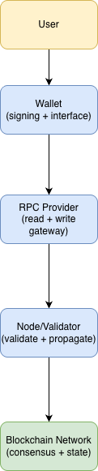
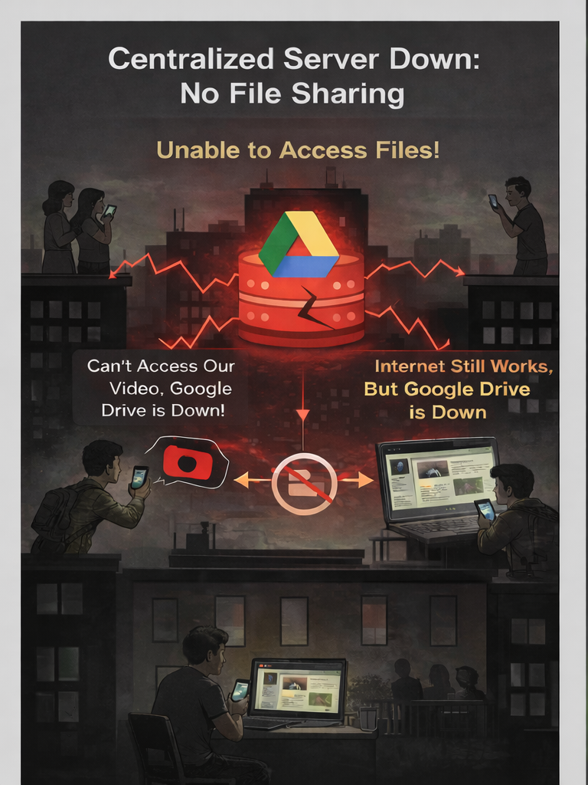
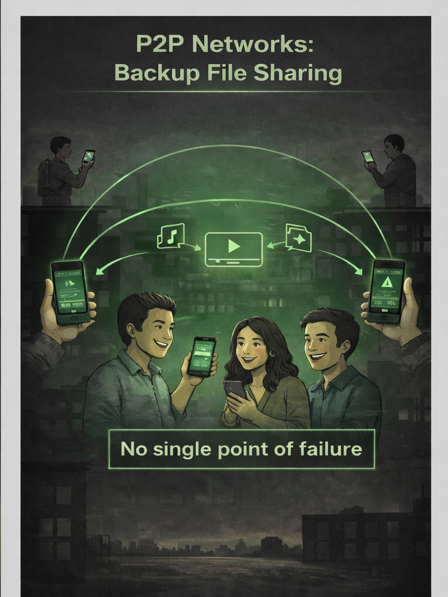
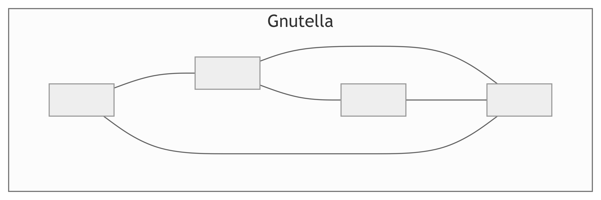
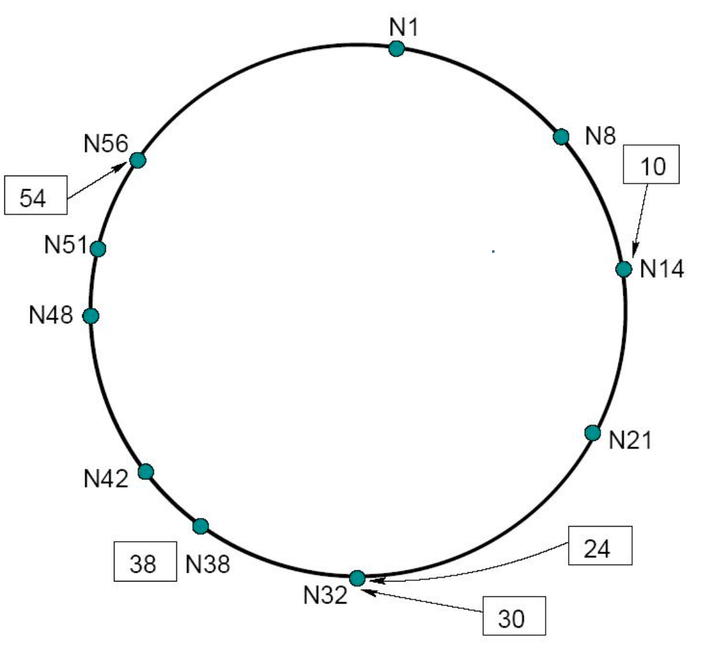
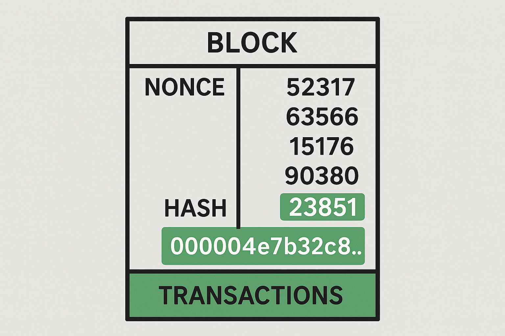

## Why This Technical Review Matters

- This course moved quickly across cryptography, distributed systems, consensus, Bitcoin, Ethereum, and forensics
- The final exam asks you to explain how these ideas fit together, not just recognize isolated terms
- Today is a focused rebuild of the technical stack before the course closes

::: {.notes}

**Overall Slide Concept**
This slide frames the lesson as an integration exercise rather than a last-minute cram session. It matters here because students need to rebuild the full technical stack before the exam and see how the course modules connect. Emphasize that the review is about causal relationships across layers, not isolated vocabulary.

**Key Points**
- Re-center the class on mechanisms from cryptography through forensics.
- Stress that the exam rewards explanation and synthesis more than term recognition.
- Set expectations for a fast review that repeatedly ties one module to the next.

**Walkthrough**
None

**Sources**
[@yaga_blockchaintechnologyoverview_2018]; [@narayanan_bitcoincryptocurrencytechnologies_2016]; [@bonneau_sokresearchperspectives_2015]

:::

## Technical Review Objectives

By the end of this review, you should be able to:

1. Explain the core technical role of hashing, Merkle roots, and digital signatures in blockchain systems
2. Contrast centralized, distributed, permissioned, and permissionless architectures
3. Compare classical consensus, Proof of Work, and Proof of Stake at a high level
4. Reconstruct the key technical ideas behind Bitcoin and Ethereum
5. Explain how blockchain forensics relies on both transparent ledgers and off-chain identity links

::: {.notes}

**Overall Slide Concept**
This slide gives students a roadmap for what they should be able to explain by the end of the review. It matters here because the rest of the lesson moves quickly across domains and needs a visible set of anchor goals. Emphasize that these objectives define the conceptual through-line for the course closeout.

**Key Points**
- Highlight the four major technical layers being revisited: primitives, systems, consensus, and platform design.
- Point out that Bitcoin, Ethereum, and forensics are being reviewed as applications of those layers.
- Spell out that P2P means peer-to-peer and UTXO means unspent transaction output.

**Walkthrough**
None

**Sources**
None

:::
## <a href="../introduction/02-IN-blockchain_at_a_glance.html#/the-three-pillars" target="_blank">The Blockchain Stack at a Glance</a>

:::: {.columns}
::: {.column width="64%"}
- **Cryptography** gives integrity, commitments, and authorization
- **Peer-to-peer networking** moves transactions and blocks without a central server
- **Consensus** lets many nodes converge on one ledger history
- **Ledger/data structures** record history in a tamper-evident form
- **Applications** build wallets, tokens, smart contracts, and services on top
:::
::: {.column width="36%"}

<div style="background:transparent; border-radius:12px; padding:0.45rem; text-align:center;">
  
</div>

:::
::::

::: {.notes}

**Overall Slide Concept**
This slide re-establishes blockchain as a layered system rather than a single invention. It matters here because the lesson will revisit each layer separately and then reconnect them. Emphasize that failures or tradeoffs at one layer propagate into the layers above it.

**Key Points**
- Cryptography secures data, authorization, and integrity.
- Distributed networking moves data among nodes without one central operator.
- Consensus coordinates state updates so many replicas can accept one shared history.

**Walkthrough**
None

**Sources**
None

:::
## <a href="../introduction/02-IN-blockchain_at_a_glance.html#/putting-it-together-the-lifecycle-of-a-transaction" target="_blank">One Transaction, End to End</a> {.smaller}

1. A user creates a transaction and signs it with a private key
2. The transaction is broadcast across a peer-to-peer network
3. Nodes validate structure, signatures, and policy rules
4. A miner or validator proposes a block containing the transaction
5. Consensus determines whether that block becomes part of the accepted history
6. The transaction later becomes evidence for accounting, auditing, or forensics

::: {.notes}

**Overall Slide Concept**
This slide reconstructs the full lifecycle of a blockchain transaction from creation through settlement. It matters here because it links together nearly every technical concept students learned in the course. Emphasize that no single mechanism solves the problem alone; the system works because the layers cooperate.

**Key Points**
- A transaction is signed, propagated, validated, and committed through several distinct stages.
- Each stage depends on different mechanisms such as signatures, gossip, mempools, and consensus.
- Finality is the result of the full process, not just submission by the user.

**Walkthrough**
1. A user creates and signs a transaction with a private key.
2. Peers relay the transaction and nodes validate its format and authorization.
3. A proposer or miner includes it in a block that the consensus process accepts.

**Sources**
[@yaga_blockchaintechnologyoverview_2018]; [@antonopoulos_masteringbitcoinprogramming_2017]; [@antonopoulos_masteringethereum_2018]

:::
## <a href="../primitives/01-CP-cryptography_intro.html#/how-blockchain-uses-cryptography" target="_blank">Why Cryptography Matters in Blockchain</a>

- Blockchain does not eliminate trust problems by magic
- It replaces some trust in institutions with trust in math, protocol rules, and distributed verification
- Cryptography helps answer three core questions:
  - Has data changed?
  - Who authorized this action?
  - Can many parties verify the same claim efficiently?

::: {.notes}

**Overall Slide Concept**
This slide explains why blockchain security begins with cryptographic primitives rather than trust in an administrator. It matters here because the review starts from the lowest technical layer before moving upward. Emphasize that cryptography provides integrity and authorization, but not by itself full system security.

**Key Points**
- Hashing, signatures, and randomness support the core security assumptions of the ledger.
- Cryptography constrains what honest and dishonest actors can do to data and ownership claims.
- Security still depends on correct implementation and system design, not mathematics alone.

**Walkthrough**
None

**Sources**
[@yaga_blockchaintechnologyoverview_2018]; [@bonneau_sokresearchperspectives_2015]

:::
## <a href="../primitives/02-CP-hashing_and_merkle_trees.html#/what-is-a-cryptographic-hash-function" target="_blank">Hashing: What Problem Does It Solve?</a>

- A cryptographic hash maps arbitrary input to a fixed-length digest
- Hashes are used as compact fingerprints of data
- In blockchains, hashes support:
  - Tamper evidence
  - Block linking
  - Commitments to large data sets
  - Efficient verification

::: {.notes}

**Overall Slide Concept**
This slide clarifies that hashing is used to compress and commit to data in a tamper-evident way. It matters here because later slides rely on students understanding why hashes appear throughout blocks, trees, and identifiers. Emphasize the idea of compact commitments rather than encryption.

**Key Points**
- A cryptographic hash function maps arbitrary input to a fixed-size digest.
- The digest lets nodes check integrity without storing or comparing full inputs each time.
- Hashing does not hide data; it gives a compact fingerprint of data.

**Walkthrough**
None

**Sources**
[@yaga_blockchaintechnologyoverview_2018]; [@narayanan_bitcoincryptocurrencytechnologies_2016]

:::
## <a href="../primitives/02-CP-hashing_and_merkle_trees.html#/hash-function-properties" target="_blank">Hash Properties That Matter for Blockchain</a>

- **Deterministic**: same input, same output
- **Preimage resistant**: hard to recover the original input from the digest
- **Second-preimage resistant**: hard to find a different input with the same digest as a chosen message
- **Collision resistant**: hard to find any two distinct inputs with the same digest
- **Avalanche effect**: small input changes produce very different outputs

::: {.notes}

**Overall Slide Concept**
This slide identifies the specific hash properties blockchain systems rely on in practice. It matters here because the security story for blocks and Merkle roots depends on these properties being hard to break. Emphasize preimage resistance, second-preimage resistance, and collision resistance as distinct ideas.

**Key Points**
- Preimage resistance makes it hard to recover an input from its digest.
- Collision resistance makes it hard to find two different inputs with the same digest.
- Second-preimage resistance matters when an attacker tries to swap one valid message for another.

**Walkthrough**
None

**Sources**
[@yaga_blockchaintechnologyoverview_2018]; [@narayanan_bitcoincryptocurrencytechnologies_2016]

:::
## <a href="../primitives/02-CP-hashing_and_merkle_trees.html#/avalanche-effect" target="_blank">Avalanche Effect: Tiny Change, Very Different Output</a>

:::: {.columns}
::: {.column width="56%"}
- One small change in input should produce a radically different digest
- That makes hash outputs hard to predict and helps expose tampering

```text
Hash("HELLO")
3615f80c9d293ed7402687f94b22d58e...

Hash("HELLo")
c6f4b0a7af12e91b3ca3e1e7100e2971...
```
:::
::: {.column width="44%"}

```{dot}
#| fig-width: 4.5
#| fig-height: 2.8
digraph Avalanche {
  rankdir=TB;
  bgcolor="transparent";
  graph [nodesep=0.35, ranksep=0.45];
  node [shape=box, style="rounded,filled", fontname="Helvetica", fontsize=11];
  edge [color="#64748b", penwidth=1.1, arrowsize=0.7];

  in1 [label="HELLO", fillcolor="#e0f2fe", color="#38bdf8"];
  in2 [label="HELLo", fillcolor="#fee2e2", color="#f87171"];
  h1 [label="3615f80c9d293ed7...", fillcolor="#f8fafc", color="#cbd5e1"];
  h2 [label="c6f4b0a7af12e91b...", fillcolor="#f8fafc", color="#cbd5e1"];

  in1 -> h1;
  in2 -> h2;
}
```
:::
::::

::: {.notes}

**Overall Slide Concept**
This slide shows why tiny changes in input produce dramatically different hash outputs. It matters here because blockchain depends on even small tampering being immediately visible in downstream hashes. Emphasize that this sensitivity is what makes chained records tamper-evident.

**Key Points**
- Small input changes should produce unrelated-looking outputs.
- This makes near-miss tampering easy to detect and hard to conceal.
- Avalanche behavior supports block chaining, Merkle proofs, and integrity checks.

**Walkthrough**
None

**Sources**
[@yaga_blockchaintechnologyoverview_2018]; [@merkle_digitalsignaturebased_1988]

:::
## <a href="../primitives/02-CP-hashing_and_merkle_trees.html#/where-youll-see-them-nonexhaustive" target="_blank">Hashing in Blockchain Practice</a>

- Blocks include hashes of previous blocks to form a chain
- Transactions and headers are hashed repeatedly during validation and consensus
- Nodes can compare short digests instead of entire files or histories
- If a hash-linked record changes, later hashes no longer match

::: {.notes}

**Overall Slide Concept**
This slide connects abstract hash properties to the places students actually see hashing in blockchain systems. It matters here because review works best when the primitive is tied back to concrete system roles. Emphasize that hashing is reused repeatedly for different technical jobs.

**Key Points**
- Hashes identify blocks, transactions, and committed data structures.
- Merkle roots summarize many transactions in one block-header field.
- Proof-of-Work also turns hashing into an economic resource test.

**Walkthrough**
None

**Sources**
None

:::
## <a href="../primitives/02-CP-hashing_and_merkle_trees.html#/merkle-trees-motivation" target="_blank">Merkle Trees: Why They Exist</a>

:::: {.columns}
::: {.column width="58%"}
- A block can contain many transactions
- Instead of storing every transaction in the header, the system commits to them with a tree of hashes
- Leaf hashes represent individual items
- Parent hashes combine child hashes until a single top value remains
- Top value: the **Merkle root**
:::
::: {.column width="42%"}

```{dot}
#| fig-width: 4.7
#| fig-height: 3.6
digraph MerkleExample4 {
rankdir=BT;
bgcolor="transparent";

graph [splines=true, nodesep=0.1, ranksep=0.1];

node [shape=box, style="rounded,filled", padding=0.05, width=0.1, height=0.1, margin=0.05, fontname="Helvetica", fontsize=10,
color="#0369a1", fillcolor="#e0f2fe"];

R  [label="r = H(p1 ‖ p2)"];

{rank=same;
p1 [label="p1 = H(a ‖ b)"];
p2 [label="p2 = H(c ‖ d)"];
}

node [color="#9ca3af", fillcolor="#f3f4f6"];
{rank=same;
a [label="a = H(A)"];
b [label="b = H(B)"];
c [label="c = H(C)"];
d [label="d = H(D)"];
}

a -> p1; b -> p1;
c -> p2; d -> p2;
p1 -> R; p2 -> R;

edge [color="#64748b"];
}
```
:::
::::

::: {.notes}

**Overall Slide Concept**
This slide explains why blockchain systems need a data structure more efficient than checking every transaction one by one. It matters here because Merkle trees connect hashing to scalable verification. Emphasize that the tree lets nodes prove membership without sending the whole block.

**Key Points**
- A Merkle tree combines many transaction hashes into one root.
- This structure supports efficient inclusion proofs for lightweight verification.
- The root changes if any underlying transaction data changes.

**Walkthrough**
None

**Sources**
None

:::
## <a href="../primitives/02-CP-hashing_and_merkle_trees.html#/merkle-proofs-membership" target="_blank">Why the Merkle Root Matters</a> {.smaller}

- It is a compact commitment to all transactions in the block
- Changing even one transaction changes the Merkle root
- It allows efficient inclusion proofs without downloading the full block body
- It lets lightweight clients verify membership with a path of sibling hashes
- The Merkle root is **not** just another field in the block header
- It is the block’s compact cryptographic commitment to the full transaction set
- It matters because it enables:
  - Tamper detection
  - Efficient verification
  - Lightweight client proofs
  - Header-first validation strategies

::: {.notes}

**Overall Slide Concept**
This slide turns the Merkle tree into an operational concept by focusing on the root. It matters here because the root is the block-level commitment that lightweight clients can rely on. Emphasize that trust in the root still depends on trust in the broader chain and consensus process.

**Key Points**
- The Merkle root commits to the full transaction set in a compact form.
- Membership proofs let a client verify inclusion using only a small branch of hashes.
- This supports simplified verification without downloading every transaction.

**Walkthrough**
1. Start from the transaction hash being proved.
2. Recompute the path of sibling hashes up to the root.
3. Compare the recomputed root with the root stored in the accepted block header.

**Sources**
[@yaga_blockchaintechnologyoverview_2018]; [@merkle_digitalsignaturebased_1988]; [@nakamoto_bitcoinpeertopeerelectronic_2008]

:::
## <a href="../primitives/04-CP-asymmetric_encryption_and_digital_signatures.html#/digital-signature-workflow" target="_blank">Asymmetric Crypto and Digital Signatures</a>

:::: {.columns}
::: {.column width="58%"}
- Public-key cryptography separates a public verification key from a private signing key
- In blockchain, signatures are often more important than encryption
- A valid signature shows that the holder of the private key authorized the transaction
- Other nodes can verify that authorization using only the public key or address data
:::
::: {.column width="42%"}

```{dot}
//| fig-width: 3.5
digraph Sig {
  bgcolor="transparent";
  node [shape=box, style="rounded,filled", fontname="Helvetica", fontsize=10];
  edge [fontname="Helvetica", fontsize=9];

  PK  [label="Private Key",              fillcolor="#dbeafe"];
  TX  [label="Transaction Data",         fillcolor="#f1f5f9"];
  S   [label="Sign Transaction",         fillcolor="#fef3c7"];
  SIG [label="Digital Signature",        fillcolor="#fde68a"];
  PUB [label="Public Key /\nAddress Data", fillcolor="#dbeafe"];
  V   [label="Network Verification",     fillcolor="#dcfce7"];
  OK  [label="Accept or Reject",         fillcolor="#bbf7d0"];

  PK -> S; TX -> S; S -> SIG; SIG -> V; PUB -> V; TX -> V; V -> OK;
}
```
:::
::::

::: {.notes}

**Overall Slide Concept**
This slide reviews how public-key cryptography authorizes transactions without sharing secret material. It matters here because blockchain ownership claims are expressed through signatures rather than account managers. Emphasize that signatures prove authorization, not necessarily identity.

**Key Points**
- A private key signs; a public key verifies.
- Digital signatures let the network check that a spender is authorized.
- Asymmetric means the signing key and verification key are different.

**Walkthrough**
1. A user signs a message or transaction with a private key.
2. Other nodes verify the signature using the corresponding public key.
3. Valid signatures allow the network to accept the authorization claim.

**Sources**
[@antonopoulos_masteringbitcoinprogramming_2017]; [@antonopoulos_masteringethereum_2018]

:::
## <a href="../primitives/04-CP-asymmetric_encryption_and_digital_signatures.html#/public-keys-as-blockchain-addresses" target="_blank">Keys, Wallets, Addresses, and Ownership</a>

- A **private key** is the critical secret
- A **public key** is derived from the private key and supports verification
- An **address** is usually a shorter identifier derived from public-key material or script conditions
- A **wallet** manages keys, addresses, and signing operations
- Control of funds depends on control of keys, not on knowing someone’s name

::: {.notes}

**Overall Slide Concept**
This slide separates several concepts that students often merge together in casual conversation. It matters here because blockchain systems treat keys, addresses, and wallet software as related but distinct layers. Emphasize that control of a private key is closer to ownership than the interface a user sees.

**Key Points**
- A wallet is software or hardware that helps manage keys and transactions.
- An address is a public-facing identifier derived from key material under a protocol’s rules.
- Ownership in practice means the ability to produce valid signatures or otherwise satisfy spend conditions.

**Walkthrough**
None

**Sources**
[@bitcoin.orgdevelopers_walletsdeveloperguide_2024]; [@antonopoulos_masteringbitcoinprogramming_2017]

:::
## <a href="../primitives/05-CP-crypto_assumptions_and_challenges.html#/case-study-linux.encoder-rng-failure" target="_blank">When Cryptography Fails in Practice</a>

- Strong algorithms do not help if implementations are weak
- Common failures include:
  - Poor randomness
  - Weak key generation
  - Key leakage
  - Bad validation logic
  - Unsafe wallet recovery procedures
- Blockchain losses often come from operational failures, not broken math

::: {.notes}

**Overall Slide Concept**
This slide reminds students that good primitives do not save bad implementations. It matters here because protocol-level trust can still be undermined by key leaks, poor randomness, and operational mistakes. Emphasize that the attack surface includes software engineering and human handling.

**Key Points**
- Implementation bugs and unsafe defaults can defeat theoretically sound cryptography.
- Key management and randomness are recurring practical failure points.
- Security reviews must include operational and software layers, not just math.

**Walkthrough**
None

**Sources**
[@yaga_blockchaintechnologyoverview_2018]; [@sec_sec_2025]

:::
## <a href="../primitives/05-CP-crypto_assumptions_and_challenges.html#/pqc-migration-in-blockchain-systems" target="_blank">Cryptographic Challenges Moving Forward</a>

- **Quantum risk** is more serious for current public-key systems like RSA and ECC than for hash functions
- Hash-based security is weakened by Grover-style speedups, but not destroyed in the same way signature systems are threatened by Shor-style attacks
- Blockchain migration challenges include:
  - Large installed key base
  - Long-lived addresses
  - Backward compatibility
  - “Harvest now, decrypt later” style concerns for public data and exposed keys

::: {.notes}

**Overall Slide Concept**
This slide bridges classic cryptography into future-looking risk. It matters here because blockchain systems have long lifetimes and must plan for migration before assumptions fail. Emphasize that cryptographic agility is a governance and engineering challenge, not just a research topic.

**Key Points**
- Post-quantum migration is slow because live systems cannot switch assumptions instantly.
- Long-lived addresses, signatures, and archived data create transition pressure.
- Protocol upgrades require coordination across software, users, and institutions.

**Walkthrough**
None

**Sources**
[@boneh_quantumcryptographyimplications_2020]; [@l34_nist_pqc_project_2026]

:::
## <a href="../primitives/05-CP-crypto_assumptions_and_challenges.html#/when-good-crypto-goes-bad-milk-sad-cve-2023-39910" target="_blank">Case Reminder: Milk Sad and Bad Entropy</a>

- Wallet safety depends on good randomness
- If seed phrases or private keys are generated from weak entropy, the wallet may be predictable
- The lesson is broader than one bug:
  - Cryptography can be correct on paper and still fail in deployment
  - Blockchain systems amplify the cost of key-management mistakes because irreversible transfers are easy

::: {.notes}

**Overall Slide Concept**
This slide grounds the implementation-risk discussion in a concrete blockchain failure. It matters here because students need to remember that randomness is not an abstract detail when keys are involved. Emphasize that entropy means the unpredictability needed to generate secure secrets.

**Key Points**
- Bad entropy can make supposedly secret keys guessable.
- The Milk Sad case shows how wallet generation mistakes become theft opportunities.
- Randomness quality is a system dependency, not an optional refinement.

**Walkthrough**
None

**Sources**
[@yaga_blockchaintechnologyoverview_2018]; [@l35_milksad_update2_2023]

:::
## <a href="../distributed_primitives/01-DS-distributed_systems.html#/centralized-vs.-decentralized-tradeoffs" target="_blank">Centralized vs Distributed Architectures</a> {.smaller}

:::: {.columns}
::: {.column width="52%"}
- A centralized system has a clear control point and often a simpler operating model
- A distributed system spreads responsibility across multiple machines or organizations
- Blockchain adopts distributed designs to reduce reliance on a single trusted operator
- This improves resilience in some ways, but also adds coordination, latency, and consistency problems
:::
::: {.column width="48%"}

::: {style="text-align:center; line-height:0.9;"}
{fig-alt="Centralized network during outage." width="50%"}
{fig-alt="Peer-to-peer network during outage." width="50%"}
:::

:::
::::

::: {.notes}

**Overall Slide Concept**
This slide contrasts the basic control patterns behind traditional systems and blockchain-style systems. It matters here because later consensus and governance choices make more sense once the architectural tradeoff is clear. Emphasize that distributed does not automatically mean decentralized.

**Key Points**
- Centralized systems are simpler to coordinate but create single points of control and failure.
- Distributed systems improve resilience but increase coordination complexity.
- Decentralized means power is dispersed, not merely that many machines exist.

**Walkthrough**
None

**Sources**
[@ukgovernmentchiefscientificadviser_distributedledgertechnology_2016]; [@yaga_blockchaintechnologyoverview_2018]

:::
## <a href="../distributed_primitives/01-DS-distributed_systems.html#/gossip-in-a-blockchain-network" target="_blank">Why Blockchain Pushes Toward P2P</a>

- Permissionless blockchains try to minimize trust in any single operator or organization
  - A central server would have to be trusted not to fail, censor, or behave maliciously
- Blockchain networks want many participants to receive transactions, validate blocks, relay information, and maintain ledger history
- P2P design supports openness, redundancy, and censorship resistance, while permissioned systems often reintroduce more trusted service layers

::: {.notes}

**Overall Slide Concept**
This slide explains why public blockchains lean on peer-to-peer networking instead of a central relay. It matters here because open participation depends on information moving without a privileged hub. Emphasize that P2P means peer-to-peer communication among nodes of the same network.

**Key Points**
- Peer-to-peer designs reduce reliance on a single distribution point.
- Gossip-style propagation helps spread transactions and blocks quickly across the network.
- This openness creates resilience but also introduces new attack surfaces.

**Walkthrough**
None

**Sources**
[@nakamoto_bitcoinpeertopeerelectronic_2008]; [@ukgovernmentchiefscientificadviser_distributedledgertechnology_2016]

:::
## <a href="../distributed_primitives/02-DS-p2p_design.html#/scalability-challenges" target="_blank">Gossip vs DHTs</a>

:::: {.columns}
::: {.column width="56%"}
- **Gossip/unstructured relay** is good for spreading new information widely
- **Distributed Hash Table/structured overlay routing** is good for efficient lookup in large networks
- Tradeoff:
  - Gossip favors resilience and simple dissemination
  - DHTs favor efficient routing and discovery
:::
::: {.column width="44%"}

<div style="display:flex; flex-direction:column; gap:0.8rem; align-items:center; margin-top:0.35rem;">
  
  
</div>
:::
::::

::: {.notes}

**Overall Slide Concept**
This slide compares two overlay-network ideas students encountered earlier in the course. It matters here because blockchain uses broadcast-heavy communication differently from structured lookup systems. Emphasize that DHT means distributed hash table.

**Key Points**
- Gossip is good for broad dissemination of new data such as blocks and transactions.
- DHTs are designed for structured lookup and routing rather than wide broadcast.
- Blockchain networks may combine ideas, but the core relay problem usually looks gossip-heavy.

**Walkthrough**
None

**Sources**
[@ukgovernmentchiefscientificadviser_distributedledgertechnology_2016]; [@singh_eclipseattacksoverlay_2006]

:::

## <a href="../distributed_primitives/02-DS-p2p_design.html#/membership-and-churn" target="_blank">Peer Discovery and Churn</a>

- New nodes need a way to find their first peers
- Real networks must handle nodes joining, leaving, failing, or moving
- A healthy blockchain network needs:
  - Bootstrapping mechanisms
  - Ongoing peer replacement
  - Diversity in connections
  - Tolerance for churn and partial partitions

::: {.notes}

**Overall Slide Concept**
This slide reviews how nodes find one another and remain connected in a changing network. It matters here because peer-to-peer systems only work if they can tolerate constant joins, leaves, and failures. Emphasize that churn means continual turnover in participating peers.

**Key Points**
- Nodes need discovery mechanisms to locate useful peers without central coordination.
- Healthy networks must keep operating as peers join, disconnect, or change addresses.
- Connectivity quality affects propagation speed, resilience, and eclipse risk.

**Walkthrough**
None

**Sources**
[@heilman_eclipseattacksbitcoins_2015]; [@singh_eclipseattacksoverlay_2006]

:::
## <a href="../distributed_primitives/02-DS-p2p_design.html#/the-great-p2p-weakness-sybil-eclipse-attacks" target="_blank">P2P Threats: Sybil and Eclipse</a>

- A **Sybil attack** tries to gain influence by creating many fake identities
- An **eclipse attack** tries to isolate a node from honest peers and control what it sees
- These attacks matter because even strong cryptography is not enough if a node’s network view is manipulated
- Open systems need technical and economic defenses, not just identity checks

::: {.notes}

**Overall Slide Concept**
This slide highlights two of the most important peer-to-peer threats in open blockchain networks. It matters here because networking attacks can distort a node’s view even if cryptography remains intact. Emphasize that a Sybil attack means creating many fake identities and an eclipse attack means surrounding a target with attacker-controlled peers.

**Key Points**
- Sybil attacks try to gain influence by multiplying apparent identities.
- Eclipse attacks isolate a victim’s network view and can support higher-level fraud or manipulation.
- Peer diversity, admission controls, and robust discovery reduce these risks.

**Walkthrough**
None

**Sources**
[@androulaki_hyperledgerfabricdistributed_2018]; [@hyperledger_blockchainplatformenterprise_2023]

:::
## <a href="../distributed_primitives/04-DS-distributed_ledgers.html#/permissioned-vs.-permissionless-comparison" target="_blank">Permissioned vs Permissionless Systems</a>

- **Permissionless** systems allow open participation and must resist unknown adversaries
- **Permissioned** systems restrict membership and usually know who participants are
- This changes:
  - Admission control
  - Identity management
  - Governance
  - Privacy expectations
  - Consensus design

::: {.notes}

**Overall Slide Concept**
This slide contrasts open blockchain participation with curated membership models. It matters here because consensus, governance, and threat assumptions shift dramatically depending on who may join. Emphasize that permissioned systems restrict participation while permissionless systems allow open entry.

**Key Points**
- Permissionless systems optimize for openness and adversarial resilience.
- Permissioned systems trade openness for control, performance, and identifiable participants.
- Admission policy changes both the governance model and the threat model.

**Walkthrough**
None

**Sources**
[@androulaki_hyperledgerfabricdistributed_2018]; [@hyperledger_blockchainplatformenterprise_2023]

:::
## <a href="../permissioned_ledger/02-PC-hlf_and_distributed_ledgers.html#/the-big-picture-end-to-end-fabric-path" target="_blank">Where Hyperledger Fabric Fits</a>

:::: {.columns}
::: {.column width="64%"}
- Fabric is a permissioned distributed ledger platform
- It assumes known organizations, managed identities, and policy-driven participation
- Trust is managed through:
  - MSPs and certificate authorities
  - Endorsement policies
  - Ordering services
  - Governance agreements
:::
::: {.column width="36%"}

```{dot}
#| fig-width: 4.6
#| fig-height: 4.4
digraph GenericPath {
  rankdir=TB;
  bgcolor="transparent";
  node [shape=box, style="rounded,filled", fontname="Helvetica", color="#94a3b8", fontsize=10];
  edge [color="#64748b", penwidth=1.3];

  C1 [label="Submitting Org", fillcolor="#dbeafe"];
  I [label="Identity Check", fillcolor="#bfdbfe"];
  A1 [label="Approving Org A", fillcolor="#dcfce7"];
  A2 [label="Approving Org B", fillcolor="#bbf7d0"];
  O [label="Ordering Service\n(Single Node or Small Cluster)", fillcolor="#fef3c7"];
  V [label="Validating / Committing Nodes", fillcolor="#fde68a"];
  L [label="Shared Ledger", fillcolor="#fee2e2"];

  C1 -> I;
  I -> A1;
  I -> A2;
  {A1 A2} -> O;
  O -> V -> L;
}
```
:::
::::

::: {.notes}

**Overall Slide Concept**
This slide gives students a concrete example of a permissioned ledger architecture. It matters here because Fabric shows how enterprise blockchain design diverges from public-chain design. Emphasize that Fabric uses known organizations, modular components, and policy-driven control.

**Key Points**
- Hyperledger Fabric separates transaction endorsement, ordering, and validation roles.
- Known participants reduce some open-network threats but introduce governance and administration assumptions.
- It is best understood as a business network platform rather than a permissionless cryptocurrency system.

**Walkthrough**
None

**Sources**
[@bonneau_sokresearchperspectives_2015]; [@narayanan_bitcoincryptocurrencytechnologies_2016]

:::
## <a href="../consensus_primitives/01-CM-consensus_in_distributed_systems_and_blockchains_intro.html#/consensus-properties-slva-and-fpic" target="_blank">What Consensus Is Actually Trying to Guarantee</a>

- Consensus is about getting many nodes to agree on ledger state or history
- Earlier in the course, we framed the core properties as **SLVA**:
  - **Safety**: honest nodes do not finalize conflicting outcomes
  - **Liveness**: the system continues making progress
  - **Validity**: decided values must satisfy the protocol’s rules
  - **Agreement**: honest nodes converge on the same result

::: {.notes}

**Overall Slide Concept**
This slide clarifies the real job of consensus beyond the vague idea of agreement. It matters here because both classical and blockchain-style protocols are best compared by the guarantees they aim to deliver. Emphasize safety and liveness as the main conceptual anchors.

**Key Points**
- Safety asks whether honest nodes avoid accepting conflicting histories.
- Liveness asks whether honest activity eventually makes progress.
- Consensus manages replicated state under failure and, sometimes, active attack.

**Walkthrough**
None

**Sources**
[@bonneau_sokresearchperspectives_2015]; [@narayanan_bitcoincryptocurrencytechnologies_2016]; [@androulaki_hyperledgerfabricdistributed_2018]

:::
## <a href="../consensus_primitives/01-CM-consensus_in_distributed_systems_and_blockchains_intro.html#/comparing-consensus-families" target="_blank">Classical vs Economic Consensus</a> {.smaller}

:::: {.columns}
::: {.column width="75%"}
- **Classical consensus** usually assumes known participants and focuses on message exchange, quorum rules, and fault models
- **Economic consensus** adds incentives, resource costs, or stake penalties to shape behavior in open systems
- **Permissioned ledgers**: usable because membership is curated and identity is managed
- **Permissionless blockchains**: needed because anyone may try to participate, relay, or attack
:::
::: {.column width="25%"}

```{dot}
#| fig-width: 4.2
#| fig-height: 3.5
digraph Phases {
  rankdir=TB;
  bgcolor="transparent";
  node [shape=box, style="rounded,filled", fontname="Helvetica", fontsize=11];
  edge [color="#64748b", arrowsize=0.7];

  P [label="Propose", fillcolor="#dbeafe"];
  V [label="Vote", fillcolor="#dcfce7"];
  C [label="Commit", fillcolor="#fef3c7"];
  QC [label="Quorum Certificate", fillcolor="#ede9fe"];

  P -> V -> C -> QC;
}
```
:::
::::

::: {.notes}

**Overall Slide Concept**
This slide compares two families of consensus students saw in the course. It matters here because blockchain protocols borrow the goal of replicated agreement but rely on very different enforcement tools. Emphasize that classical protocols lean on bounded membership while economic protocols lean on costly participation and incentives.

**Key Points**
- Classical consensus assumes known participants and explicit fault thresholds.
- Economic consensus uses scarce resources or stake to discourage bad behavior.
- The membership model strongly shapes performance, security, and governance.

**Walkthrough**
None

**Sources**
None

:::
## <a href="../consensus_primitives/02-CM-pow_and_security.html#/the-pow-rule-at-a-glance" target="_blank">Proof of Work</a>

:::: {.columns}
::: {.column width="60%"}
- PoW uses a computational puzzle to make block production costly
- Producing a block is expensive, but checking a proposed block is cheap
- This creates an objective eligibility rule for blocks in open networks
- Security comes from the real-world cost of rewriting history at scale
:::
::: {.column width="40%"}

{width="92%"}
:::
::::

::: {.notes}

**Overall Slide Concept**
This slide reintroduces Proof of Work as an economic consensus mechanism built around costly computation. It matters here because Bitcoin’s security model depends on turning block production into a resource competition. Emphasize that work is probabilistic and externalized through energy and hardware costs.

**Key Points**
- Miners compete to find a valid block hash below the current target.
- The protocol uses difficulty to regulate how often valid blocks appear.
- Security comes from the cost of rewriting history at scale.

**Walkthrough**
1. Miners assemble candidate blocks and vary a nonce or related fields.
2. They hash repeatedly until a candidate satisfies the network target.
3. The network accepts the valid block and extends the chain with the most accumulated work.

**Sources**
[@nakamoto_bitcoinpeertopeerelectronic_2008]; [@bonneau_sokresearchperspectives_2015]

:::
## <a href="../consensus_primitives/02-CM-pow_and_security.html#/difficulty-hash-rate-and-expected-work" target="_blank">Difficulty, Work, and Probabilistic Finality</a>

- The **target** determines how hard it is to find a valid block
- **Difficulty adjustment** may be used to help keep average block intervals near an intended schedule
- Finality in PoW is usually probabilistic:
  - A payment becomes safer as more work accumulates after it
  - The chain is never impossible to fork or replace, but doing so becomes costlier as more work accumulates

::: {.notes}

**Overall Slide Concept**
This slide explains why Proof of Work gives confidence gradually rather than instantly. It matters here because students often treat block inclusion as final when it is really probabilistic under PoW. Emphasize that finality is confidence that increases as more work is built on top of a block.

**Key Points**
- Difficulty tunes the expected effort required to mine a block.
- Accumulated work makes older blocks progressively harder to replace.
- Probabilistic finality means certainty is approximated rather than absolute.

**Walkthrough**
None

**Sources**
[@nakamoto_bitcoinpeertopeerelectronic_2008]; [@bonneau_sokresearchperspectives_2015]

:::
## <a href="../consensus_primitives/02-CM-pow_and_security.html#/majority-hash-attacks" target="_blank">Common PoW Attack Themes</a>

- **Majority hash-power attacks**: dominant mining power can outcompete honest miners and replace recent chain history.
- **Double-spend attempts**: an attacker spends funds, then tries to build an alternate branch that excludes the original payment.
- **Selfish mining and strategic withholding**: miners keep blocks private to gain an advantage over honest miners.
- **Censorship through block construction choices**: miners or pools can refuse to include selected transactions.
- **Network-level attacks**: routing, eclipse, or partition attacks distort what miners and nodes see.

::: {.notes}

**Overall Slide Concept**
This slide summarizes the recurring attack patterns against Proof of Work systems. It matters here because the protocol is secure only relative to its resource-distribution assumptions. Emphasize that many attacks aim to distort incentives, visibility, or majority control rather than break hashing itself.

**Key Points**
- Majority-hash attacks threaten reorderability and double-spend resistance.
- Selfish mining and related strategies exploit coordination and information asymmetries.
- Security depends on economic decentralization as much as protocol rules.

**Walkthrough**
None

**Sources**
[@nakamoto_bitcoinpeertopeerelectronic_2008]; [@bonneau_sokresearchperspectives_2015]; [@heilman_eclipseattacksbitcoins_2015]

:::
## <a href="../consensus_primitives/03-CM-pos.html#/proof-of-stake-process" target="_blank">Proof of Stake</a>

:::: {.columns}
::: {.column width="48%"}
- PoS replaces energy-intensive work with stake-weighted participation
- Core flow:
  - A proposer is selected for a slot or round
  - A committee attests to the proposed block
  - Votes accumulate toward checkpoints and finality

:::
::: {.column width="52%"}

```{dot}
#| fig-width: 4.8
#| fig-height: 5.2
digraph PoSFlow {
  rankdir=TB;
  bgcolor="transparent";
  graph [fontsize=12, nodesep=0.45, ranksep=0.55];
  node [shape=box, style="rounded,filled", fontname="Helvetica", fontsize=12];
  edge [fontname="Helvetica", fontsize=10, arrowsize=0.7, color="#64748b"];

  Proposer [label="Block Proposer\n(Validator for Slot N)", fillcolor="#e3f2fd"];
  Committee [label="Slot N Committee\n(random subset of validators)", fillcolor="#fff8e1"];
  Attest [label="Stake-Weighted Attestations\n(2t+1 votes)", fillcolor="#c8e6c9"];
  QC [label="Quorum Certificate (QC)\nAggregated Signatures", fillcolor="#bbdefb"];
  CheckA [label="Checkpoint\n(Finalized)", fillcolor="#f0f4c3"];
  Pacemaker [label="Pacemaker / Timeout\n(view change, leader rotation)", fillcolor="#ffe082", shape=note];

  Proposer -> Committee [label="proposes block"];
  Committee -> Attest [label="attest votes"];
  Attest -> QC [label="aggregate"];
  QC -> CheckA [label="supermajority stake vote"];
  QC -> Proposer [label="new round"];
  CheckA -> Proposer [label="epoch advances"];
  QC -> Pacemaker [style=dashed, color="gray50"];
  Pacemaker -> Proposer [style=dashed, label="new round", color="gray50"];
}
```
:::
::::

::: {.notes}

**Overall Slide Concept**
This slide reintroduces Proof of Stake as a different way to make consensus expensive to attack. It matters here because students need to contrast stake-based security with work-based security without assuming they are identical. Emphasize that the scarce resource is bonded stake rather than computation.

**Key Points**
- Validators are selected or scheduled based on stake-backed participation.
- Misbehavior can be punished economically through slashing or related penalties.
- The protocol trades hardware costs for governance and incentive complexity.

**Walkthrough**
1. Validators lock stake to become eligible for protocol duties.
2. The protocol assigns proposing and attesting roles across time slots or rounds.
3. Finality emerges when enough honest stake votes consistently for the same history.

**Sources**
[@buterin_ethereumnextgenerationsmart_2014]; [@l34_ethereumorg_merge_2022]

:::
## <a href="../consensus_primitives/03-CM-pos.html#/becoming-a-validator" target="_blank">Validators, Committees, and Finality</a>

:::: {.columns}
::: {.column width="60%"}
- A validator is a participant authorized by stake to help secure the chain
- Committees are randomly selected subsets of validators that check proposals in a slot
- This structure avoids every validator talking to every other validator on every block
- Every epoch, a stake-weighted supermajority vote finalizes the blocks
:::
::: {.column width="40%"}

```{dot}
#| fig-width: 4.0
#| fig-height: 4.2
digraph FinalityFlow {
  rankdir=TB;
  bgcolor="transparent";
  node [shape=box, style="rounded,filled", fontname="Helvetica", fontsize=11];
  edge [color="#64748b", penwidth=1.2, arrowsize=0.7];

  P [label="Proposer\nbuilds block", fillcolor="#dbeafe"];
  C [label="Committee\nattests", fillcolor="#fef3c7"];
  E [label="Epoch / checkpoint\naggregation", fillcolor="#dcfce7"];
  F [label="Finality\nsignal", fillcolor="#ede9fe"];

  P -> C -> E -> F;
}
```
:::
::::

::: {.notes}

**Overall Slide Concept**
This slide breaks Proof of Stake into the operational roles students need to remember. It matters here because modern PoS systems are easier to understand when separated into proposers, attesters, committees, and finality rules. Emphasize that committee means a subset of validators assigned to evaluate a block or slot.

**Key Points**
- Validators do not all perform the same task at the same time.
- Committees distribute validation duties and help scale coordination.
- Finality rules make reverting older decisions increasingly costly or impossible under assumptions.

**Walkthrough**
1. A proposer assembles a candidate block for the current slot or round.
2. Assigned validators or committees attest to what they observe as valid.
3. Finality logic aggregates those votes into stronger commitment to one chain state.

**Sources**
[@buterin_ethereumnextgenerationsmart_2014]; [@l34_ethereumorg_merge_2022]

:::
## <a href="../consensus_primitives/03-CM-pos.html#/nothing-at-stake" target="_blank">Common PoS Attack Themes</a>

- **Nothing-at-stake incentives**: validators may be tempted to support multiple forks if equivocation is not punished.
- **Long-range attacks**: old validator keys or historical stake can be abused to fabricate an alternate past.
- **Weak subjectivity**: new or offline nodes need trustworthy recent checkpoints to avoid bad histories.
- **Censorship and cartel behavior**: large validator groups can coordinate to delay or exclude targeted transactions.
- **Bribery and concentration risks**: stake concentration can make collusion or economic coercion more effective.

::: {.notes}

**Overall Slide Concept**
This slide reviews the main ways stake-based consensus can be attacked or distorted. It matters here because PoS changes the cost model but not the need for careful adversarial reasoning. Emphasize that these threats target incentives, coordination, and governance, not just validator software.

**Key Points**
- Nothing-at-stake and long-range-style concerns arise from the ability to sign cheaply.
- Validator concentration can create governance and censorship pressure.
- Defenses rely on slashing, checkpointing, social coordination, and client discipline.

**Walkthrough**
None

**Sources**
None

:::
## <a href="../consensus_primitives/01-CM-consensus_in_distributed_systems_and_blockchains_intro.html#/comparing-consensus-families" target="_blank">Consensus Families</a>

- **Permissioned/classical** consensus gives strong deterministic finality under curated membership
- **PoW** gives open participation with computationally costly block production and probabilistic finality
- **PoS** gives open participation with stake-based security enforced through slashing and structured finality
- The right question is not “which one is best?” but “which assumptions and tradeoffs fit the system?”

::: {.notes}

**Overall Slide Concept**
This slide gives students one last high-level comparison across the main consensus approaches. It matters here because the review is moving from abstract protocol families into specific chains and platforms. Emphasize which assumptions change and which goals stay constant across the families.

**Key Points**
- All consensus families aim to coordinate replicated state under failure.
- Membership, cost model, and finality behavior are the main differentiators.
- Choosing a family means choosing a threat model and governance style.

**Walkthrough**
None

**Sources**
None

:::
## <a href="../bitcoin/01-BF-bitcoin_origins_and_mechanics.html#/prebitcoin-timeline" target="_blank">Why Bitcoin Emerged</a>

- Bitcoin grew out of long-running digital cash efforts and cypherpunk thinking
- The 2008 financial crisis sharpened distrust in centralized financial intermediaries
- The combination of existing concepts drawn from cryptography, peer-to-peer networking, trust and consensus, and lessons from failed digital cash efforts provided the foundation for Bitcoin and subsequent blockchain technologies
  - Nakamoto (Proof-of-Work) consensus was the final key to making the decentralized digital cash work

::: {.notes}

**Overall Slide Concept**
This slide reconnects Bitcoin to the earlier digital-cash and cypherpunk history. It matters here because Bitcoin is best understood as a synthesis of older ideas under a new trust model. Emphasize the double-spend problem and the search for non-state digital cash.

**Key Points**
- Bitcoin combined earlier cryptographic ideas with peer-to-peer consensus and issuance rules.
- It emerged in response to both technical and political dissatisfaction with central intermediaries.
- Its novelty was the package: incentives, hashing, and open participation working together.

**Walkthrough**
None

**Sources**
None

:::
## <a href="../bitcoin/01-BF-bitcoin_origins_and_mechanics.html#/lessons-from-precursors-4" target="_blank">Bitcoin’s Core Design Synthesis</a>

- Digital signatures define who can authorize spending
- Peer-to-peer networking spreads transactions and blocks
- Proof of Work helps open participants converge on one history
- Hash-linked blocks and Merkle commitments make history tamper-evident
- Together, these mechanisms address double-spending without a central operator

::: {.notes}

**Overall Slide Concept**
This slide condenses Bitcoin into a small set of cooperating mechanisms. It matters here because students should leave the course able to explain Bitcoin as a layered design, not just a token. Emphasize how signatures, chained blocks, and economic consensus jointly address double spending.

**Key Points**
- Digital signatures authorize spending of valid outputs.
- Hash-linked blocks create a tamper-evident transaction history.
- Proof of Work and longest-chain selection coordinate agreement on one history.

**Walkthrough**
None

**Sources**
None

:::
## <a href="../bitcoin/02-BF-transactions_and_mining.html#/the-data-structure-of-a-block" target="_blank">Bitcoin Block Structure</a>

:::: {.columns}
::: {.column width="58%"}
- A Bitcoin block contains a header plus a body of transactions
- Key header fields include:
  - Version
  - Previous block hash
  - Merkle root
  - Timestamp
  - Difficulty target representation
  - Nonce
:::
::: {.column width="42%"}

```{dot}
#| fig-width: 4.8
#| fig-height: 5.2
digraph G {
bgcolor="transparent";
graph [rankdir=TB,fontsize=10, fontname="Helvetica"];
node  [shape=box, fontname="Helvetica"];
edge  [fontname="Helvetica"];

subgraph cluster_block {
label="Bitcoin Block";
color="#999999";

header [shape=record, style="rounded,filled", fillcolor="#f5f7fb",
  label="{ Block Header (80 bytes) | Version | Prev Block Hash | <merkle> Merkle Root | Timestamp | nBits (Target) | Nonce }"];
transact [shape=record, style="rounded,filled", fillcolor="#f5f7fb",
  label="{ Included\nTransactions }"];

subgraph cluster_txs {
  label="Transactions (ordered)";
  color="#c8d6e5";
  tx0 [label="Coinbase\n(extraNonce,\nsubsidy + fees)"];
  tx1 [label="tx1"];
  tx2 [label="tx2"];
  tx3 [label="tx3"];
  txEllipsis [label="... txn"];
}

mroot [label="Merkle Root", shape=oval, style=filled, fillcolor="#e8f5e9"];
pow [label="Hash Header", shape=box, style="rounded,filled", fillcolor="#fff3e0"];
check [label="hash < target?", shape=diamond, style=filled, fillcolor="#ffe0b2"];
incnonce [label="Change nonce /\nextraNonce", shape=box];

tx0 -> mroot [style=dashed];
tx1 -> mroot [style=dashed];
tx2 -> mroot [style=dashed];
tx3 -> mroot [style=dashed];
txEllipsis -> mroot [style=dashed];
tx0 -> transact;
txEllipsis -> transact;
mroot -> header:merkle;
header -> transact;
transact -> pow;
pow -> check;
check -> incnonce [label="no"];
incnonce -> pow;
}
}
```
:::
::::

::: {.notes}

**Overall Slide Concept**
This slide revisits what is actually inside a Bitcoin block. It matters here because many later ideas, from Merkle roots to mining, depend on the header-body distinction. Emphasize how compact header fields summarize larger bodies of transaction data.

**Key Points**
- The block header contains fields that miners hash and peers validate.
- The transaction list contains the payload whose integrity is summarized by the Merkle root.
- Different fields serve different jobs: identification, ordering, difficulty, and commitment.

**Walkthrough**
1. The header records metadata such as previous block hash, Merkle root, timestamp, target, and nonce.
2. The body holds the transactions included in the block.
3. Together they let nodes verify both chain position and transaction-set integrity.

**Sources**
None

:::
## <a href="../bitcoin/02-BF-transactions_and_mining.html#/transactions-and-the-utxo-model" target="_blank">Bitcoin Transactions and the UTXO Model</a>

- Bitcoin tracks spendable outputs, not account balances
- A transaction consumes old outputs and creates new outputs
- Change usually returns to a new output controlled by the sender
- This model matters for:
  - Transaction structure
  - Fee calculation
  - Wallet behavior
  - Forensic clustering heuristics

::: {.notes}

**Overall Slide Concept**
This slide revisits Bitcoin’s transaction model as a flow of spendable outputs. It matters here because students often carry account-model intuitions into Bitcoin and miss how ownership and validation really work. Emphasize that UTXO means unspent transaction output.

**Key Points**
- Bitcoin transactions consume prior outputs and create new outputs.
- Validation checks that referenced outputs are valid, unspent, and properly authorized.
- The model makes state explicit as a set of spendable pieces rather than account balances.

**Walkthrough**
1. A transaction points to existing outputs it wants to spend.
2. It provides unlocking data, usually signatures, to satisfy the spending conditions.
3. It creates new outputs that become future UTXOs for later transactions.

**Sources**
None

:::
## <a href="../bitcoin/01-BF-bitcoin_origins_and_mechanics.html#/monetary-policy" target="_blank">Bitcoin Monetary Policy and Difficulty</a>

- New coins enter circulation through block subsidies
- The subsidy schedule declines over time through halvings
- The total supply cap is designed around a 21 million BTC limit
- Difficulty adjusts every 2016 blocks to target about a 10-minute average block interval despite changes in hash rate

::: {.notes}

**Overall Slide Concept**
This slide ties Bitcoin’s issuance schedule to its mining adjustment logic. It matters here because students should understand that monetary policy and consensus tuning are linked in Bitcoin. Emphasize that issuance is rule-based while difficulty stabilizes block timing.

**Key Points**
- New bitcoin enters circulation through block rewards that decline over time.
- Difficulty adjustment keeps expected block production near the protocol target despite hash-rate changes.
- Scarcity and security are related but not identical design goals.

**Walkthrough**
None

**Sources**
None

:::
## <a href="../bitcoin/03-BF-bitcoin_nodes_and_network.html#/joining-the-bitcoin-network" target="_blank">Bitcoin Nodes, Relay, and Peer Discovery</a>

:::: {.columns}
::: {.column width="55%"}
- Full nodes validate rules and maintain the ledger independently
- Transactions and blocks spread through peer-to-peer relay
- New nodes need a bootstrapping path to peers
- Once connected, nodes keep learning about the network through peer communication and gossip propagation
:::
::: {.column width="45%"}

```{dot}
#| fig-width: 5.1
#| fig-height: 4.5
digraph PeerDiscovery {
  rankdir=LR;
  bgcolor="transparent";
  node [shape=box, style="rounded,filled", fillcolor="#f8fafc",
        color="#cbd5e1", fontname="Inter,Helvetica,Arial", fontsize=16];
  edge [color="#64748b", arrowsize=0.7, penwidth=1.1];

  N [label="New Node\n(Joining)"];
  DNS1 [label="DNS Seed A\n(seed.bitcoin.sipa.be)", fillcolor="#e0f2fe", color="#38bdf8"];
  DNS2 [label="DNS Seed B\n(seed.bitcoinstats.com)", fillcolor="#e0f2fe", color="#38bdf8"];
  HC [label="Hardcoded\nFallback Peers", fillcolor="#fef9c3", color="#f59e0b"];

  P1 [label="Peer 1"];
  P2 [label="Peer 2"];
  P3 [label="Peer 3"];
  P4 [label="Peer 4"];
  P5 [label="Peer 5"];

  N -> DNS1 [label="DNS query"];
  N -> DNS2 [label="DNS query"];
  DNS1 -> P1 [label="returns IPs"];
  DNS1 -> P2;
  DNS2 -> P3;
  DNS2 -> P4;
  HC -> P5 [label="fallback"];

  N -> P1 [label="connect"];
  N -> P2 [label="connect"];
  N -> P3 [label="connect"];
  N -> P4 [label="connect"];
  N -> P5 [label="connect"];
}
```
:::
::::

::: {.notes}

**Overall Slide Concept**
This slide revisits the network layer that supports Bitcoin’s consensus layer. It matters here because blocks do not matter if they cannot propagate through the network promptly and honestly. Emphasize that node behavior includes validation, relay, and neighbor management.

**Key Points**
- Nodes discover peers, exchange inventory, and relay transactions and blocks.
- Propagation quality affects mempool visibility and fork resolution.
- Networking assumptions influence both performance and attack exposure.

**Walkthrough**
1. A node learns about peers through discovery mechanisms and prior connections.
2. It exchanges announcements and requests for transactions or blocks.
3. It validates received data locally before relaying accepted information onward.

**Sources**
None

:::
## <a href="../consensus_primitives/02-CM-pow_and_security.html#/mining-pools-variance-and-payouts" target="_blank">Mining Pools and Their Role</a>

- Solo mining has high reward variance
- Pools reduce variance by letting miners combine effort and share payouts
- Pools change incentives and centralization pressures even if the protocol remains permissionless
- Pools are economically important, but they are not identical to the protocol itself
- Concentration in pools can create real security concerns

::: {.notes}

**Overall Slide Concept**
This slide explains why many miners aggregate effort instead of mining entirely alone. It matters here because mining decentralization looks different once variance and payout smoothing are introduced. Emphasize that pools coordinate rewards and can influence governance pressure points.

**Key Points**
- Pools reduce payout variance for individual miners by sharing rewards.
- Pooling can improve economic stability while increasing concentration risk.
- Operational centralization can emerge even when hardware ownership is widespread.

**Walkthrough**
None

**Sources**
None

:::
## <a href="../ethereum/01-EF-ethereum_intro.html#/ethereum-keeps-accounts-not-coins" target="_blank">Ethereum's Goals</a>

- Ethereum extends blockchain beyond payments into general-purpose programmable state
- The core vision is a platform for smart contracts and decentralized applications
- Ethereum shifts the central design question from “How do we transfer digital money?” to “How do we execute shared logic on a decentralized system?”

::: {.notes}

**Overall Slide Concept**
This slide contrasts Ethereum’s ambitions with Bitcoin’s narrower original focus. It matters here because students need to understand why Ethereum introduced new execution and state-management complexity. Emphasize programmability as the core expansion.

**Key Points**
- Ethereum aims to support general-purpose on-chain computation, not only payments.
- Its design centers smart contracts and shared state transitions.
- That broader scope expands use cases while increasing complexity and risk.

**Walkthrough**
None

**Sources**
None

:::
## <a href="../ethereum/01-EF-ethereum_intro.html#/every-node-runs-the-same-program-the-evm" target="_blank">EVM, Gas, and Global State</a>

- Ethereum maintains a shared global state rather than Bitcoin’s UTXO set
- The EVM executes contract logic deterministically
- Gas meters computation and storage use; the base fee is burned while tips can go to the proposer
- If a transaction runs out of gas, state changes revert but the spent gas is still lost

::: {.notes}

**Overall Slide Concept**
This slide reviews the execution model that makes Ethereum programmable. It matters here because later smart-contract and scaling slides rely on students understanding execution cost and shared state. Emphasize that EVM means Ethereum Virtual Machine.

**Key Points**
- The EVM executes contract code against a shared global state.
- Gas meters computation and storage usage to price execution and limit abuse.
- All nodes do not invent their own answers; they reproduce the same state transition rules.

**Walkthrough**
None

**Sources**
None

:::
## <a href="../ethereum/01-EF-ethereum_intro.html#/bitcoin-spends-outputs-ethereum-edits-balances" target="_blank">Accounts vs UTXOs</a>

:::: {.columns}
::: {.column width="54%"}
- Bitcoin’s UTXO model represents value as discrete spendable outputs
- Ethereum’s account model represents balances and contract state directly
- The difference affects:
  - Transaction structure
  - Smart contract design
  - Wallet semantics
  - Forensics and tracing 
:::
::: {.column width="46%"}

```{dot}
#| fig-width: 5.2
#| fig-height: 3.2
digraph Models {
  bgcolor="transparent";
  graph [rankdir=LR, splines=ortho, nodesep=0.5, ranksep=0.6, fontname="Helvetica", fontsize=10];
  node  [shape=box, style="rounded,filled", fillcolor="#f5f7fb", fontname="Helvetica", fontsize=10];
  edge  [fontname="Helvetica", fontsize=9];

  subgraph cluster_btc {
    label="Bitcoin UTXO";
    color="#bdbdbd";
    btc_a1 [label="UTXO 8 BTC", fillcolor="#FFF9C4"];
    btc_a2 [label="UTXO 5 BTC", fillcolor="#FFE0B2"];
    btc_t [label="Tx", shape=circle, style="filled,bold", fillcolor="#E3F2FD"];
    btc_b1 [label="Bob 10 BTC", fillcolor="#E8F5E9"];
    btc_c1 [label="Change 3 BTC", fillcolor="#D1C4E9"];
    btc_a1 -> btc_t;
    btc_a2 -> btc_t;
    btc_t -> btc_b1;
    btc_t -> btc_c1;
  }

  subgraph cluster_eth {
    label="Ethereum Accounts";
    color="#bdbdbd";
    eth_a  [label="Alice\n13 ETH", fillcolor="#FFF9C4"];
    eth_b  [label="Bob\n+10 ETH", fillcolor="#E8F5E9"];
    eth_a2 [label="Alice\n3 ETH left", fillcolor="#D1C4E9"];
    eth_a -> eth_b  [label="-10 ETH"];
    eth_a -> eth_a2 [label="post-state"];
  }
}
```
:::
::::

::: {.notes}

**Overall Slide Concept**
This slide helps students compare Ethereum’s account model with Bitcoin’s UTXO model. It matters here because design choices about state shape downstream wallet behavior, privacy, and contract logic. Emphasize that an account model stores balances in named state entries rather than spendable output sets.

**Key Points**
- Bitcoin tracks spendable outputs, while Ethereum tracks account state directly.
- Account models can simplify some application logic but change validation and privacy properties.
- The transaction model influences how smart contracts, wallets, and analytics behave.

**Walkthrough**
None

**Sources**
None

:::
## <a href="../ethereum/03-EF-ethereum_network.html#/two-networks-one-chain" target="_blank">The Merge and Two-Layer Ethereum</a>

- Ethereum moved from PoW to PoS in **The Merge**
- The modern system separates:
  - **Execution layer**: transactions, EVM execution, state transitions
  - **Consensus layer**: validator coordination, fork choice, finality
- The application state stayed continuous, but the block-production and finality engine changed underneath it
- That separation matters because scaling, client software, and upgrades often affect one layer more than the other

::: {.notes}

**Overall Slide Concept**
This slide reviews Ethereum’s move from Proof of Work to Proof of Stake and the resulting execution-consensus split. It matters here because modern Ethereum is easier to understand as two cooperating layers. Emphasize that the execution layer processes transactions while the consensus layer finalizes blocks.

**Key Points**
- The Merge replaced mining with validator-based consensus.
- Ethereum now separates execution responsibilities from consensus responsibilities.
- This architecture clarifies upgrade paths and role boundaries.

**Walkthrough**
None

**Sources**
None

:::
## <a href="../ethereum/01-EF-ethereum_intro.html#/a-key-or-code-controls-each-account" target="_blank">EOAs vs Contract Accounts</a>

- **Externally Owned Accounts (EOAs)** are controlled by private keys and initiate transactions
- **Contract accounts** hold code and storage, but only execute when called
- This distinction matters for:
  - Wallet behavior and nonce handling
  - Access control and smart contract design
  - Forensics, because some addresses are users and some are programs

::: {.notes}

**Overall Slide Concept**
This slide distinguishes user-controlled accounts from code-controlled accounts. It matters here because many smart-contract interactions are really relationships between these two account types. Emphasize that EOA means externally owned account.

**Key Points**
- EOAs are controlled by private keys and can initiate transactions directly.
- Contract accounts hold code and react according to deployed logic.
- Understanding the difference is crucial for security and execution flow.

**Walkthrough**
None

**Sources**
None

:::
## <a href="../ethereum/03-EF-ethereum_network.html#/builder-relay-stack-and-mev" target="_blank">Block Building</a>

- Block construction is often specialized rather than handled only by the proposer
- **Maximal Extractable Value (MEV)** is the value gained from transaction ordering, inclusion, or exclusion
- Key actors:
  - Searchers identify profitable orderings
  - Builders assemble candidate blocks
  - Relays forward bids and blocks to proposers
- That makes Ethereum block production an ecosystem with real censorship and centralization pressure

::: {.notes}

**Overall Slide Concept**
This slide explains who actually assembles candidate Ethereum blocks in the modern stack. It matters here because students need to connect incentives, MEV, and proposer-builder separation to protocol operation. Emphasize that MEV means maximal extractable value.

**Key Points**
- Modern block production can involve proposers, builders, and relays rather than one simple actor.
- Transaction ordering creates both revenue opportunities and fairness concerns.
- The block-building stack affects centralization and censorship pressure.

**Walkthrough**
1. Transactions enter shared pools or builder pipelines.
2. Builders assemble candidate blocks that optimize for validity and revenue.
3. Proposers select or publish a block that the consensus layer then advances.

**Sources**
None

:::
## <a href="../ethereum/04-EF-smart_contracts.html#/smart-contracts-concept-and-scope" target="_blank">Smart Contracts: What They Are</a>

:::: {.columns}
::: {.column width="56%"}
- A smart contract is code stored on-chain and executed by the network
- It can hold state, enforce rules, and expose callable functions
- Smart contracts support:
  - Tokens
  - Exchanges
  - Lending
  - Governance
  - NFT logic
:::
::: {.column width="44%"}

```{mermaid}
sequenceDiagram
  participant U as User (EOA)
  participant A as Contract A
  participant B as Contract B
  U->>A: tx: call A.f(x), value = v
  A->>B: external call B.g(y)
  B-->>A: return / revert
  A-->>U: return / revert
```

```solidity
contract Counter {
  uint256 public count;
  function inc() external { count += 1; }
}
```
:::
::::

::: {.notes}

**Overall Slide Concept**
This slide re-centers smart contracts as persistent programs with on-chain consequences. It matters here because many Ethereum applications are easier to understand as rule systems over shared state. Emphasize that smart contracts execute deterministically under protocol rules rather than human discretion.

**Key Points**
- A smart contract is code stored on-chain and executed by the network.
- Contracts can hold assets, enforce rules, and coordinate interactions.
- They extend blockchain from record-keeping into programmable state transitions.

**Walkthrough**
None

**Sources**
None

:::
## <a href="../ethereum/04-EF-smart_contracts.html#/reentrancy-anatomy-and-defenses" target="_blank">Smart Contract Risks and Security</a>

- Bugs become security problems when code directly controls assets or permissions
- Important risks include reentrancy, bad access control, unsafe upgrades, oracle dependence, and randomness misuse
- **Reentrancy**: an external call lets untrusted code call back before state is updated
- Reused code and copied patterns can spread both best practices and vulnerabilities at scale
- Code quality, governance, and operational controls still matter

::: {.notes}

**Overall Slide Concept**
This slide reminds students that programmability increases attack surface. It matters here because Ethereum’s flexibility only matters if students also understand the cost of bugs and unsafe assumptions. Emphasize reentrancy, access control, and audit discipline as recurring themes.

**Key Points**
- Contract bugs can move or lock assets irreversibly once deployed.
- Security depends on code quality, testing, review, and conservative design patterns.
- Smart-contract trust often means trusting implementation choices under immutable conditions.

**Walkthrough**
None

**Sources**
None

:::
## <a href="../ethereum/04-EF-smart_contracts.html#/randomness-oracles-and-external-data" target="_blank">Oracles and Off-Chain Dependencies</a>

- Smart contracts cannot directly observe the outside world
- **Oracles** bridge in prices, events, or other off-chain facts
- That makes them useful, but also reintroduces trust and manipulation risk
- If the oracle is wrong, delayed, or censored, what does the contract do?

:::: {.callout-warning appearance="simple"}
Where and why did trust re-enter the system?
::::

::: {.notes}

**Overall Slide Concept**
This slide shows where Ethereum’s on-chain logic still depends on outside information. It matters here because students should not mistake on-chain execution for self-sufficiency. Emphasize that an oracle is a mechanism for bringing external data into contract logic.

**Key Points**
- Smart contracts cannot natively observe the outside world with certainty.
- Oracles bridge data in, but they create trust and manipulation questions.
- External dependencies often become the weak point in otherwise elegant systems.

**Walkthrough**
None

**Sources**
None

:::
## <a href="../ethereum/01-EF-ethereum_intro.html" target="_blank">Layer 2s, Rollups, and Blobs</a>

- **Layer 2** systems move execution or aggregation away from Layer 1 while still relying on Ethereum for settlement or data availability
- **Optimistic rollups** rely on fraud proofs and challenge periods
- **ZK rollups** rely on validity proofs that show the state transition was correct
- **Blob data** from EIP-4844 gives rollups cheaper temporary data space without expanding permanent state

::: {.notes}

**Overall Slide Concept**
This slide revisits Ethereum scaling through layered execution rather than one chain doing everything. It matters here because modern Ethereum strategy depends on moving activity off the base layer while preserving settlement assurances. Emphasize that rollups batch activity and post compressed commitments back to Ethereum.

**Key Points**
- Layer 2 systems execute many transactions outside the base layer.
- Rollups rely on Ethereum for settlement, data availability, or dispute resolution depending on design.
- Blob data lowers the cost of publishing large batches needed by scaling systems.

**Walkthrough**
1. Transactions are processed in a secondary execution environment.
2. The rollup posts compressed data or commitments back to Ethereum.
3. Ethereum supplies settlement guarantees while the higher layer supplies throughput.

**Sources**
None

:::
## <a href="../ethereum/01-EF-ethereum_intro.html" target="_blank">Ethereum Upgrades, EIPs, and Client Diversity</a>

- **EIPs** are the formal mechanism for proposing and standardizing protocol changes
- Ethereum evolves through coordinated upgrades rather than staying frozen
- Client diversity matters because a monoculture bug can threaten liveness or safety across the network

:::: {.callout-note appearance="simple"}
**Examples to keep in view**

- The Merge
- Rollup-centered scaling
- Blob data and the broader danksharding roadmap
::::

::: {.notes}

**Overall Slide Concept**
This slide reviews how Ethereum changes over time without one owner flipping a switch. It matters here because protocol evolution is a governance problem as much as a coding problem. Emphasize that EIP means Ethereum Improvement Proposal.

**Key Points**
- Upgrades are proposed, debated, implemented, and adopted through a social-technical process.
- Client diversity reduces systemic risk from one software stack dominating the network.
- Governance is distributed, but it still concentrates influence in people and institutions.

**Walkthrough**
None

**Sources**
None

:::
## <a href="../ethereum/05-EF-digital_assets_tokenization_and_nfts.html#/digital-assets-tokenization-and-nfts" target="_blank">Tokens and Standards</a>

- Tokens are smart-contract-defined assets or rights
- Common standards:
  - **ERC-20** defines fungible-token balances, transfers, and allowances
  - **ERC-721** defines unique NFT ownership and transfer
  - **ERC-1155** supports mixed fungible and non-fungible token IDs in one contract
  - **ERC-165** lets contracts advertise which interfaces they implement

:::: {.callout-note appearance="simple"}
Native ETH is a protocol asset; most tokens and NFTs are smart-contract assets that follow shared standards.
::::

::: {.notes}

**Overall Slide Concept**
This slide revisits why token standards matter in Ethereum’s application layer. It matters here because standards make wallets, exchanges, and contracts interoperable. Emphasize that a standard is a shared interface convention rather than a guarantee of quality or legitimacy.

**Key Points**
- Token standards define predictable behaviors for assets and contracts.
- Interoperability lets many tools support the same asset types with less custom code.
- Standards accelerate ecosystems while leaving policy and governance questions unresolved.

**Walkthrough**
None

**Sources**
None

:::
## <a href="../ethereum/05-EF-digital_assets_tokenization_and_nfts.html#/realworld-assets-rwas-and-tokenization" target="_blank">NFTs and Tokenization</a>

- Fungible tokens are interchangeable units; NFTs track distinct records or items
- Tokenization links blockchain records to claims about assets, access, identity, or provenance
- The token is the on-chain record, but its legal, social, or physical meaning depends on surrounding rules and institutions

::: {style="position: relative; top: -95px;"}
```{dot}
#| fig-width: 5.6
#| fig-height: 1.9
digraph TokenStack {
  rankdir=LR;
  bgcolor="transparent";
  node [shape=box, style="rounded,filled", fontname="Helvetica", fontsize=10];
  edge [color="#64748b", penwidth=1.1, arrowsize=0.7];

  C [label="Issuer / Creator", fillcolor="#dbeafe"];
  K [label="Token Contract\n(ERC standard)", fillcolor="#e9d5ff"];
  S [label="Ownership / balances /\napprovals", fillcolor="#dcfce7"];
  M [label="Metadata / claims", fillcolor="#fef3c7"];
  X [label="Apps / markets /\nindexers", fillcolor="#fde68a"];

  C -> K;
  K -> S;
  K -> M;
  S -> X;
  M -> X;
}
```
:::

::: {.notes}

**Overall Slide Concept**
This slide widens the application-layer discussion beyond fungible assets. It matters here because students should see tokenization as a claim-design problem, not merely a culture trend. Emphasize that NFT means non-fungible token.

**Key Points**
- NFTs represent distinguishable items or claims rather than interchangeable units.
- Tokenization links on-chain records to off-chain assets, identities, or rights under varying assumptions.
- The hard problem is often enforcement and provenance, not token issuance itself.

**Walkthrough**
None

**Sources**
None

:::
## <a href="../forensics/02-FO-foundations_obfuscation_tracing.html#/the-analysts-mindset-graph-thinking" target="_blank">Graph Thinking and Heuristics</a>

- Blockchain forensics often begins with transaction graph structure
- Common heuristics and patterns:
  - Fan-in/fan-out
  - Common-input ownership (CIOH)
  - Peeling chains and change detection
  - Address clustering

:::: {.callout-note appearance="simple"}
Heuristics generate investigative leads and clustering hypotheses, but they are clues, not proof.
::::

::: {.notes}

**Overall Slide Concept**
This slide reintroduces the forensic mindset needed to analyze transparent ledgers. It matters here because forensics works by combining transaction structure with pattern recognition rather than waiting for one explicit identity label. Emphasize that a heuristic is an evidence-guided inference rule, not proof by itself.

**Key Points**
- Analysts often model flows as graphs of addresses, clusters, and interactions.
- Heuristics help prioritize likely relationships or behaviors for deeper review.
- Good forensic work balances useful inference with humility about uncertainty.

**Walkthrough**
None

**Sources**
None

:::
## <a href="../forensics/02-FO-foundations_obfuscation_tracing.html#/obfuscation-service-mixers-tumblers" target="_blank">Obfuscation and Countermeasures</a>

:::: {.columns}
::: {.column width="60%"}
- Adversaries use mixers, CoinJoin, bridges, chain hopping, and privacy-preserving assets to make tracing harder
- Investigators respond with flow analysis, cross-chain tracing, timing correlation, and service-level intelligence
:::
::: {.column width="40%"}

```{dot}
#| fig-width: 3.6
#| fig-height: 2.7
digraph Mixer {
  graph [bgcolor="transparent"];
  rankdir=LR;
  node [shape=box, style="rounded,filled", fontname="Helvetica"];
  edge [fontname="Helvetica"];

  subgraph cluster_inputs {
    label="Deposits";
    style=dashed;
    UserA [label="User A\n(Illicit)", fillcolor="#fdd"];
    UserB [label="User B\n(Licit)", fillcolor="#e8f5e9"];
    UserC [label="User C\n(Licit)", fillcolor="#e8f5e9"];
  }

  Mixer [label="Mixer Pool", shape=cylinder, fillcolor="#f5f7fb", height=1.5];

  subgraph cluster_outputs {
    label="Withdrawals";
    style=dashed;
    NewA [label="New Addr A'", fillcolor="#fdd"];
    NewB [label="New Addr B'", fillcolor="#e8f5e9"];
    NewC [label="New Addr C'", fillcolor="#e8f5e9"];
  }

  UserA -> Mixer;
  UserB -> Mixer;
  UserC -> Mixer;
  Mixer -> NewA;
  Mixer -> NewB;
  Mixer -> NewC;
}
```
:::
::::

::: {.notes}

**Overall Slide Concept**
This slide reviews the cat-and-mouse dynamic between privacy tactics and analytic response. It matters here because transparent ledgers do not automatically mean easy attribution. Emphasize that obfuscation raises investigative cost even when it does not guarantee privacy.

**Key Points**
- Mixing, peeling chains, and cross-chain movement complicate traceability.
- Analysts respond with timing, graph, clustering, and off-chain evidence techniques.
- The contest is dynamic because both privacy tools and investigative methods evolve.

**Walkthrough**
None

**Sources**
None

:::
## <a href="../forensics/02-FO-foundations_obfuscation_tracing.html#/the-shift-in-strategy-privacy-preserving-blockchains" target="_blank">Privacy Coins</a>

- Privacy coins change the problem because the transaction graph is intentionally hidden or degraded
- **Monero** uses ring signatures, stealth addresses, and RingCT to hide sender, receiver, and amount
- **Zcash** uses optional shielded transactions backed by zk-SNARKs
- Investigators often pivot from on-chain tracing toward:
  - Entry and exit points
  - Timing and amount correlation
  - Device or server-side evidence

::: {.notes}

**Overall Slide Concept**
This slide reminds students that not all blockchain systems prioritize transparency equally. It matters here because privacy-preserving designs change the forensic assumptions that work well on Bitcoin or Ethereum. Emphasize that privacy coins intentionally hide parts of transaction structure by default.

**Key Points**
- Privacy coins are designed to reduce observable links among senders, receivers, or amounts.
- Their stronger privacy properties limit the usefulness of standard public-ledger heuristics.
- Analytic work shifts toward endpoints, exchanges, metadata, and operational context.

**Walkthrough**
None

**Sources**
None

:::
## <a href="../forensics/02-FO-foundations_obfuscation_tracing.html#/the-final-step-attribution" target="_blank">Attribution</a>

- On-chain transparency alone rarely gives a real-world name immediately
- Attribution often depends on off-chain links such as:
  - Exchange records
  - KYC/AML processes
  - Seized devices or cloud accounts
  - OSINT and behavioral traces
- The key lesson is that blockchain forensics combines technical tracing with institutional and investigative leverage

::: {.notes}

**Overall Slide Concept**
This slide closes the forensic review by focusing on the hardest step: linking on-chain behavior to real-world entities. It matters here because tracing value flows is not the same as identifying the actor behind them. Emphasize that attribution often requires off-chain evidence and institutional cooperation.

**Key Points**
- Clusters and transaction patterns suggest hypotheses about control.
- Attribution usually depends on off-chain records, service-provider data, or investigative context.
- The strongest conclusions come from combining multiple independent evidence sources.

**Walkthrough**
None

**Sources**
None

:::
## Course Purpose

- It is the combination of:
  - Cryptographic commitments
  - Distributed communication
  - Consensus under adversarial conditions
  - Incentive design
  - Application-layer logic
- If one layer is weak, the overall system can still fail

::: {.notes}

**Overall Slide Concept**
This slide recenters the entire course at the very end of the technical review. It matters here because students should leave with a coherent reason for why the course combined systems, economics, cryptography, and governance. Emphasize that blockchain literacy means being able to evaluate claims, not just describe technology.

**Key Points**
- The course aimed to build layered understanding rather than tool-specific familiarity.
- Technical design, incentives, and institutions all shape blockchain outcomes.
- Students should now be able to reason across the stack instead of memorizing isolated modules.

**Walkthrough**
None

**Sources**
None

:::
## Final Exam Review Prompts

- What does the Merkle root do, and why is it in the block header?
- Why are digital signatures central to blockchain ownership?
- Why does a permissionless blockchain need a different consensus model than a permissioned ledger?
- How does Bitcoin’s UTXO model differ from Ethereum’s account model?
- Why are blockchain forensics possible even when users begin with pseudonymous addresses?

::: {.notes}

**Overall Slide Concept**
This slide turns the technical review into a preparation tool for assessment. It matters here because students now need prompts that force them to synthesize across the course without scripted answers. Emphasize the structure of a strong response: mechanism, tradeoff, and implication.

**Key Points**
- The prompts are meant to trigger integrated explanations, not one-line definitions.
- Strong answers should connect primitives, system design, and real-world consequences.
- Encourage students to cite examples from Bitcoin, Ethereum, permissioned ledgers, and forensics as needed.

**Walkthrough**
None

**Sources**
None

:::
## References
