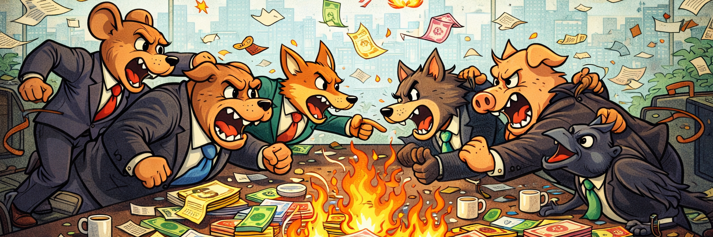
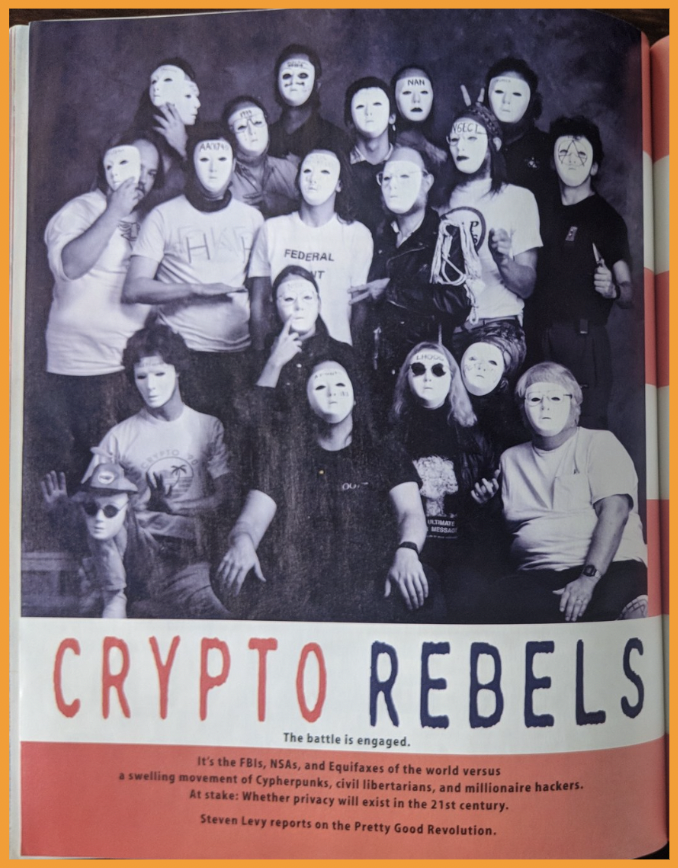

## What Does the Future Hold?


**In 15 years, what is the state of blockchain?**

:::: {.columns}
::: {.column width="50%"}

- The foundation of global digital accountability?
- Supporting niche applications and communities?
- Remembered as a failed technology?

:::
::: {.column width="50%"}

{fig-align="center" width="100%"}

:::
::::


::: {.notes}

**Overall Slide Concept**
This opening slide shifts the lesson from description to forward-looking evaluation. It matters here because the section asks students to think about blockchain as a set of contingent futures rather than a fixed destiny. Emphasize that the rest of the lesson compares plausible trajectories rather than making a prediction.

**Key Points**
- Blockchain’s long-term role remains uncertain and path-dependent.
- Several futures can coexist across sectors instead of one outcome winning everywhere.
- Technology adoption depends on institutions, incentives, and governance as much as engineering.

**Walkthrough**
None

**Sources**
[@nakamoto_bitcoinpeertopeerelectronic_2008]; [@buterin_ethereumnextgenerationsmart_2014]; [@bis_annualeconomicreport_2022]; [@l34_wef_future_blockchain_2026]

:::


## A Spectrum of Futures
<div style="font-size:0.82em; line-height:1.15;">

| Global infrastructure | Niche ecosystem | Decline / fragmentation |
|---|---|---|
| Shared settlement system | Crypto-native markets | Constrained, fragmented adoption |
| CBDCs, tokenized assets, bank integration | DeFi, NFTs, DAOs, on-chain communities | Regulation, technical limits, competing systems |
| Broader institutional adoption | Strongest inside crypto itself | Uneven relevance across sectors and regions |

</div>

***These futures are not mutually exclusive. Which paths expand depends on the incentives blockchain creates and the limits it cannot easily escape.***

::: {.notes}

**Overall Slide Concept**
This slide organizes the lesson around three broad trajectories so the later discussion has a clear structure. It matters here because students need a framework for comparing optimistic, narrow, and pessimistic outcomes. Emphasize that the spectrum is analytical, not prophetic.

**Key Points**
- The lesson compares infrastructure-scale adoption, bounded crypto-native persistence, and fragmentation or decline.
- Each path is shaped by constraints rather than by technical elegance alone.
- The futures can overlap geographically and by use case.

**Walkthrough**
None

**Sources**
[@nakamoto_bitcoinpeertopeerelectronic_2008]; [@buterin_ethereumnextgenerationsmart_2014]; [@bis_annualeconomicreport_2022]; [@l34_wef_future_blockchain_2026]

:::


## Future 1: Global Settlement Layer

- Blockchain integrated into financial infrastructure  
- Banks, CBDCs, and stablecoins interconnected  
- Cross-border payments become faster and more programmable  
- **A shift away from the original tenet of decentralization**
- Supported by the Bank for International Settlements (BIS), central-bank pilots, and tokenization advocates

::: {.notes}

**Overall Slide Concept**
This slide presents the most institutionally ambitious future for blockchain systems. It matters here because it connects public-chain ideas to tokenized money, cross-border payments, and settlement infrastructure. Emphasize that the question is not whether all crypto wins, but whether parts of the stack become durable financial plumbing.

**Key Points**
- This path imagines blockchain-style infrastructure supporting payments, settlements, and tokenized claims.
- Interoperability, settlement speed, and programmable money are the main selling points.
- The strongest support for this future usually comes from institutional experiments rather than ideological arguments.

**Walkthrough**
None

**Sources**
[@bis_annualeconomicreport_2022]; [@l34_bis_annual_report_2024]; [@bis_mbridge_2024]

:::

## Future 2: Specialized Crypto Ecosystem

- Blockchain used in **crypto-native environments**
- Crypto-native = systems whose users, assets, and incentives mostly stay on-chain
- DeFi, NFTs, tokenized assets, and on-chain communities
- Limited integration with traditional systems
- Technology limits, weak social trust, and geopolitical friction still slow broader adoption
- Often implied by International Monetary Fund (IMF) and World Economic Forum (WEF) views that blockchain may remain useful in bounded niches

::: {.notes}

**Overall Slide Concept**
This slide describes a middle-path future in which blockchain remains important but mostly within bounded domains. It matters here because much of today’s ecosystem already looks like this outcome. Emphasize that persistence does not require universal adoption.

**Key Points**
- Crypto-native finance, token communities, and specialized applications can remain active without replacing mainstream infrastructure.
- This future favors niche value creation over wholesale institutional transformation.
- Ethereum-style programmability is especially relevant in this scenario.

**Walkthrough**
None

**Sources**
[@buterin_ethereumnextgenerationsmart_2014]; [@l34_wef_future_blockchain_2026]; [@wang_soktokenizationblockchain_2021]

:::


## Future 3: Decline or Fragmentation

- Blockchain-dependent technologies are overcome by their shortcomings
- Heavy regulation limits growth  
- Technical challenges deter future implementation
- Competing and fragmenting systems further reduce relevance  
- Most strongly associated with skeptical IMF, BIS, and regulatory critiques

::: {.notes}

**Overall Slide Concept**
This slide forces students to take failure or partial failure seriously as an outcome. It matters here because technological possibility does not guarantee broad social or market adoption. Emphasize that fragmentation can mean surviving in pieces rather than vanishing completely.

**Key Points**
- Regulatory pressure, weak user demand, and competing systems can limit adoption.
- Fragmentation may leave isolated niches without one coherent global ecosystem.
- Institutional skepticism often focuses on volatility, coordination cost, and limited net benefit.

**Walkthrough**
None

**Sources**
[@imf_fintechnotes_2025]; [@l34_imf_leaving_wild_west_2023]; [@bis_annualeconomicreport_2022]; [@l34_bis_crypto_multiplier_2023]

:::


## The Real Question

:::: {.columns}
::: {.column width="45%"}

**If blockchain is so powerful...**

**Why isn't everything using it?**

:::
::: {.column width="55%"}

::: {.callout-note appearance="simple"}
**Scalability**

Throughput, latency, and cost still limit many real-world uses.
:::

::: {.callout-tip appearance="simple"}
**Regulation**

States shape who can build, transact, and scale.
:::

::: {.callout-warning appearance="simple"}
**Usability**

Complexity and error risk still block mass adoption.
:::

:::
::::

***The answer is not one flaw. It is accumulated friction across technology, institutions, and users.***

::: {.notes}

**Overall Slide Concept**
This slide acts as the hinge from future scenarios into the constraints that shape them. It matters here because it reframes the lesson from imagining possibilities to evaluating bottlenecks. Emphasize that the important issue is not whether blockchain can do something, but whether it can do it competitively and sustainably.

**Key Points**
- Adoption is blocked by layers of technical, human, and institutional friction.
- No single flaw explains the bottlenecks; the barriers accumulate across the stack.
- The next slides sort those barriers into clearer categories.

**Walkthrough**
None

**Sources**
[@bis_annualeconomicreport_2022]; [@imf_fintechnotes_2025]; [@l34_wef_future_blockchain_2026]

:::

## Technical Constraints

:::: {.columns}
::: {.column width="58%"}

<div style="font-size:0.9em; line-height:1.1;">

- scalability limits
- tradeoffs between decentralization, security, and speed
- fee spikes and latency under heavy demand
- scaling layers improve throughput, but add complexity and new trust assumptions

</div>

:::
::: {.column width="42%"}

```{mermaid}
%%{init: {"theme":"neutral", "fontFamily": "Segoe UI, Roboto, Helvetica, Arial, sans-serif"}}%%
graph TD
    subgraph part1[" "]
        A(Decentralization) --- B(Security)
        B --- C(Scalability)
        C --- A
    end

    subgraph part2["  "]
        D(Bitcoin / Ethereum L1) -- Prioritizes --> A
        D -- Prioritizes --> B
        E(Visa / Centralized DB) -- Prioritizes --> B
        E -- Prioritizes --> C
        F(Some 'Fast' Blockchains) -- May Sacrifice --> A
    end

    style A fill:#f9f,stroke:#333,stroke-width:2px
    style B fill:#ccf,stroke:#333,stroke-width:2px
    style C fill:#cfc,stroke:#333,stroke-width:2px
```

:::
::::

***Some barriers are architectural--not temporary.***

::: {.notes}

**Overall Slide Concept**
This slide gathers the engineering limitations that bound blockchain adoption. It matters here because students need to see scalability and security tradeoffs as structural constraints, not merely unfinished optimization work. Emphasize that the trilemma is shorthand for competing system goals.

**Key Points**
- Throughput, latency, and decentralization often pull in different directions.
- Scaling techniques usually relocate costs or trust assumptions rather than eliminating them.
- Technical limits shape where blockchain is plausible and where it is not.

**Walkthrough**
None

**Sources**
[@croman_scalingdecentralizedblockchains_2016]; [@buterin_ethereumnextgenerationsmart_2014]

:::


## Human & Economic Constraints

<div style="font-size:0.86em; line-height:1.08;">
::::: {.columns}
::: {.column width="50%"}

**Usability Challenges**

- Complex key management  
- Risk of irreversible mistakes and predatory practices
- Poor interfaces and opaque requirements

:::

::: {.column width="50%"}

**Governance & Incentives**

- Protocol changes still require coordination and agreement  
- Voting can favor insiders  
- Incentives can reward short-term gain over stability  

:::
::::: 
<div style="text-align:center; margin-top:0.35rem;">
  
</div>

<div style="font-size:0.84em;">

***Even perfect code cannot overcome people, incentives, and coordination issues.***

</div>
</div>

::: {.notes}

**Overall Slide Concept**
This slide shifts the analysis from engineering to user behavior and incentives. It matters here because systems fail in practice when ordinary users cannot operate them safely or when incentives misalign. Emphasize that usability and governance are part of system design, not add-ons.

**Key Points**
- Key management remains difficult for mainstream users.
- Token incentives can attract participation while also distorting behavior and governance.
- Economic sustainability matters as much as technical novelty.

**Walkthrough**
None

**Sources**
[@u.c.f.library_digitalwalletsoverview_2022]; [@voskobojnikov_userperceptionbitcoin_2019]; [@l34_imf_leaving_wild_west_2023]

:::


## External Constraints

:::: {.columns}
::: {.column width="62%"}

<div style="font-size:0.9em; line-height:1.12;">

- **Regulation and compliance** shape who can legally build, issue, and transact  
- **Energy consumption and resource use** keep proof-of-work systems on the political agenda  
- **High price volatility** can undermine trust in crypto as money or savings  

</div>

:::
::: {.column width="38%"}

{fig-align="center" width="82%"}

<div style="font-size:0.52em; line-height:1.05;">

*Image source: [Wikimedia Commons, Vogtle NPP](https://en.wikipedia.org/wiki/Nuclear_power_plant#/media/File:Vogtle_NPP.jpg)*

</div>

:::
:::: 

::: {.callout-note appearance="simple"}
The Cambridge Digital Mining Industry Report estimated Bitcoin's annual electricity consumption at about **138 TWh as of June 30, 2024**, roughly **0.54% of global electricity usage**. 
:::

***Public legitimacy can limit adoption even when the technology works.***

::: {.notes}

**Overall Slide Concept**
This slide captures the pressures that come from outside the protocol itself. It matters here because legal, environmental, and geopolitical forces shape what blockchain systems are allowed to become. Emphasize that external constraints can redirect design even when the protocol still functions technically.

**Key Points**
- Regulation affects identity, compliance, custody, and market access.
- Energy use and environmental framing remain salient, especially for Proof of Work systems.
- Blockchain systems must coexist with states, firms, and infrastructure providers.

**Walkthrough**
None

**Sources**
[@l33_fatf_fatf_targeted_update_on_implementation_of_the_fatf_stan_2025]; [@bis_annualeconomicreport_2022]; [@imf_fintechnotes_2025]; [@cambridgecentreforalternativefinance_cambridgeblockchainnetwork_2025]

:::

## Two Powerful Technologies Collide

:::: {.columns}
::: {.column width="50%"}

::: {.callout-tip appearance="simple"}
**Artificial Intelligence**

- Automates analysis and decision-making  
- Finds patterns across large data sets  
- Scales action faster than human teams  
:::

:::
::: {.column width="50%"}

::: {.callout-note appearance="simple"}
**Blockchain Systems**

- Shared rules and records  
- Traceable execution  
- Shared state across participants  
- Verifiable transactions without one central operator  
:::

:::
::::

***Together, they can amplify both coordination and failure at machine speed.***

::: {.notes}

**Overall Slide Concept**
This slide introduces the AI subsection by showing why blockchain’s future may be reshaped by another general-purpose technology. It matters here because the course is closing by asking what new combinations could change the stakes. Emphasize that the interest is in interaction effects, not tech buzzword stacking.

**Key Points**
- AI changes how cheaply systems can analyze, predict, and automate decisions.
- Blockchain changes how shared records, execution, and coordination can be structured.
- Their intersection creates both new operational possibilities and new systemic risks.

**Walkthrough**
None

**Sources**
[@chainalysis_reports_2025]; [@l34_wef_future_blockchain_2026]

:::


## Opportunities

- **Smart contract auditing:** AI can review large codebases and flag risky patterns faster than human teams alone.
- **Fraud detection and monitoring:** models can scan transaction graphs and identify suspicious flows at machine speed.
- **Autonomous economic agents:** software agents can evaluate conditions and execute on-chain actions continuously.

***Near-term opportunities mostly improve monitoring, verification, and automation inside existing systems.***

::: {.notes}

**Overall Slide Concept**
This slide focuses the AI discussion on practical upside rather than abstract hype. It matters here because students should be able to name concrete areas where AI may complement blockchain operations. Emphasize that the strongest opportunities are often analytic and operational first.

**Key Points**
- AI can support fraud detection, code review, and monitoring of blockchain systems.
- Automation can improve triage and reduce some manual oversight burdens.
- Machine actors may participate in markets and protocol processes in new ways.

**Walkthrough**
None

**Sources**
[@chainalysis_reports_2025]; [@l34_chainalysis_reports_2026]

:::


## Opportunity: Authenticity and Provenance

- **Content authenticity and provenance:** blockchain-backed credentials can help certify origin, edits, and ownership in an age of deepfakes.
- **Machine-readable provenance chains:** AI systems and platforms can check whether media carries trustworthy history rather than relying only on surface realism.

::: {.callout-note appearance="simple"}
NIST's 2024 report on synthetic-content risks argues that authentication, provenance, labeling, and auditing tools will be central to distinguishing trustworthy content from manipulated media. In parallel, the C2PA standard promotes **Content Credentials** so creators and platforms can preserve provenance and edit history. This is one area where blockchain-style integrity records and content credentials could matter well beyond finance.
:::

::: {.notes}

**Overall Slide Concept**
This slide broadens the opportunity discussion beyond finance into trust infrastructure. It matters here because AI-generated content raises demand for systems that can preserve provenance and accountability. Emphasize that blockchain may help anchor records, but it cannot by itself guarantee truth about the physical world.

**Key Points**
- Synthetic media increases the value of durable provenance and integrity records.
- Blockchain-style registries may help track how content or credentials were issued and changed.
- The hardest problems remain capture trust, standard adoption, and endpoint integrity.

**Walkthrough**
None

**Sources**
[@l34_c2pa_content_credentials_2026]; [@parsons_contentcredentialsc2pa_2024]

:::


## Risks

:::: {.columns}
::: {.column width="50%"}

::: {.callout-warning appearance="simple"}
**AI-driven exploits**

Models can scan contracts, wallet patterns, and public code faster than human attackers alone.
:::

::: {.callout-warning appearance="simple"}
**Governance manipulation**

Agents can optimize bribery, messaging, or voting strategies in token-governed systems.
:::

:::
::: {.column width="50%"}

::: {.callout-warning appearance="simple"}
**Automated large-scale attacks**

Automation lets one attacker probe many contracts, protocols, or users at once.
:::

::: {.callout-warning appearance="simple"}
**AI errors at scale**

Hallucinated, brittle, or overconfident systems can cause real on-chain damage if trusted too quickly.
:::

:::
::::

***AI does not just strengthen defenders. It also compresses the time between weakness, exploitation, and irreversible loss.***

::: {.notes}

**Overall Slide Concept**
This slide balances the opportunity discussion by focusing on how AI can scale malicious capability. It matters here because technological convergence increases both defensive and offensive capacity. Emphasize that automation changes the speed and scale of exploitation.

**Key Points**
- AI can lower the barrier to discovering or exploiting contract vulnerabilities.
- Automated systems can amplify fraud, phishing, and governance manipulation.
- The same tools that aid defenders can aid attackers.

**Walkthrough**
None

**Sources**
[@chainalysis_reports_2025]; [@l34_chainalysis_reports_2026]

:::

## Cryptographically Relevant Quantum Threat

<div style="font-size:0.82em; line-height:1.08;">

A cryptographically relevant quantum computer is one powerful enough to run attacks such as Shor's algorithm against today's public-key cryptography. For blockchain systems, this means possible recovery of private keys from exposed public keys and the forgery of valid signatures.

:::: {.columns}
::: {.column width="50%"}

::: {.callout-warning appearance="simple" style="background:#FCE8E8; border-left-color:#C95C5C;"}
**What is threatened**

- **ECDSA and similar signatures** secure wallet ownership and transaction authorization  
- **Public-to-private key security assumptions** could break if large fault-tolerant quantum machines arrive  
- **Exposed public keys** would be highly vulnerable to these attacks

:::

:::
::: {.column width="50%"}

::: {.callout-warning appearance="simple" style="background:#FCE8E8; border-left-color:#C95C5C;"}
**Why blockchains are hard to patch**

- **Blockchain trust models rely on cryptography**, so this is a system-level problem rather than a single bug  
- **Migration requires social coordination** across wallets, clients, exchanges, and users  
- **Decentralized communities must agree on upgrades**, timing, and standards before the threat becomes urgent  

:::

:::
::::

***The threat is real, but the harder problem may be coordinated migration before a crisis arrives.***

</div>

::: {.notes}

**Overall Slide Concept**
This slide introduces a future risk that directly targets the cryptographic assumptions behind blockchain ownership and security. It matters here because students should understand why long-lived systems must plan for assumption failure before it arrives. Emphasize that public-key systems are the most immediately relevant concern here.

**Key Points**
- Bitcoin and Ethereum rely heavily on public-key cryptography such as ECDSA.
- Quantum attacks matter most where exposed public keys or migration delays create openings.
- The risk is serious even if timelines remain uncertain.

**Walkthrough**
None

**Sources**
[@l34_nist_pqc_project_2026]; [@l34_nsa_quantum_guidance_2026]; [@boneh_quantumcryptographyimplications_2020]

:::


## What Can Be Done

:::: {.columns}
::: {.column width="62%"}

<div style="font-size:0.9em; line-height:1.12;">

- **Post-quantum cryptography (PQC):** NIST is standardizing algorithms intended to survive quantum attacks.
- **Protocol migration strategies:** networks need staged upgrades, wallet support, and governance coordination.
- **Hybrid cryptographic systems:** during transition, systems may combine classical and PQC methods to reduce migration risk.

</div>

:::
::: {.column width="38%"}

{fig-align="center" width="82%"}

:::
::::

::: {.notes}

**Overall Slide Concept**
This slide turns the quantum discussion from threat description to migration planning. It matters here because the key instructional point is not panic, but transition strategy under uncertainty. Emphasize that post-quantum adoption is a governance and coordination challenge as much as a cryptographic one.

**Key Points**
- Post-quantum algorithms are being standardized and tested now.
- Migration will likely be gradual and hybrid rather than instantaneous.
- Blockchain systems must coordinate wallet, protocol, and user-level transitions.

**Walkthrough**
None

**Sources**
[@l34_nist_pqc_project_2026]; [@l34_nsa_quantum_guidance_2026]

:::


## The Original Vision

:::: {.columns}
::: {.column width="58%"}

<div style="font-size:0.9em; line-height:1.12;">

> “Privacy is necessary for an open society in the electronic age.”  
> — Eric Hughes, *A Cypherpunk’s Manifesto*

- Privacy through cryptography  
- Decentralized systems  
- Resistance to centralized authority  

</div>

:::
::: {.column width="42%"}

{fig-align="center" width="82%"}

:::
::::

***Blockchain began not only as a technical project, but as a political vision of privacy, autonomy, and decentralization.***

::: {.notes}

**Overall Slide Concept**
This slide returns to the ideological roots of blockchain before the lesson moves into final synthesis. It matters here because the course is not only about systems engineering, but also about the ideas that motivated those systems. Emphasize privacy, decentralization, and resistance to centralized control as the key roots.

**Key Points**
- Cypherpunk thinking treated cryptography as a tool for freedom and privacy.
- Bitcoin emerged from a tradition that distrusted centralized control over digital life.
- The original vision was political as well as technical.

**Walkthrough**
None

**Sources**
[@hughes_cypherpunksmanifesto_1993]; [@l34_cypherpunk_manifesto_1993]

:::

## Why It Mattered

<div style="font-size:0.9em; line-height:1.08; margin-bottom:0.15rem;">
- Early cryptography ideas became money, platforms, and policy experiments  
- Each milestone changed how developers, markets, and states understood blockchain  
- The pattern is not steady progress, but cycles of launch, hype, failure, and redesign  
</div>
<div style="margin-top:-4.0rem;">

```{dot}
#| fig-width: 8.5
#| fig-height: 5.4
#| out-width: 100%
digraph HistoryTimeline {
  rankdir=TB;
  graph [pad="0.12", nodesep="0.22", ranksep="0.62", splines=ortho];
  node [shape=box, style="rounded,filled", fontname="Helvetica", fontsize=9.2, margin="0.06,0.04", fillcolor="#EAF2FF", color="#2F5D8A"];
  edge [color="#6B7280", penwidth=1.2, arrowhead=none];

  n1 [shape=circle, width=0.14, fixedsize=true, label="", fillcolor="#6B7280", color="#6B7280"];
  n2 [shape=circle, width=0.14, fixedsize=true, label="", fillcolor="#6B7280", color="#6B7280"];
  n3 [shape=circle, width=0.14, fixedsize=true, label="", fillcolor="#6B7280", color="#6B7280"];
  n4 [shape=circle, width=0.14, fixedsize=true, label="", fillcolor="#6B7280", color="#6B7280"];
  n5 [shape=circle, width=0.14, fixedsize=true, label="", fillcolor="#6B7280", color="#6B7280"];
  n6 [shape=circle, width=0.14, fixedsize=true, label="", fillcolor="#6B7280", color="#6B7280"];
  n7 [shape=circle, width=0.14, fixedsize=true, label="", fillcolor="#6B7280", color="#6B7280"];
  n8 [shape=circle, width=0.14, fixedsize=true, label="", fillcolor="#6B7280", color="#6B7280"];
  n9 [shape=circle, width=0.14, fixedsize=true, label="", fillcolor="#6B7280", color="#6B7280"];
  n10 [shape=circle, width=0.14, fixedsize=true, label="", fillcolor="#6B7280", color="#6B7280"];
  n11 [shape=circle, width=0.14, fixedsize=true, label="", fillcolor="#6B7280", color="#6B7280"];
  n12 [shape=circle, width=0.14, fixedsize=true, label="", fillcolor="#6B7280", color="#6B7280"];
  n13 [shape=circle, width=0.14, fixedsize=true, label="", fillcolor="#6B7280", color="#6B7280"];
  n14 [shape=circle, width=0.14, fixedsize=true, label="", fillcolor="#6B7280", color="#6B7280"];
  n15 [shape=circle, width=0.14, fixedsize=true, label="", fillcolor="#6B7280", color="#6B7280"];
  n16 [shape=circle, width=0.14, fixedsize=true, label="", fillcolor="#6B7280", color="#6B7280"];
  n17 [shape=circle, width=0.14, fixedsize=true, label="", fillcolor="#6B7280", color="#6B7280"];
  n18 [shape=circle, width=0.14, fixedsize=true, label="", fillcolor="#6B7280", color="#6B7280"];
  n19 [shape=circle, width=0.14, fixedsize=true, label="", fillcolor="#6B7280", color="#6B7280"];
  n20 [shape=circle, width=0.14, fixedsize=true, label="", fillcolor="#6B7280", color="#6B7280"];

  t1 [label="1983\nBlind\nsignatures", URL="https://doi.org/10.1007/978-1-4757-0602-4_18", target="_blank", tooltip="Blind Signatures for Untraceable Payments"];
  b2 [label="1993\nCypherpunk\nmanifesto", URL="https://www.activism.net/cypherpunk/manifesto.html", target="_blank", tooltip="A Cypherpunk's Manifesto"];
  t3 [label="1997\nHashcash", URL="https://www.hashcash.org/papers/", target="_blank", tooltip="Hashcash papers"];
  b4 [label="1998-2005\nb-money /\nBit Gold", URL="http://www.weidai.com/bmoney.txt", target="_blank", tooltip="b-money and Bit Gold precursors"];
  t5 [label="2008\nBitcoin\nwhitepaper", URL="https://bitcoin.org/whitepaper.pdf", target="_blank", tooltip="Bitcoin whitepaper"];
  b6 [label="2009\nBitcoin\nlaunch", URL="https://satoshi.nakamotoinstitute.org/quotes/releases/", target="_blank", tooltip="Bitcoin v0.1 released"];
  t7 [label="2015\nEthereum\nlaunch", URL="https://blog.ethereum.org/2015/07/30/ethereum-launches", target="_blank", tooltip="Ethereum launches"];
  b8 [label="2016\nDAO exploit /\nETH fork", URL="https://blog.ethereum.org/2016/07/20/hard-fork-completed", target="_blank", tooltip="The DAO hard fork"];
  t9 [label="2017\nBitcoin Cash\nfork", URL="https://venturebeat.com/business/as-bitcoin-splits-its-clone-stumbles-out-of-the-gate/", target="_blank", tooltip="Bitcoin Cash fork"];
  b10 [label="2018\nUSDC\nlaunch", URL="https://www.circle.com/blog/introducing-usd-coin", target="_blank", tooltip="Introducing USD Coin"];
  t11 [label="2019\nLibra\nproposal", URL="https://www.diem.com/en-us/updates/introducing-libra/", target="_blank", tooltip="Introducing Libra"];
  b12 [label="2020\nSand Dollar\nrollout", URL="https://www.centralbankbahamas.com/news/public-notices/the-sand-dollar-is-on-schedule-for-gradual-national-release-to-the-bahamas-in-mid-october-2020", target="_blank", tooltip="Sand Dollar rollout"];
  t13 [label="2020\nDeFi\nsummer", URL="https://www.chainalysis.com/blog/2021-global-defi-adoption-index/", target="_blank", tooltip="DeFi growth in 2020"];
  b14 [label="2021\nEl Salvador\nBitcoin law", URL="https://investinelsalvador.gob.sv/download/bitcoin-law/", target="_blank", tooltip="Bitcoin Law"];
  t15 [label="2022\nTerra\ncollapse", URL="https://www.euronews.com/next/2022/05/11/fintech-crypto-currency-terra", target="_blank", tooltip="Terra collapse"];
  b16 [label="2022\nEthereum\nMerge", URL="https://ethereum.org/roadmap/merge/", target="_blank", tooltip="The Merge"];
  t17 [label="2022\nFTX\nbankruptcy", URL="https://www.aljazeera.com/economy/2022/11/11/distressed-crypto-exchange-ftx-files-for-bankruptcy", target="_blank", tooltip="FTX bankruptcy"];
  b18 [label="2023\nMiCA\nadopted", URL="https://eur-lex.europa.eu/summary/EN/legissum:4626998", target="_blank", tooltip="MiCA regulation"];
  t19 [label="2024\nSpot BTC\nETFs", URL="https://www.congress.gov/crs-product/IF12573", target="_blank", tooltip="Spot Bitcoin ETFs"];
  b20 [label="2024\nmBridge\nMVP", URL="https://www.bis.org/about/bisih/topics/cbdc/mcbdc_bridge.htm", target="_blank", tooltip="Project mBridge MVP"];

  {rank=min; t1; t3; t5; t7; t9; t11; t13; t15; t17; t19;}
  {rank=same; n1; n2; n3; n4; n5; n6; n7; n8; n9; n10; n11; n12; n13; n14; n15; n16; n17; n18; n19; n20;}
  {rank=max; b2; b4; b6; b8; b10; b12; b14; b16; b18; b20;}

  n1 -> n2 -> n3 -> n4 -> n5 -> n6 -> n7 -> n8 -> n9 -> n10 -> n11 -> n12 -> n13 -> n14 -> n15 -> n16 -> n17 -> n18 -> n19 -> n20;

  t1 -> n1 [minlen=1];
  n2 -> b2 [minlen=1];
  t3 -> n3 [minlen=1];
  n4 -> b4 [minlen=1];
  t5 -> n5 [minlen=1];
  n6 -> b6 [minlen=1];
  t7 -> n7 [minlen=1];
  n8 -> b8 [minlen=1];
  t9 -> n9 [minlen=1];
  n10 -> b10 [minlen=1];
  t11 -> n11 [minlen=1];
  n12 -> b12 [minlen=1];
  t13 -> n13 [minlen=1];
  n14 -> b14 [minlen=1];
  t15 -> n15 [minlen=1];
  n16 -> b16 [minlen=1];
  t17 -> n17 [minlen=1];
  n18 -> b18 [minlen=1];
  t19 -> n19 [minlen=1];
  n20 -> b20 [minlen=1];
}
```

</div>

::: {.notes}

**Overall Slide Concept**
This slide condenses the course into a historical arc showing why blockchain became globally significant. It matters here because students need a timeline of how ideas became infrastructure, markets, failures, and policy debates. Emphasize that significance came from real-world uptake, not just elegant design.

**Key Points**
- The field moved from cryptographic proposals to functioning networks and then to major institutions and regulators.
- Launches, hacks, forks, stablecoins, and state responses repeatedly changed the meaning of blockchain.
- Historical moments matter because they show how technical systems become social and geopolitical systems.

**Walkthrough**
None

**Sources**
[@back_hashcashdenialservice_2002]; [@nakamoto_bitcoinpeertopeerelectronic_2008]; [@buterin_ethereumnextgenerationsmart_2014]; [@l34_circle_usdc_2018]; [@l33_european_central_bank_ecb_progress_on_the_digital_euro_2025]; [@bis_mbridge_2024]

:::


## What Actually Happened

::::: {.columns}
::: {.column width="50%"}

::: {.callout-tip appearance="simple"}
**Original Vision**

- Permissionless systems  
- Privacy by default  
- Grassroots participation  
:::

:::

::: {.column width="50%"}

::: {.callout-warning appearance="simple"}
**Modern Reality**

- Institutional adoption  
- Regulatory oversight  
- Corporate ecosystems  
:::

:::

::::: 

Real-world adoption pressures reshaped blockchain from a pure ideology into a hybrid mix of opportunity, compromise, and constraint.

*The result is a system constantly pulled between decentralization and institutional control.*


::: {.notes}

**Overall Slide Concept**
This slide compares the original vision with the ecosystem that actually emerged. It matters here because the lesson now asks students to judge blockchain by lived outcomes rather than initial hopes. Emphasize the mismatch between pure decentralization rhetoric and mixed institutional reality.

**Key Points**
- Institutions, exchanges, and regulators became central actors in many parts of the ecosystem.
- Real-world adoption required compromise with existing legal and economic systems.
- Blockchain today reflects both original ideals and accumulated practical constraints.

**Walkthrough**
None

**Sources**
[@nakamoto_bitcoinpeertopeerelectronic_2008]; [@buterin_ethereumnextgenerationsmart_2014]; [@bis_annualeconomicreport_2022]; [@l34_imf_leaving_wild_west_2023]

:::


## The Core Tension

:::: {.columns}
::: {.column width="50%"}

::: {.callout-note appearance="simple"}
**Decentralization**

- Openness and censorship resistance  
- Fewer gatekeepers  
- Harder for any one actor to dominate the system  
:::

:::
::: {.column width="50%"}

::: {.callout-warning appearance="simple"}
**Control / Regulation**

- Compliance, monitoring, and accountability  
- Easier intervention when systems fail  
- Easier integration with institutions  
:::

:::
::::

***These goals are in tension: more control often reduces openness, while more openness often limits control.***

::: {.notes}

**Overall Slide Concept**
This slide states the main unresolved tension that runs through the entire course. It matters here because nearly every design choice students studied can be read as a negotiation between openness and control. Emphasize that this tension is not a bug in the course narrative; it is the central theme of the field itself.

**Key Points**
- Decentralization promises openness, resilience, and reduced gatekeeping.
- Control promises compliance, recovery, and manageability for large institutions.
- Most real systems live somewhere between those poles.

**Walkthrough**
None

**Sources**
[@hughes_cypherpunksmanifesto_1993]; [@bis_annualeconomicreport_2022]; [@imf_fintechnotes_2025]

:::

## When Blockchain Systems Broke

- [**Mt. Gox**](https://www.mtgox.com/): a centralized exchange collapse that showed protocol security does not protect users from custodial failure.  
- [**The DAO**](https://blog.ethereum.org/2016/06/17/critical-update-re-dao-vulnerability): a smart-contract exploit that exposed how code flaws can undermine decentralized systems.  
- [**ICO bubble**](https://www.sec.gov/ICO): speculative fundraising without real products, often ending in losses and later enforcement.  
- [**Terra/Luna**](https://www.sec.gov/litigation/complaints/2023/comp-pr2023-32.pdf): an algorithmic design failure that triggered contagion across the broader crypto market.  
- [**FTX**](https://restructuring.ra.kroll.com/FTX/): a reminder that old-fashioned fraud and mismanagement still thrive inside crypto intermediaries.  

::: {.notes}

**Overall Slide Concept**
This slide gathers major failures to remind students that the ecosystem must be judged under stress, not only in theory. It matters here because failure analysis is one of the best ways to test whether students truly understand system dependencies. Emphasize that breakdowns happened at multiple layers, not only in one place.

**Key Points**
- Custodial failures, smart-contract failures, and economic failures each exposed different weaknesses.
- Repeated crises showed that trust never disappears; it moves to new locations.
- Studying failure reveals which assumptions were unrealistic or poorly enforced.

**Walkthrough**
None

**Sources**
[@l34_euronews_reuters_terra_2022]; [@l34_aljazeera_reuters_ftx_bankruptcy_2022]; [@sec_sec_2025]

:::


## Key Lessons

:::: {.columns}
::: {.column width="33%"}

::: {.callout-note appearance="simple"}
**Cryptography != trustlessness**

Trust shifts into code, operators, and institutions rather than disappearing.
:::

:::
::: {.column width="33%"}

::: {.callout-tip appearance="simple"}
**Incentives shape outcomes**

Bad incentives can break systems even when the software works as designed.
:::

:::
::: {.column width="33%"}

::: {.callout-warning appearance="simple"}
**Security is continuous**

Auditing, monitoring, and migration are recurring requirements, not one-time fixes.
:::

:::
::::

***The deepest lesson is that blockchain does not escape politics, incentives, or human failure. It reorganizes them.***


::: {.notes}

**Overall Slide Concept**
This slide distills the course’s main lessons after the failures and futures have both been considered. It matters here because students now need a compact set of ideas to carry into the exam and beyond the course. Emphasize trust relocation, incentive design, and adaptive security as the durable takeaways.

**Key Points**
- Blockchain changes where trust lives rather than removing trust altogether.
- Human behavior and incentives matter as much as protocol rules.
- Security and governance require continual maintenance, not one-time design.

**Walkthrough**
None

**Sources**
[@yaga_blockchaintechnologyoverview_2018]; [@bonneau_sokresearchperspectives_2015]; [@bis_annualeconomicreport_2022]

:::

## What Is Blockchain Really?

- **Technology:** a distributed system for consensus, verification, and programmable coordination
- **Political system:** a debate over decentralization, control, censorship resistance, and governance
- **Financial experiment:** a live environment for new assets, markets, incentives, and failure modes

Blockchain’s future depends on how those three dimensions reinforce or constrain one another.

::: {.notes}

**Overall Slide Concept**
This slide performs the final conceptual synthesis of the course. It matters here because the instructor now needs to show students that no single disciplinary lens fully captures blockchain. Emphasize that the technology can simultaneously be a distributed system, a political project, and a financial substrate depending on perspective.

**Key Points**
- Technical, political, and economic descriptions each capture a real part of blockchain.
- Different stakeholders emphasize different aspects because they face different risks and incentives.
- The most mature understanding is plural rather than reductionist.

**Walkthrough**
None

**Sources**
[@yaga_blockchaintechnologyoverview_2018]; [@bis_annualeconomicreport_2022]; [@imf_fintechnotes_2025]

:::


## Discussion

- **Which future is most likely—and why?**
- **Where are the biggest risks in blockchain systems today?**
- **Where are the biggest opportunities to leverage blockchains?**
- **Is blockchain more political or technical?**
- **What would need to change for mass adoption?**

::: {.notes}

**Overall Slide Concept**
This final slide turns the close of the course back toward student reasoning. It matters here because the best end-state is not rote recall but defensible judgment about tradeoffs, futures, and risks. Emphasize evidence-based synthesis rather than one correct opinion.

**Key Points**
- The discussion questions ask students to weigh competing futures and constraints.
- Strong responses should connect technical design to governance and real-world incentives.
- The goal is to demonstrate judgment built from the whole course.

**Walkthrough**
None

**Sources**
None

:::

## References
