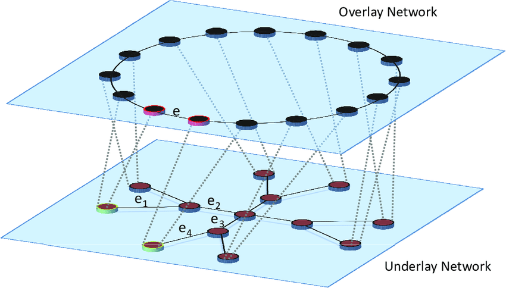
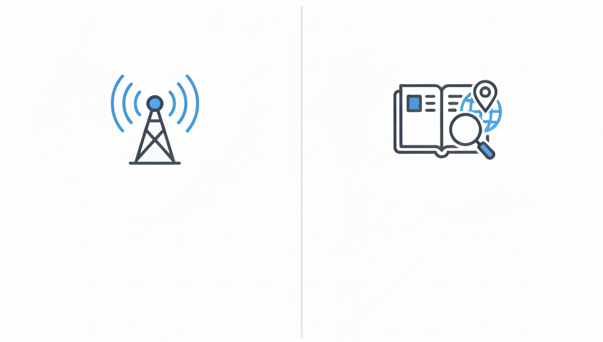

## From P2P Models to P2P Design {.smaller}

* In our last lesson, we saw the high-level P2P architectures:

  - **Hybrid** (*Napster*): A central server for *finding* peers, but direct P2P for *transfer*.
  - **Gossip** (*Gnutella 0.4*): A chaotic "flooding" model that scaled poorly.
  - **Supernode** (*Gnutella 0.6*): 
      + "Smart" gossip model where powerful *Full Nodes* serve weaker *Light clients*.
      + Blockchains use this model.

* But this raises the *real* engineering questions:

  > - How does a peer *gossip*? How does it find other peers to talk to?
  > - How do you build an "address book" for a P2P network *without* a central server?
  > - What happens when peers constantly join and leave?

* In this lesson, we dive into the "plumbing" of P2P by exploring the two main types of **overlay networks** and the critical security problems they face.

::: {.notes}

**Overall Slide Concept**
This opening slide establishes the shift from naming P2P models to engineering the overlay mechanisms that make them work. It matters here because students now need to understand discovery, routing, and churn rather than just high-level architecture labels. Emphasize that this is the “plumbing” lesson for how peers actually find, reach, and maintain one another.

**Key Points**
- The lesson moves from architectural categories into concrete overlay design choices.
- Discovery, routing, and membership maintenance are the core engineering questions in P2P systems.
- These same mechanics matter directly for blockchain networking and decentralized storage.

**Walkthrough**
None

**Sources**
@kirk_gnutellaprotocolspecification_2004; @stoica_chordscalablepeertopeer_2001; @nakamoto_bitcoinpeertopeerelectronic_2008

:::

## What is an "Overlay Network?" {.smaller}

**Overlay Network** 

 : A *logical* map built on top of the *physical* internet. It's the "rules of the road" that peers use to find each other and share data, without a central server.



::: {.notes}

**Overall Slide Concept**
This slide establishes the idea of an overlay network as the logical network peers construct on top of the physical internet. It matters here because later routing examples only make sense once students separate physical links from application-level neighbor relationships. Emphasize that overlays are software-defined communication maps, not physical rewiring.

**Key Points**
- An overlay is a logical topology built on top of the internet’s physical infrastructure.
- It defines which peers know about each other and how messages move through the application.
- P2P behavior is determined as much by overlay rules as by raw internet connectivity.

**Walkthrough**
None

**Sources**
@stoica_chordscalablepeertopeer_2001; @ratnasamy_scalablecontentaddressablenetwork_2001

:::

## Unstructured Overlay Networks {.smaller}

:::: {.columns}
::: {.column width="48%"}
* **What it is:** A random mesh of peer connections.
* **Analogy:** Shouting in a crowded room.
* **How it finds things:** A peer floods a query to all neighbors, and each neighbor forwards it again.
* **Why it works:** It is simple and resilient under churn.
* **Why it hurts:** It creates duplicates, wasted traffic, and broadcast storms.
:::
::: {.column width="52%"}
```{dot}
#| fig-width: 5.4
#| fig-height: 4.8
digraph Flood {
  graph [layout=neato, overlap=false, splines=true, outputorder=edgesfirst, bgcolor="transparent"];
  node [shape=circle, fixedsize=true, width=0.58, style="filled", fontname="Helvetica", fontsize=10];
  edge [color="#cbd5e1", penwidth=1.6, arrowhead=none];

  A [label="0", pos="0.2,2.1!", fillcolor="#dcfce7", color="#15803d", penwidth=2.2];
  B [label="1", pos="1.8,2.5!", fillcolor="#dbeafe", color="#2563eb"];
  C [label="2", pos="3.4,1.8!", fillcolor="#dbeafe", color="#2563eb"];
  D [label="2", pos="1.0,0.7!", fillcolor="#dbeafe", color="#2563eb"];
  E [label="3", pos="2.8,0.8!", fillcolor="#fef3c7", color="#d97706"];
  F [label="2", pos="4.9,2.3!", fillcolor="#fef3c7", color="#d97706"];
  G [label="4", pos="5.1,0.2!", fillcolor="#fecaca", color="#dc2626"];
  H [label="1", pos="0.1,-1.0!", fillcolor="#fef3c7", color="#d97706"];
  I [label="4", pos="2.7,-1.4!", fillcolor="#fecaca", color="#dc2626"];
  J [label="1", pos="6.2,1.1!", fillcolor="#fee2e2", color="#dc2626"];
  K [label="2", pos="5.4,-1.3!", fillcolor="#fee2e2", color="#dc2626"];
  L [label="2", pos="1.2,-2.4!", fillcolor="#fee2e2", color="#dc2626"];

  A -> B; A -> C; A -> D;
  B -> C; B -> D; B -> E;
  C -> E; C -> F; C -> G;
  D -> E; D -> H; D -> I;
  E -> F; E -> G; E -> I;
  F -> G; F -> J;
  G -> I; G -> J; G -> K;
  H -> I; H -> L;
  I -> G; I -> K; I -> L;

  A -> B [color="#2563eb", penwidth=2.8, arrowhead=normal];
  A -> C [color="#2563eb", penwidth=2.8, arrowhead=normal];
  A -> D [color="#2563eb", penwidth=2.8, arrowhead=normal];

  B -> C [color="#f59e0b", penwidth=2.2, arrowhead=normal];
  B -> D [color="#f59e0b", penwidth=2.2, arrowhead=normal];
  B -> E [color="#f59e0b", penwidth=2.2, arrowhead=normal];
  C -> E [color="#f59e0b", penwidth=2.2, arrowhead=normal];
  C -> F [color="#f59e0b", penwidth=2.2, arrowhead=normal];
  C -> G [color="#f59e0b", penwidth=2.2, arrowhead=normal];
  D -> E [color="#f59e0b", penwidth=2.2, arrowhead=normal];
  D -> H [color="#f59e0b", penwidth=2.2, arrowhead=normal];
  D -> I [color="#f59e0b", penwidth=2.2, arrowhead=normal];

  E -> F [color="#dc2626", penwidth=2.0, arrowhead=normal];
  E -> G [color="#dc2626", penwidth=2.0, arrowhead=normal];
  E -> I [color="#dc2626", penwidth=2.0, arrowhead=normal];
  F -> G [color="#dc2626", penwidth=2.0, arrowhead=normal];
  F -> J [color="#dc2626", penwidth=2.0, arrowhead=normal];
  G -> I [color="#dc2626", penwidth=2.0, arrowhead=normal];
  G -> J [color="#dc2626", penwidth=2.0, arrowhead=normal];
  G -> K [color="#dc2626", penwidth=2.0, arrowhead=normal];
  H -> I [color="#dc2626", penwidth=2.0, arrowhead=normal];
  H -> L [color="#dc2626", penwidth=2.0, arrowhead=normal];
  I -> G [color="#dc2626", penwidth=2.0, arrowhead=normal];
  I -> K [color="#dc2626", penwidth=2.0, arrowhead=normal];
  I -> L [color="#dc2626", penwidth=2.0, arrowhead=normal];
}
```

:::: {.callout-note appearance="simple"}
Numbers show how many copies each peer receives. Flooding keeps going until every peer that learns the message has forwarded it, so outer peers are effectively in a race to rebroadcast first.
::::
:::
::::

::: {.notes}

**Overall Slide Concept**
This slide establishes unstructured overlays as the simplest P2P design: random neighbor connections plus flooding-based search. It matters here because students need a baseline decentralized routing strategy before seeing more organized DHT approaches. Emphasize resilience and simplicity first, then the cost of duplicated traffic.

**Key Points**
- Unstructured overlays connect peers in a random mesh rather than a carefully organized geometry.
- Search typically works by flooding or gossiping requests outward through neighbors.
- The design tolerates churn well but can waste bandwidth through duplicates and broadcast storms.

**Walkthrough**
None

**Sources**
@kirk_gnutellaprotocolspecification_2004; @saroiu_measurementstudypeertopeer_2002

:::

## Structured Overlay Networks {.smaller}

:::: {.columns}
::: {.column width="45%"}
* **What it is:** A deliberately organized overlay for exact lookups.
* **Analogy:** A postal system moving a letter toward the right ZIP code.
* **How it works in practice:**
  - The sender knows an entry point, not the full route.
  - The first office does not know the final street address, but it does know which regional hub gets the letter closer.
  - Each step forwards to the best closer destination it knows
* **Why it works:** The network does not flood. It narrows the search with each hop.
:::
::: {.column width="55%"}
```{dot}
#| fig-width: 4.4
#| fig-height: 5.8
digraph Postal {
  rankdir=TB;
  bgcolor="transparent";
  graph [nodesep=0.4, ranksep=0.45];
  node [shape=box, style="rounded,filled", fontname="Helvetica", fontsize=11];
  edge [fontname="Helvetica", fontsize=10, arrowsize=0.7, color="#475569", penwidth=1.4];

  Sender [label="Sender Node\n(zip 101xx)", fillcolor="#dcfce7"];
  Local1 [label="Local Post Office\nnear sender", fillcolor="#dbeafe"];
  Hub1 [label="Regional Sorting Center\nknows 1xxxx routes", fillcolor="#bfdbfe"];
  Hub2 [label="Regional Sorting Center\nknows 9xxxx routes", fillcolor="#fde68a"];
  Local2 [label="Local Post Office\nnear receiver", fillcolor="#fef3c7"];
  Receiver [label="Destination Peer\n(zip 902xx)", fillcolor="#e9d5ff"];

  SideA [label="other known route\nfor 4xxxx", shape=note, fillcolor="#ffffff"];
  SideB [label="other known route\nfor 8xxxx", shape=note, fillcolor="#ffffff"];
  SideC [label="other local option\nfor 901xx", shape=note, fillcolor="#ffffff"];

  Sender -> Local1 [label="mail letter"];
  Local1 -> Hub1 [label="closest known sorter"];
  Hub1 -> Hub2 [label="closest known ZIP prefix"];
  Hub2 -> Local2 [label="closest local office"];
  Local2 -> Receiver [label="final delivery"];

  Local1 -> SideA [style=dashed, color="#94a3b8"];
  Hub1 -> SideB [style=dashed, color="#94a3b8"];
  Hub2 -> SideC [style=dashed, color="#94a3b8"];
}
```

:::: {.callout-note appearance="simple"}
The sender does not know how to get to the final destination. Each intermediary just forwards the message to the closest next destination it knows.
::::
:::
::::

::: {.notes}

**Overall Slide Concept**
This slide establishes structured overlays as the organized alternative to flooding, where peers and data are placed into a searchable logical geometry. It matters here because the lesson is about choosing the right overlay for the workload, not blindly favoring chaos or order. Emphasize exact lookup efficiency and the need for maintained structure.

**Key Points**
- Structured overlays organize peers so lookups can move toward a target instead of broadcasting everywhere.
- DHTs are the main structured-overlay family for exact key-based retrieval.
- Their efficiency depends on keeping the overlay’s routing state up to date.

**Walkthrough**
None

**Sources**
@kirk_gnutellaprotocolspecification_2004; @stoica_chordscalablepeertopeer_2001; @ratnasamy_scalablecontentaddressablenetwork_2001; @stutzbach_understandingchurnpeertopeer_2006

:::

## When to Use Which? {.smaller}

The two P2P designs (Unstructured and Structured) are tools for different jobs. Choosing the right one depends on what you need to do.

:::: {.columns}

::: {.column width="50%"}

#### Unstructured (like "Gossip")

* **Best For:** Broadcasting *new* information to *everyone* as quickly as possible.
* **Trade-off:** Very "noisy" and inefficient for finding *specific* data.

:::
::: {.column width="50%"}

#### Structured (like an "Address Book")

* **Best For:** Efficiently finding *one specific piece* of data in a massive network.
* **Trade-off:** More complex to build and maintain. Only good for "exact-match" searches (you need the hash/ID).
:::

{align=center .onlytextwidth}

::::


::: {.notes}

**Overall Slide Concept**
This slide establishes workload matching as the real criterion for choosing between unstructured and structured P2P designs. It matters here because students should stop asking which architecture is “better” in general and start asking which problem they are solving. Emphasize broadcast versus lookup as the main dividing line.

**Key Points**
- Unstructured overlays are strong for broadcasting new information widely.
- Structured overlays are strong for finding one specific item efficiently in a large network.
- Bitcoin-style gossip and IPFS-style lookup are good contrasting examples of this distinction.

**Walkthrough**
None

**Sources**
@stoica_chordscalablepeertopeer_2001; @ratnasamy_scalablecontentaddressablenetwork_2001; @saroiu_measurementstudypeertopeer_2002; @kirk_gnutellaprotocolspecification_2004

:::

## Scalability Challenges{.smaller}

**Why P2P Networks Get Clogged**

:::: {.columns}

::: {.column width="50%"}

**Unstructured (Flooding)**

* **The Cost:** When you "flood" a query, the number of messages grows with the size of the network.
* **The Math:** The best-case cost is **$O(N)$** (linear cost). If the network ($N$) doubles in size, query traffic doubles.
* **The Result:** The network quickly gets overwhelmed by "broadcast storms" and grinds to a halt. This is what happened to Gnutella.
* **The Fix:** Create a "Supernode" hierarchy. This concentrates the traffic on a backbone of powerful peers, which is what Gnutella 0.6 did.

:::

::: {.column width="50%"}

**Structured (Distributed Hash Table)**

* **The Cost:** When you route a query in a DHT, you "jump" across the network, halving the distance each time.
* **The Math:** The cost is **$O(\log N)$** (logarithmic cost). If the network doubles, you only add *one extra hop*.
* **The Result:** The network can grow to millions of peers, and you can *still* find any file in just a few (e.g., 20-30) hops.
* **The Catch:** This amazing efficiency only works if the "address book" is maintained.

:::

::::


::: {.notes}

**Overall Slide Concept**
This slide establishes why scalability separates noisy flooding designs from more efficient structured overlays. It matters here because complexity classes become meaningful only when tied to message overhead in real networks. Emphasize that O(N) flooding and O(log N) routing feel very different as the network grows.

**Key Points**
- Flooding costs grow roughly with network size, which can overwhelm large overlays.
- DHT-style routing grows logarithmically, so each doubling of network size adds only a small routing penalty.
- Efficiency gains in structured systems come with the obligation to maintain routing state correctly.

**Walkthrough**
None

**Sources**
@stoica_chordscalablepeertopeer_2001; @saroiu_measurementstudypeertopeer_2002; @stutzbach_understandingchurnpeertopeer_2006

:::

## DHT Example: *Chord* {.smaller}

:::: {.columns}
::: {.column width="43%"}
**1. The Big Idea: "The Clock"**

* All peers (nodes) and all files (data) get a unique ID from a hash function.
* These IDs are arranged in a circle, like the numbers on a clock.
* **The Rule:** A piece of data (a key) is stored at its **"successor"**: the very next peer it encounters on the clock.
* **Example:** A file with ID `50` would be stored on the first peer with an ID greater than 50 (e.g., `Node 55`).

:::

::: {.column width="57%"}

**2. The Problem: The Slow Walk**

* If you are `Node 1` and need file `50`, you could just "walk around the clock" asking every peer... but that would be incredibly slow on a network with millions of peers.

**3. The Solution: "Shortcuts"**

* Chord gives each peer a "finger table," which is just a list of **shortcuts** to peers on the *other side* of the clock.
* Instead of walking, you "jump" across the clock, getting closer with each hop.

* This "jump" method lets you find any peer in a massive network in just a few hops. 
:::

::::

::: {.callout-note appearance="simple"}
The big idea is to organize the entire network into a logical **ring**, like a clock.
:::

::: {.notes}

**Overall Slide Concept**
This slide establishes Chord as the canonical ring-based DHT example students can reuse when thinking about successor-based placement and shortcut routing. It matters here because it makes the abstract idea of structured routing concrete. Emphasize the ring, successor ownership rule, and finger-table shortcuts.

**Key Points**
- Chord hashes peers and keys into a logical ring.
- Each key is stored at its successor, the first node whose ID is at least as large as the key’s ID.
- Finger tables let nodes jump around the ring instead of walking neighbor by neighbor.

**Walkthrough**
None

**Sources**
@stoica_chordscalablepeertopeer_2001

:::


## Chord - Example

:::: {.columns}
::: {.column width="64%"}
::: {.r-stack}
```{dot}
#| fig-width: 6.0
#| fig-height: 5.6
digraph Chord0 {
  graph [layout=neato, overlap=false, splines=true, outputorder=edgesfirst, bgcolor="transparent"];
  node [shape=circle, style="filled", fixedsize=true, width=0.52, fontname="Helvetica", fontsize=8, fillcolor="#f8fafc", color="#64748b"];
  edge [color="#cbd5e1", penwidth=1.3, arrowhead=none];
  n8  [label="8",  pos="2.65,2.55!"];
  n12 [label="12", pos="3.18,1.75!"];
  n17 [label="17", pos="3.42,0.60!"];
  n24 [label="24", pos="2.45,-2.15!"];
  n31 [label="31", pos="0.35,-3.45!"];
  n42 [label="42", pos="-2.75,-2.05!"];
  n51 [label="51", pos="-3.25,1.10!"];
  n56 [label="56", pos="-2.55,2.45!"];
  n8 -> n12; n12 -> n17; n17 -> n24; n24 -> n31; n31 -> n42; n42 -> n51; n51 -> n56; n56 -> n8;
  f17 [shape=note, label="17", pos="3.90,1.35!", fillcolor="#fef08a", color="#ca8a04", fontsize=8, style="rounded,filled"];
  f33 [shape=note, label="33", pos="-1.10,-3.75!", fillcolor="#fef08a", color="#ca8a04", fontsize=8, style="rounded,filled"];
  f34 [shape=note, label="34", pos="-2.65,-3.45!", fillcolor="#fef08a", color="#ca8a04", fontsize=8, style="rounded,filled"];
  f54 [shape=note, label="54", pos="-3.55,2.80!", fillcolor="#bbf7d0", color="#16a34a", fontsize=8, style="rounded,filled"];
  f17 -> n17 [color="#94a3b8", arrowhead=normal];
  f33 -> n42 [color="#94a3b8", arrowhead=normal];
  f34 -> n42 [color="#94a3b8", arrowhead=normal];
  f54 -> n56 [color="#16a34a", penwidth=2.0, arrowhead=normal];
  n8 [fillcolor="#dcfce7", color="#15803d", penwidth=2.0];
}
```

::: {.fragment .fade-in-then-out data-fragment-index="1"}
```{dot}
#| fig-width: 6.0
#| fig-height: 5.6
digraph Chord1 {
  graph [layout=neato, overlap=false, splines=true, outputorder=edgesfirst, bgcolor="transparent"];
  node [shape=circle, style="filled", fixedsize=true, width=0.52, fontname="Helvetica", fontsize=8, fillcolor="#f8fafc", color="#64748b"];
  edge [color="#cbd5e1", penwidth=1.3, arrowhead=none];
  n8  [label="8",  pos="2.65,2.55!"]; n12 [label="12", pos="3.18,1.75!"]; n17 [label="17", pos="3.42,0.60!"]; n24 [label="24", pos="2.45,-2.15!"];
  n31 [label="31", pos="0.35,-3.45!"]; n42 [label="42", pos="-2.75,-2.05!"]; n51 [label="51", pos="-3.25,1.10!"]; n56 [label="56", pos="-2.55,2.45!"];
  n8 -> n12; n12 -> n17; n17 -> n24; n24 -> n31; n31 -> n42; n42 -> n51; n51 -> n56; n56 -> n8;
  f17 [shape=note, label="17", pos="3.90,1.35!", fillcolor="#fef08a", color="#ca8a04", fontsize=8, style="rounded,filled"];
  f33 [shape=note, label="33", pos="-1.10,-3.75!", fillcolor="#fef08a", color="#ca8a04", fontsize=8, style="rounded,filled"];
  f34 [shape=note, label="34", pos="-2.65,-3.45!", fillcolor="#fef08a", color="#ca8a04", fontsize=8, style="rounded,filled"];
  f54 [shape=note, label="54", pos="-3.55,2.80!", fillcolor="#bbf7d0", color="#16a34a", fontsize=8, style="rounded,filled"];
  f17 -> n17 [color="#94a3b8", arrowhead=normal]; f33 -> n42 [color="#94a3b8", arrowhead=normal]; f34 -> n42 [color="#94a3b8", arrowhead=normal]; f54 -> n56 [color="#16a34a", penwidth=2.0, arrowhead=normal];
  n8 [fillcolor="#dcfce7", color="#15803d", penwidth=2.0];
  n42 [fillcolor="#dbeafe", color="#2563eb", penwidth=2.0];
  n8 -> n42 [color="#2563eb", penwidth=2.4, arrowhead=normal];
}
```
:::

::: {.fragment .fade-in-then-out data-fragment-index="2"}
```{dot}
#| fig-width: 6.0
#| fig-height: 5.6
digraph Chord2 {
  graph [layout=neato, overlap=false, splines=true, outputorder=edgesfirst, bgcolor="transparent"];
  node [shape=circle, style="filled", fixedsize=true, width=0.52, fontname="Helvetica", fontsize=8, fillcolor="#f8fafc", color="#64748b"];
  edge [color="#cbd5e1", penwidth=1.3, arrowhead=none];
  n8  [label="8",  pos="2.65,2.55!"]; n12 [label="12", pos="3.18,1.75!"]; n17 [label="17", pos="3.42,0.60!"]; n24 [label="24", pos="2.45,-2.15!"];
  n31 [label="31", pos="0.35,-3.45!"]; n42 [label="42", pos="-2.75,-2.05!"]; n51 [label="51", pos="-3.25,1.10!"]; n56 [label="56", pos="-2.55,2.45!"];
  n8 -> n12; n12 -> n17; n17 -> n24; n24 -> n31; n31 -> n42; n42 -> n51; n51 -> n56; n56 -> n8;
  f17 [shape=note, label="17", pos="3.90,1.35!", fillcolor="#fef08a", color="#ca8a04", fontsize=8, style="rounded,filled"];
  f33 [shape=note, label="33", pos="-1.10,-3.75!", fillcolor="#fef08a", color="#ca8a04", fontsize=8, style="rounded,filled"];
  f34 [shape=note, label="34", pos="-2.65,-3.45!", fillcolor="#fef08a", color="#ca8a04", fontsize=8, style="rounded,filled"];
  f54 [shape=note, label="54", pos="-3.55,2.80!", fillcolor="#bbf7d0", color="#16a34a", fontsize=8, style="rounded,filled"];
  f17 -> n17 [color="#94a3b8", arrowhead=normal]; f33 -> n42 [color="#94a3b8", arrowhead=normal]; f34 -> n42 [color="#94a3b8", arrowhead=normal]; f54 -> n56 [color="#16a34a", penwidth=2.0, arrowhead=normal];
  n8 [fillcolor="#dcfce7", color="#15803d", penwidth=2.0];
  n42 [fillcolor="#dbeafe", color="#2563eb", penwidth=2.0];
  n51 [fillcolor="#dbeafe", color="#2563eb", penwidth=2.0];
  n8 -> n42 [color="#2563eb", penwidth=2.4, arrowhead=normal];
  n42 -> n51 [color="#2563eb", penwidth=2.4, arrowhead=normal];
}
```
:::

::: {.fragment .fade-in data-fragment-index="3"}
```{dot}
#| fig-width: 6.0
#| fig-height: 5.6
digraph Chord3 {
  graph [layout=neato, overlap=false, splines=true, outputorder=edgesfirst, bgcolor="transparent"];
  node [shape=circle, style="filled", fixedsize=true, width=0.52, fontname="Helvetica", fontsize=8, fillcolor="#f8fafc", color="#64748b"];
  edge [color="#cbd5e1", penwidth=1.3, arrowhead=none];
  n8  [label="8",  pos="2.65,2.55!"]; n12 [label="12", pos="3.18,1.75!"]; n17 [label="17", pos="3.42,0.60!"]; n24 [label="24", pos="2.45,-2.15!"];
  n31 [label="31", pos="0.35,-3.45!"]; n42 [label="42", pos="-2.75,-2.05!"]; n51 [label="51", pos="-3.25,1.10!"]; n56 [label="56", pos="-2.55,2.45!"];
  n8 -> n12; n12 -> n17; n17 -> n24; n24 -> n31; n31 -> n42; n42 -> n51; n51 -> n56; n56 -> n8;
  f17 [shape=note, label="17", pos="3.90,1.35!", fillcolor="#fef08a", color="#ca8a04", fontsize=8, style="rounded,filled"];
  f33 [shape=note, label="33", pos="-1.10,-3.75!", fillcolor="#fef08a", color="#ca8a04", fontsize=8, style="rounded,filled"];
  f34 [shape=note, label="34", pos="-2.65,-3.45!", fillcolor="#fef08a", color="#ca8a04", fontsize=8, style="rounded,filled"];
  f54 [shape=note, label="54", pos="-3.55,2.80!", fillcolor="#bbf7d0", color="#16a34a", fontsize=8, style="rounded,filled"];
  f17 -> n17 [color="#94a3b8", arrowhead=normal]; f33 -> n42 [color="#94a3b8", arrowhead=normal]; f34 -> n42 [color="#94a3b8", arrowhead=normal]; f54 -> n56 [color="#16a34a", penwidth=2.0, arrowhead=normal];
  n8 [fillcolor="#dcfce7", color="#15803d", penwidth=2.0];
  n42 [fillcolor="#dbeafe", color="#2563eb", penwidth=2.0];
  n51 [fillcolor="#dbeafe", color="#2563eb", penwidth=2.0];
  n56 [fillcolor="#bbf7d0", color="#16a34a", penwidth=2.0];
  n8 -> n42 [color="#2563eb", penwidth=2.4, arrowhead=normal];
  n42 -> n51 [color="#2563eb", penwidth=2.4, arrowhead=normal];
  n51 -> n56 [color="#16a34a", penwidth=2.6, arrowhead=normal];
}
```
:::
:::
:::
::: {.column width="36%"}
::: {.r-stack}
::: {.fragment .fade-out data-fragment-index="1"}
:::: {.callout-note appearance="simple"}
**Node 8 Finger Table**

| Node | IP Address |
|---|---|
| `Node 12` | `10.0.0.12` |
| `Node 17` | `10.0.0.17` |
| `Node 24` | `10.0.0.24` |
| `Node 42` | `10.0.0.42` |
::::
:::

::: {.fragment .fade-in-then-out data-fragment-index="1"}
:::: {.callout-note appearance="simple"}
**Node 42 Finger Table**

| Node | IP Address |
|---|---|
| `Node 51` | `10.0.0.51` |
| `Node 51` | `10.0.0.51` |
| `Node 56` | `10.0.0.56` |
| `Node 8` | `10.0.0.8` |
::::
:::

::: {.fragment .fade-in-then-out data-fragment-index="2"}
:::: {.callout-note appearance="simple"}
**Node 51 Finger Table**

| Node | IP Address |
|---|---|
| `Node 56` | `10.0.0.56` |
| `Node 56` | `10.0.0.56` |
| `Node 8` | `10.0.0.8` |
| `Node 12` | `10.0.0.12` |
::::
:::

::: {.fragment .fade-in data-fragment-index="3"}
:::: {.callout-note appearance="simple"}
Lookup result: `File 54` is stored at successor `Node 56`.
::::
:::
:::
:::
::::

::: {.notes}

**Overall Slide Concept**
This slide establishes the mechanics of a Chord lookup so students can see finger-table shortcuts in action rather than only hearing the rule. It matters here because routing behavior is easier to trust once a lookup path is traced step by step. Emphasize that each hop chooses a node that gets closer to the target identifier.

**Key Points**
- Chord lookups improve efficiency by jumping to progressively closer identifier ranges.
- Finger tables are local routing hints, not a full map of the network.
- The example shows how a few informed hops can replace a full ring traversal.

**Walkthrough**
1. Start at a node that does not own the target key.
2. Use the finger table to jump to the closest known node that does not overshoot the target.
3. Repeat until the lookup reaches the successor responsible for the key.

**Sources**
@stoica_chordscalablepeertopeer_2001

:::

## DHT Example: *CAN* {.smaller}

**CAN (Content-Addressable Network)** is another "structured overlay" design. Instead of a circle, it uses a logical **map** or **grid**.

:::: {.columns}
::: {.column width="47%"}
  * The entire network is a "virtual coordinate space," like a 2D map.
  * Each grid square is a node-owned zone.
  * First hex digit chooses the row: `0-7` or `8-F`.
  * Second hex digit chooses the column: `0-3`, `4-7`, `8-B`, `C-F`.

**The Routing: "Greedy Walk"**

  * You forward the query to the neighboring zone that is geometrically closest to the target.
  * Start at node `N1` and find file `D4`
:::
::: {.column width="53%"}
```{dot}
#| fig-width: 5.8
#| fig-height: 4.8
digraph CAN {
  bgcolor="transparent";
  graph [ranksep=0.45, nodesep=0.35];
  node [shape=plain, fontname="Helvetica"];

  Map [label=<
    <TABLE BORDER="1" CELLBORDER="1" CELLSPACING="0" CELLPADDING="14" COLOR="#94a3b8">
      <TR>
        <TD PORT="p1" BGCOLOR="#dbeafe"><B>N1</B></TD>
        <TD PORT="p2" BGCOLOR="#bfdbfe"><B>N2</B></TD>
        <TD PORT="p3" BGCOLOR="#fde68a"><B>N3</B></TD>
        <TD PORT="p4" BGCOLOR="#fef3c7"><B>N4</B></TD>
      </TR>
      <TR>
        <TD PORT="p5" BGCOLOR="#dcfce7"><B>N5</B></TD>
        <TD PORT="p6" BGCOLOR="#fecaca"><B>N6</B></TD>
        <TD PORT="p7" BGCOLOR="#e9d5ff"><B>N7</B></TD>
        <TD PORT="p8" BGCOLOR="#fbcfe8"><B>N8</B></TD>
      </TR>
    </TABLE>
  >];

  { rank=sink; D4; }
  D4 [label=<<B>D4</B>>, shape=oval, style=filled, fillcolor="#fca5a5", fontname="Helvetica", fontsize="14"];
  D4 -> Map:p6 [style=bold, color="#dc2626", arrowsize=1.2];
}
```
:::
::::


::: {.notes}

**Overall Slide Concept**
This slide establishes CAN as a different DHT geometry that treats the overlay like a coordinate map rather than a ring. It matters here because students should see that structured routing is a family of design patterns, not one fixed algorithm. Emphasize zones, coordinates, and greedy movement across neighboring regions.

**Key Points**
- CAN assigns peers ownership of zones in a logical coordinate space.
- Keys hash to coordinates, and the peer owning that zone stores or answers for them.
- Routing forwards requests to the neighboring zone that is geometrically closest to the target.

**Walkthrough**
None

**Sources**
@ratnasamy_scalablecontentaddressablenetwork_2001

:::

## DHT Example: *Pastry*  {.smaller}

**Pastry** is a third "structured overlay" design. It routes queries by matching the target's ID one digit at a time, like looking up a phone number.

**The Big Idea: "The Phone Number"**

* Every peer and file gets a long, unique ID, like `1A2B`.
* Each peer maintains a "routing table" of peers that share a prefix of its *own* ID.
    * Row 1: Peers that start with `1...`
    * Row 2: Peers that start with `1A...`
    * Row 3: Peers that start with `1A2...`
* It also keeps a "leaf set" of peers with the *numerically closest* IDs (its immediate neighbors).

::: {.notes}

**Overall Slide Concept**
This slide establishes Pastry as the prefix-matching DHT design that most directly connects to later systems like Kademlia. It matters here because many modern decentralized systems use this style of routing rather than Chord or CAN exactly. Emphasize prefix growth and the supporting role of the leaf set.

**Key Points**
- Pastry routes by matching more digits of the destination ID at each hop.
- Routing tables handle long-distance progress, while the leaf set handles the final exact neighborhood.
- Prefix-based routing is foundational for several real decentralized storage and discovery systems.

**Walkthrough**
None

**Sources**
@rowstron_pastryscalabledecentralized_2001

:::

## Pastry Lookup Example {.smaller}

:::: {.columns}
::: {.column width="52%"}
- Target key: `1A2`
- Start node: `16B`
- The route improves the shared prefix one step at a time:
  - `16B -> 1C4` matches the first digit `1`
  - `1C4 -> 1A7` matches the prefix `1A`
  - `1A7 -> 1A2` reaches the responsible neighborhood
- The **leaf set** is what turns "close enough" into the exact final destination
:::
::: {.column width="48%"}

| Routing table at `16B` | next hop |
|---|---|
| prefix `1...` | `1C4` |
| prefix `2...` | `2F1` |
| prefix `A...` | `A90` |

| Routing table at `1C4` | next hop |
|---|---|
| prefix `1A.` | `1A7` |
| prefix `1B.` | `1B9` |
| prefix `1F.` | `1F2` |

| Leaf set at `1A7` | peers |
|---|---|
| lower IDs | `196`, `19F` |
| higher IDs | `1A2`, `1AD` |
:::
::::

::: {.notes}

**Overall Slide Concept**
This slide establishes the step-by-step intuition of Pastry lookups so students can watch prefix matching progress incrementally. It matters here because the “one more correct digit per hop” rule is the conceptual heart of Pastry-style overlays. Emphasize that the leaf set turns “near the target” into “exact final owner.”

**Key Points**
- Each hop improves the shared prefix between the current node and the target identifier.
- Routing tables provide candidates for the next better prefix match.
- The leaf set resolves the final step once the request reaches the right neighborhood.

**Walkthrough**
1. Begin at a node whose ID shares only a short prefix with the target key.
2. Forward to a node that shares one more digit of the target prefix.
3. Use the leaf set near the destination prefix to reach the exact responsible peer.

**Sources**
@rowstron_pastryscalabledecentralized_2001

:::

## The Blockchain Link: Efficient Routing

* Pastry (and its relatives like Tapestry and Kademlia) are widely used in decentralized systems that *support* blockchains.
* **Decentralized Storage (IPFS):** The lookup system used by IPFS (which stores NFT data) is heavily inspired by Kademlia, which uses a similar prefix-matching logic.
* **Ethereum's P2P Layer:** The node discovery protocol in Ethereum (Discovery v5) is also based on Kademlia.

This "prefix-matching" design is extremely fast and resilient, making it a popular choice for building the "address book" for decentralized applications.

::: {.notes}

**Overall Slide Concept**
This slide establishes the concrete blockchain and decentralized-app relevance of efficient structured routing. It matters here because students should not file DHTs away as purely historical P2P curiosities. Emphasize that decentralized storage and node discovery still depend on these ideas in practice.

**Key Points**
- IPFS-style decentralized storage relies on Kademlia-like lookup ideas to find content.
- Ethereum node discovery also uses structured peer-finding logic rather than pure flooding.
- Efficient routing is often the hidden support layer beneath visible blockchain applications.

**Walkthrough**
None

**Sources**
@nakamoto_bitcoinpeertopeerelectronic_2008; @bitcoin.orgdevelopers_p2pnetworkdeveloper_2024

:::

## Membership and "Churn" {.smaller}

All P2P networks face a "fundamental property": peers are not reliable. They constantly join, leave, and crash. This is called **churn**.

**The Problem of "Churn"**

What does churn break?

* **In Unstructured Networks (Gossip):**
  
    * Your neighbors disappear, potentially "partitioning" you from the main network.
    * You need a way to find new, healthy peers.


* **In Structured Networks (DHTs):**
  
    * **Lost Files:** If `Node 55` (storing file `50`) suddenly leaves, file `50` is now gone.
    * **Broken "Clock":** The link between `Node 45` and `Node 55` is broken.
    * **Broken "Shortcuts":** Every peer's "shortcut" pointing to `Node 55` is now pointing at an empty space.


::: {.notes}

**Overall Slide Concept**
This slide establishes churn as the unavoidable instability of peer membership in P2P systems. It matters here because every overlay design in the lesson must survive continuous peer arrival and departure. Emphasize that churn breaks both neighbor relationships and, in structured systems, the routing and storage logic itself.

**Key Points**
- Churn means peers are constantly joining, leaving, failing, and reconnecting.
- In unstructured systems, churn threatens connectivity; in DHTs, it also threatens correctness of routes and data placement.
- Overlay maintenance exists primarily because churn is normal, not exceptional.

**Walkthrough**
None

**Sources**
@stutzbach_understandingchurnpeertopeer_2006; @voulgaris_cycloninexpensivemembership_2005; @stoica_chordscalablepeertopeer_2001

:::

## The "Self-Healing" Solutions {.smaller}

Peers are *constantly* running maintenance tasks in the background:

* **Join:** A new peer contacts any known node, finds its correct spot on the "clock," and "splices itself in."
* **Stabilize:** Peers constantly ping their immediate neighbors to find new peers or notice when one has left.
* **Fix Fingers:** Peers periodically check their "shortcuts" to see if they're still valid and update them if they're broken.
* **Replicate:** To prevent data loss, `File 50` isn't just on `Node 55`; it's also *copied* to the next few peers (e.g., `Node 60`, `Node 65`).

::: {.notes}

**Overall Slide Concept**
This slide establishes the background maintenance work that keeps structured overlays alive despite churn. It matters here because DHT efficiency only holds when peers continuously repair the overlay. Emphasize join, stabilize, fix-fingers, and replication as normal maintenance, not optional add-ons.

**Key Points**
- New peers must find their logical position and splice into the overlay correctly.
- Existing peers continuously check neighbors and repair stale shortcut information.
- Replication protects data from disappearing when the nominal owner leaves suddenly.

**Walkthrough**
None

**Sources**
@stutzbach_understandingchurnpeertopeer_2006; @voulgaris_cycloninexpensivemembership_2005

:::

## Partitions & Healing {.smaller}

All P2P networks can break. A **"network partition"** is when the network splits into two or more "islands" that can't talk to each other.

**How Networks Break**

* **Massive Churn:** So many peers leave at once (like a mass power outage) that the "self-healing" tasks can't keep up.
* **Routing Bias:** A flaw in the code that causes all peers in, say, Europe, to only connect to other European peers, "orphaning" them from North America.
* **Attack:** An attacker could intentionally partition the network (this is a key part of an "Eclipse Attack," which we'll see next).

::: {.notes}

**Overall Slide Concept**
This slide establishes partitions as the major overlay-level failure where the network breaks into disconnected islands. It matters here because partitions are not just inconvenient in blockchains; they can trigger security and consensus consequences. Emphasize both accidental and adversarial causes of partitioning.

**Key Points**
- Partitions can arise from mass churn, routing bugs, or deliberate attack.
- Redundancy and long-range checks are common healing techniques in structured overlays.
- In blockchain systems, partitions can lead to forks, stale views, and double-spend opportunities.

**Walkthrough**
None

**Sources**
@stutzbach_understandingchurnpeertopeer_2006; @voulgaris_cycloninexpensivemembership_2005

:::

## The P2P Playbook: Surviving Churn {.smaller}

To survive in the real world, P2P networks combine redundancy with maintenance, but they do it in different ways.

:::: {.columns}
::: {.column width="50%"}
**Structured (DHT)**

* **Replication:** Copy important data to successor neighbors so one departure does not erase the file immediately.
* **Constant checks:** Run `stabilize()` and `fix_fingers()` to repair broken successor links and shortcuts.
* **Goal:** Preserve the logical shape of the overlay so routing stays correct.
:::
::: {.column width="50%"}
**Unstructured (Gossip)**

* **Redundancy:** Keep several neighbors so one departure does not isolate a peer immediately.
* **Gossip membership:** Exchange small peer-list samples to keep contacts fresh.
* **Goal:** Stay well connected and well mixed, even though no precise shape is maintained.
:::
::::

::: {.notes}

**Overall Slide Concept**
This slide establishes a compact operational checklist for designing overlays that survive churn. It matters here because after many specific examples, students need a reusable playbook. Emphasize that good P2P design assumes turnover and failure as the default environment.

**Key Points**
- Healthy overlays maintain fresh neighbor information, redundant paths, and replicated state.
- Background repair is part of the protocol, not a separate emergency mode.
- Churn survival depends on both routing correctness and membership freshness.

**Walkthrough**
None

**Sources**
@stutzbach_understandingchurnpeertopeer_2006; @voulgaris_cycloninexpensivemembership_2005

:::

## Micro Lab: Flood vs. DHT Routing

[Open P2P Routing Lab](/assets/labs/p2p-routing/p2p_routing_lab.html)

::: {.notes}

**Overall Slide Concept**
This lab slide establishes a hands-on comparison between flooding and DHT-style routing so students can see the efficiency tradeoff directly. It matters here because lookup and propagation differences are easier to grasp when they are observed, not only described. Emphasize message count and path behavior as the main outputs to watch.

**Key Points**
- The lab contrasts broadcast-heavy search with targeted structured lookup.
- Students should watch how message overhead changes as the task changes.
- The exercise reinforces that architecture choice follows workload choice.

**Walkthrough**
1. Run a flooding-style search and observe how widely the query spreads.
2. Run a DHT-style lookup and observe how the path narrows toward the target.
3. Compare message count, path length, and network noise between the two approaches.

**Sources**
@nakamoto_bitcoinpeertopeerelectronic_2008; @bitcoin.orgdevelopers_p2pnetworkdeveloper_2024

:::

## The Blockchain Link {.smaller}

**Partitions are a "Code Red"**

* For a file-sharing network, a partition is an *inconvenience* (you can't find some files).
* For a blockchain, a partition is a **catastrophic security failure.**
* If the network splits into "USA" and "Europe," each "island" will keep growing.
* This creates **two different "true" blockchains** (a "fork").
* An attacker could spend money on the "USA" chain and then re-join the "Europe" chain to "erase" that transaction.
* This is why blockchain P2P protocols are *obsessed* with staying connected. They are designed to be "partition-resistant" above all else.

::: {.notes}

**Overall Slide Concept**
This slide establishes the second blockchain bridge of the lesson, tying routing and churn mechanics back to decentralized trust systems directly. It matters here because students should now be able to map overlay design decisions onto blockchain network behavior. Emphasize that discovery and routing are hidden but essential support systems for decentralized consensus.

**Key Points**
- Blockchain systems need both broad propagation and robust peer discovery to function well.
- Routing and churn handling shape availability, censorship resistance, and synchronization quality.
- Overlay design therefore affects not only efficiency but also security and decentralization.

**Walkthrough**
None

**Sources**
@douceur_sybilattack_2002; @singh_eclipseattacksoverlay_2006

:::

## The Great P2P Weakness: Sybil & Eclipse Attacks {.smaller}

These P2P networks have a fatal security flaw. We've assumed peers are *honest*. What if they're not?

**The Sybil Attack**

* **The Attack:** An attacker creates millions of fake peers (fake identities) on their one computer.
* **The Problem:** In a P2P network, "identity is free". There is no central authority to stop this.
* **The Impact:**
    * The attacker can "out-vote" honest peers in a consensus system.
    * They can surround a victim, leading to an Eclipse Attack.

::: {.notes}

**Overall Slide Concept**
This slide establishes Sybil and eclipse attacks as the major security weakness that naive P2P trust models invite. It matters here because the lesson now turns from normal engineering problems to adversarial overlay manipulation. Emphasize that open membership is a strength only when identity abuse and peer isolation are actively managed.

**Key Points**
- A Sybil attack creates many fake identities to distort peer selection or influence.
- An eclipse attack isolates a target node by surrounding it with attacker-controlled peers.
- These are overlay-control attacks, not breaks of cryptographic signatures themselves.

**Walkthrough**
None

**Sources**
@singh_eclipseattacksoverlay_2006; @heilman_eclipseattacksbitcoins_2015

:::


## The Eclipse Attack {.smaller}

* **The Attack:** An attacker uses their millions of Sybil peers to *surround* a victim.
* **The Problem:** The victim's "neighbor list" is filled *only* with the attacker's fake nodes.
* **The Impact:** The victim is "eclipsed" from the real network.
    * The attacker now controls **everything the victim sees and hears.**
    * They can feed the victim a *fake* blockchain.
    * They can censor the victim's transactions.

::: {.notes}

**Overall Slide Concept**
This slide establishes the eclipse attack as the concrete isolation pattern students should recognize in blockchain networking. It matters here because eclipse attacks connect overlay manipulation directly to stale views, censorship, and downstream consensus harm. Emphasize that controlling a node’s neighbors can be enough to control its reality.

**Key Points**
- If an attacker controls all or most of a node’s peers, they can distort what that node sees.
- Eclipse conditions can support delayed blocks, censored transactions, and easier follow-on attacks.
- Peer diversity and connection hygiene are practical defenses against this kind of isolation.

**Walkthrough**
None

**Sources**
None

:::


## Check-on-Learning & Bridge to P2P Trust {.smaller}

Let's review the core P2P concepts before we move on.


1.  **Q1:** Why is a structured DHT (like Chord) faster for lookups than an unstructured "flood" (like Gnutella 0.4)?

::: {.fragment .fade-in}
  * **A:** A DHT provides efficient, $O(\log N)$ routing (like a card catalog). Flooding is $O(N)$ (checking every shelf in the library).
:::

2.  **Q2:** What is "churn," and how do networks "heal" from it?

::: {.fragment .fade-in}
  * **A:** Churn is the constant joining and leaving of peers. Structured networks "heal" with constant maintenance (like `stabilize()`). Unstructured networks "heal" by gossiping peer lists (like `CYCLON`).
:::

3.  **Q3:** If identities are free, what stops an attacker from creating a million "Sybil" peers to surround and "Eclipse" a victim?

::: {.fragment .fade-in}
  * **A:** In a basic P2P network, *nothing*. This is the fundamental vulnerability. This is the problem that , famously, Proof-of-Work is designed to solve.
:::


::: {.notes}

**Overall Slide Concept**
This closing slide establishes the lesson’s bridge from overlay engineering into later trust and consensus discussions. It matters here because students should leave seeing P2P design as a security and systems question, not just a networking curiosity. Emphasize the progression from routing and churn into adversarial trust management.

**Key Points**
- Overlay design determines how peers find data, recover from churn, and resist manipulation.
- Structured and unstructured designs solve different problems and fail in different ways.
- The next step is understanding how decentralized systems build trust on top of these imperfect networks.

**Walkthrough**
None

**Sources**
None

:::


## References
