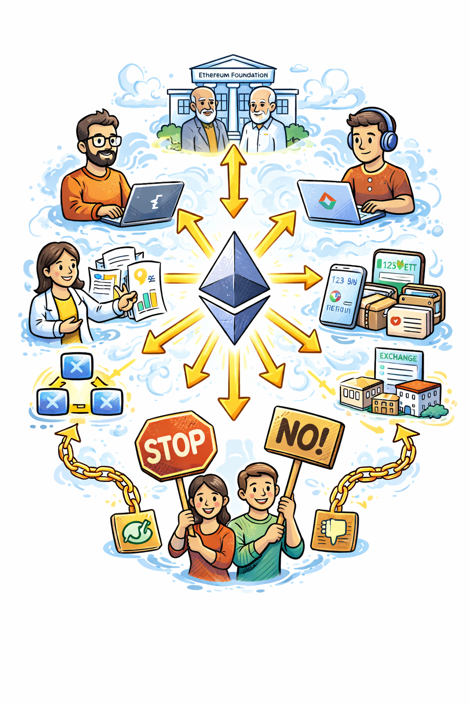
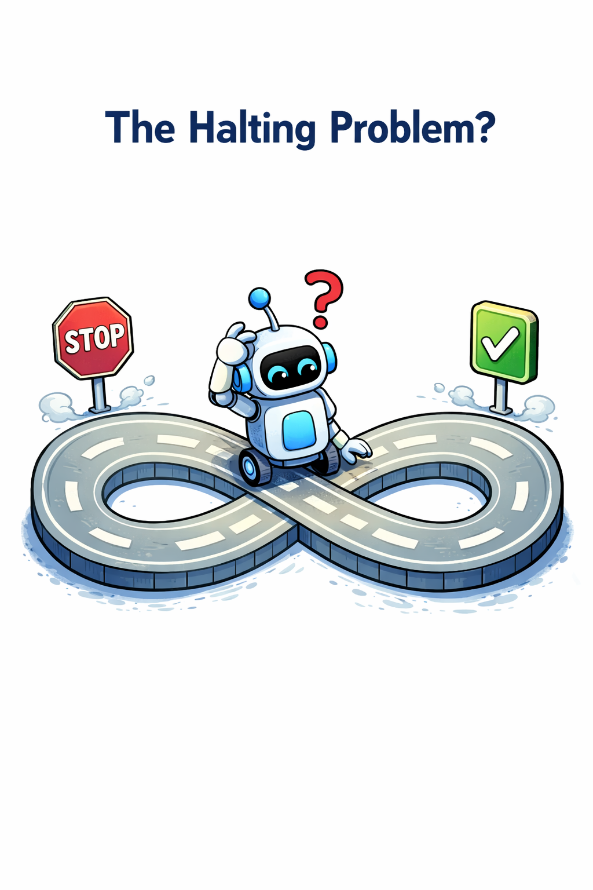
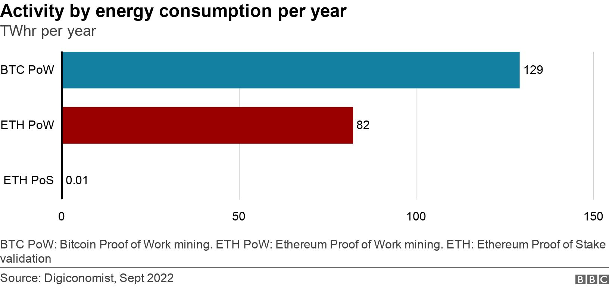

## An Ethereum payment hides most of what moved {.smaller}

::: {style="font-size: .85em;"}

**The case:** day 1's lab chain, blocks 3 to 6. Each holds one transaction, and an agent reads only its To and Value fields. Block 3 tells the truth: 1.5 ETH to Account 2. Block 4 shows 0 ETH, yet tokens moved. Block 5 sends 2 ETH to a contract, and the ETH ends up somewhere else. Block 6 failed, and its sender still paid. Today is how to read what really happened in each.

**Day 2 left off** with Bitcoin, where coins move from output to output. Ethereum keeps accounts instead, and today reads them in three parts:

1. **Accounts and the EVM:** who or what holds the funds, and the program that changes them.
2. **The transaction and its cost:** what the sender asked for, what it paid, and when it is final.
3. **Reading the result:** the receipt, its logs, and value a contract passes on.

**By the end:** given an Ethereum transaction in an explorer, say what kind of account sent and received it, what it cost, whether it worked and is final, and where its value went, including value the transaction does not show.

**The point to earn:** a transaction is only the sender's request. The receipt and a trace of the call say what actually happened [@ethereumorg_jsonrpcapi_2025; @otterscan_otsnamespace_2026].

:::

::: {.notes}

**Overall Slide Concept**
This slide opens day 3 with a case students have already touched: the four transactions in blocks 3 to 6 of day 1's lab chain. It matters here because the analyst's first job on Ethereum is to say who received what, and an agent who reads only the To and Value fields gets three of these four wrong. Emphasize the objective: the practice and the review come back to it.

**Key Points**
- Day 1's explorer lab asked about these blocks and marked them "day 3 explains this". This lesson is that explanation, and the case runs through it: block 3's sender is the check that closes part 1, block 3's fee is worked in part 2, and blocks 5 and 6 are read in part 3; the practice reads blocks 4 and 5.
- Block 3 is an ordinary transfer, so its To and Value fields tell the whole story. Block 4 is a token transfer, whose receiver sits in a log, not the To field. Block 5 is a payment to a contract that passes the ETH on. Block 6 failed but still cost its sender a fee. Do not explain these yet; the lesson does.
- The point is a claim the lesson earns: the transaction is the request the sender signed, the receipt is the node's record of what it did, and a trace of the call shows ETH that a contract passed on.
- Day 2 was Bitcoin, which records unspent outputs and has no account balances. Part 1 opens by setting the two side by side.

**Walkthrough**
1. Read the case. Ask the class which of the four transactions they could explain now; leave the answers open.
2. Read the link back to day 2, then name the three parts.
3. Read the objective aloud. Each part ends with a check every student answers, and the close asks the objective again.
4. Time plan, 50 minutes: opening and the vocabulary reset 8, part 1 11 (with its check), part 2 11 (with its check), part 3 10, practice, answers, review and next 10. The five-minute lab "Is it final yet?" on the finality slide fits inside part 2 only with time in hand.

**Sources**
- @ethereumorg_jsonrpcapi_2025
- @otterscan_otsnamespace_2026

:::

## Reset: today runs on day 1's Ethereum terms {.smaller}

[]{#ethereum-reset-say-what-each-term-means}**Three minutes, to start the day.** Day 2 was Bitcoin; today is Ethereum. Say each term, all from day 1, in one line to your neighbour, or write it down. Mark any you can't say yet: today's lessons use every one.

:::: {.columns}
::: {.column width="33%"}
1. account
2. nonce (of an account)
3. Ethereum address
4. Keccak-256
:::
::: {.column width="33%"}
5. From field
6. contract address
7. gas
8. gas price
:::
::: {.column width="34%"}
9. transaction fee
10. Gwei and wei
11. slot and epoch
12. finalized
:::
::::

The next slide gives each one in a line, as day 1 taught it.

::: {.notes}

**Overall Slide Concept**
This slide is day 3's vocabulary reset: twelve Ethereum terms from day 1, each said aloud in one line before today's lessons build on them. It matters here because day 2 was all Bitcoin, and students arrive thinking in outputs and change, while today reads accounts, nonces and gas. Emphasize that this is a check, not a test: nothing is collected or scored.

**Key Points**
- Six of the terms come from day 1's Blockchain at a Glance (its Otterscan payment slide): account, nonce, gas, gas price, transaction fee, Gwei and wei.
- Four come from Keys, secp256k1 and Addresses: Ethereum address, Keccak-256, From field and contract address.
- Two come from Ledger and Finality: slot and epoch, and finalized.
- "Nonce" meant two other things on day 1, a signature's secret number and a field in the block header. Here it is the account's counter of transactions sent.

**Walkthrough**
1. Give the class three minutes: pairs take turns, one term each, saying it in one line.
2. Note which terms stall; dwell on those rows on the next slide.
3. Move to the next slide and read each line as the check on their answers.

**Sources**
- @ethereum.org_accountsdeveloperdocs_2025
- @ethereum.org_gasfeesdeveloper_2025

:::

## Each term in one line, as day 1 taught it {.smaller}

::: {style="font-size: 0.7em;"}
| Term | In one line | Day 1 lesson |
| --- | --- | --- |
| account[]{#the-ethereum-terms-each-in-one-line} | An address with a balance and a nonce; Ethereum keeps balances, Bitcoin keeps none [@ethereum.org_accountsdeveloperdocs_2025; @antonopoulos_masteringbitcoinprogramming_2017] | At a Glance |
| nonce (of an account) | Counts the transactions the account has sent; nonce 0 is its first [@ethereum.org_accountsdeveloperdocs_2025] | At a Glance |
| Ethereum address | The public key hashed with Keccak-256, cut to its last 20 bytes, written `0x` and 40 hex characters [@wood_ethereumsecuredecentralised_2016] | Keys |
| Keccak-256 | Ethereum's hash; a tool labelled "SHA3" may mean it or NIST's SHA3-256, which gives different digests [@bertoni_keccakreferenceversion_2011] | Keys |
| From field | Worked out by every node from the signature, not sent by the sender [@wood_ethereumsecuredecentralised_2016] | Keys |
| contract address | An address no private key controls: its code does [@antonopoulos_masteringethereum_2018] | Keys |
| gas | Counts the work a transaction makes the node do; a plain ETH transfer uses 21,000 [@ethereum.org_gasfeesdeveloper_2025] [31 Oct 2026]{.asof} | At a Glance |
| gas price | The block's base fee, which is destroyed, plus a tip to the block's maker [@buterin_eip1559feemarket_2019] | At a Glance |
| transaction fee | Gas used × gas price, both on the page; Bitcoin's fee is a leftover written nowhere [@ethereum.org_gasfeesdeveloper_2025] | At a Glance |
| Gwei and wei | 10^-9^ ETH and 10^-18^ ETH [@ethereum.org_gasfeesdeveloper_2025] | At a Glance |
| slot and epoch | A slot is 12 seconds; 32 slots make an epoch of 6.4 minutes [@ethereumorg_glossary_2026] [23 Oct 2026]{.asof} | Finality |
| finalized | A protocol state: the block's checkpoint got votes from two-thirds of staked ETH, about 15 minutes after the block [@ethereumorg_pos_2026; @ethereumorg_ssf_2026] [23 Oct 2026]{.asof} | Finality |

: {tbl-colwidths="[18,66,16]"}
:::

::: {.notes}

**Overall Slide Concept**
This slide gives the twelve terms of the reset in a line each, in the words day 1's lessons used. It matters here because part 1 builds on the first rows straight away, and part 2 on the gas rows. Emphasize the two Bitcoin habits to drop today: there is no change output, and the fee is on the page, not worked out.

**Key Points**
- Each line repeats a slide from day 1. The last column names the lesson: At a Glance is Blockchain at a Glance, Keys is Keys, secp256k1 and Addresses, and Finality is Ledger and Finality.
- The gas, slot, epoch and finality figures carry as-of dates, because network upgrades change them.
- Students who stalled on gas, gas price or fee get them again, worked with real numbers, in part 2.

**Walkthrough**
1. Read the rows top to bottom; pause on any term the room stalled on.
2. Ask one student to read day 1's block 3 payment in these terms. (Expected answer: Account 1, at nonce 0, paid 1.5 ETH to Account 2; it used 21,000 gas at 0.770510252 Gwei, a fee of 0.000016180715292 ETH.)
3. Move into part 1.

**Sources**
- @ethereum.org_accountsdeveloperdocs_2025
- @antonopoulos_masteringbitcoinprogramming_2017 (2nd edition kept: the 3rd edition drops its "no accounts or balances" line)
- @wood_ethereumsecuredecentralised_2016
- @bertoni_keccakreferenceversion_2011
- @antonopoulos_masteringethereum_2018
- @ethereum.org_gasfeesdeveloper_2025
- @buterin_eip1559feemarket_2019
- @ethereumorg_glossary_2026
- @ethereumorg_pos_2026
- @ethereumorg_ssf_2026

:::

## Ethereum edits balances; Bitcoin spends outputs

::: {.columns}
::: {.column width="50%"}

::: {style="text-align: center; font-size: 0.85em; font-weight: 700; margin-bottom: 0.25em;"}
Bitcoin: spends outputs
:::

```{dot}
//| echo: false
digraph BitcoinUTXO {
  graph [rankdir=TB, splines=ortho, nodesep=1.0, ranksep=1.0,
         fontname="Helvetica", fontsize=13, size="6.5,5.4!", ratio=fill];
  node  [shape=box, style="rounded,filled", fillcolor="#f5f7fb", fontname="Helvetica", fontsize=14, margin="0.22,0.14"];
  edge  [fontname="Helvetica", fontsize=12];

  subgraph cluster_btc {
    label="";
    color="#bdbdbd";

    // --- Inputs: the payer's earlier outputs, spent whole
    A1 [label="Output: 1.0 BTC\n(payer)", fillcolor="#e1effa", color="#0072b2"];
    A2 [label="Output: 0.8 BTC\n(payer)", fillcolor="#e1effa", color="#0072b2"];

    // --- Transaction
    T [label="Transaction", shape=circle, style="filled,bold", fillcolor="#f8fafc", color="#94a3b8"];

    // --- Outputs
    B1 [label="Output: 1.5 BTC\n(to payee)", fillcolor="#dff4ec", color="#009e73"];
    C1 [label="Output: 0.2999 BTC\n(change, to payer)", fillcolor="#fdf0d5", color="#e69f00"];

    // --- Connections
    A1 -> T [label="input #1"];
    A2 -> T [label="input #2"];
    T -> B1 [label="output #1"];
    T -> C1 [label="output #2"];

    {rank=same; A1; A2;}
    {rank=same; B1; C1;}
  }
}
```

:::
::: {.column width="50%"}

::: {style="text-align: center; font-size: 0.85em; font-weight: 700; margin-bottom: 0.25em;"}
Ethereum: block 3 edits balances
:::

```{dot}
//| echo: false
digraph EthereumAccounts {
  graph [rankdir=TB, splines=ortho, nodesep=1.0, ranksep=1.0,
         fontname="Helvetica", fontsize=13, size="6.5,5.4!", ratio=fill];
  node  [shape=box, style="rounded,filled", fillcolor="#f5f7fb", fontname="Helvetica", fontsize=14, margin="0.22,0.14"];
  edge  [fontname="Helvetica", fontsize=12];

  subgraph cluster_eth {
    label="";
    color="#bdbdbd";

    // --- One account each; balances change in place
    A  [label="Account 1\nbalance 100 → 98.49998 ETH\nnonce 0 → 1", fillcolor="#FFF9C4"];
    B  [label="Account 2\nbalance 100 → 101.5 ETH", fillcolor="#E8F5E9"];

    // --- Transfer
    A -> B  [label="1.5 ETH"];
  }
}
```

:::
:::

::: {style="font-size: 0.6em;"}
[]{#bitcoin-spends-outputs-ethereum-edits-balances}**For the analyst:** Bitcoin returns change as a new output [@nakamoto_bitcoinpeertopeerelectronic_2008]; Ethereum has no change output, and the sender's balance just goes down by the value and the fee [@ethereum.org_accountsdeveloperdocs_2025; @garratt_tokenaccountbaseddigital_2020]. Day 6's change heuristic has nothing to work on here.
:::

::: {.notes}

**Overall Slide Concept**
This slide sets Bitcoin's model beside Ethereum's, with the same 1.5-coin payment on each side: on the right, the real block 3 transfer from day 1's lab chain. It matters here because students know Bitcoin from day 2, and the contrast tells them which Bitcoin reading habits carry over and which do not. Emphasize that an Ethereum payment leaves no change output: the sender's balance just goes down.

**Key Points**
- Bitcoin records value as unspent outputs. To pay 1.5 BTC from outputs of 1.0 and 0.8, the payer spends both whole, makes a 1.5 BTC output for the payee and a change output back to themself; the 0.0001 BTC no output claims is the fee. These Bitcoin figures are made up for the comparison.
- Ethereum keeps one record per account, with a balance and a nonce, and a transaction edits them in place. Every lab account started with 100 ETH. After block 3, Account 1 holds 98.499983819284708 ETH (100, less the 1.5 sent and the 0.000016180715292 ETH fee), its nonce has gone from 0 to 1, and Account 2 holds 101.5 ETH.
- With no change output, the change heuristic students meet on day 6 has nothing to work on in an Ethereum payment.
- Because it is all one record per account, an Ethereum address's whole history sits on its own page in the explorer, as day 1's lab showed.

**Walkthrough**
1. Left: the payer's two outputs are spent whole, and 0.2999 BTC comes back as change.
2. Right: one box per account. Account 1's balance drops in place and Account 2's rises; nothing comes back.
3. Ask how many new records the Ethereum payment made for the payer's remaining funds. (Expected answer: none; the same account's balance changed, while Bitcoin made a new change output.)
4. Read the analyst line.

**Sources**
- @garratt_tokenaccountbaseddigital_2020
- @ethereum.org_accountsdeveloperdocs_2025
- @nakamoto_bitcoinpeertopeerelectronic_2008

:::

## A key or code controls each account {.smaller}

::::: {style="font-size: 0.88em;"}

:::: {.columns}
::: {.column width="50%"}
**Externally owned account (EOA)**

- Controlled by whoever holds its private key [@ethereum.org_accountsdeveloperdocs_2025].
- Free to create, and the only kind that can start a transaction [@ethereum.org_accountsdeveloperdocs_2025].
- Has no code of its own [@ethereum.org_accountsdeveloperdocs_2025].
- Lab chain: Accounts 0 to 5.
:::
::: {.column width="50%"}
**Contract account**

- A program deployed to the network, controlled by its code [@ethereum.org_accountsdeveloperdocs_2025].
- Costs gas to create, and acts only when a transaction reaches it [@ethereum.org_accountsdeveloperdocs_2025].
- Its address is computed from its creator's address and nonce [@ethereum.org_accountsdeveloperdocs_2025].
- Lab chain: the token contract `0x5FbDB…` and the Splitter `0xe7f1…`, both created by Account 0.
:::
::::

[]{#ethereum-keeps-accounts-not-coins}Every account has four fields [@ethereum.org_accountsdeveloperdocs_2025]:

- **nonce** and **balance** (in wei; 10^18^ wei make 1 ETH);
- **code hash:** the fingerprint of the account's code, the hash of an empty program for an EOA;
- **storage root:** a single hash that sums up everything the account has stored, empty for an EOA.

**For the analyst:** an address with no code moves funds only when its key signs, whether a person or an automated system holds that key; an address with code moves them by its program.

:::::

::: {.notes}

**Overall Slide Concept**
This slide sorts Ethereum accounts by what controls them: a private key or code. It matters here because the first question about any address in an investigation is whether a key holder or a program moved the funds. Emphasize that only an EOA can start a transaction; a contract acts only when called.

**Key Points**
- An externally owned account, EOA for short, is controlled by a private key, costs nothing to create and is the only kind that can start a transaction. It has no code.
- A contract account is controlled by its code, costs gas to create because it stores code and data, and acts only when a transaction reaches it.
- A contract's address is not chosen: it is computed from the creating account's address and that account's nonce at the time. On the lab chain, Account 0 created the token contract in block 1 and the Splitter in block 2; the explorer's contract page names the creator and the creation transaction.
- Every account has the same four fields. The code hash is a fingerprint of the account's code; an EOA's is the hash of empty code. The storage root is one hash that sums up the account's whole store of data; for an EOA it is the root of an empty store. Students need not compute either: a code hash other than the empty one is the mark of a contract.
- The analyst line holds for automated systems too: an exchange's hot wallet is an EOA whose key a server holds.

**Walkthrough**
1. Read the two columns: key-controlled on the left, code-controlled on the right, each with its lab-chain examples.
2. Read the four fields and the wei conversion.
3. Close on the analyst line: code or no code is the first thing to settle about an address.

**Sources**
- @ethereum.org_accountsdeveloperdocs_2025

:::

## One program on every node, seeing only the chain {.smaller}

::: {style="font-size: 0.86em;"}
[]{#every-node-runs-the-same-program-the-evm}[]{#a-contract-sees-only-what-is-on-chain}The **Ethereum Virtual Machine (EVM)** is the program every node runs for each transaction. Contracts are written in languages such as Solidity and compiled into bytecode the EVM runs [@wood_ethereumsecuredecentralised_2016; @ethereum.org_smartcontractsdeveloper_2025].

- **Deterministic:** the same transaction and the same prior state give the same result on every node [@wood_ethereumsecuredecentralised_2016].
- **Metered:** every operation costs gas, writing to permanent storage costs the most, and a call stops when its gas runs out [@wood_ethereumsecuredecentralised_2016; @ethereum.org_gasfeesdeveloper_2025].
- **Sealed off:** to stay deterministic, a contract cannot read files, websites, a clock of its own or random numbers. It sees only the transaction's data and defined block fields [@wood_ethereumsecuredecentralised_2016; @ethereum.org_smartcontractsdeveloper_2025].
- **Oracles** bring outside facts, such as an asset's price, on chain, and add trust in whoever supplies them [@ellis_chainlinkdecentralizedoracle_2017; @eskandari_sokoraclesground_2021].

**For the analyst:** every node reran every transaction and agreed on the result, so a balance or log read from any full node is the network's record, not one company's. A contract that acts on a price trusts its oracle; day 8 shows attackers moving that price.
:::

::: {.notes}

**Overall Slide Concept**
This slide introduces the EVM as the one program every Ethereum node runs, and the price of that design: a contract sees only what is on chain. It matters here because the EVM is why an analyst can trust a balance or a log from any full node, and the sealed-off design is why oracles exist and become a target. Emphasize determinism, and the oracle as a point of trust.

**Key Points**
- The EVM is a stack-based virtual machine: a program that runs contract bytecode the same way on every node. Contracts are written in a language such as Solidity and compiled to that bytecode; the next lesson reads one.
- Determinism is the core property: every node must reach the same result from the same inputs, or the nodes could not agree on the state.
- Gas meters every operation, so even a program that loops for ever stops when its gas runs out. Writing to permanent storage costs the most, because every node keeps it for good. Part 2 prices this gas.
- Determinism has a price: a contract cannot reach outside the chain. If it could read a website's ETH price, nodes reading at different moments would see different prices and disagree.
- An oracle is the answer: a system that puts outside data on chain. It adds trust in the oracle's data source, which is why day 8's oracle-manipulation attacks work.

**Walkthrough**
1. Read the definition: source code compiled to bytecode, run by every node.
2. Take the four bullets in turn; "metered" returns in part 2.
3. Ask what would break if a contract could read a website's ETH price. (Expected answer: nodes reading at different moments would get different prices and compute different results, so they could not agree.)
4. Close on the analyst line and the day 8 pointer.

**Sources**
- @wood_ethereumsecuredecentralised_2016
- @ethereum.org_smartcontractsdeveloper_2025
- @ethereum.org_gasfeesdeveloper_2025
- @ellis_chainlinkdecentralizedoracle_2017
- @eskandari_sokoraclesground_2021

:::

## A contract is code plus storage at an address {.smaller}

::: {style="font-size: 0.9em;"}
- A **smart contract** is a program deployed at its own address, with **storage** that persists between calls [@ethereum.org_smartcontractsdeveloper_2025; @wood_ethereumsecuredecentralised_2016].
- Once deployed, its code decides how every call to it is handled [@wood_ethereumsecuredecentralised_2016].
- It runs only when called; it has **no background tasks** [@ethereum.org_accountsdeveloperdocs_2025].
- It can call other contracts and send ETH while it runs [@ethereum.org_smartcontractsdeveloper_2025].

**Lab chain:** the token contract `0x5FbDB…` keeps every holder's token balance in its storage. A token is not a balance the chain keeps; it is an entry in this contract's storage [@ethereum.org_smartcontractsdeveloper_2025].

**For the analyst:** in the explorer, a contract's page has a Contract tab holding its code, and a creator; an EOA's page has neither [@otterscan_otterscan_2025].
:::

::: {.notes}

**Overall Slide Concept**
This slide defines a smart contract as code plus storage at its own address, using the lab chain's token contract as the example. It matters here because funds that enter a contract are governed by its code and recorded in its storage, which is why parts 2 and 3 read transactions to contracts differently. Emphasize that a contract runs only when called.

**Key Points**
- A smart contract is a program at its own address, with storage that persists between calls. Once deployed, its code decides what each call does.
- It has no background tasks: nothing happens in a contract until a transaction, or another contract during a transaction, calls it.
- While it runs it can call other contracts and send ETH; part 3 shows what that does to the trail.
- The lab chain's token contract keeps every holder's token balance in its own storage. That is why a token transfer is a call to the token contract, not a payment between the two holders. The tokens lesson later today reads how token contracts work.
- In Otterscan, a contract's address page shows a Contract tab with its code and the creator's address; an EOA's page shows neither. Day 1's lab used exactly this to tell the two apart.
- Reading a contract's code is the next lesson.

**Walkthrough**
1. Read the four bullets.
2. Read the lab-chain line: the token balances live inside the contract.
3. Read the analyst line, the test students use on the check that follows.

**Sources**
- @ethereum.org_smartcontractsdeveloper_2025
- @wood_ethereumsecuredecentralised_2016
- @ethereum.org_accountsdeveloperdocs_2025
- @otterscan_otterscan_2025

:::

## Check: block 3. Which account type sent it? {.smaller}

::: {style="font-size: .85em;"}

Block 3's transaction is from `0x7099…79C8` (Account 1). Its address page in the explorer shows a balance and a nonce, and no Contract tab.

**Write one line:** is the sender an EOA or a contract account, and what two pieces of evidence say so?

::: {.fragment}
**Answer:** an EOA. Only an EOA can start a transaction, and the address has no code, so no Contract tab [@ethereum.org_accountsdeveloperdocs_2025; @otterscan_otterscan_2025].

**Part 1 in one line:** Ethereum keeps accounts, not outputs. A key controls an EOA and code controls a contract, and every node runs the same EVM to change them [@ethereum.org_accountsdeveloperdocs_2025; @wood_ethereumsecuredecentralised_2016].
:::

:::

::: {.notes}

**Overall Slide Concept**
This slide closes part 1 with a check every student answers, on block 3 of the running case. It matters here because "key or code" is the first question about every address in an investigation, and students should settle it from evidence, not from an explorer's label. Emphasize two independent pieces of evidence: what started the transaction, and whether the address has code.

**Key Points**
- Expected answer: an EOA. It started a transaction, which only an EOA can do, and its address page shows no code.
- The two pieces of evidence are of different kinds: one is a rule of the protocol, the other is what the address holds.
- Otterscan also prints short tags such as [EOA] beside addresses; a tag is the explorer's label, so check it against the code, as day 1's lab said.
- The part's synthesis, on the slide: accounts, not outputs; key or code; one EVM on every node.

**Walkthrough**
1. Read the case.
2. Give every student thirty seconds to write one line: EOA or contract, and the two pieces of evidence.
3. Take a show of hands, then reveal the answer and its reasons.
4. Read the part 1 synthesis.

**Sources**
- @ethereum.org_accountsdeveloperdocs_2025
- @otterscan_otterscan_2025
- @wood_ethereumsecuredecentralised_2016

:::

## A transaction is a signed, numbered message {.smaller}

::: {style="font-size: 0.8em;"}
| Field | What it holds [@ethereumorg_transactions_2025] | What it tells the analyst |
| --- | --- | --- |
| `from` | The sender, worked out from the signature | Whose key authorized it |
| `to` | The receiving address; empty when deploying a contract | The account or contract called; for a token transfer, the token contract, not the recipient |
| `value` | ETH to send, in wei | How much ETH moved directly |
| `data` | Optional; a contract call names its function here | Which function was called |
| `nonce` | The sender's transaction counter | Where it falls in the sender's sequence |
| gas fields | The most gas, the most per unit, and the tip | The most the sender would pay |
| signature | Made with the sender's private key | That the key holder signed |
:::

- Three kinds: a transfer, a contract deployment (no `to`; the code goes in `data`) and a contract call [@ethereumorg_transactions_2025].
- A token moves by a contract call: `data` names a function such as `transfer(address,uint256)`, and `value` stays 0 [@ethereumorg_transactions_2025].

::: {.notes}

**Overall Slide Concept**
This slide opens part 2 by reading an Ethereum transaction field by field, with what each field tells the analyst. It matters here because the transaction is the request the sender signed, and an analyst must know which fields carry ETH, which carry a contract call, and which fix its place in the sender's history. Emphasize that `value` carries only ETH; tokens move through a contract call in `data`.

**Key Points**
- A transaction carries a recipient, a value, optional data, the sender's nonce, three gas fields and a signature. The `from` the explorer shows is not sent: every node recovers it from the signature, as day 1 taught.
- An empty `to` means a contract deployment, with the code in `data`. Data naming a function means a contract call. Neither is the plain transfer of block 3.
- The nonce orders the sender's transactions: Account 1's block 3 transfer is nonce 0, its block 5 call nonce 1.
- A token transfer is a contract call such as `transfer(address,uint256)` sent to the token contract, with `value` 0. That is why block 4's receiver is not in its To field; part 3 shows where the receiver is.
- The gas fields set the most the sender will pay; the next slide works out what block 3 actually paid.

**Walkthrough**
1. Read the table top to bottom, stopping on `to`, `value` and `data`.
2. Name the three kinds of transaction.
3. Ask which kind block 4's transaction is, given that its To is the token contract and its value 0 ETH. (Expected answer: a contract call.)

**Sources**
- @ethereumorg_transactions_2025

:::

## Worked: block 3's fee, most of it burned {.smaller}

::: {style="font-size: 0.88em;"}
[]{#gas-prices-the-work-a-failed-call-still-pays}**Fee = gas used × (base fee + tip)** [@ethereum.org_gasfeesdeveloper_2025]. Block 3, from day 1's lab:

| Step | Block 3 |
| --- | --- |
| Gas used | 21,000 (a plain transfer) |
| Price per gas | 0.770510251 Gwei base fee + 0.000000001 Gwei tip = 0.770510252 Gwei |
| Fee | 21,000 × 0.770510252 Gwei = 16,180.715292 Gwei = **0.000016180715292 ETH** |
| Burned | 21,000 × base fee = 16,180.715271 Gwei, destroyed |
| Tip | 21,000 wei, to the block's fee recipient |

- Under **EIP-1559**, the base fee is destroyed (burned) and the tip goes to the block's fee recipient: the validator who proposed the block, or a **builder**, a firm that assembles blocks and pays the proposer to use them [@buterin_eip1559feemarket_2019; @ethereum.org_gasfeesdeveloper_2025; @flashbots_builderpayments_2026] [31 Oct 2026]{.asof}.
- **A failed call still pays** for the gas it used, and its changes are undone [@ethereum.org_gasfeesdeveloper_2025].

**For the analyst:** a failed transaction still takes its fee, so the sender's balance falls even though nothing else moved.
:::

::: {.notes}

**Overall Slide Concept**
This slide works block 3's fee step by step and shows where the money went: most burned, a sliver to the block's maker. It matters here because the fee is the one cost every transaction pays, even a failed one, and the analyst sees it in the sender's balance. Emphasize the formula and that failure does not refund the fee.

**Key Points**
- The sender sets the most gas the transaction may use and the most it will pay per unit; what it pays is the gas it actually used times the block's price per gas.
- Since EIP-1559, the price per gas has two parts. The base fee is set by the protocol and destroyed. The tip goes to the block's fee recipient.
- The base fee moves with demand: it rises after a block that used more than the target amount of gas, and falls after one that used less. The lab chain's blocks were nearly empty, so its base fee fell block by block, from 1 Gwei at the start to 0.770510251 Gwei by block 3.
- Block 3, worked: 21,000 gas used, a base fee of 0.770510251 Gwei and a tip of 1 wei per gas (0.000000001 Gwei). The price per gas is 0.770510252 Gwei; times 21,000 that is 16,180.715292 Gwei, and since one Gwei is 10^-9 ETH, 0.000016180715292 ETH, exactly the Transaction Fee the explorer showed. Of that, 16,180.715271 Gwei was burned and 21,000 wei went to the fee recipient.
- The fee recipient is usually not the proposer itself today (31 Oct 2026): most blocks are assembled by builders, firms that collect transactions and pay the validator who proposes the block for the right to fill it. Validators and staking were day 1's Ledger and Finality.
- Each block also has a gas limit, which caps how much work fits in one block; the base fee's target is half of it.
- A call that fails, or runs out of gas, has all its changes undone, but the gas it used is still paid. Part 3 reads block 6, a failed call, in the explorer.

**Walkthrough**
1. Read the formula, then work the table row by row aloud: add base fee and tip, multiply by gas used, convert Gwei to ETH.
2. Ask how much of the fee the block's maker received. (Expected answer: 21,000 wei, the tip; the rest was burned.)
3. Read the EIP-1559 line, glossing builder, then the failed-call line and the analyst line.

**Sources**
- @ethereum.org_gasfeesdeveloper_2025
- @buterin_eip1559feemarket_2019
- @flashbots_builderpayments_2026

:::

## Pending, included, then final 15 minutes later

::: {style="font-size: 0.82em;"}
- []{#pending-then-included-then-final}**Pending:** a wallet signs the transaction, and peers relay it to the pool of pending transactions, the mempool (day 4) [@ethereumorg_transactions_2025].
- **Included:** a validator puts it in a block, and every node re-runs it in the EVM [@ethereumorg_transactions_2025; @ethereumdevelopers_blockproposal_2024].
- **Final:** only after validators holding two-thirds of staked ETH vote for a later checkpoint, about 15 minutes after the block (day 1) [@ethereumorg_transactions_2025; @ethereumorg_ssf_2026] [31 Oct 2026]{.asof}.

Older blocks say "mined": before The Merge (15 Sep 2022) miners made blocks; since then validators propose them, and transactions run as before [@l34_ethereumorg_merge_2022].

**For the analyst:** say which stage a transaction has reached. Included is not final.
:::

[Open the five-minute lab: Is it final yet?](/assets/labs/is-it-final-yet/index.html)

::: {.notes}

**Overall Slide Concept**
This slide follows a transaction from the wallet to finality in today's proof-of-stake Ethereum. It matters here because an analyst should say which stage a transaction has reached: pending, included or final. Emphasize that inclusion and finality are different events.

**Key Points**
- A signed transaction waits in the pool of pending transactions until a validator includes it in a block; day 4 reads that pool and what happens in it.
- Once included, every node re-runs the transaction in the EVM and records the same result.
- Finality is a later event: the block becomes final once validators holding two-thirds of staked ETH have voted for a later checkpoint, about 15 minutes after the block was made. Day 1's Ledger and Finality taught the votes.
- History students will meet on old blocks: before The Merge on 15 September 2022, miners made Ethereum's blocks; since then validators propose them. The way transactions run did not change.
- Day 1's lab chain has a single node that seals a block on a timer, so it has no validators' votes; this slide describes Ethereum's main network.

**Walkthrough**
1. Follow the three stages in order: pending, included, final.
2. Note The Merge date, so students read "mined" on older blocks without confusion.
3. With time in hand, open the five-minute lab "Is it final yet?" from the link on the slide: students predict on which of Bitcoin, Ethereum and Tron a payment made eight minutes ago is final, drag a clock to watch each chain's status change, then meet an Ethereum stall where blocks keep coming but finality stops. It runs offline.

**Sources**
- @ethereumorg_transactions_2025
- @ethereumdevelopers_blockproposal_2024
- @ethereumorg_ssf_2026
- @l34_ethereumorg_merge_2022

:::

## Check: a block two minutes old. Final? {.smaller}

::: {style="font-size: .85em;"}

On Ethereum's main network, a payment sits in a block made two minutes ago. The agent asks: "So it's done, and can't be undone?"

**Write one line:** is the payment final? What stage is it at, and when would it be final?

::: {.fragment}
**Answer:** not yet. It is included, not final. It becomes final once validators holding two-thirds of staked ETH vote for a later checkpoint, about 15 minutes after the block [@ethereumorg_ssf_2026; @ethereumorg_pos_2026] [31 Oct 2026]{.asof}.

**Part 2 in one line:** a transaction is a signed, numbered request; it pays gas used × (base fee + tip) even when it fails, and it is final about 15 minutes after its block [@ethereumorg_transactions_2025; @ethereum.org_gasfeesdeveloper_2025; @ethereumorg_ssf_2026] [31 Oct 2026]{.asof}.
:::

:::

::: {.notes}

**Overall Slide Concept**
This slide closes part 2 with a check every student answers: whether a payment two minutes old is final. It matters here because agents and prosecutors hear "it's on the chain" as "it's settled", and the analyst must say which stage it has reached. Emphasize that included and final are different words with different meanings.

**Key Points**
- Expected answer: no. The payment is included in a block, and it becomes final only after the validators' votes, about 15 minutes after the block.
- The number of blocks on top does not make an Ethereum block final; the votes do. Day 1's lab made the same point about confirmations.
- The part's synthesis, on the slide: a signed, numbered request, a fee even on failure, and finality about 15 minutes after the block.

**Walkthrough**
1. Read the case and the agent's question.
2. Give every student thirty seconds to write one line: final or not, the stage, and when.
3. Take a show of hands, then reveal the answer.
4. Read the part 2 synthesis.

**Sources**
- @ethereumorg_ssf_2026
- @ethereumorg_pos_2026
- @ethereumorg_transactions_2025
- @ethereum.org_gasfeesdeveloper_2025

:::

## The receipt says what actually happened {.smaller}

::: {style="font-size: 0.86em;"}
Once a transaction is in a block, a node returns its **receipt** [@ethereumorg_jsonrpcapi_2025]:

| Receipt field | Meaning [@ethereumorg_jsonrpcapi_2025] |
| --- | --- |
| `status` | 1 for success, 0 for failure |
| `gasUsed` | The gas this transaction used |
| `effectiveGasPrice` | Base fee plus tip, per unit of gas |
| `logs` | The events the transaction's contracts recorded |
| `contractAddress` | The new contract, if it deployed one |

A **log** is a record a contract writes while it runs. Each names the contract that wrote it, and carries up to four `topics`, the fields an explorer searches on, and other `data` [@ethereumorg_jsonrpcapi_2025]. Lab chain, block 7's second transaction: To is the token contract and Value 0 ETH, and its one log reads **Transfer 250 CRT from Account 3 to Account 1** (CRT is the course token), written by the token contract.

**For the analyst:** read `status` first: a failed transaction moved nothing but its fee [@ethereum.org_gasfeesdeveloper_2025]. A token transfer shows up in the logs, not in `value`.
:::

::: {.notes}

**Overall Slide Concept**
This slide opens part 3 by reading the receipt, the node's record of what a transaction actually did, and shows one log read on the lab chain. It matters here because the transaction says what the sender asked for, but the receipt says whether it worked, what it cost and which events it left. Emphasize reading `status` first, and that a token's receiver is found in the logs.

**Key Points**
- A receipt gives the status (1 success, 0 failure), the gas used, the effective price per gas, the logs and any new contract's address.
- A log is a record a contract writes while it runs, for others to read. Each names the contract that wrote it and carries indexed topics, which explorers search on, and other data.
- Block 7's second transaction, worked: Account 3 sent a call to the token contract with Value 0 ETH. Otterscan decodes its one log as a Transfer of 250 CRT (the lab token) from Account 3 to Account 1, written by the token contract. So Account 1 is the receiver, though the To field names the token contract.
- How a token contract writes that Transfer log, and how the amount is counted, is the tokens lesson later today. Here students need only: a token transfer shows up in the logs.
- A failed transaction is recorded on chain, but it moved nothing except its fee; the next slide reads one.

**Walkthrough**
1. Read the table, stopping on `status` and `logs`.
2. Read the log definition, then the block 7 example: To and Value say token contract and 0 ETH; the log says who received the tokens.
3. Close on the analyst line: status first, then logs for tokens.

**Sources**
- @ethereumorg_jsonrpcapi_2025
- @ethereum.org_gasfeesdeveloper_2025

:::

## Worked: block 6's receipt: status 0, fee paid {.smaller}

::: {style="font-size: 0.86em;"}
Block 6's transaction in Otterscan, from day 1's lab [@otterscan_otterscan_2025]:

| Field | Block 6 | What it says |
| --- | --- | --- |
| Status | **Fail**, error "balance too low" | It did not work: read this first |
| From / Nonce | Account 4 (`0x15d3…6A65`), nonce 0 | Account 4's first transaction, used up all the same |
| Interacted With (To) | The token contract `0x5FbDB…` | A contract call: `transfer(address,uint256)` |
| Value | 0 ETH | No ETH was meant to move |
| Gas used / limit | 24,835 / 100,000 | It ran until the contract refused |
| Transaction fee | **0.000012833438343285 ETH** | 24,835 × 0.516748071 Gwei, paid anyway |
| Logs | None | No Transfer was recorded |

: {tbl-colwidths="[24,40,36]"}

**Reading:** Account 4 tried to send tokens it did not hold. The token contract refused, its changes were undone, and Account 4 paid the fee and used up nonce 0 [@ethereum.org_gasfeesdeveloper_2025; @ethereumorg_transactions_2025].
:::

::: {.notes}

**Overall Slide Concept**
This slide works a real failed transaction in Otterscan, field by field, in the order an analyst reads it. It matters here because a failed transaction sits in its block like any other, and an agent who skips the status line will report a transfer that never happened. Emphasize status first, then the fee and nonce it still consumed.

**Key Points**
- Status: Fail, with the error "balance too low". The token contract refused the call. How a contract refuses a call is the next lesson's reading of contract code.
- From and nonce: Account 4, nonce 0. Its nonce is now 1, so the failed transaction counts in its sequence like a successful one.
- To and value: the token contract, a `transfer(address,uint256)` call, 0 ETH. This is the same kind of call as block 7's, which worked.
- Gas: it used 24,835 of the 100,000 it allowed, because the contract stopped early.
- Fee: 24,835 gas × 0.516748071 Gwei (block 6's base fee of 0.51674807 Gwei plus a 1-wei tip) = 0.000012833438343285 ETH, paid although nothing else happened.
- Logs: none. Because the call failed, the contract wrote no Transfer log, which is how an analyst confirms no tokens moved.
- Account 4 held no lab tokens at the time: the explorer's token holdings for it show none before block 6.

**Walkthrough**
1. Open block 6's transaction in Otterscan, or the saved pages, and read the fields in the slide's order.
2. Stop on the Status line before anything else.
3. Check the fee with the formula from part 2.
4. Read the reading line, then ask what Account 4's balance shows after block 6. (Expected answer: it fell by exactly the fee.)

**Sources**
- @otterscan_otterscan_2025
- @ethereum.org_gasfeesdeveloper_2025
- @ethereumorg_transactions_2025

:::

## Contracts move value the transaction won't show {.smaller}

:::: {.columns}
::: {.column width="46%"}

```{dot}
//| echo: false
digraph InternalTransfers {
  rankdir=TB;
  graph [fontsize=10, nodesep=0.3, ranksep=0.45, bgcolor=transparent];
  node [shape=box, style="rounded,filled", fontname="Helvetica", fontsize=11, margin="0.10,0.06"];
  edge [fontname="Helvetica", fontsize=9, arrowsize=0.7];

  A1  [label="Account 1 (EOA)", fillcolor="#dcfce7"];
  S   [label="Splitter contract\n0xe7f1…", fillcolor="#fde68a"];
  A2  [label="Account 2 (EOA)", fillcolor="#dcfce7"];
  A4  [label="Account 4 (EOA)", fillcolor="#dcfce7"];

  A1 -> S  [label="transaction: 2 ETH", penwidth=2];
  S -> A2  [label="internal transfer: 1 ETH", style=dashed];
  S -> A4  [label="internal transfer: 1 ETH", style=dashed];
}
```

:::
::: {.column width="54%"}

::: {style="font-size: 0.9em;"}
Block 5, from day 1's lab:

- The transaction shows only Account 1 → the Splitter, 2 ETH, calling `split(address,address)`.
- While it ran, the contract sent 1 ETH to Account 2 and 1 ETH to Account 4. These are **internal transfers**: ETH a contract sends during a transaction, not transactions of their own [@ethereum.org_smartcontractsdeveloper_2025; @otterscan_otsnamespace_2026].
- Such a send is "only unveiled by examining the internal calls" [@otterscan_otsnamespace_2026]: Otterscan asks the node to replay the transaction step by step, a **trace**, and lists them [@otterscan_otsnamespace_2026].
:::

:::
::::

**For the analyst:** when funds go into a contract, the trail goes on in the internal transfers (ETH) and the logs (tokens). Read both before saying where the funds went.

::: {.notes}

**Overall Slide Concept**
This slide shows value that moves inside a contract call, where the transaction itself does not show it, using block 5 of the running case. It matters here because an analyst who reads only transactions loses the funds the moment they enter a contract, as they do in swaps, bridges and mixers later in the course. Emphasize the two places the trail goes on: internal transfers for ETH, logs for tokens.

**Key Points**
- Block 5's transaction reaches one contract, the Splitter, with 2 ETH. That is all the To and Value fields show.
- While the call ran, the Splitter's code sent 1 ETH on to Account 2 and 1 ETH to Account 4. A contract sending ETH this way creates no new transaction and, in this case, no log.
- Otterscan finds these sends by asking the node to replay the transaction and record each call; it shows them as TRANSFER lines on the transaction's page. The first line is the transaction's own 2 ETH; the lines after it are what the contract passed on.
- Why the Splitter sent the ETH there is in its code: the next lesson reads a contract's code.

**Walkthrough**
1. Follow the solid arrow: the only part the transaction shows.
2. Follow the dashed arrows: the internal transfers that carried the 2 ETH on.
3. Ask where the 2 ETH is at the end of block 5. (Expected answer: 1 ETH with Account 2 and 1 ETH with Account 4; the Splitter kept none.)
4. Read the analyst line.

**Sources**
- @ethereum.org_smartcontractsdeveloper_2025
- @otterscan_otsnamespace_2026

:::

## Practice: blocks 4 and 5. Who received what? {.smaller}

::: {style="font-size: .85em;"}

Open blocks 4 and 5 in the explorer, or in day 1's saved pages. For each, write one line: who sent what to whom, and the field on the page that proves it.

1. **Block 4.** Account 0 sends a transaction to the token contract `0x5FbDB…`. Who received the tokens, how many, and how much ETH did the transaction carry?
2. **Block 5.** Account 1 sends 2 ETH to the Splitter `0xe7f1…`. What did the transaction cost Account 1 in all, and on which line of the page do you find the ETH that reached Account 4?
3. **Both.** The agent read only the To field of each and wrote "Account 0 paid the token contract; Account 1 paid the Splitter." What would you tell the agent?

:::

::: {.notes}

**Overall Slide Concept**
The three parts are done; this slide has students read two transactions of the running case themselves, in the explorer, and write who received what. It matters here because the analyst's job is to say where the value went from the evidence, and these two shapes, a token transfer and a payment through a contract, recur in every Ethereum trace. Emphasize naming the field that proves each answer.

**Key Points**
- Block 4 repeats the reading worked on the receipt slide (block 7's token transfer): To and Value name the token contract and 0 ETH, and the log names the receiver.
- Block 5 repeats the internal-transfer slide, with one step more: the fee Account 1 paid on top, from the Transaction Fee line.
- Question 3 is the opening case's mistake, put in the agent's words.
- The answers are on the next slide; keep it hidden until students have written theirs.

**Walkthrough**
1. Give students five minutes in pairs, at the explorer or the saved pages.
2. Take answers for block 4 first, then block 5.
3. For question 3, ask one pair to say it as they would to the agent.

**Sources**
- @otterscan_otterscan_2025
- @otterscan_otsnamespace_2026

:::

## Answers: the logs and the internal transfer {.smaller}

::: {style="font-size: .78em;"}

| Block | Who received what | The field that proves it |
| --- | --- | --- |
| **4** | Account 3 received 5,000 CRT from Account 0. The transaction carried 0 ETH and paid a fee of 0.00003534912160151 ETH | The log: Transfer 5,000 CRT from Account 0 to Account 3, written by the token contract [@ethereumorg_jsonrpcapi_2025] |
| **5** | Account 2 received 1 ETH and Account 4 received 1 ETH; the Splitter kept none. Account 1 also paid a fee of 0.000024648825585642 ETH | The internal transfers (TRANSFER lines) on the transaction's page [@otterscan_otsnamespace_2026]; the Transaction Fee line |
| **To the agent** | The To field names the contract each transaction called, not who received the value. Account 3 received the tokens; Accounts 2 and 4 received the ETH | The log for block 4, the internal transfers for block 5 |

: {tbl-colwidths="[14,50,36]"}

These are facts the chain records, so they need no confidence word. Who holds each account's key is a judgment the chain cannot make.

:::

::: {.notes}

**Overall Slide Concept**
This slide gives the practice answers, each with the field that proves it. It matters here because the feedback is where students check their own reading, and naming the evidence is what makes an answer usable by an agent. Emphasize the last row: the To field says which contract was called, not who was paid.

**Key Points**
- Block 4: a call to the token contract's `transfer(address,uint256)` with 0 ETH; the one log reads Transfer 5,000 CRT from Account 0 to Account 3. Its fee was 52,421 gas × 0.67433131 Gwei = 0.00003534912160151 ETH.
- Block 5: 2 ETH into the Splitter, which sent 1 ETH each to Accounts 2 and 4 by internal transfer and kept none. Its fee was 41,754 gas × 0.590334473 Gwei = 0.000024648825585642 ETH.
- To the agent: the To field is the contract called. The receiver of tokens is in the logs; the receiver of ETH a contract passes on is in the internal transfers.
- These answers are facts the chain records, so no confidence word is needed. A judgment, such as who controls Account 3, would need evidence from outside the chain and a confidence word.

**Walkthrough**
1. Reveal the slide after students have written their lines.
2. Read each row, and ask a pair whose answer differed to say what they read.
3. Stress the last row, then the line on facts and judgments.

**Sources**
- @ethereumorg_jsonrpcapi_2025
- @otterscan_otsnamespace_2026

:::

## Review: account, transaction, receipt, in order {.smaller}

::: {style="font-size: .8em;"}

[]{#recap-account-transaction-receipt}**The objective:** given an Ethereum transaction in an explorer, say what kind of account sent and received it, what it cost, whether it worked and is final, and where its value went. Answer each question from memory before the answer appears.

**1. The account: how do you tell an EOA from a contract?**

::: {.fragment}
A key controls an EOA, which has no code and is the only kind that can start a transaction; a contract has code and a creator [@ethereum.org_accountsdeveloperdocs_2025].
:::

**2. The transaction: a call shows Value 0 ETH. Did nothing move?**

::: {.fragment}
Not necessarily: a token moves by a contract call with `value` 0, and its receiver is in the logs [@ethereumorg_transactions_2025; @ethereumorg_jsonrpcapi_2025].
:::

**3. The receipt: status 0. What did it cost, and what moved?**

::: {.fragment}
It paid gas used × (base fee + tip), and nothing else moved; its changes were undone [@ethereum.org_gasfeesdeveloper_2025].
:::

**4. The trace: 2 ETH went into a contract. Where is it now?**

::: {.fragment}
Read the internal transfers: the contract may have passed it on, as block 5's Splitter did [@otterscan_otsnamespace_2026].
:::

**5. The block is two minutes old. Is it final?**

::: {.fragment}
No: included, and final about 15 minutes after the block [@ethereumorg_ssf_2026] [31 Oct 2026]{.asof}.
:::

:::

::: {.notes}

**Overall Slide Concept**
This slide reviews the lesson against its objective, in the order an analyst reads a transaction: the account, the transaction, the receipt, the trace, then finality. It matters here because recalling an answer fixes it better than hearing a summary, and the questions show whether students can now do what the opening promised. Emphasize question 2: it is the opening case's mistake asked once more.

**Key Points**
- Question 1 is part 1's check, general rather than on block 3.
- Question 2 returns to block 4 and the opening case: Value 0 ETH does not mean nothing moved.
- Question 3 is block 6, worked in part 3.
- Question 4 is block 5 and the internal transfers.
- Question 5 is part 2's check asked again; a class that still says "yes" needs the finality slide once more.
- No new facts appear here; every answer was taught on an earlier slide.

**Walkthrough**
1. Read the objective.
2. For each question, give students a few seconds to answer aloud or on paper, then reveal the answer.
3. Ask the class the objective as a question: given a transaction, can you now say who received what, and how you know?

**Sources**
- @ethereum.org_accountsdeveloperdocs_2025
- @ethereumorg_transactions_2025
- @ethereumorg_jsonrpcapi_2025
- @ethereum.org_gasfeesdeveloper_2025
- @otterscan_otsnamespace_2026
- @ethereumorg_ssf_2026

:::

## Next: reading a contract's code {.smaller}

::: {style="font-size: .88em;"}

Block 5's Splitter sent 1 ETH each to Accounts 2 and 4, and block 6's token contract refused Account 4. Each did what its code says: once deployed, the code decides how every call is handled [@wood_ethereumsecuredecentralised_2016]. Reading that code comes next.

| Where | What you do with today's reading |
| --- | --- |
| **Next lesson (Smart Contracts)** | Read a contract's code: who may call what, and how a contract refuses a call |
| **Then (Tokens)** | ERC-20 tokens, stablecoins and NFTs: how a token contract writes its Transfer log |
| **Day 3 lab** | Read a token contract, then mint an NFT on the course chain and read both in Otterscan |
| Optional browser lab | [Reading a contract with no source](/assets/labs/ether_evm/index.html) |
| Day 4 | The pool of pending transactions, decentralized exchanges and bridges |

: {tbl-colwidths="[30,70]"}

**Bottom line:** a transaction is the sender's request. Read the account, the transaction, the receipt and the internal transfers before saying who received what.

:::

::: {.notes}

**Overall Slide Concept**
The review checked the objective; this slide gives the lesson's bottom line and names what comes next without teaching it. It matters here because the next lesson answers the question this one leaves open: why a contract sent the ETH where it did, or refused a call. Emphasize the bottom line.

**Key Points**
- The bridge: the Splitter's split and the token contract's refusal were both decided by code, and once deployed a contract's code decides how every call is handled.
- The next lesson, Smart Contracts: From Concept to Ethereum, reads a contract's code, including how a contract refuses a call.
- The lesson after it, Tokens: ERC-20, Stablecoins and NFTs, reads how a token contract keeps balances and writes its Transfer log.
- This afternoon's lab reads a token contract, then mints an NFT on the course chain and reads both in Otterscan.
- The optional browser lab, Reading a Contract With No Source, works from a contract's bytecode alone; it suits students who finish early.
- Day 4 reads the pool of pending transactions, decentralized exchanges and bridges.

**Walkthrough**
1. Read the bridge line.
2. Walk the table.
3. Close on the bottom line.

**Sources**
- @wood_ethereumsecuredecentralised_2016

:::

<!-- Hidden in the 13 Nov 2026 rebuild: the Solidity listing moves to the next lesson, Smart Contracts; the wallet slide is off the outline. -->

:::: {.content-hidden}

## A short Solidity contract (moved to reading code)

::: {.columns}
::: {.column width="47%"}

::: {style="font-size: 0.74em;"}
- Ethereum can deploy programs at their own contract addresses with **persistent state** [@ethereum.org_smartcontractsdeveloper_2025].  

- These are **smart contracts**: code plus storage that follow on-chain rules [@wood_ethereumsecuredecentralised_2016].

  - Once deployed, the code determines how calls are handled.

- Contracts run only when called; there are **no background tasks** [@ethereum.org_accountsdeveloperdocs_2025].  

- Contracts can call other contracts, enabling **composability** and atomic workflows [@ethereum.org_smartcontractsdeveloper_2025].
:::

:::
::: {.column width="53%"}

<div style="font-size:0.4em; line-height:1.18; color:#374151; font-family:SFMono-Regular, Menlo, Monaco, Consolas, 'Liberation Mono', 'Courier New', monospace;">
<span style="color:#6b7280;">// SPDX-License-Identifier: MIT // License identifier</span><br>
<span style="color:#7c3aed;">pragma</span> <span style="color:#1d4ed8;">solidity</span> <span style="color:#b45309;">^0.8.20</span>; <span style="color:#6b7280;">// Solidity version</span><br>
<br>
<span style="color:#7c3aed;">contract</span> <span style="color:#0f766e;">SimpleCounter</span> { <span style="color:#6b7280;">// Define contract</span><br>
&nbsp;&nbsp;&nbsp;&nbsp;<span style="color:#1d4ed8;">uint256</span> <span style="color:#7c3aed;">private</span> count; <span style="color:#6b7280;">// Stored counter value</span><br>
&nbsp;&nbsp;&nbsp;&nbsp;<span style="color:#1d4ed8;">address</span> <span style="color:#7c3aed;">public</span> owner; <span style="color:#6b7280;">// Address of deployer</span><br>
<br>
&nbsp;&nbsp;&nbsp;&nbsp;<span style="color:#7c3aed;">constructor</span>(<span style="color:#1d4ed8;">uint256</span> startingValue) { <span style="color:#6b7280;">// Runs once on deployment</span><br>
&nbsp;&nbsp;&nbsp;&nbsp;&nbsp;&nbsp;&nbsp;&nbsp;owner = <span style="color:#be185d;">msg.sender</span>; <span style="color:#6b7280;">// Set deployer as owner</span><br>
&nbsp;&nbsp;&nbsp;&nbsp;&nbsp;&nbsp;&nbsp;&nbsp;count = startingValue; <span style="color:#6b7280;">// Initialize counter</span><br>
&nbsp;&nbsp;&nbsp;&nbsp;}<br>
<br>
&nbsp;&nbsp;&nbsp;&nbsp;<span style="color:#7c3aed;">function</span> <span style="color:#0f766e;">increment</span>() <span style="color:#7c3aed;">public</span> { <span style="color:#6b7280;">// Anyone can increase count</span><br>
&nbsp;&nbsp;&nbsp;&nbsp;&nbsp;&nbsp;&nbsp;&nbsp;count += <span style="color:#b45309;">1</span>; <span style="color:#6b7280;">// Add 1 to counter</span><br>
&nbsp;&nbsp;&nbsp;&nbsp;}<br>
<br>
&nbsp;&nbsp;&nbsp;&nbsp;<span style="color:#7c3aed;">function</span> <span style="color:#0f766e;">reset</span>() <span style="color:#7c3aed;">public</span> { <span style="color:#6b7280;">// Reset function</span><br>
&nbsp;&nbsp;&nbsp;&nbsp;&nbsp;&nbsp;&nbsp;&nbsp;<span style="color:#b45309;">require</span>(<span style="color:#be185d;">msg.sender</span> == owner, <span style="color:#047857;">"Only owner can reset"</span>); <span style="color:#6b7280;">// Access control</span><br>
&nbsp;&nbsp;&nbsp;&nbsp;&nbsp;&nbsp;&nbsp;&nbsp;count = <span style="color:#b45309;">0</span>; <span style="color:#6b7280;">// Reset counter to zero</span><br>
&nbsp;&nbsp;&nbsp;&nbsp;}<br>
<br>
&nbsp;&nbsp;&nbsp;&nbsp;<span style="color:#7c3aed;">function</span> <span style="color:#0f766e;">getCount</span>() <span style="color:#7c3aed;">public</span> <span style="color:#7c3aed;">view</span> <span style="color:#7c3aed;">returns</span> (<span style="color:#1d4ed8;">uint256</span>) { <span style="color:#6b7280;">// Read-only function</span><br>
&nbsp;&nbsp;&nbsp;&nbsp;&nbsp;&nbsp;&nbsp;&nbsp;<span style="color:#7c3aed;">return</span> count; <span style="color:#6b7280;">// Return current value</span><br>
&nbsp;&nbsp;&nbsp;&nbsp;}<br>
}<br>
</div>

:::
:::

::: {.notes}

**Overall Slide Concept**
This slide shows a smart contract as code plus storage at its own address, with a short Solidity example to read, not write. It matters here because the next lesson reads contracts line by line, and students should first see the parts: stored values, a constructor and functions anyone or only the owner can call. Emphasize that a contract runs only when a transaction or another contract calls it.

**Key Points**
- Smart contracts are programs compiled to EVM bytecode and deployed on-chain.
- They can store state, hold value, and expose callable functions.
- This is how Ethereum turns a virtual machine into a platform for applications.
- Students read this code, not write it; the next lesson reads contracts line by line.

**Walkthrough**
1. Point to the two stored values, `count` and `owner`.
2. The constructor runs once, at deployment, and records the deployer as owner.
3. Gloss three words students meet again in lesson ②: `public` means anyone can call the function, `view` means it only reads and changes nothing, and `msg.sender` is the address that made this call.
4. `increment` is open to anyone; `reset` checks `msg.sender` against `owner` first.
5. Ask what happens if a stranger calls `reset`. (Expected answer: the `require` fails, the call reverts and the count stays; the stranger still pays the fee, as the gas slide shows.)

**Sources**
- @wood_ethereumsecuredecentralised_2016
- @ethereum.org_smartcontractsdeveloper_2025

- @ethereum.org_accountsdeveloperdocs_2025
:::


::::

:::: {.content-hidden}

## Most users reach the chain through a wallet (cut) {.smaller}

<div style="font-size: 0.74em; margin-top: -0.35em;">

```{dot}
//| fig-height: 1.4
digraph UserEthereumPath {
  rankdir=LR;
  graph [fontsize=10, nodesep=0.35, ranksep=0.45, bgcolor=transparent];
  node [shape=box, style="rounded,filled", fontname="Helvetica", fontsize=10, margin="0.08,0.05"];
  edge [fontname="Helvetica", fontsize=8, arrowsize=0.7];

  OnRamp   [label="Exchange /\nOn-ramp", fillcolor="#dbeafe"];
  Wallet   [label="Wallet\nkeys + signing", fillcolor="#dcfce7"];
  DApp     [label="dApp\nUI + contracts", fillcolor="#fde68a"];
  Data     [label="RPC /\nIndexer", fillcolor="#f3e8ff"];
  Chain    [label="Ethereum\nor L2", fillcolor="#fecaca"];
  Explorer [label="Explorer\nverify", fillcolor="#e5e7eb"];

  OnRamp -> Wallet [label="buy / withdraw"];
  Wallet -> DApp [label="connect + sign"];
  DApp -> Data [label="read + submit"];
  Data -> Chain [label="broadcast"];
  Chain -> Explorer [label="inspect"];
}
```

</div>

::: {style="font-size: .72em;"}

- Exchanges sell ETH for ordinary money and hold it until the buyer sends it to a wallet they control; examples include Coinbase, Kraken, Robinhood Crypto, and Binance.US [@ethereumorg_geteth_2026; @coinbase_10k_2026; @kraken_getverified_2026; @robinhood_crypto_2026; @binanceus_home_2026].
- A wallet holds the user's keys; with it the user sends and receives tokens, connects to apps, swaps, bridges to a layer 2, and revokes a contract's access to funds [@ethereumorg_guides_2025]. Examples include MetaMask, Rabby, Rainbow, Trust Wallet, Coinbase Wallet, and Ledger [@ethereumorg_findwallet_2026] [31 Oct 2026]{.asof}.
- An app must connect to an Ethereum node to read the chain or send a transaction [@ethereumorg_jsonrpcapi_2025]; providers, indexers and explorers serve that data, but they are not the chain itself.
- **For the analyst:** a withdrawal from an exchange ties the receiving address to a business that held the buyer's funds [@ethereumorg_geteth_2026]; day 6 follows funds to such services.

:::

::: {.notes}

**Overall Slide Concept**
This slide follows the path most users take to the chain: an exchange, a wallet, then an app. It matters here because students often encounter Ethereum through exchanges, wallets, app frontends, RPC providers, indexers, and block explorers before they understand the underlying protocol. Emphasize that the examples are touchpoints, not endorsements or rankings, and that the exchange withdrawal is where an address often first meets a known service.

**Key Points**
- Most users enter through an exchange or on-ramp, move assets to a wallet, and then interact with a DApp.
- Wallets hold keys and sign messages or transactions; they do not replace the chain.
- DApps commonly depend on RPC endpoints, indexers, and explorers for reads, submission, search, and verification.
- User actions such as approvals, swaps, bridges, and mints create distinct on-chain risk and evidence patterns.

**Walkthrough**
Follow the diagram left to right. A user may buy ETH on an exchange, withdraw to a wallet, connect the wallet to a DApp, sign an approval or transaction, and then inspect the result through an explorer. Point out that many failures and investigations occur at the boundaries: on-ramp custody, wallet signing, contract permissions, bridge routing, RPC availability, and explorer interpretation.

**Sources**
- @ethereumorg_geteth_2026
- @coinbase_10k_2026
- @kraken_getverified_2026
- @robinhood_crypto_2026
- @binanceus_home_2026
- @ethereumorg_guides_2025
- @ethereumorg_findwallet_2026
- @ethereumorg_jsonrpcapi_2025

:::


::::

<!-- Hidden for D3 (1) (docs/build-spec.md): off target in the Course Audit (vision, governance, halting problem), history (nightly reading), and slides the lesson above replaces or that day 1 already teaches. -->

:::: {.content-hidden}

## Beyond Cryptocurrency: Buterin's Vision {.smaller}

::: {.columns}
::: {.column width="62%"}
- By 2013, Bitcoin had shown that a decentralized network could maintain digital money without a central bank, but its scripting model was intentionally narrow and not designed for general applications.
- Vitalik Buterin envisioned something broader: *a blockchain that could run arbitrary application logic*, so developers would not need to build a new chain for every new use case.

:::

::: {.column width="38%"}
{fig-alt="Portrait of Vitalik Buterin" width="85%"}

::: {style="font-size: 0.52em; margin-top: 0.35em;"}
Photo: Romanpoet, *Vitalik Buterin Profile Photo*, Wikimedia Commons (CC BY-SA 4.0).
:::
:::
:::
- In the whitepaper, Ethereum aimed to provide a general-purpose platform for smart contracts and decentralized applications that could execute the same rules on every node.
- Smart contracts are on-chain programs that can hold value, update state, and enforce rules automatically.
- Deterministic execution across many nodes provides credible neutrality for all of those applications.

::: {.notes}

**Overall Slide Concept**
This opening slide establishes Ethereum as an attempt to turn the blockchain from a specialized money system into a general-purpose execution platform. It matters here because students need to understand why Ethereum exists before they can make sense of the EVM, smart contracts, and later scaling choices. Emphasize that the key shift is from storing balances to running shared application logic under common rules.

**Key Points**
- Ethereum expands the blockchain model from digital cash to general-purpose computation.
- Smart contracts are on-chain programs that can hold value and enforce rules.
- Deterministic execution across many nodes is what gives those applications credible neutrality.

**Walkthrough**
None

**Sources**
- @nakamoto_bitcoinpeertopeerelectronic_2008
- @buterin_ethereumnextgenerationsmart_2014
- @romanpoet_vitalikbuterinprofile_2016

:::

::::

:::: {.content-hidden}

## Ethereum's History

::: {style="font-size: 0.76em;"}
::: {style="background:#eaf4fb; color:#1f2937; border:1px solid #c7dceb; border-radius:10px; padding:0.45em 0.7em; margin-bottom:0.38em;"}
**2013:** Buterin publishes the [*Ethereum Whitepaper*](https://ethereum.org/en/whitepaper/).
:::

::: {style="background:#deeff9; color:#1f2937; border:1px solid #b8d5e8; border-radius:10px; padding:0.45em 0.7em; margin-bottom:0.38em;"}
**2014:** [Crowdsale raises ~31,000 BTC](https://blog.ethereum.org/2014/08/08/ether-sale-a-statistical-overview); Foundation established.
:::

::: {style="background:#d2e9f7; color:#1f2937; border:1px solid #a9cee3; border-radius:10px; padding:0.45em 0.7em; margin-bottom:0.38em;"}
**2015:** [Mainnet launches](https://blog.ethereum.org/2015/07/22/frontier-is-coming-what-to-expect-and-how-to-prepare) with smart contracts and mining.
:::

::: {style="background:#c6e2f4; color:#1f2937; border:1px solid #9bc6dd; border-radius:10px; padding:0.45em 0.7em; margin-bottom:0.38em;"}
**2016:** [DAO hack and hard fork](https://blog.ethereum.org/2016/07/20/hard-fork-completed) split ETH and ETC.
:::

::: {style="background:#b8daf1; color:#1f2937; border:1px solid #8cbcd6; border-radius:10px; padding:0.45em 0.7em; margin-bottom:0.38em;"}
**2017–2021:** [Upgrades improve gas, tooling, and the ecosystem](https://ethereum.org/en/history/).
:::

::: {style="background:#a9d1ed; color:#1f2937; border:1px solid #7db2cf; border-radius:10px; padding:0.45em 0.7em;"}
**2022:** [The Merge](https://ethereum.org/en/upgrades/merge/). Ethereum shifts from PoW to PoS.
:::
:::

::: {.notes}

**Overall Slide Concept**
This slide establishes Ethereum's historical arc from whitepaper vision to live network to major governance and consensus milestones. It matters here because the lesson needs to show that Ethereum's current design is the product of iterative upgrades and contested decisions rather than a fixed blueprint from the start. Emphasize that programmability brought both rapid ecosystem growth and a larger attack and governance surface.

**Key Points**
- The 2013 whitepaper introduced Ethereum as a programmable blockchain platform.
- Mainnet launch, the DAO fork, and The Merge are pivotal moments in Ethereum's development.
- Ethereum's history is a story of coordinated upgrades around a more ambitious design than Bitcoin's.

**Walkthrough**
None

**Sources**
- @buterin_ethereumnextgenerationsmart_2014
- @buterin_ethersalestatistical_2014
- @l34_ethereum_launches_2015
- @l34_ethereum_hard_fork_completed_2016
- @ethereumorg_history_2026
- @l34_ethereumorg_merge_2022

:::

::::

:::: {.content-hidden}

## Governance & Ethereum Improvement Proposals (EIPs) {.smaller}

Bitcoin governance is relatively conservative and informal: changes emerge through rough social consensus among developers, node operators, miners, and users, with a strong bias against frequent protocol change. Ethereum is also governed socially, but it uses a more explicit proposal culture and public upgrade process to coordinate faster protocol and standards evolution.

::: {style="font-size: 1.08em;"}
- Ethereum changes through **Ethereum Improvement Proposals (EIPs)**, which are the public specifications for protocol and standards updates.
- **Core EIPs** change protocol rules; **ERCs** define shared application standards such as token and wallet interfaces.
- `ERC` stands for **Ethereum Request for Comment**.
- Adoption still depends on **social consensus**: there is no binding on-chain vote that forces Ethereum L1 upgrades.
:::

::: {.callout-note appearance="simple"}
**Examples:** `EIP-1559` changed the fee market; `ERC-20` standardized fungible tokens.
:::

::: {.notes}

**Overall Slide Concept**
This slide establishes the EIP system as Ethereum's public change-management framework for both protocol changes and ecosystem standards. It matters here because the rest of Ethereum's technical evolution depends on how proposals are specified, debated, and adopted. Emphasize that even with a more explicit proposal culture, Ethereum still relies on social consensus and software adoption rather than binding on-chain votes.

**Key Points**
- EIPs are public specifications for Ethereum protocol and standards changes.
- Core EIPs affect protocol rules, while ERCs define shared ecosystem interfaces.
- Adoption depends on implementation and agreement across the ecosystem, not on automatic governance machinery.

**Walkthrough**
None

**Sources**
- @becze_eip1eippurpose_2015
- @buterin_ethereumnextgenerationsmart_2014

:::

::::

:::: {.content-hidden}

## EIP Workflow {.smaller}

::: {style="font-size: 1.18em;"}
- A proposal typically moves from **idea** to **draft**, then through **review** and, if accepted, toward a stable final form.
- Editors check format and clarity, while developers and researchers debate feasibility, risks, and tradeoffs in public.
- For protocol changes, client teams implement and test the change on devnets and testnets before mainnet activation.
- The important point is that Ethereum upgrades are **specified, implemented, tested, and adopted** in stages rather than changed by decree.
:::

::: {.notes}

**Overall Slide Concept**
This slide establishes Ethereum upgrades as a staged process of specification, implementation, testing, and adoption. It matters here because students should see governance as an operational workflow rather than as a simple announcement from a central authority. Emphasize that drafts only matter once client teams implement them and the ecosystem coordinates around tested code.

**Key Points**
- EIPs move through public stages rather than appearing as instant protocol changes.
- Review and testing are as important as proposing the original idea.
- Mainnet adoption depends on client implementation and ecosystem coordination.

**Walkthrough**
None

**Sources**
- @becze_eip1eippurpose_2015

:::

::::

:::: {.content-hidden}

## Stakeholders & Decision Making {.smaller}

::: {.columns}
::: {.column width="52%"}

- **Client teams** implement software and therefore shape what is realistically deployable.
- **Researchers and contributors** propose designs and analyze security, incentives, and tradeoffs.
- The **Ethereum Foundation** helps coordinate, but it does not unilaterally command upgrades.
- **Validators, node operators, exchanges, wallets, and application teams** all matter because they decide what software to run and support.
- In the end, Ethereum governance is **opt-in**: if enough people disagree, they can refuse an upgrade or follow a different chain.

:::
::: {.column width="48%"}

{fig-alt="Ethereum governance ecosystem graphic." width="90%"}

:::
:::

::: {.notes}

**Overall Slide Concept**
This slide establishes governance influence in Ethereum as distributed across researchers, client teams, operators, and economically important service providers. It matters here because students should avoid the false choice between imagining Ethereum as centrally controlled or magically leaderless. Emphasize that legitimacy comes from opt-in coordination around software, not from any single institution dictating outcomes.

**Key Points**
- Different stakeholders shape design, implementation, deployment readiness, and adoption.
- The Ethereum Foundation is influential but not protocol-sovereign.
- Social consensus remains real because participants can refuse to run unwanted software.

**Walkthrough**
None

**Sources**
- @becze_eip1eippurpose_2015
- @buterin_ethereumnextgenerationsmart_2014

:::

::::

:::: {.content-hidden}

## The Halting Problem

::: {.columns}
::: {.column width="58%"}

::: {style="font-size: 0.72em;"}

Can an algorithm decide whether *any arbitrary program* will eventually halt or run forever?

::: {.fragment}
**No.** In the general case, the problem is undecidable.
:::

::: {.fragment}
“there can be no general process” that decides this for every possible program. 

*--Alan Turing (1936)* 
:::

::: {.fragment}
Ethereum wants to run expressive programs, but every node must be able to stop and agree on the result. How can we solve this?
:::

::: {.fragment}
**Solution:**
*Gas metering charges for computation* and halt execution when prepaid gas runs out.
:::

:::

:::
::: {.column width="42%"}

{fig-alt="Illustration for the halting problem used as a visual anchor across the slide builds." width="100%"}

:::
:::

::: {.notes}

**Overall Slide Concept**
This slide establishes the Halting Problem as the theoretical reason Ethereum cannot simply ask whether arbitrary contract code will finish safely before executing it. It matters here because it motivates gas as a practical resource-bounding mechanism rather than an arbitrary fee design. Emphasize that Ethereum doesn't solve undecidability; it charges for computation and halts when prepaid gas is exhausted.

**Key Points**
- Arbitrary programs cannot be analyzed in general to decide whether they will halt.
- Ethereum still needs a way to run expressive programs without allowing infinite computation.
- Gas provides that practical bound by limiting how much execution can continue.

**Walkthrough**
None

**Sources**
- @turing_computablenumbersapplication_1937
- @wood_ethereumsecuredecentralised_2016
- @ethereum.org_gasfeesdeveloper_2025

:::

::::

:::: {.content-hidden}

## The Ethereum Virtual Machine (EVM) 

::: {style="font-size: 0.82em;"}
A **stack-based virtual machine** executed by every node for each transaction or contract call. Contracts are compiled from languages (such as Solidity) into bytecode that the EVM runs.

- **Deterministic**: the same input and prior state must produce the same result.
- **Isolation**: contracts run in a sandboxed environment with tightly limited external access.
- **Gas metering**: opcodes charge gas to bound computation and prevent infinite loops.
- **State updates** persist through Ethereum's account and contract-storage model.
- **Native asset**: Ether (`ETH`); `gwei` is a common subunit, where `1 ETH = 1 billion gwei`.
:::

::: {.notes}

**Overall Slide Concept**
This slide establishes the EVM as the execution environment that every Ethereum node uses to reproduce the same state transitions from the same inputs. It matters here because the EVM is the mechanism that turns Ethereum's vision of a shared computer into something nodes can actually verify. Emphasize determinism, gas metering, and the separation between temporary execution context and persistent state.

**Key Points**
- The EVM is a stack-based virtual machine that executes contract bytecode on every node.
- Determinism and sandboxing are necessary for replicated execution across the network.
- Gas meters execution so arbitrary programs can still run under bounded resource rules.

**Walkthrough**
None

**Sources**
- @wood_ethereumsecuredecentralised_2016
- @ethereum.org_smartcontractsdeveloper_2025
- @ethereum.org_gasfeesdeveloper_2025

:::

::::

:::: {.content-hidden}

## Gas: Metering Computation and Storage  {.smaller}

- **Every EVM operation has a gas cost**, and operations that write **permanent state** are priced especially high.
- **Users choose** how much gas a transaction may consume and how much they are willing to pay for each unit of gas.
  - **Total fee = gas used × effective gas price**, which combines the **base fee** and any **tip**.
- **If execution runs out of gas**, Ethereum reverts the state changes but still charges for the computation nodes already performed.
- **Each block has a gas limit**, which caps how much total computation and storage-changing activity can fit into that block.
- Under **EIP-1559**, the **base fee is burned** and the **tip goes to the block's fee recipient**.
  - If part of every transaction fee is **permanently destroyed**, what does that imply about **ETH supply over time**?

::: {.notes}

**Overall Slide Concept**
This slide establishes gas as Ethereum's metering system for computation and state change. It matters here because students need to connect abstract halting concerns to concrete fee mechanics and execution limits. Emphasize that gas both bounds resource use and creates incentives around block space, while EIP-1559 changes how fees are split between burn and the tip to the fee recipient.

**Key Points**
- Every EVM operation has a gas cost, with persistent state changes priced especially high.
- Users set gas limits and effective gas prices, and out-of-gas execution reverts state but still burns spent computation.
- Gas fees are part security mechanism, part congestion-pricing mechanism.

**Walkthrough**
None

**Sources**
- @wood_ethereumsecuredecentralised_2016
- @ethereum.org_gasfeesdeveloper_2025
- @buterin_eip1559feemarket_2019

:::

::::

:::: {.content-hidden}

## Determinism & Execution Constraints {.smaller}

- **Every node must reach the same result** when executing the same transactions.  
  - Consensus depends on *identical state transitions* across all nodes.  
- Contracts execute in a **sandboxed EVM**:
  - No access to the file system, network, clock, or OS randomness.  
  - Execution must be *purely deterministic* given on-chain state and input.  
- **Implication:**  
  - Smart contracts cannot directly query off-chain information or trigger external actions.  
  - Randomness, time, and I/O require careful design (e.g., block hash entropy, commit–reveal schemes).

::: {.callout-important}
If even one node computes a different result, consensus breaks, so the EVM **forbids** nondeterministic behavior.
:::

::: {.notes}

**Overall Slide Concept**
This slide establishes determinism as a hard requirement for a replicated state machine: every honest node must compute the same result from the same transaction and prior state. It matters here because Ethereum's expressive contract model would break consensus if contracts could depend on local randomness, network calls, or non-reproducible inputs. Emphasize that execution constraints are what make general-purpose computation compatible with consensus.

**Key Points**
- Ethereum contracts must avoid hidden local dependencies so all nodes reach the same result.
- Inputs come from transaction data and defined block fields, not from arbitrary external I/O.
- Deterministic execution is a consensus requirement, not just a programming preference.

**Walkthrough**
None

**Sources**
- @wood_ethereumsecuredecentralised_2016
- @ethereum.org_smartcontractsdeveloper_2025

:::

::::

:::: {.content-hidden}

## Oracles: Bridging Blockchains and Reality {.smaller}

::: {.columns}
::: {.column width="44%"}

{fig-alt="Cartoon illustration for blockchain oracles." width="100%"}

:::
::: {.column width="56%"}

- **Problem:** Smart contracts cannot directly observe off-chain facts such as prices, weather, or election outcomes.  
- **Oracle:** an external system that brings outside data on-chain so contracts can use it in their logic.  
- **Common models:** a single trusted data source, or a decentralized oracle network that aggregates multiple sources.  
- **Trade-off:** oracles solve the information gap, but they add new trust assumptions around data quality, honesty, and liveness.

:::
:::

::: {.notes}

**Overall Slide Concept**
This slide establishes oracles as the mechanism Ethereum uses when contracts need facts about the outside world. It matters here because smart contracts cannot directly observe weather, prices, or real-world events while remaining deterministic. Emphasize that oracles bridge external reality into Ethereum but also introduce new trust and manipulation risks.

**Key Points**
- Smart contracts need oracles because they cannot directly query the outside world.
- Oracles convert external facts into on-chain data that contracts can act on deterministically.
- Oracle design reintroduces trust and adversarial considerations at the boundary between chain and world.

**Walkthrough**
None

**Sources**
- @ellis_chainlinkdecentralizedoracle_2017
- @eskandari_sokoraclesground_2021

:::

::::

:::: {.content-hidden}

## Accounts & Global State (EOA vs Contract)

::: {style="font-size: 0.86em;"}
- **Externally Owned Accounts (EOAs):** controlled by private keys; initiate transactions and pay gas. (wallet)  
- **Contract accounts:** hold code and storage, and run only when another transaction or contract call activates them. (program)
- Ethereum’s global state keeps track of each account’s balance, nonce, code, and storage.  
- Contract addresses are deterministic: under `CREATE`, they come from the creator and nonce; under `CREATE2`, they come from the creator, a salt, and the bytecode hash.  
- That predictability lets developers plan deployments, coordinate contracts, and support upgrade patterns.
:::

::: {.callout-note appearance="simple"}
Day 8 preview: [read a contract that has no published source](/assets/labs/ether_evm/index.html) (micro-lab).
:::

::: {.notes}

**Overall Slide Concept**
This slide establishes Ethereum's account-based state model and distinguishes externally owned accounts from contract accounts. It matters here because later slides on transactions, contracts, and state growth depend on students knowing what kinds of entities exist in Ethereum state. Emphasize that both account types live inside one shared global state, but only one is controlled by private keys directly.

**Key Points**
- EOAs are controlled by private keys, while contract accounts are controlled by code.
- Both account types exist inside Ethereum's shared global state.
- This model differs sharply from Bitcoin's UTXO accounting.

**Walkthrough**
None

**Sources**
- @ethereum.org_accountsdeveloperdocs_2025
- @wood_ethereumsecuredecentralised_2016

:::

::::

:::: {.content-hidden}

## The Merge (Sept 15, 2022) 

- Ethereum originally launched with **Proof of Work**; The Merge changed block production to **Proof of Stake**.
- In simple terms, Ethereum kept the same application layer while swapping out the mechanism that decides who gets to add the next block.
- Mining ended, and block production moved from miners using hardware and electricity to validators participating under the new consensus model.
- Users, balances, and smart contracts carried forward without resetting the chain, so the change was structural rather than a brand-new network launch.

::: {.notes}

**Overall Slide Concept**
This slide establishes The Merge as the moment Ethereum changed its consensus mechanism while preserving its existing application layer and state history. It matters here because students should see PoS as a consensus transition inside an already-running programmable system, not as the birth of a new chain from scratch. Emphasize the date, the significance, and the fact that execution continued under a new security model.

**Key Points**
- The Merge moved Ethereum from Proof of Work to Proof of Stake on September 15, 2022.
- Smart contracts and state persisted while the consensus mechanism changed underneath them.
- This was one of Ethereum's most consequential coordinated upgrades.

**Walkthrough**
None

**Sources**
- @l34_ethereumorg_merge_2022
- @ethereumorg_history_2026

:::

::::

:::: {.content-hidden}

## PoW vs PoS: Security Model (Review) {.smaller}

| Feature | Proof of Work (PoW) | Proof of Stake (PoS) |
|----------|--------------------|----------------------|
| **Security resource** | Energy + hardware | Staked ETH (capital) |
| **Who proposes blocks** | Miners, proportional to hashpower | Validators, pseudorandomly selected from stakers |
| **Attack cost** | Continuous energy expenditure | Large bonded stake at risk of being slashed |
| **Punishment for misbehavior** | Wasted electricity, orphaned blocks | **Slashing:** loss of staked ETH |
| **Consensus rule** | Longest-chain by cumulative work | Finalized checkpoints by ≥2/3 stake attestations |
| **Finality** | Probabilistic (more confirmations → safer) | Economic and explicit (irreversible after finalization) |

::: {.notes}

**Overall Slide Concept**
This slide establishes the security-model differences between PoW and PoS as a review bridge from earlier blockchain material into Ethereum's new era. It matters here because the class must compare what changed in validator incentives, attack costs, and finality assumptions after The Merge. Emphasize similarity in consensus goals but difference in resource and punishment models.

**Key Points**
- PoW and PoS both seek ordered agreement, but they secure it through different resources and penalties.
- PoS replaces external work with validator stake and slashing risk.
- Ethereum's post-Merge security reasoning depends on these changed assumptions.

**Walkthrough**
None

**Sources**
- @l34_ethereumorg_merge_2022
- @ethereumdevelopers_proofofstakepos_2025
- @nakamoto_bitcoinpeertopeerelectronic_2008

:::

::::

:::: {.content-hidden}

## Impact of The Merge {.smaller}

::: {.columns}
::: {.column width="44%"}

{fig-alt="BBC News chart illustrating Ethereum's pre- and post-Merge energy consumption." width="100%"}

::: {style="font-size: 0.58em; text-align: center; margin-top: 0.35em;"}
Chart: BBC News, Joe Tidy, *Ethereum Merge: How One Big Cryptocurrency Is Going Green* (Sept. 14, 2022).
:::

:::
::: {.column width="56%"}

- **~99.9% reduction in energy use**, because **mining hardware no longer secures the network**.
- **ETH issuance fell** relative to the PoW era, while **EIP-1559 base-fee burn** continued.
  - **Supply dynamics** shifted away from heavy issuance and toward **network activity**.

:::
:::

- **Some mining hardware moved to other PoW chains** after Ethereum stopped mining, changing the economics and security mix of those networks.
- **Users and applications continued through the transition** without restarting the chain, which showed that Ethereum could change its consensus system without wiping balances or contracts.
- **The Merge set up Ethereum's next phase** by letting the roadmap focus on **rollups** and **data availability** instead of maintaining a mining-based base layer.

::: {.notes}

**Overall Slide Concept**
This slide establishes the practical consequences of The Merge rather than just the mechanism of the transition. It matters here because students should connect the consensus change to energy use, issuance, validator economics, and the broader Ethereum roadmap. Emphasize that The Merge was not a scaling fix, but it did reshape incentives and the platform's future direction.

**Key Points**
- The Merge drastically changed Ethereum's energy profile and issuance dynamics.
- It shifted security toward validator staking and slashing rather than mining expenditure.
- It set the stage for later roadmap work but did not itself solve scaling.

**Walkthrough**
None

**Sources**
- @l34_ethereumorg_merge_2022
- @ccri_ccriindicesethereums_2025
- @ethereumorg_history_2026

:::

::::

:::: {.content-hidden}

## Transaction Lifecycle (PoS Era)

::: {style="font-size: 0.92em;"}
- A wallet **creates and signs** the transaction, and peers relay it through the **mempool**.  
- A validator can **include** it in a block, then every node **re-executes** it in the EVM.  
- **Gas meters execution**: successful calls update state and emit logs; failed calls revert state but still consume gas.  
- **Inclusion is not finality**: a transaction can appear in a block quickly, but PoS finality comes later through validator attestations.  
- The core **execution logic stayed the same** after the Merge; what changed was the **consensus and finality mechanism**.
:::

::: {.notes}

**Overall Slide Concept**
This slide establishes how transactions flow through Ethereum's PoS-era pipeline from user submission through execution and inclusion. It matters here because students need a contemporary mental model of transaction processing after The Merge. Emphasize the roles of users, validators, execution, and confirmations inside the current architecture.

**Key Points**
- Transactions enter the network, are ordered by validators, executed by the EVM, and then finalized over time.
- Execution and consensus are distinct but coordinated layers in modern Ethereum.
- The lifecycle is different from Bitcoin's UTXO/mempool/mining model even where some concepts look familiar.

**Walkthrough**
None

**Sources**
- @ethereum.org_transactionsdeveloperdocs_2025
- @ethereumdevelopers_proofofstakepos_2025
- @ethereumdevelopers_blockproposal_2024

:::

::::

:::: {.content-hidden}

## DApp Architecture

- A **DApp (Decentralized Application, also dApp, Dapp, or dapp)** = user interface + wallet + one or more on-chain smart contracts.  
- The UI (web or mobile) connects to a wallet, which holds keys, signs, and sends transactions.  
- Contracts execute deterministically on Ethereum, replacing traditional backends and intermediaries.  
- **Purpose:** remove centralized control, enable trust-minimized coordination and asset ownership.  
- Security and usability hinge on standards, permission design, and cautious composability.

::: {.notes}

**Overall Slide Concept**
This slide establishes DApps as layered systems that combine on-chain contracts with off-chain interfaces and services. It matters here because students should not confuse a contract alone with a full application architecture. Emphasize that the decentralized part of a DApp usually lives alongside ordinary frontends, wallets, and sometimes oracle or indexing infrastructure.

**Key Points**
- A DApp is more than a contract; it includes user interfaces and supporting services.
- The on-chain and off-chain pieces interact through wallets, calls, events, and APIs.
- Understanding this split is essential for thinking about trust boundaries and failure modes.

**Walkthrough**
None

**Sources**
- @ethereumorg_guides_2025
- @ethereum.org_smartcontractsdeveloper_2025

:::

::::

:::: {.content-hidden}

## Summary

::: {style="font-size: 0.86em;"}
- Ethereum extends the blockchain idea from **digital money** to a **shared computer** that can run general-purpose programs.  

- The EVM, **deterministic execution**, and **gas metering** are what make that shared computer verifiable across many nodes.  

- **Smart contracts** are on-chain programs with persistent state, which enables DApps, composability, and new trust assumptions around code and oracles.  

- Ethereum’s long-term scaling path keeps **L1 broadly verifiable** while moving more execution to **L2s** and improving **data availability**.  
:::

::: {.notes}

**Overall Slide Concept**
This closing slide establishes Ethereum's overall mental model for the lesson: a shared computer secured by deterministic execution, gas, and a scaling strategy built around L2s and data availability. It matters here because students should leave with one coherent picture before later lessons zoom into mining history, networking, and smart contracts in more detail. Emphasize that Ethereum's ambition creates both its power and its complexity.

**Key Points**
- Ethereum extends blockchains from digital money to shared execution of programs.
- The EVM, gas, and deterministic execution are what make that shared computation verifiable.
- Ethereum's long-run roadmap keeps L1 broadly verifiable while pushing more execution to L2s.

**Walkthrough**
None

**Sources**
- @wood_ethereumsecuredecentralised_2016
- @l34_ethereum_scaling_docs_2026

:::

::::

<!-- Hidden here for D4 (3), Layer 2s and bridges, which takes these slides (docs/build-spec.md). -->

:::: {.content-hidden}

## State Growth & Storage Pressure

::: {style="font-size: 0.78em;"}
- **Core problem:** every new piece of on-chain state makes Ethereum a little heavier for future nodes to store and verify.  
- **State persists by default:** contract storage stays on-chain unless someone explicitly clears it; there is no automatic expiry.  
- **This creates pressure over time:** larger state means higher disk, memory, and sync costs for nodes, which can make full participation harder.  
- **Why it matters:** if running a node becomes too expensive, validation concentrates in fewer hands and decentralization weakens.  
- **Research directions:** Ethereum researchers are exploring pruning old history, lighter state structures, and ideas like state rent or re-genesis to manage long-term growth.  
:::

::: {.notes}

**Overall Slide Concept**
This slide establishes state growth as one of Ethereum's core long-run scaling and decentralization pressures. It matters here because persistent contract storage is powerful but makes validation and node operation more expensive over time. Emphasize that storage-heavy applications can raise the cost of keeping the base layer broadly verifiable.

**Key Points**
- Persistent state is expensive because every full node must preserve and verify it.
- State growth raises storage and operational burdens on the network.
- This pressure is one reason Ethereum cannot scale simply by letting contracts write unlimited data cheaply.

**Walkthrough**
None

**Sources**
- @wood_ethereumsecuredecentralised_2016
- @l34_ethereum_scaling_docs_2026

:::

::::

:::: {.content-hidden}

## The Scaling Problem

::: {style="font-size: 0.84em;"}
**Why not bigger blocks?** If a block can carry more transactions, it is natural to think the network should process more activity per block and therefore scale more easily.

- **Bigger blocks** raise **hardware and bandwidth requirements**, pushing validation toward data centers.  
- Ethereum prioritizes **broad verifiability at L1**, because that supports both **security** and **decentralization**.  
- The strategy is to keep **L1 minimal** for **ordering and data availability**, while scaling most execution elsewhere.  
- This is the **scalability trilemma**: **security, decentralization, and scalability** pull against one another.  
:::

::: {.notes}

**Overall Slide Concept**
This slide establishes Ethereum's scaling problem as a decentralization constraint rather than merely a throughput complaint. It matters here because the roadmap toward L2s only makes sense once students see why making L1 much bigger would price smaller validators and operators out of verification. Emphasize that the base layer is kept narrow on purpose to preserve broad participation.

**Key Points**
- Larger L1 throughput can make full validation harder and more centralized.
- Ethereum treats broad verifiability as a design goal that limits monolithic scaling.
- The solution path therefore focuses on shifting execution while preserving a strong base layer.

**Walkthrough**
None

**Sources**
- @l34_ethereum_scaling_docs_2026
- @wood_ethereumsecuredecentralised_2016

:::

::::

:::: {.content-hidden}

## Introducing L2

- **Layer 1 (L1)** is the base blockchain, such as Ethereum itself, which provides consensus, ordering, and data availability, which you are familiar with.
- **Layer 2 (L2)** is a **separate execution environment** built on top of a L1 that processes transactions off the main chain and then posts data or proofs back to that L1.
- Several L2s can exist on top of the same L1 because different teams can build separate systems with different performance, cost, and trust tradeoffs while still inheriting settlement from the underlying chain.

::: {.notes}

**Overall Slide Concept**
This slide establishes Layer 2s as separate execution environments that settle back to Ethereum rather than as entirely independent chains. It matters here because the lesson is transitioning from the scaling problem to the architectural answer Ethereum has chosen. Emphasize that multiple L2s can coexist because they share the same settlement and data-availability anchor.

**Key Points**
- L1 provides consensus, ordering, and settlement, while L2s handle more execution elsewhere.
- L2s are distinct systems that still depend on Ethereum for anchoring and verification.
- Many L2s can coexist on top of one L1 because they make different trade-offs while inheriting common settlement.

**Walkthrough**
None

**Sources**
- @l34_ethereum_scaling_docs_2026
- @l31_arbitrum_rollup_2026

:::

::::

:::: {.content-hidden}

## Modular Scaling

- L1 focuses on consensus, ordering, and data availability.  
- L2s handle execution and post the data needed to verify their state transitions.  
- Security comes from L1: if data is available on L1, anyone can reconstruct and verify L2 state.  
- Increasing L1 data availability capacity scales the entire ecosystem without inflating L1 execution or state.  

::: {.notes}

**Overall Slide Concept**
This slide establishes modular scaling as the key design principle behind Ethereum's roadmap: keep L1 focused on verification-critical functions and let higher layers perform more execution. It matters here because students need a concise architectural picture before diving into operator models, rollups, and blobs. Emphasize that security inheritance depends on posting enough data or proofs back to L1.

**Key Points**
- L1 is optimized for consensus, ordering, and data availability, not for doing all execution itself.
- L2s scale the ecosystem by moving execution elsewhere while anchoring back to Ethereum.
- Data availability on L1 is the security link that makes modular scaling credible.

**Walkthrough**
None

**Sources**
- @l34_ethereum_scaling_docs_2026
- @wood_ethereumsecuredecentralised_2016

:::

::::

:::: {.content-hidden}

## L2 Operator Models {.smaller}

- L2 operators order transactions and post results to L1.  
  - **Sequencer:** orders user transactions into batches for the L2.
  - **Prover:** produces the proof or claim that Ethereum will later check.
- L1 does not “trust” them — it enforces verification rules deterministically.  
- These are two models for how an entire L2 proves correctness back to Ethereum:
  - **Optimistic rollups:** Ethereum accepts the result *unless someone challenges it* during a dispute window with a fraud proof.  
  - **Zero Knowledge (ZK) rollups:** Ethereum checks a *cryptographic proof showing the state transition was correct*.  

**Security comes from data availability and L1 verification, not from trusting L2 operators.**

::: {.notes}

**Overall Slide Concept**
This slide establishes the main operator roles and trust model behind rollup-style L2s. It matters here because students need to see who orders transactions, who proves correctness, and why those operators are not simply trusted authorities. Emphasize that Ethereum checks claims through data availability and verification rules rather than by trusting sequencers or provers personally.

**Key Points**
- Sequencers order L2 transactions, while provers or challengers support correctness back on L1.
- Optimistic and ZK rollups differ in when and how correctness is checked.
- Security comes from L1-enforced verification and data availability, not from operator goodwill.

**Walkthrough**
None

**Sources**
- @l34_ethereum_scaling_docs_2026
- @eip4844_shardblobtransactions_2024

:::

::::

:::: {.content-hidden}

## Rollups — Optimistic vs ZK{.smaller}

| Feature / Tradeoff            | **Optimistic Rollups** | **ZK (Validity) Rollups** |
|-------------------------------|------------------------|---------------------------|
| **Verification Model**        | Assume correct, can be challenged | Prove correctness up front |
| **Security Basis**            | Fraud proofs; at least one honest challenger | Cryptographic validity proofs |
| **Finality & Withdrawals**    | Delayed (challenge window) | Near-instant after proof verification |
| **Cost / Complexity**         | Simple, lower proving cost | Complex circuits, high proving cost |
| **EVM Compatibility**         | Natively EVM-compatible | Emulation or zkEVM required |
| **Throughput & Latency**      | High throughput, delayed finality | Moderate throughput, instant finality |
| **Examples**                  | Optimism, Arbitrum, Base | zkSync, StarkNet, Scroll, Polygon zkEVM |

::: {.notes}

**Overall Slide Concept**
This slide establishes the main trade-off contrast between optimistic and ZK rollups. It matters here because students should be able to compare challenge-based and proof-based models without getting lost in implementation detail. Emphasize that both aim to inherit Ethereum security, but they differ in latency, complexity, and compatibility.

**Key Points**
- Optimistic rollups assume correctness unless challenged, while ZK rollups prove correctness up front.
- The two models trade off withdrawal speed, complexity, and compatibility differently.
- Both depend on L1 for anchoring data and final settlement.

**Walkthrough**
None

**Sources**
- @eip4844_shardblobtransactions_2024
- @l34_ethereum_scaling_docs_2026

:::

::::

:::: {.content-hidden}

## Proto-Danksharding (EIP-4844) — Blob Data for L2s {.smaller}

- Introduces *blobs*: large, cheap, temporary data attachments to blocks.  
- Blobs store raw rollup batch data needed for verification, but are **not executed** by the EVM.  
- Nodes ensure blobs are available for a limited time (~weeks), then prune them.  
- Decoupling execution from data availability reduces L2 costs and keeps L1 state small.  
- Called “proto-danksharding” because it implements the blob system *without full sharding yet*—a stepping stone to the final design.  

::: {.callout-note appearance="simple"}
**Sharding** splits a workload across parallel pieces of the system so the network can handle more data or computation without forcing all nodes to process everything.
:::

::: {.notes}

**Overall Slide Concept**
This slide establishes proto-danksharding as Ethereum's first major step toward cheaper rollup data availability. It matters here because students need to understand why blob space lowers L2 costs without making the EVM execute more data directly. Emphasize that blobs are for temporary data availability, not for permanent contract state.

**Key Points**
- EIP-4844 introduces blobs as cheaper, temporary data attachments for rollups.
- Blob data is available to the network but not executed by the EVM.
- Cheaper data availability lowers L2 costs while preserving a smaller L1 state footprint.

**Walkthrough**
None

**Sources**
- @eip4844_shardblobtransactions_2024
- @l34_ethereum_scaling_docs_2026

:::

::::

## References
