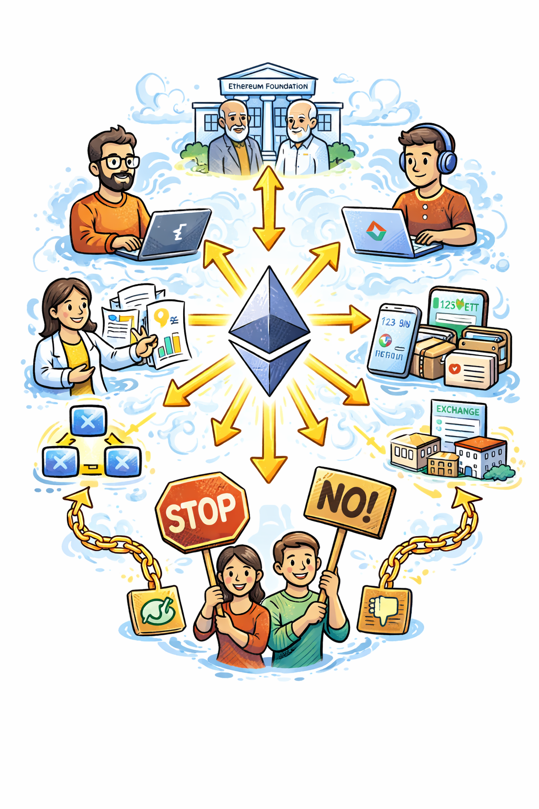
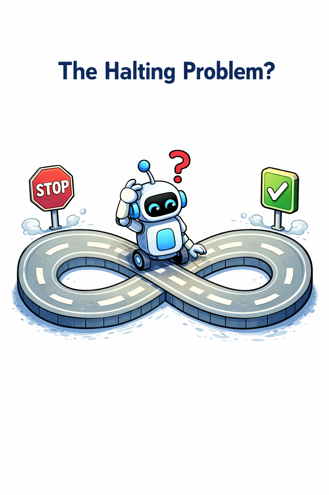
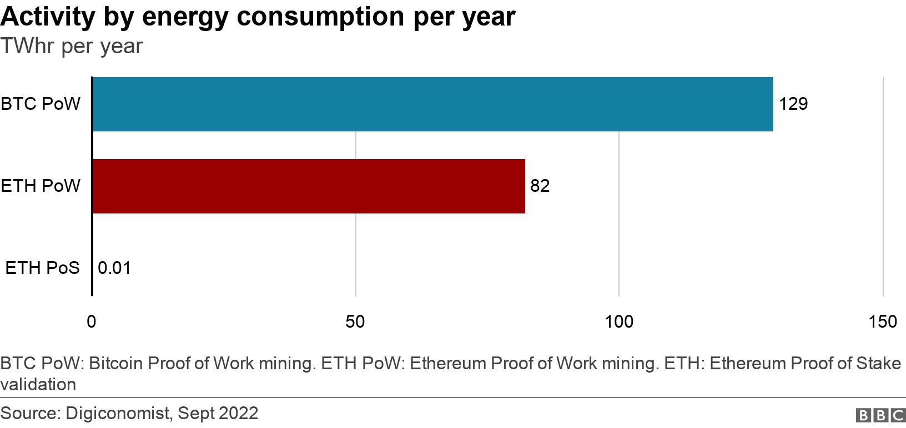

## Beyond Cryptocurrency: Buterin's Vision {.smaller}

::: {.columns}
::: {.column width="62%"}
- By 2013, Bitcoin had shown that a decentralized network could maintain digital money without a central bank, but its scripting model was intentionally narrow and not designed for general applications.
- Vitalik Buterin envisioned something broader: *a blockchain that could run arbitrary application logic*, so developers would not need to build a new chain for every new use case.

:::

::: {.column width="38%"}
{fig-alt="Portrait of Vitalik Buterin" width="85%"}

::: {style="font-size: 0.52em; margin-top: 0.35em;"}
Photo: Romanpoet, *Vitalik Buterin Profile Photo*, Wikimedia Commons (CC BY-SA 4.0).
:::
:::
:::
- In the whitepaper, Ethereum aimed to provide a general-purpose platform for smart contracts and decentralized applications that could execute the same rules on every node.
- Smart contracts are on-chain programs that can hold value, update state, and enforce rules automatically.
- Deterministic execution across many nodes provides credible neutrality for all of those applications.

::: {.notes}

**Overall Slide Concept**
This opening slide establishes Ethereum as an attempt to turn the blockchain from a specialized money system into a general-purpose execution platform. It matters here because students need to understand why Ethereum exists before they can make sense of the EVM, smart contracts, and later scaling choices. Emphasize that the key shift is from storing balances to running shared application logic under common rules.

**Key Points**
- Ethereum expands the blockchain model from digital cash to general-purpose computation.
- Smart contracts are on-chain programs that can hold value and enforce rules.
- Deterministic execution across many nodes is what gives those applications credible neutrality.

**Walkthrough**
None

**Sources**
- @nakamoto_bitcoinpeertopeerelectronic_2008
- @buterin_ethereumnextgenerationsmart_2014
- @romanpoet_vitalikbuterinprofile_2016

:::

## Ethereum's History

::: {style="font-size: 0.76em;"}
::: {style="background:#eaf4fb; color:#1f2937; border:1px solid #c7dceb; border-radius:10px; padding:0.45em 0.7em; margin-bottom:0.38em;"}
**2013:** Buterin publishes the [*Ethereum Whitepaper*](https://ethereum.org/en/whitepaper/).
:::

::: {style="background:#deeff9; color:#1f2937; border:1px solid #b8d5e8; border-radius:10px; padding:0.45em 0.7em; margin-bottom:0.38em;"}
**2014:** [Crowdsale raises ~31,000 BTC](https://blog.ethereum.org/2014/08/08/ether-sale-a-statistical-overview); Foundation established.
:::

::: {style="background:#d2e9f7; color:#1f2937; border:1px solid #a9cee3; border-radius:10px; padding:0.45em 0.7em; margin-bottom:0.38em;"}
**2015:** [Mainnet launches](https://blog.ethereum.org/2015/07/22/frontier-is-coming-what-to-expect-and-how-to-prepare) with smart contracts and mining.
:::

::: {style="background:#c6e2f4; color:#1f2937; border:1px solid #9bc6dd; border-radius:10px; padding:0.45em 0.7em; margin-bottom:0.38em;"}
**2016:** [DAO hack and hard fork](https://blog.ethereum.org/2016/07/20/hard-fork-completed) split ETH and ETC.
:::

::: {style="background:#b8daf1; color:#1f2937; border:1px solid #8cbcd6; border-radius:10px; padding:0.45em 0.7em; margin-bottom:0.38em;"}
**2017–2021:** [Upgrades improve gas, tooling, and the ecosystem](https://ethereum.org/en/history/).
:::

::: {style="background:#a9d1ed; color:#1f2937; border:1px solid #7db2cf; border-radius:10px; padding:0.45em 0.7em;"}
**2022:** [The Merge](https://ethereum.org/en/upgrades/merge/). Ethereum shifts from PoW to PoS.
:::
:::

::: {.notes}

**Overall Slide Concept**
This slide establishes Ethereum's historical arc from whitepaper vision to live network to major governance and consensus milestones. It matters here because the lesson needs to show that Ethereum's current design is the product of iterative upgrades and contested decisions rather than a fixed blueprint from the start. Emphasize that programmability brought both rapid ecosystem growth and a larger attack and governance surface.

**Key Points**
- The 2013 whitepaper introduced Ethereum as a programmable blockchain platform.
- Mainnet launch, the DAO fork, and The Merge are pivotal moments in Ethereum's development.
- Ethereum's history is a story of coordinated upgrades around a more ambitious design than Bitcoin's.

**Walkthrough**
None

**Sources**
- @buterin_ethereumnextgenerationsmart_2014
- @buterin_ethersalestatistical_2014
- @l34_ethereum_launches_2015
- @l34_ethereum_hard_fork_completed_2016
- @ethereumorg_history_2026
- @l34_ethereumorg_merge_2022

:::

## Governance & Ethereum Improvement Proposals (EIPs) {.smaller}

Bitcoin governance is relatively conservative and informal: changes emerge through rough social consensus among developers, node operators, miners, and users, with a strong bias against frequent protocol change. Ethereum is also governed socially, but it uses a more explicit proposal culture and public upgrade process to coordinate faster protocol and standards evolution.

::: {style="font-size: 1.08em;"}
- Ethereum changes through **Ethereum Improvement Proposals (EIPs)**, which are the public specifications for protocol and standards updates.
- **Core EIPs** change protocol rules; **ERCs** define shared application standards such as token and wallet interfaces.
- `ERC` stands for **Ethereum Request for Comment**.
- Adoption still depends on **social consensus**: there is no binding on-chain vote that forces Ethereum L1 upgrades.
:::

::: {.callout-note appearance="simple"}
**Examples:** `EIP-1559` changed the fee market; `ERC-20` standardized fungible tokens.
:::

::: {.notes}

**Overall Slide Concept**
This slide establishes the EIP system as Ethereum's public change-management framework for both protocol changes and ecosystem standards. It matters here because the rest of Ethereum's technical evolution depends on how proposals are specified, debated, and adopted. Emphasize that even with a more explicit proposal culture, Ethereum still relies on social consensus and software adoption rather than binding on-chain votes.

**Key Points**
- EIPs are public specifications for Ethereum protocol and standards changes.
- Core EIPs affect protocol rules, while ERCs define shared ecosystem interfaces.
- Adoption depends on implementation and agreement across the ecosystem, not on automatic governance machinery.

**Walkthrough**
None

**Sources**
- @becze_eip1eippurpose_2015
- @buterin_ethereumnextgenerationsmart_2014

:::

## EIP Workflow {.smaller}

::: {style="font-size: 1.18em;"}
- A proposal typically moves from **idea** to **draft**, then through **review** and, if accepted, toward a stable final form.
- Editors check format and clarity, while developers and researchers debate feasibility, risks, and tradeoffs in public.
- For protocol changes, client teams implement and test the change on devnets and testnets before mainnet activation.
- The important point is that Ethereum upgrades are **specified, implemented, tested, and adopted** in stages rather than changed by decree.
:::

::: {.notes}

**Overall Slide Concept**
This slide establishes Ethereum upgrades as a staged process of specification, implementation, testing, and adoption. It matters here because students should see governance as an operational workflow rather than as a simple announcement from a central authority. Emphasize that drafts only matter once client teams implement them and the ecosystem coordinates around tested code.

**Key Points**
- EIPs move through public stages rather than appearing as instant protocol changes.
- Review and testing are as important as proposing the original idea.
- Mainnet adoption depends on client implementation and ecosystem coordination.

**Walkthrough**
None

**Sources**
- @becze_eip1eippurpose_2015

:::

## Stakeholders & Decision Making {.smaller}

::: {.columns}
::: {.column width="52%"}

- **Client teams** implement software and therefore shape what is realistically deployable.
- **Researchers and contributors** propose designs and analyze security, incentives, and tradeoffs.
- The **Ethereum Foundation** helps coordinate, but it does not unilaterally command upgrades.
- **Validators, node operators, exchanges, wallets, and application teams** all matter because they decide what software to run and support.
- In the end, Ethereum governance is **opt-in**: if enough people disagree, they can refuse an upgrade or follow a different chain.

:::
::: {.column width="48%"}

{fig-alt="Ethereum governance ecosystem graphic." width="90%"}

:::
:::

::: {.notes}

**Overall Slide Concept**
This slide establishes governance influence in Ethereum as distributed across researchers, client teams, operators, and economically important service providers. It matters here because students should avoid the false choice between imagining Ethereum as centrally controlled or magically leaderless. Emphasize that legitimacy comes from opt-in coordination around software, not from any single institution dictating outcomes.

**Key Points**
- Different stakeholders shape design, implementation, deployment readiness, and adoption.
- The Ethereum Foundation is influential but not protocol-sovereign.
- Social consensus remains real because participants can refuse to run unwanted software.

**Walkthrough**
None

**Sources**
- @becze_eip1eippurpose_2015
- @buterin_ethereumnextgenerationsmart_2014

:::

## The Ethereum Virtual Machine (EVM) 

::: {style="font-size: 0.82em;"}
A **stack-based virtual machine** executed by every node for each transaction or contract call. Contracts are compiled from languages (such as Solidity) into bytecode that the EVM runs.

- **Deterministic**: the same input and prior state must produce the same result.
- **Isolation**: contracts run in a sandboxed environment with tightly limited external access.
- **Gas metering**: opcodes charge gas to bound computation and prevent infinite loops.
- **State updates** persist through Ethereum's account and contract-storage model.
- **Native asset**: Ether (`ETH`); `gwei` is a common subunit, where `1 ETH = 1 billion gwei`.
:::

::: {.notes}

**Overall Slide Concept**
This slide establishes the EVM as the execution environment that every Ethereum node uses to reproduce the same state transitions from the same inputs. It matters here because the EVM is the mechanism that turns Ethereum's vision of a shared computer into something nodes can actually verify. Emphasize determinism, gas metering, and the separation between temporary execution context and persistent state.

**Key Points**
- The EVM is a stack-based virtual machine that executes contract bytecode on every node.
- Determinism and sandboxing are necessary for replicated execution across the network.
- Gas meters execution so arbitrary programs can still run under bounded resource rules.

**Walkthrough**
None

**Sources**
- @wood_ethereumsecuredecentralised_2016
- @ethereum.org_smartcontractsdeveloper_2025
- @ethereum.org_gasfeesdeveloper_2025

:::

## The Halting Problem

::: {.columns}
::: {.column width="58%"}

::: {style="font-size: 0.72em;"}

Can an algorithm decide whether *any arbitrary program* will eventually halt or run forever?

::: {.fragment}
**No.** In the general case, the problem is undecidable.
:::

::: {.fragment}
“there can be no general process” that decides this for every possible program. 

*--Alan Turing (1936)* 
:::

::: {.fragment}
Ethereum wants to run expressive programs, but every node must be able to stop and agree on the result. How can we solve this?
:::

::: {.fragment}
**Solution:**
*Gas metering charges for computation* and halt execution when prepaid gas runs out.
:::

:::

:::
::: {.column width="42%"}

{fig-alt="Illustration for the halting problem used as a visual anchor across the slide builds." width="100%"}

:::
:::

::: {.notes}

**Overall Slide Concept**
This slide establishes the Halting Problem as the theoretical reason Ethereum cannot simply ask whether arbitrary contract code will finish safely before executing it. It matters here because it motivates gas as a practical resource-bounding mechanism rather than an arbitrary fee design. Emphasize that Ethereum doesn't solve undecidability; it charges for computation and halts when prepaid gas is exhausted.

**Key Points**
- Arbitrary programs cannot be analyzed in general to decide whether they will halt.
- Ethereum still needs a way to run expressive programs without allowing infinite computation.
- Gas provides that practical bound by limiting how much execution can continue.

**Walkthrough**
None

**Sources**
- @turing_computablenumbersapplication_1937
- @wood_ethereumsecuredecentralised_2016
- @ethereum.org_gasfeesdeveloper_2025

:::

## Gas: Metering Computation and Storage  {.smaller}

- **Every EVM operation has a gas cost**, and operations that write **permanent state** are priced especially high.
- **Users choose** how much gas a transaction may consume and how much they are willing to pay for each unit of gas.
  - **Total fee = gas used × effective gas price**, which combines the **base fee** and any **tip**.
- **If execution runs out of gas**, Ethereum reverts the state changes but still charges for the computation nodes already performed.
- **Each block has a gas limit**, which caps how much total computation and storage-changing activity can fit into that block.
- Under **EIP-1559**, the **base fee is burned** and the **tip goes to the block proposer**.
  - If part of every transaction fee is **permanently destroyed**, what does that imply about **ETH supply over time**?

::: {.notes}

**Overall Slide Concept**
This slide establishes gas as Ethereum's metering system for computation and state change. It matters here because students need to connect abstract halting concerns to concrete fee mechanics and execution limits. Emphasize that gas both bounds resource use and creates incentives around block space, while EIP-1559 changes how fees are split between burn and proposer tip.

**Key Points**
- Every EVM operation has a gas cost, with persistent state changes priced especially high.
- Users set gas limits and effective gas prices, and out-of-gas execution reverts state but still burns spent computation.
- Gas fees are part security mechanism, part congestion-pricing mechanism.

**Walkthrough**
None

**Sources**
- @wood_ethereumsecuredecentralised_2016
- @ethereum.org_gasfeesdeveloper_2025
- @buterin_eip1559feemarket_2019

:::

## Determinism & Execution Constraints {.smaller}

- **Every node must reach the same result** when executing the same transactions.  
  - Consensus depends on *identical state transitions* across all nodes.  
- Contracts execute in a **sandboxed EVM**:
  - No access to the file system, network, clock, or OS randomness.  
  - Execution must be *purely deterministic* given on-chain state and input.  
- **Implication:**  
  - Smart contracts cannot directly query off-chain information or trigger external actions.  
  - Randomness, time, and I/O require careful design (e.g., block hash entropy, commit–reveal schemes).

::: {.callout-important}
If even one node computes a different result, consensus breaks, so the EVM **forbids** nondeterministic behavior.
:::

::: {.notes}

**Overall Slide Concept**
This slide establishes determinism as a hard requirement for a replicated state machine: every honest node must compute the same result from the same transaction and prior state. It matters here because Ethereum's expressive contract model would break consensus if contracts could depend on local randomness, network calls, or non-reproducible inputs. Emphasize that execution constraints are what make general-purpose computation compatible with consensus.

**Key Points**
- Ethereum contracts must avoid hidden local dependencies so all nodes reach the same result.
- Inputs come from transaction data and defined block fields, not from arbitrary external I/O.
- Deterministic execution is a consensus requirement, not just a programming preference.

**Walkthrough**
None

**Sources**
- @wood_ethereumsecuredecentralised_2016
- @ethereum.org_smartcontractsdeveloper_2025

:::

## Oracles: Bridging Blockchains and Reality {.smaller}

::: {.columns}
::: {.column width="44%"}

{fig-alt="Cartoon illustration for blockchain oracles." width="100%"}

:::
::: {.column width="56%"}

- **Problem:** Smart contracts cannot directly observe off-chain facts such as prices, weather, or election outcomes.  
- **Oracle:** an external system that brings outside data on-chain so contracts can use it in their logic.  
- **Common models:** a single trusted data source, or a decentralized oracle network that aggregates multiple sources.  
- **Trade-off:** oracles solve the information gap, but they add new trust assumptions around data quality, honesty, and liveness.

:::
:::

::: {.notes}

**Overall Slide Concept**
This slide establishes oracles as the mechanism Ethereum uses when contracts need facts about the outside world. It matters here because smart contracts cannot directly observe weather, prices, or real-world events while remaining deterministic. Emphasize that oracles bridge external reality into Ethereum but also introduce new trust and manipulation risks.

**Key Points**
- Smart contracts need oracles because they cannot directly query the outside world.
- Oracles convert external facts into on-chain data that contracts can act on deterministically.
- Oracle design reintroduces trust and adversarial considerations at the boundary between chain and world.

**Walkthrough**
None

**Sources**
- @ellis_chainlinkdecentralizedoracle_2017
- @eskandari_sokoraclesground_2021

:::

## Accounts & Global State (EOA vs Contract)

::: {style="font-size: 0.86em;"}
- **Externally Owned Accounts (EOAs):** controlled by private keys; initiate transactions and pay gas. (wallet)  
- **Contract accounts:** hold code and storage, and run only when another transaction or contract call activates them. (program)
- Ethereum’s global state keeps track of each account’s balance, nonce, code, and storage.  
- Contract addresses are deterministic: under `CREATE`, they come from the creator and nonce; under `CREATE2`, they come from the creator, a salt, and the bytecode hash.  
- That predictability lets developers plan deployments, coordinate contracts, and support upgrade patterns.
:::

::: {.callout-note appearance="simple"}
[Interactive Ether EVM lab](/assets/labs/ether_evm/index.html).
:::

::: {.notes}

**Overall Slide Concept**
This slide establishes Ethereum's account-based state model and distinguishes externally owned accounts from contract accounts. It matters here because later slides on transactions, contracts, and state growth depend on students knowing what kinds of entities exist in Ethereum state. Emphasize that both account types live inside one shared global state, but only one is controlled by private keys directly.

**Key Points**
- EOAs are controlled by private keys, while contract accounts are controlled by code.
- Both account types exist inside Ethereum's shared global state.
- This model differs sharply from Bitcoin's UTXO accounting.

**Walkthrough**
None

**Sources**
- @ethereum.org_accountsdeveloperdocs_2025
- @wood_ethereumsecuredecentralised_2016

:::

## Transaction Models: UTXO vs Accounts

::: {.columns}
::: {.column width="50%"}

::: {style="text-align: center; font-size: 1.0em; font-weight: 700; margin-bottom: 0.25em;"}
Bitcoin UTXO Model
:::

```{dot}
#| label: fig-bitcoin-utxo
#| echo: false
digraph BitcoinUTXO {
  graph [rankdir=TB, splines=ortho, nodesep=1.0, ranksep=1.0,
         fontname="Helvetica", fontsize=13, size="6.5,6.9!", ratio=fill];
  node  [shape=box, style="rounded,filled", fillcolor="#f5f7fb", fontname="Helvetica", fontsize=14, margin="0.22,0.14"];
  edge  [fontname="Helvetica", fontsize=12];

  subgraph cluster_btc {
    label="";
    color="#bdbdbd";

    // --- Inputs (Alice's prior outputs)
    A1 [label="UTXO: 8 BTC\n(Alice Addr 1)", fillcolor="#FFF9C4"];
    A2 [label="UTXO: 5 BTC\n(Alice Addr 2)", fillcolor="#FFE0B2"];

    // --- Transaction
    T [label="Transaction", shape=circle, style="filled,bold", fillcolor="#E3F2FD"];

    // --- Outputs
    B1 [label="UTXO: 10 BTC\n(to Bob)", fillcolor="#E8F5E9"];
    C1 [label="UTXO: 3 BTC\n(to Alice, change Addr 3)", fillcolor="#D1C4E9"];

    // --- Connections
    A1 -> T [label="input #1"];
    A2 -> T [label="input #2"];
    T -> B1 [label="output #1"];
    T -> C1 [label="output #2"];

    {rank=same; A1; A2;}
    {rank=same; B1; C1;}
  }
}
```  

:::
::: {.column width="50%"}

::: {style="text-align: center; font-size: 1.0em; font-weight: 700; margin-bottom: 0.25em;"}
Ethereum Account Model
:::

```{dot}
#| label: fig-ethereum-accounts
#| echo: false
digraph EthereumAccounts {
  graph [rankdir=TB, splines=ortho, nodesep=1.0, ranksep=1.0,
         fontname="Helvetica", fontsize=13, size="6.5,6.9!", ratio=fill];
  node  [shape=box, style="rounded,filled", fillcolor="#f5f7fb", fontname="Helvetica", fontsize=14, margin="0.22,0.14"];
  edge  [fontname="Helvetica", fontsize=12];

  subgraph cluster_eth {
    label="";
    color="#bdbdbd";

    // --- Accounts before and after
    A  [label="Alice Account\nBalance: 13 ETH", fillcolor="#FFF9C4"];
    B  [label="Bob Account\nBalance: +10 ETH", fillcolor="#E8F5E9"];
    A2 [label="Alice Account\nRemaining: 3 ETH", fillcolor="#D1C4E9"];

    // --- Transfers
    A -> B  [label="−10 ETH"];
    A -> A2 [label="= 3 ETH (post-transfer)"];
  }
}
```  

:::
:::

::: {.notes}

**Overall Slide Concept**
This slide establishes the conceptual difference between Bitcoin's UTXO accounting and Ethereum's account-based state machine. It matters here because students already know Bitcoin and need a direct contrast to understand why Ethereum feels more like a computer than like a set of spendable receipts. Emphasize that Ethereum updates mutable account state directly, which supports richer applications but changes validation and execution patterns.

**Key Points**
- Bitcoin tracks value as discrete unspent outputs, while Ethereum tracks balances and storage inside accounts.
- The account model is more natural for persistent program state and repeated contract interaction.
- This difference helps explain why Ethereum supports richer applications but also more complex execution.

**Walkthrough**
None

**Sources**
- @garratt_tokenaccountbaseddigital_2020
- @ethereum.org_accountsdeveloperdocs_2025
- @nakamoto_bitcoinpeertopeerelectronic_2008

:::

## The Merge (Sept 15, 2022) 

- Ethereum originally launched with **Proof of Work**; The Merge changed block production to **Proof of Stake**.
- In simple terms, Ethereum kept the same application layer while swapping out the mechanism that decides who gets to add the next block.
- Mining ended, and block production moved from miners using hardware and electricity to validators participating under the new consensus model.
- Users, balances, and smart contracts carried forward without resetting the chain, so the change was structural rather than a brand-new network launch.

::: {.notes}

**Overall Slide Concept**
This slide establishes The Merge as the moment Ethereum changed its consensus mechanism while preserving its existing application layer and state history. It matters here because students should see PoS as a consensus transition inside an already-running programmable system, not as the birth of a new chain from scratch. Emphasize the date, the significance, and the fact that execution continued under a new security model.

**Key Points**
- The Merge moved Ethereum from Proof of Work to Proof of Stake on September 15, 2022.
- Smart contracts and state persisted while the consensus mechanism changed underneath them.
- This was one of Ethereum's most consequential coordinated upgrades.

**Walkthrough**
None

**Sources**
- @l34_ethereumorg_merge_2022
- @ethereumorg_history_2026

:::

## PoW vs PoS: Security Model (Review) {.smaller}

| Feature | Proof of Work (PoW) | Proof of Stake (PoS) |
|----------|--------------------|----------------------|
| **Security resource** | Energy + hardware | Staked ETH (capital) |
| **Who proposes blocks** | Miners, proportional to hashpower | Validators, pseudorandomly selected from stakers |
| **Attack cost** | Continuous energy expenditure | Large bonded stake at risk of being slashed |
| **Punishment for misbehavior** | Wasted electricity, orphaned blocks | **Slashing:** loss of staked ETH |
| **Consensus rule** | Longest-chain by cumulative work | Finalized checkpoints by ≥2/3 stake attestations |
| **Finality** | Probabilistic (more confirmations → safer) | Economic and explicit (irreversible after finalization) |

::: {.notes}

**Overall Slide Concept**
This slide establishes the security-model differences between PoW and PoS as a review bridge from earlier blockchain material into Ethereum's new era. It matters here because the class must compare what changed in validator incentives, attack costs, and finality assumptions after The Merge. Emphasize similarity in consensus goals but difference in resource and punishment models.

**Key Points**
- PoW and PoS both seek ordered agreement, but they secure it through different resources and penalties.
- PoS replaces external work with validator stake and slashing risk.
- Ethereum's post-Merge security reasoning depends on these changed assumptions.

**Walkthrough**
None

**Sources**
- @l34_ethereumorg_merge_2022
- @ethereumdevelopers_proofofstakepos_2025
- @nakamoto_bitcoinpeertopeerelectronic_2008

:::

## Impact of The Merge {.smaller}

::: {.columns}
::: {.column width="44%"}

{fig-alt="BBC News chart illustrating Ethereum's pre- and post-Merge energy consumption." width="100%"}

::: {style="font-size: 0.58em; text-align: center; margin-top: 0.35em;"}
Chart: BBC News, Joe Tidy, *Ethereum Merge: How One Big Cryptocurrency Is Going Green* (Sept. 14, 2022).
:::

:::
::: {.column width="56%"}

- **~99.9% reduction in energy use**, because **mining hardware no longer secures the network**.
- **ETH issuance fell** relative to the PoW era, while **EIP-1559 base-fee burn** continued.
  - **Supply dynamics** shifted away from heavy issuance and toward **network activity**.

:::
:::

- **Some mining hardware moved to other PoW chains** after Ethereum stopped mining, changing the economics and security mix of those networks.
- **Users and applications continued through the transition** without restarting the chain, which showed that Ethereum could change its consensus system without wiping balances or contracts.
- **The Merge set up Ethereum's next phase** by letting the roadmap focus on **rollups** and **data availability** instead of maintaining a mining-based base layer.

::: {.notes}

**Overall Slide Concept**
This slide establishes the practical consequences of The Merge rather than just the mechanism of the transition. It matters here because students should connect the consensus change to energy use, issuance, validator economics, and the broader Ethereum roadmap. Emphasize that The Merge was not a scaling fix, but it did reshape incentives and the platform's future direction.

**Key Points**
- The Merge drastically changed Ethereum's energy profile and issuance dynamics.
- It shifted security toward validator staking and slashing rather than mining expenditure.
- It set the stage for later roadmap work but did not itself solve scaling.

**Walkthrough**
None

**Sources**
- @l34_ethereumorg_merge_2022
- @ccri_ccriindicesethereums_2025
- @ethereumorg_history_2026

:::

## Transaction Lifecycle (PoS Era)

::: {style="font-size: 0.92em;"}
- A wallet **creates and signs** the transaction, and peers relay it through the **mempool**.  
- A validator can **include** it in a block, then every node **re-executes** it in the EVM.  
- **Gas meters execution**: successful calls update state and emit logs; failed calls revert state but still consume gas.  
- **Inclusion is not finality**: a transaction can appear in a block quickly, but PoS finality comes later through validator attestations.  
- The core **execution logic stayed the same** after the Merge; what changed was the **consensus and finality mechanism**.
:::

::: {.notes}

**Overall Slide Concept**
This slide establishes how transactions flow through Ethereum's PoS-era pipeline from user submission through execution and inclusion. It matters here because students need a contemporary mental model of transaction processing after The Merge. Emphasize the roles of users, validators, execution, and confirmations inside the current architecture.

**Key Points**
- Transactions enter the network, are ordered by validators, executed by the EVM, and then finalized over time.
- Execution and consensus are distinct but coordinated layers in modern Ethereum.
- The lifecycle is different from Bitcoin's UTXO/mempool/mining model even where some concepts look familiar.

**Walkthrough**
None

**Sources**
- @ethereum.org_transactionsdeveloperdocs_2025
- @ethereumdevelopers_proofofstakepos_2025
- @ethereumdevelopers_blockproposal_2024

:::

## From EVM to Programs — Smart Contracts

::: {.columns}
::: {.column width="47%"}

::: {style="font-size: 0.74em;"}
- Ethereum can deploy programs at their own contract addresses with **persistent state**.  

- These are **smart contracts**: code plus storage that follow on-chain rules.

  - Once deployed, the code determines how calls are handled.

- Contracts run only when called; there are **no background tasks**.  

- Contracts can call other contracts, enabling **composability** and atomic workflows.  
:::

:::
::: {.column width="53%"}

<div style="font-size:0.4em; line-height:1.18; color:#374151; font-family:SFMono-Regular, Menlo, Monaco, Consolas, 'Liberation Mono', 'Courier New', monospace;">
<span style="color:#6b7280;">// SPDX-License-Identifier: MIT // License identifier</span><br>
<span style="color:#7c3aed;">pragma</span> <span style="color:#1d4ed8;">solidity</span> <span style="color:#b45309;">^0.8.20</span>; <span style="color:#6b7280;">// Solidity version</span><br>
<br>
<span style="color:#7c3aed;">contract</span> <span style="color:#0f766e;">SimpleCounter</span> { <span style="color:#6b7280;">// Define contract</span><br>
&nbsp;&nbsp;&nbsp;&nbsp;<span style="color:#1d4ed8;">uint256</span> <span style="color:#7c3aed;">private</span> count; <span style="color:#6b7280;">// Stored counter value</span><br>
&nbsp;&nbsp;&nbsp;&nbsp;<span style="color:#1d4ed8;">address</span> <span style="color:#7c3aed;">public</span> owner; <span style="color:#6b7280;">// Address of deployer</span><br>
<br>
&nbsp;&nbsp;&nbsp;&nbsp;<span style="color:#7c3aed;">constructor</span>(<span style="color:#1d4ed8;">uint256</span> startingValue) { <span style="color:#6b7280;">// Runs once on deployment</span><br>
&nbsp;&nbsp;&nbsp;&nbsp;&nbsp;&nbsp;&nbsp;&nbsp;owner = <span style="color:#be185d;">msg.sender</span>; <span style="color:#6b7280;">// Set deployer as owner</span><br>
&nbsp;&nbsp;&nbsp;&nbsp;&nbsp;&nbsp;&nbsp;&nbsp;count = startingValue; <span style="color:#6b7280;">// Initialize counter</span><br>
&nbsp;&nbsp;&nbsp;&nbsp;}<br>
<br>
&nbsp;&nbsp;&nbsp;&nbsp;<span style="color:#7c3aed;">function</span> <span style="color:#0f766e;">increment</span>() <span style="color:#7c3aed;">public</span> { <span style="color:#6b7280;">// Anyone can increase count</span><br>
&nbsp;&nbsp;&nbsp;&nbsp;&nbsp;&nbsp;&nbsp;&nbsp;count += <span style="color:#b45309;">1</span>; <span style="color:#6b7280;">// Add 1 to counter</span><br>
&nbsp;&nbsp;&nbsp;&nbsp;}<br>
<br>
&nbsp;&nbsp;&nbsp;&nbsp;<span style="color:#7c3aed;">function</span> <span style="color:#0f766e;">reset</span>() <span style="color:#7c3aed;">public</span> { <span style="color:#6b7280;">// Reset function</span><br>
&nbsp;&nbsp;&nbsp;&nbsp;&nbsp;&nbsp;&nbsp;&nbsp;<span style="color:#b45309;">require</span>(<span style="color:#be185d;">msg.sender</span> == owner, <span style="color:#047857;">"Only owner can reset"</span>); <span style="color:#6b7280;">// Access control</span><br>
&nbsp;&nbsp;&nbsp;&nbsp;&nbsp;&nbsp;&nbsp;&nbsp;count = <span style="color:#b45309;">0</span>; <span style="color:#6b7280;">// Reset counter to zero</span><br>
&nbsp;&nbsp;&nbsp;&nbsp;}<br>
<br>
&nbsp;&nbsp;&nbsp;&nbsp;<span style="color:#7c3aed;">function</span> <span style="color:#0f766e;">getCount</span>() <span style="color:#7c3aed;">public</span> <span style="color:#7c3aed;">view</span> <span style="color:#7c3aed;">returns</span> (<span style="color:#1d4ed8;">uint256</span>) { <span style="color:#6b7280;">// Read-only function</span><br>
&nbsp;&nbsp;&nbsp;&nbsp;&nbsp;&nbsp;&nbsp;&nbsp;<span style="color:#7c3aed;">return</span> count; <span style="color:#6b7280;">// Return current value</span><br>
&nbsp;&nbsp;&nbsp;&nbsp;}<br>
}<br>
</div>

:::
:::

::: {.notes}

**Overall Slide Concept**
This slide establishes smart contracts as the bridge from EVM bytecode to user-visible programs and applications. It matters here because the lesson has built the machine model and now needs to reconnect that machinery to what developers actually create. Emphasize that smart contracts are persistent, stateful programs deployed to addresses and invoked through transactions.

**Key Points**
- Smart contracts are programs compiled to EVM bytecode and deployed on-chain.
- They can store state, hold value, and expose callable functions.
- This is how Ethereum turns a virtual machine into a platform for applications.

**Walkthrough**
None

**Sources**
- @wood_ethereumsecuredecentralised_2016
- @ethereum.org_smartcontractsdeveloper_2025

:::

## DApp Architecture

- A **DApp (Decentralized Application, also dApp, Dapp, or dapp)** = user interface + wallet + one or more on-chain smart contracts.  
- The UI (web or mobile) connects to a wallet, which holds keys, signs, and sends transactions.  
- Contracts execute deterministically on Ethereum, replacing traditional backends and intermediaries.  
- **Purpose:** remove centralized control, enable trust-minimized coordination and asset ownership.  
- Security and usability hinge on standards, permission design, and cautious composability.

::: {.notes}

**Overall Slide Concept**
This slide establishes DApps as layered systems that combine on-chain contracts with off-chain interfaces and services. It matters here because students should not confuse a contract alone with a full application architecture. Emphasize that the decentralized part of a DApp usually lives alongside ordinary frontends, wallets, and sometimes oracle or indexing infrastructure.

**Key Points**
- A DApp is more than a contract; it includes user interfaces and supporting services.
- The on-chain and off-chain pieces interact through wallets, calls, events, and APIs.
- Understanding this split is essential for thinking about trust boundaries and failure modes.

**Walkthrough**
None

**Sources**
- @ethereumorg_guides_2025
- @ethereum.org_smartcontractsdeveloper_2025

:::

## How Most Users Touch Ethereum {.smaller}

<div style="font-size: 0.74em; margin-top: -0.35em;">

```{dot}
digraph UserEthereumPath {
  rankdir=LR;
  graph [fontsize=10, nodesep=0.35, ranksep=0.45, bgcolor=transparent];
  node [shape=box, style="rounded,filled", fontname="Helvetica", fontsize=10, margin="0.08,0.05"];
  edge [fontname="Helvetica", fontsize=8, arrowsize=0.7];

  OnRamp   [label="Exchange /\nOn-ramp", fillcolor="#dbeafe"];
  Wallet   [label="Wallet\nkeys + signing", fillcolor="#dcfce7"];
  DApp     [label="dApp\nUI + contracts", fillcolor="#fde68a"];
  Data     [label="RPC /\nIndexer", fillcolor="#f3e8ff"];
  Chain    [label="Ethereum\nor L2", fillcolor="#fecaca"];
  Explorer [label="Explorer\nverify", fillcolor="#e5e7eb"];

  OnRamp -> Wallet [label="buy / withdraw"];
  Wallet -> DApp [label="connect + sign"];
  DApp -> Data [label="read + submit"];
  Data -> Chain [label="broadcast"];
  Chain -> Explorer [label="inspect"];
}
```

</div>

::: {style="font-size: .72em;"}

- Common actions: buy ETH for gas, hold or send stablecoins, mint, swap, bridge, and approve token spending.
- Wallets are the user's signing layer; examples include MetaMask, Rabby, Rainbow, Trust Wallet, Coinbase Wallet, and Ledger.
- Exchanges/on-ramps are entry and exit services; examples include Coinbase, Kraken, Robinhood Crypto, and Binance.US.
- RPC providers, indexers, and explorers make apps usable, but they are not the chain itself.

:::

::: {.notes}

**Overall Slide Concept**
This slide turns the abstract DApp architecture into the workflow most users actually experience. It matters here because students often encounter Ethereum through exchanges, wallets, app frontends, RPC providers, indexers, and block explorers before they understand the underlying protocol. Emphasize that the examples are touchpoints, not endorsements or rankings.

**Key Points**
- Most users enter through an exchange or on-ramp, move assets to a wallet, and then interact with a DApp.
- Wallets hold keys and sign messages or transactions; they do not replace the chain.
- DApps commonly depend on RPC endpoints, indexers, and explorers for reads, submission, search, and verification.
- User actions such as approvals, swaps, bridges, and mints create distinct on-chain risk and evidence patterns.

**Walkthrough**
Follow the diagram left to right. A user may buy ETH on an exchange, withdraw to a wallet, connect the wallet to a DApp, sign an approval or transaction, and then inspect the result through an explorer. Point out that many failures and investigations occur at the boundaries: on-ramp custody, wallet signing, contract permissions, bridge routing, RPC availability, and explorer interpretation.

**Sources**
- @ethereumorg_guides_2025
- @ethereum.org_smartcontractsdeveloper_2025
- Ethereum.org, "JSON-RPC API": https://ethereum.org/developers/docs/apis/json-rpc/
- MetaMask Support, "How to revoke smart contract allowances/token approvals": https://support.metamask.io/more-web3/learn/how-to-revoke-smart-contract-allowances-token-approvals/
- Ledger Support, "Ethereum Token Approvals Explained": https://support.ledger.com/article/Ethereum-Token-Approvals-Explained
- Product examples named for orientation only: MetaMask, Rabby, Rainbow, Trust Wallet, Coinbase Wallet, Ledger, Coinbase, Kraken, Robinhood Crypto, Binance.US.

:::

## State Growth & Storage Pressure

::: {style="font-size: 0.78em;"}
- **Core problem:** every new piece of on-chain state makes Ethereum a little heavier for future nodes to store and verify.  
- **State persists by default:** contract storage stays on-chain unless someone explicitly clears it; there is no automatic expiry.  
- **This creates pressure over time:** larger state means higher disk, memory, and sync costs for nodes, which can make full participation harder.  
- **Why it matters:** if running a node becomes too expensive, validation concentrates in fewer hands and decentralization weakens.  
- **Research directions:** Ethereum researchers are exploring pruning old history, lighter state structures, and ideas like state rent or re-genesis to manage long-term growth.  
:::

::: {.notes}

**Overall Slide Concept**
This slide establishes state growth as one of Ethereum's core long-run scaling and decentralization pressures. It matters here because persistent contract storage is powerful but makes validation and node operation more expensive over time. Emphasize that storage-heavy applications can raise the cost of keeping the base layer broadly verifiable.

**Key Points**
- Persistent state is expensive because every full node must preserve and verify it.
- State growth raises storage and operational burdens on the network.
- This pressure is one reason Ethereum cannot scale simply by letting contracts write unlimited data cheaply.

**Walkthrough**
None

**Sources**
- @wood_ethereumsecuredecentralised_2016
- @l34_ethereum_scaling_docs_2026

:::

## The Scaling Problem

::: {style="font-size: 0.84em;"}
**Why not bigger blocks?** If a block can carry more transactions, it is natural to think the network should process more activity per block and therefore scale more easily.

- **Bigger blocks** raise **hardware and bandwidth requirements**, pushing validation toward data centers.  
- Ethereum prioritizes **broad verifiability at L1**, because that supports both **security** and **decentralization**.  
- The strategy is to keep **L1 minimal** for **ordering and data availability**, while scaling most execution elsewhere.  
- This is the **scalability trilemma**: **security, decentralization, and scalability** pull against one another.  
:::

::: {.notes}

**Overall Slide Concept**
This slide establishes Ethereum's scaling problem as a decentralization constraint rather than merely a throughput complaint. It matters here because the roadmap toward L2s only makes sense once students see why making L1 much bigger would price smaller validators and operators out of verification. Emphasize that the base layer is kept narrow on purpose to preserve broad participation.

**Key Points**
- Larger L1 throughput can make full validation harder and more centralized.
- Ethereum treats broad verifiability as a design goal that limits monolithic scaling.
- The solution path therefore focuses on shifting execution while preserving a strong base layer.

**Walkthrough**
None

**Sources**
- @l34_ethereum_scaling_docs_2026
- @wood_ethereumsecuredecentralised_2016

:::

## Introducing L2

- **Layer 1 (L1)** is the base blockchain, such as Ethereum itself, which provides consensus, ordering, and data availability, which you are familiar with.
- **Layer 2 (L2)** is a **separate execution environment** built on top of a L1 that processes transactions off the main chain and then posts data or proofs back to that L1.
- Several L2s can exist on top of the same L1 because different teams can build separate systems with different performance, cost, and trust tradeoffs while still inheriting settlement from the underlying chain.

::: {.notes}

**Overall Slide Concept**
This slide establishes Layer 2s as separate execution environments that settle back to Ethereum rather than as entirely independent chains. It matters here because the lesson is transitioning from the scaling problem to the architectural answer Ethereum has chosen. Emphasize that multiple L2s can coexist because they share the same settlement and data-availability anchor.

**Key Points**
- L1 provides consensus, ordering, and settlement, while L2s handle more execution elsewhere.
- L2s are distinct systems that still depend on Ethereum for anchoring and verification.
- Many L2s can coexist on top of one L1 because they make different trade-offs while inheriting common settlement.

**Walkthrough**
None

**Sources**
- @l34_ethereum_scaling_docs_2026
- @l31_arbitrum_rollup_2026

:::

## Modular Scaling

- L1 focuses on consensus, ordering, and data availability.  
- L2s handle execution and post the data needed to verify their state transitions.  
- Security comes from L1: if data is available on L1, anyone can reconstruct and verify L2 state.  
- Increasing L1 data availability capacity scales the entire ecosystem without inflating L1 execution or state.  

::: {.notes}

**Overall Slide Concept**
This slide establishes modular scaling as the key design principle behind Ethereum's roadmap: keep L1 focused on verification-critical functions and let higher layers perform more execution. It matters here because students need a concise architectural picture before diving into operator models, rollups, and blobs. Emphasize that security inheritance depends on posting enough data or proofs back to L1.

**Key Points**
- L1 is optimized for consensus, ordering, and data availability, not for doing all execution itself.
- L2s scale the ecosystem by moving execution elsewhere while anchoring back to Ethereum.
- Data availability on L1 is the security link that makes modular scaling credible.

**Walkthrough**
None

**Sources**
- @l34_ethereum_scaling_docs_2026
- @wood_ethereumsecuredecentralised_2016

:::

## L2 Operator Models {.smaller}

- L2 operators order transactions and post results to L1.  
  - **Sequencer:** orders user transactions into batches for the L2.
  - **Prover:** produces the proof or claim that Ethereum will later check.
- L1 does not “trust” them — it enforces verification rules deterministically.  
- These are two models for how an entire L2 proves correctness back to Ethereum:
  - **Optimistic rollups:** Ethereum accepts the result *unless someone challenges it* during a dispute window with a fraud proof.  
  - **Zero Knowledge (ZK) rollups:** Ethereum checks a *cryptographic proof showing the state transition was correct*.  

**Security comes from data availability and L1 verification, not from trusting L2 operators.**

::: {.notes}

**Overall Slide Concept**
This slide establishes the main operator roles and trust model behind rollup-style L2s. It matters here because students need to see who orders transactions, who proves correctness, and why those operators are not simply trusted authorities. Emphasize that Ethereum checks claims through data availability and verification rules rather than by trusting sequencers or provers personally.

**Key Points**
- Sequencers order L2 transactions, while provers or challengers support correctness back on L1.
- Optimistic and ZK rollups differ in when and how correctness is checked.
- Security comes from L1-enforced verification and data availability, not from operator goodwill.

**Walkthrough**
None

**Sources**
- @l34_ethereum_scaling_docs_2026
- @eip4844_shardblobtransactions_2024

:::

## Rollups — Optimistic vs ZK{.smaller}

| Feature / Tradeoff            | **Optimistic Rollups** | **ZK (Validity) Rollups** |
|-------------------------------|------------------------|---------------------------|
| **Verification Model**        | Assume correct, can be challenged | Prove correctness up front |
| **Security Basis**            | Fraud proofs; at least one honest challenger | Cryptographic validity proofs |
| **Finality & Withdrawals**    | Delayed (challenge window) | Near-instant after proof verification |
| **Cost / Complexity**         | Simple, lower proving cost | Complex circuits, high proving cost |
| **EVM Compatibility**         | Natively EVM-compatible | Emulation or zkEVM required |
| **Throughput & Latency**      | High throughput, delayed finality | Moderate throughput, instant finality |
| **Examples**                  | Optimism, Arbitrum, Base | zkSync, StarkNet, Scroll, Polygon zkEVM |

::: {.notes}

**Overall Slide Concept**
This slide establishes the main trade-off contrast between optimistic and ZK rollups. It matters here because students should be able to compare challenge-based and proof-based models without getting lost in implementation detail. Emphasize that both aim to inherit Ethereum security, but they differ in latency, complexity, and compatibility.

**Key Points**
- Optimistic rollups assume correctness unless challenged, while ZK rollups prove correctness up front.
- The two models trade off withdrawal speed, complexity, and compatibility differently.
- Both depend on L1 for anchoring data and final settlement.

**Walkthrough**
None

**Sources**
- @eip4844_shardblobtransactions_2024
- @l34_ethereum_scaling_docs_2026

:::

## Proto-Danksharding (EIP-4844) — Blob Data for L2s {.smaller}

- Introduces *blobs*: large, cheap, temporary data attachments to blocks.  
- Blobs store raw rollup batch data needed for verification, but are **not executed** by the EVM.  
- Nodes ensure blobs are available for a limited time (~weeks), then prune them.  
- Decoupling execution from data availability reduces L2 costs and keeps L1 state small.  
- Called “proto-danksharding” because it implements the blob system *without full sharding yet*—a stepping stone to the final design.  

::: {.callout-note appearance="simple"}
**Sharding** splits a workload across parallel pieces of the system so the network can handle more data or computation without forcing all nodes to process everything.
:::

::: {.notes}

**Overall Slide Concept**
This slide establishes proto-danksharding as Ethereum's first major step toward cheaper rollup data availability. It matters here because students need to understand why blob space lowers L2 costs without making the EVM execute more data directly. Emphasize that blobs are for temporary data availability, not for permanent contract state.

**Key Points**
- EIP-4844 introduces blobs as cheaper, temporary data attachments for rollups.
- Blob data is available to the network but not executed by the EVM.
- Cheaper data availability lowers L2 costs while preserving a smaller L1 state footprint.

**Walkthrough**
None

**Sources**
- @eip4844_shardblobtransactions_2024
- @l34_ethereum_scaling_docs_2026

:::

## Summary

::: {style="font-size: 0.86em;"}
- Ethereum extends the blockchain idea from **digital money** to a **shared computer** that can run general-purpose programs.  

- The EVM, **deterministic execution**, and **gas metering** are what make that shared computer verifiable across many nodes.  

- **Smart contracts** are on-chain programs with persistent state, which enables DApps, composability, and new trust assumptions around code and oracles.  

- Ethereum’s long-term scaling path keeps **L1 broadly verifiable** while moving more execution to **L2s** and improving **data availability**.  
:::

::: {.notes}

**Overall Slide Concept**
This closing slide establishes Ethereum's overall mental model for the lesson: a shared computer secured by deterministic execution, gas, and a scaling strategy built around L2s and data availability. It matters here because students should leave with one coherent picture before later lessons zoom into mining history, networking, and smart contracts in more detail. Emphasize that Ethereum's ambition creates both its power and its complexity.

**Key Points**
- Ethereum extends blockchains from digital money to shared execution of programs.
- The EVM, gas, and deterministic execution are what make that shared computation verifiable.
- Ethereum's long-run roadmap keeps L1 broadly verifiable while pushing more execution to L2s.

**Walkthrough**
None

**Sources**
- @wood_ethereumsecuredecentralised_2016
- @l34_ethereum_scaling_docs_2026

:::

## References
