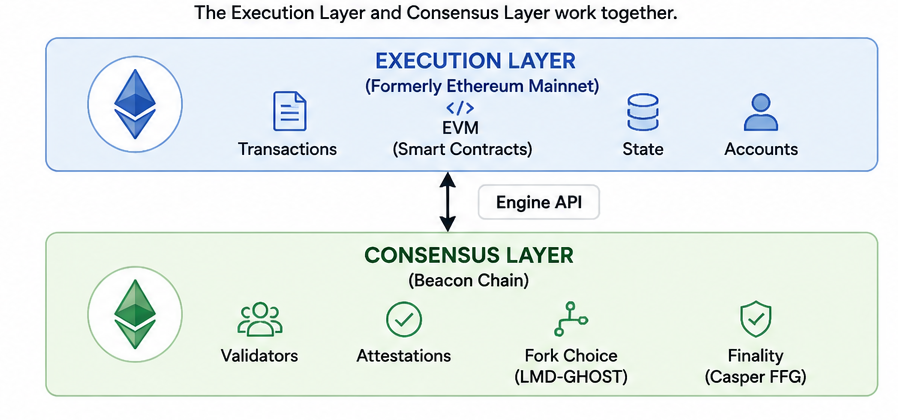

## Agenda

- Today we explore how Ethereum organizes data, proposes blocks, and reaches agreement.  
- We’ll trace the shift from Proof of Work “mining” to Proof of Stake “validation.”  
- Topics: block structure and headers, validator duties and rewards, and how consensus ensures shared state.  
- Security and incentives are part of the story — they explain *why* these mechanisms work under pressure.  

::: {.notes}

**Overall Slide Concept**
This opening slide establishes the lesson's throughline: Ethereum block structure, Proof of Stake validation, and security are one connected system. It matters here because students need a roadmap before diving into headers, validators, and attack cases. Emphasize that the class is tracing how transactions become finalized state under live operational pressure.

**Key Points**
- The lesson connects data structure, consensus flow, and security assumptions.
- Proof of Work "mining" has been replaced by Proof of Stake validation, but the need for coordination and trust minimization remains.
- Spell out PoS as Proof of Stake and explain that validators are the participants who propose and attest to blocks.

**Walkthrough**
None

**Sources**
@wood_ethereumsecuredecentralised_2016; @ethereumdevelopers_proofofstakepos_2025; @ethereumdevelopers_blockproposal_2024

:::

## The Ethereum Operational Framework

::: {style="font-size: 0.70em;"}

::: columns
::: {.column width="50%"}
- Ethereum can be considered a global, append-only
  state machine shared by peers.

- Anyone can submit a transaction; validators
  propose blocks and attesters verify and accept.

- The chain with the most cumulative *attestation weight* is the canonical history.

- Ownership is control of private keys
  (EOAs and contract accounts).

- Incentives fund
  security and honest participation.
:::
::: {.column width="50%"}
```{dot}
//| fig-width: 5
digraph EthBlockFlow {
  rankdir=TB;
  graph [bgcolor="transparent", fontsize=14, nodesep=0.35, ranksep=0.45];
  node  [shape=box, style="rounded,filled", fillcolor="#eef2f7",
         fontname="Helvetica", fontsize=13, color="#9ba8b7", penwidth=1.2];
  edge  [fontname="Helvetica", fontsize=11, color="#9ba8b7", arrowsize=0.7];

  Chain     [label="Canonical Head\n(heaviest attested)"];
  Wallet    [label="User Wallet"];
  Mempool   [label="Mempool"];
  Validator [label="Proposer\n(Validator)"];
  Block     [label="New Block"];
  Nodes     [label="Full Nodes\n& Attesters"];

  Chain     -> Wallet;
  Wallet    -> Mempool   [label="signed tx"];
  Mempool   -> Validator [label="candidate set"];
  Validator -> Block     [label="builds block"];
  Block     -> Nodes;
  Nodes     -> Chain     [label="validate +\nattest"];
}
```
:::
:::
:::

::: {.callout-note appearance="simple" style="font-size: 0.72em;"}
**Attestation weight**: the total voting power behind a block or branch, measured by how much validator stake is represented in the latest attestations supporting it.
:::

::: {.notes}

**Overall Slide Concept**
This slide establishes the block as the operational unit that ties users, validators, attesters, and canonical chain history together. It matters here because students need the high-level lifecycle before examining specific header and body fields. Emphasize that canonical history depends on attested agreement, not just block creation.

**Key Points**
- Ethereum can be treated as a shared state machine that advances through proposed and attested blocks.
- Users submit signed transactions, proposers assemble candidate blocks, and attesters help determine the canonical head.
- Define canonical as the history the network currently recognizes as authoritative.

**Walkthrough**
None

**Sources**
@wood_ethereumsecuredecentralised_2016; @ethereum.org_blocksdeveloperdocs_2025

:::

## Execution Payload: Header Structure {.smaller}

::: {style="font-size: .8em;"}

::: columns
::: {.column width="69%"}
- **Execution Payload = Header + Body**  
  - **Header:** commitments and metadata.  
  - **Body:** ordered transactions and execution data.  
- **Core header roots (Merkle–Patricia tries):**  
  - These are ordered, hash-linked data structures built with `Keccak-256`, so a single root commits to the exact contents and order beneath it.
  - `state_root` → commits to global state after execution.  
  - `transactions_root` → commits to ordered list of transactions.  
  - `receipts_root` → commits to execution results (status, gas, logs).  
- **Operational Fields**: gas accounting, parent hash, indexing, etc.

::: {.callout-note appearance="simple" style="font-size: 1.2em;"}
**Keccak-256** is Ethereum's main cryptographic hash function. It is based on the **Keccak sponge construction**, not quite the Merkle-Damgard design used by `SHA-256`; it is closely related to but not identical with the NIST-standardized `SHA-3`.
:::
:::
::: {.column width="30%"}
```{dot}
digraph EthBlock {
  rankdir=TB;
  graph [bgcolor="transparent", fontsize=11, nodesep=0.25, ranksep=0.3,
         compound=true];
  node  [shape=box, style="rounded,filled", fontname="Helvetica",
         fontsize=11, color="#9ba8b7", penwidth=1.0];
  edge  [color="#9ba8b7", arrowsize=0.6];

  subgraph cluster_block {
    label="Execution Payload"; labeljust=c; fontname="Helvetica"; fontsize=12;
    style="rounded,filled"; fillcolor="#f5f7fa"; color="#9ba8b7";

    subgraph cluster_header {
      label="Header (Commitments + Metadata)\n~500-700 bytes"; labeljust=c;
      fontname="Helvetica"; fontsize=10;
      style="rounded,filled"; fillcolor="#eef2f7"; color="#b0bec5";

      state   [label="state_root",          fillcolor="#dce6f0"];
      txroot  [label="transactions_root",   fillcolor="#dce6f0"];
      rcproot [label="receipts_root",       fillcolor="#dce6f0"];
      meta    [label="Operational Fields",  fillcolor="#dce6f0"];

      state -> txroot -> rcproot -> meta;
    }

    subgraph cluster_body {
      label="Body (Execution Data)\nvariable size"; labeljust=c;
      fontname="Helvetica"; fontsize=10;
      style="rounded,filled"; fillcolor="#eef2f7"; color="#b0bec5";

      body_placeholder [label="Transactions\nExecution Data",
                        fillcolor="#dce6f0"];
    }

    meta -> body_placeholder [ltail=cluster_header, lhead=cluster_body];
  }
}

```
:::
:::
:::

::: {.notes}

**Overall Slide Concept**
This slide establishes why the execution payload header matters: it is a compact commitment to the transactions, outcomes, and resulting state below it. It matters here because later security and verification discussions depend on understanding what these roots guarantee.

**Key Points**
- The execution payload header contains commitments and metadata, while the body carries the execution data itself.
- The `state_root`, `transactions_root`, and `receipts_root` commit to world state, ordered transactions, and execution outcomes.
- Define trie briefly as a key-value data structure that supports efficient lookup and hashed commitments.

**Walkthrough**
1. Start with the idea that the block splits into a header and a body.
2. Point to the three roots as commitments to inputs, outputs, and resulting state.
3. Close by noting that operational fields such as parent hash and gas accounting make the block usable by nodes and tools.

**Sources**
@wood_ethereumsecuredecentralised_2016; @ethereum.org_blocksdeveloperdocs_2025

:::

## Beacon Blocks and Execution Payloads {.smaller}

::: {style="font-size: .74em;"}

::: columns
::: {.column width="52%"}
- In post-Merge Ethereum, the **beacon block** is the outer consensus-layer container validators propose and attest to.
- The **execution payload** resides inside that beacon block.
- **Outer fields:**
  - `slot` — **8 bytes**
  - `proposer_index` — **8 bytes**
  - `parent_root` — **32 bytes**
  - `state_root` — **32 bytes**
- **Body fields with fixed-size types:**
  - `randao_reveal` (`BLSSignature`) — **96 bytes**
  - `eth1_data` — deposit-contract view / deposit metadata
  - `graffiti` — optional metadata, **32 bytes**
- **Variable-size fields:**
  - `attestations`, `proposer/attester slashings`, `deposits`, exits, sync data
  - `execution_payload`

:::
::: {.column width="54%"}
```{dot}
digraph BeaconBlockView {
  rankdir=TB;
  graph [bgcolor="transparent", fontsize=11, nodesep=0.25, ranksep=0.3,
         compound=true];
  node  [shape=box, style="rounded,filled", fontname="Helvetica",
         fontsize=11, color="#9ba8b7", penwidth=1.0];
  edge  [color="#9ba8b7", arrowsize=0.6];

  subgraph cluster_block {
    label="Beacon Block (Consensus Layer)"; labeljust=c; fontname="Helvetica"; fontsize=12;
    style="rounded,filled"; fillcolor="#f5f7fa"; color="#9ba8b7";

    subgraph cluster_header {
      label="Outer Fields"; labeljust=c;
      fontname="Helvetica"; fontsize=10;
      style="rounded,filled"; fillcolor="#eef2f7"; color="#b0bec5";

      slot     [label="slot\n8 B", fillcolor="#dce6f0"];
      proposer [label="proposer_index\n8 B", fillcolor="#dce6f0"];
      parent   [label="parent_root\n32 B", fillcolor="#dce6f0"];
      state    [label="state_root\n32 B", fillcolor="#dce6f0"];

      slot -> proposer -> parent -> state;
    }

    subgraph cluster_body {
      label="Body\n(variable size)"; labeljust=c;
      fontname="Helvetica"; fontsize=10;
      style="rounded,filled"; fillcolor="#eef2f7"; color="#b0bec5";

      randao   [label="randao_reveal\n96 B", fillcolor="#dce6f0"];
      eth1     [label="eth1_data\nmetadata", fillcolor="#dce6f0"];
      graffiti [label="graffiti\n32 B", fillcolor="#dce6f0"];
      ops      [label="Attestations /\nSlashings /\nSync data\nvariable", fillcolor="#dce6f0"];
      payload  [label="execution_payload\nexecution block\nvariable", fillcolor="#cfe8ff"];

      randao -> eth1 -> graffiti -> ops -> payload;
    }

    state -> randao [ltail=cluster_header, lhead=cluster_body];
  }
}
```
:::
:::
:::
::: {.notes}

**Overall Slide Concept**
This slide resolves the post-Merge ambiguity between the execution-layer block structure and the larger consensus-layer beacon block. It matters here because students need to know what validators actually propose and attest to, and where the execution payload sits inside that object.

**Key Points**
- The beacon block is the outer consensus-layer container.
- The execution payload is nested inside it and carries the execution-layer block data.
- Fixed-width fields such as `slot`, `state_root`, `randao_reveal`, and `graffiti` can be described precisely, while operational lists remain variable size.

**Walkthrough**
1. Start with the outer box and explain that this is the beacon block validators gossip and attest to in the consensus layer.
2. Point to the outer metadata fields: `slot`, `proposer_index`, `parent_root`, and `state_root`.
3. Move into the body and identify `randao_reveal`, `eth1_data`, and `graffiti` as named beacon-block fields, while the slashings, attestations, and sync data vary in size.
4. End by highlighting `execution_payload` as the embedded execution-layer block students will continue analyzing in the next slide.

**Sources**
@ethereum.org_blocksdeveloperdocs_2025; @ethereumdevelopers_proofofstakepos_2025

:::

## The Merge: Beacon Chain to PoS

::: {style="font-size: .8em;"}
::: {style="text-align: center;"}
{fig-alt="Diagram showing Ethereum's execution layer merging with the Beacon Chain's proof-of-stake consensus layer." width="78%"}
:::

- Execution layer: transactions, accounts, smart contracts, and state.
- Consensus layer: handles validators, attestations, fork choice, and finality.
:::
::: {.notes}

**Overall Slide Concept**
This is an orientation slide, not a history slide. It matters here because students are about to move from block structure into Proof-of-Stake mechanics, and they need a clear mental map of Ethereum's two-layer architecture before diving into validators, attestations, fork choice, and finality.

**Key Points**
- The execution layer is where transactions are processed and state is updated.
- The consensus layer is where validators coordinate around attestations, fork choice, and finality.

**Walkthrough**
1. Start with the image and remind students that when we say "Ethereum" today, we really mean a system with two connected layers.
2. Point to the execution layer and identify its responsibilities: transactions, smart contracts, accounts, and state.
3. Point to the consensus layer and identify its responsibilities: validators, attestations, fork choice, and finality.
4. Close by telling students that the remaining slides focus on how the consensus layer secures and finalizes what the execution layer computes.

**Sources**
@l34_ethereumorg_merge_2022; @ethereumorg_history_2026

:::

## PoS Overview: Validators, Committees, and Clients {.smaller}

::: {style="font-size: .8em;"}
- Join by staking **32 ETH** in the deposit contract on the execution layer.  
- Each validator runs:  
  - **Execution client** → handles transactions and state (EVM).  
  - **Consensus client** → runs the Consensus Layer: assigns duties, verifies blocks, manages committees and finality.  
  - **Validator process** → signs duties assigned by the consensus client.  
- Duties (execution):  
  - Rarely: propose a block for a slot.  
  - Frequently: attest within a randomly selected committee that votes on block validity and checkpoints.  
- Rewards for timely, correct attestations; penalties for missed or conflicting votes.  
- **Slashing** burns stake for provable equivocation or surround voting.  
- Operational focus: client diversity, monitoring, secure key handling.

::: {.callout-note appearance="simple"}
Committee attesters earn small rewards for each timely, correct vote. Proposers receive a larger reward that includes attestation aggregation bonuses and transaction fees. Rewards are funded by new ETH issuance and priority fees paid by users.
:::
:::
::: {.notes}

**Overall Slide Concept**
This slide establishes the main actors in Ethereum's PoS consensus process and how they coordinate around blocks and checkpoints. It matters here because the lesson now shifts from historical transition to the steady-state mechanics of validator duties. Emphasize how roles differ across proposers, attesters, committees, and clients while still serving one shared consensus process.

**Key Points**
- Validators are selected for duties such as proposing blocks and attesting to blocks proposed by others.
- Committees distribute attestation work so many participants help evaluate each slot and epoch.
- Define client briefly as the software implementation that participates in either the consensus or execution layer.

**Walkthrough**
1. Identify proposers as the validators chosen to build a block for a slot.
2. Explain committees as rotating groups that attest to what they believe is the correct head and checkpoint.
3. Close by tying those duties back to clients that execute, validate, and exchange the required messages.

**Sources**
@ethereumdevelopers_proofofstakepos_2025; @ethereumdevelopers_blockproposal_2024; @ethereum.org_nodesclientsdeveloper_2025

:::

## Slots and Epochs

::: {style="font-size: .80em;"}

- **Slot** = 12 seconds; at most one block proposal per slot.
- **Epoch** = 32 slots (~6.4 minutes); committees reshuffle each epoch.
- Each slot, **one committee** (a subset of all validators) attests — over a full epoch, every active validator attests exactly once.
- Missed slots happen — liveness continues through the next proposal.
- Finality escalates through epoch checkpoints (Casper-FFG).
- **Per-slot lifecycle:** proposer broadcasts a block (~0–4s), committee
  attests to it (~4s mark), attestations are *BLS-aggregated* and included
  in a subsequent slot's block.

::: {.callout-note appearance="simple"}
**Boneh-Lynn-Shacham (BLS)** signature scheme compresses the signatures of the attestors into a single compact signature, which can be verified easily.
:::

:::

::: {.notes}

**Overall Slide Concept**
This slide establishes the cadence of Ethereum PoS by tying validator duties to 12-second slots and grouped epochs. It matters here because later discussion of attestation, fork choice, and finality assumes students can place each action on the protocol timeline. Emphasize that timing structure is how Ethereum organizes repeated consensus work.

**Key Points**
- Slots are short windows for proposing and attesting to blocks, while epochs group multiple slots into a larger unit.
- Many consensus rules, rewards, and finality checkpoints are evaluated at the epoch level rather than per single block.
- Spell out epoch as a fixed collection of consecutive slots used for protocol accounting and finality logic.

**Walkthrough**
1. Define a slot as the basic time unit where a proposer may publish a block.
2. Group several slots into an epoch to show how Ethereum batches larger consensus decisions.
3. Connect this schedule to later topics such as justified and finalized checkpoints.

**Sources**
@ethereumdevelopers_blockproposal_2024; @ethereumdevelopers_proofofstakepos_2025

:::

## Validator Selection & Randomness {.smaller}
::: {style="font-size: .95em;"}

- **Purpose:** prevent predictability or bias in proposer and committee selection.  
- **Source:** RANDAO — Ethereum's rolling randomness mechanism for validator selection.
  - In each slot, the proposer includes a `randao_reveal` in the beacon block.
  - Over time, those proposer reveals update the shared randomness seed used by the consensus layer.
- **Assignments:**  
  - The Consensus Layer uses the seed to shuffle validators and assign proposers/committees per slot.  
  - Selection is weighted by effective balance and fixed only shortly before duties are performed.
- **Incentives:**  
  - Missing or withholding a reveal forfeits rewards and only marginally affects the overall result.
  - Rolling contributions from many slots make the randomness hard to steer in practice.

::: {.callout-note appearance="simple"}
RANDAO is stake-weighted: each validator's influence on the random seed is proportional to their effective balance (up to 32 ETH per key), so selection probability scales with the amount of ETH staked.
:::
:::
::: {.notes}

**Overall Slide Concept**
This slide establishes that validator assignment must be unpredictable enough to resist manipulation while remaining verifiable to the network. It matters here because committee rotation and proposer selection only improve security if participants cannot cheaply game the process. Emphasize that randomness is not decorative here; it is part of Ethereum's defense against targeted influence.

**Key Points**
- Ethereum uses randomized assignment to determine which validators propose blocks and which join committees.
- RANDAO is the production mechanism Ethereum uses to keep those assignments hard to predict and hard to bias.
- Define validator selection as the process of assigning consensus duties to staked participants for a given slot or epoch.

**Walkthrough**
1. Start with the problem: validator duties must be assigned unpredictably enough to resist targeting or collusion.
2. Explain that Ethereum solves this with RANDAO, a rolling source of shared randomness updated by block proposers.
3. Close by connecting that shared seed to proposer selection and committee shuffling in the slots ahead.

**Sources**
@ethereumdevelopers_proofofstakepos_2025; @ethereumdevelopers_blockproposal_2024

:::

## RANDAO: How the Randomness Is Built {.smaller}
::: {style="font-size: .76em;"}

::: columns
::: {.column width="45%"}
- Each slot's proposer includes a **`randao_reveal`** in the beacon block.
- That reveal is a **BLS signature on the current epoch number**.
- The consensus layer **mixes** that reveal into the running RANDAO state.
- The updated seed is then reused with slot and epoch context to:
  - select future proposers
  - shuffle validators into committees

::: {.callout-note appearance="simple" style="font-size: 0.8em;"}
**Contrast:** some PoS systems use **VRFs** for private per-validator randomness; Ethereum currently uses collective **RANDAO** instead.
:::
:::
::: {.column width="55%"}
```{dot}
digraph RandaoFlow {
  rankdir=LR;
  graph [bgcolor="transparent", fontsize=12, nodesep=0.35, ranksep=0.55];
  node  [shape=box, style="rounded,filled", fontname="Helvetica",
         fontsize=11, color="#9ba8b7", penwidth=1.1];
  edge  [color="#9ba8b7", arrowsize=0.7, fontname="Helvetica", fontsize=10];

  proposer [label="Current Slot\nProposer", fillcolor="#dbeafe"];
  reveal   [label="`randao_reveal`\n(BLS-signs current epoch)", fillcolor="#e0f2fe"];
  mix      [label="Mix Into\nRANDAO State", fillcolor="#fef3c7"];
  seed     [label="Updated\nRANDAO Seed", fillcolor="#dcfce7"];
  propnext [label="Select Next\nProposers", fillcolor="#e9d5ff"];
  comm     [label="Shuffle Validators\nInto Committees", fillcolor="#fde68a"];

  proposer -> reveal -> mix -> seed;
  seed -> propnext;
  seed -> comm;
}
```
:::
:::
:::

::: {.notes}

**Overall Slide Concept**
This slide explains the mechanism behind Ethereum's randomness rather than detouring into a general VRF lecture. It matters here because students have already heard that RANDAO exists; now they need to see how proposer reveals become a shared seed that drives later duties.

**Key Points**
- Each proposer contributes a `randao_reveal` in its beacon block.
- The reveal is a BLS signature over the current epoch that gets mixed into the running randomness state.
- The resulting seed is reused by the consensus layer for proposer selection and committee shuffling.

**Walkthrough**
1. Start with the proposer box and explain that one proposer contributes per slot.
2. Point to `randao_reveal` and explain that it is the proposer's BLS signature on the current epoch.
3. Follow the diagram into the running RANDAO state and emphasize that the seed is updated collectively over time.
4. End on the two outputs: the updated seed helps determine future proposers and committee assignments.

**Sources**
@ethereumdevelopers_blockproposal_2024; @ethereumdevelopers_proofofstakepos_2025

:::

## Global Randomness: RANDAO + VDF Beacons {.smaller}

::: {style="font-size: .75em;"}

- **Why shared randomness?**
  - Ethereum needs one deterministic seed that the whole consensus layer can use for proposer selection and committee rotation.
- **RANDAO's limitation:**
  - the *last revealer* can withhold its contribution and marginally bias the final seed.
- **Why this is tolerated in practice:**
  - withholding forfeits rewards
  - the effect is diluted by many prior contributions
- **VDF idea:**
  - a **Verifiable Delay Function** would add a time-locked step that is easy to verify but impossible to compute early.
  - that would reduce or eliminate the last-revealer advantage.
- **Mainnet status:** VDFs are still a proposed improvement, not part of Ethereum mainnet today.

::: {.callout-note appearance="simple"}
RANDAO is Ethereum's production randomness mechanism today. VDFs are mentioned because they address bias at the margin, not because they are already deployed.
:::  

:::

::: {.notes}

**Overall Slide Concept**
This slide reframes the discussion from mechanism to limitations. It matters here because students now know how RANDAO works and are ready to hear what residual bias remains and why researchers discuss VDFs.

**Key Points**
- Shared randomness is necessary for consensus-wide duty assignment.
- RANDAO has a small last-revealer bias rather than perfect unpredictability.
- VDF stands for verifiable delay function and is a proposed mitigation, not a deployed Ethereum feature.

**Walkthrough**
1. Start by reminding students that the previous slide explained how the seed is built.
2. Introduce the remaining limitation: the final contributor can marginally bias the output by withholding.
3. Close by explaining that VDFs are a research answer to that bias, but not something Ethereum mainnet currently uses.

**Sources**
@ethereumdevelopers_blockproposal_2024; @ethereumdevelopers_proofofstakepos_2025

:::

## Forks in Proof of Stake — Causes and Resolution {.smaller}

::: {style="font-size: .85em;"}

- Each slot has one designated proposer, but messages spread asynchronously.  
- **Short-term forks** occur when:  
  - The proposer's block arrives late or not at all.  
  - Attestations propagate in different orders across validators.  
  - A proposer equivocates or two blocks exist for the same slot.  
- **Result:**  
  - Validators may temporarily disagree on the chain head.  
- **Resolution:**  
  - Attestations serve as stake-weighted votes for blocks.  
  - The fork-choice rule — **LMD-GHOST (Latest-Message-Driven Greedy Heaviest-Observed SubTree)** — follows the branch with the most recent total attestation weight.  
  - As new votes arrive, honest nodes converge on the same head.

::: {.callout-note appearance="simple"}
LMD-GHOST starts at the last justified checkpoint and walks down the block tree, choosing whichever child has the greatest stake weight from validators' *latest* attestations. Each validator counts once (their most recent vote only). The result is a head that reflects the current majority view, not historical block count.
:::
:::
::: {.notes}

**Overall Slide Concept**
This slide establishes that forks still happen under PoS, but they arise and resolve differently than in PoW. It matters here because students may assume Proof of Stake eliminates temporary disagreement, when it actually changes the recovery mechanisms. Emphasize that timing, attestations, and finality rules are what distinguish ordinary short-lived forks from more serious safety concerns.

**Key Points**
- PoS forks can emerge from latency, competing proposals, missed attestations, or client disagreement.
- Fork choice and finality rules help the network converge even when temporary branches appear.
- Define fork briefly as a divergence where different nodes temporarily track different candidate histories.

**Walkthrough**
1. Identify how competing views of the recent head can arise in a distributed network.
2. Explain that validators attest to what they see, creating weight for one branch or another.
3. Show that Ethereum resolves routine forks through fork choice first and finality later.

**Sources**
@ethereumdevelopers_proofofstakepos_2025; @ethereumdevelopers_blockproposal_2024

:::

## Gasper: Fork Choice + Finality
::: {style="font-size: .67em;"}
- **Gasper** = the combined consensus protocol that pairs two mechanisms:
  - **LMD-GHOST** (fork choice): picks the head by following the branch with the greatest *latest* attested stake weight.  
  - **Casper-FFG** (finality gadget): finalizes checkpoints once ≥ 2/3 of total stake votes consistently across epochs.  
- **Finality sequence** (across two epochs):
  1. Validators cast source→target votes; when ≥ 2/3 of stake supports
     a checkpoint link, the target becomes **justified**.
  2. When the *next* epoch's checkpoint is also justified, the earlier
     checkpoint becomes **finalized** — economically irreversible.
- **Safety:** reverting a finalized checkpoint implies ≥ 1/3 of total stake must be slashed.  
- **Liveness:** inactivity leak gradually restores a supermajority after major outages.

::: {.callout-note appearance="simple"}
Gasper is the name for Ethereum's full consensus protocol. Casper-FFG is one component within it — the finality gadget. LMD-GHOST is the other — the fork-choice rule. "Casper" alone is sometimes used loosely to refer to either the gadget or the broader system, but precisely it means the FFG finality layer only.
:::
:::
::: {.notes}

**Overall Slide Concept**
This slide establishes Gasper as Ethereum's combination of immediate head selection and stronger checkpoint finality. It matters here because students now have the timing and validator concepts needed to understand why Ethereum separates 'best current head' from 'finalized history.' Emphasize that LMD-GHOST and Casper-FFG solve related but different consensus problems.

**Key Points**
- Gasper combines LMD-GHOST fork choice with Casper-FFG finality.
- LMD stands for latest-message-driven and tracks the current heaviest attested head, while FFG stands for Friendly Finality Gadget and finalizes checkpoints.
- The design gives Ethereum both short-term liveness and stronger settlement guarantees over time.

**Walkthrough**
1. Start with LMD-GHOST selecting the best current head from recent attestations.
2. Then explain Casper-FFG justifying and finalizing checkpoints across epochs.
3. End by tying both pieces together under the Gasper name.

**Sources**
@ethereumdevelopers_proofofstakepos_2025; @ethereumdevelopers_blockproposal_2024; @ethereumdevelopers_ethereumproofofstakeattack_2025

:::

## Double Spending (Threat Model)

::: {style="font-size: .75em;"}
- **Goal:** accept payment, then publish a conflicting history that erases it.
- **PoW:** requires sustained majority hash power to outpace the honest chain.
- **PoS:** requires majority stake *and* willingness to be slashed — post-finality rewrites destroy at least 1/3 of bonded stake.
- Mainnet double-spends are economically impractical under PoS finality.
- **Settlement policy:** wait for finalized checkpoints (PoS) rather than counting confirmations (PoW).

::: {.callout-note appearance="simple"}
**Real-world example:** Ethereum Classic suffered a series of 51% double-spend attacks in 2020, where attackers rented enough hash power to reorganize thousands of blocks and reverse exchange deposits worth millions of dollars. This was feasible because ETC's total hash rate was low enough to rent temporarily. Ethereum mainnet's shift to PoS changes the calculus entirely — an attacker cannot rent stake and walk away; they must own it and accept that it will be slashed.
:::
::: 
::: {.notes}

**Overall Slide Concept**
This slide establishes double spending as a threat-model question in PoS rather than a problem magically solved by staking alone. It matters here because students need to connect consensus mechanics to a concrete adversarial goal they already recognize from earlier lessons. Emphasize that settlement confidence depends on finality and honest-majority assumptions, not just the existence of validators.

**Key Points**
- Double spending means trying to get two conflicting outcomes accepted from the same underlying funds or transaction authority.
- PoS counters this through attestation weight, finality, and slashable evidence for conflicting behavior.
- Define slashable briefly as behavior that can be proven and penalized by taking away stake.

**Walkthrough**
None

**Sources**
@ethereumdevelopers_proofofstakepos_2025; @ethereumdevelopers_ethereumproofofstakeattack_2025

:::

## Balance Attack
::: {style="font-size: .75em;"}

- **Goal:** split the network into sub-partitions with roughly equal validator weight.
- Delay cross-partition communication so each side builds its own fork and accumulates attestations independently.
- Selectively release withheld blocks or attestations to one side, making its branch heavier under LMD-GHOST; the other side reorgs.
- Exploits **propagation asymmetry** rather than absolute majority of stake.
- Defenses: diverse peering, fast relay networks, client diversity, monitoring for unusual reorg depth or participation dips.

::: {.callout-note appearance="simple"}
**Real-world relevance:** In 2023, researchers demonstrated balancing-style attacks against LMD-GHOST in testnet conditions, exploiting proposer boost timing and attestation delays. Ethereum responded with **proposer boost** — a fork-choice weight bonus given to the current slot's block when seen on time — which raises the cost of these attacks significantly. The episode illustrates that consensus security depends on network plumbing, not just cryptography.
:::
:::
::: {.notes}

**Overall Slide Concept**
This slide establishes a network-layer attack where an adversary manipulates connectivity to give an inaccurate view of chain weight or progress. It matters here because Ethereum security depends not just on cryptography and incentives, but also on what validators and users can observe. Emphasize that consensus can be pressured when honest participants are partitioned or delayed.

**Key Points**
- A balance attack exploits network partitioning or delay to skew what different participants believe about the chain.
- The threat is about coordination and visibility, not just invalid cryptographic data.
- Define partition briefly as a condition where groups of nodes cannot reliably exchange messages with each other.

**Walkthrough**
1. Describe the attacker separating or delaying communication between groups of nodes.
2. Explain how each side may make decisions using incomplete or skewed information.
3. Close with the operational consequence: slower or riskier settlement during abnormal network conditions.

**Sources**
@ethereumdevelopers_ethereumproofofstakeattack_2025

:::

## Security Risk: Smart Contract Code Reuse

- Less than 10% of contracts are unique bytecode; templates dominate deployments.
- One vulnerability can impact thousands of dependent contracts (e.g., Parity multisig 2017).
- Attackers fingerprint bytecode families to find mass-exploitation targets.
- Mitigations: audited libraries, invariants, upgrade discipline, runtime guards.
- Encourage diversity in implementations and proactive upgrade playbooks.

::: {.notes}

**Overall Slide Concept**
This slide establishes that smart contract risk can be amplified when insecure code patterns are copied widely across projects. It matters here because Ethereum security is not only about consensus safety; application-layer design failures can scale rapidly through reuse. Emphasize that reuse multiplies both benefits and bugs.

**Key Points**
- Reused contract patterns can spread the same flaw across many deployments.
- Audited-looking code is not automatically safe when copied into new contexts or modified carelessly.
- Define smart contract briefly as program logic executed by the Ethereum network and stored on-chain.

**Walkthrough**
None

**Sources**
@ethereum.org_smartcontractsdeveloper_2025; @siegel_understandingdaoattack_2016; @l34_ethereum_dao_vulnerability_2016

:::

## Real-World Ethereum Security Examples

::: {style="font-size: .60em;"}

- **The DAO Hack (June 2016):** A reentrancy vulnerability in The DAO's smart contract allowed an attacker to drain ~$60M in ETH by repeatedly calling the withdraw function before balances updated. The Ethereum community responded with a controversial hard fork, splitting the chain into Ethereum (ETH) and Ethereum Classic (ETC).

- **Parity Multisig Wallet (July 2017):** Hackers exploited a visibility bug in the Parity multisig library contract, stealing ~$31M in ETH from multiple wallets. A second Parity incident in November 2017 accidentally froze over 500,000 ETH when a user triggered a self-destruct on the shared library — a textbook case of code-reuse risk.

- **Consensus Layer Finality Delays (May 2023):** On May 11–12, Ethereum mainnet experienced two finality delays — the first lasting ~25 minutes, the second over an hour. Consensus client bugs (Prysm, Teku) caused validators to go offline, dropping participation below the 2/3 threshold needed for finalization. Blocks continued to be produced (liveness held), and the network self-recovered without intervention. Client diversity was credited as the key reason the outage stayed brief.

- **Ethereum Classic 51% Attacks (2020):** ETC suffered multiple double-spend attacks where attackers rented enough hash power to reorganize thousands of blocks and reverse exchange deposits. This contrast illustrates why Ethereum's move to PoS — where stake cannot be rented and walked away from — fundamentally changes the attacker's calculus.

:::

::: {.notes}

**Overall Slide Concept**
This slide establishes that Ethereum security incidents have repeatedly emerged at the application and implementation layers, not only at consensus. It matters here because concrete examples help students distinguish protocol design from contract coding and operational failures. Emphasize that incident history teaches where assumptions broke in practice.

**Key Points**
- Real incidents show how logic flaws, misuse of libraries, or unsafe upgrade patterns can cause major losses.
- Security examples ground abstract threats in concrete operational and engineering consequences.
- Define incident analysis briefly as studying what failed, why it failed, and what defenses would have helped.

**Walkthrough**
None

**Sources**
@siegel_understandingdaoattack_2016; @l34_ethereum_dao_vulnerability_2016; @offchain_ethereumbeaconchain_2023

:::

## Nothing-at-Stake
::: {style="font-size: .60em;"}
- **Risk:** in naive PoS, validators could sign multiple competing forks
  at no cost, undermining convergence.
- **Defense:** Ethereum enforces **objective slashing** for three offenses:
  1. **Double proposal** — two blocks for the same slot.
  2. **Double attestation** — two votes for the same target epoch with
     different chain heads.
  3. **Surround vote** — an attestation whose source→target range
     encloses or is enclosed by a prior vote.
- Evidence is purely cryptographic — two conflicting signatures from the
  same key. Intent is irrelevant once proofs exist.
- **Correlation penalty:** slashing severity scales with how many
  validators are slashed in the same ~18-day window. An isolated mistake
  costs ~1 ETH; a coordinated attack involving ≥1/3 of stake can burn
  the full 32 ETH per validator.
- Slashing events propagate to all clients; anyone can submit evidence,
  making enforcement decentralized.

::: {.callout-note appearance="simple"}
All known mainnet slashings have been accidental — misconfigured backups causing double attestations (Staked, 2021; Bitcoin Suisse, 2023). No intentional equivocation has occurred, suggesting the penalty structure deters it effectively.
:::
:::
::: {.notes}

**Overall Slide Concept**
This slide establishes the nothing-at-stake critique as a concern about validators supporting multiple branches when signing is cheap. It matters here because PoS changes the resource cost model compared with PoW, so students need to understand the new incentive problem. Emphasize that Ethereum responds with slashing and protocol rules rather than energy expenditure.

**Key Points**
- Nothing-at-stake asks whether validators can cheaply sign conflicting branches without meaningful cost.
- Ethereum answers this with slashable equivocation rules and finality logic.
- Define equivocation briefly as signing conflicting messages that should be mutually exclusive.

**Walkthrough**
None

**Sources**
@ethereumdevelopers_ethereumproofofstakeattack_2025; @ethereumdevelopers_proofofstakepos_2025

:::

## Finality Delay
::: {style="font-size: .65em;"}
- **May 11–12, 2023:** Ethereum mainnet experienced its first finality delays — consensus client bugs (Prysm, Teku) overloaded validators, dropping participation below the 2/3 threshold needed to finalize checkpoints.
  - First incident: ~25 minutes (4 epochs without finality).
  - Second incident: over an hour (9 epochs), triggering the **inactivity leak** penalty.
- **What kept working:** blocks continued to be proposed and transactions processed — liveness was never lost, only finality paused.
- **What recovered it:** client diversity meant unaffected clients (e.g., Lighthouse) kept attesting. The inactivity leak gradually penalized offline validators, restoring the 2/3 supermajority. No manual intervention was required.
- **Operational lesson:** exchanges, bridges, and high-value services should pause large settlements when finality stalls and resume only after consecutive finalized epochs.

::: {.callout-note appearance="simple"}
The May 2023 incidents validated Ethereum's design under stress: the protocol distinguished between liveness (blocks keep coming) and safety (finality locks history), degraded gracefully, and self-healed. The community credited **client diversity** as the primary reason both outages stayed brief.
:::
:::
::: {.notes}

**Overall Slide Concept**
This slide establishes finality delay as a real operational state where block production continues but stronger settlement guarantees pause. It matters here because students should distinguish liveness from finality when assessing Ethereum risk. Emphasize that degraded operation can still be functioning operation, but downstream services must respond differently.

**Key Points**
- Finality delay occurs when the network keeps producing blocks but lacks the participation needed to finalize checkpoints.
- Client diversity and inactivity leaks help Ethereum recover without rewriting finalized history.
- Define liveness briefly as the ability to keep processing blocks and finality as the stronger lock on accepted history.

**Walkthrough**
None

**Sources**
@offchain_ethereumbeaconchain_2023; @hristov_ethereumvalidatorslost_2025; @etheralpha_clientdiversityethereum_2025

:::

## Censorship
::: {style="font-size: .65em;"}
- **Real-world case — OFAC / Tornado Cash (2022–2023):** After the U.S. Treasury sanctioned Tornado Cash in August 2022, the dominant relay (Flashbots) began filtering out sanctioned transactions. By November 2022, ~77% of relayed blocks excluded those transactions.
- **Community response:** Flashbots open-sourced its relay code; non-censoring relays (Ultra Sound, Agnostic, bloXroute) launched. By mid-2023, censored blocks dropped to ~30%. Vitalik Buterin publicly supported treating sustained base-layer censorship as a slashable attack.
- **Takeaway:** Ethereum's protocol never enforced censorship — sanctioned transactions still reached the chain, just with longer delays. But the episode exposed how **infrastructure centralization** (few relays, few builders) can create soft censorship even in a permissionless system.
- **Proposed mitigations:** inclusion lists (forcing proposers to include pending transactions), encrypted mempools, and greater relay/builder diversity.

::: {.callout-note appearance="simple" style="font-size: 0.78em;"}
**Builders** assemble a candidate block from pending transactions, and a  **Relay** passes that block to validators running middleware (MEV-Boost), so they can choose and propose it without seeing all transaction details first.
:::

:::

::: {.notes}

**Overall Slide Concept**
This slide establishes censorship as an infrastructure and incentive problem that can exist even when the base protocol is permissionless. It matters here because Ethereum's real-world behavior depends on builders, relays, validators, and policy pressure in addition to protocol rules. Emphasize that delayed inclusion can still be a serious security and governance concern.

**Key Points**
- Ethereum censorship pressure has often appeared at the relay and builder layer rather than as a direct protocol rule.
- Rotating proposers and diversified infrastructure make sustained censorship harder, but not impossible.
- Spell out MEV as maximal extractable value and OFAC as the Office of Foreign Assets Control.

**Walkthrough**
None

**Sources**
@flashbotsltd_flashbots_2025; @u.s.dept.oftreasury_ustreasurysanctions_2022; @l35_mevwatch_2026

:::

## Conclusion: Summary of Concepts

::: {style="font-size: .7em;"}

- **Block structure:** Headers cryptographically commit to inputs (`transactions_root`), outcomes (`receipts_root`), and world state (`state_root`) — enabling verification without full re-execution.
- **PoS consensus:** RANDAO randomness selects validators → committees attest in 12-second slots → LMD-GHOST picks the head → Casper-FFG finalizes checkpoints across epochs.
- **Security is layered:** The DAO and Parity exploited the application layer; finality delays hit the consensus layer; balance attacks and censorship target the network layer. No single defense covers all three.
- **Defenses are economic + operational:** Slashing deters equivocation, inactivity leaks restore finality, client diversity limits blast radius, and checkpoint sync blocks long-range attacks.
- **Operational takeaway:** Monitor participation and finality status, settle on finalized checkpoints (not block count), and treat infrastructure concentration as a security risk.

:::
::: {.notes}

**Overall Slide Concept**
This summary slide establishes the lesson's main synthesis: Ethereum security depends on how block commitments, PoS consensus, and operational practice fit together. It matters here because students have just seen many moving parts and need a coherent model before discussion or lab work. Emphasize the layered nature of Ethereum risk and defense rather than treating any single mechanism as sufficient.

**Key Points**
- Headers and roots support verification, while PoS consensus governs proposal, attestation, and finality.
- Security issues span execution, consensus, and infrastructure layers rather than staying in one place.
- Define operational takeaway here as the concrete monitoring or settlement behavior a practitioner should adopt.

**Walkthrough**
None

**Sources**
@wood_ethereumsecuredecentralised_2016; @ethereumdevelopers_proofofstakepos_2025; @ethereumdevelopers_ethereumproofofstakeattack_2025

:::

## References
