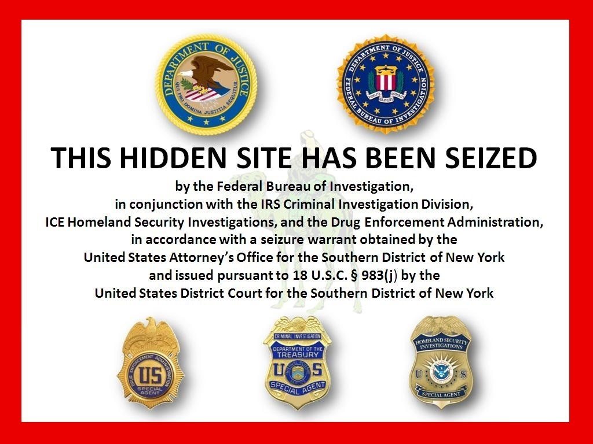
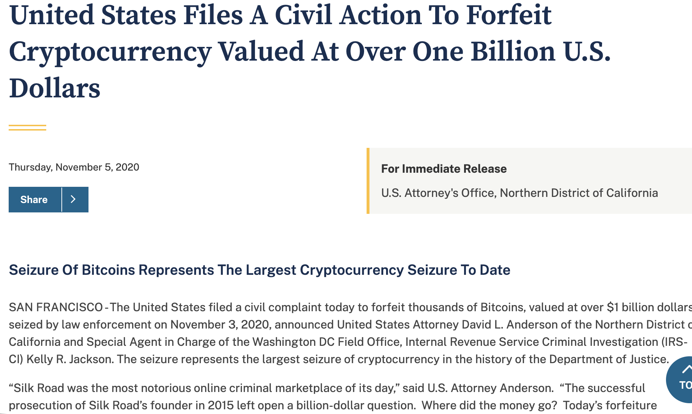
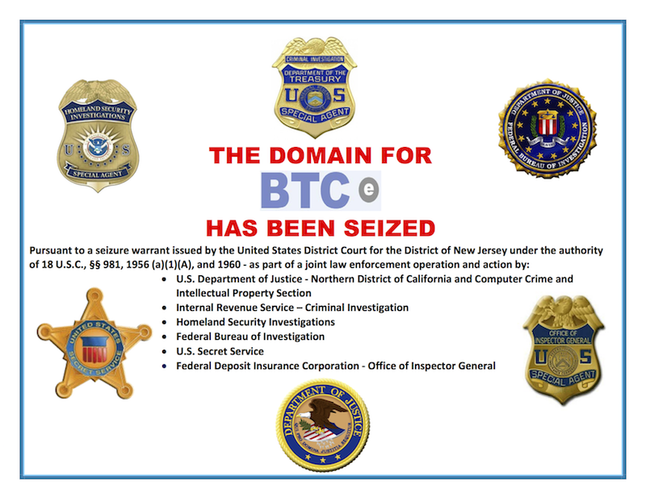
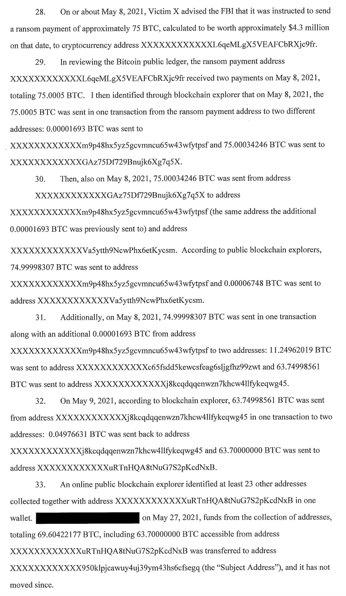
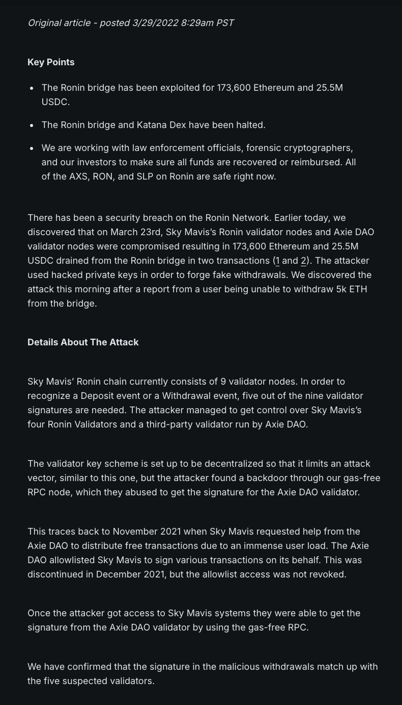
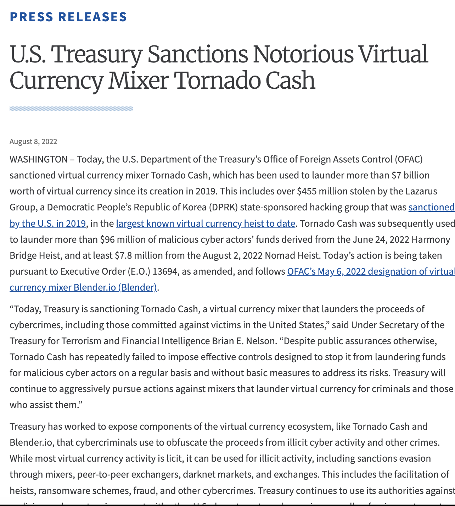

## Step 4 ended Low: now name the service {.smaller}

::: {style="font-size: .8em;"}

**The case:** this morning's worked trace stopped at step 4. The peel reached D, whose cluster holds about 2 million addresses, and the agent asks which service that is. Size is behavior alone, so the row says Low:

| Step | What you see | Heuristic | Could be wrong if | Confidence |
| --- | --- | --- | --- | --- |
| 4 | `T6`'s peel to D; D's cluster: 2 million addresses | Huge cluster: likely a service | It is not a service | Low |

: {tbl-colwidths="[7,30,26,22,15]"}

**The last lesson** followed a ransom to the first service it reached. Naming that service, and saying how sure you are, takes three parts:

1. **Labels and platforms:** where a name for a cluster comes from, and what an analytics platform adds.
2. **How well clustering has been measured:** what the tests show, and what a court asked of the method.
3. **Confidence and the explanation:** the words for an attribution, and five parts that explain it to an agent.

**By the end:** given a cluster and its labels, name the service, say where each label came from, give a confidence (High, Moderate or Low) with its reason, and explain it in five plain parts.

**The point to earn:** a label is a claim by someone. It carries only as far as its source knew, and only a different kind of evidence makes an attribution High [@kappos_howpeelmillion_2022; @sterlingov_dcd_2024].

:::

::: {.notes}

**Overall Slide Concept**
This slide opens the last lesson of day 6 with the worked trace's open question: step 4 reached a huge cluster, and the agent asks which service it is. It matters here because the afternoon lab's trace also stops at the first service, and the analyst must name it and say how sure. Emphasize the objective: each part ends with a check, and the review comes back to it.

**Key Points**
- Students already know two things this lesson builds on. The clustering lesson this morning ran a worked trace of four steps (invented data); step 4's peel landed in a cluster of about 2 million addresses, rated Low. The ransomware lesson just now followed a ransom to the first service it reached. Day 5 showed what an exchange knows about its customers.
- A cluster that size is usually a service: in Kappos et al., ransomware addresses sat in clusters averaging 2.9 million addresses, all exchanges, wallets, mixers or markets. Size alone is behavior, so the course scale gives Low until a label of another kind agrees.
- Define label briefly: a claim that an address or cluster belongs to a named service or actor; vendors and explorers call them tags.
- Define attribution briefly: linking on-chain activity to the service or actor behind it.
- The point is a claim the lesson earns: part 1 shows that labels differ by source, part 2 that the methods are tested only in part, and part 3 that confidence counts kinds of evidence. The Bitcoin Fog case runs through all three parts; BTC-e is the second case, for practice.

**Walkthrough**
1. Read the case and the row: why is it Low? (Cluster size is behavior alone.) Leave the agent's question open; the lesson answers it.
2. Read the link back, then name the three parts.
3. Read the objective aloud. Each part ends with a check every student answers, and the close asks the objective again.
4. Time plan, 50 minutes: opening 3, part 1 6, check 2, part 2 12, check 3, part 3 12, practice 5, answers 4, review and next 3.

**Sources**
- @kappos_howpeelmillion_2022
- @sterlingov_dcd_2024

:::

## A label is only as good as its source {.smaller}

**Bottom line:** say where each label came from and how far to trust it; one label with an unknown basis is Low. Ask of every label: who says so, how did they know, and how could it be wrong?

::: {style="font-size: .8em;"}

| Source | Example | How far it carries alone |
| --- | --- | --- |
| The owner itself | An exchange publishes its own wallet addresses [@binance_transparency_2023] | Strong for the addresses listed; silent on the rest |
| A government listing | OFAC named over 100 addresses for the Hydra market [@u.s.dept.oftreasury_hydragarantex_2022] | Strong, for the exact address and the listing's date |
| A court record | The Bitcoin Fog rulings [@sterlingov_dcd_2024] | Strong for what the court found; read the finding |
| OSINT (open-source intelligence: what anyone can read) | An alias, forum posts, IP addresses (Bitcoin Fog) [@sterlingov_cadc_2026] | A lead to a person or service; needs another line |
| An open label set | An open copy of OFAC's addresses [@b10c_ofacaddresses_2026] | As good as the list it copies, at its last update |
| A platform or explorer tag | "Exchange" on a cluster | As far as its basis is shown; unknown basis is Low |

: {tbl-colwidths="[20,44,36]"}

:::

**Ask:** an explorer tags D's cluster "Exchange X", basis not shown. What confidence?

::: {.notes}

**Overall Slide Concept**
This slide sorts labels by where they come from. It matters here because outcome 8 asks the analyst to tie every label to its source and say how far to trust it. Emphasize that the question is how the source knew, not how official it sounds.

**Key Points**
- The owner's own list: Binance publishes a list of its wallet addresses with links to view them. The owner holds the keys, so it is strong for what it lists and says nothing about deposit addresses it leaves out.
- A government listing: on 5 April 2022 Treasury said OFAC was "identifying over 100 virtual currency addresses" tied to Hydra. Check the exact address and the date; lists change.
- A court record: the Bitcoin Fog district ruling of 29 February 2024 sets out how the cluster was tested; the next slides read it.
- OSINT: in Bitcoin Fog the person came from an alias, forum activity and an IP analysis, all off-chain.
- An open label set: b10c's repository copies the sanctioned addresses out of OFAC's list; it is only as current as its last update.
- A tag on an explorer or analytics platform, with no basis shown, is one unverified label: Low on the course scale.
- The three questions sort every row: who says so (the source), how they knew (keys, seized servers, a court's finding, heuristics), and how it could be wrong (a merged cluster, an old list, a guess passed on as fact).
- Define OSINT briefly: open-source intelligence, information anyone can read, such as forum posts and websites.

**Walkthrough**
1. Read each row: who knew, and how.
2. Ask: an explorer tags D's cluster "Exchange X". What confidence? (Low: one label, basis unknown.)
3. Ask: Exchange X's own published list includes D. Now? (Moderate: one strong line; see the confidence slide.)

**Sources**
- @binance_transparency_2023
- @u.s.dept.oftreasury_hydragarantex_2022
- @sterlingov_dcd_2024
- @sterlingov_cadc_2026
- @b10c_ofacaddresses_2026

:::

## Platforms run your heuristics at scale {.smaller}

**Bottom line:** commercial platforms run the heuristics you run by hand, at scale, and add labels from sources you cannot see. Their errors show as missed addresses and as merged clusters.

| What it does | As a court described one platform | You met it |
| --- | --- | --- |
| Co-spend clustering | The "co-spend" heuristic | This morning |
| Behavioral clustering | Can include "the change address analysis" | This morning |
| Intelligence-based clustering | Uses "data leaks, court documents, and data partnerships" | This lesson: labels |

: {tbl-colwidths="[30,45,25]"}

The three heuristics are Chainalysis Reactor's, from the Bitcoin Fog appeal [@sterlingov_cadc_2026].

- **Too few addresses (underinclusive):** Reactor left out one of five test deposit addresses because it is "deliberately conservative" [@sterlingov_dcd_2024].
- **Too many:** merging on careless change guesses can build one supercluster of about 224 million addresses [@moser_resurrectingaddressclustering_2022].

::: {.notes}

**Overall Slide Concept**
This slide treats commercial analytics platforms as a category: what they automate and how their errors show. It matters here because analysts receive platform output and must explain it without overstating it. Emphasize that a platform's cluster and tag are the same heuristics and labels as the last two slides, run at scale with less of the basis shown.

**Key Points**
- The D.C. Circuit described Reactor's clustering as three heuristics: co-spend; a behavioral heuristic, a proprietary algorithm whose factors can include change address analysis; and intelligence-based clustering from data leaks, court documents and data partnerships.
- Other firms (TRM Labs, Elliptic, Ciphertrace) sell similar platforms; the course labs use open-source tools only, and this slide names firms for awareness.
- Underinclusion: in the district ruling, investigators' sting deposits identified five Bitcoin Fog addresses; Reactor had four. The court called it "deliberately conservative and thus underinclusive".
- Over-merging: Möser and Narayanan show that naive change merging produced one supercluster of 223.9 million addresses, containing the old Mt. Gox supercluster.
- Read a platform cluster as a floor for what it includes and a risk for what it merges.
- Define underinclusive briefly: leaving out addresses that do belong.

**Walkthrough**
1. Read the three rows: each is something students did by hand this morning, or the labels of the last slide.
2. Ask: a platform says a cluster has 900,000 addresses. Is that all of them? (Likely not: conservative clustering leaves some out.)

**Sources**
- @sterlingov_cadc_2026
- @sterlingov_dcd_2024
- @moser_resurrectingaddressclustering_2022

:::

## Check: which label would you trust, and why? {.smaller}

Three labels reach your trace. For each, say who knew, how far it carries alone, and the confidence it gives.

1. An analytics platform tags D's cluster "Exchange X"; the basis is not shown.
2. Address A is on OFAC's Hydra listing of 5 April 2022, and your payment to A is from 2023.
3. A forum post says address B belongs to a mixer.

::: {.fragment}

**Answer:** trust 2 most, for address A only: a government listing of that exact address, read with its date [@u.s.dept.oftreasury_hydragarantex_2022]: **Moderate**, one strong line, and check that A is still listed. Label 1 is one tag with no basis: **Low**, and the cluster may be missing addresses or merging others [@sterlingov_dcd_2024; @moser_resurrectingaddressclustering_2022]. Label 3 is OSINT: a lead, **Low** until another line agrees.

**Part 1 in one line:** a label carries as far as its source knew; a platform runs the same heuristics at scale and may not show its basis.

:::

::: {.notes}

**Overall Slide Concept**
This slide closes part 1 with a check every student answers: three labels from three kinds of source. It matters here because the lab trace gathers labels like these, and the common mistake is to trust a platform's tag because the platform is expensive. Emphasize the three questions from the label slide: who says so, how did they know, how could it be wrong.

**Key Points**
- Label 2 is the strongest because the government listed that exact address; it holds for A, not for the cluster around A, and it is read with the listing's date.
- Label 1 is a platform tag with no basis shown: one unverified label, Low. The platform slide showed both ways its cluster can be wrong: too few addresses or too many.
- Label 3 is OSINT, a lead to follow, not a finding: Low until a line of another kind agrees.
- The answer is a ranking with a reason for each, not a single word.

**Walkthrough**
1. Give students two minutes to rank the three and write a confidence for each.
2. Reveal the answer; ask who ranked label 1 first, and why.
3. Read the Part 1 line.

**Sources**
- @u.s.dept.oftreasury_hydragarantex_2022
- @sterlingov_dcd_2024
- @moser_resurrectingaddressclustering_2022

:::

## Clustering works for most, fails in known ways {.smaller}

::: {style="font-size: .92em;"}

**Bottom line:** few studies test clustering against known answers. They show it works for most users and fails in known ways, and their error rates describe a method, not your hop.

| Study | What it tested against | What it found |
| --- | --- | --- |
| Kappos et al. 2022 (this morning) [@kappos_howpeelmillion_2022] | Clusters with known owners | 60 of 120 clusters holding a CoinJoin merged owners; investigators "should not rely on" heuristics "as definitive evidence" |
| Möser and Narayanan 2022 [@moser_resurrectingaddressclustering_2022] | Transactions whose change output is known | Earlier change heuristics "have not been rigorously evaluated"; a trained model reached a false-positive rate of 0.044%; careless merging collapses clusters |

: {tbl-colwidths="[24,26,50]"}

**Ground truth:** a test set where the right answer is known in advance. **False-positive rate:** how often a method says yes when the answer is no.

A study's 0.044% is for its method on its test set. Your link still gets a word: Low, Moderate or High.

:::

::: {.notes}

**Overall Slide Concept**
This slide shows how well the clustering heuristics have been measured. It matters here because an analyst asked "how do you know?" must be able to say what testing exists and what it shows. Emphasize the gap between a published error rate for a method and a confidence for one link.

**Key Points**
- Kappos et al. (USENIX Security 2022) was taught this morning: their test set counts clusters holding a CoinJoin as merging owners, 60 of 120, and they warn against treating the heuristics as definitive.
- Möser and Narayanan (Financial Cryptography 2022) say current techniques "rely on heuristics that have not been rigorously evaluated or optimized". They built a ground-truth set of transactions with known change, trained a model to predict change with low false positives (0.044% at their strictest threshold) and showed ways to detect and prevent cluster collapse.
- Their naive merging produced one supercluster of 223.9 million addresses: one false link merges everything behind it.
- A false-positive rate measured on a study's data says how the method did there; it is not the probability that this hop is right. The course never puts a percentage on a judgment.
- Define ground truth briefly: a test set where the right answer is known in advance.
- Define false-positive rate briefly: how often a method says yes when the answer is no.

**Walkthrough**
1. Read each study: what it compared against, and what it found.
2. Ask: can you write "99.956% confident" on a change hop? (No: that number is the study's, on its data; give a word and the reason.)

**Sources**
- @kappos_howpeelmillion_2022
- @moser_resurrectingaddressclustering_2022

:::

## Bitcoin Fog: why the court trusted the trace {.smaller}

**Bottom line:** the platform had no peer review and no known error rate. The court accepted its clustering because independent checks agreed, and the appeals court upheld that on 25 Sep 2026 [@sterlingov_cadc_2026] [31 Oct 2026]{.asof}.

:::: {.columns}
::: {.column width="35%"}
**What was missing**

- Peer review of the platform
- A known error rate

Both experts admitted both [@sterlingov_cadc_2026].
:::
::: {.column width="65%"}
**What agreed with it** [@sterlingov_dcd_2024]

- Investigators' deposits: 4 of 5 addresses in the cluster
- A second platform agreed on all 144 addresses that paid the defendant
- The defense's own tool confirmed almost 400,000 addresses, no false positive
- The defendant testified his bitcoin had been mixed in Bitcoin Fog
- Anyone can recheck a cluster from the public chain by hand
:::
::::

::: {.notes}

**Overall Slide Concept**
This slide reads one court's test of blockchain tracing as evidence of how well the heuristics hold up. It matters here because the analyst's assessment rests on the same heuristics, and corroboration is what made them credible. Emphasize the reasoning, not the legal procedure, which is outside the course.

**Key Points**
- United States v. Sterlingov: the district court (29 February 2024) found that not all the heuristics had been peer reviewed and that Chainalysis kept no central error rate, yet that substantial evidence showed the software reliable and, if anything, conservative.
- The checks: FBI and IRS sting deposits identified five Bitcoin Fog addresses, and Reactor had four; TRM Labs corroborated all 144 Bitcoin Fog addresses that sent funds to Sterlingov's accounts; Ciphertrace, the defense's witness, confirmed almost 400,000 of the over 900,000 addresses and found no false positive; Sterlingov's own pretrial testimony said his Kraken bitcoin had been mixed in Bitcoin Fog.
- The court noted that results for particular clusters can be checked "with the public blockchain data, a pad of paper, a pencil, and hours of work."
- The court limited its finding to Reactor "as used in this case and as confirmed by the other evidence before the Court".
- The D.C. Circuit affirmed on 25 September 2026 (No. 24-3161): both experts admitted no peer review and no known error rate, and the court relied on other markers of reliability [31 Oct 2026]{.asof}.
- The lesson for the analyst: corroboration of another kind is what moves a cluster from plausible to trusted; say what corroborates it and what does not.
- The next slide sets out what the rule on expert evidence now asks of any method like this one.

**Walkthrough**
1. Read the left column: what the method lacked.
2. Read the right column and sort each line: same kind of evidence, or another kind? (Second platform: same kind, clustering; deposits, testimony: another kind.)
3. Ask: what does "4 of 5" show, and what does it not? (It finds known addresses; it is a small test, as the court itself said.)

**Sources**
- @sterlingov_dcd_2024
- @sterlingov_cadc_2026

:::

## Courts now ask how reliable the method is {.smaller}

::: {style="font-size: .85em;"}

**Bottom line:** the federal rule on expert evidence, amended in 2023, asks whether a method is reliable and was applied reliably. So the analyst whose work an expert relies on must be able to say four things about each method [@lii_fre702_2023] [31 Oct 2026]{.asof}.

| What you must be able to say | The rule's 2023 note | In Bitcoin Fog |
| --- | --- | --- |
| **What the method is** | The opinion rests on a "basis and methodology" | Co-spend, behavioral and intelligence-based clustering [@sterlingov_cadc_2026] |
| **How it was tested, and how often it errs** | The judge should, where possible, receive "the known or potential rate of error" | No known error rate; checks of another kind instead [@sterlingov_dcd_2024] |
| **How it was applied here** | Each opinion must "stay within the bounds" of a reliable application | The cluster, the test deposits, the addresses that paid the defendant |
| **What it cannot show** | Avoid claims of "absolute or one hundred percent certainty" | Who ran it; every address (4 of 5 deposits found) |

: {tbl-colwidths="[27,40,33]"}

Legal process stays outside the course: this is what your assessment should already say.

:::

::: {.notes}

**Overall Slide Concept**
This slide turns the 2023 amendment to Federal Rule of Evidence 702 into four things an analyst must be able to say about a method. It matters here because an analyst's findings often reach court through an expert, and the same four answers make any assessment stronger. Emphasize that this is not court procedure: it is the content of a good assessment.

**Key Points**
- Rule 702 governs testimony by expert witnesses. The 2023 amendment says the party offering the expert must show "that it is more likely than not" that the rule's conditions are met, including a reliable method reliably applied (Legal Information Institute, read 31 October 2026).
- The Committee Note asks the judge, where possible, to receive an estimate of "the known or potential rate of error" of the method. Part 2's first slide showed how few such rates exist for clustering.
- The note says each expert opinion "must stay within the bounds of what can be concluded from a reliable application" of the method, and that forensic experts should avoid assertions of "absolute or one hundred percent certainty". The course's confidence words do this: High is never certain.
- Bitcoin Fog fills the right column: the platform had no known error rate, and the court relied on checks of another kind; the limits it set (Reactor "as used in this case") are the fourth row.
- Warrants, testimony and admissibility are outside the course; the analyst's job ends at the assessment.

**Walkthrough**
1. Read the four rows down the left column: these are the four questions.
2. Read each row across: the rule's words, then the case.
3. Ask: which row does a study's error rate answer, and which does it not? (Row 2, for the method; it does not answer row 3, how it was applied here.)

**Sources**
- @lii_fre702_2023
- @sterlingov_cadc_2026
- @sterlingov_dcd_2024

:::

## Check: does a measured error rate support High? {.smaller}

A hop in your lab trace marks output 1 as change. Three clues from the transaction agree: a fresh address, the inputs' script type, an un-round amount. A published change model with a 0.044% false-positive rate also picks output 1. Nothing else bears on the hop.

**Is the hop High? What do you write about the method?**

::: {.fragment}

**Answer:** no: **Moderate**. The clues and the model read the same transaction, so they are one kind of evidence, and the 0.044% is the model's rate on its study's test set, not the chance this hop is right [@moser_resurrectingaddressclustering_2022]. Write what the method is, how it was tested, and that a different kind of evidence would be needed for High [@lii_fre702_2023].

**Part 2 in one line:** a measured error rate describes a method; a confidence word describes your link and counts kinds of evidence.

:::

::: {.notes}

**Overall Slide Concept**
This slide closes part 2 with a check every student answers: a hop with three agreeing clues and a published error rate. It matters here because a precise-looking number tempts analysts to write High, or a percentage, and the course scale allows neither. Emphasize that the rate goes in the assessment as how the method was tested, not as the confidence.

**Key Points**
- The clustering lesson this morning taught that clues from one transaction stop at Moderate. A change model reads the same transaction, so it adds a reason, not a second kind of evidence.
- Möser and Narayanan's 0.044% is a false-positive rate at their strictest threshold, on their ground-truth set. It says how the method did there.
- The four questions from the last slide give the answer's shape: what the method is, how it was tested, how it was applied here, what it cannot show.
- High would need a line of another kind, such as the recipient's own records or a known deposit.

**Walkthrough**
1. Give students two minutes to write a confidence word and one sentence about the method.
2. Reveal the answer; ask anyone who wrote High or "99.956%" to say what the number measures.
3. Read the Part 2 line.

**Sources**
- @moser_resurrectingaddressclustering_2022
- @lii_fre702_2023

:::

## The chain shows a service; records show who {.smaller}

**Bottom line:** on-chain analysis can find a service and size it. Who ran it, and what they knew, came from records off the chain.

| Case | What the chain showed | What came from off the chain |
| --- | --- | --- |
| Bitcoin Fog | A cluster of over 900,000 addresses [@sterlingov_cadc_2026] | The alias that launched it in 2011, IP addresses tied to the defendant; it stopped two days after his arrest |
| Samourai Wallet | Whirlpool's batched CoinJoins and Ricochet's extra hops: over 80,000 BTC [@departmentofjustice_samouraisentenced_2025] | The founders marketed it to criminals on a darknet forum and called it "money laundering for bitcoin" |
| Hydra market | About 86% of the illicit bitcoin Russian exchanges received directly in 2019 [@u.s.dept.oftreasury_hydragarantex_2022] | German police shut its servers and seized $25 million in bitcoin; OFAC named over 100 of its addresses |

: {tbl-colwidths="[16,40,44]"}

Your assessment says what the chain shows and names the service; the people come from someone else's records.

::: {.notes}

**Overall Slide Concept**
This slide separates what the chain shows from what attribution to people needs. It matters here because outcome 8 asks the analyst to keep what the chain shows apart from what is assumed, and the analyst's job ends at the assessment. Emphasize that every case here named its people from off-chain records.

**Key Points**
- Bitcoin Fog: the clustering tied it to over 900,000 addresses; it was launched in 2011 by someone calling himself "Akemashite Omedetou", an IP analysis tied addresses connected to Sterlingov to the service, and it stopped two days after his arrest (D.C. Circuit, 25 September 2026).
- Samourai Wallet: per the SDNY release of 19 November 2025, Whirlpool "coordinated batches of Bitcoin exchanges between groups of Samourai users" and Ricochet added unneeded hops; more than 80,000 BTC passed through them. Hill marketed it on Dread; Rodriguez called it "money laundering for bitcoin". Rodriguez received five years and Hill four [31 Oct 2026]{.asof}. Day 7 reads CoinJoin on the chain.
- Hydra: Treasury's release of 5 April 2022 says Hydra took about 86% of the illicit bitcoin received directly by Russian exchanges in 2019, that German police shut its servers in Germany and seized $25 million in bitcoin, and that OFAC identified over 100 addresses.
- On-chain work found and sized each service; names, intent and control came from forum posts, records, servers and testimony.
- Day 9 fuses on-chain findings with other sources.

**Walkthrough**
1. Read across each row: chain, then records.
2. Ask: which column can your lab trace fill? (The middle one: the service, and how money reached it.)

**Sources**
- @sterlingov_cadc_2026
- @departmentofjustice_samouraisentenced_2025
- @u.s.dept.oftreasury_hydragarantex_2022

:::

## Attribution confidence: count kinds of evidence {.smaller}

::: {style="font-size: .8em;"}

**Bottom line:** the same scale as the hops: count kinds of evidence, not labels or tools. Never a percentage.

| Attribution rests on | Confidence | Why, on the course scale |
| --- | --- | --- |
| One tag, basis unknown | **Low** | One unverified label |
| A huge cluster, no label | **Low** | Behavior alone |
| A label from the owner's list or a government listing, for the exact address | **Moderate** | One strong line |
| Two platforms' clusters agree | **Moderate** | One kind of evidence: clustering heuristics |
| Weaker lines of different kinds agree (timing, amount, a pattern) | **Moderate** | Together they outweigh chance; no one line is strong |
| A cluster and a label of another kind agree, no known failure | **High** | Independent lines agree |

: {tbl-colwidths="[50,15,35]"}

A **known failure** is a way this kind of link is shown to go wrong, such as a CoinJoin merging owners. A fact read off the chain takes no confidence word; a source's own attribution is cited with its date, not rated; your attribution resting on it is.

ICD 203 asks analysts to state their confidence; the course scale gives the words [@odni_icd203_2015]. A platform's "99.9%" from another case describes the platform there, not your link [@sterlingov_cadc_2026].

:::

::: {.notes}

**Overall Slide Concept**
This slide applies the course confidence scale to attribution. It matters here because every service named in the lab carries a confidence and its reason. Emphasize that two tools running the same kind of heuristic are not independent.

**Key Points**
- Low: timing, amount or behavior alone, or one unverified label.
- Moderate: one strong line, or weaker lines that agree.
- High: independent lines agree and no known failure applies. Independent means a different kind of evidence.
- Two platforms agreeing raises nothing above Moderate: both cluster with similar heuristics over the same transactions.
- A cluster plus a label of another kind, such as the service's own address list, a known test deposit or a record, can reach High.
- The D.C. Circuit noted a government contractor's finding that Reactor correctly clustered and attributed 99.9% of a large number of addresses in a different case: a figure about the tool elsewhere, never a confidence for this link.
- Several weaker lines of different kinds that agree (say timing, amount and a known pattern) make Moderate, not Low: Low is for one kind of evidence alone. Day 9's Drift case is rated this way.
- What the chain records (an amount, a time, which address paid which) is a fact, not a judgment, so it takes no confidence word. A source's attribution, such as an FBI statement, is quoted and cited with its date; it is not ours to rate. Only Low, Moderate and High go in a confidence column.
- ICD 203 standardizes the confidence words only; the course defines the scale.

**Walkthrough**
1. Read each row and its reason.
2. Ask: TRM and Chainalysis both tag D's cluster "Exchange X". Confidence? (Moderate: one kind of evidence.)
3. Ask: and Exchange X's own list includes D? (High, if no known failure applies.)

**Sources**
- @odni_icd203_2015
- @sterlingov_cadc_2026

:::

## A model explanation: Bitcoin Fog {.smaller}

**Bottom line:** five parts, in plain words, for a reader who is not a specialist.

| Part | The explanation |
| --- | --- |
| **1. Bottom line** | Bitcoin Fog was a bitcoin mixer: a service that took in bitcoin and paid out other bitcoin, to hide where it came from [@departmentofjustice_operatorbitcoinfog_2024]. |
| **2. What the chain shows** | Over 900,000 addresses tied together by how their bitcoin was spent; investigators' own test deposits landed in the group [@sterlingov_dcd_2024]. |
| **3. What is inferred** | That the whole group is one service, Bitcoin Fog. Each address joined by a rule of thumb that can be wrong. |
| **4. How confident** | High that the group is Bitcoin Fog: deposits made to the service itself agree with the clustering, and no tool that checked found a wrong address. |
| **5. What it cannot show** | Who ran it: that came from records off the chain [@sterlingov_cadc_2026]. Nor every address: the group missed one of five test deposits, so 900,000 is a floor. |

: {tbl-colwidths="[22,78]"}

::: {.notes}

**Overall Slide Concept**
This slide models the explanation outcome 9 asks for, on the case this lesson has read. It matters here because students explain their own trace the same way in the lab and the final exercise. Emphasize the plain words: no "co-spend", no "heuristic" in the text a non-specialist reads.

**Key Points**
- Part 1: the DOJ called Bitcoin Fog a notorious darknet cryptocurrency mixer.
- Part 2: Chainalysis attributed over 900,000 addresses to the cluster; FBI and IRS sting deposits identified five addresses and Reactor had four.
- Part 3: "rule of thumb" is the plain word for heuristic.
- Part 4: High because two kinds of evidence agree, the clustering and deposits made to the service itself; Ciphertrace confirmed almost 400,000 addresses and found no false positive, and TRM agreed on the 144 it checked (both are the same kind as the clustering, so they support but do not make it High).
- Part 5: the person came from the alias, the IP analysis and forum activity; the cluster is conservative, so the count is a floor. Stopping here is the analyst's job: the assessment ends at what the evidence shows.

**Walkthrough**
1. Read the five parts aloud as if to an agent.
2. Ask: which part does a reader need if they read only one line? (Part 1.)
3. Ask: which word in part 4 would change if the test deposits had not been made? (High falls to Moderate.)

**Sources**
- @departmentofjustice_operatorbitcoinfog_2024
- @sterlingov_dcd_2024
- @sterlingov_cadc_2026

:::

## BTC-e: weak KYC made the cluster actionable {.smaller}

**Bottom line:** the chain showed crime proceeds pooling at one exchange. Records showed the exchange knew almost nothing about its customers, so the service itself was the finding [@financialcrimesenforcementnetworkfincen_fincenfinesbtce_2017].

| What the chain showed | What came from records off the chain |
| --- | --- |
| Over 300,000 bitcoin in transactions traceable to the Mt. Gox theft (2011 to 2014) | Customers gave only "a username, a password, and an e-mail address" |
| At least $3 million in transactions tied to ransomware (Cryptolocker, Locky) | Its staff advised users on cashing out dark-net drug sales; it hid its location and owners |
| Money from many crimes arriving at the same service | FinCEN fined BTC-e $110 million and its operator, Alexander Vinnik, $12 million (27 Jul 2017) |

: {tbl-colwidths="[45,55]"}

At an exchange that knows its customers, a deposit leads to a customer record. At BTC-e there was little record to find, so the cluster was actionable as the exchange itself: the service, not a customer, was what investigators could act on.

::: {.notes}

**Overall Slide Concept**
This slide brings in BTC-e as the lesson's second case: an exchange that served criminals because it asked them for almost nothing. It matters here because the practice that follows has students explain it in five parts, and because it shows the limit of a trace that reaches a service: what the chain shows depends on what the service recorded. Emphasize the two columns: the chain, then the records.

**Key Points**
- FinCEN's release of 27 July 2017 is the source for every row. BTC-e was an internet-based exchange; FinCEN says it processed over 300,000 bitcoin in transactions traceable to the Mt. Gox theft, funds stolen between 2011 and 2014, and at least $3 million tied to ransomware such as Cryptolocker and Locky.
- It failed to obtain customer information "beyond a username, a password, and an e-mail address". Its customer service advised users on accessing money from drug sales on dark-net markets such as Silk Road, Hansa Market and AlphaBay, and it concealed its location and ownership.
- The penalty was a civil money penalty of $110,003,314 against BTC-e and $12 million against Vinnik, in coordination with law enforcement's seizure of BTC-e and Vinnik's arrest. Vinnik pleaded guilty to money laundering conspiracy on 3 May 2024.
- Day 5 showed a regulated exchange: a deposit address leads to the exchange's records of a customer. BTC-e is the other end of that scale: weak KYC made it the place crime proceeds pooled, and the exchange was the actionable finding.
- Define KYC briefly again: know your customer, the identity checks a regulated service must make.

**Walkthrough**
1. Read the left column: what tracing alone could show.
2. Read the right column: what only records could show.
3. Ask: if your lab trace reached a BTC-e address, what would you name? (The service, with its source and a confidence; the customer behind it is not on the chain, and here barely in the records.)

**Sources**
- @financialcrimesenforcementnetworkfincen_fincenfinesbtce_2017
- @departmentofjustice_btceoperatorpleads_2024

:::

## Practice: explain BTC-e in five parts {.smaller}

::: {style="font-size: .9em;"}

An agent asks: "Our victim's bitcoin went to BTC-e. What was BTC-e, and what can the chain tell us?"

Write the five parts, in plain words, from the BTC-e slide and today's lesson:

1. **Bottom line**
2. **What the chain shows**
3. **What is inferred**
4. **How confident:** High, Moderate or Low, for your trace's last hop being BTC-e, if your clustering puts the receiving address in a group that a government record (a separate kind of evidence) names as BTC-e's. This case is made up
5. **What it cannot show**

:::

::: {.notes}

**Overall Slide Concept**
The three parts are done; this slide has students write the five-part explanation they read for Bitcoin Fog, on the second case. It matters here because the lab ends with this explanation for the student's own trace. Emphasize plain words: no "co-spend" or "heuristic" in text an agent reads.

**Key Points**
- Every fact needed is on the BTC-e slide; the confidence follows the attribution scale from part 3.
- Part 4 has one thing to rate: the attribution of the receiving cluster to BTC-e. A government action tied to that exchange is a label of another kind than clustering.
- The answers are on the next slide; keep it hidden until students have written theirs.

**Walkthrough**
1. Give students five minutes in pairs to write the five parts.
2. Ask one pair to read their bottom line aloud before revealing the answers.

**Sources**
- @financialcrimesenforcementnetworkfincen_fincenfinesbtce_2017

:::

## Answers: a five-part explanation of BTC-e {.smaller}

::: {style="font-size: .85em;"}

| Part | A model answer |
| --- | --- |
| **1. Bottom line** | BTC-e was an online exchange that asked customers for almost no identity and became a place to cash out stolen and criminal bitcoin [@financialcrimesenforcementnetworkfincen_fincenfinesbtce_2017]. |
| **2. What the chain shows** | The victim's bitcoin reaching addresses grouped with the exchange's, alongside bitcoin from the Mt. Gox theft and from ransomware. |
| **3. What is inferred** | That the group is one service, BTC-e: addresses joined by rules of thumb that can be wrong, and named by a government action. |
| **4. How confident** | **High** that the funds reached BTC-e: your clustering and a government record naming the address, two kinds of evidence, agree. Clustering and platform tags alone: **Moderate**. |
| **5. What it cannot show** | Which customer received the funds: BTC-e kept only a username, password and email. Who ran it came from records, not the chain. |

: {tbl-colwidths="[22,78]"}

**Part 3 in one line:** confidence counts kinds of evidence; the chain names the service, records name the people.

:::

::: {.notes}

**Overall Slide Concept**
This slide gives a model answer to the practice, part by part. It matters here because students check their own five parts against it, and the reasons matter as much as the words. Emphasize parts 4 and 5: the confidence counts kinds of evidence, and the limits are stated, not left out.

**Key Points**
- Part 1 says what BTC-e was in one sentence, from FinCEN's release.
- Part 2 is what tracing shows: funds reaching the cluster, and other proceeds arriving there.
- Part 3 names the inference: clustering joined the addresses, and the name comes from a label.
- Part 4: clustering plus a label of another kind (the government's finding, which rests on records) is High on the course scale, if no known failure applies; two platforms agreeing is one kind, Moderate. The government's own attribution is cited with its date, not rated; the rating is for the student's link to it.
- Part 5: the customer is not on the chain, and BTC-e's records held little; the operator was named from records. The assessment stops there.

**Walkthrough**
1. Reveal the slide after students have written their five parts.
2. Read each part, and ask a pair whose part 4 differs to say why.
3. Ask: which part would an agent most want, and which would they most likely skip? (Part 1; part 5.)

**Sources**
- @financialcrimesenforcementnetworkfincen_fincenfinesbtce_2017

:::

## Review: every label, a source and a confidence {.smaller}

[]{#recap-every-label-a-source-and-a-confidence}

::: {style="font-size: .8em;"}

**The objective:** given a cluster and its labels, name the service, say where each label came from, give a confidence with its reason, and explain it in five plain parts. Answer each question from memory before the answer appears.

**1. Step 4's cluster of 2 million addresses: what does it need before you name the service?**

::: {.fragment}
A label, with its source: who says so, how they knew, how it could be wrong. Size alone is behavior: Low [@kappos_howpeelmillion_2022].
:::

**2. Two platforms tag the same cluster "Exchange X". Is that High?**

::: {.fragment}
No: **Moderate**. Both run similar clustering heuristics on the same transactions, so they are one kind of evidence; the exchange's own list would make it High [@sterlingov_cadc_2026].
:::

**3. Bitcoin Fog's platform had no known error rate. Why did the court trust the trace?**

::: {.fragment}
Checks of another kind agreed: investigators' own deposits, and the defendant's testimony [@sterlingov_dcd_2024].
:::

**4. What did the chain show about BTC-e, and what did it not?**

::: {.fragment}
Crime proceeds reaching the exchange; not which customers received them [@financialcrimesenforcementnetworkfincen_fincenfinesbtce_2017].
:::

**Next:** day 7, where the trace goes dark: mixers, CoinJoin and privacy coins. **This afternoon:** your annotated trace, from a ransom address to the first service, named with a source and a confidence.

:::

::: {.notes}

**Overall Slide Concept**
This slide reviews the lesson against its objective: four questions, one on each part and one on the second case, answered from memory before each answer appears. It matters here because the lab ends at the first service, named with a source and a confidence, and these four answers are that habit. Emphasize question 2: it is the mistake the lesson most wants to stop.

**Key Points**
- Question 1 returns to the opening case and part 1: a label and its source.
- Question 2 applies part 3's scale; a class that says "yes" needs the confidence slide once more. Likely follow-up: "If a platform is right 99.9% of the time, why not High?" That figure is the tool's, in another case; this link gets a word for the kinds of evidence behind it.
- Question 3 is part 2's case: corroboration of another kind, not an error rate.
- Question 4 is the second case: the chain shows the service; records show who.
- No new facts appear here; every answer was taught on an earlier slide.
- Day 7 starts where tracing gets harder: mixers and CoinJoin, then privacy coins.

**Walkthrough**
1. Read the objective.
2. For each question, give students a few seconds to answer aloud or on paper, then reveal the answer.
3. Ask the class the objective as a question: can you now name a service, give its source and confidence, and explain it?
4. Name day 7 and the afternoon lab.

**Sources**
- @kappos_howpeelmillion_2022
- @sterlingov_cadc_2026
- @sterlingov_dcd_2024
- @financialcrimesenforcementnetworkfincen_fincenfinesbtce_2017

:::

<!-- Hidden 31 Oct 2026 when this lesson was recut as Attribution and confidence (Build Tracker D6 ③): the owner chose to hide the slides the Course Audit did not rate: Permissionless Finance, The Immutable Ledger, How Adversaries Hide, Forensic Countermeasures. -->

:::: {.content-hidden}

## Permissionless Finance {.smaller}

Blockchain's borderless and decentralized features make it a powerful tool for illicit finance, enabling activities that attempt to bypass the traditional, regulated financial system.

<div style="display: flex; flex-direction: column; gap: 15px; margin-top: 20px;">
<div style="display: flex; align-items: center;">
<div style="flex: 0 0 70px; height: 70px; background: #f8f9fa; border-left: 4px solid #dc3545; border-radius: 8px; display: flex; align-items: center; justify-content: center; font-size: 2em; box-shadow: 0 2px 4px rgba(0,0,0,0.05);">🌍</div>
<div style="margin-left: 20px; font-size: 0.95em;">
<strong>Neutral Infrastructure:</strong> Protocols do not enforce "Know Your Customer" (KYC) rules at the base layer; anyone can create a wallet and transact.
</div>
</div>
<div style="display: flex; align-items: center;">
<div style="flex: 0 0 70px; height: 70px; background: #f8f9fa; border-left: 4px solid #dc3545; border-radius: 8px; display: flex; align-items: center; justify-content: center; font-size: 2em; box-shadow: 0 2px 4px rgba(0,0,0,0.05);">💸</div>
<div style="margin-left: 20px; font-size: 0.95em;">
<strong>Ransomware Extortion:</strong> Bitcoin remains the most common currency for extortion. It is used because of its massive liquidity and accessibility, not because it is untraceable.
</div>
</div>
<div style="display: flex; align-items: center;">
<div style="flex: 0 0 70px; height: 70px; background: #f8f9fa; border-left: 4px solid #dc3545; border-radius: 8px; display: flex; align-items: center; justify-content: center; font-size: 2em; box-shadow: 0 2px 4px rgba(0,0,0,0.05);">🌪️</div>
<div style="margin-left: 20px; font-size: 0.95em;">
<strong>Money Laundering:</strong> Criminals use decentralized networks to layer and obfuscate the origins of illicitly obtained funds.
</div>
</div>
<div style="display: flex; align-items: center;">
<div style="flex: 0 0 70px; height: 70px; background: #f8f9fa; border-left: 4px solid #dc3545; border-radius: 8px; display: flex; align-items: center; justify-content: center; font-size: 2em; box-shadow: 0 2px 4px rgba(0,0,0,0.05);">🛡️</div>
<div style="margin-left: 20px; font-size: 0.95em;">
<strong>Sanctions Evasion:</strong> Used by state and non-state actors to bypass international economic restrictions.
</div>
</div>
</div>

::: {.notes}

**Overall Slide Concept**
This opening slide establishes why permissionless finance attracts illicit use without implying that blockchains are inherently criminal tools. It matters here because the rest of the lesson depends on understanding that neutral infrastructure can serve both legitimate and malicious actors. Emphasize that accessibility, liquidity, and weak gatekeeping change the threat environment.

**Key Points**
- Permissionless systems reduce entry barriers for both lawful users and adversaries.
- Illicit finance on blockchains often exploits borderless settlement, liquidity, and weak identity checks rather than true invisibility.
- Spell out KYC as Know Your Customer and define sanctions evasion as bypassing formal economic restrictions.

**Walkthrough**
None

**Sources**
@sykes_virtualcurrenciesmoney_2019; @uniswaplabs_uniswapdocs_2025

:::

## The Immutable Ledger {.smaller}

The same features that enable permissionless finance also create an unprecedented, permanent evidence trail for investigators. Because we cannot easily block malicious actors *before* they act on-chain, security relies heavily on tracing and analyzing funds *after* the fact.

* **Pseudonymous, not Anonymous:** A blockchain address acts as a persistent, unique identifier. It does not inherently reveal a real-world identity, but it can be profiled and tracked over time.
* **Permanent Public Record:** Every transaction is recorded on an immutable ledger, allowing for continuous monitoring and historical tracing.
* **The Operational Security Reality:** While an adversary can create a wallet without an ID, any operational security mistake they make—even years later—is permanently recorded and can be used to unmask them.

<div style="margin-top: 40px; display: flex; align-items: center; justify-content: center; font-family: monospace; font-size: 1.1em;">
<div style="background: #f8f9fa; padding: 10px 20px; border-radius: 5px; border: 2px solid #ced4da; color: #6c757d;">Tx: 0x1A2b...</div>
<div style="margin: 0 10px; color: #adb5bd; font-weight: bold;">━━━</div>
<div style="background: #e8f5e9; padding: 10px 20px; border-radius: 5px; border: 2px solid #198754; position: relative; color: #198754; font-weight: bold; box-shadow: 0 0 10px rgba(25, 135, 84, 0.2);">
Tx: 0x8F4c...
<div style="position: absolute; top: -25px; right: -25px; font-size: 1.8em; filter: drop-shadow(2px 4px 4px rgba(0,0,0,0.2));">🔍</div>
</div>
<div style="margin: 0 10px; color: #adb5bd; font-weight: bold;">━━━</div>
<div style="background: #f8f9fa; padding: 10px 20px; border-radius: 5px; border: 2px solid #ced4da; color: #6c757d;">Tx: 0x9D3e...</div>
</div>

::: {.notes}

**Overall Slide Concept**
This slide establishes the central forensic advantage of blockchains: the public record that criminals cannot easily erase after the fact. It matters here because the lesson now pivots from illicit use to investigative opportunity. Emphasize pseudonymity rather than anonymity and the lasting value of operational mistakes.

**Key Points**
- Public ledgers create long-lived, queryable transaction histories tied to persistent addresses.
- Investigators often succeed by combining immutable ledger data with later operational security failures.
- Define pseudonymous briefly as tied to persistent identifiers without automatically revealing real-world identity.

**Walkthrough**
None

**Sources**
@boneh_anonymouscommunicationprivacy_2020

:::

##  How Adversaries Hide {.smaller}

To break the trail of evidence on the public ledger, criminals use a toolkit of obfuscation techniques designed to make tracing as difficult as possible.

* **Mixers & Tumblers:** These services act like a digital laundry, mixing stolen funds with a large pool of other users' money to hide the original source

* **Chain Hopping:** Criminals use **cross-chain bridges** to jump assets between different blockchains (e.g., from Ethereum to Solana), forcing investigators to start their search over on a new, separate ledger

* **Layering (Peel Chains):** Instead of making one large transfer, they use a series of transactions to "peel off" small amounts of crypto, creating a complex and confusing web that hides the total amount being moved

<div style="display: flex; align-items: center; justify-content: center; gap: 8px; margin-top: 20px; font-family: sans-serif; text-align: center; flex-wrap: wrap; font-size: 0.8em;">
<div style="background-color: #ffebee; border: 2px solid #b71c1c; padding: 10px; border-radius: 8px; font-weight: bold; color: #b71c1c;">Stolen</div>
<div style="font-size: 18px; color: #6c757d;">&#8594;</div>
<div style="background-color: #f8f9fa; border: 2px solid #6c757d; padding: 10px; border-radius: 8px;"><b>Mixer</b><br><span style="font-size: 0.8em; color: #495057;">(Breaks the Link)</span></div>
<div style="font-size: 18px; color: #6c757d;">&#8594;</div>
<div style="background-color: #f8f9fa; border: 2px solid #6c757d; padding: 10px; border-radius: 8px;"><b>Bridge</b><br><span style="font-size: 0.8em; color: #495057;">(Hops the Chain)</span></div>
<div style="font-size: 18px; color: #6c757d;">&#8594;</div>
<div style="background-color: #f8f9fa; border: 2px solid #6c757d; padding: 10px; border-radius: 8px;"><b>Layering</b><br><span style="font-size: 0.8em; color: #495057;">(Hides the Volume)</span></div>
<div style="font-size: 18px; color: #6c757d;">&#8594;</div>
<div style="background-color: #e8f5e9; border: 2px solid #2e7d32; padding: 10px; border-radius: 8px; font-weight: bold; color: #2e7d32;">"Cleaned"</div>
</div>

::: {.notes}

**Overall Slide Concept**
This slide establishes the main obfuscation toolkit adversaries use to break or blur straightforward blockchain traces. It matters here because analysts need to know the common laundering moves before studying countermeasures. Emphasize that criminals usually combine several methods rather than relying on only one.

**Key Points**
- Mixers, chain hopping, and layering are used to hide source, path, and transaction volume.
- These techniques complicate tracing, but they usually leave secondary timing, volume, or bridge signals behind.
- Define chain hopping briefly as moving assets across ledgers to force investigators into a new tracing environment.

**Walkthrough**
None

**Sources**
@gjorgjev_blockchainforensicsunmasking_2025; @kappos_empiricalanalysisanonymity_2018; @salisu_blockchainforensicsmodern_2023; @sykes_virtualcurrenciesmoney_2019; @frowis_safeguardingevidentialvalue_2020

:::

## Forensic Countermeasures {.smaller}

<div style="display: flex; flex-direction: column; gap: 15px; margin-top: 20px;">
<div style="display: flex; align-items: center;">
<div style="flex: 0 0 70px; height: 70px; background: #f8f9fa; border-left: 4px solid #0d6efd; border-radius: 8px; display: flex; align-items: center; justify-content: center; font-size: 2em; box-shadow: 0 2px 4px rgba(0,0,0,0.05);">🔍</div>
<div style="margin-left: 20px; font-size: 0.95em;">
<strong>Combining All Signals:</strong> Mixing traditional on-chain ledger analysis with real-world open-source intelligence (OSINT) to find clues.
</div>
</div>
<div style="display: flex; align-items: center;">
<div style="flex: 0 0 70px; height: 70px; background: #f8f9fa; border-left: 4px solid #0d6efd; border-radius: 8px; display: flex; align-items: center; justify-content: center; font-size: 2em; box-shadow: 0 2px 4px rgba(0,0,0,0.05);">🤖</div>
<div style="margin-left: 20px; font-size: 0.95em;">
<strong>Adaptive Tools:</strong> Using AI and machine learning to automatically adapt and spot complex, evolving laundering techniques.
</div>
</div>
<div style="display: flex; align-items: center;">
<div style="flex: 0 0 70px; height: 70px; background: #f8f9fa; border-left: 4px solid #0d6efd; border-radius: 8px; display: flex; align-items: center; justify-content: center; font-size: 2em; box-shadow: 0 2px 4px rgba(0,0,0,0.05);">🤝</div>
<div style="margin-left: 20px; font-size: 0.95em;">
<strong>Teamwork & Sharing:</strong> Agencies and companies sharing information on bad actors and suspicious patterns.
</div>
</div>
<div style="display: flex; align-items: center;">
<div style="flex: 0 0 70px; height: 70px; background: #f8f9fa; border-left: 4px solid #0d6efd; border-radius: 8px; display: flex; align-items: center; justify-content: center; font-size: 2em; box-shadow: 0 2px 4px rgba(0,0,0,0.05);">⚖️</div>
<div style="margin-left: 20px; font-size: 0.95em;">
<strong>Regulation & Mandates:</strong> Governments creating rules that require more transparency at key choke points, like bridges and exchanges.
</div>
</div>
</div>

::: {.notes}

**Overall Slide Concept**
This slide establishes that effective blockchain forensics is a layered practice, not a single software trick. It matters here because successful investigation usually depends on combining chain analytics, external intelligence, and institutional coordination. Emphasize that technical traces are strongest when paired with collaboration and policy levers.

**Key Points**
- Strong investigations combine on-chain analysis with OSINT, institutional reporting, and interagency cooperation.
- Regulation can reshape the environment by increasing transparency at exchanges, bridges, and other chokepoints.
- Define OSINT briefly as open-source intelligence gathered from publicly available information.

**Walkthrough**
None

**Sources**
@song_identifyingmoneylaundering_2024; @atlam_blockchainforensicssystematic_2024; @frowis_safeguardingevidentialvalue_2020; @sykes_virtualcurrenciesmoney_2019

:::

::::

<!-- Hidden 13 Nov 2026 (owner, decision B on the Week 2 outline): it teaches CoinJoin and privacy coins before day 7 (Mixers and CoinJoin; Privacy Coins). -->

:::: {.content-hidden}

## Challenges in Forensic Analysis {.smaller}

Blockchain analysis is powerful, but it is not a silver bullet. Sophisticated adversaries and inherent technical limitations create significant obstacles, meaning on-chain data alone is rarely enough to close a case.

* **Heuristic Evasion:** Tools like **CoinJoin** are explicitly designed to break the foundational rules of tracing (like the Common-Input-Ownership heuristic) by mixing inputs from dozens of distinct users into a single transaction.
* **Cryptographic "Ghost Flows":** **Privacy coins** (e.g., Monero, Zcash) use advanced cryptography to completely hide senders, receivers, and transaction amounts. When funds enter these networks, the on-chain trail goes dark.
* **The Off-Chain Blind Spot:** Much of the crypto economy happens off-chain inside the private databases of centralized exchanges, Over-The-Counter (OTC) desks, and darknet markets. Forensic tools cannot see into these private ledgers.
* **Attribution Uncertainty:** Even a perfect on-chain trace only leads to a pseudonymous address. Linking that address to a real human requires off-chain intelligence. Relying solely on heuristics risks **false positives**, which carry severe legal and reputational consequences.

::: {.notes}

**Overall Slide Concept**
This slide establishes the hard limits of forensic software so students do not mistake public-ledger visibility for perfect attribution. It matters here because the exchange, DEX and bridge slides that follow only make sense once those limits are acknowledged. Emphasize that privacy tools, off-chain ledgers, and attribution uncertainty create real blind spots.

**Key Points**
- CoinJoin, privacy coins, and exchange-internal ledgers all reduce what pure on-chain analysis can prove.
- Attribution remains an intelligence judgment that requires corroborating evidence beyond address clustering alone.
- Define false positive briefly as an incorrect attribution or match that could create serious legal or analytical harm.

**Walkthrough**
None

**Sources**
@frowis_safeguardingevidentialvalue_2020; @atlam_blockchainforensicssystematic_2024

:::

::::

<!-- Hidden 31 Oct 2026: the regulation slides moved to 05-FO "VASPs and the Rules" (Build Tracker D5 ②). -->
:::: {.content-hidden}

## Policy & Regulatory Response {.smaller}

**The Pivot to Policy:** Because technical tracing has absolute limits, investigators cannot win the fight using software alone. Defeating illicit finance requires combining these technical traces with **regulatory chokepoints**.

* **Mandatory ID Checks (KYC/AML):** Requiring identity verification at centralized exchanges and fiat on-ramps ensures that pseudonymous crypto can eventually be tied to a real-world identity when it enters the traditional financial system.
* **Required Reporting:** Financial institutions and exchanges must file Suspicious Activity Reports (SARs) when detecting abnormal behavior, proactively creating a data trail for investigators.
* **Sanctions & Enforcement:** Governments can designate specific smart contracts (e.g., Tornado Cash) or entities (e.g., Lazarus Group) as sanctioned, making it illegal for citizens and businesses to interact with them.
* **Global Coordination:** Because crypto is borderless, formal treaties and public-private partnerships are necessary to share intelligence and pursue criminals across international jurisdictions to prevent regulatory arbitrage.

::: {.callout-note appearance="minimal"}
**KYC** — Know Your Customer | **AML** — Anti-Money Laundering
:::


::: {.notes}

**Overall Slide Concept**
This slide establishes the policy pivot: when technical tracing reaches its limit, regulated chokepoints become decisive. It matters here because the lesson is connecting forensic practice to enforcement and governance. Emphasize that KYC, reporting, sanctions, and cooperation are meant to bridge pseudonymous ledger activity to legal identity and action.

**Key Points**
- Regulation is most effective where crypto touches centralized exchanges, banks, and cross-border reporting systems.
- KYC, AML, SARs, and sanctions convert technical traces into actionable legal process.
- Spell out AML as Anti-Money Laundering and SAR as Suspicious Activity Report.

**Walkthrough**
None

**Sources**
@akbarfam_securecrosschainprovenance_2024; @akbarfam_forensiblockprovenancedrivenblockchain_2023; @avice_linkingcryptoassetattribution_2025; @sykes_virtualcurrenciesmoney_2019; @frowis_safeguardingevidentialvalue_2020; @salisu_blockchainforensicsmodern_2023

:::

## Adversarial Counter-Responses to Regulation {.smaller}

As global regulations tighten around centralized exchanges, adversaries adapt by avoiding compliant fiat off-ramps entirely. If an exchange requires an ID, criminals seek paths that do not.

* **Jurisdictional Arbitrage:** Because crypto is borderless, adversaries route funds to exchanges located in countries with weak Anti-Money Laundering (AML) laws or jurisdictions that refuse to cooperate with Western subpoenas. 
* **Privacy Coin Gateways:** Criminals use decentralized exchanges (DEXs) or cross-chain bridges to swap traceable assets (like Bitcoin) into privacy coins (like Monero). This deliberately breaks the visible chain before the funds are eventually cashed out.
* **The "No Cash-Out" Economy:** Often, adversaries don't convert to fiat at all. They use cryptocurrency directly to purchase "bulletproof" hosting, VPNs, zero-day exploits, or physical goods from darknet providers that operate outside the law.

::: {.notes}

**Overall Slide Concept**
This slide establishes that adversaries adapt to regulation rather than simply stopping when exchanges tighten controls. It matters here because defensive strategies must account for behavioral displacement. Emphasize how jurisdiction shopping, privacy conversion, and direct crypto spending all avoid the most visible fiat chokepoints.

**Key Points**
- Criminals evade regulated exchanges by using weak jurisdictions, privacy assets, and direct crypto-denominated underground markets.
- The most dangerous adaptation is often avoiding fiat conversion entirely.
- Define jurisdictional arbitrage briefly as routing activity through countries with weaker enforcement or cooperation.

**Walkthrough**
None

**Sources**
@sykes_virtualcurrenciesmoney_2019; @financialcrimesenforcementnetworkfincen_applicationcertainbusinessmodels_2019; @departmentofjustice_operatorscryptocurrencymixers_2025

:::

::::

<!-- Hidden 13 Nov 2026 (owner, decision B on the Week 2 outline): DEXs and the constant-product pool repeat day 4 (Mempool, MEV and DEX Trades; Liquidity). -->

:::: {.content-hidden}

## Decentralized Exchanges (DEXs) {.smaller}

* **Smart Contract Driven:** Unlike centralized exchanges (e.g., Coinbase), a DEX operates entirely via autonomous code on a blockchain, with no corporate entity holding user funds.
* **Crypto-to-Crypto Only:** Because they cannot interface with traditional banks, DEXs do not allow users to "cash out" to fiat (e.g., USD). They strictly facilitate swapping one digital asset for another.
* **Automated Market Makers (AMMs):** Instead of an order book matching buyers with sellers, a smart contract holds a *liquidity pool* of two tokens and enforces the **constant product formula: x · y = k**. The pool always holds Token A (quantity *x*) and Token B (quantity *y*) such that their product *k* stays fixed. Buying Token B reduces its supply, forcing *x* up to keep *k* constant—this is automatic, demand-driven pricing with no human market maker.
* **Self-Custody:** Users trade directly from their own wallets, retaining absolute control of their private keys before, during, and after the trade.
* **Permissionless Access:** There are no sign-ups, no accounts, and no Know Your Customer (KYC) identity checks required to swap tokens.


::: {.notes}

**Overall Slide Concept**
This slide establishes decentralized exchanges as a new laundering and swapping environment that removes the usual compliance counterparty. It matters here because DEXs are central to modern asset hopping and obfuscation paths. Emphasize that they are code-based trading venues, not fiat off-ramps.

**Key Points**
- DEXs let users swap crypto assets without opening exchange accounts or completing KYC at the protocol layer.
- They remove one chokepoint, but they do not themselves provide fiat cash-out.
- Spell out DEX as decentralized exchange and AMM as automated market maker.

**Walkthrough**
None

**Sources**
@sykes_virtualcurrenciesmoney_2019; @salisu_blockchainforensicsmodern_2023

:::

::::

<!-- Hidden 31 Oct 2026: bridges and atomic swaps moved to 08-EF (Build Tracker D4 ③). -->
:::: {.content-hidden}

## Bridges & Swaps: Crossing the Chain Boundary {.smaller}

:::: {.columns}
::: {.column width="60%"}
* **The Single-Chain Limit:** Standard DEXs only swap assets on the *same* blockchain. They cannot natively convert Ethereum into a completely separate privacy coin like Monero (XMR).
* **Wrapped Tokens:** Adversaries can buy "Wrapped Monero" on an Ethereum DEX, but wrapped tokens live on the transparent public ledger, defeating the purpose of privacy.
:::
::: {.column width="40%"}
```{dot}
digraph chainhop {
  bgcolor="transparent"
  rankdir=TB;
  node [shape=box, style="rounded,filled", fontname="sans-serif", margin=0.2];
  edge [color="#adb5bd", penwidth=2, arrowsize=0.8];

  USDC [label="Stolen USDC", fillcolor="#ffebee", color="#c62828", fontcolor="#c62828", penwidth=2];
  DEX [label="Standard DEX", shape=hexagon, fillcolor="#f8f9fa", color="#6c757d"];
  ETH [label="ETH (Intermediary)", fillcolor="#e3f2fd", color="#0d6efd", fontcolor="#0d6efd", penwidth=2];
  Swap [label="Non-KYC Instant Exchange", shape=hexagon, fillcolor="#f8f9fa", color="#6c757d"];
  PrivacyCoin [label="Native Monero or\nShielded Zcash\n(Trail Goes Dark)", fillcolor="#212529", color="#ffc107", fontcolor="#ffc107", penwidth=3];

  USDC -> DEX;
  DEX -> ETH;
  ETH -> Swap;
  Swap -> PrivacyCoin;
}
```

:::
::::

::: {.notes}

**Overall Slide Concept**
This slide establishes why bridges and swaps are so important in laundering workflows: they let adversaries move into new asset and chain environments with different visibility or enforcement profiles. It matters here because cross-chain behavior is a recurring obstacle in modern forensics. Emphasize that every boundary crossing is also a new trace opportunity if monitored well.

**Key Points**
- Bridges and cross-chain swaps help adversaries break linear traces and exploit different monitoring conditions.
- Crossing a chain boundary changes both the asset type and the investigative context.
- Define bridge briefly as infrastructure that locks or verifies value on one chain to represent it on another.

**Walkthrough**
None

**Sources**
@salisu_blockchainforensicsmodern_2023; @lin_tracktraceautomatically_2025

:::

## Bridges & Swaps: Crossing the Chain Boundary (cont.) {.smaller}

* **Atomic Swaps:** A trustless cross-chain trade enforced by **Hash Time-Locked Contracts (HTLCs)**. Both parties lock funds on their respective chains behind the same cryptographic secret (a hash preimage). When the recipient reveals the secret to claim their funds, it simultaneously unlocks the funds on the other chain—or both sides expire and refund if no claim is made. No middleman, no bridge contract. 
  * *Forensic challenge:* the two on-chain transactions appear on completely separate ledgers with no shared identifier linking them.
* **Non-KYC Instant Exchanges:** Criminals use automated swap services (e.g., SimpleSwap, FixedFloat) that do not require accounts. They send Bitcoin in, and the system sends native Monero—or Zcash directly to a "shielded" address—breaking the trail.

::: {.notes}

**Overall Slide Concept**
This continuation slide establishes the practical investigative implication of bridge use: analysts need continuity methods that survive chain transitions. It matters here because otherwise each hop looks like the trail has gone cold. Emphasize timing, amount, and destination correlation as the practical bridge-tracing tools.

**Key Points**
- Cross-chain tracing depends on correlating deposits, withdrawals, timing, and asset conversions rather than following one native transaction format.
- Bridge use complicates analysis, but it also creates visible infrastructure dependencies.
- Define correlation briefly as linking events across systems using matching patterns rather than one explicit identifier.

**Walkthrough**
None

**Sources**
@salisu_blockchainforensicsmodern_2023; @lin_tracktraceautomatically_2025

:::

::::

<!-- Hidden 13 Nov 2026 (owner, decision B on the Week 2 outline): automated cross-chain tracing (XSema) repeats the cross-chain tracing in Clustering, Change and Peel Chains and the day 8 lab. -->

:::: {.content-hidden}

## Future of Forensics: Automated Cross-Chain Tracing  {.smaller}

:::: {.columns}
::: {.column width="60%"}
Currently, tracing assets across chains is slow and manual—analysts juggle multiple block explorers, compare timestamps, and adjust for fees by hand. *XSema* automates this entirely.

* **Automated Provenance Extraction:** Bridge contracts emit structured on-chain events (deposit/withdrawal logs). XSema parses these logs to extract *semantics*—asset type, amount, source chain, destination chain—then correlates cross-chain hops using **timing windows** (deposit and matching withdrawal settle within seconds to minutes) and **fee-adjusted amount matching**. The result is a unified provenance graph that definitively links a Bitcoin input to its eventual Ethereum output.
:::
::: {.column width="40%"}
```{dot}
//| fig-width: 4.4
//| fig-height: 6.2
digraph xsema {
  bgcolor="transparent"
  rankdir=TB
  nodesep=0.3
  ranksep=0.32
  node [shape=box style="rounded,filled" fontname="Helvetica" fontsize=13 fillcolor="#f8fafc" color="#cbd5e1" margin="0.14,0.07"]
  edge [color="#64748b" arrowsize=0.7 fontname="Helvetica" fontsize=11 fontcolor="#475569"]

  BTC    [label="BTC Deposit Tx\n(T=0)" fillcolor="#fee2e2" color="#ef4444"]
  Bridge [label="Bridge Contract\nEmits Log Event" fillcolor="#fef3c7" color="#f59e0b"]
  XSema  [label=<<b>XSema</b><br/>parse semantics<br/>timing window<br/>amount − fee> fillcolor="#e0f2fe" color="#38bdf8" penwidth=2]
  ETH    [label="ETH Withdrawal Tx\n(T=0 + ~minutes)" fillcolor="#dcfce7" color="#22c55e"]
  Result [label=<<b>Unified Provenance<br/>Graph</b>> fillcolor="#dcfce7" color="#16a34a" penwidth=2]

  BTC -> Bridge   [label="  lock funds"]
  Bridge -> XSema [label="  log parsed"]
  XSema -> ETH    [label="  correlated ✓" color="#16a34a" fontcolor="#15803d"]
  ETH -> Result
}
```
:::
::::

::: {.notes}

**Overall Slide Concept**
This slide establishes automated cross-chain tracing as the next evolution of blockchain forensics. It matters here because manual chain-by-chain reconstruction does not scale against modern laundering patterns. Emphasize that automation is about prioritizing and correlating evidence, not replacing analyst judgment.

**Key Points**
- Cross-chain automation helps analysts follow flows that move quickly across assets and ledgers.
- Effective automation still depends on clean data, validated heuristics, and human review.
- Define heuristic briefly as an evidence-based rule of thumb used to infer likely relationships or behavior.

**Walkthrough**
None

**Sources**
@lin_tracktraceautomatically_2025

:::

::::

<!-- Hidden 31 Oct 2026 when this lesson was recut as Attribution and confidence (Build Tracker D6 ③): the owner chose to hide the slides the Course Audit did not rate: Secure Cross-Agency Collaboration. -->

:::: {.content-hidden}

## Future of Forensics: Secure Cross-Agency Collaboration {.smaller}

:::: {.columns}
::: {.column width="60%"}
Cross-chain crimes are cross-border crimes. Agencies often hold overlapping pieces of the same investigation but cannot legally share full case files. *ForensiCross* solves this without requiring disclosure.

* **Privacy-Preserving Record Linkage:** ForensiCross uses **private set intersection**: Agency A and Agency B each submit their encrypted suspect wallet lists. The protocol reveals *only the overlap*—wallets appearing in both investigations—without either agency ever seeing the other's full dataset. 
:::
::: {.column width="40%"}
```{dot}
digraph forensicross {
  bgcolor="transparent"
  rankdir=TB;
  node [shape=box, style="rounded,filled", fontname="sans-serif", margin=0.2, fontsize=11];
  edge [color="#adb5bd", penwidth=2, arrowsize=0.8];

  FBI [label="FBI\nSuspect Wallets\n{A, B, C, D}", fillcolor="#e3f2fd", color="#0d6efd", fontcolor="#0d6efd", penwidth=2];
  Europol [label="Europol\nSuspect Wallets\n{C, D, E, F}", fillcolor="#e8f5e9", color="#2e7d32", fontcolor="#2e7d32", penwidth=2];
  PSI [label="ForensiCross\nPrivate Set\nIntersection", shape=hexagon, fillcolor="#fff9c4", color="#f9a825", fontcolor="#f9a825", penwidth=2];
  Result [label="Shared Cluster\n{C, D} only\n(no other data shared)", fillcolor="#212529", color="#ffc107", fontcolor="#ffc107", penwidth=2];
  FBI -> PSI [label="encrypted"];
  Europol -> PSI [label="encrypted"];
  PSI -> Result;
}
```
:::
::::

::: {.notes}

**Overall Slide Concept**
This slide establishes secure collaboration as a core challenge in forensic operations, especially when multiple agencies hold sensitive but complementary evidence. It matters here because attribution often fails when information sharing fails. Emphasize that collaboration systems must protect sources while still enabling joint analysis.

**Key Points**
- Cross-agency work is essential because no single organization usually has all the on-chain and off-chain pieces.
- Secure sharing methods reduce duplication, delay, and evidentiary fragmentation.
- Define collaboration artifact briefly as a shared analytical product, indicator, or evidence record used across teams.

**Walkthrough**
None

**Sources**
@frowis_safeguardingevidentialvalue_2020; @avice_linkingcryptoassetattribution_2025

:::

::::

<!-- Hidden 31 Oct 2026 when this lesson was recut as Attribution and confidence (Build Tracker D6 ③): the AI attribution slide gave a percentage confidence, and the provenance slides are off the analyst's task. -->

:::: {.content-hidden}

## Future of Forensics: AI-Powered Attribution {.smaller}

Even with a perfect transaction graph, analysts still face **Attribution Uncertainty**. To link a wallet to a real-world entity, analysts must scour the internet for open-source intelligence (OSINT). AI is revolutionizing this step.

* **Parsing Unstructured Data:** Large Language Models (LLMs) can rapidly read millions of forum posts, darknet market listings, and social media tweets to find references to specific crypto addresses.
* **Knowledge Graph Integration:** AI tools can take ambiguous "tags" (e.g., an address labeled "Suspected Lazarus" by one firm and "Darknet Vendor" by another) and intelligently link them into a unified Knowledge Graph of threat actors.

<div style="display: flex; align-items: center; justify-content: center; gap: 15px; margin-top: 30px;">
<div style="background: #f8f9fa; padding: 15px; border-radius: 8px; border-left: 4px solid #6c757d; font-size: 0.9em; width: 30%;">
📄 "Send payment to 0x1A2b..."<br><i>- Dark web forum post</i>
</div>
<div style="font-size: 2em; color: #0d6efd;">🤖</div>
<div style="background: #e3f2fd; padding: 15px; border-radius: 8px; border: 2px solid #0d6efd; text-align: center; width: 30%;">
<b>Entity Profile:</b><br>
Threat Actor X<br>
<span style="font-size: 0.8em; color: #495057;">Confidence: 94%</span>
</div>
</div>

::: {.notes}

**Overall Slide Concept**
This slide establishes AI-assisted attribution as a force multiplier for pattern detection, clustering, and prioritization. It matters here because blockchain datasets are too large and adaptive for purely manual review. Emphasize that AI can assist triage and hypothesis generation, but it does not remove the need for evidentiary validation.

**Key Points**
- AI tools can surface patterns across flows, entities, and behaviors that would be slow to spot manually.
- Attribution supported by AI still needs corroboration to avoid overconfident or opaque conclusions.
- Define attribution briefly as linking observed blockchain activity to a real-world actor, organization, or operation.

**Walkthrough**
None

**Sources**
@avice_linkingcryptoassetattribution_2025; @song_identifyingmoneylaundering_2024

:::


## Future of Forensics: ForensiBlock & the Design Trade-off {.smaller}

Instead of treating forensics as a reactive, after-the-fact investigation, researchers are proposing **"Security-by-Design"** — building auditability directly into the protocol.

* **ForensiBlock:** An academic framework for enterprise and consortium blockchains with native auditability. Provenance metadata is embedded at the consensus layer — not bolted on afterward — making it a network rule rather than an optional audit trail.
* **Where It Applies:** Government supply chains, military logistics, and **Central Bank Digital Currencies (CBDCs)** — environments where auditability is a legal requirement and anonymity is not expected.
* **The Policy Trade-off:** Embedding strict forensic tracking into a *public* protocol directly conflicts with the Cypherpunk ethos of privacy and permissionless access. Bitcoin will never adopt this. The architecture is a deliberate choice between two incompatible values.

::: {.notes}

**Overall Slide Concept**
This slide establishes ForensiBlock as an example of designing more provenance into systems at the cost of additional complexity or trust assumptions. It matters here because the lesson is now exploring whether infrastructure itself can be redesigned to help investigators. Emphasize the core tradeoff between privacy, usability, and evidentiary visibility.

**Key Points**
- Provenance-enhancing designs can improve traceability but may increase operational burden or reduce privacy.
- Better forensic visibility is never free; it always changes incentives or trust assumptions somewhere else.
- Define trade-off briefly as gaining one desirable property by accepting cost or weakness in another area.

**Walkthrough**
None

**Sources**
@akbarfam_forensiblockprovenancedrivenblockchain_2023; @akbarfam_securecrosschainprovenance_2024

:::


## Future of Forensics: Embedded Provenance {.smaller}

:::: {.columns}
::: {.column width="75%"}
**Immutability records facts — not meaning.** A standard blockchain permanently records that wallet A sent funds to a mixer at 14:03. It does *not* record that those funds came from a ransomware payment.

* **The Obfuscation Problem:** Criminals exploit immutability. A mixer's hops are faithfully recorded forever — the history isn't erased, it's *buried* under layers of legitimate-looking transactions.
* **What Provenance Adds:** Embedded provenance attaches semantic context to each asset — origin, custody chain, compliance attestation — that a raw transaction graph never carries.
* **Enforced at Consensus:** A provenance-bearing system makes a valid custody proof a *condition of transaction acceptance*. No clean proof → transaction rejected by the protocol, not flagged by an analyst after the fact.
:::
::: {.column width="25%"}
```{dot}
digraph provenance {
  bgcolor="transparent"
  rankdir=TB;
  node [shape=box, style="rounded,filled", fontname="sans-serif", margin=0.15, fontsize=10];
  edge [color="#adb5bd", penwidth=1.8, arrowsize=0.7, fontsize=9];

  subgraph cluster_standard {
    label="Standard Ledger";
    style="dashed"; color="#6c757d"; fontcolor="#6c757d";
    A1 [label="Tx: A→Mixer\n14:03", fillcolor="#ffebee", color="#c62828", fontcolor="#c62828"];
    A2 [label="Tx: Mixer→B\n14:07", fillcolor="#fff9c4", color="#f9a825", fontcolor="#f9a825"];
    A3 [label="Tx: B→Exchange\n14:55", fillcolor="#e8f5e9", color="#2e7d32", fontcolor="#2e7d32"];
    A1 -> A2 -> A3;
    Q [label="Origin: ???", shape=plaintext, fontcolor="#dc3545"];
  }

  subgraph cluster_provenance {
    label="Provenance-Embedded";
    style="dashed"; color="#0d6efd"; fontcolor="#0d6efd";
    B1 [label="Tx + proof:\npayroll #1234\ncompliance ✓", fillcolor="#e3f2fd", color="#0d6efd", fontcolor="#0d6efd"];
    B2 [label="Tx + proof:\ncustody chain\nintact ✓", fillcolor="#e3f2fd", color="#0d6efd", fontcolor="#0d6efd"];
    B3 [label="Tx: no proof\n→ REJECTED", fillcolor="#ffebee", color="#c62828", fontcolor="#c62828"];
    B1 -> B2;
    B2 -> B3 [style=dashed, color="#c62828"];
  }

  A3 -> B1 [style=invis];
}
```
:::
::::

::: {.notes}

**Overall Slide Concept**
This slide establishes embedded provenance as the idea of designing traceability and evidentiary markers into systems from the start. It matters here because retrofitting forensics after deployment is much harder than planning for it architecturally. Emphasize that provenance design should support both operational use and later investigation.

**Key Points**
- Systems can be built so that provenance is easier to verify without relying entirely on post hoc reconstruction.
- Embedded provenance helps when many organizations need to trust the same artifact history over time.
- Define provenance marker briefly as a recorded attribute or event that helps reconstruct origin, custody, or transformation.

**Walkthrough**
None

**Sources**
@akbarfam_securecrosschainprovenance_2024; @akbarfam_forensiblockprovenancedrivenblockchain_2023

:::

::::

<!-- Hidden 31 Oct 2026: Silk Road moved to 03-FO (Build Tracker D6 ②), which rebuilds the market and its money trail from the 2020 complaint for forfeiture. The arrest, the seizure, the forfeiture and the pardon are legal process (Course Audit row 30). -->

:::: {.content-hidden}

## Case Study: Silk Road  {.smaller}

<div style="float: right; position: relative; top: 0px; padding: 10px; width:400px;">

</div>

Launched in 2011 by Ross Ulbricht (alias "Dread Pirate Roberts"), Silk Road was a **massive darknet market** operating on the **Tor network**.

It facilitated the sale of **illegal drugs, forged identity documents, and hacking tools**, making it a top target for federal law enforcement. Ulbricht famously attempted to use the network to commission **murder-for-hire** hits.

It **relied exclusively on Bitcoin**, promising users financial anonymity beyond the reach of traditional banks and police.

It used an internal Bitcoin bank, escrow, and "tumbler" to obscure flows. But the immutable ledger meant **Bitcoin didn't erase evidence; it permanently recorded it.**


::: {.notes}

**Overall Slide Concept**
This slide establishes Silk Road as the first major case where blockchain forensics showed that pseudonymous markets could still be dismantled. It matters here because the later case studies build on this early investigative playbook. Emphasize that operational mistakes and chokepoints mattered more than breaking Bitcoin itself.

**Key Points**
- Silk Road demonstrated that criminal marketplaces could leverage Bitcoin while still leaving recoverable evidence trails.
- The case became a template for combining blockchain records with traditional investigative methods.
- Define darknet market briefly as an online illicit marketplace accessible through privacy-focused infrastructure such as Tor.

**Walkthrough**
None

**Sources**
@sykes_virtualcurrenciesmoney_2019; @departmentofjustice_manhattanusattorneyannounces_2014; @departmentofjustice_rossulbrichtcreator_2015; Wired, "Ross Ulbricht Calls for New Trial, Alleging Feds Hacked Tor" (March 2015); Wired, "Silk Road Mastermind Ross Ulbricht Convicted of All 7 Charges" (Feb. 2015)

:::

## Silk Road: The Break {.smaller}

<div style="float: right; position: relative; top: 0px; padding: 10px; width:400px;">
{fig-alt="FBI seizure banner: &quot;This hidden site has been seized&quot; with Department of Justice and FBI seals and DEA, IRS-CI and HSI badges."}
</div>

The FBI and DEA made over **100 undercover purchases** of narcotics and tracked the physical packages through the mail — the break came from physical detective work, not code analysis.

Investigators found the real-world location of the Silk Road server by catching a **brief IP address leak** outside the Tor network.

In October 2013, agents tracked Ulbricht to a **San Francisco public library.** They staged a distraction to grab his open, **unencrypted laptop** before he could lock it.

Blockchain records became undeniable proof when analysts tied the public ledger's transaction history directly to the 144,336 **BTC recovered from his seized hard drive**.


::: {.notes}

**Overall Slide Concept**
This slide establishes the specific break point in the Silk Road investigation where technical and operational evidence converged. It matters here because it shows that major cases often turn on one compromise or one observable mistake rather than perfect end-to-end visibility. Emphasize the role of investigative pivot points.

**Key Points**
- High-profile investigations often hinge on one actionable break that turns a broad trace into a concrete lead.
- Blockchain evidence becomes much more valuable once it can be tied to a person, device, or seized service.
- Define pivot point briefly as the moment where diffuse evidence becomes specific enough to act on.

**Walkthrough**
None

**Sources**
@sykes_virtualcurrenciesmoney_2019

:::

## Silk Road: The Ledger

<div style="float: right; position: relative; top: 0px; padding: 10px; width:400px;">
{fig-alt="Justice Department press release dated 5 November 2020: &quot;United States Files A Civil Action To Forfeit Cryptocurrency Valued At Over One Billion U.S. Dollars&quot;."}
</div>

In November 2020, investigators **seized over $1 billion in Bitcoin** stolen from Silk Road back in 2012-2013.

Prosecutors linked the massive stash to previously hidden transactions from a hacker known as "Individual X."

The market was long gone, but the **immutable ledger preserved the evidence** needed for attribution and civil forfeiture.

::: {.callout-note appearance="minimal"}
Ross Ulbricht received a presidential pardon on January 21, 2025.
:::

::: {.notes}

**Overall Slide Concept**
This slide establishes the Silk Road ledger itself as a durable evidentiary substrate rather than just transaction noise. It matters here because students should see how historical ledgers stay useful long after the market or actors are disrupted. Emphasize that time is often on the investigator's side when records are immutable.

**Key Points**
- The blockchain ledger preserves transaction history even after markets close and services disappear.
- Historical traces remain valuable for clustering, corroboration, and retrospective attribution.
- Define immutable ledger briefly as a record that is very difficult to alter retroactively once widely replicated and confirmed.

**Walkthrough**
None

**Sources**
@sykes_virtualcurrenciesmoney_2019

:::


::::

<!-- Hidden 31 Oct 2026 when this lesson was recut as Attribution and confidence (Build Tracker D6 ③): the owner chose to hide the slides the Course Audit did not rate: the BTC-e intro. "BTC-e: weak KYC made the cluster actionable" was rewritten 13 Nov 2026 as the second case and moved up, after the model explanation. -->

:::: {.content-hidden}

## Case Study: BTC-e

<div style="float: right; position: relative; top: 0px; padding: 10px; width:400px;">

{fig-alt="Seizure banner: &quot;The domain for BTC-e has been seized&quot; with law enforcement badges and a list of the agencies involved."}

</div>

Founded in 2011 and operated by Alexander Vinnik, **BTC-e** (*Bitcoin Exchange*) was one of the world's largest and most **anonymous digital currency exchanges.**

It operated with virtually **no Anti-Money Laundering (AML) controls,** making it a primary cash-out venue for cybercriminals worldwide.

Investigators targeted it because it acted as a **massive "service cluster,"** facilitating **billions in transactions** for ransomware operators, hackers, and drug traffickers.

::: {.callout-note appearance="minimal"}
BTC-e was a full web-based exchange — not just a wallet or address cluster. 

Users created pseudonymous accounts, deposited crypto or wired fiat (USD, EUR, RUB) to BTC-e's shell-company bank accounts, and traded on live order books across multiple pairs (BTC/USD, LTC/BTC, etc.). 

Cash-out happened via wire transfer or payment processors like WebMoney — no identity required.
:::

::: {.notes}

**Overall Slide Concept**
This slide establishes BTC-e as a fiat conversion chokepoint that became strategically important because so much illicit flow converged there. It matters here because it demonstrates how exchanges can become more operationally significant than the underlying crime scene. Emphasize that weak compliance can make one service central to many investigations at once.

**Key Points**
- BTC-e served as a major laundering and cash-out hub for criminal proceeds.
- Exchange centralization makes seizure, indictment, and disruption high-leverage moves.
- Define off-ramp briefly as the service or pathway used to convert crypto assets into fiat or spendable equivalents.

**Walkthrough**
None

**Sources**
@financialcrimesenforcementnetworkfincen_fincenfinesbtce_2017; @sykes_virtualcurrenciesmoney_2019

:::

::::

<!-- Hidden 31 Oct 2026 when this lesson was recut as Attribution and confidence (Build Tracker D6 ③): the owner chose to hide the slides the Course Audit did not rate: BTC-e: Deanonymization. -->

:::: {.content-hidden}

## BTC-e: Deanonymization

:::: {.columns}
::: {.column width="60%"}
- **The On-Chain Limit:** Clustering proved the exchange was laundering billions, but an on-chain cluster is just a collection of numbers. It does not contain a name.
- **Following the Fiat:** To identify the operator, investigators had to follow the money off the blockchain and into traditional digital payment processors (like WebMoney).
- **The OpSec Failure:** Vinnik transferred millions in stolen Mt. Gox funds from BTC-e directly into personal accounts tied to his real name and IP addresses.
- **The Synthesis:** By combining on-chain cluster mapping with real-world subpoenas to banks and payment providers, the FBI unmasked the administrator.
:::
::: {.column width="40%"}
<div style="display: flex; flex-direction: column; align-items: center; gap: 5px; font-family: sans-serif; margin-top: 10px;">
<div style="background: #212529; border: 2px solid #ffc107; padding: 10px; border-radius: 8px; text-align: center; color: #ffc107; width: 85%; box-shadow: 0 4px 6px rgba(0,0,0,0.1);">
<div style="font-size: 1.5em; margin-bottom: 2px;">⛓️</div>
<strong>On-Chain</strong><br/>
<span style="font-size: 0.8em; color: #adb5bd;">BTC-e Cluster</span>
</div>

<div style="color: #adb5bd; font-size: 1.2em; font-weight: bold; line-height: 1;">&darr;</div>

<div style="background: #f8f9fa; border: 2px solid #0d6efd; padding: 10px; border-radius: 8px; text-align: center; color: #0d6efd; width: 85%; box-shadow: 0 4px 6px rgba(0,0,0,0.1);">
<div style="font-size: 1.5em; margin-bottom: 2px;">🏦</div>
<strong>Fiat Off-Ramp</strong><br/>
<span style="font-size: 0.8em; color: #6c757d;">WebMoney Processor</span>
</div>

<div style="display: flex; flex-direction: column; align-items: center; color: #dc3545; font-size: 1em; font-weight: bold; line-height: 1;">
<span style="font-size: 0.6em; text-transform: uppercase; background: #fff; padding: 2px 8px; border-radius: 10px; border: 1px solid #dc3545; position: relative; top: 6px;">Subpoena</span>
<div>&darr;</div>
</div>

<div style="background: #ffebee; border: 2px solid #c62828; padding: 10px; border-radius: 8px; text-align: center; color: #c62828; width: 85%; box-shadow: 0 4px 6px rgba(0,0,0,0.1);">
<div style="font-size: 1.5em; margin-bottom: 2px;">👤</div>
<strong>Real Identity</strong><br/>
<span style="font-size: 0.8em;">Alexander Vinnik</span>
</div>
</div>
:::
::::

::: {.notes}

**Overall Slide Concept**
This slide establishes deanonymization as the stage where blockchain traces and off-chain evidence converge on a human operator or organization. It matters here because tracing alone is rarely the end goal. Emphasize that deanonymization depends on joining ledger evidence with infrastructure, identity, or behavioral data.

**Key Points**
- Deanonymization happens when pseudonymous addresses can be credibly linked to real operators.
- Exchange data, server records, and other off-chain evidence are often the decisive bridge.
- Define deanonymization briefly as linking pseudonymous activity to a real-world identity or accountable entity.

**Walkthrough**
None

**Sources**
@financialcrimesenforcementnetworkfincen_fincenfinesbtce_2017

:::

::::

<!-- Hidden 31 Oct 2026 when this lesson was recut as Attribution and confidence (Build Tracker D6 ③): indictment and extradition are legal process, outside the course. -->

:::: {.content-hidden}

## BTC-e: Indictment

:::: {.columns}
::: {.column width="70%"}
- **The 2017 Takedown:** Coordinated action by the DOJ and FinCEN resulted in a $110 million penalty, domain seizures, and Vinnik's arrest in Greece.
- **The Global Chase:** What followed was a multi-year extradition battle, highlighting the complexities of international jurisdiction in borderless crimes.
- **The 2024 Resolution:** On May 3, 2024, Alexander Vinnik pleaded guilty in the U.S. to conspiracy to commit money laundering.
- **The Strategic Impact:** Taking down the exchange captured funds and fundamentally disrupted the liquidity infrastructure that other cybercriminals relied upon.
:::
::: {.column width="30%"}
{fig-alt="Photo of Alexander Vinnik, the BTC-e operator, being escorted by police."}
:::
::::

::: {.callout-note appearance="minimal"}
Alexander Vinnik was released in exchanged for detained American teacher Marc Fogel in 2025.
:::

::: {.notes}

**Overall Slide Concept**
This slide establishes indictment as the moment when accumulated forensic and operational evidence crosses into formal legal action. It matters here because the lesson is about how traces become consequences. Emphasize that prosecution depends on packaging technical evidence into legally sustainable claims.

**Key Points**
- Indictments turn complex forensic patterns into specific charges and narrative claims for court.
- Strong blockchain evidence still needs legal framing, jurisdiction, and admissible supporting documentation.
- Define indictment briefly as a formal criminal charge issued after a prosecutable theory has been assembled.

**Walkthrough**
None

**Sources**
@financialcrimesenforcementnetworkfincen_fincenfinesbtce_2017; @departmentofjustice_operatorscryptocurrencymixers_2025

:::

::::

<!-- Hidden 24 Oct 2026: Colonial Pipeline moved to 03-FO (Build Tracker D2 ③). -->
:::: {.content-hidden}

## Case Study: Colonial Pipeline

:::: {.columns}

::: {.column width="30%"}

:::

::: {.column width="70%"}

* Colonial Pipeline is the largest refined products pipeline in the U.S., **supplying nearly half the fuel for the East Coast.**

* In May 2021, a Russian-linked cybercriminal group called "DarkSide" **breached Colonial's IT network** — then deployed ransomware that **locked their billing and business systems.**

* Fearing the malware might spread to operational controls, **Colonial proactively shut down the pipeline,** causing widespread panic-buying and severe gas shortages.

* Desperate to restore critical infrastructure, **Colonial paid a ransom of approximately 75 BTC**, giving the FBI a live trail to trace on the public ledger.
:::

::::


::: {.notes}

**Overall Slide Concept**
This slide establishes Colonial Pipeline as the case where ransomware tracing became visibly tied to national critical infrastructure impact. It matters here because it shows that blockchain forensics can have direct physical and political consequences. Emphasize the link between a public payment trail and rapid high-stakes investigation.

**Key Points**
- The ransomware attack disrupted fuel distribution indirectly by compromising business systems and forcing precautionary shutdown.
- The ransom payment created a live forensic trail investigators could follow immediately.
- Define ransomware-as-a-service briefly as a criminal model where operators provide malware to affiliates who conduct attacks.

**Walkthrough**
None

**Sources**
@departmentofjustice_departmentjusticeseizes_2021

:::

## Colonial Pipeline: Payment Recovery

:::: {.columns}
::: {.column width="60%"}
- Investigators used public blockchain explorers to follow the initial 75 BTC ransom through **at least six sequential hops** on the public ledger.
- The trace revealed **63.7 BTC** consolidating in a specific, identifiable target address.
- **The Jurisdiction:** Because that address was tied to a server located in the **Northern District of California**, the FBI established **legal jurisdiction**.
- **The Seizure:** A magistrate judge authorized a warrant, and the FBI used the **recovered private key** to directly transfer and seize the funds.
:::
::: {.column width="40%"}
{fig-alt="Pages from the FBI affidavit tracing the Colonial Pipeline ransom of about 75 BTC through a chain of Bitcoin addresses to the seized address."}
:::
::::

::: {.notes}

**Overall Slide Concept**
This slide establishes the operational sequence that turned a ransom payment into a successful seizure opportunity. It matters here because it shows the difference between tracing money and recovering money. Emphasize that jurisdiction, timing, and control of keys are what convert trace visibility into asset recovery.

**Key Points**
- Investigators traced the ransom through successive hops until a large portion consolidated in a target address.
- Recovery required both legal authority and effective control over the destination wallet infrastructure.
- Define legal jurisdiction briefly as the authority of a court or agency to act over a server, entity, or asset within its reach.

**Walkthrough**
None

**Sources**
@departmentofjustice_departmentjusticeseizes_2021

:::

::::

<!-- Hidden 31 Oct 2026: Ronin moved to 09-FO as the North Korea introduction (Build Tracker D8 ①). -->
:::: {.content-hidden}

## Case Study: Ronin Bridge

:::: {.columns}
::: {.column width="65%"}
- Ronin is an **Ethereum-linked sidechain** built by Sky Mavis specifically for the massively popular play-to-earn game, *Axie Infinity*.
- To move money between the game and the broader crypto economy, users locked assets in a **cross-chain bridge contract** on Ethereum.
- In March 2022, attackers completely drained the Ethereum side of the bridge, stealing **173,600 ETH and 25.5M USDC** (worth over $620 million).
- The theft **went unnoticed for six days** until a legitimate user tried to withdraw 5,000 ETH and found the contract empty.
:::
::: {.column width="35%"}
{fig-alt="Ronin Network post-mortem of 29 March 2022: the bridge was drained of 173,600 ETH and 25.5M USDC after attackers took control of five of nine validators."}
:::
::::

::: {.notes}

**Overall Slide Concept**
This slide establishes the Ronin bridge theft as a bridge-security case where operational failure, not smart-contract math alone, drove catastrophic loss. It matters here because cross-chain infrastructure now sits at the center of many major thefts. Emphasize that users trusted a bridge whose weakest point was governance and monitoring.

**Key Points**
- Ronin connected a high-volume game ecosystem to Ethereum, concentrating value in bridge-controlled custody.
- The theft also exposed weak monitoring because the drain was not discovered until users tried to withdraw.
- Define sidechain briefly as a separate blockchain linked to a main chain for asset or message transfer.

**Walkthrough**
None

**Sources**
@roninnetwork_roninblogcommunity_2022; @fbinationalpressoffice_fbistatementattribution_2022

:::

## Ronin: Key Management

- **The Validator Set:** The bridge was secured by a multi-signature scheme requiring **5 out of 9 validator nodes** to approve any withdrawal.
- **The Compromise:** It wasn't a code exploit. Attackers used spear-phishing to breach Sky Mavis's IT infrastructure, stealing **four validator private keys**.
- **The Fatal Flaw:** To get the required fifth signature, attackers exploited a deprecated but active "gas-free" RPC node to hijack a key belonging to the **Axie DAO**.
- **The Forgery:** Armed with 5 keys, the attackers simply **forged valid withdrawal requests**, commanding the bridge to hand over the assets.

::: {.notes}

**Overall Slide Concept**
This slide establishes the heart of the Ronin failure: compromised validator keys defeated the bridge's approval model without exploiting the core contract logic. It matters here because it shows that cryptographic systems fail when key management and governance fail. Emphasize that legitimate-looking signatures can still represent illegitimate control.

**Key Points**
- The attack succeeded by obtaining enough validator keys to satisfy the bridge's own withdrawal rules.
- The bridge treated the forged withdrawals as valid because the attackers possessed the required approvals.
- Define multisignature briefly as a system requiring several distinct keys to authorize one action.

**Walkthrough**
None

**Sources**
@roninnetwork_roninblogcommunity_2022; @fbinationalpressoffice_fbistatementattribution_2022

:::

## Ronin: Tracing Through the Mixers

:::: {.columns}
::: {.column width="60%"}
- **The Wash Cycle:** Lazarus immediately began moving the stolen ETH through **Tornado Cash** on the Ethereum network to break the on-chain links.
- **Chain Hopping:** To further complicate the trace, they bridged a portion of the stolen funds from Ethereum over to the Bitcoin network.
- **Double Mixing:** Once on Bitcoin, they fed the funds into **Blender.io**, a centralized Bitcoin mixer.
- **The Forensic Trace:** Despite these layers, analysts used **timing, volume correlations, and advanced heuristics** to successfully trace the funds through both mixers and across the bridge.
:::
::: {.column width="40%"}
```{dot}
digraph ronintrace {
  bgcolor="transparent"
  rankdir=TB;
  node [shape=box, style="rounded,filled", fontname="sans-serif", margin=0.2];
  edge [color="#adb5bd", penwidth=2, arrowsize=0.8];

  Stolen [label="Stolen ETH\n(Ronin Bridge)", fillcolor="#ffebee", color="#c62828", fontcolor="#c62828", penwidth=2];
  TC [label="Tornado Cash\n(Ethereum Mixer)", shape=hexagon, fillcolor="#f8f9fa", color="#6c757d"];
  Bridge [label="Cross-Chain Bridge", fillcolor="#e3f2fd", color="#0d6efd", fontcolor="#0d6efd", penwidth=2];
  Blender [label="Blender.io\n(Bitcoin Mixer)", shape=hexagon, fillcolor="#f8f9fa", color="#6c757d"];

  Stolen -> TC;
  TC -> Bridge;
  Bridge -> Blender;
}
```

:::
::::

::: {.notes}

**Overall Slide Concept**
This slide establishes the laundering sequence after Ronin as an example of layered obfuscation across mixers and chains. It matters here because it demonstrates that investigators increasingly face hybrid laundering paths rather than single-chain movement. Emphasize that even complex laundering creates correlation opportunities.

**Key Points**
- Lazarus used Tornado Cash, bridging, and Blender.io in sequence to fracture the trace.
- Analysts responded by correlating timing, amounts, and infrastructure touchpoints across the whole path.
- Define mixer briefly as a service or protocol intended to obscure direct transaction linkages among users.

**Walkthrough**
None

**Sources**
@fbinationalpressoffice_fbistatementattribution_2022; @u.s.dept.oftreasury_ustreasurysanctions_2022

:::

## Ronin: From Trace to Takedown

:::: {.columns}
::: {.column width="60%"}
- **Attribution:** On April 14, 2022, using the blockchain trace, the FBI officially attributed the theft to North Korea's Lazarus Group.
- **Sanctioning the Infrastructure:** Because the trace undeniably proved the mixers were laundering Ronin proceeds, the U.S. Treasury sanctioned **Blender.io** (May 2022) and **Tornado Cash** (Aug 2022).
- **The Forensic Impact:** This marked a shift: investigators weren't just tracking the hackers; they were using on-chain evidence to systematically dismantle the obfuscation tools themselves.
:::
::: {.column width="40%"}
{fig-alt="U.S. Treasury press release of 8 August 2022: &quot;U.S. Treasury Sanctions Notorious Virtual Currency Mixer Tornado Cash&quot;."}
:::
::::


::: {.notes}

**Overall Slide Concept**
This slide establishes how a robust forensic trace can lead not only to attribution, but to sanctions against laundering infrastructure. It matters here because it shows policy action being driven by blockchain evidence rather than just suspicion. Emphasize that mapping the toolchain can be as important as naming the actor.

**Key Points**
- The Ronin trace supported attribution to Lazarus and policy action against the mixers used in the laundering path.
- Investigators used the trace to target enabling infrastructure, not only the original theft.
- Define sanctions briefly as legal restrictions intended to bar interaction with designated entities or infrastructure.

**Walkthrough**
None

**Sources**
@fbinationalpressoffice_fbistatementattribution_2022; @u.s.dept.oftreasury_ustreasuryissuesfirstever_2022; @u.s.dept.oftreasury_ustreasurysanctions_2022

:::

## Ronin: The Norwegian Recovery

- **The Off-Ramp Mistake:** Even after double-mixing and chain hopping, the hackers eventually needed to convert crypto to fiat, sending funds to centralized exchanges.
- **The Seizure:** Norwegian authorities (Økokrim) tracked these specific deposits and worked with the exchanges to freeze the accounts before the hackers could cash out.
- **The Return:** In 2023 and 2024, Norway successfully seized and returned approximately **$5.8 million** to the victims.
- **Forensic Lesson:** No matter how complex the middle of the maze is, the exit points (centralized exchanges) remain highly vulnerable to tracing and legal process.

::: {.notes}

**Overall Slide Concept**
This slide establishes the Norwegian recovery as evidence that even sophisticated laundering chains can still fail at the exit points. It matters here because it reinforces the lesson that compliant off-ramps remain decisive chokepoints. Emphasize that exchange deposits can become the moment where messy laundering finally becomes recoverable.

**Key Points**
- Laundered funds still became vulnerable once they were routed into centralized exchanges for cash-out.
- Cross-border cooperation allowed traced deposits to be frozen and partially returned to victims.
- Define seizure briefly as legally taking control of assets connected to a criminal or sanctioned flow.

**Walkthrough**
None

**Sources**
@fbinationalpressoffice_fbistatementattribution_2022; @u.s.dept.oftreasury_ustreasuryissuesfirstever_2022; @u.s.dept.oftreasury_ustreasurysanctions_2022; @okokrim_recordcryptocurrencyseizure_2023; @okokrim_nok60million_2024

:::

::::

<!-- Hidden 31 Oct 2026 when this lesson was recut as Attribution and confidence (Build Tracker D6 ③): sanctions litigation and prosecution are legal process, outside the course. -->

:::: {.content-hidden}

## Ronin: Legal Battles

- **Sanctioning Code vs. Creators:** Initially, the U.S. Treasury sanctioned the Tornado Cash smart contracts. However, following legal challenges, the sanctions were dropped in 2025 because immutable code is not a "person" or "entity."
- **Prosecuting the Operator:** Instead, the DOJ targeted the humans behind the code. They prosecuted **Roman Storm**, the co-founder of Tornado Cash, for knowingly facilitating the laundering of over $1 billion.

::: {.notes}

**Overall Slide Concept**
This slide establishes the legal debate that followed Tornado Cash: whether governments can meaningfully target autonomous code, its operators, or both. It matters here because the lesson ends by showing how blockchain forensics moves into courtroom and policy arguments. Emphasize that the evidence may survive even when the legal theory shifts.

**Key Points**
- The legal strategy moved from sanctioning code itself toward prosecuting the humans who built or operated surrounding infrastructure.
- The Ronin trace remained central because it tied the software ecosystem to concrete laundering outcomes.
- Define immutable code briefly as deployed contract logic that cannot be altered in place without separate upgrade mechanisms.

**Walkthrough**
None

**Sources**
@u.s.dept.oftreasury_tornadocashdelisting_2025; @departmentofjustice_foundertornadocash_2025

:::

::::

## References {.smaller}
