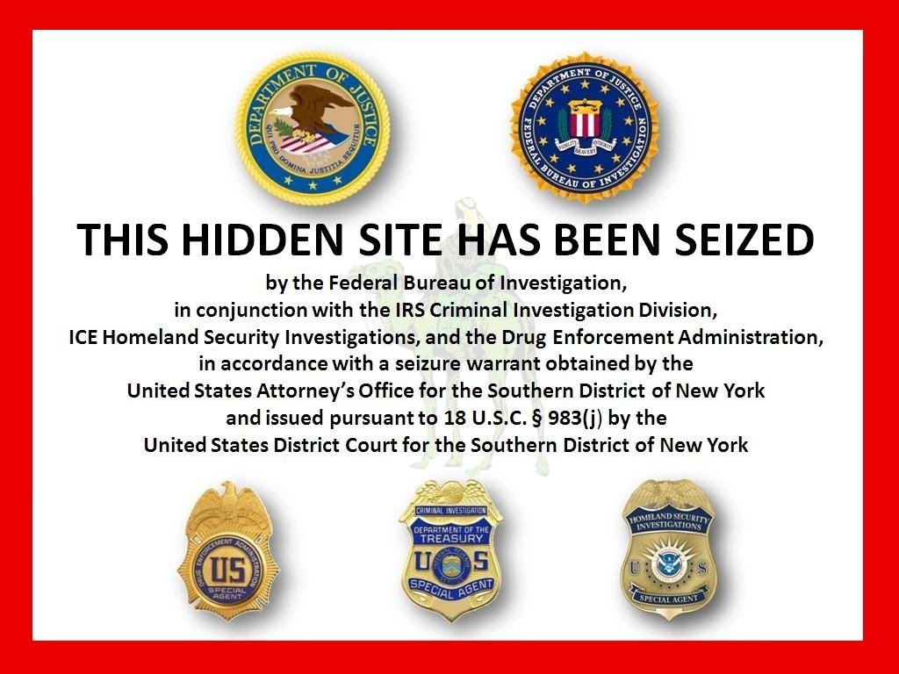
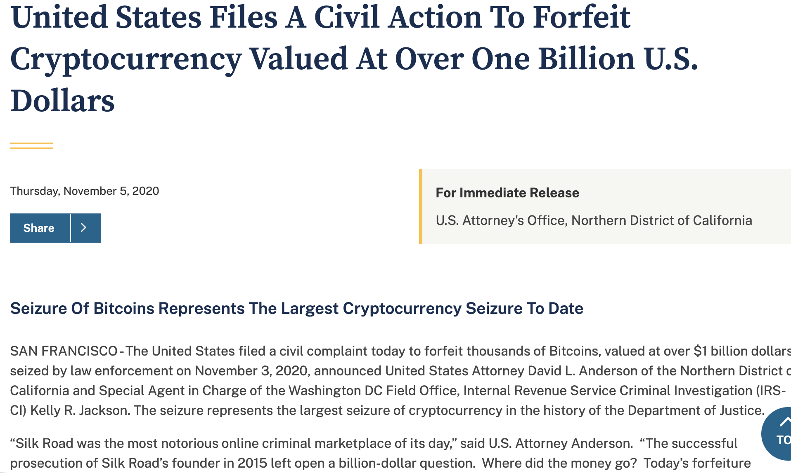
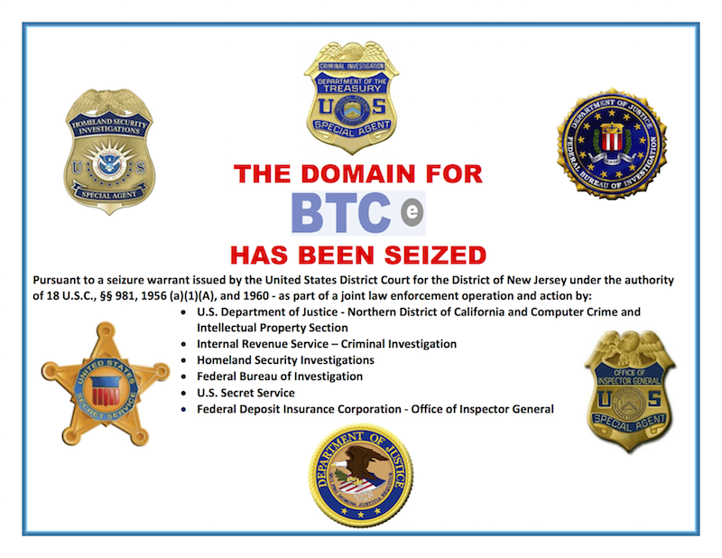
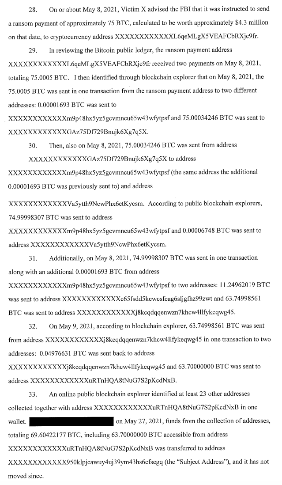
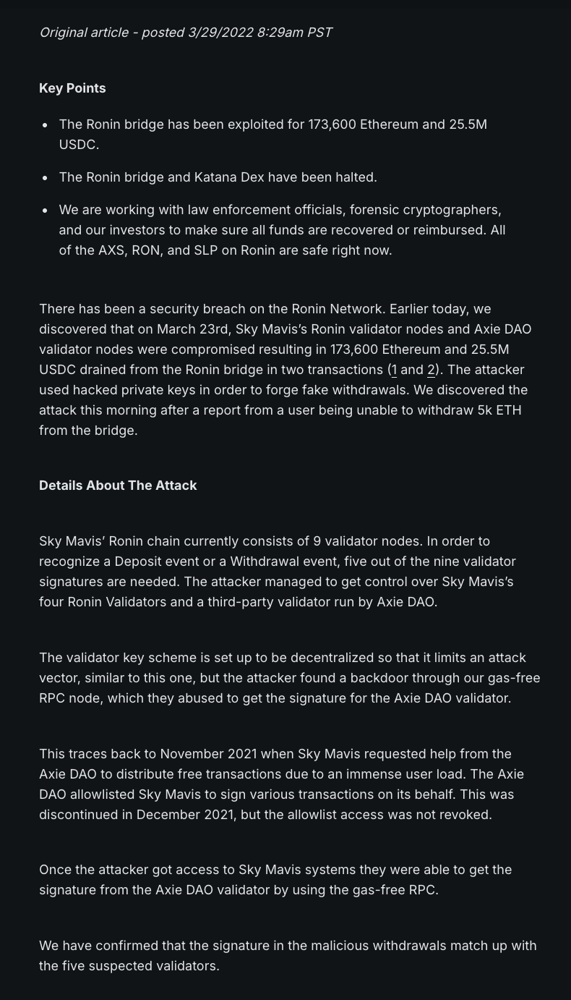
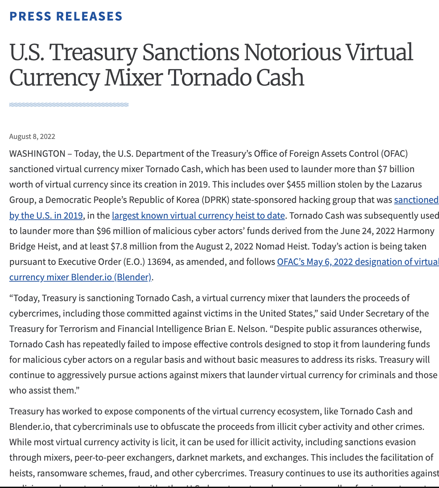

## Permissionless Finance {.smaller}

Blockchain's borderless and decentralized features make it a powerful tool for illicit finance, enabling activities that attempt to bypass the traditional, regulated financial system.

<div style="display: flex; flex-direction: column; gap: 15px; margin-top: 20px;">
<div style="display: flex; align-items: center;">
<div style="flex: 0 0 70px; height: 70px; background: #f8f9fa; border-left: 4px solid #dc3545; border-radius: 8px; display: flex; align-items: center; justify-content: center; font-size: 2em; box-shadow: 0 2px 4px rgba(0,0,0,0.05);">🌍</div>
<div style="margin-left: 20px; font-size: 0.95em;">
<strong>Neutral Infrastructure:</strong> Protocols do not enforce "Know Your Customer" (KYC) rules at the base layer; anyone can create a wallet and transact.
</div>
</div>
<div style="display: flex; align-items: center;">
<div style="flex: 0 0 70px; height: 70px; background: #f8f9fa; border-left: 4px solid #dc3545; border-radius: 8px; display: flex; align-items: center; justify-content: center; font-size: 2em; box-shadow: 0 2px 4px rgba(0,0,0,0.05);">💸</div>
<div style="margin-left: 20px; font-size: 0.95em;">
<strong>Ransomware Extortion:</strong> Bitcoin remains the most common currency for extortion. It is used because of its massive liquidity and accessibility, not because it is untraceable.
</div>
</div>
<div style="display: flex; align-items: center;">
<div style="flex: 0 0 70px; height: 70px; background: #f8f9fa; border-left: 4px solid #dc3545; border-radius: 8px; display: flex; align-items: center; justify-content: center; font-size: 2em; box-shadow: 0 2px 4px rgba(0,0,0,0.05);">🌪️</div>
<div style="margin-left: 20px; font-size: 0.95em;">
<strong>Money Laundering:</strong> Criminals use decentralized networks to layer and obfuscate the origins of illicitly obtained funds.
</div>
</div>
<div style="display: flex; align-items: center;">
<div style="flex: 0 0 70px; height: 70px; background: #f8f9fa; border-left: 4px solid #dc3545; border-radius: 8px; display: flex; align-items: center; justify-content: center; font-size: 2em; box-shadow: 0 2px 4px rgba(0,0,0,0.05);">🛡️</div>
<div style="margin-left: 20px; font-size: 0.95em;">
<strong>Sanctions Evasion:</strong> Used by state and non-state actors to bypass international economic restrictions.
</div>
</div>
</div>

::: {.notes}

**Overall Slide Concept**
This opening slide establishes why permissionless finance attracts illicit use without implying that blockchains are inherently criminal tools. It matters here because the rest of the lesson depends on understanding that neutral infrastructure can serve both legitimate and malicious actors. Emphasize that accessibility, liquidity, and weak gatekeeping change the threat environment.

**Key Points**
- Permissionless systems reduce entry barriers for both lawful users and adversaries.
- Illicit finance on blockchains often exploits borderless settlement, liquidity, and weak identity checks rather than true invisibility.
- Spell out KYC as Know Your Customer and define sanctions evasion as bypassing formal economic restrictions.

**Walkthrough**
None

**Sources**
@sykes_virtualcurrenciesmoney_2019; @uniswaplabs_uniswapdocs_2025

:::

## The Immutable Ledger {.smaller}

The same features that enable permissionless finance also create an unprecedented, permanent evidence trail for investigators. Because we cannot easily block malicious actors *before* they act on-chain, security relies heavily on tracing and analyzing funds *after* the fact.

* **Pseudonymous, not Anonymous:** A blockchain address acts as a persistent, unique identifier. It does not inherently reveal a real-world identity, but it can be profiled and tracked over time.
* **Permanent Public Record:** Every transaction is recorded on an immutable ledger, allowing for continuous monitoring and historical tracing.
* **The Operational Security Reality:** While an adversary can create a wallet without an ID, any operational security mistake they make—even years later—is permanently recorded and can be used to unmask them.

<div style="margin-top: 40px; display: flex; align-items: center; justify-content: center; font-family: monospace; font-size: 1.1em;">
<div style="background: #f8f9fa; padding: 10px 20px; border-radius: 5px; border: 2px solid #ced4da; color: #6c757d;">Tx: 0x1A2b...</div>
<div style="margin: 0 10px; color: #adb5bd; font-weight: bold;">━━━</div>
<div style="background: #e8f5e9; padding: 10px 20px; border-radius: 5px; border: 2px solid #198754; position: relative; color: #198754; font-weight: bold; box-shadow: 0 0 10px rgba(25, 135, 84, 0.2);">
Tx: 0x8F4c...
<div style="position: absolute; top: -25px; right: -25px; font-size: 1.8em; filter: drop-shadow(2px 4px 4px rgba(0,0,0,0.2));">🔍</div>
</div>
<div style="margin: 0 10px; color: #adb5bd; font-weight: bold;">━━━</div>
<div style="background: #f8f9fa; padding: 10px 20px; border-radius: 5px; border: 2px solid #ced4da; color: #6c757d;">Tx: 0x9D3e...</div>
</div>

::: {.notes}

**Overall Slide Concept**
This slide establishes the central forensic advantage of blockchains: the public record that criminals cannot easily erase after the fact. It matters here because the lesson now pivots from illicit use to investigative opportunity. Emphasize pseudonymity rather than anonymity and the lasting value of operational mistakes.

**Key Points**
- Public ledgers create long-lived, queryable transaction histories tied to persistent addresses.
- Investigators often succeed by combining immutable ledger data with later operational security failures.
- Define pseudonymous briefly as tied to persistent identifiers without automatically revealing real-world identity.

**Walkthrough**
None

**Sources**
@boneh_anonymouscommunicationprivacy_2020

:::

##  How Adversaries Hide {.smaller}

To break the trail of evidence on the public ledger, criminals use a toolkit of obfuscation techniques designed to make tracing as difficult as possible.

* **Mixers & Tumblers:** These services act like a digital laundry, mixing stolen funds with a large pool of other users' money to hide the original source

* **Chain Hopping:** Criminals use **cross-chain bridges** to jump assets between different blockchains (e.g., from Ethereum to Solana), forcing investigators to start their search over on a new, separate ledger

* **Layering (Peel Chains):** Instead of making one large transfer, they use a series of transactions to "peel off" small amounts of crypto, creating a complex and confusing web that hides the total amount being moved

<div style="display: flex; align-items: center; justify-content: center; gap: 8px; margin-top: 20px; font-family: sans-serif; text-align: center; flex-wrap: wrap; font-size: 0.8em;">
<div style="background-color: #ffebee; border: 2px solid #b71c1c; padding: 10px; border-radius: 8px; font-weight: bold; color: #b71c1c;">Stolen</div>
<div style="font-size: 18px; color: #6c757d;">&#8594;</div>
<div style="background-color: #f8f9fa; border: 2px solid #6c757d; padding: 10px; border-radius: 8px;"><b>Mixer</b><br><span style="font-size: 0.8em; color: #495057;">(Breaks the Link)</span></div>
<div style="font-size: 18px; color: #6c757d;">&#8594;</div>
<div style="background-color: #f8f9fa; border: 2px solid #6c757d; padding: 10px; border-radius: 8px;"><b>Bridge</b><br><span style="font-size: 0.8em; color: #495057;">(Hops the Chain)</span></div>
<div style="font-size: 18px; color: #6c757d;">&#8594;</div>
<div style="background-color: #f8f9fa; border: 2px solid #6c757d; padding: 10px; border-radius: 8px;"><b>Layering</b><br><span style="font-size: 0.8em; color: #495057;">(Hides the Volume)</span></div>
<div style="font-size: 18px; color: #6c757d;">&#8594;</div>
<div style="background-color: #e8f5e9; border: 2px solid #2e7d32; padding: 10px; border-radius: 8px; font-weight: bold; color: #2e7d32;">"Cleaned"</div>
</div>

::: {.notes}

**Overall Slide Concept**
This slide establishes the main obfuscation toolkit adversaries use to break or blur straightforward blockchain traces. It matters here because analysts need to know the common laundering moves before studying countermeasures. Emphasize that criminals usually combine several methods rather than relying on only one.

**Key Points**
- Mixers, chain hopping, and layering are used to hide source, path, and transaction volume.
- These techniques complicate tracing, but they usually leave secondary timing, volume, or bridge signals behind.
- Define chain hopping briefly as moving assets across ledgers to force investigators into a new tracing environment.

**Walkthrough**
None

**Sources**
@gjorgjev_blockchainforensicsunmasking_2025; @kappos_empiricalanalysisanonymity_2018; @salisu_blockchainforensicsmodern_2023; @sykes_virtualcurrenciesmoney_2019; @frowis_safeguardingevidentialvalue_2020

:::

## Forensic Countermeasures {.smaller}

<div style="display: flex; flex-direction: column; gap: 15px; margin-top: 20px;">
<div style="display: flex; align-items: center;">
<div style="flex: 0 0 70px; height: 70px; background: #f8f9fa; border-left: 4px solid #0d6efd; border-radius: 8px; display: flex; align-items: center; justify-content: center; font-size: 2em; box-shadow: 0 2px 4px rgba(0,0,0,0.05);">🔍</div>
<div style="margin-left: 20px; font-size: 0.95em;">
<strong>Combining All Signals:</strong> Mixing traditional on-chain ledger analysis with real-world open-source intelligence (OSINT) to find clues.
</div>
</div>
<div style="display: flex; align-items: center;">
<div style="flex: 0 0 70px; height: 70px; background: #f8f9fa; border-left: 4px solid #0d6efd; border-radius: 8px; display: flex; align-items: center; justify-content: center; font-size: 2em; box-shadow: 0 2px 4px rgba(0,0,0,0.05);">🤖</div>
<div style="margin-left: 20px; font-size: 0.95em;">
<strong>Adaptive Tools:</strong> Using AI and machine learning to automatically adapt and spot complex, evolving laundering techniques.
</div>
</div>
<div style="display: flex; align-items: center;">
<div style="flex: 0 0 70px; height: 70px; background: #f8f9fa; border-left: 4px solid #0d6efd; border-radius: 8px; display: flex; align-items: center; justify-content: center; font-size: 2em; box-shadow: 0 2px 4px rgba(0,0,0,0.05);">🤝</div>
<div style="margin-left: 20px; font-size: 0.95em;">
<strong>Teamwork & Sharing:</strong> Agencies and companies sharing information on bad actors and suspicious patterns.
</div>
</div>
<div style="display: flex; align-items: center;">
<div style="flex: 0 0 70px; height: 70px; background: #f8f9fa; border-left: 4px solid #0d6efd; border-radius: 8px; display: flex; align-items: center; justify-content: center; font-size: 2em; box-shadow: 0 2px 4px rgba(0,0,0,0.05);">⚖️</div>
<div style="margin-left: 20px; font-size: 0.95em;">
<strong>Regulation & Mandates:</strong> Governments creating rules that require more transparency at key choke points, like bridges and exchanges.
</div>
</div>
</div>

::: {.notes}

**Overall Slide Concept**
This slide establishes that effective blockchain forensics is a layered practice, not a single software trick. It matters here because successful investigation usually depends on combining chain analytics, external intelligence, and institutional coordination. Emphasize that technical traces are strongest when paired with collaboration and policy levers.

**Key Points**
- Strong investigations combine on-chain analysis with OSINT, institutional reporting, and interagency cooperation.
- Regulation can reshape the environment by increasing transparency at exchanges, bridges, and other chokepoints.
- Define OSINT briefly as open-source intelligence gathered from publicly available information.

**Walkthrough**
None

**Sources**
@song_identifyingmoneylaundering_2024; @atlam_blockchainforensicssystematic_2024; @frowis_safeguardingevidentialvalue_2020; @sykes_virtualcurrenciesmoney_2019

:::

## Challenges in Forensic Analysis {.smaller}

Blockchain analysis is powerful, but it is not a silver bullet. Sophisticated adversaries and inherent technical limitations create significant obstacles, meaning on-chain data alone is rarely enough to close a case.

* **Heuristic Evasion:** Tools like **CoinJoin** are explicitly designed to break the foundational rules of tracing (like the Common-Input-Ownership heuristic) by mixing inputs from dozens of distinct users into a single transaction.
* **Cryptographic "Ghost Flows":** **Privacy coins** (e.g., Monero, Zcash) use advanced cryptography to completely hide senders, receivers, and transaction amounts. When funds enter these networks, the on-chain trail goes dark.
* **The Off-Chain Blind Spot:** Much of the crypto economy happens off-chain inside the private databases of centralized exchanges, Over-The-Counter (OTC) desks, and darknet markets. Forensic tools cannot see into these private ledgers.
* **Attribution Uncertainty:** Even a perfect on-chain trace only leads to a pseudonymous address. Linking that address to a real human requires off-chain intelligence. Relying solely on heuristics risks **false positives**, which carry severe legal and reputational consequences.

::: {.notes}

**Overall Slide Concept**
This slide establishes the hard limits of forensic software so students do not mistake public-ledger visibility for perfect attribution. It matters here because the next policy discussion only makes sense once those limits are acknowledged. Emphasize that privacy tools, off-chain ledgers, and attribution uncertainty create real blind spots.

**Key Points**
- CoinJoin, privacy coins, and exchange-internal ledgers all reduce what pure on-chain analysis can prove.
- Attribution remains an intelligence judgment that requires corroborating evidence beyond address clustering alone.
- Define false positive briefly as an incorrect attribution or match that could create serious legal or analytical harm.

**Walkthrough**
None

**Sources**
@frowis_safeguardingevidentialvalue_2020; @atlam_blockchainforensicssystematic_2024

:::

## Policy & Regulatory Response {.smaller}

**The Pivot to Policy:** Because technical tracing has absolute limits, investigators cannot win the fight using software alone. Defeating illicit finance requires combining these technical traces with **regulatory chokepoints**.

* **Mandatory ID Checks (KYC/AML):** Requiring identity verification at centralized exchanges and fiat on-ramps ensures that pseudonymous crypto can eventually be tied to a real-world identity when it enters the traditional financial system.
* **Required Reporting:** Financial institutions and exchanges must file Suspicious Activity Reports (SARs) when detecting abnormal behavior, proactively creating a data trail for investigators.
* **Sanctions & Enforcement:** Governments can designate specific smart contracts (e.g., Tornado Cash) or entities (e.g., Lazarus Group) as sanctioned, making it illegal for citizens and businesses to interact with them.
* **Global Coordination:** Because crypto is borderless, formal treaties and public-private partnerships are necessary to share intelligence and pursue criminals across international jurisdictions to prevent regulatory arbitrage.

::: {.callout-note appearance="minimal"}
**KYC** — Know Your Customer | **AML** — Anti-Money Laundering
:::


::: {.notes}

**Overall Slide Concept**
This slide establishes the policy pivot: when technical tracing reaches its limit, regulated chokepoints become decisive. It matters here because the lesson is connecting forensic practice to enforcement and governance. Emphasize that KYC, reporting, sanctions, and cooperation are meant to bridge pseudonymous ledger activity to legal identity and action.

**Key Points**
- Regulation is most effective where crypto touches centralized exchanges, banks, and cross-border reporting systems.
- KYC, AML, SARs, and sanctions convert technical traces into actionable legal process.
- Spell out AML as Anti-Money Laundering and SAR as Suspicious Activity Report.

**Walkthrough**
None

**Sources**
@akbarfam_securecrosschainprovenance_2024; @akbarfam_forensiblockprovenancedrivenblockchain_2023; @avice_linkingcryptoassetattribution_2025; @sykes_virtualcurrenciesmoney_2019; @frowis_safeguardingevidentialvalue_2020; @salisu_blockchainforensicsmodern_2023

:::

## Adversarial Counter-Responses to Regulation {.smaller}

As global regulations tighten around centralized exchanges, adversaries adapt by avoiding compliant fiat off-ramps entirely. If an exchange requires an ID, criminals seek paths that do not.

* **Jurisdictional Arbitrage:** Because crypto is borderless, adversaries route funds to exchanges located in countries with weak Anti-Money Laundering (AML) laws or jurisdictions that refuse to cooperate with Western subpoenas. 
* **Privacy Coin Gateways:** Criminals use decentralized exchanges (DEXs) or cross-chain bridges to swap traceable assets (like Bitcoin) into privacy coins (like Monero). This deliberately breaks the visible chain before the funds are eventually cashed out.
* **The "No Cash-Out" Economy:** Often, adversaries don't convert to fiat at all. They use cryptocurrency directly to purchase "bulletproof" hosting, VPNs, zero-day exploits, or physical goods from darknet providers that operate outside the law.

::: {.notes}

**Overall Slide Concept**
This slide establishes that adversaries adapt to regulation rather than simply stopping when exchanges tighten controls. It matters here because defensive strategies must account for behavioral displacement. Emphasize how jurisdiction shopping, privacy conversion, and direct crypto spending all avoid the most visible fiat chokepoints.

**Key Points**
- Criminals evade regulated exchanges by using weak jurisdictions, privacy assets, and direct crypto-denominated underground markets.
- The most dangerous adaptation is often avoiding fiat conversion entirely.
- Define jurisdictional arbitrage briefly as routing activity through countries with weaker enforcement or cooperation.

**Walkthrough**
None

**Sources**
@sykes_virtualcurrenciesmoney_2019; @financialcrimesenforcementnetworkfincen_applicationcertainbusinessmodels_2019; @departmentofjustice_operatorscryptocurrencymixers_2025

:::

## Decentralized Exchanges (DEXs) {.smaller}

* **Smart Contract Driven:** Unlike centralized exchanges (e.g., Coinbase), a DEX operates entirely via autonomous code on a blockchain, with no corporate entity holding user funds.
* **Crypto-to-Crypto Only:** Because they cannot interface with traditional banks, DEXs do not allow users to "cash out" to fiat (e.g., USD). They strictly facilitate swapping one digital asset for another.
* **Automated Market Makers (AMMs):** Instead of an order book matching buyers with sellers, a smart contract holds a *liquidity pool* of two tokens and enforces the **constant product formula: x · y = k**. The pool always holds Token A (quantity *x*) and Token B (quantity *y*) such that their product *k* stays fixed. Buying Token B reduces its supply, forcing *x* up to keep *k* constant—this is automatic, demand-driven pricing with no human market maker.
* **Self-Custody:** Users trade directly from their own wallets, retaining absolute control of their private keys before, during, and after the trade.
* **Permissionless Access:** There are no sign-ups, no accounts, and no Know Your Customer (KYC) identity checks required to swap tokens.


::: {.notes}

**Overall Slide Concept**
This slide establishes decentralized exchanges as a new laundering and swapping environment that removes the usual compliance counterparty. It matters here because DEXs are central to modern asset hopping and obfuscation paths. Emphasize that they are code-based trading venues, not fiat off-ramps.

**Key Points**
- DEXs let users swap crypto assets without opening exchange accounts or completing KYC at the protocol layer.
- They remove one chokepoint, but they do not themselves provide fiat cash-out.
- Spell out DEX as decentralized exchange and AMM as automated market maker.

**Walkthrough**
None

**Sources**
@sykes_virtualcurrenciesmoney_2019; @salisu_blockchainforensicsmodern_2023

:::

<!-- Hidden 31 Oct 2026: bridges and atomic swaps moved to 08-EF (Build Tracker D4 ③). -->
:::: {.content-hidden}

## Bridges & Swaps: Crossing the Chain Boundary {.smaller}

:::: {.columns}
::: {.column width="60%"}
* **The Single-Chain Limit:** Standard DEXs only swap assets on the *same* blockchain. They cannot natively convert Ethereum into a completely separate privacy coin like Monero (XMR).
* **Wrapped Tokens:** Adversaries can buy "Wrapped Monero" on an Ethereum DEX, but wrapped tokens live on the transparent public ledger, defeating the purpose of privacy.
:::
::: {.column width="40%"}
```{dot}
digraph chainhop {
  bgcolor="transparent"
  rankdir=TB;
  node [shape=box, style="rounded,filled", fontname="sans-serif", margin=0.2];
  edge [color="#adb5bd", penwidth=2, arrowsize=0.8];

  USDC [label="Stolen USDC", fillcolor="#ffebee", color="#c62828", fontcolor="#c62828", penwidth=2];
  DEX [label="Standard DEX", shape=hexagon, fillcolor="#f8f9fa", color="#6c757d"];
  ETH [label="ETH (Intermediary)", fillcolor="#e3f2fd", color="#0d6efd", fontcolor="#0d6efd", penwidth=2];
  Swap [label="Non-KYC Instant Exchange", shape=hexagon, fillcolor="#f8f9fa", color="#6c757d"];
  PrivacyCoin [label="Native Monero or\nShielded Zcash\n(Trail Goes Dark)", fillcolor="#212529", color="#ffc107", fontcolor="#ffc107", penwidth=3];

  USDC -> DEX;
  DEX -> ETH;
  ETH -> Swap;
  Swap -> PrivacyCoin;
}
```

:::
::::

::: {.notes}

**Overall Slide Concept**
This slide establishes why bridges and swaps are so important in laundering workflows: they let adversaries move into new asset and chain environments with different visibility or enforcement profiles. It matters here because cross-chain behavior is a recurring obstacle in modern forensics. Emphasize that every boundary crossing is also a new trace opportunity if monitored well.

**Key Points**
- Bridges and cross-chain swaps help adversaries break linear traces and exploit different monitoring conditions.
- Crossing a chain boundary changes both the asset type and the investigative context.
- Define bridge briefly as infrastructure that locks or verifies value on one chain to represent it on another.

**Walkthrough**
None

**Sources**
@salisu_blockchainforensicsmodern_2023; @lin_tracktraceautomatically_2025

:::

## Bridges & Swaps: Crossing the Chain Boundary (cont.) {.smaller}

* **Atomic Swaps:** A trustless cross-chain trade enforced by **Hash Time-Locked Contracts (HTLCs)**. Both parties lock funds on their respective chains behind the same cryptographic secret (a hash preimage). When the recipient reveals the secret to claim their funds, it simultaneously unlocks the funds on the other chain—or both sides expire and refund if no claim is made. No middleman, no bridge contract. 
  * *Forensic challenge:* the two on-chain transactions appear on completely separate ledgers with no shared identifier linking them.
* **Non-KYC Instant Exchanges:** Criminals use automated swap services (e.g., SimpleSwap, FixedFloat) that do not require accounts. They send Bitcoin in, and the system sends native Monero—or Zcash directly to a "shielded" address—breaking the trail.

::: {.notes}

**Overall Slide Concept**
This continuation slide establishes the practical investigative implication of bridge use: analysts need continuity methods that survive chain transitions. It matters here because otherwise each hop looks like the trail has gone cold. Emphasize timing, amount, and destination correlation as the practical bridge-tracing tools.

**Key Points**
- Cross-chain tracing depends on correlating deposits, withdrawals, timing, and asset conversions rather than following one native transaction format.
- Bridge use complicates analysis, but it also creates visible infrastructure dependencies.
- Define correlation briefly as linking events across systems using matching patterns rather than one explicit identifier.

**Walkthrough**
None

**Sources**
@salisu_blockchainforensicsmodern_2023; @lin_tracktraceautomatically_2025

:::

::::

## Future of Forensics: Automated Cross-Chain Tracing  {.smaller}

:::: {.columns}
::: {.column width="60%"}
Currently, tracing assets across chains is slow and manual—analysts juggle multiple block explorers, compare timestamps, and adjust for fees by hand. *XSema* automates this entirely.

* **Automated Provenance Extraction:** Bridge contracts emit structured on-chain events (deposit/withdrawal logs). XSema parses these logs to extract *semantics*—asset type, amount, source chain, destination chain—then correlates cross-chain hops using **timing windows** (deposit and matching withdrawal settle within seconds to minutes) and **fee-adjusted amount matching**. The result is a unified provenance graph that definitively links a Bitcoin input to its eventual Ethereum output.
:::
::: {.column width="40%"}
```{dot}
digraph xsema {
  bgcolor="transparent"
  rankdir=TB;
  node [shape=box, style="rounded,filled", fontname="sans-serif", margin=0.2, fontsize=11];
  edge [color="#adb5bd", penwidth=2, arrowsize=0.8, fontsize=10];

  BTC [label="BTC Deposit Tx\n(T=0)", fillcolor="#ffebee", color="#c62828", fontcolor="#c62828", penwidth=2];
  Bridge [label="Bridge Contract\nEmits Log Event", shape=hexagon, fillcolor="#fff9c4", color="#f9a825", fontcolor="#f9a825", penwidth=2];
  XSema [label="XSema\n─────────────\nparse semantics\ntiming window\namount − fee", shape=rectangle, fillcolor="#e3f2fd", color="#0d6efd", fontcolor="#0d6efd", penwidth=2];
  ETH [label="ETH Withdrawal Tx\n(T=0 + ~minutes)", fillcolor="#e8f5e9", color="#2e7d32", fontcolor="#2e7d32", penwidth=2];
  Graph [label="Unified Provenance\nGraph", shape=parallelogram, fillcolor="#212529", color="#ffc107", fontcolor="#ffc107", penwidth=2];

  BTC -> Bridge [label="lock funds"];
  Bridge -> XSema [label="log parsed"];
  XSema -> ETH [label="correlated ✓"];
  ETH -> Graph;
}
```
:::
::::

::: {.notes}

**Overall Slide Concept**
This slide establishes automated cross-chain tracing as the next evolution of blockchain forensics. It matters here because manual chain-by-chain reconstruction does not scale against modern laundering patterns. Emphasize that automation is about prioritizing and correlating evidence, not replacing analyst judgment.

**Key Points**
- Cross-chain automation helps analysts follow flows that move quickly across assets and ledgers.
- Effective automation still depends on clean data, validated heuristics, and human review.
- Define heuristic briefly as an evidence-based rule of thumb used to infer likely relationships or behavior.

**Walkthrough**
None

**Sources**
@lin_tracktraceautomatically_2025

:::

## Future of Forensics: Secure Cross-Agency Collaboration {.smaller}

:::: {.columns}
::: {.column width="60%"}
Cross-chain crimes are cross-border crimes. Agencies often hold overlapping pieces of the same investigation but cannot legally share full case files. *ForensiCross* solves this without requiring disclosure.

* **Privacy-Preserving Record Linkage:** ForensiCross uses **private set intersection**: Agency A and Agency B each submit their encrypted suspect wallet lists. The protocol reveals *only the overlap*—wallets appearing in both investigations—without either agency ever seeing the other's full dataset. 
:::
::: {.column width="40%"}
```{dot}
digraph forensicross {
  bgcolor="transparent"
  rankdir=TB;
  node [shape=box, style="rounded,filled", fontname="sans-serif", margin=0.2, fontsize=11];
  edge [color="#adb5bd", penwidth=2, arrowsize=0.8];

  FBI [label="FBI\nSuspect Wallets\n{A, B, C, D}", fillcolor="#e3f2fd", color="#0d6efd", fontcolor="#0d6efd", penwidth=2];
  Europol [label="Europol\nSuspect Wallets\n{C, D, E, F}", fillcolor="#e8f5e9", color="#2e7d32", fontcolor="#2e7d32", penwidth=2];
  PSI [label="ForensiCross\nPrivate Set\nIntersection", shape=hexagon, fillcolor="#fff9c4", color="#f9a825", fontcolor="#f9a825", penwidth=2];
  Result [label="Shared Cluster\n{C, D} only\n(no other data shared)", fillcolor="#212529", color="#ffc107", fontcolor="#ffc107", penwidth=2];
  FBI -> PSI [label="encrypted"];
  Europol -> PSI [label="encrypted"];
  PSI -> Result;
}
```
:::
::::

::: {.notes}

**Overall Slide Concept**
This slide establishes secure collaboration as a core challenge in forensic operations, especially when multiple agencies hold sensitive but complementary evidence. It matters here because attribution often fails when information sharing fails. Emphasize that collaboration systems must protect sources while still enabling joint analysis.

**Key Points**
- Cross-agency work is essential because no single organization usually has all the on-chain and off-chain pieces.
- Secure sharing methods reduce duplication, delay, and evidentiary fragmentation.
- Define collaboration artifact briefly as a shared analytical product, indicator, or evidence record used across teams.

**Walkthrough**
None

**Sources**
@frowis_safeguardingevidentialvalue_2020; @avice_linkingcryptoassetattribution_2025

:::

## Future of Forensics: AI-Powered Attribution {.smaller}

Even with a perfect transaction graph, analysts still face **Attribution Uncertainty**. To link a wallet to a real-world entity, analysts must scour the internet for open-source intelligence (OSINT). AI is revolutionizing this step.

* **Parsing Unstructured Data:** Large Language Models (LLMs) can rapidly read millions of forum posts, darknet market listings, and social media tweets to find references to specific crypto addresses.
* **Knowledge Graph Integration:** AI tools can take ambiguous "tags" (e.g., an address labeled "Suspected Lazarus" by one firm and "Darknet Vendor" by another) and intelligently link them into a unified Knowledge Graph of threat actors.

<div style="display: flex; align-items: center; justify-content: center; gap: 15px; margin-top: 30px;">
<div style="background: #f8f9fa; padding: 15px; border-radius: 8px; border-left: 4px solid #6c757d; font-size: 0.9em; width: 30%;">
📄 "Send payment to 0x1A2b..."<br><i>- Dark web forum post</i>
</div>
<div style="font-size: 2em; color: #0d6efd;">🤖</div>
<div style="background: #e3f2fd; padding: 15px; border-radius: 8px; border: 2px solid #0d6efd; text-align: center; width: 30%;">
<b>Entity Profile:</b><br>
Threat Actor X<br>
<span style="font-size: 0.8em; color: #495057;">Confidence: 94%</span>
</div>
</div>

::: {.notes}

**Overall Slide Concept**
This slide establishes AI-assisted attribution as a force multiplier for pattern detection, clustering, and prioritization. It matters here because blockchain datasets are too large and adaptive for purely manual review. Emphasize that AI can assist triage and hypothesis generation, but it does not remove the need for evidentiary validation.

**Key Points**
- AI tools can surface patterns across flows, entities, and behaviors that would be slow to spot manually.
- Attribution supported by AI still needs corroboration to avoid overconfident or opaque conclusions.
- Define attribution briefly as linking observed blockchain activity to a real-world actor, organization, or operation.

**Walkthrough**
None

**Sources**
@avice_linkingcryptoassetattribution_2025; @song_identifyingmoneylaundering_2024

:::


## Future of Forensics: ForensiBlock & the Design Trade-off {.smaller}

Instead of treating forensics as a reactive, after-the-fact investigation, researchers are proposing **"Security-by-Design"** — building auditability directly into the protocol.

* **ForensiBlock:** An academic framework for enterprise and consortium blockchains with native auditability. Provenance metadata is embedded at the consensus layer — not bolted on afterward — making it a network rule rather than an optional audit trail.
* **Where It Applies:** Government supply chains, military logistics, and **Central Bank Digital Currencies (CBDCs)** — environments where auditability is a legal requirement and anonymity is not expected.
* **The Policy Trade-off:** Embedding strict forensic tracking into a *public* protocol directly conflicts with the Cypherpunk ethos of privacy and permissionless access. Bitcoin will never adopt this. The architecture is a deliberate choice between two incompatible values.

::: {.notes}

**Overall Slide Concept**
This slide establishes ForensiBlock as an example of designing more provenance into systems at the cost of additional complexity or trust assumptions. It matters here because the lesson is now exploring whether infrastructure itself can be redesigned to help investigators. Emphasize the core tradeoff between privacy, usability, and evidentiary visibility.

**Key Points**
- Provenance-enhancing designs can improve traceability but may increase operational burden or reduce privacy.
- Better forensic visibility is never free; it always changes incentives or trust assumptions somewhere else.
- Define trade-off briefly as gaining one desirable property by accepting cost or weakness in another area.

**Walkthrough**
None

**Sources**
@akbarfam_forensiblockprovenancedrivenblockchain_2023; @akbarfam_securecrosschainprovenance_2024

:::


## Future of Forensics: Embedded Provenance {.smaller}

:::: {.columns}
::: {.column width="75%"}
**Immutability records facts — not meaning.** A standard blockchain permanently records that wallet A sent funds to a mixer at 14:03. It does *not* record that those funds came from a ransomware payment.

* **The Obfuscation Problem:** Criminals exploit immutability. A mixer's hops are faithfully recorded forever — the history isn't erased, it's *buried* under layers of legitimate-looking transactions.
* **What Provenance Adds:** Embedded provenance attaches semantic context to each asset — origin, custody chain, compliance attestation — that a raw transaction graph never carries.
* **Enforced at Consensus:** A provenance-bearing system makes a valid custody proof a *condition of transaction acceptance*. No clean proof → transaction rejected by the protocol, not flagged by an analyst after the fact.
:::
::: {.column width="25%"}
```{dot}
digraph provenance {
  bgcolor="transparent"
  rankdir=TB;
  node [shape=box, style="rounded,filled", fontname="sans-serif", margin=0.15, fontsize=10];
  edge [color="#adb5bd", penwidth=1.8, arrowsize=0.7, fontsize=9];

  subgraph cluster_standard {
    label="Standard Ledger";
    style="dashed"; color="#6c757d"; fontcolor="#6c757d";
    A1 [label="Tx: A→Mixer\n14:03", fillcolor="#ffebee", color="#c62828", fontcolor="#c62828"];
    A2 [label="Tx: Mixer→B\n14:07", fillcolor="#fff9c4", color="#f9a825", fontcolor="#f9a825"];
    A3 [label="Tx: B→Exchange\n14:55", fillcolor="#e8f5e9", color="#2e7d32", fontcolor="#2e7d32"];
    A1 -> A2 -> A3;
    Q [label="Origin: ???", shape=plaintext, fontcolor="#dc3545"];
  }

  subgraph cluster_provenance {
    label="Provenance-Embedded";
    style="dashed"; color="#0d6efd"; fontcolor="#0d6efd";
    B1 [label="Tx + proof:\npayroll #1234\ncompliance ✓", fillcolor="#e3f2fd", color="#0d6efd", fontcolor="#0d6efd"];
    B2 [label="Tx + proof:\ncustody chain\nintact ✓", fillcolor="#e3f2fd", color="#0d6efd", fontcolor="#0d6efd"];
    B3 [label="Tx: no proof\n→ REJECTED", fillcolor="#ffebee", color="#c62828", fontcolor="#c62828"];
    B1 -> B2;
    B2 -> B3 [style=dashed, color="#c62828"];
  }

  A3 -> B1 [style=invis];
}
```
:::
::::

::: {.notes}

**Overall Slide Concept**
This slide establishes embedded provenance as the idea of designing traceability and evidentiary markers into systems from the start. It matters here because retrofitting forensics after deployment is much harder than planning for it architecturally. Emphasize that provenance design should support both operational use and later investigation.

**Key Points**
- Systems can be built so that provenance is easier to verify without relying entirely on post hoc reconstruction.
- Embedded provenance helps when many organizations need to trust the same artifact history over time.
- Define provenance marker briefly as a recorded attribute or event that helps reconstruct origin, custody, or transformation.

**Walkthrough**
None

**Sources**
@akbarfam_securecrosschainprovenance_2024; @akbarfam_forensiblockprovenancedrivenblockchain_2023

:::

## Case Study: Silk Road  {.smaller}

<div style="float: right; position: relative; top: 0px; padding: 10px; width:400px;">

</div>

Launched in 2011 by Ross Ulbricht (alias "Dread Pirate Roberts"), Silk Road was a **massive darknet market** operating on the **Tor network**.

It facilitated the sale of **illegal drugs, forged identity documents, and hacking tools**, making it a top target for federal law enforcement. Ulbricht famously attempted to use the network to commission **murder-for-hire** hits.

It **relied exclusively on Bitcoin**, promising users financial anonymity beyond the reach of traditional banks and police.

It used an internal Bitcoin bank, escrow, and "tumbler" to obscure flows. But the immutable ledger meant **Bitcoin didn't erase evidence; it permanently recorded it.**


::: {.notes}

**Overall Slide Concept**
This slide establishes Silk Road as the first major case where blockchain forensics showed that pseudonymous markets could still be dismantled. It matters here because the later case studies build on this early investigative playbook. Emphasize that operational mistakes and chokepoints mattered more than breaking Bitcoin itself.

**Key Points**
- Silk Road demonstrated that criminal marketplaces could leverage Bitcoin while still leaving recoverable evidence trails.
- The case became a template for combining blockchain records with traditional investigative methods.
- Define darknet market briefly as an online illicit marketplace accessible through privacy-focused infrastructure such as Tor.

**Walkthrough**
None

**Sources**
@sykes_virtualcurrenciesmoney_2019; @departmentofjustice_manhattanusattorneyannounces_2014; @departmentofjustice_rossulbrichtcreator_2015; Wired, "Ross Ulbricht Calls for New Trial, Alleging Feds Hacked Tor" (March 2015); Wired, "Silk Road Mastermind Ross Ulbricht Convicted of All 7 Charges" (Feb. 2015)

:::

## Silk Road: The Break {.smaller}

<div style="float: right; position: relative; top: 0px; padding: 10px; width:400px;">

</div>

The FBI and DEA made over **100 undercover purchases** of narcotics and tracked the physical packages through the mail — the break came from physical detective work, not code analysis.

Investigators found the real-world location of the Silk Road server by catching a **brief IP address leak** outside the Tor network.

In October 2013, agents tracked Ulbricht to a **San Francisco public library.** They staged a distraction to grab his open, **unencrypted laptop** before he could lock it.

Blockchain records became undeniable proof when analysts tied the public ledger's transaction history directly to the 144,336 **BTC recovered from his seized hard drive**.


::: {.notes}

**Overall Slide Concept**
This slide establishes the specific break point in the Silk Road investigation where technical and operational evidence converged. It matters here because it shows that major cases often turn on one compromise or one observable mistake rather than perfect end-to-end visibility. Emphasize the role of investigative pivot points.

**Key Points**
- High-profile investigations often hinge on one actionable break that turns a broad trace into a concrete lead.
- Blockchain evidence becomes much more valuable once it can be tied to a person, device, or seized service.
- Define pivot point briefly as the moment where diffuse evidence becomes specific enough to act on.

**Walkthrough**
None

**Sources**
@sykes_virtualcurrenciesmoney_2019

:::

## Silk Road: The Ledger

<div style="float: right; position: relative; top: 0px; padding: 10px; width:400px;">

</div>

In November 2020, investigators **seized over $1 billion in Bitcoin** stolen from Silk Road back in 2012-2013.

Prosecutors linked the massive stash to previously hidden transactions from a hacker known as "Individual X."

The market was long gone, but the **immutable ledger preserved the evidence** needed for attribution and civil forfeiture.

::: {.callout-note appearance="minimal"}
Ross Ulbricht received a presidential pardon on January 21, 2025.
:::

::: {.notes}

**Overall Slide Concept**
This slide establishes the Silk Road ledger itself as a durable evidentiary substrate rather than just transaction noise. It matters here because students should see how historical ledgers stay useful long after the market or actors are disrupted. Emphasize that time is often on the investigator's side when records are immutable.

**Key Points**
- The blockchain ledger preserves transaction history even after markets close and services disappear.
- Historical traces remain valuable for clustering, corroboration, and retrospective attribution.
- Define immutable ledger briefly as a record that is very difficult to alter retroactively once widely replicated and confirmed.

**Walkthrough**
None

**Sources**
@sykes_virtualcurrenciesmoney_2019

:::


## Case Study: BTC-e

<div style="float: right; position: relative; top: 0px; padding: 10px; width:400px;">



</div>

Founded in 2011 and operated by Alexander Vinnik, **BTC-e** (*Bitcoin Exchange*) was one of the world's largest and most **anonymous digital currency exchanges.**

It operated with virtually **no Anti-Money Laundering (AML) controls,** making it a primary cash-out venue for cybercriminals worldwide.

Investigators targeted it because it acted as a **massive "service cluster,"** facilitating **billions in transactions** for ransomware operators, hackers, and drug traffickers.

::: {.callout-note appearance="minimal"}
BTC-e was a full web-based exchange — not just a wallet or address cluster. 

Users created pseudonymous accounts, deposited crypto or wired fiat (USD, EUR, RUB) to BTC-e's shell-company bank accounts, and traded on live order books across multiple pairs (BTC/USD, LTC/BTC, etc.). 

Cash-out happened via wire transfer or payment processors like WebMoney — no identity required.
:::

::: {.notes}

**Overall Slide Concept**
This slide establishes BTC-e as a fiat conversion chokepoint that became strategically important because so much illicit flow converged there. It matters here because it demonstrates how exchanges can become more operationally significant than the underlying crime scene. Emphasize that weak compliance can make one service central to many investigations at once.

**Key Points**
- BTC-e served as a major laundering and cash-out hub for criminal proceeds.
- Exchange centralization makes seizure, indictment, and disruption high-leverage moves.
- Define off-ramp briefly as the service or pathway used to convert crypto assets into fiat or spendable equivalents.

**Walkthrough**
None

**Sources**
@financialcrimesenforcementnetworkfincen_fincenfinesbtce_2017; @sykes_virtualcurrenciesmoney_2019

:::

## BTC-e: Weak KYC Made the Cluster Actionable

:::: {.columns}
::: {.column width="60%"}
- **Zero Identity Checks:** Accounts could be opened with just a username, password, and an email address, explicitly attracting illicit users.
- **Clustering the Giant:** Analysts used common-input heuristics to group millions of distinct deposit addresses into a single, massive "BTC-e entity" cluster.
- **The Aggregator:** Once the cluster was mapped, investigators traced inflows from diverse criminal sources directly into it—including 300,000 BTC from the Mt. Gox hack.
- **The Analytic Signal:** Instead of tracking individual hackers, investigators followed the repeated "fan-in" patterns of stolen funds pooling into BTC-e's central hot wallets.
:::
::: {.column width="40%"}

<div style="display: flex; align-items: center; justify-content: center; gap: 10px; font-family: sans-serif; padding: 10px; margin-top: 20px;">
<div style="display: flex; flex-direction: column; gap: 15px; flex: 1;">
<div style="background: #ffebee; border: 2px solid #c62828; padding: 10px; border-radius: 6px; text-align: center; color: #c62828; font-size: 0.85em; box-shadow: 0 2px 4px rgba(0,0,0,0.05);"><strong>Mt. Gox Hack</strong><br/>(300k BTC)</div>
<div style="background: #ffebee; border: 2px solid #c62828; padding: 10px; border-radius: 6px; text-align: center; color: #c62828; font-size: 0.85em; box-shadow: 0 2px 4px rgba(0,0,0,0.05);"><strong>Ransomware</strong><br/>Proceeds</div>
<div style="background: #ffebee; border: 2px solid #c62828; padding: 10px; border-radius: 6px; text-align: center; color: #c62828; font-size: 0.85em; box-shadow: 0 2px 4px rgba(0,0,0,0.05);"><strong>Darknet</strong><br/>Markets</div>
</div>
<div style="display: flex; flex-direction: column; justify-content: space-around; color: #adb5bd; font-size: 2em; font-weight: bold; height: 180px;">
<div style="transform: rotate(15deg); margin-top: 15px;">&rarr;</div>
<div>&rarr;</div>
<div style="transform: rotate(-15deg); margin-bottom: 15px;">&rarr;</div>
</div>
<div style="flex: 1.2;">
<div style="background: #212529; border: 3px solid #ffc107; padding: 25px 10px; border-radius: 12px; text-align: center; color: #ffc107; box-shadow: 0 6px 12px rgba(0,0,0,0.15);">
<div style="font-size: 2.5em; margin-bottom: 5px;">🏦</div>
<strong style="font-size: 1.1em;">BTC-e Central<br/>Hot Wallets</strong><br/>
<span style="font-size: 0.75em; color: #adb5bd;">Massive Service Cluster</span>
</div>
</div>
</div>

:::
::::

::: {.notes}

**Overall Slide Concept**
This slide establishes weak KYC as the factor that made BTC-e a particularly useful node for criminals and a particularly valuable target for investigators. It matters here because compliance gaps can scale into ecosystem-wide risk. Emphasize that poor identity controls turn an exchange into a laundering amplifier.

**Key Points**
- Weak KYC made BTC-e attractive for moving funds that would have triggered stronger scrutiny elsewhere.
- Once investigators linked multiple illicit flows to the same weak-compliance venue, the cluster became operationally actionable.
- Define actionable briefly as sufficiently supported to justify enforcement, seizure, or further targeted investigation.

**Walkthrough**
None

**Sources**
@financialcrimesenforcementnetworkfincen_fincenfinesbtce_2017; @frowis_safeguardingevidentialvalue_2020

:::

## BTC-e: Deanonymization

:::: {.columns}
::: {.column width="60%"}
- **The On-Chain Limit:** Clustering proved the exchange was laundering billions, but an on-chain cluster is just a collection of numbers. It does not contain a name.
- **Following the Fiat:** To identify the operator, investigators had to follow the money off the blockchain and into traditional digital payment processors (like WebMoney).
- **The OpSec Failure:** Vinnik transferred millions in stolen Mt. Gox funds from BTC-e directly into personal accounts tied to his real name and IP addresses.
- **The Synthesis:** By combining on-chain cluster mapping with real-world subpoenas to banks and payment providers, the FBI unmasked the administrator.
:::
::: {.column width="40%"}
<div style="display: flex; flex-direction: column; align-items: center; gap: 5px; font-family: sans-serif; margin-top: 10px;">
<div style="background: #212529; border: 2px solid #ffc107; padding: 10px; border-radius: 8px; text-align: center; color: #ffc107; width: 85%; box-shadow: 0 4px 6px rgba(0,0,0,0.1);">
<div style="font-size: 1.5em; margin-bottom: 2px;">⛓️</div>
<strong>On-Chain</strong><br/>
<span style="font-size: 0.8em; color: #adb5bd;">BTC-e Cluster</span>
</div>

<div style="color: #adb5bd; font-size: 1.2em; font-weight: bold; line-height: 1;">&darr;</div>

<div style="background: #f8f9fa; border: 2px solid #0d6efd; padding: 10px; border-radius: 8px; text-align: center; color: #0d6efd; width: 85%; box-shadow: 0 4px 6px rgba(0,0,0,0.1);">
<div style="font-size: 1.5em; margin-bottom: 2px;">🏦</div>
<strong>Fiat Off-Ramp</strong><br/>
<span style="font-size: 0.8em; color: #6c757d;">WebMoney Processor</span>
</div>

<div style="display: flex; flex-direction: column; align-items: center; color: #dc3545; font-size: 1em; font-weight: bold; line-height: 1;">
<span style="font-size: 0.6em; text-transform: uppercase; background: #fff; padding: 2px 8px; border-radius: 10px; border: 1px solid #dc3545; position: relative; top: 6px;">Subpoena</span>
<div>&darr;</div>
</div>

<div style="background: #ffebee; border: 2px solid #c62828; padding: 10px; border-radius: 8px; text-align: center; color: #c62828; width: 85%; box-shadow: 0 4px 6px rgba(0,0,0,0.1);">
<div style="font-size: 1.5em; margin-bottom: 2px;">👤</div>
<strong>Real Identity</strong><br/>
<span style="font-size: 0.8em;">Alexander Vinnik</span>
</div>
</div>
:::
::::

::: {.notes}

**Overall Slide Concept**
This slide establishes deanonymization as the stage where blockchain traces and off-chain evidence converge on a human operator or organization. It matters here because tracing alone is rarely the end goal. Emphasize that deanonymization depends on joining ledger evidence with infrastructure, identity, or behavioral data.

**Key Points**
- Deanonymization happens when pseudonymous addresses can be credibly linked to real operators.
- Exchange data, server records, and other off-chain evidence are often the decisive bridge.
- Define deanonymization briefly as linking pseudonymous activity to a real-world identity or accountable entity.

**Walkthrough**
None

**Sources**
@financialcrimesenforcementnetworkfincen_fincenfinesbtce_2017

:::

## BTC-e: Indictment

:::: {.columns}
::: {.column width="70%"}
- **The 2017 Takedown:** Coordinated action by the DOJ and FinCEN resulted in a $110 million penalty, domain seizures, and Vinnik's arrest in Greece.
- **The Global Chase:** What followed was a multi-year extradition battle, highlighting the complexities of international jurisdiction in borderless crimes.
- **The 2024 Resolution:** On May 3, 2024, Alexander Vinnik pleaded guilty in the U.S. to conspiracy to commit money laundering.
- **The Strategic Impact:** Taking down the exchange captured funds and fundamentally disrupted the liquidity infrastructure that other cybercriminals relied upon.
:::
::: {.column width="30%"}

:::
::::

::: {.callout-note appearance="minimal"}
Alexander Vinnik was released in exchanged for detained American teacher Marc Fogel in 2025.
:::

::: {.notes}

**Overall Slide Concept**
This slide establishes indictment as the moment when accumulated forensic and operational evidence crosses into formal legal action. It matters here because the lesson is about how traces become consequences. Emphasize that prosecution depends on packaging technical evidence into legally sustainable claims.

**Key Points**
- Indictments turn complex forensic patterns into specific charges and narrative claims for court.
- Strong blockchain evidence still needs legal framing, jurisdiction, and admissible supporting documentation.
- Define indictment briefly as a formal criminal charge issued after a prosecutable theory has been assembled.

**Walkthrough**
None

**Sources**
@financialcrimesenforcementnetworkfincen_fincenfinesbtce_2017; @departmentofjustice_operatorscryptocurrencymixers_2025

:::


<!-- Hidden 24 Oct 2026: Colonial Pipeline moved to 03-FO (Build Tracker D2 ③). -->
:::: {.content-hidden}

## Case Study: Colonial Pipeline

:::: {.columns}

::: {.column width="30%"}

:::

::: {.column width="70%"}

* Colonial Pipeline is the largest refined products pipeline in the U.S., **supplying nearly half the fuel for the East Coast.**

* In May 2021, a Russian-linked cybercriminal group called "DarkSide" **breached Colonial's IT network** — then deployed ransomware that **locked their billing and business systems.**

* Fearing the malware might spread to operational controls, **Colonial proactively shut down the pipeline,** causing widespread panic-buying and severe gas shortages.

* Desperate to restore critical infrastructure, **Colonial paid a ransom of approximately 75 BTC**, giving the FBI a live trail to trace on the public ledger.
:::

::::


::: {.notes}

**Overall Slide Concept**
This slide establishes Colonial Pipeline as the case where ransomware tracing became visibly tied to national critical infrastructure impact. It matters here because it shows that blockchain forensics can have direct physical and political consequences. Emphasize the link between a public payment trail and rapid high-stakes investigation.

**Key Points**
- The ransomware attack disrupted fuel distribution indirectly by compromising business systems and forcing precautionary shutdown.
- The ransom payment created a live forensic trail investigators could follow immediately.
- Define ransomware-as-a-service briefly as a criminal model where operators provide malware to affiliates who conduct attacks.

**Walkthrough**
None

**Sources**
@departmentofjustice_departmentjusticeseizes_2021

:::

## Colonial Pipeline: Payment Recovery

:::: {.columns}
::: {.column width="60%"}
- Investigators used public blockchain explorers to follow the initial 75 BTC ransom through **at least six sequential hops** on the public ledger.
- The trace revealed **63.7 BTC** consolidating in a specific, identifiable target address.
- **The Jurisdiction:** Because that address was tied to a server located in the **Northern District of California**, the FBI established **legal jurisdiction**.
- **The Seizure:** A magistrate judge authorized a warrant, and the FBI used the **recovered private key** to directly transfer and seize the funds.
:::
::: {.column width="40%"}

:::
::::

::: {.notes}

**Overall Slide Concept**
This slide establishes the operational sequence that turned a ransom payment into a successful seizure opportunity. It matters here because it shows the difference between tracing money and recovering money. Emphasize that jurisdiction, timing, and control of keys are what convert trace visibility into asset recovery.

**Key Points**
- Investigators traced the ransom through successive hops until a large portion consolidated in a target address.
- Recovery required both legal authority and effective control over the destination wallet infrastructure.
- Define legal jurisdiction briefly as the authority of a court or agency to act over a server, entity, or asset within its reach.

**Walkthrough**
None

**Sources**
@departmentofjustice_departmentjusticeseizes_2021

:::

::::

## Case Study: Ronin Bridge

:::: {.columns}
::: {.column width="65%"}
- Ronin is an **Ethereum-linked sidechain** built by Sky Mavis specifically for the massively popular play-to-earn game, *Axie Infinity*.
- To move money between the game and the broader crypto economy, users locked assets in a **cross-chain bridge contract** on Ethereum.
- In March 2022, attackers completely drained the Ethereum side of the bridge, stealing **173,600 ETH and 25.5M USDC** (worth over $620 million).
- The theft **went unnoticed for six days** until a legitimate user tried to withdraw 5,000 ETH and found the contract empty.
:::
::: {.column width="35%"}

:::
::::

::: {.notes}

**Overall Slide Concept**
This slide establishes the Ronin bridge theft as a bridge-security case where operational failure, not smart-contract math alone, drove catastrophic loss. It matters here because cross-chain infrastructure now sits at the center of many major thefts. Emphasize that users trusted a bridge whose weakest point was governance and monitoring.

**Key Points**
- Ronin connected a high-volume game ecosystem to Ethereum, concentrating value in bridge-controlled custody.
- The theft also exposed weak monitoring because the drain was not discovered until users tried to withdraw.
- Define sidechain briefly as a separate blockchain linked to a main chain for asset or message transfer.

**Walkthrough**
None

**Sources**
@roninnetwork_roninblogcommunity_2022; @fbinationalpressoffice_fbistatementattribution_2022

:::

## Ronin: Key Management

- **The Validator Set:** The bridge was secured by a multi-signature scheme requiring **5 out of 9 validator nodes** to approve any withdrawal.
- **The Compromise:** It wasn't a code exploit. Attackers used spear-phishing to breach Sky Mavis's IT infrastructure, stealing **four validator private keys**.
- **The Fatal Flaw:** To get the required fifth signature, attackers exploited a deprecated but active "gas-free" RPC node to hijack a key belonging to the **Axie DAO**.
- **The Forgery:** Armed with 5 keys, the attackers simply **forged valid withdrawal requests**, commanding the bridge to hand over the assets.

::: {.notes}

**Overall Slide Concept**
This slide establishes the heart of the Ronin failure: compromised validator keys defeated the bridge's approval model without exploiting the core contract logic. It matters here because it shows that cryptographic systems fail when key management and governance fail. Emphasize that legitimate-looking signatures can still represent illegitimate control.

**Key Points**
- The attack succeeded by obtaining enough validator keys to satisfy the bridge's own withdrawal rules.
- The bridge treated the forged withdrawals as valid because the attackers possessed the required approvals.
- Define multisignature briefly as a system requiring several distinct keys to authorize one action.

**Walkthrough**
None

**Sources**
@roninnetwork_roninblogcommunity_2022; @fbinationalpressoffice_fbistatementattribution_2022

:::

## Ronin: Tracing Through the Mixers

:::: {.columns}
::: {.column width="60%"}
- **The Wash Cycle:** Lazarus immediately began moving the stolen ETH through **Tornado Cash** on the Ethereum network to break the on-chain links.
- **Chain Hopping:** To further complicate the trace, they bridged a portion of the stolen funds from Ethereum over to the Bitcoin network.
- **Double Mixing:** Once on Bitcoin, they fed the funds into **Blender.io**, a centralized Bitcoin mixer.
- **The Forensic Trace:** Despite these layers, analysts used **timing, volume correlations, and advanced heuristics** to successfully trace the funds through both mixers and across the bridge.
:::
::: {.column width="40%"}
```{dot}
digraph ronintrace {
  bgcolor="transparent"
  rankdir=TB;
  node [shape=box, style="rounded,filled", fontname="sans-serif", margin=0.2];
  edge [color="#adb5bd", penwidth=2, arrowsize=0.8];

  Stolen [label="Stolen ETH\n(Ronin Bridge)", fillcolor="#ffebee", color="#c62828", fontcolor="#c62828", penwidth=2];
  TC [label="Tornado Cash\n(Ethereum Mixer)", shape=hexagon, fillcolor="#f8f9fa", color="#6c757d"];
  Bridge [label="Cross-Chain Bridge", fillcolor="#e3f2fd", color="#0d6efd", fontcolor="#0d6efd", penwidth=2];
  Blender [label="Blender.io\n(Bitcoin Mixer)", shape=hexagon, fillcolor="#f8f9fa", color="#6c757d"];

  Stolen -> TC;
  TC -> Bridge;
  Bridge -> Blender;
}
```

:::
::::

::: {.notes}

**Overall Slide Concept**
This slide establishes the laundering sequence after Ronin as an example of layered obfuscation across mixers and chains. It matters here because it demonstrates that investigators increasingly face hybrid laundering paths rather than single-chain movement. Emphasize that even complex laundering creates correlation opportunities.

**Key Points**
- Lazarus used Tornado Cash, bridging, and Blender.io in sequence to fracture the trace.
- Analysts responded by correlating timing, amounts, and infrastructure touchpoints across the whole path.
- Define mixer briefly as a service or protocol intended to obscure direct transaction linkages among users.

**Walkthrough**
None

**Sources**
@fbinationalpressoffice_fbistatementattribution_2022; @u.s.dept.oftreasury_ustreasurysanctions_2022

:::

## Ronin: From Trace to Takedown

:::: {.columns}
::: {.column width="60%"}
- **Attribution:** On April 14, 2022, using the blockchain trace, the FBI officially attributed the theft to North Korea's Lazarus Group.
- **Sanctioning the Infrastructure:** Because the trace undeniably proved the mixers were laundering Ronin proceeds, the U.S. Treasury sanctioned **Blender.io** (May 2022) and **Tornado Cash** (Aug 2022).
- **The Forensic Impact:** This marked a shift: investigators weren't just tracking the hackers; they were using on-chain evidence to systematically dismantle the obfuscation tools themselves.
:::
::: {.column width="40%"}

:::
::::


::: {.notes}

**Overall Slide Concept**
This slide establishes how a robust forensic trace can lead not only to attribution, but to sanctions against laundering infrastructure. It matters here because it shows policy action being driven by blockchain evidence rather than just suspicion. Emphasize that mapping the toolchain can be as important as naming the actor.

**Key Points**
- The Ronin trace supported attribution to Lazarus and policy action against the mixers used in the laundering path.
- Investigators used the trace to target enabling infrastructure, not only the original theft.
- Define sanctions briefly as legal restrictions intended to bar interaction with designated entities or infrastructure.

**Walkthrough**
None

**Sources**
@fbinationalpressoffice_fbistatementattribution_2022; @u.s.dept.oftreasury_ustreasuryissuesfirstever_2022; @u.s.dept.oftreasury_ustreasurysanctions_2022

:::

## Ronin: The Norwegian Recovery

- **The Off-Ramp Mistake:** Even after double-mixing and chain hopping, the hackers eventually needed to convert crypto to fiat, sending funds to centralized exchanges.
- **The Seizure:** Norwegian authorities (Økokrim) tracked these specific deposits and worked with the exchanges to freeze the accounts before the hackers could cash out.
- **The Return:** In 2023 and 2024, Norway successfully seized and returned approximately **$5.8 million** to the victims.
- **Forensic Lesson:** No matter how complex the middle of the maze is, the exit points (centralized exchanges) remain highly vulnerable to tracing and legal process.

::: {.notes}

**Overall Slide Concept**
This slide establishes the Norwegian recovery as evidence that even sophisticated laundering chains can still fail at the exit points. It matters here because it reinforces the lesson that compliant off-ramps remain decisive chokepoints. Emphasize that exchange deposits can become the moment where messy laundering finally becomes recoverable.

**Key Points**
- Laundered funds still became vulnerable once they were routed into centralized exchanges for cash-out.
- Cross-border cooperation allowed traced deposits to be frozen and partially returned to victims.
- Define seizure briefly as legally taking control of assets connected to a criminal or sanctioned flow.

**Walkthrough**
None

**Sources**
@fbinationalpressoffice_fbistatementattribution_2022; @u.s.dept.oftreasury_ustreasuryissuesfirstever_2022; @u.s.dept.oftreasury_ustreasurysanctions_2022; @okokrim_recordcryptocurrencyseizure_2023; @okokrim_nok60million_2024

:::

## Ronin: Legal Battles

- **Sanctioning Code vs. Creators:** Initially, the U.S. Treasury sanctioned the Tornado Cash smart contracts. However, following legal challenges, the sanctions were dropped in 2025 because immutable code is not a "person" or "entity."
- **Prosecuting the Operator:** Instead, the DOJ targeted the humans behind the code. They prosecuted **Roman Storm**, the co-founder of Tornado Cash, for knowingly facilitating the laundering of over $1 billion.

::: {.notes}

**Overall Slide Concept**
This slide establishes the legal debate that followed Tornado Cash: whether governments can meaningfully target autonomous code, its operators, or both. It matters here because the lesson ends by showing how blockchain forensics moves into courtroom and policy arguments. Emphasize that the evidence may survive even when the legal theory shifts.

**Key Points**
- The legal strategy moved from sanctioning code itself toward prosecuting the humans who built or operated surrounding infrastructure.
- The Ronin trace remained central because it tied the software ecosystem to concrete laundering outcomes.
- Define immutable code briefly as deployed contract logic that cannot be altered in place without separate upgrade mechanisms.

**Walkthrough**
None

**Sources**
@u.s.dept.oftreasury_tornadocashdelisting_2025; @departmentofjustice_foundertornadocash_2025

:::

## References {.smaller}
