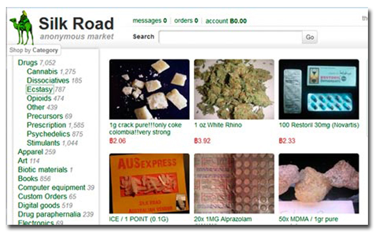

## Ransom: a payment you can watch from the start {.smaller}

::: {style="font-size: .85em;"}

**The case:** Colonial Pipeline paid DarkSide about 75 BTC on 8 May 2021, and the FBI followed the money [@fbi_colonialaffidavit_2021]. The agent asks where it went. Today follows that ransom hop by hop, the way your trace will this afternoon.

**The last lesson** (clustering heuristics and peel chains) made every hop of a trace name its heuristic, what could make it wrong, and how sure you are. Today runs that method on a real ransom, in three parts:

1. **The payment:** the note, the portal, the price and the address.
2. **Colonial, hop by hop:** five hops, each judged, and where the trace stopped.
3. **The cash-out:** the developer's and affiliate's shares, and the services where ransoms end up.

**By the end:** given a ransom's payment address, follow it hop by hop with each hop's heuristic and confidence (High, Moderate or Low), say where the trace ends (a service, or a holding address and the date you checked), and say which kind of service a ransom cashes out at.

**The point to earn:** a ransom is the one trace that starts from a payment the victim already knows, and the ledger is "visible online to everyone" [@fbi_colonialaffidavit_2021, para. 21]. So you can write down and check every hop, and it ends at the first service, where records exist, or at a holding address.

:::

::: {.notes}

**Overall Slide Concept**
This slide opens lesson ② of day 6 with a case and a question: Colonial's ransom was paid, and the agent asks where it went. It matters here because the afternoon lab's trace starts at a ransom payment, and this lesson follows a real one from the same start. Emphasize the objective: the checks, the practice and the review all come back to it.

**Key Points**
- Students already hold the method. The last lesson (clustering heuristics and peel chains) taught them to give every hop a heuristic, a way it could fail and a confidence word. This lesson uses it on real transfers instead of made-up ones.
- Ransomware gives the analyst an unusual gift: the start of the trace is known, not guessed. The FBI affidavit defines the blockchain as a public ledger "visible online to everyone" (para. 21), and Colonial was told on or about 8 May what to pay (para. 28).
- Colonial runs through the lesson. Part 1 follows the payment from the note to the address, part 2 follows the 75 BTC across five hops, and part 3 sets the cash-out services beside it, with Silk Road's stolen coins as a second case.
- New terms this lesson: ransom note, payment portal, ransomware-as-a-service (RaaS), affiliate, holding address, cash-out, darknet market.
- The next lesson takes the trace to the service and asks how to name who is behind it.

**Walkthrough**
1. Read the case and leave the agent's question open; the lesson answers it.
2. Read the link back, then name the three parts.
3. Read the objective aloud. Each part ends with a check every student answers, and the review asks the objective again.
4. Time plan, 50 minutes: opening 5, part 1 9, part 2 14, part 3 with the practice 14, answers and review 8.

**Sources**
- @fbi_colonialaffidavit_2021

:::

## Fewer victims pay, but each pays more {.smaller}

**Bottom line:** ransomware still takes hundreds of millions of dollars a year on-chain. Fewer victims pay, but the median payment has risen [@chainalysis_ransomware_2026] [26 Feb 2026]{.asof}.

- **2025 total:** more than \$820 million in on-chain payments, 8% below the revised 2024 figure of \$892 million [@chainalysis_ransomware_2026].
- **Still rising:** the 2025 total "is likely to approach or exceed \$900 million" as more payments are attributed [@chainalysis_ransomware_2026].
- **Who pays:** the share of ransoms paid may have hit an all-time low, 28% [@chainalysis_ransomware_2026].
- **How much:** the median payment rose 368%, from \$12,738 in 2024 to \$59,556 in 2025 [@chainalysis_ransomware_2026].
- **For comparison:** DarkSide alone took just over \$90 million from 47 victims by May 2021 [@robinson_darkside_2021].

::: {.notes}

**Overall Slide Concept**
This slide gives the current scale of ransomware payments, dated. It matters here because analysts brief agents and prosecutors on the threat, and a figure without a date and a source is not usable. Emphasize that these totals are estimates from attributed payments and go up as more are found.

**Key Points**
- Chainalysis, "Crypto Ransomware: 2026 Crypto Crime Report" (26 Feb 2026): more than \$820 million in on-chain payments in 2025, 8% below the updated 2024 estimate of \$892 million; the 2025 total is likely to approach or exceed \$900 million as more events and payments are attributed.
- The share of ransoms paid "potentially reached an all-time low" at 28%; the median payment rose 368%, from \$12,738 to \$59,556.
- Elliptic counted just over \$90 million paid to DarkSide from 47 victims [18 May 2021]{.asof}.
- These are a commercial firm's published research figures; the course cites research but does not use the firm's platform.

**Walkthrough**
1. Read the bottom line and the date.
2. Ask: why might the 2025 total still rise? (Payments are counted only once attributed to ransomware.)
3. Ask: how would you cite this figure when you explain it to an agent? (Source and the date of the figure.)

**Sources**
- @chainalysis_ransomware_2026
- @robinson_darkside_2021

:::

## A note leads to a portal, a price, an address {.smaller}

**Bottom line:** the criminals' note leads to a Tor site, the **payment portal**, and a price in cryptocurrency. The victim, or a firm acting for it, buys the coins and sends them to the address the criminals give.

:::: {.columns}
::: {.column width="58%"}
- **The note:** on Colonial's screens, it gave a Tor site said to hold samples of stolen data, and demanded about 75 BTC [@fbi_colonialaffidavit_2021, para. 26].
- **Two threats:** files stay encrypted, and stolen data may be published [@fbi_colonialaffidavit_2021, para. 24; @cisa_aa21131a_2021].
- **The payment:** the victim buys the coin at an exchange and sends it, often from a wallet the exchange hosts [@financialcrimesenforcementnetworkfincen_advisoryransomwareuse_2021, p. 2].
- **Who pays:** a DFIR (digital forensics and incident response) firm may negotiate and pay for the victim [@financialcrimesenforcementnetworkfincen_advisoryransomwareuse_2021, p. 3].
- **Which coin:** most often Bitcoin; increasingly privacy coins such as Monero, sometimes at a discount [@financialcrimesenforcementnetworkfincen_advisoryransomwareuse_2021, p. 5] [Nov 2021]{.asof}.
:::
::: {.column width="42%"}
```{dot}
//| fig-width: 4
//| fig-height: 3.8
digraph Ransom {
  rankdir=TB;
  bgcolor="transparent";
  node [shape=box, style="rounded,filled", fillcolor="#f8fafc", color="#cbd5e1", fontname="Helvetica", fontsize=13];
  edge [color="#64748b", arrowsize=0.7, fontname="Helvetica", fontsize=11];

  N [label="Ransom note\non screen", fillcolor="#fee2e2", color="#ef4444"];
  P [label="Tor site:\nstolen-data samples,\nprice, address", fillcolor="#fee2e2", color="#ef4444"];
  E [label="Victim buys coins\nat an exchange", fillcolor="#e0f2fe", color="#38bdf8"];
  R [label="Ransom address\n(your trace starts here)", fillcolor="#fef3c7", color="#f59e0b"];

  N -> P -> E -> R;
}
```
:::
::::

::: {.notes}

**Overall Slide Concept**
This slide teaches how a ransom is demanded and paid, from the note to the payment address. It matters here because each step leaves something an analyst can ask for, and the last step is where the trace starts. Emphasize that the victim side of the payment runs through regulated exchanges, while the criminal side starts at the ransom address.

**Key Points**
- Affidavit para. 26: employees saw a ransomware message; a Tor website address claimed links to samples of exfiltrated data; about 75 BTC was demanded.
- Affidavit para. 24: actors typically breach a network, exfiltrate data, encrypt, demand a ransom, and threaten to publish the stolen data if unpaid. CISA's alert AA21-131A says DarkSide encrypts and steals data and threatens to publish it.
- FinCEN (FIN-2021-A004, 8 Nov 2021, p. 2): the victim typically wires funds to a cryptocurrency exchange, buys the type and amount the perpetrator specifies, and sends it, often from a hosted wallet, to the perpetrator's address.
- FinCEN p. 3: DFIR firms may negotiate with the criminals, facilitate payment and investigate the breach; cyber insurers may reimburse.
- FinCEN p. 5: ransoms are most commonly in Bitcoin; criminals increasingly require or incentivize AECs, have offered discounts for them, and Monero is the one named.
- Define payment portal briefly: the criminals' website, usually on Tor, where the victim sees the price and the address; FinCEN's red flags (p. 7) note victims using such a portal to communicate with the criminals.

**Walkthrough**
1. Follow the diagram top to bottom: note, portal, exchange, ransom address.
2. Point out the last box, the ransom address: that is where your trace starts.
3. Hold this diagram; the check after the next slide asks which boxes are leads off the blockchain.

**Sources**
- @fbi_colonialaffidavit_2021
- @cisa_aa21131a_2021
- @financialcrimesenforcementnetworkfincen_advisoryransomwareuse_2021

:::

## The portal and chat are leads; ask for them {.smaller}

**Bottom line:** the start of your trace comes from the victim's side, not the blockchain. Ask the victim, or the firm that paid for it, for everything the criminals sent.

| Ask for | Why it matters |
| --- | --- |
| The ransom address and the payment transaction | Your trace starts there; Colonial gave the FBI the address it was told to pay [@fbi_colonialaffidavit_2021, para. 28] |
| The ransom note and the Tor site's address | They name the group and the site [@fbi_colonialaffidavit_2021, para. 26] |
| The chat on the portal | Where the criminals set the price and any discount [@financialcrimesenforcementnetworkfincen_advisoryransomwareuse_2021, pp. 5, 7] |
| Who bought the coins, and where | The exchange holds the victim's side of the payment [@financialcrimesenforcementnetworkfincen_advisoryransomwareuse_2021, p. 2] |

: {tbl-colwidths="[38,62]"}

A bank sees the victim's side too: FinCEN's red flags include a customer using "the onion router or an unidentified web portal" to talk to the person they pay in cryptocurrency [@financialcrimesenforcementnetworkfincen_advisoryransomwareuse_2021, p. 7].

::: {.notes}

**Overall Slide Concept**
This slide lists the off-chain artifacts of a ransom and why each is a lead. It matters here because the analyst's first request to the case agent is for these, and they are the different kind of evidence that can later lift a hop's confidence. Emphasize asking for the payment transaction itself, not just the address.

**Key Points**
- Affidavit para. 28: Colonial told the FBI the address it was instructed to pay; para. 26: the note gave a Tor website address.
- The chat is where the criminals set the price and the address; a discount for paying in Monero (FinCEN p. 5) would show there.
- FinCEN p. 2: the victim buys the coins at an exchange, often sending from a hosted wallet, so the exchange holds records of the victim's side.
- FinCEN red flags (p. 7): use of "the onion router or an unidentified web portal" to communicate with the recipient of a cryptocurrency transaction; a customer with little cryptocurrency history buying or sending a large amount, which may mean a ransomware victim.
- Off-chain artifacts are a different kind of evidence from the ledger: lesson ③ uses them for attribution and High confidence.

**Walkthrough**
1. Read each row: what to ask for and why.
2. Ask: which row gives a different kind of evidence from the blockchain? (All four; the first also starts the trace.)

**Sources**
- @fbi_colonialaffidavit_2021
- @financialcrimesenforcementnetworkfincen_advisoryransomwareuse_2021

:::

## Check: what does this note give you to trace? {.smaller}

::: {style="font-size: .85em;"}

Colonial's screens showed a ransom note pointing to a Tor site. On or about 8 May the company was told to pay about 75 BTC [@fbi_colonialaffidavit_2021, para. 28].

**Write two lines:** which box of the note-to-address diagram (a few slides back) does your trace start from, and which of the other boxes hold leads that are not on the blockchain?

::: {.fragment}
**Answer:** the trace starts at the ransom address, the last box. The note and the portal are off-chain leads: they name the group and the site, and the portal sets the price and the address. Ask the victim for all of them.

**Part 1 in one line:** a ransom trace starts from an address the victim was given, and the note, portal and chat are leads you ask for [@fbi_colonialaffidavit_2021; @financialcrimesenforcementnetworkfincen_advisoryransomwareuse_2021].
:::

:::

::: {.notes}

**Overall Slide Concept**
This slide closes part 1 with a check every student answers. It matters here because a student who thinks the trace starts at the note will hunt the chain for something that is not on it. Emphasize that the ransom address is the first on-chain fact, and everything before it is a lead from the victim.

**Key Points**
- Expected answer: the trace starts at the ransom address. The note and the Tor portal are leads, not chain data.
- The address came from the criminals' side of the exchange, not from the ledger, which is why the victim is the first source to ask.
- Off-chain leads are a different kind of evidence from the ledger; the next lesson uses them to move a hop from Low or Moderate toward High.
- The part's synthesis, on the slide: start from the address the victim was given, and ask for the note, portal and chat.

**Walkthrough**
1. Go back to the diagram a few slides up if students need it.
2. Give every student thirty seconds to write two lines.
3. Take answers, reveal the answer, then read the part 1 synthesis.

**Sources**
- @fbi_colonialaffidavit_2021
- @financialcrimesenforcementnetworkfincen_advisoryransomwareuse_2021

:::

## Colonial: shut down at dawn, paid the next day {.smaller}

**Bottom line:** DarkSide's ransom note appeared before 5 am on Friday 7 May 2021. Colonial shut the pipeline down within the hour and paid about 75 BTC on 8 May [@blount_testimony_2021; @fbi_colonialaffidavit_2021].

| When (2021) | What happened |
| --- | --- |
| 7 May, just before 5:00 am | An employee finds the ransom note on an IT-network system [@blount_testimony_2021, p. 2] |
| 7 May, 6:10 am | All 5,500 miles of pipeline confirmed shut down [@blount_testimony_2021, p. 2] |
| 7 May | Colonial reports the attack, by DarkSide, to the FBI [@fbi_colonialaffidavit_2021, para. 25] |
| 8 May | Told to pay about 75 BTC, worth about \$4.3 million, to one address [@fbi_colonialaffidavit_2021, para. 28] |
| 8-9 May | The ransom moves four times (next slide) [@fbi_colonialaffidavit_2021, paras. 29-32] |
| 12 May, evening | Pipelines begin returning to service [@blount_testimony_2021, p. 3] |
| 7 June | The Justice Department announces it has seized 63.7 of the bitcoins [@departmentofjustice_departmentjusticeseizes_2021] |

: {tbl-colwidths="[24,76]"}

The CEO: "I made the decision that Colonial Pipeline would pay the ransom" [@blount_testimony_2021, p. 4].

::: {.notes}

**Overall Slide Concept**
Part 2 of the lesson starts here: the 75 BTC, hop by hop, from the address part 1 ended on. This slide sets out the Colonial case as a timeline, from the ransom note to the payment and the recovery. It matters here because the timeline shows how fast a ransom is paid and moved: the trace starts within a day of the attack. Emphasize the dates, since each hop on the next slides is dated.

**Key Points**
- Blount's Senate testimony (8 June 2021): the note was identified just before 5:00 am EDT on Friday 7 May; the shutdown began at about 5:55 am, and by 6:10 am all 5,500 miles were confirmed shut down, about fifteen minutes in all.
- The pipeline serves about 260 delivery points across 13 states and Washington, D.C. (testimony p. 2); pipelines began returning to service on the evening of 12 May (p. 3).
- Blount made the decision to pay, to have "every tool available" to restart quickly (p. 4).
- Affidavit para. 25: on or about 7 May, Colonial (called "Victim X") reported the attack by DarkSide to the FBI. Para. 28: on or about 8 May it was told to pay about 75 BTC, worth about \$4.3 million that day.
- The DOJ press release of 7 June 2021 announced the seizure of 63.7 BTC, then worth about \$2.3 million. How it was seized is legal process, which is out of scope.

**Walkthrough**
1. Read the rows top to bottom.
2. Ask: how long between the note and the payment? (About a day.)
3. Ask: how long did the ransom sit before it moved? (It moved the same day: next slide.)

**Sources**
- @blount_testimony_2021
- @fbi_colonialaffidavit_2021
- @departmentofjustice_departmentjusticeseizes_2021

:::

## The ransom moved four times in two days {.smaller}

**Bottom line:** the ransom address received 75.0005 BTC in two payments on 8 May. By 9 May the money had moved four times, and on 27 May 63.7 BTC of it was gathered into one address [@fbi_colonialaffidavit_2021, paras. 29-33].

```{dot}
//| fig-width: 11
//| fig-height: 4.4
digraph Colonial {
  rankdir=LR;
  bgcolor="transparent";
  node [shape=box, style="rounded,filled", fillcolor="#f8fafc", color="#cbd5e1", fontname="Helvetica", fontsize=16];
  edge [color="#64748b", arrowsize=0.7, fontname="Helvetica", fontsize=14];

  R [label="...c9fr\nransom address\n75.0005 in", fillcolor="#fef3c7", color="#f59e0b"];
  B [label="...7q5X", fillcolor="#dcfce7", color="#22c55e"];
  A [label="...tpsf", fillcolor="#dcfce7", color="#22c55e"];
  V [label="...ycsm"];
  D [label="...9zwt"];
  J [label="...wg45", fillcolor="#dcfce7", color="#22c55e"];
  U [label="...dNxB", fillcolor="#dcfce7", color="#22c55e"];
  O [label="23+ other\naddresses"];
  S [label="...segq\n69.6042\n27 May", fillcolor="#e0f2fe", color="#38bdf8"];

  R -> B [label="1: 75.0003"];
  R -> A [label="1: 0.00001693"];
  B -> A [label="2: 74.99998"];
  B -> V [label="2: 0.0000675"];
  A -> D [label="3: 11.24962019"];
  A -> J [label="3: 63.74998561"];
  J -> J [label="4: 0.0498 back"];
  J -> U [label="4: 63.7000"];
  U -> S [label="5"];
  O -> S [label="5"];
}
```

Hops 1-3 on 8 May; hop 4 on 9 May: four moves in two days. Hop 5, on 27 May, gathers the money. Yellow: the ransom address; green: the path the affidavit follows; white: leads; blue: where it was gathered. Amounts in BTC; the affidavit hides each address's first 12 characters, so addresses here go by their last four.

::: {.notes}

**Overall Slide Concept**
This slide draws the ransom's path as the FBI affidavit describes it, from the ransom address to the address where 63.7 BTC was gathered. It matters here because this is the shape of the afternoon's trace: a chain of hops, each with outputs to judge. Emphasize the green boxes as the path the affidavit follows and the white boxes as leads.

**Key Points**
- Para. 29: the ransom address (ending L6qeMLgX5VEAFCbRXjc9fr) received two payments on 8 May totalling 75.0005 BTC, then sent 0.00001693 BTC to the address ending ...wfytpsf and 75.00034246 BTC to the address ending ...Bnujk6Xg7q5X.
- Para. 30: on 8 May, ...7q5X sent 74.99998307 BTC to ...tpsf, the address that had already received the 0.00001693, and 0.00006748 BTC to the address ending ...NcwPhx6etKycsm.
- Para. 31: on 8 May, ...tpsf sent the 74.99998307 together with the 0.00001693 in one transaction: 11.24962019 BTC to the address ending ...gfhz99zwt and 63.74998561 BTC to the address ending ...llfykeqwg45.
- Para. 32: on 9 May, ...wg45 sent 0.04976631 BTC back to itself and 63.70000000 BTC to the address ending ...S2pKcdNxB.
- Para. 33: "an online public blockchain explorer" identified at least 23 other addresses "collected together" with ...dNxB "in one wallet"; on 27 May funds from that collection, totalling 69.60422177 BTC, including the 63.7, went to the address ending ...hs6cfsegq.
- Arithmetic from those figures: hop 3's two inputs sum to exactly 75.00000000 BTC.

**Walkthrough**
1. Start at the yellow ransom address on the left.
2. Follow the numbered edges in order: 1 to 5.
3. Point out the two places an address is used twice: ...tpsf receives in hops 1 and 2, and ...wg45 pays itself in hop 4.
4. Ask: which white boxes would you want to follow next? (...9zwt, with 11.2496 BTC: the holding-address slide.)

**Sources**
- @fbi_colonialaffidavit_2021

:::

## Each hop gets a heuristic and a confidence {.smaller}

**Bottom line:** the affidavit's hops, written as your trace is. None reaches High: every clue comes from the ledger or an explorer [@fbi_colonialaffidavit_2021, paras. 29-33].

| # | What you see | Heuristic | Could be wrong if | Confidence |
| --- | --- | --- | --- | --- |
| 1 | `c9fr` pays 75.0003 to `7q5X`, a sliver to `tpsf` | Change undetermined | n/a | No call: follow both |
| 2 | `7q5X` pays 74.99998 to `tpsf` too | Branches meet at one address | `tpsf` is a service's | Moderate |
| 3 | `tpsf` pays 11.24962019 and 63.74998561 | Change undetermined | n/a | No call: follow both |
| 4 | `wg45` pays 63.7000 on, 0.0498 to itself | Self-change: back to the payer | n/a: same address | Moderate |
| 5 | An explorer lists `dNxB` + 23 as one wallet | Explorer's label | The label is wrong | Low |

: {tbl-colwidths="[5,34,25,18,18]"}

::: {.notes}

**Overall Slide Concept**
This slide turns the affidavit's narrative into the annotated trace the lab asks for. It matters here because students see lesson ①'s heuristics working, and failing to decide, on a real ransom. Emphasize that "change undetermined" appears twice and is a correct answer: no confidence is given because no call is made, and both outputs stay leads.

**Key Points**
- Hop 1: two outputs, the larger and the smaller; from this transaction alone the clues do not show which is change.
- Hop 2: the bulk goes to ...tpsf, the address that received hop 1's small output (para. 30). Both branches of hop 1 meet at one address, so one holder received both, and hop 3 spends them together (para. 31). It fails if ...tpsf belongs to a service that holds many customers' coins; lesson ① also notes some wallets reuse addresses.
- Hop 3: ...tpsf spends both its coins in one transaction (para. 31); neither output is round and both addresses are new, so change is undetermined. The affidavit follows the 63.75; the 11.25 is a lead (the holding-address slide).
- Hop 4: 0.04976631 returns to the paying address itself (para. 32): change by the plainest clue there is, so follow the round 63.70000000. Rated Moderate because it is still a same-transaction clue. Whether the 63.70 paid someone else or moved to the same actor's own address does not change where the trace goes; the 27 May grouping suggests the latter.
- Hop 5: an explorer grouped ...dNxB with at least 23 other addresses "in one wallet" (para. 33). The affidavit does not show the transactions behind the grouping, so it is one unverified label: Low on the course scale. Checking the 27 May transactions for co-spending yourself would make it your own judgment, still Moderate at best.
- "Branches meet" and "self-change" are the last two rows of lesson ①'s change-clue table.
- Course scale: same-transaction clues stop at Moderate; High needs a different kind of evidence (lesson ③).

**Walkthrough**
1. Read each row against the diagram on the last slide.
2. Ask: why is hop 1 undetermined when hop 2 settles it? (Hop 2 is a different transaction; reading forward resolved hop 1.)
3. Ask: how would you raise hop 5 from Low? (Read the 27 May transactions yourself: co-spending there is Moderate. High needs something off-chain, such as an exchange's records: lesson ③.)

**Sources**
- @fbi_colonialaffidavit_2021
- @meiklejohn_fistfulbitcoinscharacterizing_2013
- @kappos_howpeelmillion_2022

:::

## This trace stopped at a wallet, not a service {.smaller}

**Bottom line:** the affidavit's trace ends at `...segq`, an address holding 69.6 BTC that "has not moved since" it arrived, by the affidavit's date [@fbi_colonialaffidavit_2021, para. 33] [7 Jun 2021]{.asof}. It never reached an exchange. Your trace ends at the first service *or* where the money stops: say which, and the date you checked.

- **A holding address:** money gathered and left still. The trace has nowhere further to go until it moves.
- **Leads the affidavit doesn't follow** [@fbi_colonialaffidavit_2021, paras. 30-33]:
  - 11.2496 BTC to `...9zwt` at hop 3
  - 0.0000675 BTC to `...ycsm` at hop 2
  - about 5.9 BTC from the 23+ other addresses, gathered into `...segq` with the 63.7
- **Where most ransoms go next:** a service, such as an exchange (later in this lesson).

::: {.notes}

**Overall Slide Concept**
This slide shows that a trace can end without reaching a service. It matters here because the lab's trace "follows the ransom to the first service", and a student whose money stops moving must say so rather than force a hop. Emphasize recording the date: "has not moved" is true only at the time of the check.

**Key Points**
- Para. 33: on 27 May, 69.60422177 BTC, including the 63.7, went to ...segq, and "it has not moved since" (the affidavit is dated 7 June 2021).
- The leads come from paras. 30-31; the 5.9 BTC is arithmetic: 69.60422177 minus 63.70000000 is 5.90422177 BTC.
- Most DarkSide funds did reach a service: Elliptic found they went mainly to exchanges (the cash-out slide below).
- Define holding address briefly: an address where funds are gathered and then left unmoved.
- Day 6's lab: the trace ends at the first service; when it stops before that, write where and when you checked.

**Walkthrough**
1. Read the bottom line; stress the date.
2. Go down the leads: each is a branch a full investigation would follow.
3. Ask: if `...9zwt` sent its 11.25 BTC to an exchange the next day, where would your trace end? (At that exchange: the first service on that branch.)

**Sources**
- @fbi_colonialaffidavit_2021
- @robinson_darkside_2021

:::

## Check: why did this trace stop at a wallet? {.smaller}

::: {style="font-size: .85em;"}

A colleague reads the Colonial trace and asks: "Did the ransom reach an exchange?" The last address the affidavit gives is `...segq`, with 69.6 BTC.

**Write two lines:** what do you answer, and what do you add so the answer is still usable next month?

::: {.fragment}
**Answer:** "Not by this trace." The money was gathered in a holding address and, by the affidavit's date of 7 June 2021, had not moved, so it reached no service [@fbi_colonialaffidavit_2021, para. 33]. Add the date you checked, because "has not moved" is true only on that day, and list the leads left open: the 11.2496 BTC to `...9zwt` and the 0.0000675 BTC to `...ycsm`.

**Part 2 in one line:** every hop gets a heuristic and a confidence, and a trace ends at the first service or where the money stops, with the date you checked.
:::

:::

::: {.notes}

**Overall Slide Concept**
This slide closes part 2 with a check every student answers. It matters here because a student who forces a hop to a service, or writes "it stopped" with no date, hands over a finding nobody can check. Emphasize the date: it turns a claim about now into a claim about a day.

**Key Points**
- Expected answer: not by this trace. The affidavit's trace ends at a holding address, `...segq`, that "has not moved since" 27 May, by the affidavit's date (para. 33) [7 Jun 2021]{.asof}.
- The usable version carries the date checked and the leads left open, which come from paras. 30 and 31.
- This is the same habit the lab asks for: where the trace ends, and when you looked.
- The part's synthesis, on the slide: each hop has a heuristic and a confidence; a trace ends at the first service or where the money stops.

**Walkthrough**
1. Put the colleague's question.
2. Give every student thirty seconds to write two lines.
3. Take answers, reveal the answer, then read the part 2 synthesis.

**Sources**
- @fbi_colonialaffidavit_2021

:::

## Developer and affiliate split it on-chain {.smaller}

**Bottom line:** DarkSide was ransomware-as-a-service: its developers took a share of each ransom from the affiliates who ran the attacks [@cisa_aa21131a_2021]. The shares went to separate wallets, so the split shows on the blockchain [@robinson_darkside_2021].

:::: {.columns}
::: {.column width="55%"}
- **The rate:** the developer reportedly took 25% of ransoms under \$500,000, falling to 10% above \$5 million [@robinson_darkside_2021].
- **The total:** just over \$90 million from 47 victims, \$15.5 million (17%) of it to the developer [@robinson_darkside_2021] [18 May 2021]{.asof}.
- **A link between attacks:** the affiliate's shares of the Colonial and Brenntag ransoms went to one wallet, "suggesting" one party hit both [@robinson_darkside_2021].
:::
::: {.column width="45%"}
**Exercise: hop 3**

`...tpsf` spent exactly 75 BTC:

| Output | BTC | To |
| --- | --- | --- |
| A | 11.24962019 | `...9zwt` |
| B | 63.74998561 | `...wg45` |

Which output looks like the developer's cut? How sure are you, and why?
:::
::::

::: {.notes}

**Overall Slide Concept**
Part 3 of the lesson starts here: where the ransom goes after the trace stops being a single line. This slide teaches how a ransomware-as-a-service split appears on-chain, and has students read one. It matters here because the split is the first place a ransom divides, and the two halves lead to different people. Emphasize that a share that fits a split is still a judgment from the amount alone.

**Key Points**
- CISA AA21-131A (11 May 2021, revised 8 July 2021): DarkSide is RaaS; the developers receive a share of the proceeds from the actors who deploy it, the affiliates.
- Elliptic (Robinson, 18 May 2021): the developer reportedly takes 25% of ransoms under \$500,000, falling to 10% above \$5 million; the split "is very clear to see on the blockchain", with shares going to separate wallets.
- Elliptic: just over \$90 million in ransoms from 47 victims; the developer received \$15.5 million (17%), the affiliates \$74.7 million (83%).
- Elliptic: the affiliate's shares of the Colonial and Brenntag payments went to the same wallet, suggesting the same party infected both.
- Exercise answer: A is 11.2496 of 75, almost exactly 15%; the smaller output fits a developer's cut. Elliptic gives no rate for a ransom of about \$4.3 million, between its two tiers, and the affidavit does not say which output was whose. Amount alone: **Low**.
- Define affiliate briefly: the criminal who breaks in, deploys the ransomware and negotiates, paying the developer a share.

**Walkthrough**
1. Read the bottom line and the three facts.
2. Run the exercise: two minutes in pairs.
3. Take answers: the smaller output, about 15%. Ask how sure: Low, amount alone.
4. Ask: what would raise it? (Seeing the same small share go to the same wallet from other DarkSide ransoms: a pattern across victims.)

**Sources**
- @cisa_aa21131a_2021
- @robinson_darkside_2021
- @fbi_colonialaffidavit_2021

:::

## A ransom cashes out at a service {.smaller}

**Bottom line:** a ransom becomes money the criminal can spend at a service: an exchange, an over-the-counter (OTC) broker or a darknet market. Your trace ends at the first one.

:::: {.columns}
::: {.column width="60%"}
- **Exchanges:** most DarkSide funds, many to places that don't enforce anti-money-laundering rules [@robinson_darkside_2021] [May 2021]{.asof}.
- **BTC-e, an exchange:** fined \$110 million by FinCEN in 2017 for facilitating ransomware [@financialcrimesenforcementnetworkfincen_fincenfinesbtce_2017].
- **Garantex, an exchange:** nearly \$6 million from the Conti ransomware gang [@u.s.dept.oftreasury_hydragarantex_2022] [Apr 2022]{.asof}.
- **OTC brokers:** "some of them specialize in providing money laundering services" [@chainalysis_moneylaundering_2020].
- **Darknet markets:** about \$8 million in ransomware proceeds passed through Hydra, a market (next slide) [@u.s.dept.oftreasury_hydragarantex_2022].
:::
::: {.column width="40%"}
```{dot}
//| fig-width: 4
//| fig-height: 3.8
digraph CashOut {
  rankdir=TB;
  bgcolor="transparent";
  node [shape=box, style="rounded,filled", fillcolor="#f8fafc", color="#cbd5e1", fontname="Helvetica", fontsize=13];
  edge [color="#64748b", arrowsize=0.7, fontname="Helvetica", fontsize=11];

  A [label="Affiliate's share", fillcolor="#fef3c7", color="#f59e0b"];
  X [label="Exchange", fillcolor="#e0f2fe", color="#38bdf8"];
  O [label="OTC broker", fillcolor="#e0f2fe", color="#38bdf8"];
  M [label="Darknet market", fillcolor="#e0f2fe", color="#38bdf8"];

  A -> X;
  A -> O;
  A -> M;
  M -> X [label="vendors\ncash out", style=dashed];
}
```

Blue: a service. The trace ends at the first one.
:::
::::

::: {.notes}

**Overall Slide Concept**
This slide teaches where a ransom goes after the split: to a service that turns it into money the criminal can use. It matters here because the lab's trace ends at the first service, and students should know which kinds of service to expect. Emphasize that the first service is where the on-chain trace stops and the off-chain records begin.

**Key Points**
- Elliptic (Robinson, 18 May 2021): most DarkSide funds were sent to cryptoasset exchanges, many in jurisdictions that do not enforce anti-money-laundering rules.
- FinCEN (27 July 2017): BTC-e was fined \$110 million; the release's title says it was for "Facilitating Ransomware, Dark Net Drug Sales".
- Treasury (5 April 2022, release jy0701): Garantex had "over \$100 million in transactions" associated with illicit actors and darknet markets, "including nearly \$6 million from Russian RaaS gang Conti". It sanctioned Garantex and Hydra that day.
- All three named services were later penalized: FinCEN fined BTC-e (2017), and Treasury sanctioned Garantex and Hydra (2022).
- Chainalysis (15 January 2020): "while most OTC brokers run a legitimate business, some of them specialize in providing money laundering services to criminals". Day 5 covered OTC brokers.
- Treasury: "approximately \$8 million in ransomware proceeds" transited Hydra's virtual currency accounts, "including from the Ryuk, Sodinokibi, and Conti ransomware variants".
- The dashed arrow is the next slide's point: a market's vendors move their earnings on to exchanges.
- Define cash-out briefly: turning cryptocurrency into money or goods the criminal can use, at a service.

**Walkthrough**
1. Read the bottom line.
2. Follow the diagram: every solid arrow ends at a blue box, a service.
3. Ask: where does your trace end on each arrow? (At the blue box: the first service.)
4. Ask: why is the first service worth naming? (It keeps records of its customers: off-chain evidence, which lesson ③ uses for High confidence.)

**Sources**
- @robinson_darkside_2021
- @financialcrimesenforcementnetworkfincen_fincenfinesbtce_2017
- @u.s.dept.oftreasury_hydragarantex_2022
- @chainalysis_moneylaundering_2020

:::

## A darknet market is a shop and a cash-out {.smaller}

**Bottom line:** a darknet market sells illegal goods and services on sites reached with special software that hides its users, and takes "almost exclusively" virtual currency. Its users "often incorrectly believe" the coins are "an anonymous and untraceable means of exchange" [@u.s.dept.oftreasury_hydragarantex_2022].

:::: {.columns}
::: {.column width="58%"}
- **Silk Road, 2011-2013:** a Tor market with a Bitcoin payment system built to hide its users [@departmentofjustice_manhattanusattorneyannounces_2014]. Bitcoin was "the only form of payment accepted", and sales topped 9.5 million BTC [@departmentofjustice_silkroadcomplaint_2020, paras. 11-12].
- **Hydra, from 2015:** the world's largest darknet market when Treasury sanctioned it in April 2022. It sold ransomware-as-a-service, hacking tools, stolen data and drugs; its revenue rose from under \$10 million in 2016 to over \$1.3 billion in 2020 [@u.s.dept.oftreasury_hydragarantex_2022].
- **A route, not just a shop:** about 86% of the illicit Bitcoin that Russian exchanges received directly in 2019 came from Hydra [@u.s.dept.oftreasury_hydragarantex_2022].
:::
::: {.column width="42%"}

:::
::::

::: {.notes}

**Overall Slide Concept**
This slide teaches what a darknet market is and why it matters to a ransom trace in two ways: as a shop that sells ransomware, and as a route by which criminals cash out. It matters here because a trace that reaches a market has reached a service, and its vendors' coins move on to exchanges. Emphasize the Treasury's point that users wrongly think the coins can't be traced.

**Key Points**
- Treasury (5 April 2022): darknets are networks "that individuals use special software to access in a manner designed to obscure the individuals' identity"; "Marketplaces that reside on the darknet almost exclusively accept virtual currency as payment for a large range of illegal services and goods, including ransomware-as-a-service (RaaS)"; "illicit actors who transact on the darknet often incorrectly believe virtual currencies to be an anonymous and untraceable means of exchange".
- DOJ (4 February 2014): Silk Road ran on Tor from about January 2011 until law enforcement shut it down in October 2013, and was designed with "a Bitcoin-based payment system" that concealed users' identities and locations.
- Complaint for forfeiture (5 November 2020), para. 11: "The only form of payment accepted on Silk Road was Bitcoin." Para. 12: sales "totaling over 9.5 million Bitcoin" and commissions "totaling over 600,000 Bitcoin".
- Complaint para. 13: Silk Road used a "tumbler" "designed to frustrate the tracking of individual transactions through the Blockchain".
- Treasury: "Hydra was launched in 2015"; its offerings included "ransomware-as-a-service, hacking services and software, stolen personal information, counterfeit currency, stolen virtual currency, and illicit drugs"; revenue "from under \$10 million in 2016, to over \$1.3 billion in 2020"; "approximately 86 percent of the illicit Bitcoin received directly by Russian virtual currency exchanges in 2019 came from Hydra".
- Define darknet market briefly: an online market for illegal goods and services, reached with software that hides its users, such as Tor (Silk Road ran on Tor). Define tumbler briefly: a service that mixes coins to break the link between payer and payee (D7 covers mixers).

**Walkthrough**
1. Read the bottom line and point at the screenshot: every price is in bitcoin.
2. Read Silk Road and Hydra: one sold drugs, the other also sold ransomware.
3. Ask: how is Hydra both a shop and a cash-out for a ransomware affiliate? (It sold the ransomware, ransomware proceeds passed through its accounts, and its coins reached Russian exchanges.)

**Sources**
- @u.s.dept.oftreasury_hydragarantex_2022
- @departmentofjustice_manhattanusattorneyannounces_2014
- @departmentofjustice_silkroadcomplaint_2020

:::

## Silk Road: stolen coins left in round amounts {.smaller}

**Bottom line:** in 2020, a court filing traced about 70,000 BTC taken out of Silk Road. The same patterns you read in Colonial's trace showed the way [@departmentofjustice_silkroadcomplaint_2020, paras. 15-19].

| What the filing describes | The pattern you would read |
| --- | --- |
| 54 transactions from Silk Road's addresses to two addresses, 70,411.46 BTC (para. 15) | A large outflow from a service |
| "mainly round Bitcoin amounts and close together in time": ten of exactly 2,500 BTC at about 3:59 am (para. 16) | Round amounts, sent together |
| Other withdrawals were "mostly less than 100 Bitcoin" (para. 16) | Unlike the service's normal traffic |
| On 9 April 2013, 69,471.08 BTC sent on to one address, `1HQ3` (para. 17) | Gathered into one address |
| On 23 April 2015, 101 BTC from `1HQ3` to BTC-e (para. 18) | The first service: an exchange |
| The other 69,370 BTC stayed in `1HQ3` until November 2020 (para. 19) | A holding address, like Colonial's |

: {tbl-colwidths="[58,42]"}

::: {.notes}

**Overall Slide Concept**
This slide reads the money trail of coins taken out of Silk Road, as the 2020 complaint for forfeiture sets it out. It matters here because it shows the patterns from Colonial's trace, round amounts, a holding address and a first service, on a darknet market's money. Emphasize that the on-chain patterns raised the question, and an off-chain record settled it.

**Key Points**
- Para. 15: in 2020, officers "used a third party bitcoin attribution company" to analyze Silk Road's transactions, and observed 54 transactions from Silk Road's addresses to two addresses, totalling 70,411.46 BTC. A commercial analytics firm did the first pass; the course names such firms for awareness and does not use their platforms.
- Para. 16: the amounts were "mainly round Bitcoin amounts and close together in time"; ten were "exactly 2,500 Bitcoin" at about 3:59 a.m.; other withdrawals were "mostly less than 100 Bitcoin".
- Para. 16 also: the 54 transactions "were not noted in the Silk Road database as a vendor withdrawal or a Silk Road employee withdrawal and therefore appear to represent Bitcoin that was stolen from Silk Road". That conclusion came from the market's own database, not the ledger: off-chain evidence (lesson ③).
- Para. 17: on about 9 April 2013 the two addresses sent 69,471.082201 BTC to 1HQ3. Para. 18: on about 23 April 2015, 1HQ3 sent 101 BTC to BTC-e. Para. 19: the remaining 69,370.082201 BTC stayed in 1HQ3 from April 2015 to November 2020.
- The forfeiture itself, and who took the coins, are legal process and out of scope; only the trace is read here.

**Walkthrough**
1. Read the rows top to bottom against the right column.
2. Ask: which rows could you see on the ledger alone? (All but the database check in para. 16.)
3. Ask: what confidence would the round amounts alone give that the coins were stolen? (Moderate at best: a pattern from the ledger. The database record is what settled it.)
4. Ask: how is `1HQ3` like Colonial's `...segq`? (Both held the money still; Silk Road's moved 101 BTC to an exchange first.)

**Sources**
- @departmentofjustice_silkroadcomplaint_2020

:::

## Practice: find the split and the cash-out {.smaller}

::: {style="font-size: .85em;"}

A made-up ransom of 40 BTC, paid to address R:

| Step | What you see |
| --- | --- |
| 1 | R pays 34.0 BTC to `X1` and 6.0 BTC to `X2` in one transaction |
| 2 | `X1` pays 33.9996 BTC to `Y` the same day. An explorer labels `Y` a deposit address at an exchange, and hundreds of unrelated addresses have paid into it |
| 3 | `X2` has not moved when you check |

1. Which output looks like the developer's cut, and how sure are you?
2. Where does the larger branch end, and how sure are you that it is a service?
3. What do you write for the smaller branch?

:::

::: {.notes}

**Overall Slide Concept**
Part 3 is done; this slide has students apply it to a short made-up trace that holds a split, a first service and a holding address. It matters here because the afternoon's trace needs all three, and this is the first time students read them without the answer on the slide. Emphasize that every answer carries a confidence word and a reason.

**Key Points**
- The trace is invented, with no real address or victim, so no one can look it up; its shape repeats Colonial's: a split at the start, one branch that reaches a service, one that stops.
- Each question repeats a reading the lesson worked: question 1 the split exercise (the smaller output fits a developer's cut), question 2 the first service, question 3 the holding address.
- The answers are on the next slide; keep it hidden until students have written theirs.

**Walkthrough**
1. Give students four minutes in pairs to write one sentence for each question with a confidence word.
2. Take question 1 before moving on.
3. For question 2, ask what the label rests on.
4. For question 3, ask what the date has to say.

**Sources**
- @robinson_darkside_2021
- @fbi_colonialaffidavit_2021

:::

## Answers: the split, the service, the confidence {.smaller}

::: {style="font-size: .8em;"}

| Question | Reading | How sure, and why | What would change it |
| --- | --- | --- | --- |
| **1. The cut** | `X2`: 6.0 of 40 BTC is 15%, a share that fits a developer's cut [@robinson_darkside_2021] | **Low:** the amount alone, and no rate is known for this ransom | Moderate if the same small share goes to the same wallet from other ransoms by the same group |
| **2. The larger branch** | It ends at `Y`, an exchange's deposit address: the first service | **Low:** one explorer label, and the deposit pattern alone does not settle it | High needs the exchange's own records of the account behind `Y` |
| **3. The smaller branch** | A holding address: no service reached | It reached no service, and it is true only on the day you checked | If `X2` moves later, the trace goes on: re-check on a later date |

: {tbl-colwidths="[16,30,28,26]"}

**For the finding:** "The ransom split on day one; the larger branch reached what an explorer labels an exchange deposit, and the smaller branch had not moved on the date checked."

:::

::: {.notes}

**Overall Slide Concept**
This slide gives the answers to the practice, each with its confidence word and what would change it. It matters here because answering first and then hearing the reason teaches more than reading a summary. Emphasize the last column: the reason for the word matters as much as the word.

**Key Points**
- Question 1 is the split exercise again. 6.0 of 40 is exactly 15%, so the smaller output fits a developer's cut; Elliptic gives rates for ransoms under \$500,000 and over \$5 million only, so for any size between them the amount alone is Low.
- Question 2 is the first-service reading with the same rule as Colonial's last hop: a label from an explorer is one unverified label, so Low. Many unrelated payers can also fit an OTC desk or a merchant, as day 5 showed, so the pattern alone stays Low. High needs a different kind of evidence, the exchange's records, which the next lesson covers.
- Question 3 is the holding address from the second check; no confidence word is needed for what the ledger shows directly. "Has not moved" is true only on the day checked, so the date goes in the finding.
- The sample finding sentence on the slide is the form the lab's trace ends in.

**Walkthrough**
1. Reveal the slide after students have written their sentences.
2. Read each row and ask a pair that chose a different word to say why.
3. Stress the last column, then read the sample finding.

**Sources**
- @robinson_darkside_2021
- @fbi_colonialaffidavit_2021

:::

## Review: start at the ransom address {.smaller}

[]{#recap-start-at-the-ransom-address}

::: {style="font-size: .8em;"}

**The objective:** given a ransom's payment address, follow it hop by hop with each hop's heuristic and confidence, say where the trace ends, and say which kind of service a ransom cashes out at. Answer each question from memory before the answer appears.

**1. Where does a ransom trace start, and where does the address come from?**

::: {.fragment}
At the ransom address the victim was told to pay; the note, portal and chat are leads you ask for [@fbi_colonialaffidavit_2021].
:::

**2. Colonial's trace shows "change undetermined" twice. Is that a failed trace?**

::: {.fragment}
No: it is a correct answer. No call is made, so both outputs stay leads, as in the hop-3 reading of Colonial's real trace [@fbi_colonialaffidavit_2021, paras. 30-31].
:::

**3. A trace ends at a holding address. What do you write?**

::: {.fragment}
That it reached no service, where it stopped, and the date you checked. Colonial's `...segq` is the example [@fbi_colonialaffidavit_2021, para. 33].
:::

**4. A ransom splits 85/15 on day one. How sure are you which side is the developer's?**

::: {.fragment}
Low, from the amount alone [@robinson_darkside_2021].
:::

**5. Where do ransoms cash out?**

::: {.fragment}
At an exchange, an OTC broker or a darknet market; the trace ends at the first one, where off-chain records begin [@robinson_darkside_2021; @u.s.dept.oftreasury_hydragarantex_2022].
:::

**Next lesson:** the trace has reached a service. What the service knows, and how to name who is behind it, comes next. **This afternoon:** your annotated trace, from a ransom address to the first service.

:::

::: {.notes}

**Overall Slide Concept**
This slide reviews the lesson against its objective: five questions, answered from memory before each answer appears. It matters here because recalling an answer fixes it better than hearing a summary, and the questions show whether students can now do what the opening promised. Emphasize question 3: it is the mistake the lesson most wants to stop, asked a second time.

**Key Points**
- Question 1 returns to the opening case and the lesson's point: the trace starts from a payment the victim knows.
- Question 2 is the hop table's lesson: "change undetermined" is a correct answer, and appears twice in Colonial's real trace.
- Question 3 repeats the part 2 check; a class that still writes "it stopped" with no date needs the holding-address slide once more.
- Questions 4 and 5 come from part 3: the split and the cash-out, with darknet markets as both a shop and a route.
- No new facts appear here; every answer was taught on an earlier slide. The closing line names the next lesson without teaching it, and the lab uses everything above.

**Walkthrough**
1. Read the objective.
2. For each question, give students a few seconds to answer aloud or on paper, then reveal the answer.
3. Ask the class the objective as a question: can you now follow a ransom and say where it ended and how sure you are?
4. Read the last line to bridge to the next lesson and the lab.

**Sources**
- @fbi_colonialaffidavit_2021
- @robinson_darkside_2021
- @u.s.dept.oftreasury_hydragarantex_2022

:::

## References {.smaller}

::: {#refs}
:::
