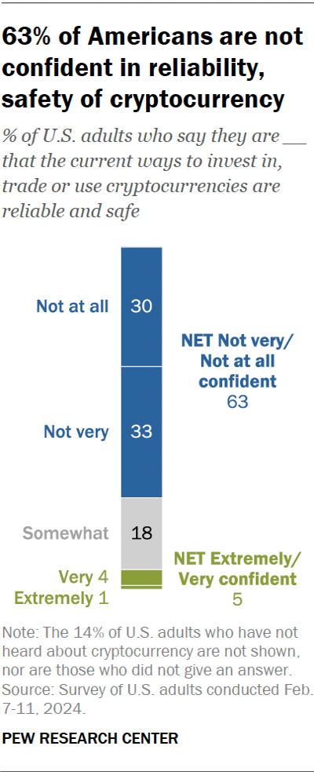

## Start by saying what cases you work {.smaller}

- **Meet your instructors**
- **Introduce yourself in under a minute**
  - Name, and the agency or team you work in
  - A case or task where cryptocurrency came up, kept unclassified
  - Self-rate (1-10): how well can you read a blockchain transaction today?
  - What do you need to be able to do when this course ends?

::: {.notes}

**Overall Slide Concept**
This opening slide sets the tone and gives the instructor a read on the room before any technical content. It matters here because the class mixes analysts who have traced funds before with analysts who have never opened an explorer, and the labs offer both a worked example and a straight-to-the-problem route. Emphasize that the self-rating is a diagnostic, not a judgement.

**Key Points**
- Introduce the instructors and why they teach this course.
- Ask for a case or task where crypto came up, and remind students to keep it unclassified and free of names.
- With 20-30 students, keep each introduction under a minute, or take half the room now and half at the start of the day-1 lab, so the welcome stays inside its 35 minutes.

**Walkthrough**
None

**Sources**
None

:::

## You will say what activity is, and how sure {.smaller}

- **Blockchain Intelligence Analysis**: characterising on-chain activity and explaining it to agents and prosecutors
- An agent hands you an address, a transaction or a case file. By day 10 you can:
  - say what the activity most likely **is**: a ransomware cash-out, sanctions evasion, a scam funnel, a state theft
  - say **how sure** you are, and why
  - **explain** it in a one-page memo and two briefings: one to an agent, one to a prosecutor
- The course covers analysis only: legal process (warrants, subpoenas, seizure, testimony) and programming are out of scope

Adapted from the Army Cyber Institute's open-source blockchain course.

::: {.notes}

**Overall Slide Concept**
This slide states what the course is for in one line: students leave able to characterise on-chain activity and explain it with honest confidence. It matters here because students arrive expecting a technology survey, and this course is built around the analyst's job instead. Emphasize that every lesson and lab feeds the day-10 memo and briefings.

**Key Points**
- Characterise means naming what a set of transactions is, with the indicators for and against.
- The two audiences need different things: the agent wants leads and how sure you are; the prosecutor wants how the method works and where it can be wrong.
- Out of scope: legal process, which belongs to a follow-on course, and data engineering (Python, SQL). Students read code and ready-made queries but never write them.
- The credit line acknowledges the Army Cyber Institute course this one is adapted from.

**Walkthrough**
None

**Sources**
None

:::

## By day 10 you can do nine things {.smaller}

::::: {.columns}
::: {.column width="50%"}
1. **Read the ledger**: what moved, between which addresses, when, and what the record cannot show
2. **Trace and cluster Bitcoin**, naming each heuristic and its false positives
3. **Say where a trace stops**: mixers, CoinJoin, privacy coins
4. **Follow value across swaps and bridges** on Ethereum
5. **Explain an exploit from its code**, reading it, never writing it
:::
::: {.column width="50%"}
6. **Trace stablecoins on Tron** and summarise exposure
7. **Characterise the activity**: the likeliest typology, and an alternative
8. **Attribute with stated confidence**, tying every label to its source
9. **Explain findings** to an agent and to a prosecutor
:::
:::::

::: {.notes}

**Overall Slide Concept**
This slide lists the nine outcomes the course is built on. It matters here because each lab product and each test item traces back to one of them. Emphasize that outcomes 1-6 build the skills and outcomes 7-9 are the job: say what it is, how sure, and explain it.

**Key Points**
- Each outcome is something a student does, and each has evidence: a lab product, the post-test, or the capstone memo and briefings.
- Outcome 5 means reading a short contract and its transactions and saying what the code let the attacker do.
- Outcome 8 ties every label (court record, issuer notice, OSINT, explorer tag) to its source and says how far to trust it.

**Walkthrough**
None

**Sources**
None

:::

## One case runs from Bitcoin to a Tron cash-out {.smaller}

| Day | Theme | You hand in |
|---|---|---|
| 1 | Reading the ledger | Explorer worksheet |
| 2 | Following Bitcoin | Annotated trace |
| 3 | Hiding, naming and saying how sure | First memo (practice) |
| 4-5 | Ethereum, contracts, DeFi and its exploits | Code-reading worksheet |
| 6 | Crossing chains | Cross-chain flow diagram |
| 7 | Stablecoins and Tron | Exposure summary |
| 8 | Where tracing stops | Limits-of-tracing note |
| 9 | The threat picture and the capstone | Capstone trace |
| 10 | Capstone | Memo, two briefings, post-test |

::: {.notes}

**Overall Slide Concept**
This slide is the map of the two weeks. It matters here because the days follow money the way an analyst meets it: Bitcoin first, then Ethereum and its contracts, across a bridge, onto stablecoins and Tron, then to where tracing stops. Emphasize that each day ends in a product an analyst would hand over.

**Key Points**
- Bridges (day 6) come before Tron (day 7), so the running case never reaches Tron before students have crossed a bridge.
- The day-3 memo is practice; the day-10 memo is graded, so every student writes a memo before the one that counts.
- From day 6, each morning's discussion opens with paired two-minute briefings on the previous day's lab product.
- Day 10 has no lessons: the capstone memo, the agent and prosecutor briefings, and the post-test.

**Walkthrough**
None

**Sources**
None

:::

## Lessons in the morning, a lab after lunch {.smaller}

| Time | Block |
|---|---|
| **0845** | Quiz: about five questions on yesterday, ungraded practice |
| **0900** | Discussion of last night's reading |
| **0920** | Three lessons of about 50 minutes, with a 10-minute break between each |
| **1210** | Lunch (75 minutes) |
| **1325** | Lab (2 hours 35 minutes) |
| **1600** | Day ends; tonight's reading takes at most 45 minutes |

- **Today is different:** this welcome replaces the quiz and discussion, and the lab opens with The Insider and a 10-minute terminal orientation

::: {.notes}

**Overall Slide Concept**
This slide sets the rhythm of every teaching day. It matters here because students plan their effort around it, and the lab is where the graded products are made. Emphasize that a lesson that overruns takes its time from the lab, so the morning starts on time.

**Key Points**
- The morning quiz is practice: nothing is recorded.
- Day 5 opens with the week-one check in place of the quiz; it does not count, and it shows who needs help before week two.
- The nightly reading is the lighter side of the subject: origins, landmark events, vignettes and new developments.
- Day 1 has no quiz or discussion: the welcome takes those 35 minutes.

**Walkthrough**
None

**Sources**
None

:::

## Every lab ends in something you hand over {.smaller}

- **One lab, two ways in:** a worked example first, or straight to the problem if your pretest shows the basics; optional challenge steps at the end
- **Browser only:** every lab runs over HTTPS from the course server; you install nothing
- **Captured data:** snapshots and the course's own chain, so every student sees the same evidence
- **Open-source tools:** Otterscan for Ethereum, java-tron for Tron, Hyperledger Fabric for a permissioned ledger
- **You read code; you never write it:** where a lab needs a query, it hands you a ready-made one and grades your reading of its output

::: {.notes}

**Overall Slide Concept**
This slide explains how the labs work. It matters here because the labs take the afternoon and produce the eight lab products. Emphasize that everyone hands in the same product, whichever way in they take.

**Key Points**
- The pretest tells each student which way into the labs to take; a student without a pretest starts from the worked example.
- Labs run on a locked-down laptop with only a web browser, over port 443; where an agency network blocks it, the fallback is a classroom server with course-supplied devices.
- Captured data means the evidence does not change under the class; public chains are a live extra only.
- Commercial analytics platforms are taught as a category, not used.

**Walkthrough**
None

**Sources**
- @otterscan_otterscan_2025
- @tronprotocol_javatron_2026
- @androulaki_hyperledgerfabricdistributed_2018

:::

## Every judgement carries High, Moderate or Low {.smaller}

- **High:** two or more independent lines of evidence agree, and no known failure of the heuristic applies
- **Moderate:** one strong line, or weaker lines that agree, but a known false positive could apply
- **Low:** timing, amount or behaviour alone, or one unverified label such as an explorer tag
- **Independent** means a different kind of evidence, not a second heuristic run over the same transactions
- Never a percentage. Day 3 teaches the scale with the ICD 203 language [@odni_icd203_2015]

::: {.notes}

**Overall Slide Concept**
This slide previews the confidence scale every lab product, memo and briefing uses. It matters here because students start rating their judgements on day 1's explorer worksheet, before day 3 teaches the scale in full. Emphasize that honest confidence is a skill the course marks, not a hedge.

**Key Points**
- ICD 203 asks analysts to express confidence but defines no scale, so the course defines its own.
- Example of High: co-spending outside any CoinJoin, plus a court record or issuer notice.
- A second heuristic over the same transactions is not independent evidence.

**Walkthrough**
None

**Sources**
- @odni_icd203_2015

:::

## A certificate needs four things {.smaller}

1. **Post-test** on day 10: one item for each of the 42 concepts, about 60 minutes, at least 80% to pass
2. **Every lab completed**, and the four graded points met: the day-2 trace, the code-reading worksheet, the day-6 diagram and the day-7 summary
3. **Capstone memo** that meets the marking guide
4. **Both briefings**, to an agent and to a prosecutor, that meet the guide

- Each point is marked **Not yet**, **Meets** or **Strong**; a piece passes when every point is at least Meets
- A Not yet on a lab point can be redone before day 10; after the course, each failed piece has one remote retry within 30 days

::: {.notes}

**Overall Slide Concept**
This slide sets out what a certificate needs. It matters here because students should know from the first hour which work counts and which is practice. Emphasize that no point can be traded for another: a memo that leaves out its heuristics' false positives does not pass, however strong the rest.

**Key Points**
- Daily quizzes and the day-5 week-one check are practice and count for nothing.
- Strong is feedback, not extra credit.
- The retry is remote: the memo by email, a briefing by video call, the post-test online.
- With one instructor, certificates follow within five working days after day 10; with two instructors and a class of up to eight, on day 10.

**Walkthrough**
None

**Sources**
None

:::

## Come rested, ask freely, keep it UNCLASSIFIED {.smaller}

- **Be on time:** the day starts at 0845 with the quiz
- **Do the reading** each night: at most 45 minutes
- **Ask questions:** expect a wide range of experience in the room
- This is an **UNCLASSIFIED** classroom: no classified material, and no names or details from your own open cases
- **Challenge claims with evidence**, including the instructor's and the slides'
- **Course data only in class:** follow your agency's rules before using any public tool on the job

::: {.notes}

**Overall Slide Concept**
This slide sets the working standards for the room. It matters here because analysts bring real casework, and the classroom must stay unclassified and free of live-case detail. Emphasize that challenge is welcome: the course's own voice asks for every claim to be sourced.

**Key Points**
- Unclassified means the classroom handles no classified material; students should still be careful about what they share from open cases.
- Labs use captured data; on the job, agency rules decide which tools and live services an analyst may use (day 1's ledger lesson explains what live data costs).
- Critiques of the course are welcome at the end of each day and at the end of the course.

**Walkthrough**
None

**Sources**
None

:::

## Missed the pretest? Take it tonight

- The pretest link is in your joining instructions; ask the instructor if you can't find it
- It takes about 60 minutes and counts for nothing: it only sets your way into the labs
- Take it tonight, and your way into the labs is set from day 2

::: {.notes}

**Overall Slide Concept**
This slide catches the students who arrive without the pretest. It matters here because the pretest sets each student's way into the labs and gives the baseline that measures their gain. Emphasize that the pretest is diagnostic and counts for nothing.

**Key Points**
- The pretest was due three working days before day 1, so the instructor could mark it before class.
- A student who takes it tonight starts today's lab from the worked example; their way into the labs is set from day 2.
- It shares the post-test's blueprint, one item per concept, so honest answers make the measured gain real.

**Walkthrough**
None

**Sources**
None

:::

## What do you expect the chain to tell you?

- What do you think a blockchain record can show an investigator, and what can it not?
- Where has cryptocurrency come up in your work, or in a case you followed?
- What makes you sceptical, curious or uncertain about this kind of evidence?
- **And:** what questions do you have about the course?

::: {.notes}

**Overall Slide Concept**
This slide surfaces the assumptions students bring before the first lesson. It matters here because the next lesson opens one real Bitcoin transaction, and students' guesses about what the record shows are the starting point. Emphasize that no answer is wrong yet; come back to these on day 8, where tracing stops.

**Key Points**
- Note the claims students make about what the chain shows (identities, balances, intent) and return to them in the day-1 lessons.
- Take course logistics questions here, briefly.
- Keep the discussion short so the first lesson starts at 0920.

**Walkthrough**
None

**Sources**
None

:::

<!-- Hidden 24 Oct 2026 when the welcome was rebuilt for Blockchain Intelligence Analysis (Build Tracker D1 Welcome): kept for reuse, not shown. -->

:::: {.content-hidden}

## Introductions

- **Meet Your Instructors**
- **Student Introductions**
  - Name
  - Favorite City & Why
  - Self-rate (1-10): How well do you know blockchain?
  - What do you want out of this course?

::: {.notes}

**Overall Slide Concept**
This opening slide establishes classroom tone, instructor credibility, and the baseline knowledge in the room before any technical content begins. It matters here because the course needs an early read on student familiarity and expectations so pacing can be calibrated from the start. Emphasize that introductions are also an operational diagnostic for how much blockchain background the class already brings.

**Key Points**
- Introduce the instructors and briefly explain why they are teaching blockchain in this setting.
- Use student introductions to gauge prior exposure and what students want from the course.
- Depending on class size, may do subsets of student intros for several lessons.

**Walkthrough**
None

**Sources**
None

:::

::::

:::: {.content-hidden}

## Why A Blockchain Course?
::::: {.columns}
::: {.column width="60%"}

- Public understanding is still uneven: people often conflate **blockchain**, **Bitcoin**, and **crypto markets**
- Skepticism remains high because the technology is complex and its use cases are often unclear
- The underlying idea is older than Bitcoin: blockchain-style timestamping work goes back to the early **1990s**
- Today the ecosystem is too large to dismiss as niche
  - **~38.07 million** cryptocurrencies - [CoinMarketCap](https://coinmarketcap.com/charts/number-of-cryptocurrencies-tracked/)
  - **18,000+ decentralized apps** across **90+ blockchains** - [DappRadar](https://docs.dappradar.com/rankings)
  - **130 countries** exploring digital currencies - [Atlantic Council](https://www.atlanticcouncil.org/economy-business/digital-currencies/)

:::
::: {.column width="40%"}
{fig-alt="Pew chart showing confidence in cryptocurrency safety and reliability" width="60%"}

Pew Research Center, October 24, 2024

:::
:::::

::: {.notes}

**Overall Slide Concept**
This slide establishes why the course exists by framing blockchain as both widely visible and widely misunderstood. It matters here because students need to see the gap between public exposure, skepticism, and actual system understanding before they start learning the technical foundations. Emphasize that the course is designed to close that understanding gap, not to sell hype or dismiss the topic.

**Key Points**
- Public discussion often conflates blockchain, Bitcoin, and cryptocurrency markets even though they are not the same thing.
- Blockchain is older than Bitcoin; briefly define timestamping as recording data in a way that proves when it existed.
- Spell out dapps as decentralized applications and explain that large ecosystem counts indicate scope, not equal importance.

**Walkthrough**
None

**Sources**
- @l00_iacis_public_perceptions_2022
- @l00_pew_crypto_confidence_2024
- @haber_howtimestampdigital_1991
- @l31_coinmarketcap_cryptocurrency_count_2026
- @l00_dappradar_rankings_2026
- @atlanticcouncil_centralbankdigital_2025

:::

::::

:::: {.content-hidden}

## Learning Objectives I

- **Foundations**
  - Explain why blockchain emerged as an alternative to centralized trust
  - Describe key primitives: hashing, signatures, Merkle trees, peer-to-peer networking, and consensus
- **Platforms and mechanics**
  - Compare Bitcoin, Ethereum, and Hyperledger
  - Work with wallets, transactions, smart contracts, and tokens
  - Evaluate consensus tradeoffs in performance, security, and decentralization

::: {.notes}

**Overall Slide Concept**
This slide establishes the first half of the course objectives by showing that students will move from motivations and primitives into platform-level mechanics. It matters here because students need a clear technical roadmap before the course widens into policy, risk, and applications. Emphasize that the early part of the course is about understanding how the system works before evaluating what it means.

**Key Points**
- The lesson sequence begins with why blockchain emerged and the primitives that make it function.
- Spell out Merkle trees as hash-based data structures that summarize larger sets of data efficiently.
- Highlight that Bitcoin, Ethereum, and Hyperledger are compared as design choices, not just brand names.

**Walkthrough**
None

**Sources**
None

:::

::::

:::: {.content-hidden}

## Learning Objectives II

- **Risks, policy, and practice**
  - Analyze blockchain vulnerabilities and network or consensus threats
  - Assess real-world applications for feasibility, scalability, and social impact
  - Explain implications for finance, identity, governance, defense, and policy
  - Explain blockchain clearly to technical and non-technical audiences

::: {.notes}

**Overall Slide Concept**
This second objectives slide establishes the analytical and practical outcomes that sit on top of the technical foundations. It matters here because students should understand from the outset that the course is not only about mechanisms, but also about risks, institutions, and communication. Emphasize that success means being able to evaluate and explain blockchain, not just recognize vocabulary.

**Key Points**
- The course expects students to assess vulnerabilities, applications, and policy implications in addition to technical designs.
- Social impact refers to how blockchain affects real institutions, incentives, and users outside the protocol itself.
- The final objective is communication: students should be able to explain blockchain clearly to technical and non-technical audiences.

**Walkthrough**
None

**Sources**
None

:::

::::

:::: {.content-hidden}

## Course Overview {.smaller}

- This course moves from **first principles** to **real-world systems**
- It combines **technical foundations**, **major blockchain platforms**, and **applied case studies**
- You will examine blockchain as:
  - a technical architecture
  - a financial and institutional phenomenon
  - a policy, security, and strategic issue
- The goal is to understand blockchain broadly and technically well enough to see opportunities and gaps in your own applications around this technology.

::: {.notes}

**Overall Slide Concept**
This slide establishes the course as an interdisciplinary journey from first principles to real-world systems and implications. It matters here because students need to understand that the course will connect technical architecture to finance, governance, security, and strategy rather than staying in a narrow engineering lane. Emphasize the breadth of the course while reassuring students that the structure is designed to make that breadth manageable.

**Key Points**
- Blockchain is treated here as a technical architecture, an institutional phenomenon, and a policy or security issue.
- First principles means starting from core concepts before moving to major systems and applications.
- The goal is broad technical literacy that lets students identify both opportunities and limits in blockchain systems.

**Walkthrough**
None

**Sources**
None

:::

::::

:::: {.content-hidden}

## Course Structure

- **Introduction**
- **Cryptographic primitives**
- **Distributed fundamentals**
- **Consensus mechanisms**
- **Permissioned chains**
- **Bitcoin framework**
- **Ethereum framework**
- **Forensics**
- **Applications and synthesis**

- **Course link:** [https://blockchain.training-as-code.com/](https://blockchain.training-as-code.com/)

::: {.notes}

**Overall Slide Concept**
This slide establishes the section-by-section roadmap for the full course. It matters here because students need a mental map of how each topic builds into the next and where Bitcoin, Ethereum, forensics, and synthesis fit in the larger arc. Emphasize progression: foundations first, then systems, then analysis and application.

**Key Points**
- The early sections build the technical stack before the course moves into major blockchain frameworks.
- Permissioned chains, Bitcoin, and Ethereum are included because each represents a different institutional and technical model.
- The course ends by reconnecting the technical details to real-world applications, forensics, and synthesis.

**Walkthrough**
None

**Sources**
None

:::

::::

:::: {.content-hidden}

## Daily Schedule
| Time | Rhythm |
|---|---|
| **0905-1130** | Quiz, discussion, and morning lectures |
| **1300-1600 (T)** | Afternoon lectures, then lab or applied exercise |
| **After Class** | Complete the reading and prepare for the next-day quiz and discussion |

::: {.notes}

**Overall Slide Concept**
This slide establishes the day-to-day rhythm students should expect throughout the course. It matters here because clear expectations about lectures, labs, readings, and quizzes reduce uncertainty and help students plan their effort. Emphasize that the course is designed as a repeated cycle of instruction, application, and preparation for the next session.

**Key Points**
- Mornings are generally for instruction and discussion, while afternoons often move toward application.
- Readings are part of course continuity, not optional extras.
- Spell out that the schedule assumes students arrive prepared for both quizzes and discussion.

**Walkthrough**
None

**Sources**
None

:::

::::

:::: {.content-hidden}

## Student Expectations

- **Prioritize sleep.** This course requires your cognitive effort!
- **Be on time with working equipment**
- **Complete assigned readings** after the class day
- **Participate** actively in discussion, labs, and quizzes
- **Ask questions.** Expect a wide range of knowledge in the room
- This is an **UNCLASSIFIED** environment, be mindful
- **Explore.** Read ahead, check sources, and investigate during class and labs
- Critiques and disagreements broaden understanding. Bring them at end of day and course

::: {.notes}

**Overall Slide Concept**
This slide establishes both the operational standards and the classroom culture for the course. It matters here because students need to know that preparation, participation, curiosity, and critique are all expected parts of the learning environment. Emphasize that thoughtful skepticism and questions are strengths in this course, not disruptions.

**Key Points**
- Set expectations around punctuality, working equipment, readings, quizzes, and participation.
- Unclassified means the classroom environment is not handling classified material; students should still be mindful about what they share.
- Invite critique and disagreement as part of learning, provided it stays constructive and evidence-based.

**Walkthrough**
None

**Sources**
None

:::

::::

:::: {.content-hidden}

## Tools and Setup

- Labs are a core part of the course and reinforce theory through hands-on work
- Lab activities include:
  - cryptographic exercises
  - consensus simulations
  - blockchain network deployment
  - smart contract development
  - forensic analysis
- Students need:
  - reliable Internet access
  - _a workstation capable of running virtual machines\*_
  - _the ability to install and configure required software\*_

_\*as fallback for cloud-hosted environment_

::: {.notes}

**Overall Slide Concept**
This slide establishes that labs are central to the course and explains the baseline technical setup students need in order to participate. It matters here because the course is not purely conceptual; students will be expected to test ideas in practical environments. Emphasize that the GitHub repository is the operational hub for setup, dependencies, and lab materials.

**Key Points**
- Labs connect theory to hands-on cryptography, consensus, smart contracts, and forensic analysis.
- Spell out GitHub as the repository hosting setup instructions, dependencies, and supporting materials.
- Students need a workstation, Internet access, and the ability to install software before labs become effective.

**Walkthrough**
None

**Sources**
None

:::

::::

:::: {.content-hidden}

## Standards & Outcomes

- **Standards**
  - You have been assigned a unique quiz handle for this course
  - All quizzes are to be taken without use of Internet or notes
  - Complete the quiz on time
  - Results are used to gauge effectiveness and guide discussion
- **Outcomes**
  - You should leave with a better technical and systems understanding of blockchain technology
  - You should understand where blockchain came from, how it works today, and where it may be going
  - You should gain the knowledge and confidence to think critically and creatively about blockchain technology, applications, and impacts

::: {.notes}

**Overall Slide Concept**
This slide establishes the difference between formal course standards and the intended outcomes students should carry away from the class. It matters here because some evaluation details may depend on the sponsoring organization, but the intellectual goals of the course are already clear. Emphasize that the course aims to build durable understanding and confidence, not just short-term test performance.

**Key Points**
- Some grading or passing details may still be externally determined, so avoid overcommitting on specifics.
- The key outcome is stronger systems-level understanding of blockchain's origins, mechanics, and trajectory.
- Students should leave better able to think critically and creatively about blockchain technologies and applications.

**Walkthrough**
None

**Sources**
None

:::

::::

:::: {.content-hidden}

## Student Questions

What questions do you have about this course?

::: {.notes}

**Overall Slide Concept**
This slide establishes a pause for practical clarification before the lesson shifts into broader opening discussion. It matters here because students often have administrative or structural questions that should be resolved before the course moves forward. Emphasize that course logistics questions are welcome and should be surfaced early.

**Key Points**
- Invite questions about structure, pacing, labs, readings, and expectations.
- Use this moment to clear up uncertainty before the broader conceptual discussion begins.
- Keep answers concise so the lesson can transition smoothly into the opening reflection slide.

**Walkthrough**
None

**Sources**
None

:::

::::

:::: {.content-hidden}

## Questions: As We Begin

- What do you think blockchain is actually **for**?
- What problems do you think it solves well, and what problems does it not solve well?
- What makes you skeptical, curious, or uncertain about this space?

::: {.notes}

**Overall Slide Concept**
This slide establishes the starting assumptions, skepticism, and curiosity students bring into the course. It matters here because the instructor can use the answers to gauge the room and connect later lessons back to the questions students initially raised. Emphasize that there is no need for consensus yet; the goal is to surface perspectives, not settle them.

**Key Points**
- Invite students to articulate what they think blockchain is for and where they think it succeeds or fails.
- Skepticism is useful data for the course and can shape examples and pacing going forward.
- Use responses here to connect future lessons back to student assumptions and uncertainties.

**Walkthrough**
None

**Sources**
None

:::

::::

:::: {.content-hidden}

## Pre-Test



[https://blockchain.training-as-code.com/quiz/](https://blockchain.training-as-code.com/quiz/)

::: {.notes}

**Overall Slide Concept**
This slide establishes the pre-test as a baseline measurement rather than a judgment on prior knowledge. It matters here because students who are new to blockchain may otherwise interpret the assessment as punitive or high stakes. Emphasize honest answers and reassure students that the value comes from measuring growth over the course.

**Key Points**
- Frame the pre-test as diagnostic, not a measure of whether students already belong in the course.
- Encourage honest responses rather than guessing strategically or trying to impress.
- Make clear that the comparison between starting point and ending point is what makes the pre-test useful.

**Walkthrough**
None

**Sources**
None

:::

::::

## References
