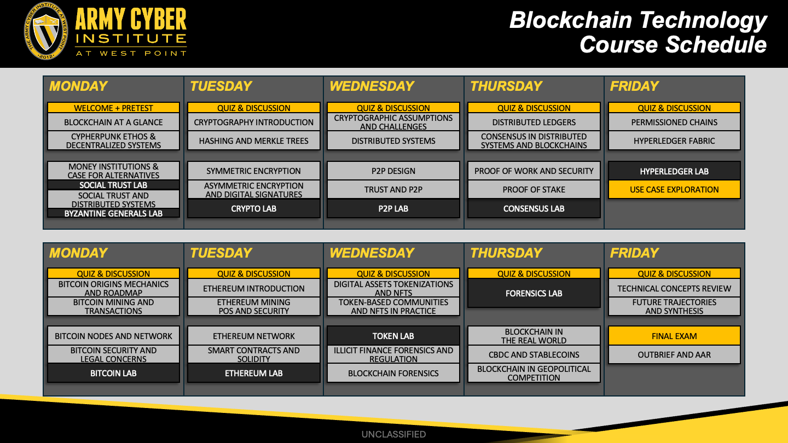

## Introductions

- **Instructor introductions**
- **Student introductions**
  - Name
  - Hometown
  - Self-rate (1-10): How well do you know blockchain?
  - What do you want out of this course?

::: {.notes}

**Overall Slide Concept**
This opening slide establishes classroom tone, instructor credibility, and the baseline knowledge in the room before any technical content begins. It matters here because the course needs an early read on student familiarity and expectations so pacing can be calibrated from the start. Emphasize that introductions are also an operational diagnostic for how much blockchain background the class already brings.

**Key Points**
- Introduce the instructors and briefly explain why they are teaching blockchain in this setting.
- Use student introductions to gauge prior exposure and what students want from the course.
- Spell out ACI as the Army Cyber Institute if that acronym comes up in discussion.

**Walkthrough**
None

**Sources**
None

:::

## Why Blockchain?
::::: {.columns}
::: {.column width="60%"}

- Public understanding is still uneven: people often conflate **blockchain**, **Bitcoin**, and **crypto markets**
- Skepticism remains high because the technology is complex and its use cases are often unclear
- The underlying idea is older than Bitcoin: blockchain-style timestamping work goes back to the early **1990s**
- Today the ecosystem is too large to dismiss as niche
  - **~38.07 million** cryptocurrencies - [CoinMarketCap](https://coinmarketcap.com/charts/number-of-cryptocurrencies-tracked/)
  - **18,000+ decentralized apps** across **90+ blockchains** - [DappRadar](https://docs.dappradar.com/rankings)
  - **130 countries** exploring digital currencies - [Atlantic Council](https://www.atlanticcouncil.org/economy-business/digital-currencies/)

:::
::: {.column width="40%"}
{fig-alt="Pew chart showing confidence in cryptocurrency safety and reliability" width="60%"}

Pew Research Center, October 24, 2024

:::
:::::

::: {.notes}

**Overall Slide Concept**
This slide establishes why the course exists by framing blockchain as both widely visible and widely misunderstood. It matters here because students need to see the gap between public exposure, skepticism, and actual system understanding before they start learning the technical foundations. Emphasize that the course is designed to close that understanding gap, not to sell hype or dismiss the topic.

**Key Points**
- Public discussion often conflates blockchain, Bitcoin, and cryptocurrency markets even though they are not the same thing.
- Blockchain is older than Bitcoin; briefly define timestamping as recording data in a way that proves when it existed.
- Spell out dapps as decentralized applications and explain that large ecosystem counts indicate scope, not equal importance.

**Walkthrough**
None

**Sources**
- @l00_iacis_public_perceptions_2022
- @l00_pew_crypto_confidence_2024
- @haber_howtimestampdigital_1991
- @l31_coinmarketcap_cryptocurrency_count_2026
- @l00_dappradar_rankings_2026
- @atlanticcouncil_centralbankdigital_2025

:::

## Learning Objectives

- **Foundations**
  - Explain why blockchain emerged as an alternative to centralized trust
  - Describe key primitives: hashing, signatures, Merkle trees, peer-to-peer networking, and consensus
- **Platforms and mechanics**
  - Compare Bitcoin, Ethereum, and Hyperledger
  - Work with wallets, transactions, smart contracts, and tokens
  - Evaluate consensus tradeoffs in performance, security, and decentralization

::: {.notes}

**Overall Slide Concept**
This slide establishes the first half of the course objectives by showing that students will move from motivations and primitives into platform-level mechanics. It matters here because students need a clear technical roadmap before the course widens into policy, risk, and applications. Emphasize that the early part of the course is about understanding how the system works before evaluating what it means.

**Key Points**
- The lesson sequence begins with why blockchain emerged and the primitives that make it function.
- Spell out Merkle trees as hash-based data structures that summarize larger sets of data efficiently.
- Highlight that Bitcoin, Ethereum, and Hyperledger are compared as design choices, not just brand names.

**Walkthrough**
None

**Sources**
None

:::

## Learning Objectives

- **Risks, policy, and practice**
  - Analyze blockchain vulnerabilities and network or consensus threats
  - Assess real-world applications for feasibility, scalability, and social impact
  - Explain implications for finance, identity, governance, defense, and policy
  - Explain blockchain clearly to technical and non-technical audiences

::: {.notes}

**Overall Slide Concept**
This second objectives slide establishes the analytical and practical outcomes that sit on top of the technical foundations. It matters here because students should understand from the outset that the course is not only about mechanisms, but also about risks, institutions, and communication. Emphasize that success means being able to evaluate and explain blockchain, not just recognize vocabulary.

**Key Points**
- The course expects students to assess vulnerabilities, applications, and policy implications in addition to technical designs.
- Social impact refers to how blockchain affects real institutions, incentives, and users outside the protocol itself.
- The final objective is communication: students should be able to explain blockchain clearly to technical and non-technical audiences.

**Walkthrough**
None

**Sources**
None

:::

## Course Overview {.smaller}

- This course moves from **first principles** to **real-world systems**
- It combines **technical foundations**, **major blockchain platforms**, and **applied case studies**
- You will examine blockchain as:
  - a technical architecture
  - a financial and institutional phenomenon
  - a policy, security, and strategic issue
- The goal is to understand blockchain broadly and technically well enough to see opportunities and gaps in your own applications around this technology.

::: {.notes}

**Overall Slide Concept**
This slide establishes the course as an interdisciplinary journey from first principles to real-world systems and implications. It matters here because students need to understand that the course will connect technical architecture to finance, governance, security, and strategy rather than staying in a narrow engineering lane. Emphasize the breadth of the course while reassuring students that the structure is designed to make that breadth manageable.

**Key Points**
- Blockchain is treated here as a technical architecture, an institutional phenomenon, and a policy or security issue.
- First principles means starting from core concepts before moving to major systems and applications.
- The goal is broad technical literacy that lets students identify both opportunities and limits in blockchain systems.

**Walkthrough**
None

**Sources**
None

:::

## Course Structure

- **Introduction**
- **Cryptographic primitives**
- **Distributed fundamentals**
- **Consensus mechanisms**
- **Permissioned chains**
- **Bitcoin framework**
- **Ethereum framework**
- **Forensics**
- **Applications and synthesis**

- **Course link:** `[Placeholder]`

::: {.notes}

**Overall Slide Concept**
This slide establishes the section-by-section roadmap for the full course. It matters here because students need a mental map of how each topic builds into the next and where Bitcoin, Ethereum, forensics, and synthesis fit in the larger arc. Emphasize progression: foundations first, then systems, then analysis and application.

**Key Points**
- The early sections build the technical stack before the course moves into major blockchain frameworks.
- Permissioned chains, Bitcoin, and Ethereum are included because each represents a different institutional and technical model.
- The course ends by reconnecting the technical details to real-world applications, forensics, and synthesis.

**Walkthrough**
None

**Sources**
None

:::

## Course Schedule

{fig-alt="Army Cyber Institute blockchain course schedule" width="97%"}

::: {.notes}

**Overall Slide Concept**
This slide establishes the pacing of the course over time by showing the schedule at a glance. It matters here because students should see where foundational material, systems content, and later application-focused work sit in the overall timeline. Emphasize orientation rather than details; the schedule is a map, not something to memorize on the first day.

**Key Points**
- Use the schedule to show the arc of the course rather than narrating every calendar detail.
- Point out where the course transitions from foundations into major systems and then into applied topics.
- If students ask about exact dates or sequencing, connect them back to the section map from the prior slide.

**Walkthrough**
None

**Sources**
None

:::

## Daily Schedule
| Time | Rhythm |
|---|---|
| **0905-1130** | Quiz, discussion, and morning lectures |
| **1300-1600 (T)** | Afternoon lectures, then lab or applied exercise |
| **After Class** | Complete the reading and prepare for the next-day quiz and discussion |

::: {.notes}

**Overall Slide Concept**
This slide establishes the day-to-day rhythm students should expect throughout the course. It matters here because clear expectations about lectures, labs, readings, and quizzes reduce uncertainty and help students plan their effort. Emphasize that the course is designed as a repeated cycle of instruction, application, and preparation for the next session.

**Key Points**
- Mornings are generally for instruction and discussion, while afternoons often move toward application.
- Readings are part of course continuity, not optional extras.
- Spell out that the schedule assumes students arrive prepared for both quizzes and discussion.

**Walkthrough**
None

**Sources**
None

:::

## Student Expectations

- **Prioritize sleep.** This course requires your cognitive effort!
- **Be on time with working equipment**
- **Complete assigned readings** after the class day
- **Participate** actively in discussion, labs, and quizzes
- **Ask questions.** Expect a wide range of knowledge in the room
- This is an **UNCLASSIFIED** environment, be mindful
- **Explore.** Read ahead, check sources, and investigate during class and labs
- Critiques and disagreements broaden understanding. Bring them at end of day and course

::: {.notes}

**Overall Slide Concept**
This slide establishes both the operational standards and the classroom culture for the course. It matters here because students need to know that preparation, participation, curiosity, and critique are all expected parts of the learning environment. Emphasize that thoughtful skepticism and questions are strengths in this course, not disruptions.

**Key Points**
- Set expectations around punctuality, working equipment, readings, quizzes, and participation.
- Unclassified means the classroom environment is not handling classified material; students should still be mindful about what they share.
- Invite critique and disagreement as part of learning, provided it stays constructive and evidence-based.

**Walkthrough**
None

**Sources**
None

:::

## Tools and Setup

- Labs are a core part of the course and reinforce theory through hands-on work
- Lab activities include:
  - cryptographic exercises
  - consensus simulations
  - blockchain network deployment
  - smart contract development
  - forensic analysis
- Students need:
  - a workstation capable of running virtual machines
  - reliable Internet access
  - the ability to install and configure required software
- Setup instructions, dependencies, and lab materials are provided through the course GitHub repository

- **GitHub repository:** [Placeholder link](https://github.com/placeholder)
  - Note: this repository link still needs to be updated

::: {.notes}

**Overall Slide Concept**
This slide establishes that labs are central to the course and explains the baseline technical setup students need in order to participate. It matters here because the course is not purely conceptual; students will be expected to test ideas in practical environments. Emphasize that the GitHub repository is the operational hub for setup, dependencies, and lab materials.

**Key Points**
- Labs connect theory to hands-on cryptography, consensus, smart contracts, and forensic analysis.
- Spell out GitHub as the repository hosting setup instructions, dependencies, and supporting materials.
- Students need a workstation, Internet access, and the ability to install software before labs become effective.

**Walkthrough**
None

**Sources**
None

:::

## Standards & Outcomes

- **Standards**
  - All quizzes are to be taken without use of Internet or notes
  - Evaluation, completion, and passing criteria are set by your organization
- **Outcomes**
  - You should leave with a better technical and systems understanding of blockchain technology
  - You should understand where blockchain came from, how it works today, and where it may be going
  - You should gain the knowledge and confidence to think critically and creatively about blockchain technology, applications, and impacts

::: {.notes}

**Overall Slide Concept**
This slide establishes the difference between formal course standards and the intended outcomes students should carry away from the class. It matters here because some evaluation details may depend on the sponsoring organization, but the intellectual goals of the course are already clear. Emphasize that the course aims to build durable understanding and confidence, not just short-term test performance.

**Key Points**
- Some grading or passing details may still be externally determined, so avoid overcommitting on specifics.
- The key outcome is stronger systems-level understanding of blockchain's origins, mechanics, and trajectory.
- Students should leave better able to think critically and creatively about blockchain technologies and applications.

**Walkthrough**
None

**Sources**
None

:::

## Student Questions

What questions do you have about this course?

::: {.notes}

**Overall Slide Concept**
This slide establishes a pause for practical clarification before the lesson shifts into broader opening discussion. It matters here because students often have administrative or structural questions that should be resolved before the course moves forward. Emphasize that course logistics questions are welcome and should be surfaced early.

**Key Points**
- Invite questions about structure, pacing, labs, readings, and expectations.
- Use this moment to clear up uncertainty before the broader conceptual discussion begins.
- Keep answers concise so the lesson can transition smoothly into the opening reflection slide.

**Walkthrough**
None

**Sources**
None

:::

## Questions: As We Begin

- What do you think blockchain is actually **for**?
- What problems do you think it solves well, and what problems does it not solve well?
- What makes you skeptical, curious, or uncertain about this space?

::: {.notes}

**Overall Slide Concept**
This slide establishes the starting assumptions, skepticism, and curiosity students bring into the course. It matters here because the instructor can use the answers to gauge the room and connect later lessons back to the questions students initially raised. Emphasize that there is no need for consensus yet; the goal is to surface perspectives, not settle them.

**Key Points**
- Invite students to articulate what they think blockchain is for and where they think it succeeds or fails.
- Skepticism is useful data for the course and can shape examples and pacing going forward.
- Use responses here to connect future lessons back to student assumptions and uncertainties.

**Walkthrough**
None

**Sources**
None

:::

## Pre-Test

- Pre-Test Registration Link:
[Link and/or QR code]

::: {.notes}

**Overall Slide Concept**
This slide establishes the pre-test as a baseline measurement rather than a judgment on prior knowledge. It matters here because students who are new to blockchain may otherwise interpret the assessment as punitive or high stakes. Emphasize honest answers and reassure students that the value comes from measuring growth over the course.

**Key Points**
- Frame the pre-test as diagnostic, not a measure of whether students already belong in the course.
- Encourage honest responses rather than guessing strategically or trying to impress.
- Make clear that the comparison between starting point and ending point is what makes the pre-test useful.

**Walkthrough**
None

**Sources**
None

:::

## References
