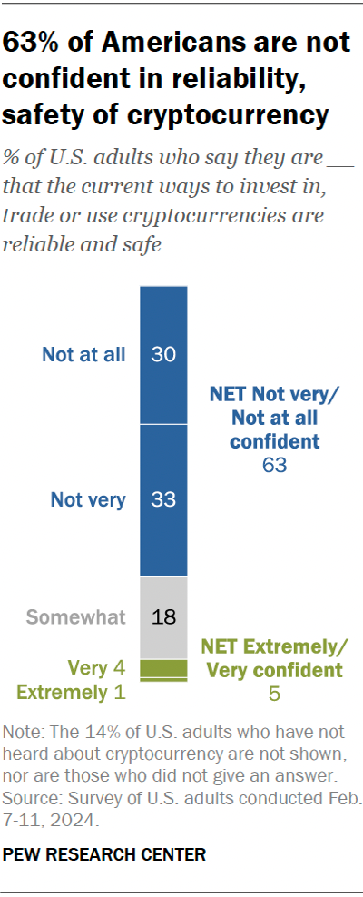

## Start by saying what cases you work {.smaller}

- **Meet your instructors**
- **Introduce yourself in under a minute**
  - Name, and the agency or team you work in
  - A case or task where cryptocurrency came up, kept unclassified: a ransomware cash-out, sanctions evasion, a scam, a state theft
  - Self-rate (1-10): how well can you read a blockchain transaction today?
  - What do you need to be able to do when this course ends?

**This welcome has four parts:** what you will do by day 10; the three confidence words every answer uses; how the days, labs and certificate work; and a short review.

**Bottom line:** the course is built around cases like yours. It teaches you to say what the activity on a blockchain is, and how sure you are.

::: {.notes}

**Overall Slide Concept**
This opening slide gives the instructor a read on the room before any technical content, and ties the course to the work students already do. It matters here because the class mixes analysts who have traced funds before with analysts who have never opened an explorer, and the labs offer each of them a different way in. Emphasize that the self-rating is a diagnostic, not a judgment, and that the bottom line is the reason the course exists.

**Key Points**
- Start with the instructors: who they are and why they teach this course.
- Then go round the room. Each student names a case or task where cryptocurrency came up, kept unclassified and free of names, because the rest of the welcome connects back to those cases.
- With 20-30 students, keep each introduction under a minute, or take half the room now and half at the start of the day-1 lab, so the welcome stays inside its 30 minutes.
- Close the introductions on the bottom line: every case named is a question about what some activity on a blockchain is, and the course teaches how to answer it and say how sure you are.
- Name the four parts on the slide, so students know where the next half hour goes.

**Walkthrough**
1. Introduce the instructors.
2. Go round the room, one minute each, on the four prompts.
3. Note each self-rating and the cases named; they tell you who may want the problem-first route in the labs.
4. Read the four parts and the bottom line.
5. Time plan, 30 minutes (the welcome takes the 0845 quiz and discussion slot on day 1): introductions 6, what you will do 4, confidence words 8, how the course runs 8, review and next 4. If time runs short, skim the slide-reading conventions and the room standards, and take the remaining introductions at the start of the lab; never skip the two checks.

**Sources**
None

:::

## By day 10 you say what activity is, and how sure {.smaller}

::: {style="font-size: .75em;"}

An agent hands you an address (an account number on a blockchain), a transaction (one recorded payment) or a case file. **By the end of day 10**, you can say what the activity most likely **is**, say **how sure** you are and why, and **explain** it plainly, bottom line first, as you would to an agent or a prosecutor.

::::: {.columns}
::: {.column width="50%"}
**The skills (week 1 builds them, week 2 uses them)**

1. **Read the ledger:** what moved, between which addresses, when, and what it cannot show
2. **Trace Bitcoin and group its addresses by owner** (clustering), naming each rule you used and where it fails
3. **Say where a trace stops:** at mixers (services that pool many users' coins and pay them back out), CoinJoin (one payment many users share) and privacy coins (coins built to hide who paid whom)
4. **Follow value across swaps and bridges** on Ethereum: trading one token for another; moving value to another blockchain
5. **Explain an attack** from the contract it used (a program on the chain): reading code, not writing it
6. **Trace stablecoins on Tron:** dollar tokens on a chain much used for them
:::
::: {.column width="50%"}
**The job (what the skills are for)**

7. **Characterize the activity:** the known pattern of crime it most resembles, the evidence for and against, and one other explanation
8. **Attribute with stated confidence:** tie every label to its source; keep what the chain shows apart from what is assumed
9. **Explain findings plainly:** bottom line first, how sure, and what the evidence cannot show

**Where the course stops:** at the assessment, so no memos or formal briefings. Legal process and learning to program are out of scope.

Adapted from the Army Cyber Institute's open-source blockchain course.

:::
:::::

:::

::: {.notes}

**Overall Slide Concept**
This slide is the course's objective: by day 10 students say what on-chain activity is, how sure they are, and explain it plainly. It matters here because students arrive expecting a technology survey, and this course is built around the analyst's job instead. Emphasize that the nine outcomes split into skills (1-6) and the job (7-9), and every lab answer and post-test item traces back to one of them.

**Key Points**
- Start from the agent's request on the top line: an address, a transaction or a case file. The lessons from the next one on teach what each of those is; today the plain glosses are enough.
- The three things in bold are the course's point: what it is, how sure, and a plain explanation. Every lesson and lab builds toward them.
- Outcomes 1 to 6 are the skills. Several name topics taught later, glossed here in a few words so students know what they will meet: a mixer pools many users' coins and pays them out again, so the link between what went in and what came out is hard to see (day 7) [@departmentofjustice_operatorscryptocurrencymixers_2025]; a CoinJoin is one transaction in which many users combine coins, so an output cannot easily be matched to its owner's input (day 7) [@gmaxwell_coinjoinbitcoinprivacy_2013]; a bridge moves value from one blockchain to another (day 4) [@l31_ethereumorg_blockchainbridges_2026]; a privacy coin such as Monero or Zcash is built to hide who paid whom, for example by paying each receipt to a fresh one-time address (day 7) [@monero_stealthaddress_2025; @electriccoincompany_zcashbasicszcash_2019]. None of them is taught today.
- Outcome 2's "clustering" is the course's word for grouping addresses by owner; the rules used to do it are heuristics, taught on day 6.
- Outcome 5 means reading one attack's short contract and its transactions and saying what the code let the attacker do, then recognizing the other attack types from their transactions and the case write-ups.
- Outcomes 7 to 9 are the job. Characterizing means naming what a set of transactions is, with the indicators for and against; the "known pattern of crime" is what the field calls a typology, taught on day 9. Attribution ties every label (a court record, an issuer notice, an explorer tag) to its source and says how far to trust it.
- Students explain their findings informally to an instructor, in the plain words they would use with an agent or a prosecutor: the agent wants leads and how sure you are; the prosecutor wants how the method works and where it can be wrong. Nothing is marked on format.
- Where the course stops: legal process belongs to a follow-on course, and data engineering (Python, SQL) is out of scope. Students mostly read code and ready-made queries; in an instructor-led lab, such as minting an NFT on day 3, they may write a few lines to see an idea work.
- The credit line acknowledges the Army Cyber Institute course this one is adapted from.

**Walkthrough**
1. Read the top paragraph: the agent's request, and the three things students will do by day 10.
2. Read outcomes 1-6 as the skills, then 7-9 as the job.
3. Ask: which of these have you done already, even once? There is no right answer; note who names tracing or attribution, as with the self-ratings.
4. Read "Where the course stops".

**Sources**
- @departmentofjustice_operatorscryptocurrencymixers_2025
- @gmaxwell_coinjoinbitcoinprivacy_2013
- @l31_ethereumorg_blockchainbridges_2026
- @monero_stealthaddress_2025
- @electriccoincompany_zcashbasicszcash_2019

:::

## Week 1 explains the chain; week 2 traces it {.smaller}

::: {style="font-size: .8em;"}

| Day | Theme | Lab |
|:--|:----------------------|:----------------------------|
| 1 | Basics first | Explorer; sign and send |
| 2 | Bitcoin and wallets | Wallet walkthrough |
| 3 | Ethereum and tokens | Token read; mint an NFT (a token for one unique item) |
| 4 | DEXs (exchanges run by code), Layer 2s, bridges | A swap and a bridge |
| 5 | Exchanges and the rules | A Tron USDT (dollar token) transfer read |
| 6 | Tracing Bitcoin | Bitcoin trace **(graded)** |
| 7 | Where the trace goes dark | CoinJoin trace **(graded)** |
| 8 | Ethereum attacks, the loot | Cross-chain trace **(graded)** |
| 9 | The threat picture | Tron stablecoin trace **(graded)** |
| 10 | Post-test, final trace | An unguided trace |

**Every day:** 0845 quiz (ungraded; today this welcome replaces it), 0915 three lessons, 1210 lunch, 1325 lab, 1600 end. **Day 10 is different:** a review session and the post-test in the morning, one final trace in the afternoon.

**This part in one line:** week 1 explains how the chain works, week 2 traces it, and four of the traces are graded.

:::

::: {.notes}

**Overall Slide Concept**
The last slide said what students will do by day 10; this one shows the two weeks that get them there. It matters here because students plan for it: week 1 builds how the ledger, keys, wallets, tokens, trading and exchanges work, with no tracing, and week 2 is analysis, with every lab a tracing exercise on a different scenario. Emphasize that week 1 is not a warm-up to skip: week 2's traces use all of it.

**Key Points**
- Week 1 labs explore or build on the course's own chain: an explorer and a node, wallets, a minted NFT (a token that stands for one unique item) [@ethereumorg_nfts_2025], a swap and a bridge. No lab in week 1 asks students to trace.
- Day 4's DEXs are exchanges run by code rather than a company, and Layer 2s are networks that settle on Ethereum; both are taught that day. Day 5 opens with the week-one check, then covers exchanges and the rules, and its lab reads a Tron USDT transfer, an exchange deposit and its sweep, and an issuer freeze, with no tracing.
- Each week-2 day's lessons prepare that afternoon's trace: Bitcoin on day 6, CoinJoin and mixers on day 7, cross-chain on day 8, Tron stablecoins on day 9. Those four are the graded lab points; the certificate slide comes back to them.
- The daily times, for the instructor and the joining instructions: 0845 quiz (about five questions on yesterday, ungraded practice); 0900 discussion of last night's reading; 0915 three lessons of about 50 minutes with a 10-minute break between each; 1210 lunch (75 minutes); 1325 lab (2 hours 35 minutes); 1600 day ends. Tonight's reading takes at most 45 minutes, and covers the lighter side of the subject: origins, landmark events and new developments.
- Day 1 has no quiz or discussion, because this welcome takes those 30 minutes. Day 5's week-one check takes the quiz's place; it does not count, and it shows who needs help before week two.
- Day 10 has no lessons: a 50-minute review session answers open questions and teaches nothing new, then the post-test (about 2 hours), then one unguided trace mixing week 2's types, explained informally to an instructor.
- A lesson that overruns takes its time from the lab, so the morning starts on time.

**Walkthrough**
1. Read the week-1 rows: each day builds how something works, with no tracing.
2. Read the week-2 rows: each lab is a trace, and four of them are graded.
3. Read the daily rhythm and day 10's difference.

**Sources**
- @ethereumorg_nfts_2025

:::

## Every judgment carries High, Moderate or Low {.smaller}

::: {style="font-size: .85em;"}

**Bottom line:** some answers are facts the chain records: a hash, a time, an amount. State them plainly. Others are judgments about what the facts mean: give each one a confidence word.

| Word | Use it when |
| --- | --- |
| **High** | Two or more independent lines of evidence agree, and no known failure of the reasoning applies. |
| **Moderate** | One strong line of evidence, or weaker lines that agree, but a known false positive could apply. |
| **Low** | Timing, amount or behavior alone, or one unverified label such as an explorer tag. |

: {tbl-colwidths="[18,82]"}

- **Words you meet today:** a hash is a short fingerprint of data; a block is a batch of transactions the chain records together; a false positive is a case where a rule points to the wrong answer.
- **Independent** means a different kind of evidence, not a second look at the same transaction.
- Never a percentage. Intelligence Community Directive 203 (ICD 203), the US intelligence community's standard for analysis, asks analysts to state a confidence; the course defines the words [@odni_icd203_2015]. Every lab page repeats this table, and day 6 applies it to each hop of a trace and to attribution.

:::

::: {.notes}

**Overall Slide Concept**
The two weeks just shown all end in judgments, and this slide teaches the one method every judgment uses: the confidence scale. It matters here because students use these three words in every lab answer and explanation from today's first lab, and every lab page prints the same words and definitions. Emphasize two things: a fact read straight off the chain takes no word, and saying honestly how sure you are is a skill the course practises from day 1, not a hedge.

**Key Points**
- Start with the split in the bottom line. Facts the chain records (a hash, a time, an amount, an address, a signature count) are stated plainly, with no confidence word. The glosses on the slide (hash, block, false positive) are enough for today: day 1's first two lessons, Blockchain at a Glance and Keys, secp256k1 and Addresses, teach blocks and hashes properly, and day 6 teaches the false positives of tracing rules.
- Judgments about what the facts mean (who controls an address, what a payment was for) always take High, Moderate or Low.
- High needs two independent lines of evidence and no known failure. Independent means a different kind of evidence, so a second rule run over the same transactions is not independent. A week-2 example of High: addresses spent together in one ordinary payment, plus a court record naming the same owner.
- A label taken from a source (an explorer tag, a court record, an issuer notice) is reported with that source and the date it was read; the judgment built on the label still takes a word. An explorer is a website that shows what a chain records, and many add labels of their own.
- ICD 203 is the directive that sets analytic standards across the US intelligence community. It asks analysts to express confidence but defines no scale, so the course defines its own; that is the only use the course makes of it.
- How the words are used is practised, not graded, in week 1: week-1 labs give feedback, and the only graded lab work is the four week-2 points the certificate slide names. The next slide works one judgment through.

**Walkthrough**
1. Read the bottom line: facts plainly, judgments with a word.
2. Read the table row by row; point out that Low is where a single explorer tag lands.
3. Read the two bullets: what independent means, and where ICD 203 comes in.

**Sources**
- @odni_icd203_2015

:::

## Worked: an explorer tag is a judgment {.smaller}

::: {style="font-size: .85em;"}

**The case:** a transaction sent 10 ETH (Ethereum's coin) to an address. A public explorer, a website that shows what the chain records, tags that address "Exchange X". The agent asks: "So the money went to Exchange X?"

1. **What is fact?** The transaction moved 10 ETH to that address in a given block. The chain records it, so it takes no word.
2. **What is judgment?** That the address belongs to Exchange X. The chain records no owners; the explorer's company wrote the tag.
3. **What evidence is there?** One unverified label, so the table says **Low**.
4. **Say it:** "The 10 ETH went to an address that one explorer tags as Exchange X (read 13 Nov 2026). On that tag alone, I have **Low** confidence the address is the exchange's."
5. **What would raise it?** A different kind of evidence, such as a court record or the exchange itself naming the address.

:::

::: {.notes}

**Overall Slide Concept**
The last slide gave the three words; this slide uses them once, step by step, on the most common label an analyst meets: an explorer tag. It matters here because every week-1 lab answer asks for a word on a judgment like this one, and students should see one done before they try it. Emphasize the order of the steps: separate fact from judgment, weigh the evidence against the table, say it with its source and date, and name what would change it.

**Key Points**
- The case is made up but ordinary: an explorer labels an address with an exchange's name, and an agent reads the label as fact.
- Step 1 is the fact: the amount, the address and the block are what the chain records, so they are stated plainly.
- Step 2 is the judgment. The chain records no owners, so "this address belongs to Exchange X" is a judgment about the facts, and the label is someone else's judgment.
- Step 3 weighs it: one unverified label is exactly the Low row of the table.
- Step 4 says it, with the tag's source and the date it was read, because a label is reported with both. This is the sentence students write in a lab.
- Step 5 names what would raise it: a different kind of evidence, which is what independent means. A court record naming the address is a different kind; a second explorer's tag is not, and that is the next slide's question.

**Walkthrough**
1. Read the case and leave the agent's question open.
2. Take the five steps in order, asking the class each step's question before reading the answer.
3. Read the sentence in step 4 aloud as the model answer.

**Sources**
- @odni_icd203_2015

:::

## Check: two tags agree. Is that High? {.smaller}

::: {style="font-size: .85em;"}

Back to the 10 ETH. A second explorer also tags the address "Exchange X". The agent says: "Two sources agree, so that's High."

**Write one line:** High, Moderate or Low, and why?

::: {.fragment}
**Answer:** not High. Two tags are the same kind of evidence, and both may rest on one source, so the second may add nothing. On two tags the judgment stays **Low**, or **Moderate** if you know each tag rests on separate work. Only a different kind of evidence, such as a court record, reaches **High**.

**This part in one line:** state facts plainly; give every judgment a word; only a different kind of evidence takes it to High.
:::

:::

::: {.notes}

**Overall Slide Concept**
This slide closes the confidence-words part with a check every student answers, on the worked case. It matters here because "two sources agree" is the reasoning that most often inflates a judgment, and the course's definition of independent is built to stop it. Emphasize that the answer turns on the kind of evidence, not the count.

**Key Points**
- Expected answer: not High. Two explorer tags are one kind of evidence, so they are not independent.
- Two tags agreeing may be one source seen twice, since the reader rarely knows where either tag came from. A student who says Low is right; Moderate fits the table's "weaker lines that agree" only if the student knows each tag rests on separate work, and should say so.
- The part's synthesis, on the slide: facts plainly, judgments with a word, and only a different kind of evidence reaches High.
- The review at the end of the welcome asks this question again.

**Walkthrough**
1. Read the case and the agent's claim.
2. Give every student thirty seconds to write a word and a reason.
3. Take a show of hands for High, Moderate and Low, then reveal the answer and its reason.
4. Read the part's one-line synthesis.

**Sources**
- @odni_icd203_2015

:::

## How to read these slides {.smaller}

::::: {.columns}
::: {.column width="50%"}
**What you will see**

- **A date in parentheses**, such as "(10 Nov 2026)", beside a fact means "as of" that date. Laws, figures and licenses change
- **A circled number** marks a lesson within a day. D7 ① is day 7's first lesson; ② and ③ are the next two
- **Sources** are on each lesson's last slide, **References**

**What you can press**

- **→ or Space** next slide, **←** back
- **Esc or O** shows every slide; **M** opens the menu to jump to one; **F** goes full screen
:::
::: {.column width="50%"}
**The glossary**

- Click the **book icon**, bottom left, or press **G**, then type a term
- Select a word on the slide first, and **G** looks it up; **Esc** closes the panel

**The rest of the course site**

- From **Course Portal** (top left), the top bar links the **Primer**, **Glossary**, **Mind map** and **Run labs**
- [Explorer links](../../explorers.qmd){target="_blank"}: the sites you will use to look up addresses and transactions
:::
:::::

::: {.notes}

**Overall Slide Concept**
The confidence words are how students answer; this slide opens the part on how the course runs, starting with the conventions every slide relies on: dated facts, circled lesson numbers, where the sources are, the keys, the glossary and the other pages of the course site. It matters here because students meet all of them from the first lesson, and a student who does not know that "(10 Nov 2026)" means "as of" may read a dated fact as timeless. Emphasize that the glossary is one click or one key away on every slide.

**Key Points**
- A date in parentheses beside a fact means "as of" that date: the fact was true then. Laws, figures, upgrades and licenses change, so each carries the date it was checked.
- The circled number is the lesson's place in its day: D7 ① is day 7's first lesson. Lessons also write it "day 7 ①".
- Each lesson's last slide, References, lists its sources. In the speaker notes each slide also shows which claim rests on which source.
- Keys: the arrow keys and Space move through the slides, Esc or O shows all of them, M opens the menu that jumps to any slide, F is full screen. B opens a chalkboard for drawing.
- The glossary opens from the book icon beside the menu and chalkboard icons, or with G. A word selected on the slide is looked up at once; otherwise type a term. G took the place of reveal.js's own jump-to-a-slide key; the menu still jumps to any slide. Each definition links to the slide that teaches the term.
- Course Portal, top left, returns to the course home page, which links the Primer (optional, before day 1), the Glossary, the Mind map and Run labs; the explorer links page lists the public sites the labs and the job use.

**Walkthrough**
1. Read the left column: dates, circled numbers, sources, keys.
2. Ask students to press **G** now with a word selected (try "explorer" on the worked slide), then **Esc**.
3. Read the right column: where the glossary, the Primer, the Mind map, Run labs and the explorer links live.

**Sources**
None

:::

## Every lab ends in an answer to an instructor {.smaller}

::: {style="font-size: .85em;"}

- **A short answer or an informal explanation:** that is the lab product, never a report
- **One lab, two ways in:** a worked example first, or straight to the problem if your instructor sees from your pretest that you know that day's basics; optional challenge steps at the end
- **Today's lab opens with The Insider,** a short group game about spotting the one player who can't be trusted, and a 10-minute tour of the terminal, the window where you type commands
- **Browser only:** every lab runs over HTTPS from the course server; you install nothing
- **Captured data:** snapshots and the course's own chain, so every student sees the same evidence
- **Open-source tools:** Otterscan, an explorer for Ethereum; java-tron, the software that runs Tron; Hyperledger Fabric, a ledger run by a closed group of known members
- **You mostly read code:** where a lab needs a query, it hands you a ready-made one and checks your reading of its output; in an instructor-led lab, such as minting an NFT, you may write a few lines to see an idea work
- **Week 2 labs are traces:** each uses a different scenario, and early finishers can hunt optional flags (a hidden address or amount), ungraded

:::

::: {.notes}

**Overall Slide Concept**
The last slide covered how to read the lessons; this one covers the labs, which take every afternoon and are where students practise. It matters here because students should know what a lab asks of them before this afternoon's. Emphasize that everyone gives the same kind of answer, whichever way in they take, and that only four lab points, all in week 2, are graded.

**Key Points**
- Lab answers are short answers or informal explanations to an instructor that confirm the student did the task accurately, with a confidence word on each judgment.
- The instructor reads the pretest items for each day's concepts and offers the problem to a student who got them right; everyone else, and any student without a pretest, starts from the worked example, and anyone may choose the worked example.
- Today's lab opens with two short openers. The Insider is a group game in which one hidden player tries to learn a secret word while the others use clues and votes to find them: a first taste of trusting people you cannot check, the problem a blockchain is built around. The terminal tour shows the command window the Bitcoin lab uses.
- Week 1 labs explore or build (an explorer and a node, wallets, a token, a swap, a bridge); week 2 labs are tracing exercises on a different scenario each day.
- Labs run on a locked-down laptop with only a web browser, over port 443; where an agency network blocks it, the fallback is a classroom server with course-supplied devices.
- Captured data means the evidence does not change under the class; public chains are a live extra only.
- The three tools are open source: Otterscan is the explorer students use on day 1 [@otterscan_otterscan_2025], java-tron runs the Tron snapshot on day 5 [@tronprotocol_javatron_2026], and Hyperledger Fabric is the permissioned ledger the instructor demonstrates on day 5 [@androulaki_hyperledgerfabricdistributed_2018]. Commercial analytics platforms are taught as a category, not used.
- Writing code is never rote programming: it happens only in an instructor-led build, like the NFT lab, and only when it teaches an idea. The flags in week 2 are for early finishers and count for nothing.

**Walkthrough**
1. Read the first bullet: the lab product is an answer, never a report.
2. Explain the two ways in, and that the pretest decides which one the instructor offers.
3. Read today's openers, then the practical bullets: browser only, captured data, open-source tools, mostly reading code.
4. Read the last bullet: week 2's traces, and the ungraded flags.

**Sources**
- @otterscan_otterscan_2025
- @tronprotocol_javatron_2026
- @androulaki_hyperledgerfabricdistributed_2018

:::

## A certificate needs three things {.smaller}

1. **Attend all ten days**
2. **Pass the post-test** on day 10: about 2 hours, one item for each of the 43 concepts [8 Nov 2026]{.asof}, 70% overall to pass
3. **Reach Meets on four lab points**, one per week-2 trace: day 6's Bitcoin trace, day 7's limits-of-tracing note, day 8's cross-chain trace and day 9's exposure summary

- Each point is marked **Meets** or **Not yet** against a one-line rubric
- One retry per point after the instructor says what was missing, in lab time or day 10's review session, never as evening work
- Everything else in the labs is feedback, week 1 included, and so is the final trace on day 10
- Certificate holders get an NFT minted on the course's own chain at the end of day 10

::: {.notes}

**Overall Slide Concept**
The labs slide said only four points are graded; this slide names them and the rest of what a certificate needs. It matters here because students should know from the first hour which work counts and which is practice. Emphasize that the post-test and the four lab points are separate: neither can be traded for the other.

**Key Points**
- Three requirements, all needed: attendance, the post-test and the four week-2 lab points.
- Each rubric is one line saying what Meets looks like, so students know it before they start.
- Everything else is practice with feedback: every week-1 lab, the daily quizzes, the day-5 week-one check and the day-10 final trace count for nothing toward the certificate.
- The end of day 10's review session is the last chance to resubmit a point.
- The post-test shares one blueprint with the pretest (one item per in-scope concept): multiple choice where the concept is familiarity, a short written answer where it is a working skill. The list of concepts can change with feedback and testing.
- On day 10 each student explains their final trace informally to an instructor, about 5 minutes, as soon as they finish. With a class over 15, a second instructor listens too.
- The NFT echoes day 3's mint.

**Walkthrough**
1. Read the three requirements.
2. Read the Meets / Not yet rule and the one retry.
3. Point to "everything else is feedback": week 1's labs are practice.

**Sources**
None

:::

## Check: can the post-test make up a lab point? {.smaller}

::: {style="font-size: .85em;"}

A student scores 95% on the post-test, but day 7's limits-of-tracing note is still at **Not yet** after its retry.

**Write one line:** does the student get a certificate?

::: {.fragment}
**Answer:** no. The post-test and the four lab points are separate requirements, and both are needed; a high score on one cannot make up for the other. The retry was the student's second chance at the point.

**This part in one line:** labs end in short answers, only the four week-2 points are graded, and a certificate needs attendance, the post-test and all four points.
:::

:::

::: {.notes}

**Overall Slide Concept**
This slide closes the part on how the course runs with a check every student answers. It matters here because the most common wrong belief about a course like this is that a strong final test covers everything. Emphasize that the certificate's three requirements stand apart.

**Key Points**
- Expected answer: no. The post-test and the four lab points are separate, and both are needed.
- The retry is the safeguard: one per point, after the instructor says what was missing.
- The part's synthesis, on the slide: short answers in every lab, four graded points in week 2, and three requirements for a certificate.

**Walkthrough**
1. Read the case.
2. Give every student a few seconds to answer yes or no.
3. Take a show of hands, then reveal the answer and its reason.
4. Read the part's one-line synthesis.

**Sources**
None

:::

## Keep it UNCLASSIFIED, and take the pretest {.smaller}

- **Be on time:** the day starts at 0845 with the quiz
- **Do the reading** each night: at most 45 minutes
- **Ask questions:** expect a wide range of experience in the room
- This is an **UNCLASSIFIED** classroom: no classified material, and no names or details from your own open cases
- **Challenge claims with evidence**, including the instructor's and the slides'
- **Course data only in class:** follow your agency's rules before using any public tool on the job
- **Missed the pretest?** The link is in your joining instructions. It counts for nothing: your instructor uses it to choose how you start each lab. Take it tonight, and your way in is set from day 2

::: {.notes}

**Overall Slide Concept**
This slide sets the working standards for the room and catches the students who arrived without the pretest. It matters here because analysts bring real casework, so the classroom must stay unclassified and free of live-case detail, and because the pretest sets each student's way into the labs. Emphasize that challenge is welcome: the course asks for every claim to be sourced.

**Key Points**
- Unclassified means the classroom handles no classified material; students should still be careful about what they share from open cases.
- Labs use captured data; on the job, agency rules decide which tools and live services an analyst may use (day 1's third lesson, Ledger and Finality, explains what live data costs).
- Critiques of the course are welcome at the end of each day and at the end of the course.
- The pretest was due three working days before day 1, so the instructor could mark it before class. A student who takes it tonight starts today's lab from the worked example; their way into the labs is set from day 2.
- The pretest shares the post-test's blueprint, one item per concept, so honest answers make the measured gain real.

**Walkthrough**
1. Read each standard.
2. Stress the UNCLASSIFIED line: no classified material and no details from open cases.
3. Invite challenge: any claim on a slide should carry its source.
4. Ask who has not taken the pretest, and point them to the link; ask the instructor if it can't be found.

**Sources**
None

:::

## Review: what you'll do, and how it's judged {.smaller}

::: {style="font-size: .85em;"}

Answer each question from memory before the answer appears.

**1. By day 10, what three things will you do with on-chain activity?**

::: {.fragment}
Say what it most likely is, say how sure you are and why, and explain it plainly, bottom line first.
:::

**2. "This transaction moved 10 ETH in block N." Does that sentence need a confidence word?**

::: {.fragment}
No. It is a fact the chain records. "This address belongs to Exchange X" is a judgment, and needs one [@odni_icd203_2015].
:::

**3. Two explorers tag the same address. Is that High?**

::: {.fragment}
No. Two tags are one kind of evidence: they stay Low, or Moderate if you know each rests on separate work. Only a different kind, such as a court record, reaches High.
:::

**4. Which lab work is graded?**

::: {.fragment}
Only the four week-2 points, one per trace. Every week-1 lab is practice with feedback.
:::

:::

::: {.notes}

**Overall Slide Concept**
This slide reviews the welcome against what it promised: four questions, answered from memory before each answer appears. It matters here because recalling an answer fixes it better than hearing a summary, and the confidence words are used in every lab from this afternoon. Emphasize question 3: it is the confidence check asked a second time.

**Key Points**
- Question 1 returns to the course's objective: what it is, how sure, a plain explanation.
- Question 2 is the split between fact and judgment that opened the confidence part.
- Question 3 repeats the check on two tags; a class that still says High needs the worked slide once more.
- Question 4 comes from the certificate slide.
- No new facts appear here; every answer was given on an earlier slide.

**Walkthrough**
1. For each question, give students a few seconds to answer aloud or on paper, then reveal the answer.
2. Ask the class: can you now say what the course will ask of you, and how a judgment is worded?

**Sources**
- @odni_icd203_2015

:::

## Next: what do you expect the chain to tell you? {.smaller}

- What do you think a blockchain record can show an investigator, and what can it not?
- Where has cryptocurrency come up in your work, or in a case you followed?
- What makes you skeptical, curious or uncertain about this kind of evidence?
- **And:** what questions do you have about the course?

**Next lesson, Blockchain at a Glance:** one real Bitcoin payment, read field by field. Hold on to your answer to the first question: the day's third lesson, Ledger and Finality, comes back to it.

::: {.notes}

**Overall Slide Concept**
This slide closes the welcome with a question asked before it is taught, on purpose: what students expect the chain to show. It matters here because the first lesson opens one real Bitcoin transaction, and students' guesses about what the record shows (names, balances, intent) are the starting point the day's lessons correct. Emphasize that no answer is wrong yet, and that the answers are kept for later.

**Key Points**
- This is a deliberate pre-question: it asks about the day's point before any lesson teaches it. The day's lessons answer it, and the close of Ledger and Finality, the third lesson, returns to it: the record shows that payments happened and when, not who made them or why.
- Note the claims students make about what the chain shows (identities, balances, intent) where the class can see them, so the day's lessons can return to them; day 7, where the trace goes dark, comes back to them again.
- Take course logistics questions here, briefly.
- Keep the discussion short so the first lesson, Blockchain at a Glance, starts at 0915.

**Walkthrough**
1. Take each question in turn; collect answers without correcting them.
2. Write the claims about what the chain shows where the class can see them.
3. Take logistics questions briefly.
4. Read the next-lesson line, then start the first lesson on time.

**Sources**
None

:::

<!-- Hidden 24 Oct 2026 when the welcome was rebuilt for Blockchain Intelligence Analysis (Build Tracker D1 Welcome): kept for reuse, not shown. -->

:::: {.content-hidden}

## Introductions

- **Meet Your Instructors**
- **Student Introductions**
  - Name
  - Favorite City & Why
  - Self-rate (1-10): How well do you know blockchain?
  - What do you want out of this course?

::: {.notes}

**Overall Slide Concept**
This opening slide establishes classroom tone, instructor credibility, and the baseline knowledge in the room before any technical content begins. It matters here because the course needs an early read on student familiarity and expectations so pacing can be calibrated from the start. Emphasize that introductions are also an operational diagnostic for how much blockchain background the class already brings.

**Key Points**
- Introduce the instructors and briefly explain why they are teaching blockchain in this setting.
- Use student introductions to gauge prior exposure and what students want from the course.
- Depending on class size, may do subsets of student intros for several lessons.

**Walkthrough**
None

**Sources**
None

:::

::::

:::: {.content-hidden}

## Why A Blockchain Course?
::::: {.columns}
::: {.column width="60%"}

- Public understanding is still uneven: people often conflate **blockchain**, **Bitcoin**, and **crypto markets**
- Skepticism remains high because the technology is complex and its use cases are often unclear
- The underlying idea is older than Bitcoin: blockchain-style timestamping work goes back to the early **1990s**
- Today the ecosystem is too large to dismiss as niche
  - **~38.07 million** cryptocurrencies - [CoinMarketCap](https://coinmarketcap.com/charts/number-of-cryptocurrencies-tracked/)
  - **18,000+ decentralized apps** across **90+ blockchains** - [DappRadar](https://docs.dappradar.com/rankings)
  - **130 countries** exploring digital currencies - [Atlantic Council](https://www.atlanticcouncil.org/economy-business/digital-currencies/)

:::
::: {.column width="40%"}
{fig-alt="Pew chart showing confidence in cryptocurrency safety and reliability" width="60%"}

Pew Research Center, October 24, 2024

:::
:::::

::: {.notes}

**Overall Slide Concept**
This slide establishes why the course exists by framing blockchain as both widely visible and widely misunderstood. It matters here because students need to see the gap between public exposure, skepticism, and actual system understanding before they start learning the technical foundations. Emphasize that the course is designed to close that understanding gap, not to sell hype or dismiss the topic.

**Key Points**
- Public discussion often conflates blockchain, Bitcoin, and cryptocurrency markets even though they are not the same thing.
- Blockchain is older than Bitcoin; briefly define timestamping as recording data in a way that proves when it existed.
- Spell out dapps as decentralized applications and explain that large ecosystem counts indicate scope, not equal importance.

**Walkthrough**
None

**Sources**
- @l00_iacis_public_perceptions_2022
- @l00_pew_crypto_confidence_2024
- @haber_howtimestampdigital_1991
- @l31_coinmarketcap_cryptocurrency_count_2026
- @l00_dappradar_rankings_2026
- @atlanticcouncil_centralbankdigital_2025

:::

::::

:::: {.content-hidden}

## Learning Objectives I

- **Foundations**
  - Explain why blockchain emerged as an alternative to centralized trust
  - Describe key primitives: hashing, signatures, Merkle trees, peer-to-peer networking, and consensus
- **Platforms and mechanics**
  - Compare Bitcoin, Ethereum, and Hyperledger
  - Work with wallets, transactions, smart contracts, and tokens
  - Evaluate consensus tradeoffs in performance, security, and decentralization

::: {.notes}

**Overall Slide Concept**
This slide establishes the first half of the course objectives by showing that students will move from motivations and primitives into platform-level mechanics. It matters here because students need a clear technical roadmap before the course widens into policy, risk, and applications. Emphasize that the early part of the course is about understanding how the system works before evaluating what it means.

**Key Points**
- The lesson sequence begins with why blockchain emerged and the primitives that make it function.
- Spell out Merkle trees as hash-based data structures that summarize larger sets of data efficiently.
- Highlight that Bitcoin, Ethereum, and Hyperledger are compared as design choices, not just brand names.

**Walkthrough**
None

**Sources**
None

:::

::::

:::: {.content-hidden}

## Learning Objectives II

- **Risks, policy, and practice**
  - Analyze blockchain vulnerabilities and network or consensus threats
  - Assess real-world applications for feasibility, scalability, and social impact
  - Explain implications for finance, identity, governance, defense, and policy
  - Explain blockchain clearly to technical and non-technical audiences

::: {.notes}

**Overall Slide Concept**
This second objectives slide establishes the analytical and practical outcomes that sit on top of the technical foundations. It matters here because students should understand from the outset that the course is not only about mechanisms, but also about risks, institutions, and communication. Emphasize that success means being able to evaluate and explain blockchain, not just recognize vocabulary.

**Key Points**
- The course expects students to assess vulnerabilities, applications, and policy implications in addition to technical designs.
- Social impact refers to how blockchain affects real institutions, incentives, and users outside the protocol itself.
- The final objective is communication: students should be able to explain blockchain clearly to technical and non-technical audiences.

**Walkthrough**
None

**Sources**
None

:::

::::

:::: {.content-hidden}

## Course Overview {.smaller}

- This course moves from **first principles** to **real-world systems**
- It combines **technical foundations**, **major blockchain platforms**, and **applied case studies**
- You will examine blockchain as:
  - a technical architecture
  - a financial and institutional phenomenon
  - a policy, security, and strategic issue
- The goal is to understand blockchain broadly and technically well enough to see opportunities and gaps in your own applications around this technology.

::: {.notes}

**Overall Slide Concept**
This slide establishes the course as an interdisciplinary journey from first principles to real-world systems and implications. It matters here because students need to understand that the course will connect technical architecture to finance, governance, security, and strategy rather than staying in a narrow engineering lane. Emphasize the breadth of the course while reassuring students that the structure is designed to make that breadth manageable.

**Key Points**
- Blockchain is treated here as a technical architecture, an institutional phenomenon, and a policy or security issue.
- First principles means starting from core concepts before moving to major systems and applications.
- The goal is broad technical literacy that lets students identify both opportunities and limits in blockchain systems.

**Walkthrough**
None

**Sources**
None

:::

::::

:::: {.content-hidden}

## Course Structure

- **Introduction**
- **Cryptographic primitives**
- **Distributed fundamentals**
- **Consensus mechanisms**
- **Permissioned chains**
- **Bitcoin framework**
- **Ethereum framework**
- **Forensics**
- **Applications and synthesis**

- **Course link:** [https://blockchain.training-as-code.com/](https://blockchain.training-as-code.com/)

::: {.notes}

**Overall Slide Concept**
This slide establishes the section-by-section roadmap for the full course. It matters here because students need a mental map of how each topic builds into the next and where Bitcoin, Ethereum, forensics, and synthesis fit in the larger arc. Emphasize progression: foundations first, then systems, then analysis and application.

**Key Points**
- The early sections build the technical stack before the course moves into major blockchain frameworks.
- Permissioned chains, Bitcoin, and Ethereum are included because each represents a different institutional and technical model.
- The course ends by reconnecting the technical details to real-world applications, forensics, and synthesis.

**Walkthrough**
None

**Sources**
None

:::

::::

:::: {.content-hidden}

## Daily Schedule
| Time | Rhythm |
|---|---|
| **0905-1130** | Quiz, discussion, and morning lectures |
| **1300-1600 (T)** | Afternoon lectures, then lab or applied exercise |
| **After Class** | Complete the reading and prepare for the next-day quiz and discussion |

::: {.notes}

**Overall Slide Concept**
This slide establishes the day-to-day rhythm students should expect throughout the course. It matters here because clear expectations about lectures, labs, readings, and quizzes reduce uncertainty and help students plan their effort. Emphasize that the course is designed as a repeated cycle of instruction, application, and preparation for the next session.

**Key Points**
- Mornings are generally for instruction and discussion, while afternoons often move toward application.
- Readings are part of course continuity, not optional extras.
- Spell out that the schedule assumes students arrive prepared for both quizzes and discussion.

**Walkthrough**
None

**Sources**
None

:::

::::

:::: {.content-hidden}

## Student Expectations

- **Prioritize sleep.** This course requires your cognitive effort!
- **Be on time with working equipment**
- **Complete assigned readings** after the class day
- **Participate** actively in discussion, labs, and quizzes
- **Ask questions.** Expect a wide range of knowledge in the room
- This is an **UNCLASSIFIED** environment, be mindful
- **Explore.** Read ahead, check sources, and investigate during class and labs
- Critiques and disagreements broaden understanding. Bring them at end of day and course

::: {.notes}

**Overall Slide Concept**
This slide establishes both the operational standards and the classroom culture for the course. It matters here because students need to know that preparation, participation, curiosity, and critique are all expected parts of the learning environment. Emphasize that thoughtful skepticism and questions are strengths in this course, not disruptions.

**Key Points**
- Set expectations around punctuality, working equipment, readings, quizzes, and participation.
- Unclassified means the classroom environment is not handling classified material; students should still be mindful about what they share.
- Invite critique and disagreement as part of learning, provided it stays constructive and evidence-based.

**Walkthrough**
None

**Sources**
None

:::

::::

:::: {.content-hidden}

## Tools and Setup

- Labs are a core part of the course and reinforce theory through hands-on work
- Lab activities include:
  - cryptographic exercises
  - consensus simulations
  - blockchain network deployment
  - smart contract development
  - forensic analysis
- Students need:
  - reliable Internet access
  - _a workstation capable of running virtual machines\*_
  - _the ability to install and configure required software\*_

_\*as fallback for cloud-hosted environment_

::: {.notes}

**Overall Slide Concept**
This slide establishes that labs are central to the course and explains the baseline technical setup students need in order to participate. It matters here because the course is not purely conceptual; students will be expected to test ideas in practical environments. Emphasize that the GitHub repository is the operational hub for setup, dependencies, and lab materials.

**Key Points**
- Labs connect theory to hands-on cryptography, consensus, smart contracts, and forensic analysis.
- Spell out GitHub as the repository hosting setup instructions, dependencies, and supporting materials.
- Students need a workstation, Internet access, and the ability to install software before labs become effective.

**Walkthrough**
None

**Sources**
None

:::

::::

:::: {.content-hidden}

## Standards & Outcomes

- **Standards**
  - You have been assigned a unique quiz handle for this course
  - All quizzes are to be taken without use of Internet or notes
  - Complete the quiz on time
  - Results are used to gauge effectiveness and guide discussion
- **Outcomes**
  - You should leave with a better technical and systems understanding of blockchain technology
  - You should understand where blockchain came from, how it works today, and where it may be going
  - You should gain the knowledge and confidence to think critically and creatively about blockchain technology, applications, and impacts

::: {.notes}

**Overall Slide Concept**
This slide establishes the difference between formal course standards and the intended outcomes students should carry away from the class. It matters here because some evaluation details may depend on the sponsoring organization, but the intellectual goals of the course are already clear. Emphasize that the course aims to build durable understanding and confidence, not just short-term test performance.

**Key Points**
- Some grading or passing details may still be externally determined, so avoid overcommitting on specifics.
- The key outcome is stronger systems-level understanding of blockchain's origins, mechanics, and trajectory.
- Students should leave better able to think critically and creatively about blockchain technologies and applications.

**Walkthrough**
None

**Sources**
None

:::

::::

:::: {.content-hidden}

## Student Questions

What questions do you have about this course?

::: {.notes}

**Overall Slide Concept**
This slide establishes a pause for practical clarification before the lesson shifts into broader opening discussion. It matters here because students often have administrative or structural questions that should be resolved before the course moves forward. Emphasize that course logistics questions are welcome and should be surfaced early.

**Key Points**
- Invite questions about structure, pacing, labs, readings, and expectations.
- Use this moment to clear up uncertainty before the broader conceptual discussion begins.
- Keep answers concise so the lesson can transition smoothly into the opening reflection slide.

**Walkthrough**
None

**Sources**
None

:::

::::

:::: {.content-hidden}

## Questions: As We Begin

- What do you think blockchain is actually **for**?
- What problems do you think it solves well, and what problems does it not solve well?
- What makes you skeptical, curious, or uncertain about this space?

::: {.notes}

**Overall Slide Concept**
This slide establishes the starting assumptions, skepticism, and curiosity students bring into the course. It matters here because the instructor can use the answers to gauge the room and connect later lessons back to the questions students initially raised. Emphasize that there is no need for consensus yet; the goal is to surface perspectives, not settle them.

**Key Points**
- Invite students to articulate what they think blockchain is for and where they think it succeeds or fails.
- Skepticism is useful data for the course and can shape examples and pacing going forward.
- Use responses here to connect future lessons back to student assumptions and uncertainties.

**Walkthrough**
None

**Sources**
None

:::

::::

:::: {.content-hidden}

## Pre-Test



[https://blockchain.training-as-code.com/quiz/](https://blockchain.training-as-code.com/quiz/)

::: {.notes}

**Overall Slide Concept**
This slide establishes the pre-test as a baseline measurement rather than a judgment on prior knowledge. It matters here because students who are new to blockchain may otherwise interpret the assessment as punitive or high stakes. Emphasize honest answers and reassure students that the value comes from measuring growth over the course.

**Key Points**
- Frame the pre-test as diagnostic, not a measure of whether students already belong in the course.
- Encourage honest responses rather than guessing strategically or trying to impress.
- Make clear that the comparison between starting point and ending point is what makes the pre-test useful.

**Walkthrough**
None

**Sources**
None

:::

::::

## References
