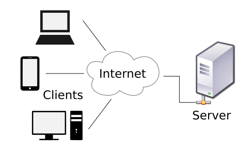
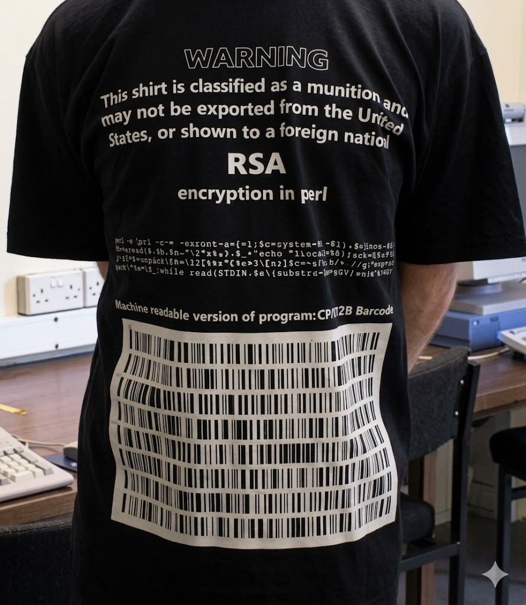
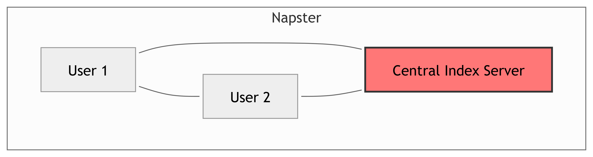

## Framing

- **Lesson Goal:** Understand the *'why'* behind blockchain.

- We'll explore the history, ideas, and frustrations that led to the creation of Bitcoin.

- This isn't just about technology; it's about trust, privacy, and control in a digital world.


```{mermaid}
%%{init: {"theme":"neutral", "fontFamily": "Segoe UI, Roboto, Helvetica, Arial, sans-serif"}}%%
timeline
  title Key Milestones (1983–2008)
  1983 : Blind Signatures (Chaum)
  1991 : PGP Crypto (Zimmermann)
  1993 : "A Cypherpunk's Manifesto"
  1997 : Hashcash (Adam Back)
  1999 : Napster (P2P)
  2001 : BitTorrent (P2P)
  2008 : 2008 Financial Crisis
  2008 : Bitcoin Whitepaper
```

::: {.notes}

**Overall Slide Concept**
This opening slide establishes the lesson as the answer to why blockchain was built, not just how it works. It matters here because students need the historical and ideological frame before later technical lessons on primitives, consensus, and system design. Emphasize that Bitcoin emerged from decades of arguments about trust, privacy, and institutional control.

**Key Points**
- The lesson connects cryptographic research, peer-to-peer networking, and social distrust of centralized institutions.
- The timeline shows Bitcoin as a synthesis of earlier ideas rather than an isolated invention.
- Milestone means a historically important step that shaped later blockchain design.

**Walkthrough**
None

**Sources**
- @chaum_blindsignaturesuntraceable_1983
- @zimmerman_whywrotepgp_1991
- @hughes_cypherpunksmanifesto_1993
- @back_hashcashdenialservice_2002
- @nakamoto_bitcoinpeertopeerelectronic_2008

:::


## Today's Agenda

- **Digital Trust:** What did it mean before blockchain?
- **The Cypherpunk Ethos:** A movement for privacy through cryptography.
- **The Crypto Wars:** The fight to make strong encryption public.
- **Early Failures:** Lessons from the first attempts at digital money.
- **Peer-to-Peer (P2P):** How systems like Napster changed the game.
- **The Spark:** How these ideas converged to create Bitcoin.

::: {.notes}

**Overall Slide Concept**
This slide establishes the roadmap for the lesson's historical argument. It matters here because students should know that each topic on the agenda contributes a different ingredient to the eventual design of Bitcoin. Emphasize the progression from trust problems to ideology, technical battles, failed experiments, decentralized networking, and final synthesis.

**Key Points**
- The lesson moves in sequence from problem definition to historical ingredients to Bitcoin's synthesis.
- The exercise is meant to surface the requirements for safe exchange without an intermediary.
- Intermediary means a trusted middle party, such as a bank or platform, that helps verify and enforce a transaction.

**Walkthrough**
None

**Sources**
None

:::

## Exercise 

- Mini-poll: *Would you email your SSN unencrypted?* Why not?

- *If two strangers transact online with no bank, what must be true to make it safe?*

::: {.notes}

**Overall Slide Concept**
This exercise slide establishes the core trust problem students must hold onto for the rest of the lesson: what must be true for strangers to transact safely online without a central authority. It matters here because the historical material makes more sense once students have articulated the coordination, identity, and cheating problems for themselves. Emphasize that the exercise is not about getting the perfect answer, but about surfacing the constraints Bitcoin later tries to solve.

**Key Points**
- The mini-poll uses familiar privacy instincts to make digital trust concrete before moving to money systems.
- Students should identify needs like identity, verification, non-repudiation, and protection against double-spending.
- SSN stands for Social Security number; consensus mechanisms are rule systems that help many parties agree on one shared result.

**Walkthrough**
None

**Sources**
- @hughes_cypherpunksmanifesto_1993
- @patel_bernsteinusdept_1996
- @nakamoto_bitcoinpeertopeerelectronic_2008

:::

## Digital Trust: The Centralized Model {.smaller}

::: {.column width="65%"}
**How It Works:**

 - **Intermediaries:** Banks, credit card companies, and governments act as trusted third parties.
 - **Verification:** They verify identities, keep records, and enforce rules.
 - **Reversibility:** They can reverse fraudulent transactions.

**The Trade-Offs:**

 - **Cost:** Intermediaries charge fees.
 - **Censorship:** They can block payments or freeze accounts.
 - **Security:** They are single points of failure and massive targets for hackers.
:::

::: {.column width="35%"}

:::

::: {.notes}

**Overall Slide Concept**
This slide establishes the pre-blockchain default model of online trust: institutions act as referees that verify identity, keep records, and reverse errors. It matters here because blockchain was built in reaction to this model's trade-offs, not because digital coordination was impossible before it. Emphasize that centralized trust is powerful and useful, but it concentrates cost, control, and risk.

**Key Points**
- Banks, payment processors, and governments provide trust by operating and enforcing the system.
- KYC and AML are key parts of this model; KYC means Know Your Customer and AML means Anti-Money Laundering.
- Single point of failure means one concentrated institution or server becomes a high-value target and chokepoint.

**Walkthrough**
None

**Sources**
- @unitedstatescongress_banksecrecyact_1970

:::

## A Crisis of Trust: 2008

::: {.r-stack}
{.fragment .fade-in width="900"}

<div class="fragment fade-in-then-out" style="background-color: rgba(0, 0, 0, 0.7); color: white; padding: 20px;">
On October 31, 2008, in the depths of the financial crisis, the Bitcoin whitepaper was published.
</div>

<div class="fragment" style="background-color: rgba(0, 0, 0, 0.7); color: white; padding: 20px;">
It proposed a financial system that didn't require trust in banks.
</div>
:::

### {data-header="A Crisis of Trust: 2008 (cont.)"}

- **Systemic trust shock:** failure cascades, opaque leverage, and liquidity freezes undermined confidence.
- **Policy response:** extraordinary interventions and subsequent regulations.
- **Context for Bitcoin (Oct 2008 whitepaper):** a design that minimizes dependence on trusted third parties.

::: {.notes}

**Overall Slide Concept**
This slide establishes the 2008 financial crisis as a crisis of confidence in centralized financial institutions, not as proof that blockchain would have solved the crisis. It matters here because Bitcoin's whitepaper appeared during a moment when trust in banks and financial governance was unusually weak. Emphasize the timing and context without overstating direct causality.

**Key Points**
- The crisis exposed systemic fragility, opaque risk, and cascading failures in the traditional financial system.
- Bitcoin's whitepaper appeared in that environment, making trust-minimized alternatives newly resonant.
- Systemic means affecting the broader system, not just one firm or one bad actor.

**Walkthrough**
None

**Sources**
- @financialcrisisinquirycommission_financialcrisisinquiry_2011
- @nakamoto_bitcoinpeertopeerelectronic_2008

:::

## The Cypherpunk Movement

> "Privacy is necessary for an open society in the electronic age... We cannot expect governments, corporations, or other large, faceless organizations to grant us privacy... We must defend our own privacy if we expect to have any. We must come together and create the systems which allow anonymous transactions to take place."
>
> — Eric Hughes, *A Cypherpunk's Manifesto* (1993) 


### {data-header="The Cypherpunk Movement"}


::: columns 

::: {.column width="60%"}

- Activists, computer scientists, and cryptographers in the early 1990s.
- Believed strong cryptography was a tool for social and political change.
- **Core idea:** Don't ask for privacy. Build it. Use code to create a world where privacy is the default.
:::

::: {.column width="40%"}

:::

:::

::: {.notes}

**Overall Slide Concept**
This slide establishes the cypherpunks as the ideological foundation beneath Bitcoin's technical design. It matters here because students need to see that blockchain grew out of a privacy movement that saw code as a tool for redistributing power away from centralized institutions. Emphasize that the cypherpunks were not merely theorizing; they were trying to build systems that made privacy and autonomy technically possible.

**Key Points**
- The cypherpunks argued that privacy was necessary for an open digital society.
- Their slogan, in effect, was to build privacy through code rather than wait for institutions to grant it.
- Manifesto means a public statement of principles; WIRED is the magazine that popularized the movement for broader audiences.

**Walkthrough**
None

**Sources**
- @hughes_cypherpunksmanifesto_1993
- @levy_cryptorebels_1993

:::

## Privacy as a Prerequisite for Open Society


- **Selective disclosure:** anonymity/pseudonymity for transactions when identity isn’t necessary.
- **Cryptography Export Controls:** code publication tied to First Amendment debates. (See: PGP, next slides)
- **Goal:** empower individuals to reveal identity *only when desired*.


::: {.notes}

**Overall Slide Concept**
This slide establishes the normative claim that privacy is not a luxury but a prerequisite for individual freedom in open digital systems. It matters here because later blockchain debates about anonymity, pseudonymity, and surveillance all rest on this earlier cypherpunk logic. Emphasize that the argument is about selective disclosure: people should reveal identity when necessary, not by default in every transaction.

**Key Points**
- The slide frames privacy as control over disclosure rather than secrecy for wrongdoing.
- Pseudonymity means acting through a persistent identifier that is not your legal name; export controls restricted the spread of strong cryptographic tools.
- The cypherpunk claim is that strong cryptography can make privacy a default design property rather than a policy promise.

**Walkthrough**
None

**Sources**
- @hughes_cypherpunksmanifesto_1993

:::

## The Crypto Wars: U.S. Gov Position (1990s)


::: columns

::: {.column width="55%"}

- Strong cryptography was classified as a **munition**.
- Exporting it was illegal, like selling a missile.
- The goal was to ensure intelligence agencies could break any code.

:::

::: {.column width="45%"}


:::

:::

---

### The Crypto Wars: Cypherpunk Response {.smaller .non-scrollable}

::: columns

::: {.column width="55%"}
- **PGP (Pretty Good Privacy):** Phil Zimmermann released his strong encryption software for free in 1991, leading to a multi-year federal investigation.
- **Code as Speech:** To bypass export laws, the PGP source code was printed in a book. It was legal to export a book, which contained protected First Amendment speech.
:::

::: {.column width="45%"}


*PGP's source code, printed as a book to legally export it.* 
:::

:::

::: {.notes}

**Overall Slide Concept**
This slide establishes the Crypto Wars as the political conflict over whether strong cryptography would remain mostly under government control or become broadly available to the public. It matters here because public access to strong encryption was a prerequisite for later open cryptographic systems such as Bitcoin. Emphasize that this was not just a technical fight but a legal and constitutional struggle over whether code could circulate freely.

**Key Points**
- In the 1990s, the U.S. government treated strong cryptographic software as a munition and restricted export.
- PGP, or Pretty Good Privacy, became a flashpoint because Phil Zimmermann released strong public encryption software anyway.
- Code as speech refers to the legal argument that source code is protected expressive activity under the First Amendment.

**Walkthrough**
None

**Sources**
- @patel_bernsteinusdept_1996
- @zimmerman_whywrotepgp_1991
- @levy_cryptohowcode_2002

:::


## Early Attempts at Digital Money {.smaller}


**DigiCash (1989-1998)**

   - Created by famed cryptographer David Chaum.
   - Used **blind signatures** to provide truly anonymous, untraceable payments.
   - **The Flaw:** It was a centralized company. It needed to partner with a bank to issue money. When the company went bankrupt, the system died.

**e-gold (1996-2009)**

   - A centralized service that allowed users to transfer ownership of grams of gold.
   - Became a hub for illicit activity due to its lax identity verification.
   - **The Flaw:** As a central entity, it was shut down by law enforcement for operating as an unlicensed money transmitter.


**Lesson:** strong privacy tech ≠ decentralized control; bank trust still required.


::: {.notes}

**Overall Slide Concept**
This slide establishes that pre-Bitcoin digital cash experiments failed not because the idea of digital money was impossible, but because centralization kept reintroducing chokepoints. It matters here because students should see that strong privacy technology alone was not enough if a central operator, bank partner, or headquarters could still be pressured or shut down. Emphasize that DigiCash and e-gold taught the field what a durable decentralized money system could not rely on.

**Key Points**
- DigiCash used blind signatures for strong privacy but still depended on a central company and banking relationships.
- e-gold showed that a central operator becomes a legal and operational target even when the system is popular.
- Blind signatures are a cryptographic technique that allows signing without learning the content being signed; unlicensed money transmitter refers to operating money services without required authorization.

**Walkthrough**
None

**Sources**
- @chaum_blindsignaturesuntraceable_1983
- @l35_wired_emoney_1994
- @departmentofjustice_digitalcurrencybusiness_2007

:::

## P2P Normalizes Decentralization {.smaller}

::: columns

::: {.column width="50%"}
**Napster (1999)**

- P2P file sharing, but used a **central server** to index files.
- This central server was its legal Achilles' heel, leading to its shutdown.


:::

::: {.column width="50%"}


**Gnutella & BitTorrent (2000s)**

- **Truly decentralized.** No central server to shut down.
- Nodes connect directly to each other to find and share files.
- BitTorrent introduced **incentives** to encourage sharing.


:::

:::

**The Lesson:** These systems proved that large-scale, resilient, decentralized coordination was possible without a central authority.

::: {.notes}

**Overall Slide Concept**
This slide establishes peer-to-peer file sharing as the real-world demonstration that large decentralized systems could coordinate without a central controller. It matters here because Bitcoin needed more than ideology; it needed proof that decentralized network architecture could work at scale. Emphasize the difference between hybrid systems like Napster and more resilient designs like Gnutella and BitTorrent.

**Key Points**
- Napster relied on a central index and was therefore vulnerable to shutdown.
- Gnutella and BitTorrent showed that decentralized coordination can persist without one central server.
- Incentives matter: BitTorrent rewarded sharing behavior, foreshadowing the role of incentives in later blockchain systems.

**Walkthrough**
None

**Sources**
- @kozinski_amrecordsinc_2001
- @cohen_incentivesbuildrobustness_2003

:::


## The Synthesis: Bitcoin {.smaller}

Bitcoin combined these decades of ideas into one elegant solution.

```{dot}
digraph G {
    rankdir=LR;
    bgcolor="transparent";
    node [shape=box, style=rounded, fontname="Helvetica"];
    
    subgraph cluster_Ingredients {
        label="Ingredients";
        fontname="Helvetica";
        style=dashed; // Optional: Gives a clean look similar to Mermaid subgraphs
        
        A [label="Cryptography"];
        B [label="Cypherpunk Ethos"];
        C [label="P2P Net"];
        E [label="Past Failures"];
        F [label="Proof-of-Work"];
    }

    Bitcoin [label="Bitcoin", style="rounded,filled", fillcolor="lightgrey"];

    A -> Bitcoin;
    B -> Bitcoin;
    C -> Bitcoin;
    E -> Bitcoin;
    F -> Bitcoin;
}
```

**The key breakthrough:** Using Proof-of-Work (mining) to allow a decentralized P2P network to agree on a single, shared history of transactions without a trusted leader.

::: {.notes}

**Overall Slide Concept**
This slide establishes Bitcoin as a synthesis of earlier cryptographic, ideological, and architectural ingredients rather than a single isolated invention. It matters here because students should now be able to see Bitcoin as the point where privacy politics, P2P networking, and anti-centralization lessons converge. Emphasize that the key breakthrough was not just digital money, but decentralized agreement on one transaction history without a trusted leader.

**Key Points**
- Bitcoin combines public-key cryptography, peer-to-peer networking, and Proof-of-Work to address double-spending.
- Proof-of-Work made it costly to append history and therefore more costly to rewrite it.
- Double-spending means trying to spend the same digital asset more than once; Hashcash was an earlier anti-spam system that inspired this mechanism.

**Walkthrough**
None

**Sources**
- @back_hashcashdenialservice_2002
- @nakamoto_bitcoinpeertopeerelectronic_2008

:::

## Promises vs. Reality {.smaller}

| Promise | What Actually Happened | 
|---|---|
| **Eliminate Intermediaries** | New intermediaries (exchanges, wallet providers) emerged. Most users interact with Bitcoin through a centralized company. |
| **Censorship Resistance** | The core protocol remains very censorship-resistant. It's difficult to stop a transaction from being broadcast and mined. |
| **Low-Cost Payments** | Transaction fees can become very high during periods of network congestion, making small payments impractical. |
| **Privacy** | Bitcoin is **pseudonymous**, not anonymous. All transactions are public, and advanced forensics can often link addresses to real-world identities. |
| **'Bank the Unbanked'** | Volatility, high fees, and technical complexity have been major barriers to adoption as a daily currency in developing nations. |

: {tbl-colwidths="[30,70]"}

::: {.notes}

**Overall Slide Concept**
This slide establishes that the lived reality of Bitcoin and its ecosystem is more complicated than the original promise set. It matters here because students need to separate the protocol's design goals from the institutions, frictions, and limitations that appeared in practice. Emphasize that evaluating blockchain seriously means holding both the innovation and the compromise in view at the same time.

**Key Points**
- Bitcoin reduced some dependencies on intermediaries, but new intermediaries such as exchanges and wallet providers emerged.
- Bitcoin is censorship-resistant at the protocol layer but still affected by fees, user behavior, and regulated access points.
- Pseudonymous means addresses are public but not automatically tied to legal identities; forensics can often bridge that gap.

**Walkthrough**
None

**Sources**
- @narayanan_bitcoincryptocurrencytechnologies_2016
- @meiklejohn_fistfulbitcoinscharacterizing_2013
- @voskobojnikov_userperceptionbitcoin_2019

:::

## Why This History Matters {.smaller}

Understanding the *'why'* helps you analyze the *'how'* and the *'what now'*.

- **Threat Modeling:** Decentralized systems have different weaknesses. Instead of hacking a server, an attacker might try to control the consensus mechanism (a 51% attack) or exploit the economic incentives.

- **Policy Literacy:** Today's debates about crypto regulation, privacy coins, and central bank digital currencies are echoes of the Crypto Wars. The history helps you understand the stakes.

- **Critical Evaluation:** Knowing the original goals of the technology allows you to cut through the hype and assess whether a new blockchain project is a genuine innovation or just a solution in search of a problem.

::: {.notes}

**Overall Slide Concept**
This slide establishes why the lesson's history matters for cyber professionals and analysts rather than treating it as background trivia. It matters here because blockchain's threat models, policy debates, and hype cycles only make sense when students understand the original problems the technology was trying to solve. Emphasize that this historical context improves technical judgment, policy literacy, and critical evaluation.

**Key Points**
- Decentralized systems shift attention from single-server attacks toward protocol manipulation, incentives, and governance.
- Current debates over privacy, regulation, and surveillance are continuations of earlier crypto conflicts.
- Critical evaluation means testing whether a blockchain project actually solves a trust problem better than simpler alternatives.

**Walkthrough**
None

**Sources**
- @hughes_cypherpunksmanifesto_1993
- @departmentofjustice_digitalcurrencybusiness_2008
- @cohen_incentivesbuildrobustness_2003
- @nakamoto_bitcoinpeertopeerelectronic_2008

:::

## Summary {.smaller}

- Blockchain was not created in a vacuum; it was a response to decades of debate about **trust, privacy, and centralization**.

- The **Cypherpunk** movement provided the ideological drive, advocating for privacy through strong cryptography.

- The failure of **centralized** digital currencies like DigiCash and e-gold proved that a resilient system needed to be decentralized.

- **P2P networks** like BitTorrent demonstrated that large-scale decentralized coordination was possible.

- **Bitcoin's key innovation** was combining these ideas with Proof-of-Work to solve the double-spending problem without a central authority.

::: {.notes}

**Overall Slide Concept**
This summary slide establishes the core lesson takeaway: Bitcoin emerged from a long chain of ideas about privacy, decentralization, and distrust of centralized control. It matters here because students should leave with a coherent historical model they can carry into the technical modules that follow. Emphasize the causal chain from cypherpunk ideals and centralized failures to P2P resilience and Bitcoin's eventual design.

**Key Points**
- Blockchain arose from debates over trust, privacy, and institutional power rather than from technical curiosity alone.
- The failures of DigiCash and e-gold showed that central points of control remained fatal weaknesses.
- Bitcoin's major contribution was combining existing ingredients into a decentralized solution to double-spending.

**Walkthrough**
None

**Sources**
None

:::

## References {.smaller}
