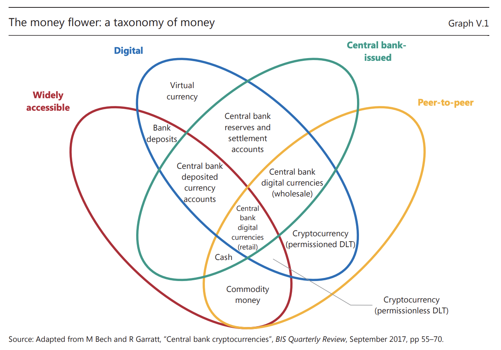

## 10-Year Savings Poll

If you had to store your life savings for 10 years, would you pick:

A) U.S. dollars in a bank account
B) Physical gold
C) Bitcoin
D) The stock market (e.g., an S&P 500 index fund)
E) Something else / a mix?

::: {.notes}

**Overall Slide Concept**
This opening poll establishes the lesson as a trust, value, and risk discussion rather than a purely technical walkthrough. It matters here because students' instinctive choices about dollars, gold, Bitcoin, or equities reveal the assumptions that the rest of the lesson will interrogate. Emphasize that there is no single correct answer, only different bundles of institutional and economic trade-offs.

**Key Points**
- The poll surfaces assumptions about inflation, volatility, institutional trust, and long-term value preservation.
- Student answers help expose what kinds of risk they fear most: state control, price swings, loss of purchasing power, or lost upside.
- This slide is diagnostic, not evaluative; the class is being asked to reveal intuitions before the framework is introduced.

**Walkthrough**
None

**Sources**
- @federalreserve_federalreserve_2025
- @bis_annualeconomicreport_2022

:::

## Agenda: Our Guiding Questions

- What is money, really? And where did our current system come from?

- How is our financial system *supposed* to work?

- What are its hidden vulnerabilities and single points of failure?

- Why was a technology like Bitcoin invented in the first place?

::: {.notes}

**Overall Slide Concept**
This slide establishes the guiding questions that organize the lesson's argument about money, institutions, and alternatives. It matters here because students need a map from basic monetary concepts to systemic weaknesses and finally to the motivation behind Bitcoin. Emphasize that the lesson is an investigation into why an alternative monetary design would even be considered.

**Key Points**
- The lesson moves from defining money to analyzing the modern system and then to evaluating why alternatives emerged.
- Vulnerabilities here include both technical fragility and institutional chokepoints.
- The final question about Bitcoin is framed as a response to historical and structural conditions, not as an isolated technology story.

**Walkthrough**
None

**Sources**
- @ammous_bitcoinstandarddecentralized_2018

:::

## What is Money? A Social Technology {.smaller}

:::: {.columns}

::: {.column}
Money is a tool that serves three functions:

1.  **Medium of Exchange**
    *   Eliminates the "coincidence of wants" problem of barter.

2.  **Unit of Account**
    *   Provides a common measure of value; a pricing yardstick.

3.  **Store of Value**
    *   Allows you to save purchasing power for the future.

::: 

::: {.column}

```{dot}
digraph G {
    // Top-down layout
    rankdir=TB; 
    bgcolor="transparent";
    
    // Global font settings to match your Mermaid init
    fontname="Segoe UI, Roboto, Helvetica, Arial, sans-serif";
    node [fontname="Segoe UI, Roboto, Helvetica, Arial, sans-serif", shape=box, style="rounded"];
    
    // Custom styled node A
    A [label="Functions of Money", style="rounded,filled", fillcolor="#003366", fontcolor="#ffffff", color="#ffffff", penwidth=2];
    
    // Standard nodes
    B [label="Medium of Exchange"];
    C [label="Unit of Account"];
    D [label="Store of Value"];

    // Subgraph must start with "cluster_" to draw the bounding box
    subgraph cluster_Solves_Problems {
        label="Solves Problems";
        style="dashed"; // Gives a nice clean boundary
        
        E [label="Barter Inefficiency"];
        F [label="Relative Pricing Chaos"];
        G [label="Saving for the Future"];
    }

    // Relationships
    A -> B;
    A -> C;
    A -> D;
    B -> E;
    C -> F;
    D -> G;
}
```

:::

::::
**Key Idea:** Money isn't inherently valuable. It's a social agreement—a technology we invented to coordinate economic activity.


::: {.notes}

**Overall Slide Concept**
This slide establishes money as a social coordination technology defined by the functions it performs rather than by its physical form. It matters here because later arguments about fiat, gold, or Bitcoin only make sense if students first understand what money is supposed to do. Emphasize that money's value is socially maintained and that different monetary systems fulfill the three functions with different strengths and weaknesses.

**Key Points**
- Money is typically evaluated as a medium of exchange, unit of account, and store of value.
- The coincidence of wants problem means barter is inefficient because each side must want exactly what the other offers.
- Social technology means a human-made coordination tool that depends on shared expectations and institutions.

**Walkthrough**
1. Start with the central box labeled functions of money.
2. Move to each of the three functions and briefly define the problem it solves.
3. Conclude with the idea that money is useful because society agrees to use it for coordination.

**Sources**
- @ammous_bitcoinstandarddecentralized_2018

:::

## A Brief History of Money's Form {.smaller .non-scrollable}

```{mermaid}
%%{init: {"theme":"neutral", "fontFamily": "Segoe UI, Roboto, Helvetica, Arial, sans-serif"}}%%
timeline
  title Evolution of Monetary Forms
  Ancient Times : Commodity Money
  : Salt, cattle, seashells
  : Value is intrinsic
  ~700 BCE : Metallic Standards
  : Gold & silver coins
  : Value is in the metal's scarcity, durability, divisibility
  ~17th-19th C. : Representative Money
  : Banknotes representing a claim on gold/silver held in a vault
  : Value is in the promise to redeem
  20th Century : Fiat Money
  : Government-issued currency not backed by a physical commodity
  : Value is based on trust in the issuing government and legal decree
```

::: {.notes}

**Overall Slide Concept**
This slide establishes the long trend toward more abstract forms of money and greater reliance on institutions. It matters here because Bitcoin is easier to understand as one more step in the history of monetary form, albeit with a different trust model. Emphasize that each historical shift changed where trust was located: in objects, in redeemable claims, or in issuing authorities.

**Key Points**
- Commodity money derives value from the thing itself, representative money from redeemability, and fiat from legal and institutional trust.
- The historical direction is toward abstraction: less physical substance and more trust in systems and promises.
- Fiat means money whose value is sustained by decree, policy, and broad acceptance rather than commodity backing.

**Walkthrough**
1. Move through the timeline from commodity forms to metallic standards, representative money, and fiat.
2. At each stage, identify where the system's trust anchor sits.
3. End by noting that modern digital money inherits the fiat stage's dependence on institutions and policy.

**Sources**
- @ammous_bitcoinstandarddecentralized_2018

:::

## The Turning Point: Ending Bretton Woods {.smaller}

On **August 15, 1971**, the global monetary system was fundamentally changed by a single announcement.

:::: {.columns}

::: {.column}

**The Old System (Bretton Woods):**

- USD was the world's reserve currency.
- USD was convertible to gold at a fixed rate: $35 per ounce.
- Other major currencies were pegged to the USD.
- This created a global gold-exchange standard.

:::

::: {.column}

**The "Nixon Shock":**

- Facing dwindling gold reserves and international pressure, President Nixon unilaterally suspended the dollar's convertibility to gold.
- This act severed the last link between the world's major currencies and a physical commodity.

:::

::::

::: {.notes}

**Overall Slide Concept**
This slide establishes the end of Bretton Woods as the decisive break that created the modern fiat monetary order. It matters here because the lesson's later concerns about inflation, central-bank power, and hard-money responses all depend on this shift away from commodity convertibility. Emphasize that 1971 changed the global rules for what money was anchored to.

**Key Points**
- Under Bretton Woods, the dollar was convertible to gold and other currencies were pegged to the dollar.
- The Nixon Shock ended that convertibility and severed the major-currency link to gold.
- Convertibility means the right to exchange paper claims for a specified amount of the underlying asset.

**Walkthrough**
None

**Sources**
- @l35_fedhistory_nixon_convertibility_2026

:::

## The Modern Financial Architect: Central Banks {.smaller}

In the post-1971 world, central banks manage the fiat money system.


:::: {.columns}

::: {.column}

**U.S. Federal Reserve Mandate:**

-   **Price Stability:** Keep inflation low and predictable.
-   **Maximum Employment:** Foster economic conditions for job growth.

:::

::: {.column}

**Core Functions:**

-   Conducting monetary policy (e.g., setting interest rates).
-   Acting as a "lender of last resort" to prevent bank panics.
-   Overseeing the payment systems that move money.

:::

::::


**The Global Coordinator:** The **Bank for International Settlements (BIS)** acts as the "central bank for central banks," fostering international cooperation.

::: {.notes}

**Overall Slide Concept**
This slide establishes central banks as the key institutional managers of the modern fiat system after the end of gold convertibility. It matters here because students need to see who now performs the stabilizing role once money is no longer anchored to a commodity. Emphasize that central banks are both economic governors and infrastructure stewards for the monetary system.

**Key Points**
- Central banks manage price stability, employment conditions, emergency liquidity, and payment-system oversight.
- The Federal Reserve, or Fed, is the U.S. central bank; the BIS is the Bank for International Settlements.
- Lender of last resort means an institution that can supply emergency liquidity to prevent bank panics or systemic collapse.

**Walkthrough**
None

**Sources**
- @ammous_bitcoinstandarddecentralized_2018
- @financialcrisisinquirycommission_financialcrisisinquiry_2011
- @bis_annualeconomicreport_2022

:::

## The "Market for Lemons": When Trust Breaks Down {.smaller}


:::: {.columns}

::: {.column}

**The Used Car Analogy:**

-   Sellers know if their car is a high-quality "peach" or a defective "lemon."
-   Buyers *cannot* tell the difference and must assume any car could be a lemon.
-   Therefore, buyers will only offer an average price.
-   This price is too low for sellers of "peaches," so they leave the market.

**The Result: Adverse Selection**

-   The market becomes flooded with "lemons."
-   Trust evaporates, and beneficial trades may not happen at all.

:::

::: {.column}


::: {style="text-align: center;"}
*What happens when one party in a transaction knows more than the other?*
:::

{fig-align="center"}

::: {style="text-align: center;"}
This is called **Information Asymmetry**.
:::

:::


::::


::: {.notes}

**Overall Slide Concept**
This slide establishes information asymmetry as a structural reason trust can break down even before an outright crisis occurs. It matters here because the lesson is moving from how institutions are supposed to work to how markets deteriorate when one party knows more than the other. Emphasize that markets fail not only from malice, but from hidden quality and distorted incentives.

**Key Points**
- Information asymmetry occurs when one side of a transaction knows more about quality or risk than the other.
- A market for lemons forms when uncertainty drives out high-quality participants and leaves worse options behind.
- Adverse selection means bad risks remain or dominate because good participants withdraw from the market.

**Walkthrough**
None

**Sources**
- @akerlof_marketlemonsquality_1970

:::

## Case Study: The 2008 Global Financial Crisis {.smaller .non-scrollable}

In 2008, the "lemons" weren't cars—they were toxic mortgages packaged into complex securities.

-   **The "Lemons":** Risky subprime mortgage loans given to borrowers who were unlikely to repay.
-   **The Packaging:** Banks bundled thousands of these mortgages together into securities (MBS) and more complex derivatives (CDOs).
-   **The Information Asymmetry:** Credit rating agencies stamped these toxic packages with top-tier AAA ratings, hiding the underlying risk. The creators knew the risk, but the buyers (pension funds, investors worldwide) did not.
-   **The Collapse:** When the housing market turned and homeowners began to default, these securities became worthless. No one knew which banks held the toxic assets. Trust evaporated, credit markets froze, and major institutions failed.


<div class="fragment fade-in-then-out" style="background-color: rgba(0, 0, 0, 0.7); color: white; padding: 5px;">
"We conclude this financial crisis was avoidable. The crisis was the result of human action and inaction... widespread failures in financial regulation and supervision proved devastating..." - *Financial Crisis Inquiry Commission Report, 2011*
</div>


::: {.notes}

**Overall Slide Concept**
This slide establishes the 2008 crisis as a large-scale failure of transparency, risk assessment, and institutional trust. It matters here because the lesson is showing how the abstract problem of lemons became a real-world collapse that shook confidence in the financial system Bitcoin emerged into. Emphasize that the crisis was not merely volatility; it was a breakdown in trust about who held what risk.

**Key Points**
- Risky mortgages were packaged into securities whose true quality was obscured or misrepresented.
- Information asymmetry and flawed ratings made bad assets appear safe to outside buyers.
- MBS means mortgage-backed securities and CDOs means collateralized debt obligations.

**Walkthrough**
None

**Sources**
- @financialcrisisinquirycommission_financialcrisisinquiry_2011

:::

## The Problem of Control: Chokepoints & Censorship {.smaller}

Centralized systems create single points of control that can be used to restrict access to money.

**Capital Controls**

Governments can legally restrict or halt the flow of money out of a country during a crisis.

**Examples:**

-   **Greece (2015):** During its debt crisis, banks were closed and citizens were limited to withdrawing only €60 per day from ATMs.
-   **Iceland (2008):** After its banking system collapsed, strict controls were placed on moving money out of the country for nearly a decade.


**Payment Censorship**

Financial intermediaries (banks, payment processors) can block transactions for policy, political, or business reasons.

This creates a permissioned system where access to the financial network is not guaranteed.


::: {.notes}

**Overall Slide Concept**
This slide establishes control as a defining feature of centralized money systems, not just an accidental byproduct. It matters here because the case for permissionless alternatives depends not only on economic critique, but also on the ability of states and intermediaries to restrict access. Emphasize that financial rails are permissioned systems with enforceable chokepoints.

**Key Points**
- Capital controls and payment censorship show how access to money can be limited in centralized systems.
- Chokepoints are central places where authorities or intermediaries can block, freeze, or redirect financial activity.
- Permissioned means access depends on approval, eligibility, or compliance with gatekeepers' rules.

**Walkthrough**
None

**Sources**
- @l35_capitalgr_capital_controls_2015
- @l35_imf_iceland_selected_issues_2015

:::

## The Problem of Value: The Specter of Inflation {.smaller}

:::: {.columns}
::: {.column}


With no anchor to gold, the value of fiat currency depends on policy.

**The "Great Inflation" (c. 1965-1982)**

Following the breakdown of Bretton Woods, the U.S. and much of the world experienced a prolonged period of high and volatile inflation.

-   Prices more than doubled over the decade of the 1970s.
-   The purchasing power of savings held in dollars was severely eroded.


:::
::: {.column}


```{mermaid}
%%{init: {"theme":"neutral", "fontFamily": "Segoe UI, Roboto, Helvetica, Arial, sans-serif"}}%%
xychart-beta
    title "U.S. Annual Inflation Rate (CPI) % Change"
    x-axis ["1970", "1971", "1972", "1973", "1974", "1975", "1976", "1977", "1978", "1979", "1980", "1981", "1982"]
    y-axis "Inflation Rate (%)" 
    bar [5.6, 3.3, 3.4, 8.7, 12.3, 6.9, 4.9, 6.7, 9.0, 13.3, 12.5, 8.9, 3.8]
```


:::

::::


::: {.notes}

**Overall Slide Concept**
This slide establishes inflation as a core value problem for fiat money once its link to commodity backing is removed. It matters here because fears about purchasing-power erosion are a major motivation for hard-money thinking and later Bitcoin advocacy. Emphasize that inflation is not just a macroeconomic statistic; it changes how people think about saving and trust.

**Key Points**
- Inflation is the rise in general prices and the corresponding decline in a currency's purchasing power.
- The Great Inflation is used here as evidence that fiat systems can lose value dramatically under policy and economic stress.
- Hard money advocates point to these episodes to argue for assets with predictable or constrained supply.

**Walkthrough**
1. Read the inflation chart from left to right as the post-Bretton Woods period unfolds.
2. Point out the major spikes to show that inflation was not a minor drift but a pronounced shock.
3. Translate the chart into everyday terms by connecting it to the shrinking buying power of savings.

**Sources**
- @l35_fedhistory_great_inflation_2026

:::

## The Ideological Divide: Austrian vs. Keynesian Economics {.smaller}


:::: {.columns}

::: {.column}

**Keynesian Economics (Mainstream View)**

-   **Core Idea:** Economies can get stuck in recessions due to a lack of spending.
-   **Role of Government:** Actively intervene to manage the economy using:
    -   *Fiscal Policy* (government spending, tax cuts)
    -   *Monetary Policy* (central bank adjusting interest rates)
-   **Ideal Money:** An **elastic**, government-managed fiat currency that can be expanded or contracted to meet economic needs.

:::

::: {.column}

**Austrian Economics (Challenger View)**

-   **Core Idea:** Recessions are caused by central banks creating artificial credit booms, leading to bad investments.
-   **Role of Government:** Laissez-faire. Do not intervene. The recession is the necessary, painful cure that liquidates the bad investments.
-   **Ideal Money:** A **hard**, predictable money (like gold) with a stable supply, free from political manipulation.

::: 

::::

::: {.notes}

**Overall Slide Concept**
This slide establishes that the argument for alternative money systems is also an ideological disagreement about how economies should be governed. It matters here because Bitcoin is easier to understand once students see it as aligned with one side of a long-running debate about intervention, credit, and hard money. Emphasize that these are frameworks for interpreting economic order, not just academic labels.

**Key Points**
- Keynesian economics generally supports active intervention and an elastic fiat money supply.
- Austrian economics generally prefers hard money and sees intervention as a source of distortion and boom-bust cycles.
- Fiscal policy means government taxing and spending choices; monetary policy means central-bank control over rates and money conditions.

**Walkthrough**
None

**Sources**
- @ammous_bitcoinstandarddecentralized_2018
- Encyclopaedia Britannica, "Keynesian economics"

:::

## The Bitcoin Standard: A Digital Return to "Hard Money" {.smaller}

Saifedean Ammous's 2018 book frames Bitcoin as the modern successor to gold, based on Austrian economic principles.

**The Core Thesis:**

1.  **Digital Scarcity (Hard Money)**
    *   Bitcoin's supply is capped by the protocol at 21 million coins. This makes it verifiably scarce and, proponents argue, resistant to the inflation that plagues fiat currencies.

2.  **Sovereign, Decentralized Settlement**
    *   It allows for final settlement of value globally without relying on trusted intermediaries like banks or governments. It replaces institutional trust with cryptographic proof.

3.  **Low Time Preference**
    *   The book argues that "sound money" (money that holds its value) encourages a culture of saving and long-term investment, leading to capital accumulation and societal progress.

::: {.notes}

**Overall Slide Concept**
This slide establishes Bitcoin as a digital attempt to restore hard-money properties in a world dominated by fiat currency and central-bank management. It matters here because the lesson is shifting from critique of the modern system to the design logic of its decentralized alternative. Emphasize that Bitcoin is presented here as a rule-bound monetary system meant to reduce discretionary control.

**Key Points**
- Bitcoin appeals to hard-money thinking by constraining supply and reducing reliance on central issuers.
- The lesson frames Bitcoin as a technical response to inflation fears, centralization, and discretionary monetary policy.
- Hard money refers to money with a difficult-to-expand supply and predictable issuance characteristics.

**Walkthrough**
None

**Sources**
- @croman_scalingdecentralizedblockchains_2016

:::

## The Engineer's Dilemma: The Blockchain Trilemma {.smaller}

:::: {.columns}

::: {.column}

Decentralized systems face a fundamental trade-off between three key properties. You can pick two.

-   **Decentralization:** How many independent participants run the network? No single point of control.
-   **Security:** How difficult is it for an attacker to compromise or reverse transactions?
-   **Scalability:** How many transactions can the network process per second?

:::

::: {.column}

```{mermaid}
%%{init: {"theme":"neutral", "fontFamily": "Segoe UI, Roboto, Helvetica, Arial, sans-serif"}}%%
graph TD
    subgraph part1[" "]
        A(Decentralization) --- B(Security)
        B --- C(Scalability)
        C --- A
    end

    subgraph part2["  "]
        D(Bitcoin / Ethereum L1) -- Prioritizes --> A
        D -- Prioritizes --> B
        E(Visa / Centralized DB) -- Prioritizes --> B
        E -- Prioritizes --> C
        F(Some 'Fast' Blockchains) -- May Sacrifice --> A
    end

    style A fill:#f9f,stroke:#333,stroke-width:2px
    style B fill:#ccf,stroke:#333,stroke-width:2px
    style C fill:#cfc,stroke:#333,stroke-width:2px
```

:::

::::

Bitcoin's design deliberately prioritizes **Decentralization** and **Security** at the expense of **Scalability**.


::: {.notes}

**Overall Slide Concept**
This slide establishes the blockchain trilemma as the engineering constraint that complicates the monetary and ideological ambitions of Bitcoin and similar systems. It matters here because students now need to see that even if decentralization is desirable, it comes with design trade-offs. Emphasize that you cannot talk about freedom, censorship resistance, or scale without also talking about what gets sacrificed.

**Key Points**
- The trilemma frames the tension among decentralization, security, and scalability.
- Bitcoin prioritizes decentralization and security more than high transaction throughput.
- Scalability means the capacity to process many transactions quickly and cheaply at large scale.

**Walkthrough**
None

**Sources**
- @l35_bis_crypto_beyond_hype_2018

:::

## The Institutional Counterpoint: The BIS Critique {.smaller}

The Bank for International Settlements (the "central bank for central banks") offered a strong critique of cryptocurrencies in 2018.

**Key Arguments from the BIS:**

-   **Scalability & Efficiency:** Distributed ledgers are inherently inefficient. The amount of data and processing required to run a global payment system would be unmanageable and could "bring the internet to a halt."

-   **Energy Consumption:** The proof-of-work consensus mechanism is an "environmental disaster," consuming as much electricity as a mid-sized country.

-   **Value Stability:** Extreme price volatility makes cryptocurrencies unreliable as a store of value and unusable as a common unit of account.

-   **Trust & Finality:** Trust in decentralized systems is "fragile" and can "evaporate at any time" due to software bugs or attacks. Transaction finality is only probabilistic, not guaranteed.

::: {.notes}

**Overall Slide Concept**
This slide establishes the mainstream institutional critique of cryptocurrencies from the perspective of central-bank-aligned policymakers. It matters here because the lesson should not present Bitcoin's case for alternatives without also presenting the strongest formal objections from incumbent institutions. Emphasize that the BIS critique focuses on practical monetary performance, energy costs, and the fragility of decentralized trust.

**Key Points**
- The BIS argues that distributed ledgers are inefficient, volatile, energy intensive, and institutionally fragile.
- This is the clearest formal counterpoint to hard-money and decentralization-first narratives.
- Finality in many blockchain systems is probabilistic, meaning confidence increases over time rather than being instantly guaranteed by one authority.

**Walkthrough**
None

**Sources**
- @l35_bis_central_bank_cryptocurrencies_2017

:::

## A Taxonomy for the Future: The "Money Flower" {.smaller}


:::: colunns

::: {.column}

To analyze new forms of money, the BIS created a helpful classification tool.

It classifies money along four key properties:

1.  **Issuer:** Central Bank or Other?
2.  **Form:** Digital or Physical?
3.  **Access:** Widely available or Restricted?
4.  **Technology:** Centralized or Peer-to-Peer?

:::

::: {.column}

{fig-align="center"}


:::

::::

This framework helps us see that Bitcoin, Cash, Bank Deposits, and potential Central Bank Digital Currencies (CBDCs) are all just different combinations of these design choices.

::: {.notes}

**Overall Slide Concept**
This slide establishes the Money Flower as a classification tool that helps students compare forms of money without collapsing them into a simple crypto-versus-fiat binary. It matters here because the course is preparing students to analyze emerging designs such as CBDCs with more nuance. Emphasize that monetary design can be decomposed into issuer, form, access, and transfer technology.

**Key Points**
- The Money Flower is a taxonomy for comparing cash, bank deposits, Bitcoin, and future digital currencies.
- CBDCs are central bank digital currencies, meaning digitally native claims issued by a central bank.
- The framework helps students compare monetary designs as combinations of choices rather than as one-dimensional categories.

**Walkthrough**
1. Introduce the four properties used to classify a form of money.
2. Place familiar examples like cash, bank deposits, and Bitcoin into the framework.
3. Use that comparison to show how new proposals such as CBDCs can be analyzed systematically.

**Sources**
None

:::

## Design Trade‑Offs: Efficiency vs. Autonomy {.smaller}

When evaluating a monetary system, what should it optimize for?

::: columns

::: {.column}

 **Efficiency**

*   High transaction speed
*   Low cost per transaction
*   High throughput (scalability)
*   Dispute resolution / reversibility

**Tends toward:**

*   Trusted intermediaries
*   Centralized record‑keeping
*   Institutional control

:::

::: {.column}

**Autonomy**

*   Censorship resistance
*   Self‑custody of assets
*   Permissionless participation
*   Transparency / auditability

**Tends toward:**

*   Distributed consensus
*   Decentralized control
*   Trust‑minimized protocols

:::

:::

::: {.callout-caution appearance="minimal"}
Systems that maximize efficiency often rely on trusted authorities.  
Systems that maximize individual user autonomy often reduce reliance on them.  
Improving one typically constrains the other.
:::


::: {.notes}

**Overall Slide Concept**
This slide establishes the final evaluative lens for the lesson: different monetary systems optimize for different values, especially efficiency and autonomy. It matters here because students now have the historical, institutional, and technical context needed to see these choices as trade-offs rather than absolute victories. Emphasize that debates about money often sound technical but are ultimately arguments about which values should dominate.

**Key Points**
- Efficient systems tend to favor speed, low cost, reversibility, and centralized coordination.
- Autonomous systems tend to favor censorship resistance, self-custody, permissionless access, and auditability.
- Self-custody means holding and controlling your own assets rather than relying on a custodian such as a bank or exchange.

**Walkthrough**
None

**Sources**
None

:::

## Summary & Key Takeaways {.smaller}

-   **Money is a social technology**, and our modern fiat system is a recent, 50-year-old experiment with known vulnerabilities (inflation, control, information asymmetry).

-   The **2008 financial crisis** was a profound **shock to institutional trust**, revealing deep-seated risks in the centralized system.

-   Decentralized alternatives like Bitcoin were created as a direct **ideological and technical response** to these perceived failures, drawing heavily from Austrian economics.

-   This response comes with its own fundamental trade-offs, captured by the **Blockchain Trilemma** (Decentralization vs. Security vs. Scalability).

-   To analyze any monetary system, you must separate its **motivations** from its **mechanisms** and evaluate it through the lenses of **efficiency, freedom, and ideology**.

::: {.notes}

**Overall Slide Concept**
This summary slide establishes the lesson's main conclusion: modern money systems are historically contingent, institutionally managed, and vulnerable in ways that motivate alternative designs. It matters here because students should leave with a coherent mental model of why Bitcoin emerged and why that response is controversial. Emphasize that the right takeaway is not that one system wins, but that every monetary system embodies trade-offs and values.

**Key Points**
- Money is a social technology, and the current fiat order is only one historically specific way of organizing it.
- Trust failures, control chokepoints, and inflation fears help explain the appeal of decentralized alternatives.
- Bitcoin's response comes with its own trade-offs, especially around scale, governance, and institutional fit.

**Walkthrough**
None

**Sources**
None

:::

## Check on Learning & Discussion {.smaller}

Let's apply what we've learned.

1.  How did the failure of **e-gold** (a centralized system) directly influence the design of **Bitcoin** (a decentralized system)?

2.  Using the **Blockchain Trilemma**, explain why a system like Visa can process 50,000 transactions per second, while Bitcoin can only process about 7.

3.  Imagine two people arguing about a new digital currency. Person A says, "It's great because it's fast and the fees are almost zero." Person B says, "It's terrible because it's run by only 10 servers and the company can freeze accounts." Using the **three-lens framework**, what is each person prioritizing?

::: {.notes}

**Overall Slide Concept**
This final discussion slide establishes whether students can now apply the lesson's frameworks rather than merely restate them. It matters here because the course wants students to reason about centralization, trade-offs, and design motives, not just memorize terms. Emphasize that the questions are asking students to connect history, engineering, and ideology in one answer.

**Key Points**
- Students should be able to explain why centralized failure pushed later designers toward decentralization.
- They should also be able to use the blockchain trilemma and the efficiency-versus-autonomy lens as analysis tools.
- This discussion is a synthesis check on the lesson, not a new content segment.

**Walkthrough**
None

**Sources**
None

:::

## References
