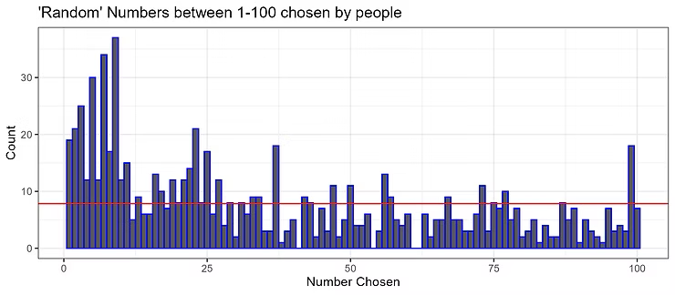

## Cryptography: From Obscurity to Mathematical Security {.smaller}

```{mermaid}
timeline
      1900 BC: Hidden methods in Egyptian and early ciphers
      100 BC: Caesar shift cipher used in Rome
      9th c.: Al-Kindi invents frequency analysis
      15th–16th c.: Polyalphabetic ciphers by Alberti and Vigenère
      1883: Kerckhoffs defines key-based security
      1940s: Enigma broken—math defeats secrecy
      1949: Shannon formalizes cryptographic theory
      1970s–2020s: Public-key and quantum-safe cryptography emerge
```

::: {.callout-note appearance="simple"}
Cryptography shift from secrecy through obscurity to **security through mathematics**
:::


::: {.notes}

**Overall Slide Concept**
This opening slide establishes the course-level shift from cryptography as hidden communication to cryptography as mathematical security. It matters here because the lesson begins by reframing student expectations before any formal definitions appear. Emphasize that the course will treat cryptography as a practical trust technology, not just code-making history.

**Key Points**
- Cryptography moved from wartime secrecy toward broader guarantees like integrity and verification.
- The lesson begins with historical intuition so later formal ideas feel motivated rather than abstract.
- Obscurity means relying on secrecy of method; mathematical security means relying on defensible assumptions and proofs.

**Walkthrough**
None

**Sources**
None

:::


## What Is Cryptography?

**Definition:**  

> The study of mathematical techniques for securing information and proving authenticity in the presence of adversaries.

- Protects **confidentiality**, **integrity**, and **authenticity**. 
- Provides **non-repudiation**.  
- Operates at the heart of secure communication, digital signatures, and blockchain protocols.  
- Enables *trust in people* to extend over untrusted channels through mathematics.


::: {.notes}

**Overall Slide Concept**
This slide establishes a working definition of cryptography as the use of mathematical techniques to secure information and interactions. It matters here because the rest of the lesson depends on students understanding that crypto protects more than secrecy alone. Emphasize the verbs involved: secure, verify, authenticate, and reason about adversaries.

**Key Points**
- Cryptography uses mathematics to protect data and communications against attackers.
- It supports confidentiality, integrity, authentication, and non-repudiation.
- Non-repudiation means a sender cannot plausibly deny an action like signing a message.

**Walkthrough**
None

**Sources**
@katz_introductionmoderncryptography_2020

:::


## Why Cryptography Matters Today

- Our world depends on digital trust: banking, identity, communication, defense.  
- Without cryptography, data could be altered, impersonated, or replayed at will.  
- Cryptography enables **trustless coordination**—people can agree without knowing each other.
- The foundation of blockchain technology is cryptography.


::: {.notes}

**Overall Slide Concept**
This slide establishes why cryptography matters beyond theory by tying it to daily digital systems students already use. It matters here because relevance has to be clear before the lesson turns more formal. Emphasize that modern digital trust depends on cryptographic mechanisms operating quietly in the background.

**Key Points**
- Cryptography underlies secure messaging, online banking, software updates, and digital identity.
- It matters because digital systems constantly face copying, tampering, impersonation, and interception risks.
- Authentication confirms identity, while integrity checks whether data was altered.

**Walkthrough**
None

**Sources**
None

:::


## From Secrecy to Integrity

| Early Goal | Modern Goal |
|-------------|-------------|
| Only confidentiality | **Add** message authenticity & integrity |
| Rely on secret methods | Rely on public algorithms + secret keys |
| Breakable by clever humans | Protected by computational infeasibility |
| Used for espionage & war | Used daily for commerce, identity, and confidentiality |


::: {.notes}

**Overall Slide Concept**
This slide establishes the conceptual expansion from classical secrecy to modern integrity and authenticity. It matters here because students often associate cryptography only with hiding messages, while blockchain depends heavily on verification. Emphasize that modern systems care just as much about proving truth and detecting tampering as about confidentiality.

**Key Points**
- Classical cryptography focused on secrecy; modern cryptography also protects integrity and authenticity.
- Integrity asks whether data changed, while authenticity asks whether it came from the claimed source.
- Blockchain relies heavily on integrity and authenticity rather than secrecy.

**Walkthrough**
None

**Sources**
None

:::


## Mathematics — The Language of Trust {.smaller}

- Cryptography relies on **formal logic** and **set theory** to define security precisely.  
- **Symbols** such as $\in$ (“in”), $\subseteq$ (“subset”), $\Rightarrow$ (“implies”) express relationships among secrets, keys, and messages.  
  - $\cap$ denotes **intersection** and indicates elements that are common between two sets. 
  - $\cup$ denotes **union** and indicates the result of combining two sets together.
- A **set** is a collection of distinct elements.  
  - Example: $K$ = {all possible keys}, $M$ = {all possible messages}.  


::: {.notes}

**Overall Slide Concept**
This slide establishes mathematics as the language that makes cryptographic claims precise and checkable. It matters here because the lesson is about to move from motivation into formal tools like functions, probability, and proofs. Emphasize that mathematical precision is what lets crypto replace trust with verification.

**Key Points**
- Cryptography depends on formal reasoning, not intuition alone.
- Mathematical definitions let us state exactly what an attacker can and cannot do.
- Formalism matters because vague security claims are hard to test or defend.

**Walkthrough**
None

**Sources**
None

:::


## Sets and Functions

- **Functions** $f : X \to Y$ map inputs to outputs (e.g., hash functions).  
- A **function** $f : X → Y$ maps each input to one output.  
- A function is **one-way** if it’s easy to compute but hard to invert.  
- Functions form the basis of hash algorithms, pseudo-random generators (PRG), and digital signatures.


::: {.notes}

**Overall Slide Concept**
This slide establishes sets and functions as the basic notation used throughout cryptography. It matters here because later definitions for hashes, generators, and encryption schemes rely on function notation. Emphasize that the notation is simple but foundational for reading cryptographic constructions correctly.

**Key Points**
- A set is a collection of possible values, and a function maps inputs to outputs.
- Cryptographic algorithms are often described as functions over bit strings.
- Bit strings are sequences of 0s and 1s, the standard language of digital computation.

**Walkthrough**
None

**Sources**
None

:::


## Proofs and Reasoning 

- Modern cryptography is based on **proofs**.  
- Security properties are formal statements applying deductive reasoning to an initial premise. 
- Proofs show that breaking a system would solve an already **hard mathematical problem** (e.g., factoring large primes).  
- If the underlying problem is computationally prohibitive with modern computers, the scheme inherits security from that intractability.

::: {.callout-note appearance="simple"}
Note that we say, "if." These are assumptions, but quantum computers may prove these assumptions wrong.
:::


::: {.notes}

**Overall Slide Concept**
This slide establishes proof and reasoning as the standard for justifying cryptographic security claims. It matters here because students need to distinguish demonstration or intuition from an actual security argument. Emphasize that cryptography relies on assumptions plus logic, not just examples that seem convincing.

**Key Points**
- A proof shows why a claim follows from defined assumptions and rules.
- Cryptographic security arguments often reduce one problem to another believed-hard problem.
- A reduction is a logical transformation showing that breaking one system would also break an underlying assumption.

**Walkthrough**
None

**Sources**
@goldreich_foundationscryptography_2004

:::


## Probability Refresher: Events and Outcomes 

- Cryptography models uncertainty using **probability spaces**.  
  - Flip a fair coin → sample space $\Omega = \{H, T\}$.  
  - Event $E = \{H\}$; $Pr(E) = \frac{1}{2}$.  
- Randomness ensures unpredictability in keys and nonces.  
- Security is often stated in terms of an adversary’s **success probability**.


::: {.callout-note appearance="simple"}
More formally, proofs establish that no efficient adversary can gain advantage $\epsilon >$ *negligible* over random guessing.
The goal is that a ciphertext is indistinguishable from random noise. 
:::


::: {.notes}

**Overall Slide Concept**
This slide establishes the probability vocabulary needed to talk about randomness and adversarial success. It matters here because later terms like negligible probability and indistinguishability depend on basic event reasoning. Emphasize that probability is how cryptography quantifies uncertainty and attack chance.

**Key Points**
- Events and outcomes help describe uncertain processes like random bit generation.
- Probability gives a numerical way to talk about how likely an event is.
- Later crypto claims often compare an attacker’s success probability against random chance.

**Walkthrough**
None

**Sources**
None

:::


## Probability Refresher: Independence & Random Variables

- **Independence:** Two events $A$ and $B$ are *independent* if $Pr(A \cap B) = Pr(A) × Pr(B)$.  
  -  The outcome of one event does not impact the outcome of another: 2 coin flips.
- **Random variable:** a numeric outcome of a random process ($X$ = result of a coin flip).  
- Used to measure **entropy** (average unpredictability).  
- Unpredictability, or randomness, is a crucial component to initialize modern crytopgraphic algorithms


::: {.notes}

**Overall Slide Concept**
This slide establishes independence and random variables as tools for reasoning about repeated or structured randomness. It matters here because cryptographic security often depends on outputs not leaking predictable relationships. Emphasize that dependence can quietly destroy assumptions of unpredictability.

**Key Points**
- Independent events do not influence each other’s probabilities.
- A random variable assigns a numerical value to an uncertain outcome.
- If outputs are correlated or dependent, an attacker may exploit the pattern.

**Walkthrough**
None

**Sources**
None

:::


## What Is Randomness?

- True randomness: unpredictability with no discernible pattern.  
- Deterministic systems (computers) can only simulate it.  
- Randomness is essential for:  
  - Key generation  
  - Nonce and salt creation  
  - Proof-of-Work puzzles  
- Weak randomness ⇒ predictable keys ⇒ broken security.

 


::: {.notes}

**Overall Slide Concept**
This slide establishes what cryptographers mean by randomness: unpredictability relative to an observer or attacker. It matters here because the rest of the lesson distinguishes true entropy from merely random-looking outputs. Emphasize that randomness is judged operationally by what can be predicted, not by how chaotic something feels.

**Key Points**
- Randomness means outcomes are not feasibly predictable in advance.
- In cryptography, good randomness supports key generation, nonces, and protocol fairness.
- A nonce is a one-time value used to ensure freshness and prevent reuse attacks.

**Walkthrough**
None

**Sources**
@eastlake_rfc4086randomness_2005

:::


## Aside: Human Randomness {.non-scrollable}

Let's try an exercise: choose a number between 1 and 100.

::: {.r-stack}
{.fragment .fade-in width="800"}

<div class="fragment fade-in-then-out" style="background-color: rgba(0, 0, 0, 0.7); color: white; padding: 20px;">
<ul>
<li>
Choosing more odd numbers than even numbers.
</li>
<li>
Picking prime numbers more frequently.
</li>
<li>
Avoiding multiples of 10, because they feel less “random.”
</li>
<li>
Rarely choosing numbers like 1 and 100.
</li>
</ul>
</div>
:::


::: {.smaller}
Source: 
[giftedworld.org/why-youre-terrible-at-being-random-and-dont-even-know-it/](https://giftedworld.org/why-youre-terrible-at-being-random-and-dont-even-know-it/)

:::

::: {.notes}

**Overall Slide Concept**
This slide establishes that humans are poor sources of randomness even when they believe they are improvising freely. It matters here because it breaks an intuitive but dangerous assumption students may carry into security design. Emphasize that perceived unpredictability is not the same as measured entropy.

**Key Points**
- Human choices often contain patterns, habits, and biases attackers can model.
- Passwords, PINs, and manual “random” picks are usually weaker than people expect.
- Entropy is the amount of unpredictability present in a source.

**Walkthrough**
None

**Sources**
None

:::


## Sources of Randomness

- **Physical entropy:** radioactive decay, thermal noise, user input, network jitter.  
- **Algorithmic entropy:** pseudorandom number generators (PRNGs) seeded by physical sources.  
- **Hybrid systems:** hardware RNG → seed → software PRG.  
- Security depends on **entropy quality** — if attackers predict the seed, all outputs are compromised.  
- Blockchain systems rely on secure randomness for mining, validator selection, and nonce generation.


::: {.notes}

**Overall Slide Concept**
This slide establishes where secure randomness actually comes from in real systems and why seed quality matters. It matters here because students need to connect abstract randomness to operating systems, hardware, and blockchain operations. Emphasize that weak seeds can compromise everything built downstream from them.

**Key Points**
- Physical entropy sources provide raw unpredictability, while software generators expand it.
- Hybrid designs often use hardware randomness to seed pseudorandom generators.
- A seed is the initial secret input that determines the generator’s output sequence.

**Walkthrough**
None

**Sources**
@barker_recommendationrandomnumber_2012; @bonneau_bitcoinpublicrandomness_2015

:::

## Pseudorandom Generators (PRGs)

- A **pseudorandom generator (PRG)** stretches a short, truly random **seed** into a long sequence that *appears random*.  
- Formally: $G : \{0,1\}^{n} \to \{0,1\}^{m}$, where $m \gg n$.  
- The output is computationally indistinguishable from true randomness.  
- Enables practical cryptography without needing infinite entropy sources.  


::: {.notes}

**Overall Slide Concept**
This slide establishes pseudorandom generators as the practical bridge between limited true entropy and the large amounts of randomness cryptographic systems need. It matters here because students are moving from raw randomness to constructions that scale securely. Emphasize that PRGs are judged by whether attackers can distinguish their output from real randomness.

**Key Points**
- A pseudorandom generator stretches a short random seed into a longer output.
- Its output should be computationally indistinguishable from true randomness.
- Indistinguishable means no efficient algorithm can reliably tell the two apart.

**Walkthrough**
None

**Sources**
@goldreich_foundationscryptography_2004; @blum_howgeneratecryptographically_1984; @bellare_introductionmoderncryptography_2005

:::


## Desirable Properties of PRGs

1. **Efficiency:** $G$ must run in polynomial time ($n^2$, $n^3$) - vs. exponential time ($2^n$).
2. **Expansion:** Output length $m$ must be significantly larger than seed length $n$.  
3. **Unpredictability:** Given the output $[1..k]$ of $G(s)$, it should be infeasible to predict $[k+1]$.  
4. **Indistinguishability:** No efficient algorithm can distinguish PRG output from true randomness.  
5. **Reproducibility:** The same seed always generates the same sequence (important for testing and simulation).


::: {.notes}

**Overall Slide Concept**
This slide establishes the specific properties a secure PRG must satisfy and clarifies how security depends on both efficiency and adversarial limits. It matters here because students now need criteria, not just intuition, for evaluating a generator. Emphasize that determinism for legitimate users can coexist with unpredictability for attackers.

**Key Points**
- A secure PRG should be efficient, expanding, reproducible, and hard to predict or distinguish.
- Polynomial time means the algorithm runs efficiently enough to be practical as inputs grow.
- Unpredictability and indistinguishability are attacker-focused properties, not claims of mystical randomness.

**Walkthrough**
None

**Sources**
@goldreich_foundationscryptography_2004; @blum_howgeneratecryptographically_1984; @katz_introductionmoderncryptography_2020

:::


## When Random Goes Wrong

- Weak or repeated randomness has broken real systems:  
  - **Android Bitcoin Wallet (2013):** repeated nonces allowed key recovery.  
  - **Debian OpenSSL Bug (2008):** flawed entropy reduced key space to $2^{15}$ possibilities.
  - **Sony PlayStation 3 (2010):** reused signature nonces exposed private keys. 


::: {.notes}

**Overall Slide Concept**
This slide establishes that randomness failures are not theoretical edge cases but real causes of catastrophic cryptographic breakage. It matters here because it turns the previous abstract discussion into operational caution. Emphasize that strong algorithms still fail when their random inputs are weak or reused.

**Key Points**
- Reused or predictable random values have exposed private keys in real systems.
- Randomness failures can collapse signatures, wallets, and key generation even when the math is sound.
- ECDSA is a digital signature scheme whose security depends critically on fresh nonces.

**Walkthrough**
None

**Sources**
@bonneau_bitcoinpublicrandomness_2015; @weimer_securitydsa15711_2008; @heninger_miningyourps_2012

:::

## Computational Hardness

- Cryptographic security depends on **computational hardness** — problems so difficult that no efficient algorithm can solve them.  
  - **Factoring:** given $N = p × q$, find $p$ and $q$.  
- In practice, “hard” means *no known algorithm can solve it in polynomial time.*


::: {.notes}

**Overall Slide Concept**
This slide establishes computational hardness as the assumption that makes modern cryptography possible. It matters here because students need to see why secure systems can be feasible for defenders yet infeasible for attackers. Emphasize that security is conditional on the best known algorithms and available computing power.

**Key Points**
- Cryptographic schemes rely on problems believed too hard to solve efficiently.
- Factoring and discrete logarithms are classic examples of one-way style problems.
- Polynomial time is used as the rough dividing line between practical and impractical attack methods.

**Walkthrough**
None

**Sources**
@diffie_newdirectionscryptography_1976; @rivest_methodobtainingdigital_1978; @goldreich_foundationscryptography_2004

:::


## Cryptography and Trustless Systems

- Traditional trust model: rely on central authority (bank, government)
- Trustless model: replaces central authority with *mathematical proof*.  
- Result: security and agreement without mutual trust.
- Trustless model is foundation for blockchain technology.


::: {.notes}

**Overall Slide Concept**
This slide establishes how cryptographic verification supports trustless systems by replacing reliance on institutions with shared checks. It matters here because the lesson is transitioning from general cryptography into the blockchain setting. Emphasize that “trustless” does not mean trust disappears; it means trust shifts toward rules, proofs, and assumptions.

**Key Points**
- Traditional systems rely on central authorities, while trustless systems rely on verifiable rules.
- Nodes can validate signatures and hashes independently instead of trusting a central referee.
- Trustless means participants need not trust each other personally to verify system state.

**Walkthrough**
None

**Sources**
@nakamoto_bitcoinpeertopeerelectronic_2008; @narayanan_bitcoincryptocurrencytechnologies_2016; @bonneau_sokresearchperspectives_2015

:::

## How Blockchain Uses Cryptography

- **Hash functions** ensure data integrity — every block depends on the hash of the previous one.  
- **Pseudorandomness** introduces fairness and unpredictability (e.g., mining puzzles, validator selection).  
- **Digital signatures** verify transaction authenticity.  
- **Consensus protocols** use cryptographic proofs to coordinate nodes without trust.  
- Together, they enable a tamper-evident, decentralized ledger.


::: {.notes}

**Overall Slide Concept**
This slide establishes how the lesson’s core primitives combine inside a blockchain system. It matters here because students have now seen the pieces separately and need a synthesis before the double-spend example. Emphasize that blockchain security is layered: hashes, signatures, randomness, and consensus each play distinct roles.

**Key Points**
- Hash functions protect integrity and chain blocks together.
- Digital signatures authenticate transactions and authorize spending.
- Consensus protocols coordinate many nodes so the network can agree on one ledger history.

**Walkthrough**
None

**Sources**
@nakamoto_bitcoinpeertopeerelectronic_2008; @narayanan_bitcoincryptocurrencytechnologies_2016; @bonneau_sokresearchperspectives_2015

:::


## Example: The Double-Spend Problem {.smaller}

- One key challenge for digital money: **prevent one coin from being spent twice.**  
- Without a central ledger, how do you ensure all copies of data stay consistent?  
- Blockchain solves this using:  
  - **Cryptographic hashing** to link blocks.  
  - **Timestamped consensus** to order transactions.  
  - **Proof-of-Work / Proof-of-Stake** to make rewriting history infeasible.  
- Cryptography ensures tamper-evidence and global agreement.


::: {.notes}

**Overall Slide Concept**
This slide establishes the double-spend problem as the concrete blockchain challenge that motivates the course’s cryptographic toolbox. It matters here because it shows why hashes, ordering, and consensus have to work together rather than in isolation. Emphasize that blockchain’s innovation is coordinated verification without a single central ledger.

**Key Points**
- Digital objects can be copied, so a system needs a way to prevent the same value from being spent twice.
- Blockchain addresses this with transaction ordering, chained history, and costly consensus.
- Proof of Work and Proof of Stake are consensus approaches that raise the cost of rewriting history under stated assumptions.

**Walkthrough**
None

**Sources**
@narayanan_bitcoincryptocurrencytechnologies_2016; @bonneau_sokresearchperspectives_2015

:::


## Summary

- Cryptography evolved from secret writing to mathematical assurance.  
- Randomness and pseudorandomness underpin all digital security.  
- Computational hardness makes attacks infeasible.  
- Blockchain depends on these principles to replace trust with verification.  


::: {.notes}

**Overall Slide Concept**
This slide establishes the lesson’s conceptual throughline so students leave with a coherent map rather than isolated terms. It matters here because the course is about to move from foundations into specific primitives like hashing and encryption. Emphasize how history, mathematics, randomness, hardness, and blockchain use all fit together.

**Key Points**
- Modern cryptography combines formal reasoning, randomness, and hardness assumptions.
- These ideas support integrity, authentication, and decentralized verification.
- The next lessons unpack the specific primitives that make those guarantees operational.

**Walkthrough**
None

**Sources**
@katz_introductionmoderncryptography_2020; @narayanan_bitcoincryptocurrencytechnologies_2016

:::


## References
