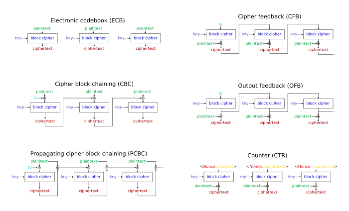
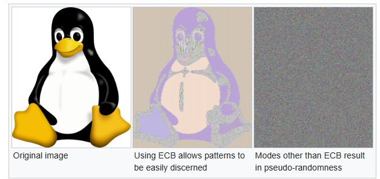

## The Shared Key {.smaller}

- Imagine two field agents need to communicate. They share one identical key that locks and unlocks the same safe.  
- They exchange messages by visiting the safe and depositing and retrieving notes. 
- This is the essence of **symmetric cryptography**: one shared secret for both encryption and decryption.
- **Contrast with hashing:** Hashes are one-way commitments; symmetric ciphers are reversible with the key.

::: {.notes}

**Overall Slide Concept**
This opening slide establishes the core mental model of symmetric cryptography: one shared secret enables both locking and unlocking. It matters here because the lesson begins with intuition before introducing formal notation and design tradeoffs. Emphasize both the power and fragility of having only one secret protect the whole channel.

**Key Points**
- Symmetric cryptography uses the same key for encryption and decryption.
- Its main advantage is efficiency, but its main operational challenge is secure key sharing.
- This differs from hashing because ciphertext is meant to be reversible with the key.

**Walkthrough**
None

**Sources**
@shannon_communicationtheorysecrecy_1949; @menezes_handbookappliedcryptography_2011

:::

## Exclusive OR (XOR) Logic {.smaller} 

- **Definition:** XOR outputs `1` if **exactly one** of its inputs is `1`; otherwise `0`.  
  - Denoted by symbols: `⊕`, `^`, or sometimes `XOR`.  
  - Common in cryptography, checksums, and parity bits.

:::: columns

::: {.column width="15%"}

:::

::: {.column width="25%"}
**Truth Table:**

| A | B | A ⊕ B |
|:-:|:-:|:-----:|
| 0 | 0 | 0 |
| 0 | 1 | 1 |
| 1 | 0 | 1 |
| 1 | 1 | 0 |

:::

::: {.column width="60%"}
**Properties:**

  - Commutative: `A ⊕ B = B ⊕ A`  
  - Associative: `(A ⊕ B) ⊕ C = A ⊕ (B ⊕ C)`  
  - Identity: `A ⊕ 0 = A`  
  - Self-inverse: `A ⊕ A = 0`

:::
::::

::: {.callout-note appearance="simple"}
**Visualization:** Think of a “difference detector” — it lights up when inputs differ.
:::

::: {.notes}

**Overall Slide Concept**
This slide establishes XOR as the bit-level operation that makes one-time pads, stream ciphers, and many symmetric constructions easy to reason about. It matters here because later encryption examples depend on students recognizing XOR’s reversibility. Emphasize that applying the same XOR mask twice restores the original value.

**Key Points**
- XOR outputs 1 when the two bits differ and 0 when they match.
- It is self-inverse, which is why the same operation can encrypt and decrypt in simple stream settings.
- Commutative and associative mean XOR expressions can be reordered and regrouped without changing the result.

**Walkthrough**
None

**Sources**
Stallings, *Cryptography and Network Security*, 2020; @katz_introductionmoderncryptography_2020

:::

## Infinite-length One Time Pad

* Imagine you and a friend share a secret, infinite-length pad of random text

* Could establish perfect secrecy if you never reused the same offset into pad
  - Encrypt: msg $\oplus$ pad-at-offset $\to$ ciphertext
  - Decrypt: ciphertext $\oplus$ pad-at-offset $\to$ plaintext
  - Share: (ciphertext, offset)

Test XOR with a OTP here: [XOR Pad Demo](/assets/labs/micro-xor/)

::: {.notes}

**Overall Slide Concept**
This slide establishes the one-time pad as the conceptual gold standard for secrecy and the ancestor of modern stream-cipher thinking. It matters here because the lesson is about to pivot from perfect-but-impractical secrecy to practical pseudorandom keystreams. Emphasize that perfect secrecy depends on truly random key material that is never reused.

**Key Points**
- A one-time pad encrypts by XORing plaintext with a truly random pad of equal length.
- Reusing the same pad or offset destroys the security guarantee.
- Perfect secrecy means ciphertext alone reveals no information about the plaintext.

**Walkthrough**
1. Choose a plaintext and align it with the same-length random pad segment.
2. XOR plaintext bits with pad bits to produce ciphertext.
3. XOR the ciphertext with the same pad segment again to recover the plaintext.

**Sources**
@katz_introductionmoderncryptography_2020; @menezes_handbookappliedcryptography_2011

:::

## Pseudo-Random Generators 

* Infinite-length, pre-shared keys do not exist, but let's assume PRGs do
  * A psuedo-random number generator generates a stream of text
  * You preshare a random seed for the generator, and then follow same algorithm in previous slide
  * Essentially a very primitive stream cipher
* **Weakness:** 
  * No error correction
  * Must track offset
  

::: {.notes}

**Overall Slide Concept**
This slide establishes pseudorandom generators as the practical replacement for impossible infinite random pads. It matters here because it shows how symmetric cryptography becomes scalable once a short shared seed can expand into a long keystream. Emphasize that practicality improves, but state management and generator quality now matter.

**Key Points**
- A PRG stretches a short seed into a long pseudorandom-looking stream.
- That stream can play the role of a one-time-pad keystream in a simple stream cipher.
- Reuse, bad offsets, or weak generators create failures even if XOR itself is simple.

**Walkthrough**
None

**Sources**
@katz_introductionmoderncryptography_2020; @menezes_handbookappliedcryptography_2011

:::

## Simple Pseudorandom Generator {.smaller}

- Let **$h$** be a cryptographic hash function  
  $h : \{0,1\}^* \to \{0,1\}^n$

- Let the initial **seed** be $s_0 \in \{0,1\}^n$

- For each round $i = 1, 2, \dots, t$:

  1. Compute $h_i = h(s_{i-1})$  
  2. Output the **last byte** of $h_i$:  
     $y_i = \mathrm{LSB}_8(h_i)$  
  3. Use the **remaining bits** of $h_i$ as the next seed:  
     $s_i = h_i[0 : n - 8]$

- Final output: $y_1 \,\|\, y_2 \,\|\, \dots \,\|\, y_t$

Visualize this: [PRG Demo](/assets/labs/micro-prg/)

::: {.callout-note appearance="simple"}
**Interpretation:** Each iteration *hashes the current seed*, *emits one byte* as pseudorandom output, and *reuses the rest* as the next seed. However, this structure is not provably secure.
:::

::: {.notes}

**Overall Slide Concept**
This slide establishes a toy PRG so students can see stateful expansion step by step before they encounter stronger designs. It matters here because abstract PRG talk is easier to absorb after one explicit construction is visible. Emphasize that this example is pedagogical rather than production-secure.

**Key Points**
- The construction repeatedly hashes state, emits a small piece, and recycles the rest as new state.
- It illustrates how one seed can drive a longer output stream.
- Toy constructions help intuition, but real secure generators need stronger design guarantees.

**Walkthrough**
1. Start from an initial seed and hash it once.
2. Emit one small portion of the hash as output and keep the rest as new state.
3. Repeat the process to stretch the seed into a longer keystream.

**Sources**
@katz_introductionmoderncryptography_2020; @boneh_hashfunctions_2020

:::

## Counter-Mode Pseudorandom Generator (PRG) {.smaller}

- Let **$F$** be a pseudorandom function (PRF) keyed by a secret key (e.g., $F_K(x)=\mathrm{HMAC}_h(K,x)$). 
- Let the **seed** be the secret key $K \in \{0,1\}^k$ and initialize a **counter** $ctr_1 \in \{0,1\}^c$.
  - $F : \{0,1\}^k \times \{0,1\}^c \to \{0,1\}^n$

- For each round $i = 1,2,\dots,t$:
  1. Compute a block with the PRF:  
     $B_i \;=\; F_K(ctr_i)$
  2. Output (e.g., the last byte):  
     $y_i \;=\; \mathrm{LSB}_8(B_i)$
  3. Increment the counter:  
     $ctr_{i+1} \;=\; ctr_i + 1 \pmod{2^c}$

- Final output: $y_1 \,\|\, y_2 \,\|\, \dots \,\|\, y_t$
  

::: {.callout-note appearance="simple"}
 **Interpretation:**  Use a secret key $K$ and a public counter to “seek” through a PRF. Each $B_i$ is pseudorandom; selecting a byte (or more) per round yields a secure keystream.
:::

::: {.notes}

**Overall Slide Concept**
This slide establishes counter-mode generation as the cleaner and more realistic pattern for deriving pseudorandom blocks from a keyed primitive. It matters here because students should see the connection between PRGs, CTR mode, and modern stream-like encryption. Emphasize that a secret key plus unique counter inputs gives repeatable but hard-to-predict output blocks.

**Key Points**
- Counter mode feeds incrementing counters into a keyed pseudorandom function.
- Security depends on the secrecy of the key and non-reuse of the counter/nonce context.
- A PRF is a keyed function whose outputs are computationally indistinguishable from random.

**Walkthrough**
1. Fix a secret key and an initial counter value.
2. Evaluate the keyed function on each successive counter value to get output blocks.
3. Concatenate the resulting bytes or blocks into the keystream.

**Sources**
@katz_introductionmoderncryptography_2020; NIST SP 800-90A Rev. 1, *Recommendation for Random Number Generation Using Deterministic Random Bit Generators*, 2015

:::

## What Is Symmetric Cryptography?

- **Definition:** Encryption and decryption using *the same secret key*.  
- **Mathematical form:**  
  - Encryption Eₖ(plaintext) = ciphertext  
  - Decryption Dₖ(ciphertext) = plaintext  
  - Where Dₖ(Eₖ(m)) = m  
- Examples: AES, ChaCha20, DES (legacy).  
- Fast and efficient—used for bulk data, VPNs, and storage encryption.

::: {.notes}

**Overall Slide Concept**
This slide establishes the formal definition of symmetric encryption after the lesson’s intuitive buildup through keys, XOR, and keystreams. It matters here because students now need the standard encrypt/decrypt notation that later comparisons will assume. Emphasize that algorithm secrecy is not the goal; only key secrecy is.

**Key Points**
- Symmetric encryption uses one secret key for both encryption and decryption.
- Correctness means decrypting an honestly produced ciphertext with the same key returns the plaintext.
- Symmetric schemes are preferred for bulk data because they are fast and efficient.

**Walkthrough**
None

**Sources**
FIPS 197, *Advanced Encryption Standard (AES)*, NIST, 2001; @katz_introductionmoderncryptography_2020

:::

## Shannon’s Principles: Confusion and Diffusion {.smaller}

| Principle | Purpose | Example |
|------------|----------|----------|
| **Confusion** | Obscure the relationship between key and ciphertext. | Substitution tables (S-boxes) |
| **Diffusion** | Spread the influence of each plaintext bit across many ciphertext bits. | Permutation layers (P-boxes) |

- Introduced by Claude Shannon (1949).  
- Together, they create complex, unpredictable ciphertext from simple transformations.

::: {.notes}

**Overall Slide Concept**
This slide establishes Shannon’s design goals as the conceptual basis for modern symmetric ciphers. It matters here because students are about to see round functions and block-cipher structure built from these two ideas. Emphasize that confusion and diffusion resist different kinds of pattern leakage and attack.

**Key Points**
- Confusion obscures how the key influences the ciphertext.
- Diffusion spreads the effect of one plaintext bit across many ciphertext bits.
- Together they help defeat simple structural and statistical attacks.

**Walkthrough**
None

**Sources**
@shannon_communicationtheorysecrecy_1949; @menezes_handbookappliedcryptography_2011

:::

## Building Blocks of Block Ciphers

- Block ciphers process fixed-size chunks (e.g., 128 bits).  
- Built from repeated **rounds** combining:  
  1. **Substitution (S-box):** non-linear mapping for confusion.  
  2. **Permutation (P-box):** bit re-ordering for diffusion.  
  3. **Key mixing:** XOR with a round key derived from the main key.  
- Multiple rounds amplify security—small changes in plaintext or key cause large changes in ciphertext.

::: {.notes}

**Overall Slide Concept**
This slide establishes the recurring components inside block ciphers so students can recognize a family resemblance across different algorithms. It matters here because the next slides compare modes and operational behavior, which only make sense once the block-cipher engine is understood. Emphasize iterative rounds, nonlinearity, and key mixing as the recurring pattern.

**Key Points**
- Block ciphers repeatedly apply substitution, permutation, and key mixing across rounds.
- Substitution introduces nonlinearity, while permutation spreads influence across positions.
- Round keys are per-round values derived from the main key.

**Walkthrough**
None

**Sources**
@stinson_cryptographytheorypractice_2022; @katz_introductionmoderncryptography_2020

:::

## Block vs Stream Ciphers {.smaller}

| Feature | Block Cipher | Stream Cipher |
|----------|---------------|----------------|
| Unit of operation | Fixed-size blocks (e.g., 128 bits) | Single bits or bytes |
| Key use | Same key for many rounds | Key generates continuous keystream |
| Examples | AES, DES | ChaCha20, RC4 |
| Strength | Strong diffusion and structure | High speed and low latency |
| Typical use | Disk, file encryption | Real-time communication, VPNs |

::: {.notes}

**Overall Slide Concept**
This slide establishes the practical difference between block and stream ciphers before the lesson turns to modes of operation. It matters here because students need to know whether they are encrypting fixed chunks or generating a continuous keystream. Emphasize tradeoffs in latency, structure, and typical deployment rather than declaring one category universally better.

**Key Points**
- Block ciphers transform fixed-size blocks, while stream ciphers generate a keystream over time.
- AES is a classic block cipher, while ChaCha20 is a widely used stream cipher.
- Real-world choice depends on environment, performance goals, and misuse resistance.

**Walkthrough**
None

**Sources**
RFC 8439, *ChaCha20 and Poly1305 for IETF Protocols*, 2018; FIPS 197, *Advanced Encryption Standard (AES)*, NIST, 2001; @katz_introductionmoderncryptography_2020

:::

## Modes of Operation Visual

{fig-align="center"}

::: {.callout-note appearance="simple"}
Photo Credit: A.M. Rowsell and Epachamo, CC-BY-SA 4.0. [Wikipedia](https://commons.wikimedia.org/wiki/File:BlockCipherModesofOperation.svg)
:::

::: {.notes}

**Overall Slide Concept**
This visual slide establishes that a block cipher alone is not enough to encrypt long messages safely; the surrounding mode determines message-level behavior. It matters here because the next slides compare those behaviors explicitly. Emphasize reading the diagram as “same primitive, different chaining rules.”

**Key Points**
- Modes are wrappers that adapt a fixed-size block cipher to longer messages.
- Changing the mode changes parallelism, error propagation, and pattern leakage.
- The diagram is a map for the more specific mode tradeoffs on the next slide.

**Walkthrough**
None

**Sources**
None

:::

## Modes of Operation Overview {.smaller}

| Mode | Description | Strengths | Weaknesses |
|------|--------------|------------|-------------|
| **ECB** | Encrypts each block independently. | Simple, parallelizable. | Reveals patterns (insecure). |
| **CBC** | Chains each block to the previous via XOR with IV. | Hides patterns, strong diffusion. | Sequential; needs IV. |
| **CFB** | Turns block cipher into self-synchronizing stream. | Handles short data streams. | Bit errors propagate. |
| **CTR** | Encrypts counter values to generate keystream. | Parallelizable, random access. | Requires unique nonce. |

::: {.notes}

**Overall Slide Concept**
This slide establishes the main block-cipher modes students are likely to hear referenced in practice and why they differ operationally. It matters here because misuse often comes from picking a familiar name without understanding nonce, IV, or chaining assumptions. Emphasize that the mode changes the security story even when the underlying cipher stays the same.

**Key Points**
- ECB is structurally insecure for patterned data, while CBC and CTR address that in different ways.
- CTR is parallelizable and random-access friendly, but nonce reuse is dangerous.
- An IV is an initialization vector; a nonce is a value that must not repeat under the same key.

**Walkthrough**
None

**Sources**
NIST SP 800-38A, *Recommendation for Block Cipher Modes of Operation*, 2001; @menezes_handbookappliedcryptography_2011; @katz_introductionmoderncryptography_2020

:::

## ECB Mode Pitfall {.smaller}

- **Electronic Codebook (ECB)** encrypts each block independently.  
- Identical plaintext blocks → identical ciphertext blocks.  
- Leaks patterns in structured data (images, database fields).  
- **Never use ECB for real-world encryption.**

{fig-align="center"}

::: {.callout-note appearance="simple"}
Photo Credit: Larry Ewing. [Wikipedia](https://en.wikipedia.org/wiki/File:Tux.svg)
:::

::: {.notes}

**Overall Slide Concept**
This slide establishes ECB as the cautionary example of what goes wrong when each block is encrypted independently with no randomness or chaining. It matters here because students often assume “encrypted” automatically means “pattern-hidden.” Emphasize that ECB fails structurally even when the underlying block cipher remains mathematically strong.

**Key Points**
- ECB produces identical ciphertext for identical plaintext blocks under the same key.
- Repeated patterns survive encryption and can leak visual or database structure.
- This is why ECB is a teaching tool and warning sign, not a recommended deployment mode.

**Walkthrough**
None

**Sources**
NIST SP 800-38A, *Recommendation for Block Cipher Modes of Operation*, 2001; Ferguson and Schneier, *Practical Cryptography*, 2003

:::

## Padding and Initialization Vectors {.smaller}

- **Padding:** ensures plaintext fits exact block size (e.g., PKCS#7).  
  - Example: “HELLO” → `HELLO\x03\x03\x03` for 8-byte block.  
- **Initialization Vector (IV):** random, unique value prepended or sent alongside ciphertext.  
  - Ensures identical plaintexts encrypt differently each time.  
- Padding adds length consistency; IVs add *semantic security* (freshness).  
- IVs are *not secret* but must be *unpredictable and never reused*.

::: {.notes}

**Overall Slide Concept**
This slide establishes padding and IVs as the operational glue that lets block ciphers handle real messages safely. It matters here because many failures come from confusing deterministic formatting with randomness requirements. Emphasize that padding solves size mismatch, while IVs or nonces solve repeatability and freshness problems.

**Key Points**
- Padding extends a short final block to the required block size.
- IVs are usually public values that should be unique or unpredictable as required by the mode.
- Semantic security means repeated encryption of the same plaintext should not reveal equality patterns.

**Walkthrough**
None

**Sources**
NIST SP 800-38A, *Recommendation for Block Cipher Modes of Operation*, 2001; Ferguson and Schneier, *Practical Cryptography*, 2003; @boneh_hashfunctions_2020

:::

## From Confidentiality to Authenticated Encryption (AEAD)

- Confidentiality hides contents; integrity detects tampering; authenticity binds to a key holder.

- AEAD schemes provide both confidentiality and integrity in one API.
  - Authenticated Encryption with Associated Data (AEAD)

- Associated Data (AAD): authenticated but unencrypted headers/metadata.

- Examples: AES-GCM, ChaCha20-Poly1305; older pattern: Encrypt-then-MAC with HMAC.

::: {.notes}

**Overall Slide Concept**
This slide establishes the modern shift from “encrypt only” thinking to authenticated encryption, where confidentiality and integrity are provided together. It matters here because students need to stop treating tamper detection as an optional add-on. Emphasize that modern APIs aim to make the safe combined pattern the default.

**Key Points**
- AEAD combines confidentiality, integrity, and authentication in one construction.
- Associated data is authenticated but intentionally left unencrypted.
- AES-GCM and ChaCha20-Poly1305 are common examples used in deployed protocols.

**Walkthrough**
None

**Sources**
@katz_introductionmoderncryptography_2020; @menezes_handbookappliedcryptography_2011

:::

## Why Symmetric Crypto  {.smaller}

- **Speed:** Thousands of times faster than public-key/asymmetric encryption.  
- **Security:** AES and ChaCha20 remain unbroken with proper key management.  
- **Ubiquity:** Protects VPNs, Wi-Fi (WPA3), TLS session data, and encrypted drives.  
- **Limitation:** Requires secure key distribution and rotation.
- Block Ciphers provide conceptual frame of reference block chaining.
 - Blockchains are like CBC in that they computation cannot be parallelized.

::: {.notes}

**Overall Slide Concept**
This slide establishes why symmetric cryptography remains the workhorse of real systems even when public-key tools get more attention. It matters here because students should understand that asymmetric cryptography usually bootstraps keys, while symmetric cryptography carries the data. Emphasize speed, ubiquity, and the continuing importance of key management.

**Key Points**
- Symmetric ciphers are much faster than public-key schemes for bulk encryption.
- They protect most real traffic after a session key has been established.
- Their main limitation is secure distribution, storage, and rotation of shared keys.

**Walkthrough**
None

**Sources**
FIPS 197, *Advanced Encryption Standard (AES)*, NIST, 2001; RFC 8439, *ChaCha20 and Poly1305 for IETF Protocols*, 2018; RFC 8446, *The Transport Layer Security (TLS) Protocol Version 1.3*, 2018

:::

## Symmetric Crypto Micro Lab

[/assets/labs/symmetric_encryption/](/assets/labs/symmetric_encryption/symmetric_encryption_lab.html)

::: {.notes}

**Overall Slide Concept**
This lab slide establishes a hands-on checkpoint where students can experiment with symmetric-encryption behavior rather than only memorize terminology. It matters here because the lesson has accumulated several interacting ideas: key reuse, mode choice, IV handling, and authenticity. Emphasize using the lab to connect operational mistakes to visible outcomes.

**Key Points**
- Use the lab to compare how different symmetric constructions behave under different settings.
- Focus on what changes when keys, IVs, or modes are reused incorrectly.
- The goal is to make abstract misuse conditions visible and memorable.

**Walkthrough**
1. Open the lab and identify which construction or mode it is demonstrating.
2. Change inputs like plaintext, key, mode, or IV/nonce and observe how outputs differ.
3. Use the results to explain which choices preserve confidentiality and which create leakage.

**Sources**
None

:::

## References
