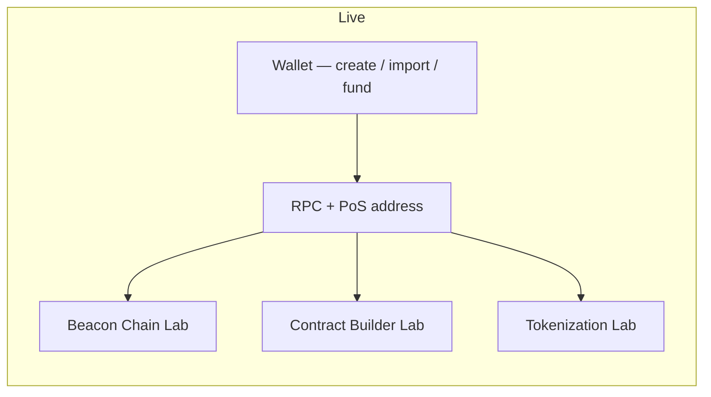
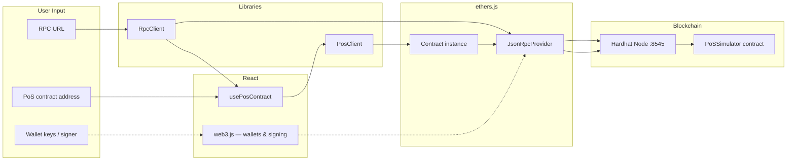
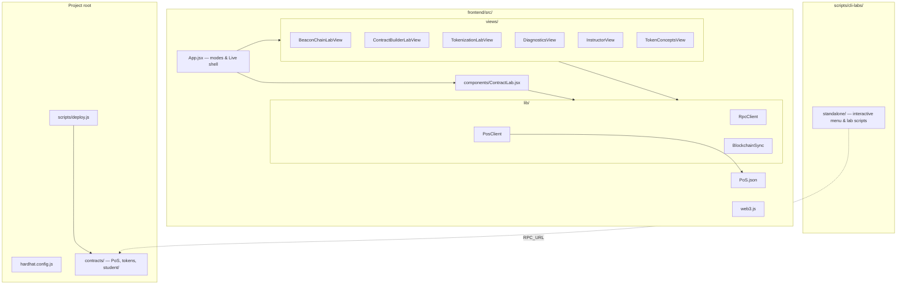
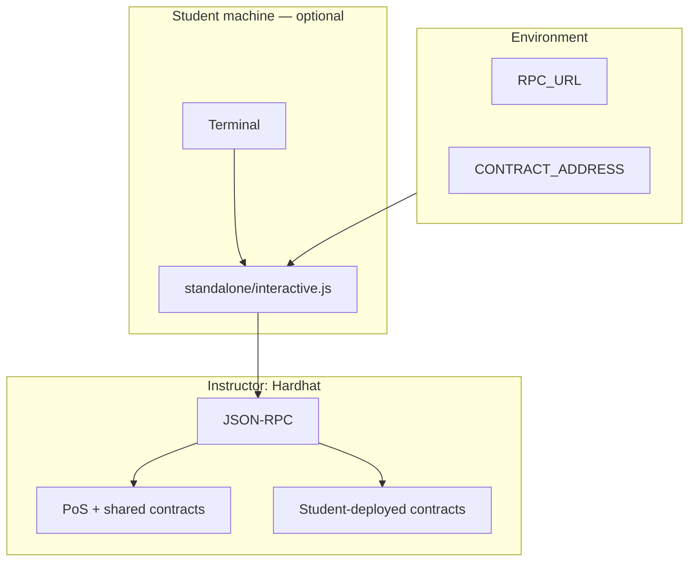

# Ethereum Lab — System Architecture

This document describes how the **Ethereum Immersive Trainer** fits together: the instructor’s chain and contracts, the React frontend, and optional CLI workflows. The **Live** area of the app is where students spend most hands-on time; the **wallet** is the central object that connects them to test ETH, signing, and the built-in labs.

---

## 1. High-Level Overview

```
┌─────────────────────────────────────────────────────────────────────────────┐
│                           INSTRUCTOR MACHINE                                  │
│  ┌─────────────────┐    ┌──────────────────┐    ┌─────────────────────────┐ │
│  │  Hardhat Node   │    │  Smart Contracts │    │  Frontend (Vite/React)  │ │
│  │  port 8545      │◄──►│  PoS, tokens,   │◄──►│  port 5173              │ │
│  │  (blockchain)   │    │  student templates│   │  + Lab API (see below)  │ │
│  └────────┬────────┘    └──────────────────┘    └───────────┬─────────────┘ │
│           │                                                  │               │
└───────────┼──────────────────────────────────────────────────┼───────────────┘
            │ JSON-RPC (HTTP)                                   │ HTTP
            │                                                   │
┌───────────┼──────────────────────────────────────────────────┼───────────────┐
│           │              STUDENT MACHINES                    │               │
│  ┌────────▼────────┐                              ┌──────────▼──────────────┐ │
│  │  CLI / Hardhat  │  (optional)                  │  Browser — Live         │ │
│  │  console + menu │  Same chain & RPC            │  Wallet + RPC + labs    │ │
│  │  in project/    │                              │  (see §2–3)             │ │
│  └─────────────────┘                              └─────────────────────────┘ │
└───────────────────────────────────────────────────────────────────────────────┘
```

- **Instructor** runs the node, deploys shared contracts, and (typically) serves the frontend. Students use the same **RPC URL** and **PoS contract address** the UI expects.
- **Lab API** (bundled with the frontend server): session checks, **fund requests**, and wallet-creation tracking. Instructor-only flows (e.g. `?mode=instructor`) are restricted as configured.
- **Students** open the instructor URL (or a local build) and work in **Live**: configure connection, manage a **wallet**, request funds, then use the **Beacon Chain**, **Contract Builder**, and **Tokenization** experiences built into the GUI (§2).
- **Written / CLI labs** are **supplementary**: long-form guides under `docs/`; **preferred CLI interaction** is `npx hardhat console` from the project root (see [CHAIN_INTERACTION_GUIDE.md](../guides/CHAIN_INTERACTION_GUIDE.md)). Optional scripts and the interactive menu under `scripts/cli-labs/standalone/` reuse the same chain once `RPC_URL` (and contract addresses where needed) are set.

---

## 2. Frontend: Where the Main Labs Live

The app is still organized into **modes** (`App.jsx`), but architecturally the important split is **guided curriculum** vs **Live** vs **optional CLI** vs **instructor**.

### 2.1 Guided curriculum (Learn)

A linear path (orientation, concepts, exploratory missions, PoS simulator, token concepts) prepares students and then **hands them off to Live**. Implementation details (exact step names, quizzes, unlocks) change over time; treat this layer as **narrative and pedagogy**, not the integration surface for the chain.

### 2.2 Live — wallet-first, three integrated labs

**Live** is the primary **hands-on** surface. Students:

1. Set **RPC URL** and **PoS contract address** (env, config, or UI).
2. **Create or import a wallet** (guest / local keys via `web3.js`).
3. **Request test ETH** from the instructor (Lab API + instructor workflow) so they can pay gas and participate.
4. Use the **same wallet identity** across the experiences below.

Embedded in the Live sidebar as **Hands-On Labs**:

| Lab | Role in the GUI | Typical contract focus |
|-----|-------------------|-------------------------|
| **Beacon Chain Lab** | Staking, validators, epochs, rewards/slashing against the PoS simulator | `PoSSimulator` (ABI in `frontend/src/PoS.json`) |
| **Contract Builder Lab** | Authoring, compiling, and deploying Solidity from the browser (Contract Lab stack) | Templates and student contracts under `contracts/` |
| **Tokenization Lab** | Fungible and non-fungible token flows wired to the live chain | Token artifacts synced with the frontend (e.g. Simple FT/NFT patterns) |

**Diagnostics**, **chain search**, **role hub**, and other tools sit beside these labs but do not replace them; they support connection health and exploration.



### 2.3 CLI Labs mode

A **single searchable page** in the app points to the standalone CLI menu (Quick Start, Playground, Contract Builder, forensics, etc.). This is **documentation and navigation** for terminal-based workflows; the underlying scripts live under `scripts/cli-labs/standalone/`.

### 2.4 Instructor mode

Dashboard for funding, monitoring, and advancing epochs—**only** on the instructor machine / allowed IPs, per deployment config.

---

## 3. Data Flow: Wallet, RPC, and Contracts



- **RpcClient** (`frontend/src/lib/RpcClient.js`): shared provider for the app when the user sets the RPC URL (may use same-origin proxy such as `/rpc-proxy` in production).
- **PosClient** (`frontend/src/lib/PosClient.js`): wraps the PoS contract; ABI from `PoS.json`.
- **usePosContract** (`frontend/src/hooks/usePosContract.js`): builds `PosClient` from provider + address; exposes staking, validators, messages, and related calls—primarily consumed by **Beacon Chain Lab** and related Live UI.
- **web3.js** (`frontend/src/web3.js`): guest/import wallets, nicknames, and signing helpers used everywhere Live needs a **user-controlled signer**.

**Flow in one line:** configure RPC and PoS address → attach **wallet** → **Beacon / Contract / Tokenization** labs read and write through **ethers** + shared **Hardhat** state.

---

## 4. File and Module Map (Condensed)



- **App.jsx**: top-level `view` state, sidebar, Live hub, and embedded lab views.
- **constants/**: `labs.js` (CLI lab registry), `content.js` / role content (curriculum copy), not the chain integration layer.
- **contracts/**: Solidity sources; `contracts/student/` holds generated or custom student contracts; Hardhat writes artifacts under `artifacts/`.
- **PROJECT_STRUCTURE.md**: exhaustive recursive file tree; use it when you need path-level detail.

---

## 5. CLI Labs and Written Docs (Abstract)



- Students typically use **`npx hardhat console`** from the project root after setting **`RPC_URL`** for remote chains (and **`CONTRACT_ADDRESS`** when interacting with the PoS from the CLI). The **interactive menu** in `scripts/cli-labs/standalone/` is an optional path for guided menus, forensics drivers, and wizards.
- Individual scripts (forensics, ransomware scenarios, etc.) are **documented in `docs/*.md`** and listed in the in-app CLI view; they are **optional** paths to the same chain.
- **No duplication** of the full lab list here—see **`docs/`** and **`frontend/src/constants/labs.js`** for the registry.

---

## 6. Contract Deployment and Sharing (Brief)

Deployers get a **contract address** from the Hardhat console, `hardhat run`, the Contract Builder menu, or the Live **Contract Lab**; peers connect with the **same RPC** and **address + ABI**. All state lives on the **one** instructor node for the class.

---

## 7. Build and Run Commands

| Action | Command | Where |
|--------|---------|--------|
| Start blockchain | `npm run chain` | Project root |
| Deploy PoS (+ related contracts) | `npm run deploy` | Project root (after chain is running) |
| Start web UI | `npm run web` or `cd frontend && npm run dev -- --host` | Root or frontend |
| Full lab (instructor) | `.\start-lab.ps1 -Mode instructor` | Windows, project root |
| Hardhat console (preferred CLI) | `npx hardhat console --network localhost` (or `instructor` + `RPC_URL`) | Project root |
| Interactive menu (optional) | `cd scripts/cli-labs/standalone && npm start` | After setting `RPC_URL` (and `CONTRACT_ADDRESS` for PoS) |
| Compile Solidity | `npx hardhat compile` | Project root |

---

## 8. Summary

**In one sentence:** The React **Live** experience ties a **student wallet** to a shared **Hardhat** node; **Beacon Chain Lab**, **Contract Builder Lab**, and **Tokenization Lab** are the three GUI-first integrations; **RpcClient**, **PosClient**, **usePosContract**, and **web3.js** implement RPC + PoS + signing; optional **Hardhat console**, scripted labs, and **docs/** extend the same environment without defining the core architecture.

---

*Update this file when Live navigation, the three lab views, or the wallet/RPC integration change.*
